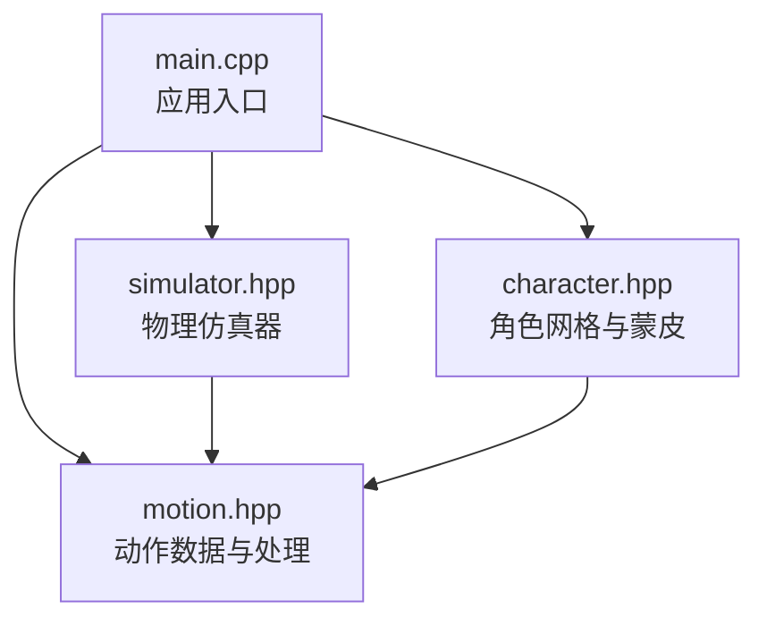
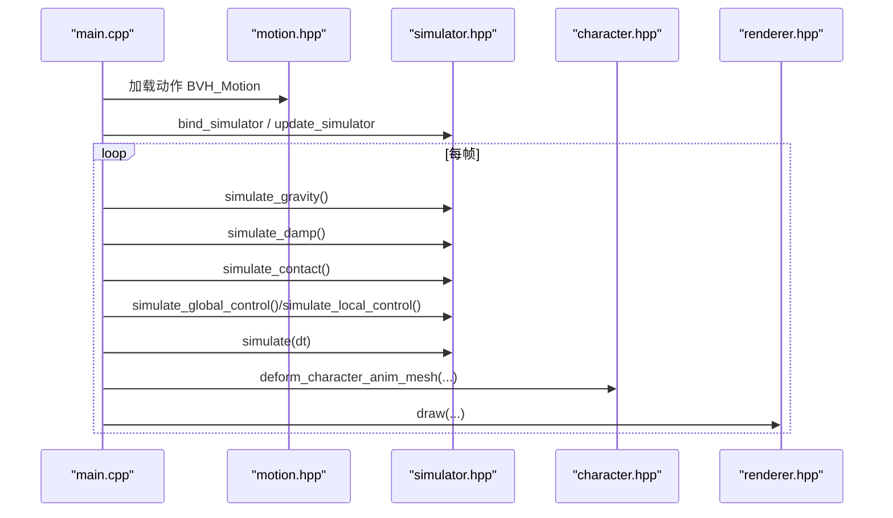
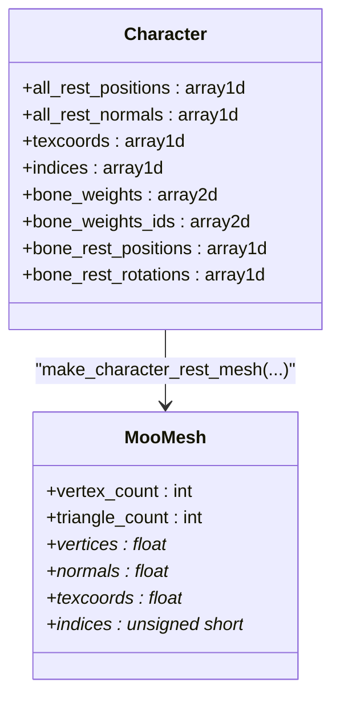
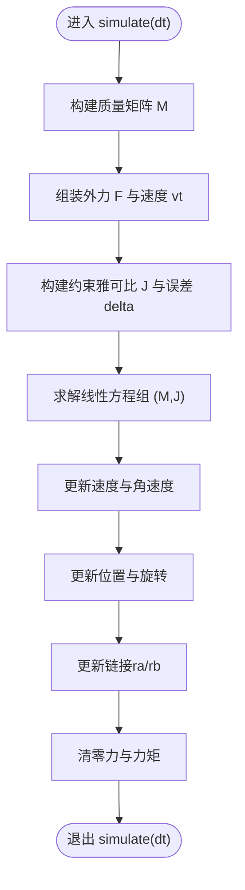
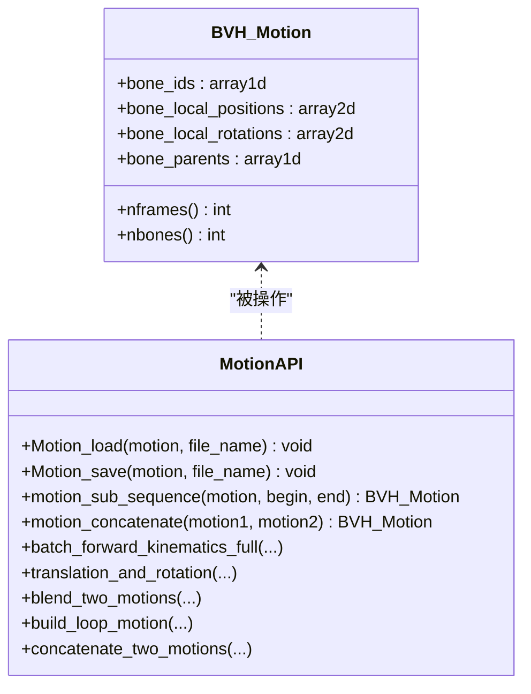
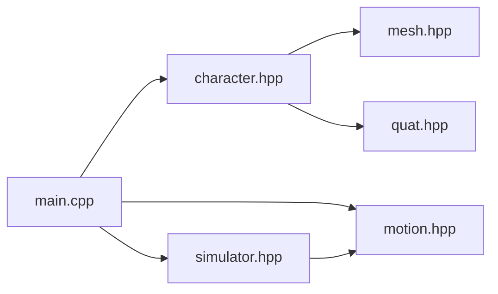

# API参考

> **版本提示（2.0）**：本文撰写于 1.x 时期，描述的是旧的实现形态——入口在根目录 `main.cpp`，功能由根目录 `.hpp` 头文件库提供，窗口用 raylib、显示用 OpenCV highgui。2.0 已把这些头文件移到 `Source/Legacy/`，渲染默认走 GPU，窗口与 UI 换成 GLFW + ImGui，`main.cpp` 拆成 `Source/Launch/Private/` 下的 `Main.cpp` 与 `Application`。文中的文件路径、行号与调用链可能已失效，请以根目录的「项目概述」「快速开始」「故障排除」三篇与当前源码为准。

<cite>
**本文引用的文件**   
- [README.md](file://README.md)
- [main.cpp](file://main.cpp)
- [character.hpp](file://character.hpp)
- [simulator.hpp](file://simulator.hpp)
- [motion.hpp](file://motion.hpp)
</cite>

## 目录
1. [简介](#简介)
2. [项目结构](#项目结构)
3. [核心组件](#核心组件)
4. [架构总览](#架构总览)
5. [详细组件分析](#详细组件分析)
6. [依赖关系分析](#依赖关系分析)
7. [性能与内存管理](#性能与内存管理)
8. [故障排查指南](#故障排查指南)
9. [结论](#结论)

## 简介
本API参考文档面向MooLab项目的开发者，系统化梳理角色动画、物理仿真与动作数据处理的核心接口。重点覆盖：
- Character类及其网格变形、骨骼蒙皮相关函数
- Simulator类的物理仿真接口（重力、阻尼、碰撞、控制力矩、步进求解）
- Motion模块的动作数据结构与处理API（前向运动学、序列操作、混合与拼接）
- 主程序对以上模块的集成调用方式与典型流程

该文档提供方法参数、返回值、异常/断言行为说明，并给出可视化图示与最佳实践建议，帮助读者准确理解并使用项目暴露的所有公共接口。

## 项目结构
MooLab采用模块化设计，关键头文件职责清晰：
- character.hpp：角色网格与蒙皮数据、线性混合蒙皮、静态网格创建与顶点/法线更新
- simulator.hpp：物理仿真器、约束求解、碰撞检测、控制力矩、批量前向运动学
- motion.hpp：BVH动作数据结构、加载/保存、子序列/拼接、批量前向运动学、旋转分解与动作融合
- main.cpp：应用入口，整合渲染、相机、控制器、数据库、UI与上述核心模块

图表来源
- [main.cpp:8-17](file://main.cpp#L8-L17)
- [character.hpp:1-47](file://character.hpp#L1-L47)
- [simulator.hpp:1-10](file://simulator.hpp#L1-L10)
- [motion.hpp:1-10](file://motion.hpp#L1-L10)

章节来源
- [README.md:1-22](file://README.md#L1-L22)
- [main.cpp:8-17](file://main.cpp#L8-L17)

## 核心组件
本节概述三大核心组件的职责与对外接口概览：
- Character：负责角色网格数据的加载、静态网格构建、基于骨骼姿态的顶点与法线线性混合变形
- Simulator：封装多体动力学仿真，包括重力、阻尼、胶囊体碰撞、全局/局部力矩控制、约束求解步进
- Motion：定义BVH_Motion数据结构，提供动作加载/保存、子序列提取、拼接、批量前向运动学、动作混合与循环构建等工具函数

章节来源
- [character.hpp:35-166](file://character.hpp#L35-L166)
- [simulator.hpp:321-933](file://simulator.hpp#L321-L933)
- [motion.hpp:37-379](file://motion.hpp#L37-L379)

## 架构总览
下图展示从输入到渲染的整体数据流：动作数据驱动前向运动学，仿真器根据控制策略计算力/力矩并推进状态，最终将仿真结果映射回角色网格进行渲染。

图表来源
- [main.cpp:296-345](file://main.cpp#L296-L345)
- [simulator.hpp:357-624](file://simulator.hpp#L357-L624)
- [character.hpp:123-164](file://character.hpp#L123-L164)

## 详细组件分析

### Character组件（角色网格与蒙皮）
Character结构体包含：
- 静态顶点位置、法线、纹理坐标、索引
- 骨骼权重与权重ID矩阵
- 骨骼初始位置与旋转

对外接口与方法：
- character_load(Character&, const char*)
  - 功能：从二进制文件加载角色网格与蒙皮数据
  - 参数：
    - character：待填充的角色对象引用
    - filename：资源路径（如“../resources/character.bin”）
  - 返回：无
  - 异常/断言：若文件打开失败会触发assert
  - 使用示例路径：[main.cpp:72-73](file://main.cpp#L72-L73)

- make_character_rest_mesh(const Character&) -> MooMesh
  - 功能：基于角色静态数据创建可渲染网格
  - 参数：character：只读角色对象
  - 返回：MooMesh（包含顶点、法线、UV、索引）
  - 使用示例路径：[main.cpp:102](file://main.cpp#L102)

- deform_character_anim_mesh(const Character&, slice1d<vec3>, slice1d<quat>, MooMesh&)
  - 功能：根据当前骨骼姿态更新网格顶点与法线（线性混合蒙皮）
  - 参数：
    - character：只读角色对象
    - bone_anim_positions：各骨骼世界位置切片
    - bone_anim_rotations：各骨骼世界旋转切片
    - mesh：待更新的网格引用
  - 返回：无
  - 使用示例路径：[main.cpp:424-428](file://main.cpp#L424-L428)

内部辅助函数：
- linear_blend_positions(...)
  - 功能：按骨骼权重对顶点位置进行线性混合
  - 复杂度：O(V*K)，V为顶点数，K为单顶点最大影响骨骼数
- linear_blend_normals(...)
  - 功能：按骨骼旋转对法线进行线性混合
  - 复杂度：O(V*K)

图表来源
- [character.hpp:35-47](file://character.hpp#L35-L47)
- [character.hpp:123-164](file://character.hpp#L123-L164)

章节来源
- [character.hpp:49-164](file://character.hpp#L49-L164)
- [main.cpp:72-73](file://main.cpp#L72-L73)
- [main.cpp:102](file://main.cpp#L102)
- [main.cpp:424-428](file://main.cpp#L424-L428)

### Simulator组件（物理仿真器）
Simulator结构体包含：
- 骨骼拓扑与补偿旋转
- 质量、惯量、链接、形状（胶囊体）
- 速度、角速度、力、力矩
- 累积误差与上次误差向量

对外接口与方法：
- Simulator::simulate_gravity(double g = 9.8)
  - 功能：为每个骨骼施加重力
  - 参数：g：重力加速度
  - 返回：无
  - 使用示例路径：[main.cpp:324](file://main.cpp#L324)

- Simulator::simulate_damp(double damp = 0.5)
  - 功能：施加线性阻尼（平移与旋转）
  - 参数：damp：阻尼系数
  - 返回：无
  - 使用示例路径：[main.cpp:325](file://main.cpp#L325)

- Simulator::simulate_contact(double A=0, double B=1, double C=0, double D=0, double eps=1e-2)
  - 功能：胶囊体间碰撞与地面接触检测，施加弹性+粘性力与摩擦力
  - 参数：A,B,C,D：平面方程；eps：容差
  - 返回：无
  - 使用示例路径：[main.cpp:326](file://main.cpp#L326)

- Simulator::simulate_local_control(slice1d<quat>)
  - 功能：基于目标局部旋转生成关节力矩（符合物理）
  - 参数：target_local_rotations：目标局部旋转序列
  - 返回：无
  - 使用示例路径：[main.cpp:333](file://main.cpp#L333)

- Simulator::simulate_global_control(slice1d<quat>)
  - 功能：基于目标全局姿态生成根节点力矩（效果直观但非严格物理）
  - 参数：target_local_rotations：目标姿态序列
  - 返回：无
  - 使用示例路径：[main.cpp:331](file://main.cpp#L331)

- Simulator::simulate(double dt)
  - 功能：构建质量矩阵M、雅可比J、约束delta，求解线性系统更新速度与姿态
  - 参数：dt：时间步长
  - 返回：无
  - 使用示例路径：[main.cpp:338](file://main.cpp#L338)

- Simulator::batch_forward_kinematics_full(...)
  - 功能：批量前向运动学（从根开始累积旋转与位置）
  - 参数：
    - bone_local_positions：局部位置
    - bone_local_rotations：局部旋转
    - bone_anim_positions：输出世界位置
    - bone_anim_rotations：输出世界旋转
  - 返回：无
  - 使用示例路径：[simulator.hpp:634-662](file://simulator.hpp#L634-L662)

- Simulator::revise_anim_bones(slice1d<quat>)
  - 功能：修正动画骨骼旋转（补偿旋转）
  - 参数：bone_anim_rotations：待修正的世界旋转切片
  - 返回：无
  - 使用示例路径：[simulator.hpp:626-632](file://simulator.hpp#L626-L632)

外部工具函数：
- bind_simulator(Simulator&, const BVH_Motion&, int frame_id, double radius)
  - 功能：绑定动作帧到仿真器，初始化质量、惯量、形状、链接等
  - 参数：
    - simulator：仿真器引用
    - motion：动作数据
    - frame_id：初始帧索引
    - radius：胶囊体半径
  - 返回：无
  - 使用示例路径：[main.cpp:98](file://main.cpp#L98)

- update_simulator(Simulator&, last_pos, last_rot, curr_pos, curr_rot, radius=0.05, dt=0.0166667f)
  - 功能：根据上一帧与当前帧的姿态更新仿真器状态（位置、旋转、速度、角速度、链接）
  - 参数：
    - last_*：上一帧骨骼世界位置/旋转
    - curr_*：当前帧骨骼世界位置/旋转
    - radius：胶囊体半径
    - dt：时间步长
  - 返回：无
  - 使用示例路径：[main.cpp:308-314](file://main.cpp#L308-L314)

- deform_character_anim_bones(const Simulator&, slice1d<vec3>, slice1d<quat>)
  - 功能：将仿真器状态反投影回角色骨骼世界姿态（用于后续蒙皮）
  - 参数：
    - simulator：只读仿真器
    - bone_anim_positions：输出世界位置
    - bone_anim_rotations：输出世界旋转
  - 返回：无
  - 使用示例路径：[main.cpp:341-344](file://main.cpp#L341-L344)

图表来源
- [simulator.hpp:543-624](file://simulator.hpp#L543-L624)

章节来源
- [simulator.hpp:321-933](file://simulator.hpp#L321-L933)
- [main.cpp:98](file://main.cpp#L98)
- [main.cpp:308-344](file://main.cpp#L308-L344)

### Motion组件（动作数据与处理）
数据结构：
- BVH_Motion
  - bone_ids：骨骼ID数组
  - bone_local_positions：每帧每骨骼的局部位置（二维数组）
  - bone_local_rotations：每帧每骨骼的局部旋转（二维数组）
  - bone_parents：父骨骼索引数组
  - nframes()：返回帧数
  - nbones()：返回骨骼数

对外接口与方法：
- Motion_load(BVH_Motion&, const char*)
  - 功能：从二进制文件加载动作数据
  - 参数：
    - motion：待填充的动作对象
    - file_name：资源路径（如“../resources/long_motion.bin”）
  - 返回：无
  - 异常/断言：文件打开失败触发assert
  - 使用示例路径：[main.cpp:81](file://main.cpp#L81)

- Motion_save(BVH_Motion&, const char*)
  - 功能：将动作数据保存到二进制文件
  - 参数：
    - motion：待保存的动作对象
    - file_name：输出路径
  - 返回：无
  - 使用示例路径：[motion.hpp:85-96](file://motion.hpp#L85-L96)

- motion_sub_sequence(const BVH_Motion&, int begin, int end) -> BVH_Motion
  - 功能：提取动作的子序列
  - 参数：begin,end：起止帧索引
  - 返回：新的BVH_Motion
  - 使用示例路径：[main.cpp:82-87](file://main.cpp#L82-L87)

- motion_concatenate(const BVH_Motion&, const BVH_Motion&) -> BVH_Motion
  - 功能：拼接两个动作
  - 参数：motion1,motion2：待拼接动作
  - 返回：新的BVH_Motion
  - 使用示例路径：[motion.hpp:110-120](file://motion.hpp#L110-L120)

- batch_forward_kinematics_full(const BVH_Motion&, int frame_num, slice1d<vec3>, slice1d<quat>)
  - 功能：对指定帧执行批量前向运动学，得到世界位置与旋转
  - 参数：
    - motion：只读动作数据
    - frame_num：帧索引
    - bone_anim_positions：输出世界位置
    - bone_anim_rotations：输出世界旋转
  - 返回：无
  - 使用示例路径：[main.cpp:204-208](file://main.cpp#L204-L208)

- batch_forward_kinematics_part(...)
  - 功能：以自定义根位置/旋转作为根，执行部分前向运动学
  - 参数：root_anim_positions, root_anim_rotations：根世界位置/旋转
  - 返回：无
  - 使用示例路径：[motion.hpp:152-182](file://motion.hpp#L152-L182)

- batch_forward_kinematics_root(...)
  - 功能：将根变换应用到所有骨骼（世界化）
  - 参数：frame_num：帧索引
  - 返回：无
  - 使用示例路径：[motion.hpp:184-198](file://motion.hpp#L184-L198)

- decompose_rotation_with_yaxis(quat& Ry, quat& Rxz, const quat&)
  - 功能：将旋转分解为绕Y轴与XZ平面的分量
  - 参数：Ry,Rxz：输出分量；rotation：输入旋转
  - 返回：无
  - 使用示例路径：[motion.hpp:200-211](file://motion.hpp#L200-L211)

- translation_and_rotation(const BVH_Motion&, int frame_num, vec3 target_translation_xz, vec3 target_facing_direction_xz) -> BVH_Motion
  - 功能：对动作进行平移与朝向调整（保持脚部轨迹一致）
  - 参数：
    - frame_num：参考帧
    - target_translation_xz：目标水平位移
    - target_facing_direction_xz：目标朝向（XZ平面）
  - 返回：新的BVH_Motion
  - 使用示例路径：[motion.hpp:213-264](file://motion.hpp#L213-L264)

- blend_two_motions(const BVH_Motion&, const BVH_Motion&, const slice1d<float>& alpha) -> BVH_Motion
  - 功能：在两段动作之间按alpha插值混合
  - 参数：alpha：插值权重序列（长度等于输出帧数）
  - 返回：新的BVH_Motion
  - 使用示例路径：[motion.hpp:266-291](file://motion.hpp#L266-L291)

- build_loop_motion(const BVH_Motion&, float half_life, float fps, float dt=0.0166667f) -> BVH_Motion
  - 功能：构建循环动作（平滑首尾差异）
  - 参数：half_life,fps,dt：循环参数
  - 返回：新的BVH_Motion
  - 使用示例路径：[motion.hpp:293-330](file://motion.hpp#L293-L330)

- concatenate_two_motions(const BVH_Motion&, const BVH_Motion&, int mix_frame, int mix_time) -> BVH_Motion
  - 功能：两段动作拼接，并在mix_frame附近进行mix_time帧的过渡混合
  - 参数：mix_frame,mix_time：混合起始帧与时长
  - 返回：新的BVH_Motion
  - 使用示例路径：[main.cpp:88-92](file://main.cpp#L88-L92)

图表来源
- [motion.hpp:37-70](file://motion.hpp#L37-L70)
- [motion.hpp:72-379](file://motion.hpp#L72-L379)

章节来源
- [motion.hpp:37-379](file://motion.hpp#L37-L379)
- [main.cpp:81-92](file://main.cpp#L81-L92)
- [main.cpp:204-208](file://main.cpp#L204-L208)

## 依赖关系分析
- main.cpp依赖：
  - character.hpp：角色网格与蒙皮
  - motion.hpp：动作数据与处理
  - simulator.hpp：物理仿真器
  - renderer.hpp、ui.hpp、database.hpp、ik.hpp、curve.hpp、robot.hpp、nnet.hpp：渲染、交互、数据与算法支持
- simulator.hpp依赖：
  - motion.hpp：前向运动学与动作数据
- character.hpp依赖：
  - array.hpp、mesh.hpp、quat.hpp：基础容器、网格、四元数

图表来源
- [main.cpp:8-17](file://main.cpp#L8-L17)
- [simulator.hpp:1-5](file://simulator.hpp#L1-L5)
- [character.hpp:4-6](file://character.hpp#L4-L6)

章节来源
- [main.cpp:8-17](file://main.cpp#L8-L17)
- [simulator.hpp:1-5](file://simulator.hpp#L1-L5)
- [character.hpp:4-6](file://character.hpp#L4-L6)

## 性能与内存管理
- 蒙皮变形
  - linear_blend_positions/linear_blend_normals复杂度为O(V*K)，建议在大规模模型时减少K或优化权重稀疏性
  - 注意避免重复分配临时数组，尽量复用slice视图以减少拷贝
- 物理仿真
  - 质量矩阵M与雅可比J规模随骨骼数增长而增大，约束求解为稠密线性系统，建议使用Release模式与OpenMP并行（代码中已对矩阵乘法启用#pragma omp parallel for）
  - 合理设置时间步长dt与simulate_time，平衡稳定性与性能
- 内存管理
  - character.hpp中使用malloc/free管理网格数据，需确保生命周期与释放时机正确
  - BVH_Motion与array1d/array2d由库管理，避免手动释放其内部指针
- 调试与可视化
  - 使用cv::imshow与trackbar实时观察特征权重与仿真效果，便于调参

章节来源
- [character.hpp:123-164](file://character.hpp#L123-L164)
- [simulator.hpp:61-79](file://simulator.hpp#L61-L79)
- [main.cpp:214-218](file://main.cpp#L214-L218)

## 故障排查指南
- 文件加载失败
  - 现象：character_load/Motion_load触发assert
  - 排查：确认资源路径与工作目录（程序启动后切换至resources目录），检查文件是否存在且格式正确
  - 参考路径：[character.hpp:49-66](file://character.hpp#L49-L66)、[motion.hpp:72-96](file://motion.hpp#L72-L96)
- 仿真不稳定或发散
  - 现象：角色抖动、穿透地面
  - 排查：
    - 减小dt或增加simulate_time
    - 调整simulate_contact的kp/kd与eps
    - 检查重力与阻尼参数
  - 参考路径：[simulator.hpp:357-435](file://simulator.hpp#L357-L435)、[main.cpp:324-338](file://main.cpp#L324-L338)
- 控制力矩不生效
  - 现象：角色无法跟随目标姿态
  - 排查：
    - 确认传入的目标旋转序列长度与帧率匹配
    - 检查revise_anim_bones是否被调用
  - 参考路径：[simulator.hpp:512-541](file://simulator.hpp#L512-L541)、[simulator.hpp:626-632](file://simulator.hpp#L626-L632)
- 蒙皮错位
  - 现象：网格顶点与法线异常
  - 排查：
    - 确认传入的bone_anim_positions/rotations为世界空间
    - 检查权重矩阵与骨骼初始姿态是否正确加载
  - 参考路径：[character.hpp:142-164](file://character.hpp#L142-L164)

章节来源
- [character.hpp:49-66](file://character.hpp#L49-L66)
- [motion.hpp:72-96](file://motion.hpp#L72-L96)
- [simulator.hpp:357-435](file://simulator.hpp#L357-L435)
- [simulator.hpp:512-541](file://simulator.hpp#L512-L541)
- [simulator.hpp:626-632](file://simulator.hpp#L626-L632)
- [character.hpp:142-164](file://character.hpp#L142-L164)

## 结论
MooLab通过清晰的模块化设计，将角色动画、物理仿真与动作数据处理解耦，提供了稳定可扩展的API集合。开发者可以：
- 使用Character接口高效完成蒙皮与网格变形
- 借助Simulator实现稳定的多体动力学仿真与约束求解
- 利用Motion工具函数灵活处理动作数据（加载、拼接、混合、前向运动学）
结合main.cpp中的集成示例，可以快速搭建完整的角色动画与仿真管线。建议在生产环境中优先使用Release构建，并根据场景需求调优物理参数与性能瓶颈点。