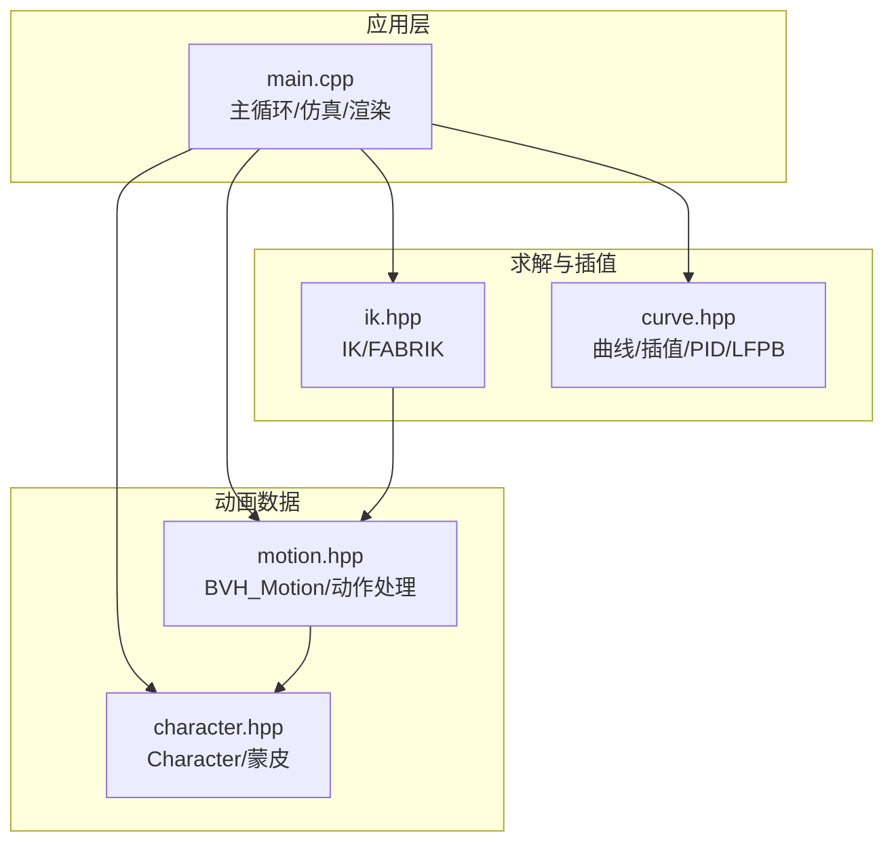
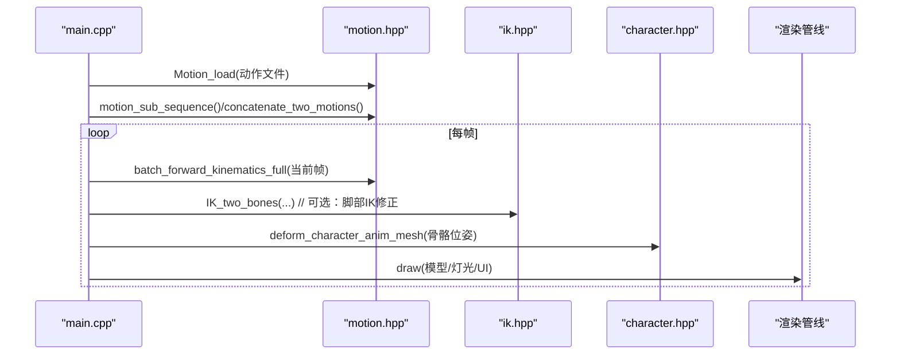
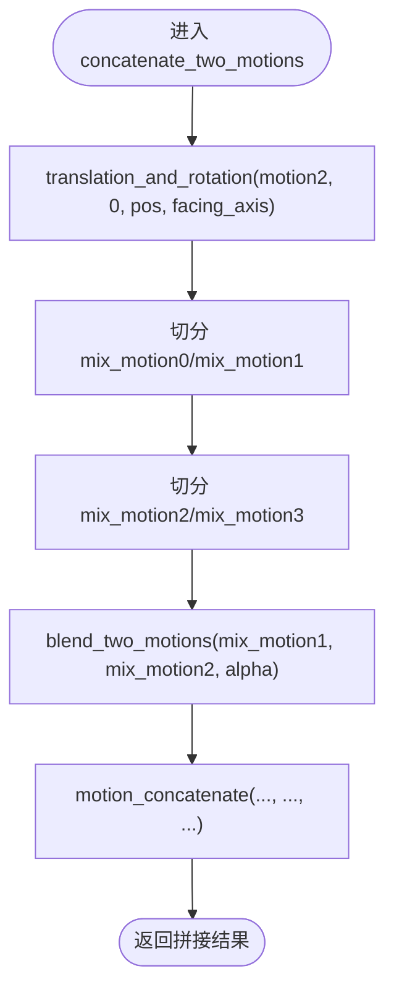
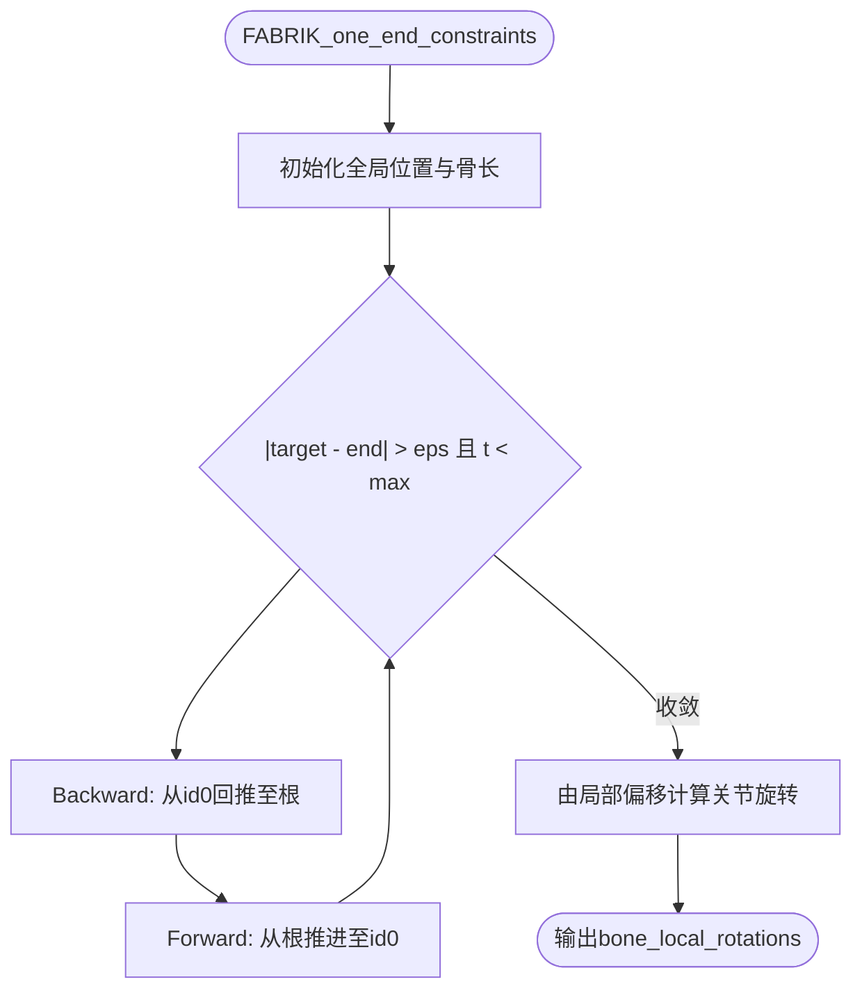
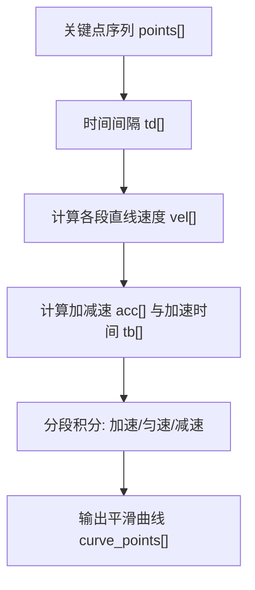
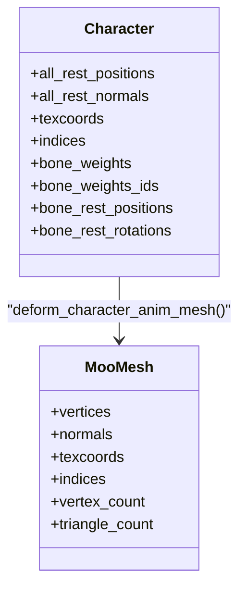
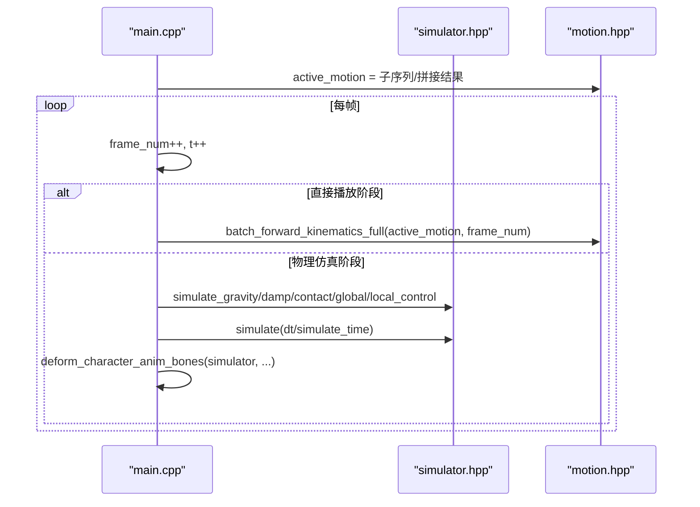
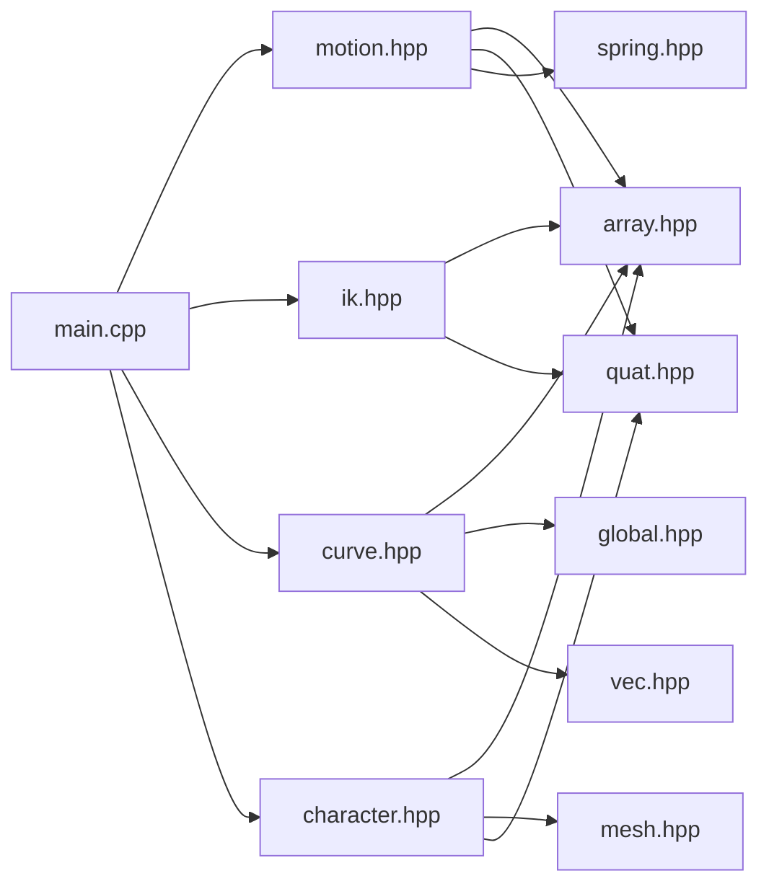

# 动画系统API

> **版本提示（2.0）**：本文撰写于 1.x 时期，描述的是旧的实现形态——入口在根目录 `main.cpp`，功能由根目录 `.hpp` 头文件库提供，窗口用 raylib、显示用 OpenCV highgui。2.0 已把这些头文件移到 `Source/Legacy/`，渲染默认走 GPU，窗口与 UI 换成 GLFW + ImGui，`main.cpp` 拆成 `Source/Launch/Private/` 下的 `Main.cpp` 与 `Application`。文中的文件路径、行号与调用链可能已失效，请以根目录的「项目概述」「快速开始」「故障排除」三篇与当前源码为准。

<cite>
**本文引用的文件**   
- [motion.hpp](file://motion.hpp)
- [ik.hpp](file://ik.hpp)
- [curve.hpp](file://curve.hpp)
- [character.hpp](file://character.hpp)
- [main.cpp](file://main.cpp)
- [README.md](file://README.md)
</cite>

## 目录
1. [简介](#简介)
2. [项目结构](#项目结构)
3. [核心组件](#核心组件)
4. [架构总览](#架构总览)
5. [详细组件分析](#详细组件分析)
6. [依赖关系分析](#依赖关系分析)
7. [性能与内存优化](#性能与内存优化)
8. [故障排查指南](#故障排查指南)
9. [结论](#结论)
10. [附录：代码示例路径](#附录代码示例路径)

## 简介
本文件为“动画系统API”的完整技术文档，覆盖以下主题：
- BVH动作数据的解析与加载接口（骨骼层次、关键帧数据）
- Motion类相关函数（动作播放、暂停、循环控制等）
- IK（逆运动学）求解器接口（目标位置设置、约束配置）
- 曲线插值API（平滑过渡、关键帧插值）
- 动作混合与交叉淡入淡出
- 动画时间管理与同步机制
- 性能优化策略与内存管理最佳实践

本项目是一个角色运动渲染与仿真器，使用C++实现，依赖OpenCV、OpenMP、Raylib。构建与运行说明见[README.md](file://README.md)。

**章节来源**
- [README.md:1-22](file://README.md#L1-L22)

## 项目结构
动画系统由以下核心头文件组成：
- motion.hpp：BVH动作数据结构与处理（加载/保存、前向运动学、动作拼接/混合、循环构造、平移旋转对齐）
- ik.hpp：IK求解器（两骨/三骨解析解，FABRIK单端/双端及带角度约束版本）
- curve.hpp：曲线与轨迹插值（贝塞尔、PID跟踪、三次样条、梯形速度规划LFPB）
- character.hpp：角色网格与蒙皮（骨骼权重、线性插值蒙皮、顶点/法线更新）
- main.cpp：应用主循环（资源加载、动作序列组装、仿真步进、渲染输出）

**图表来源**
- [motion.hpp:37-379](file://motion.hpp#L37-L379)
- [ik.hpp:7-420](file://ik.hpp#L7-L420)
- [curve.hpp:8-272](file://curve.hpp#L8-L272)
- [character.hpp:35-164](file://character.hpp#L35-L164)
- [main.cpp:53-614](file://main.cpp#L53-L614)

**章节来源**
- [motion.hpp:37-379](file://motion.hpp#L37-L379)
- [ik.hpp:7-420](file://ik.hpp#L7-L420)
- [curve.hpp:8-272](file://curve.hpp#L8-L272)
- [character.hpp:35-164](file://character.hpp#L35-L164)
- [main.cpp:53-614](file://main.cpp#L53-L614)

## 核心组件
- BVH动作数据模型与工具
  - BVH_Motion：存储骨骼ID、局部位置/旋转、父子关系；提供帧数/骨骼数查询
  - Motion_load/Motion_save：二进制序列化读写
  - motion_sub_sequence/motion_concatenate：片段截取与拼接
  - batch_forward_kinematics_*：批量前向运动学（全量/部分/仅根变换）
  - translation_and_rotation：按目标位移与朝向对齐根节点
  - blend_two_motions：两动作在时间轴上的线性插值混合
  - build_loop_motion：构造可循环的动作（补偿首尾旋转/位置差）
  - concatenate_two_motions：两段动作在指定帧处进行交叉淡入淡出拼接

- IK求解器
  - IK_two_bones：两骨/三骨解析解，给定末端目标位置，返回各关节位姿
  - FABRIK_one_end / FABRIK_one_end_constraints：单端FABRIK迭代，支持角度约束
  - FABRIK_two_end / FABRIK_two_end_constraints：双端FABRIK迭代，支持角度约束

- 曲线与插值
  - bezier_curve/spine_curve：贝塞尔与三次样条插值
  - PID_curve：基于PID控制的轨迹跟踪
  - LFPB：梯形速度规划（加减速段+匀速段），生成平滑时序曲线

- 角色蒙皮
  - Character：静态网格、骨骼权重、T-pose
  - linear_blend_positions/normals：按骨骼动画位姿对顶点/法线做线性插值蒙皮
  - deform_character_anim_mesh：将骨骼动画应用到网格

**章节来源**
- [motion.hpp:37-379](file://motion.hpp#L37-L379)
- [ik.hpp:7-420](file://ik.hpp#L7-L420)
- [curve.hpp:8-272](file://curve.hpp#L8-L272)
- [character.hpp:35-164](file://character.hpp#L35-L164)

## 架构总览
下图展示从动作数据到最终渲染的关键流程：主循环读取/组合动作，计算前向运动学得到骨骼位姿，可选IK修正脚部接触，随后对角色网格进行蒙皮并渲染。

**图表来源**
- [main.cpp:71-108](file://main.cpp#L71-L108)
- [main.cpp:292-345](file://main.cpp#L292-L345)
- [main.cpp:423-472](file://main.cpp#L423-L472)
- [motion.hpp:122-198](file://motion.hpp#L122-L198)
- [ik.hpp:7-103](file://ik.hpp#L7-L103)
- [character.hpp:142-164](file://character.hpp#L142-L164)

## 详细组件分析

### BVH动作数据与Motion API
- 数据结构
  - BVH_Motion包含：
    - bone_ids：骨骼标识
    - bone_local_positions[nframes][nbones]：每帧每骨的局部位置
    - bone_local_rotations[nframes][nbones]：每帧每骨的局部旋转（四元数）
    - bone_parents[nbones]：父索引（根为-1）
  - nframes()/nbones()：查询尺寸

- 加载/保存
  - Motion_load/BVH_Motion：以二进制格式读写上述字段
  - Motion_save：反向写入

- 片段与拼接
  - motion_sub_sequence：提取begin..end帧区间
  - motion_concatenate：纵向拼接两个动作（要求骨骼一致）

- 前向运动学
  - batch_forward_kinematics_full：从根开始累积世界坐标与旋转
  - batch_forward_kinematics_part：允许外部传入根位姿
  - batch_forward_kinematics_root：对已有全局位姿施加根节点的相对变换

- 根对齐与方向控制
  - translation_and_rotation：根据目标XZ位移与朝向，对整段动作进行根平移与Y轴旋转对齐

- 动作混合与淡入淡出
  - blend_two_motions：按alpha数组在两动作间插值（位置用lerp，旋转用slerp）
  - concatenate_two_motions：在mix_frame附近用mix_time帧长度做交叉淡入淡出拼接

- 循环构造
  - build_loop_motion：估计首尾旋转/位置的速度，均匀分布补偿到每帧，使首尾衔接更平滑

**图表来源**
- [motion.hpp:213-264](file://motion.hpp#L213-L264)
- [motion.hpp:266-291](file://motion.hpp#L266-L291)
- [motion.hpp:332-377](file://motion.hpp#L332-L377)

**章节来源**
- [motion.hpp:37-379](file://motion.hpp#L37-L379)

### IK求解器API
- 解析解（两骨/三骨）
  - IK_two_bones：输入三段链（或四段链）的当前位置/旋转与末端目标位置，输出各关节的新位姿
  - 适用场景：快速脚部IK修正、手爪抓取等短链目标定位

- 迭代解（FABRIK）
  - FABRIK_one_end：单端目标，迭代收敛至目标点
  - FABRIK_one_end_constraints：加入相邻骨夹角约束，避免过度弯曲
  - FABRIK_two_end：双端目标（如双手/双脚），交替推进两端
  - FABRIK_two_end_constraints：双端+角度约束

**图表来源**
- [ik.hpp:164-248](file://ik.hpp#L164-L248)

**章节来源**
- [ik.hpp:7-420](file://ik.hpp#L7-L420)

### 曲线与插值API
- 贝塞尔曲线
  - recursive_bezier/bezier_curve：递归De Casteljau算法采样

- 三次样条
  - spine_curve/cubic_spine_interpolation：通过端点速度与样条系数生成平滑曲线

- PID跟踪
  - pid_control/PID_curve：对离散关键点进行PID跟踪，输出平滑轨迹

- 梯形速度规划（LFPB）
  - LFPB：根据时间点td与加速度acc_value，生成带加减速段的平滑曲线

**图表来源**
- [curve.hpp:190-272](file://curve.hpp#L190-L272)

**章节来源**
- [curve.hpp:8-272](file://curve.hpp#L8-L272)

### 角色蒙皮与网格变形
- Character结构
  - all_rest_positions/all_rest_normals/texcoords/indices：静态网格
  - bone_weights/bone_weights_ids：每个顶点受多骨骼影响（权重与骨骼ID）
  - bone_rest_positions/bone_rest_rotations：T-pose下骨骼参考位姿

- 蒙皮函数
  - linear_blend_positions：按骨骼动画位姿对顶点位置做加权平均
  - linear_blend_normals：按骨骼动画旋转对法线做加权平均
  - deform_character_anim_mesh：组合调用，将骨骼动画应用到网格

**图表来源**
- [character.hpp:35-47](file://character.hpp#L35-L47)
- [character.hpp:142-164](file://character.hpp#L142-L164)

**章节来源**
- [character.hpp:35-164](file://character.hpp#L35-L164)

### 动画时间管理与同步机制
- 帧号与时间步
  - main.cpp中维护frame_num与t计数，dt=1/60秒，simulate_time控制每帧仿真步数
- 动作播放控制
  - 通过active_motion子序列控制播放范围
  - 使用batch_forward_kinematics_full按帧号取位姿
- 仿真与动画同步
  - 在t<=某个阈值时直接使用动作数据驱动，之后切换到物理仿真（重力/阻尼/接触/力矩控制）
- 交互与控制
  - 手柄摇杆映射为全局/局部速度与角速度，用于后续Motion Matching或控制器（示例中预留）

**图表来源**
- [main.cpp:161-178](file://main.cpp#L161-L178)
- [main.cpp:292-345](file://main.cpp#L292-L345)
- [main.cpp:536-548](file://main.cpp#L536-L548)

**章节来源**
- [main.cpp:53-614](file://main.cpp#L53-L614)

## 依赖关系分析
- 模块耦合
  - main.cpp依赖所有子系统：motion、ik、curve、character、simulator、renderer、ui
  - motion.hpp依赖array/quat/spring基础库
  - ik.hpp依赖array/quat
  - curve.hpp依赖array/global/vec
  - character.hpp依赖array/mesh/quat

**图表来源**
- [main.cpp:8-17](file://main.cpp#L8-L17)
- [motion.hpp:4-6](file://motion.hpp#L4-L6)
- [ik.hpp:4-5](file://ik.hpp#L4-L5)
- [curve.hpp:4-6](file://curve.hpp#L4-L6)
- [character.hpp:4-6](file://character.hpp#L4-L6)

**章节来源**
- [main.cpp:8-17](file://main.cpp#L8-L17)
- [motion.hpp:4-6](file://motion.hpp#L4-L6)
- [ik.hpp:4-5](file://ik.hpp#L4-L5)
- [curve.hpp:4-6](file://curve.hpp#L4-L6)
- [character.hpp:4-6](file://character.hpp#L4-L6)

## 性能与内存优化
- 批处理与向量化
  - 使用batch_forward_kinematics系列一次性计算全部骨骼，减少分支与重复计算
- 内存复用
  - 在main.cpp中预分配curr/last/next骨骼位姿数组，避免每帧动态分配
- 动作预处理
  - 使用build_loop_motion预先消除首尾不连续，降低运行时插值开销
  - 使用concatenate_two_motions在离线阶段完成动作拼接与淡入淡出
- 插值选择
  - 对于关键帧密集的数据，优先使用spine_curve或LFPB以获得更平滑的过渡，减少高频抖动
- IK收敛控制
  - FABRIK设置合理的eps与max迭代次数，避免过多次迭代导致卡顿
- 渲染与I/O
  - 使用二进制序列化（Motion_load/save）减少解析成本
  - 资源统一工作目录，避免频繁路径切换带来的开销

[本节为通用指导，不直接分析具体文件]

## 故障排查指南
- 动作加载失败
  - 检查文件路径与工作目录是否正确（程序启动会切换到resources目录）
  - 确认二进制文件格式与writer顺序一致（IDs→positions→rotations→parents）
- 动作播放异常
  - 检查帧号是否越界（nframes()-1）
  - 若出现跳跃，检查是否使用了正确的root变换函数（full/part/root）
- IK无解或抖动
  - 调整FABRIK的eps与max，或启用角度约束
  - 校验骨骼长度与目标距离是否在可达范围内
- 蒙皮撕裂
  - 检查骨骼权重是否为正且归一化
  - 确保T-pose与动画坐标系一致
- 性能瓶颈
  - 减少每帧IK迭代次数
  - 将动作拼接/混合在离线阶段完成
  - 合理设置simulate_time，平衡仿真精度与帧率

**章节来源**
- [motion.hpp:72-96](file://motion.hpp#L72-L96)
- [motion.hpp:122-198](file://motion.hpp#L122-L198)
- [ik.hpp:105-248](file://ik.hpp#L105-L248)
- [character.hpp:68-121](file://character.hpp#L68-L121)
- [main.cpp:71-108](file://main.cpp#L71-L108)

## 结论
该动画系统提供了完整的BVH动作数据处理、IK求解、曲线插值与角色蒙皮能力，并通过主循环实现了动作播放、物理仿真与渲染的统一。借助批处理、离线预处理与合理的参数调优，可在保证质量的同时获得良好的实时性能。

[本节为总结性内容，不直接分析具体文件]

## 附录：代码示例路径
以下为常见任务的代码示例路径（不包含具体代码内容）：
- 加载BVH动作文件
  - [motion.hpp:72-83](file://motion.hpp#L72-L83)
  - [main.cpp:71-88](file://main.cpp#L71-L88)
- 播放动画（前向运动学）
  - [motion.hpp:122-198](file://motion.hpp#L122-L198)
  - [main.cpp:292-302](file://main.cpp#L292-L302)
- 动作拼接与交叉淡入淡出
  - [motion.hpp:332-377](file://motion.hpp#L332-L377)
  - [main.cpp:88-92](file://main.cpp#L88-L92)
- 应用IK控制（脚部接触）
  - [ik.hpp:7-103](file://ik.hpp#L7-L103)
  - [main.cpp:392-415](file://main.cpp#L392-L415)
- 曲线插值（LFPB）
  - [curve.hpp:190-272](file://curve.hpp#L190-L272)
- 角色蒙皮更新
  - [character.hpp:142-164](file://character.hpp#L142-L164)
  - [main.cpp:423-428](file://main.cpp#L423-L428)