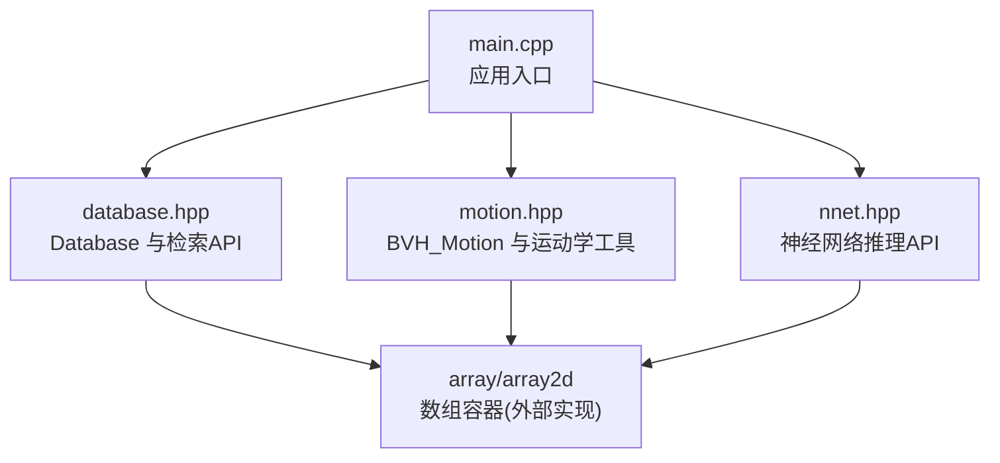
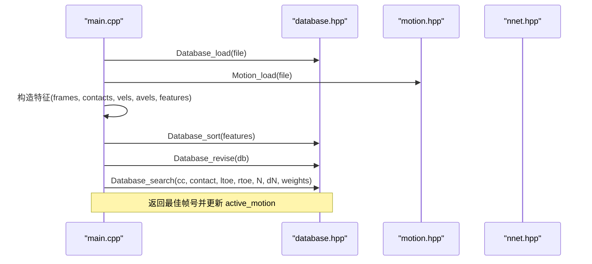
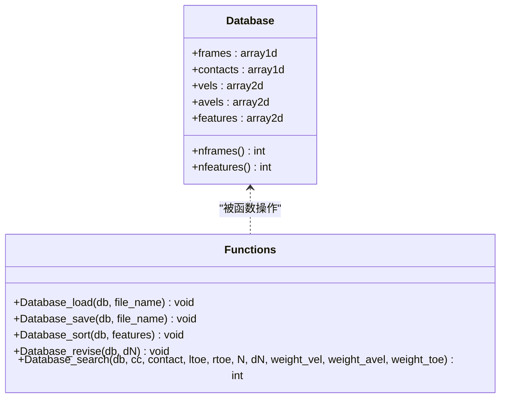
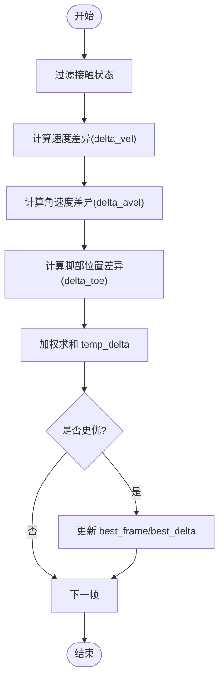
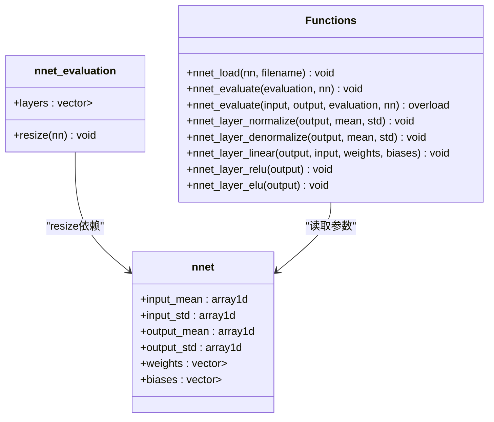
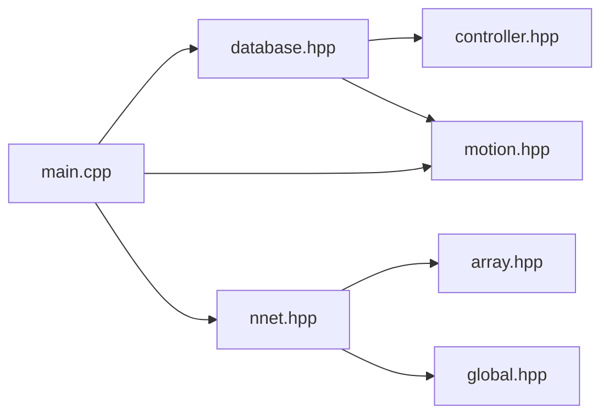

# 数据库系统API

> **版本提示（2.0）**：本文撰写于 1.x 时期，描述的是旧的实现形态——入口在根目录 `main.cpp`，功能由根目录 `.hpp` 头文件库提供，窗口用 raylib、显示用 OpenCV highgui。2.0 已把这些头文件移到 `Source/Legacy/`，渲染默认走 GPU，窗口与 UI 换成 GLFW + ImGui，`main.cpp` 拆成 `Source/Launch/Private/` 下的 `Main.cpp` 与 `Application`。文中的文件路径、行号与调用链可能已失效，请以根目录的「项目概述」「快速开始」「故障排除」三篇与当前源码为准。

<cite>
**本文引用的文件**
- [database.hpp](file://database.hpp)
- [nnet.hpp](file://nnet.hpp)
- [motion.hpp](file://motion.hpp)
- [main.cpp](file://main.cpp)
- [README.md](file://README.md)
</cite>

## 目录
1. [简介](#简介)
2. [项目结构](#项目结构)
3. [核心组件](#核心组件)
4. [架构总览](#架构总览)
5. [详细组件分析](#详细组件分析)
6. [依赖关系分析](#依赖关系分析)
7. [性能与优化](#性能与优化)
8. [故障排查指南](#故障排查指南)
9. [结论](#结论)
10. [附录：示例流程](#附录示例流程)

## 简介
本文件为 MooLab 项目中“数据库系统”的完整 API 文档，聚焦以下目标：
- Database 类的接口说明：数据库初始化、运动特征提取、动作检索等。
- 运动匹配算法相关 API：相似度计算、最近邻搜索等。
- 神经网络相关接口：用于动作分类/预测（加载、前向推理、归一化/反归一化）。
- 数据库存储格式与数据组织结构。
- 构建运动数据库、执行动作检索、处理匹配结果的完整示例流程。
- 性能优化策略：索引构建、缓存机制等。
- 扩展新动作类型的接口与方法。
- 调试与性能分析工具使用方法。

本项目基于 C++，使用 array/matrix/quat 等基础数学库，结合 raylib 进行渲染，OpenCV 用于调试显示。数据库模块负责离线或在线的特征抽取与检索；神经网络模块提供轻量级前向推理能力。

**章节来源**
- [README.md:1-22](file://README.md#L1-L22)

## 项目结构
围绕数据库系统的核心头文件与入口程序如下：
- database.hpp：Database 数据结构与数据库 I/O、排序、修订、检索等 API。
- nnet.hpp：神经网络模型结构与推理 API。
- motion.hpp：BVH 动作数据与运动学工具（用于特征提取与拼接）。
- main.cpp：应用入口，演示如何加载数据库、准备动作片段、调用检索等（部分代码被注释以适配当前运行模式）。

**图表来源**
- [main.cpp:8-17](file://main.cpp#L8-L17)
- [database.hpp:1-129](file://database.hpp#L1-L129)
- [motion.hpp:1-379](file://motion.hpp#L1-L379)
- [nnet.hpp:1-236](file://nnet.hpp#L1-L236)

**章节来源**
- [main.cpp:8-17](file://main.cpp#L8-L17)
- [database.hpp:1-129](file://database.hpp#L1-L129)
- [motion.hpp:1-379](file://motion.hpp#L1-L379)
- [nnet.hpp:1-236](file://nnet.hpp#L1-L236)

## 核心组件
本节概述数据库系统的关键组件及其职责：
- Database：存储帧索引、接触状态、速度/角速度多尺度特征、脚部位置特征等，并提供加载/保存、排序、修订、检索等 API。
- BVH_Motion：表示骨骼动画序列，提供子序列、拼接、正运动学等工具，用于特征提取与动作编辑。
- nnet：轻量神经网络结构及推理 API，支持浮点/四元数输入输出，包含层算子（线性、ReLU、ELU）与归一化/反归一化。

**章节来源**
- [database.hpp:7-19](file://database.hpp#L7-L19)
- [motion.hpp:37-70](file://motion.hpp#L37-L70)
- [nnet.hpp:8-16](file://nnet.hpp#L8-L16)

## 架构总览
下图展示数据库系统与主程序的交互关系，以及检索流程中涉及的数据流。

**图表来源**
- [main.cpp:74-94](file://main.cpp#L74-L94)
- [main.cpp:510-610](file://main.cpp#L510-L610)
- [database.hpp:21-127](file://database.hpp#L21-L127)

**章节来源**
- [main.cpp:74-94](file://main.cpp#L74-L94)
- [main.cpp:510-610](file://main.cpp#L510-L610)
- [database.hpp:21-127](file://database.hpp#L21-L127)

## 详细组件分析

### Database 类与 API
- 数据结构
  - frames：每行对应的原始帧号。
  - contacts：接触状态（例如左右脚切换）。
  - vels：多时间尺度的线速度特征（列维度为多个时间窗口）。
  - avels：多时间尺度的角速度特征（列维度为多个时间窗口）。
  - features：关键部位特征（如左右脚位置等）。
- 主要 API
  - Database_load / Database_save：二进制读写数据库。
  - Database_sort：根据给定特征矩阵对数据库进行重排（按特征排序）。
  - Database_revise：对速度/角速度进行平滑修正（多尺度差分）。
  - Database_search：基于当前角色控制器状态与脚部特征，在数据库中检索最接近的帧。

**图表来源**
- [database.hpp:7-19](file://database.hpp#L7-L19)
- [database.hpp:21-127](file://database.hpp#L21-L127)

**章节来源**
- [database.hpp:7-19](file://database.hpp#L7-L19)
- [database.hpp:21-127](file://database.hpp#L21-L127)

#### 数据库初始化与 I/O
- 初始化：通过 Database_load 从二进制文件加载 frames、contacts、vels、avels、features。
- 持久化：通过 Database_save 将上述字段写回二进制文件。

**章节来源**
- [database.hpp:21-47](file://database.hpp#L21-L47)

#### 运动特征提取与整理
- 特征矩阵 features 由左右脚位置、速度等组成（具体列定义见 main.cpp 中的注释与赋值逻辑）。
- Database_sort 接受一个二维特征矩阵，将其映射到 db.features 对应帧顺序上，便于后续检索或排序。
- Database_revise 对 vels/avels 进行多尺度平滑修正，提升检索稳定性。

**章节来源**
- [database.hpp:49-72](file://database.hpp#L49-L72)
- [main.cpp:510-534](file://main.cpp#L510-L534)

#### 动作检索（相似度与最近邻）
- 相似度计算：
  - 速度差异：比较当前控制器速度与数据库中各时间窗口的速度差，对小量值做阈值保护。
  - 角速度差异：比较 y 轴分量差异。
  - 脚部位置差异：比较左右脚局部位置。
  - 加权求和：weight_vel * delta_vel + weight_avel * delta_avel + weight_toe * delta_toe。
- 最近邻搜索：遍历数据库帧，筛选满足接触状态的候选帧，选择最小距离的帧作为最佳匹配。

**图表来源**
- [database.hpp:74-127](file://database.hpp#L74-L127)

**章节来源**
- [database.hpp:74-127](file://database.hpp#L74-L127)

### 神经网络接口（nnet）
- 模型结构
  - input_mean/input_std：输入归一化参数。
  - output_mean/output_std：输出反归一化参数。
  - weights/biases：多层网络的权重与偏置。
- 推理 API
  - nnet_load：从二进制文件加载模型参数。
  - nnet_evaluate：执行前向推理，支持 float/quat 输入输出。
  - 层算子：nnet_layer_linear、nnet_layer_relu、nnet_layer_elu。
  - 归一化/反归一化：nnet_layer_normalize、nnet_layer_denormalize。

**图表来源**
- [nnet.hpp:8-16](file://nnet.hpp#L8-L16)
- [nnet.hpp:18-41](file://nnet.hpp#L18-L41)
- [nnet.hpp:45-107](file://nnet.hpp#L45-L107)
- [nnet.hpp:110-155](file://nnet.hpp#L110-L155)
- [nnet.hpp:157-233](file://nnet.hpp#L157-L233)

**章节来源**
- [nnet.hpp:8-16](file://nnet.hpp#L8-L16)
- [nnet.hpp:18-41](file://nnet.hpp#L18-L41)
- [nnet.hpp:45-107](file://nnet.hpp#L45-L107)
- [nnet.hpp:110-155](file://nnet.hpp#L110-L155)
- [nnet.hpp:157-233](file://nnet.hpp#L157-L233)

### 运动数据与工具（BVH_Motion）
- 数据结构：bone_ids、bone_local_positions、bone_local_rotations、bone_parents。
- 常用工具：
  - Motion_load/Motion_save：二进制 I/O。
  - motion_sub_sequence：截取子序列。
  - motion_concatenate：拼接两段动作。
  - batch_forward_kinematics_*：批量正运动学计算。
  - translation_and_rotation：平移与朝向对齐。
  - blend_two_motions：两动作插值混合。
  - build_loop_motion：循环动作生成。
  - concatenate_two_motions：带过渡的两段动作拼接。

**章节来源**
- [motion.hpp:37-70](file://motion.hpp#L37-L70)
- [motion.hpp:72-96](file://motion.hpp#L72-L96)
- [motion.hpp:98-120](file://motion.hpp#L98-L120)
- [motion.hpp:122-198](file://motion.hpp#L122-L198)
- [motion.hpp:200-264](file://motion.hpp#L200-L264)
- [motion.hpp:266-330](file://motion.hpp#L266-L330)
- [motion.hpp:332-377](file://motion.hpp#L332-L377)

## 依赖关系分析
- main.cpp 依赖 database.hpp、motion.hpp、nnet.hpp 等模块，完成资源加载、仿真、渲染与可选的动作检索流程。
- database.hpp 依赖 controller.hpp 与 motion.hpp，用于获取角色控制器状态与运动学信息。
- nnet.hpp 依赖 array.hpp 与 global.hpp，提供基础数组与全局常量。

**图表来源**
- [main.cpp:8-17](file://main.cpp#L8-L17)
- [database.hpp:4-5](file://database.hpp#L4-L5)
- [nnet.hpp:4-5](file://nnet.hpp#L4-L5)

**章节来源**
- [main.cpp:8-17](file://main.cpp#L8-L17)
- [database.hpp:4-5](file://database.hpp#L4-L5)
- [nnet.hpp:4-5](file://nnet.hpp#L4-L5)

## 性能与优化
- 索引构建
  - 当前检索为线性扫描，适合中小规模数据库。若数据库规模增大，可考虑：
    - 基于特征的哈希索引或 KD-tree/ANN 近似最近邻。
    - 分桶索引（按接触状态、速度区间等）。
- 缓存机制
  - 对频繁访问的帧片段（如 search_motion）进行缓存，减少重复切片与拼接开销。
  - 对 Database_revise 的结果进行缓存，避免重复平滑计算。
- 并行化
  - Database_search 的逐帧比较可并行化（OpenMP），尤其当 N 较大时。
  - 特征提取阶段（vels/avels/features）可并行计算。
- 数值稳定
  - 小量速度/角速度差异的阈值保护已内置，建议保持该策略以避免除零或异常放大。
- 内存布局
  - 使用连续数组（array2d）有利于 SIMD 加速与缓存友好。

[本节为通用指导，不直接分析具体文件]

## 故障排查指南
- 数据库加载失败
  - 检查二进制文件路径与权限，确保 Database_load 能打开文件。
  - 确认文件头与字段顺序一致（frames/contacts/vels/avels/features）。
- 检索结果异常
  - 调整权重 weight_vel/weight_avel/weight_toe，观察匹配效果变化。
  - 检查 contacts 是否正确反映左右脚接触状态。
  - 验证 features 中左右脚位置与速度是否合理。
- 神经网络推理错误
  - 确认 nnet_load 成功加载模型参数。
  - 检查输入尺寸与网络期望一致（float/quat 转换正确）。
  - 注意最终层不进行激活函数处理（代码注释有说明）。

**章节来源**
- [database.hpp:21-47](file://database.hpp#L21-L47)
- [database.hpp:74-127](file://database.hpp#L74-L127)
- [nnet.hpp:18-41](file://nnet.hpp#L18-L41)
- [nnet.hpp:127-155](file://nnet.hpp#L127-L155)

## 结论
Database 模块提供了完整的动作数据库 I/O、特征整理与检索能力；配合 motion.hpp 的运动学工具与 nnet.hpp 的轻量推理接口，构成了可扩展的动作匹配与预测管线。当前实现以线性检索为主，易于理解与调试；在生产环境中可通过索引与并行化进一步提升性能。

[本节为总结性内容，不直接分析具体文件]

## 附录：示例流程
以下示例展示如何构建运动数据库、执行动作检索与处理匹配结果（步骤描述，非代码片段）：
- 构建数据库
  - 加载 BVH 动作序列（Motion_load）。
  - 计算多尺度速度/角速度（vels/avels）与脚部特征（features）。
  - 填充 frames 与 contacts。
  - 调用 Database_sort 对特征进行排序。
  - 调用 Database_revise 进行平滑修正。
  - 调用 Database_save 持久化数据库。
- 执行检索
  - 初始化 Character_Controller 并更新其速度/角速度/脚部位置。
  - 调用 Database_search 传入当前状态与权重，得到最佳帧号。
  - 根据最佳帧号截取 search_motion，并与 active_motion 拼接，实现动作切换。
- 处理匹配结果
  - 打印 best_delta 与 best_frame 用于调试。
  - 可视化匹配轨迹或关键点以验证效果。

**章节来源**
- [main.cpp:74-94](file://main.cpp#L74-L94)
- [main.cpp:510-610](file://main.cpp#L510-L610)
- [database.hpp:21-127](file://database.hpp#L21-L127)