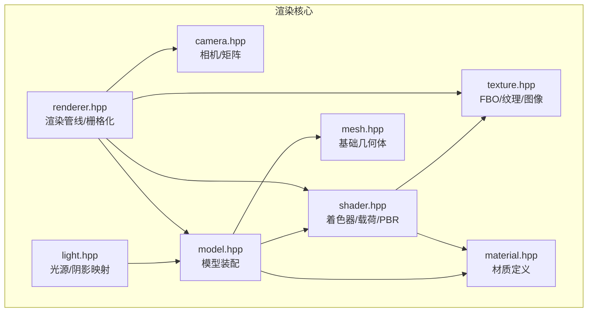
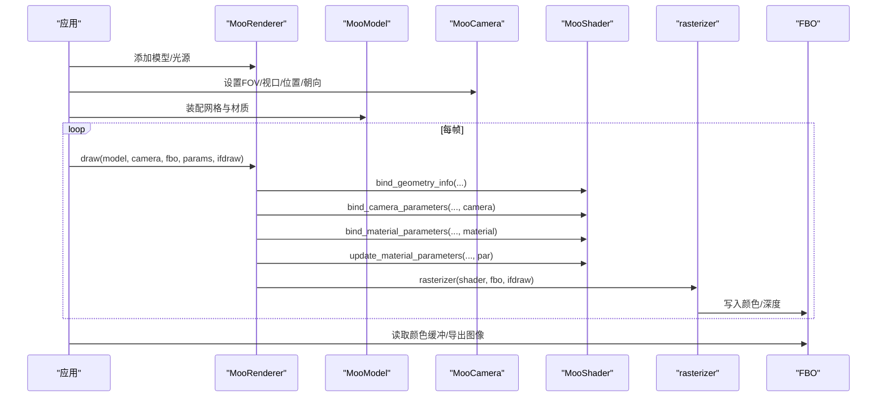
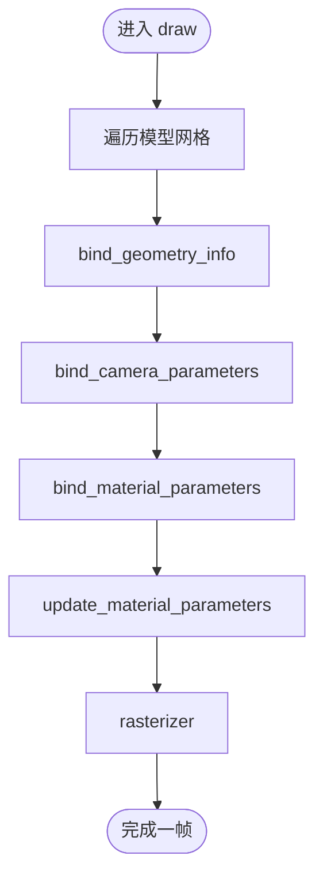
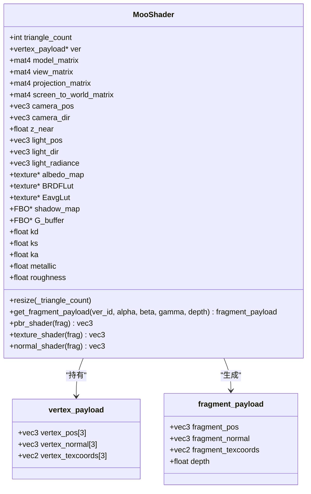
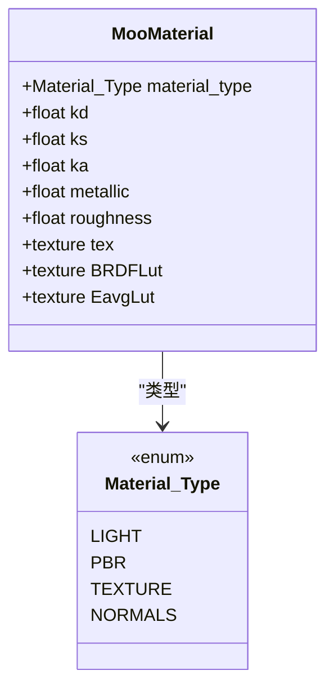
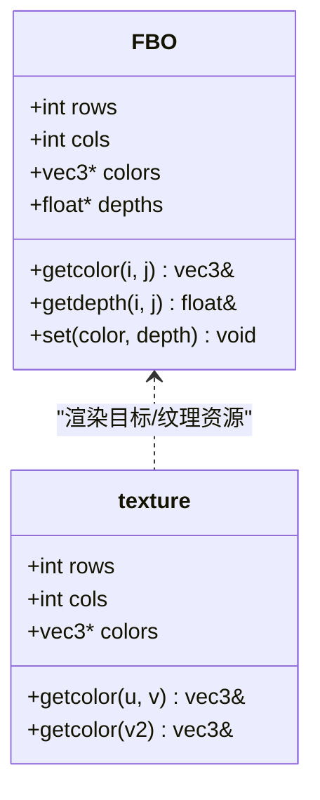
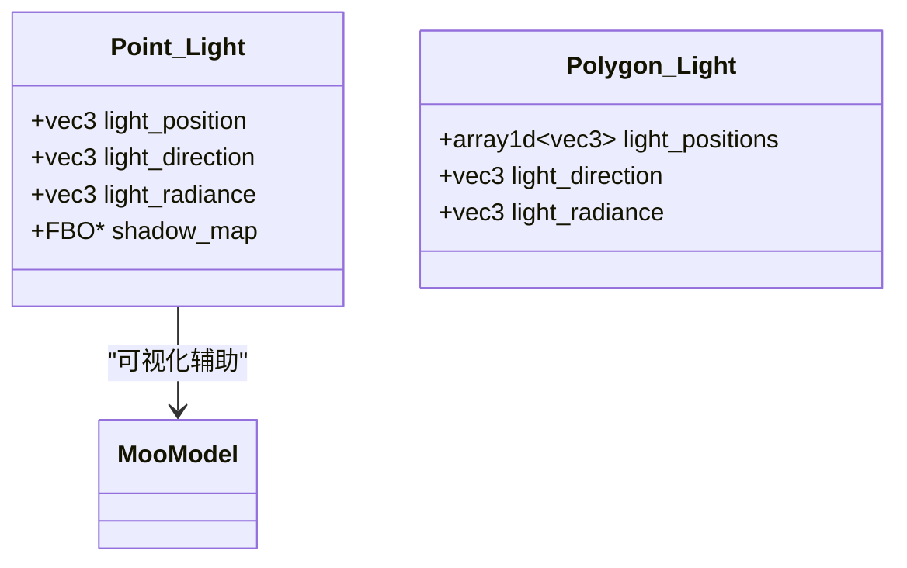
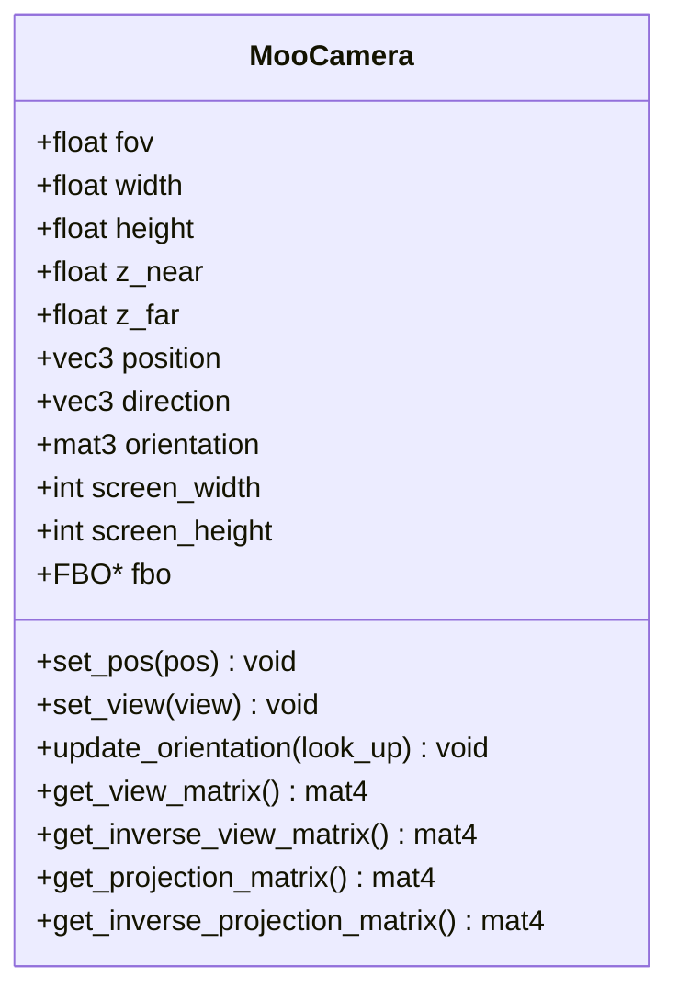
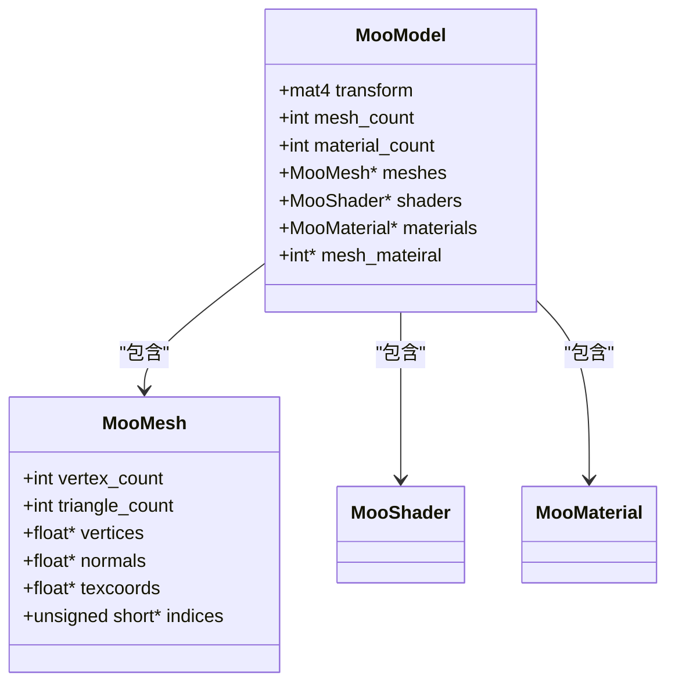
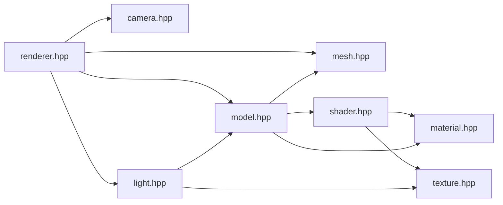

# 渲染系统API

> **版本提示（2.0）**：本文撰写于 1.x 时期，描述的是旧的实现形态——入口在根目录 `main.cpp`，功能由根目录 `.hpp` 头文件库提供，窗口用 raylib、显示用 OpenCV highgui。2.0 已把这些头文件移到 `Source/Legacy/`，渲染默认走 GPU，窗口与 UI 换成 GLFW + ImGui，`main.cpp` 拆成 `Source/Launch/Private/` 下的 `Main.cpp` 与 `Application`。文中的文件路径、行号与调用链可能已失效，请以根目录的「项目概述」「快速开始」「故障排除」三篇与当前源码为准。

<cite>
**本文引用的文件**   
- [renderer.hpp](file://renderer.hpp)
- [shader.hpp](file://shader.hpp)
- [material.hpp](file://material.hpp)
- [texture.hpp](file://texture.hpp)
- [light.hpp](file://light.hpp)
- [camera.hpp](file://camera.hpp)
- [mesh.hpp](file://mesh.hpp)
- [model.hpp](file://model.hpp)
</cite>

## 目录
1. [简介](#简介)
2. [项目结构](#项目结构)
3. [核心组件](#核心组件)
4. [架构总览](#架构总览)
5. [详细组件分析](#详细组件分析)
6. [依赖关系分析](#依赖关系分析)
7. [性能与优化](#性能与优化)
8. [故障排查指南](#故障排查指南)
9. [结论](#结论)
10. [附录：示例流程](#附录示例流程)

## 简介
本文件为渲染系统的完整API文档，覆盖以下方面：
- Renderer（场景与渲染管线控制）：场景初始化、绘制流程、相机绑定、几何/材质参数绑定、栅格化。
- Shader（着色器系统）：顶点/片段数据载荷、PBR/纹理/法线着色器、多散射BRDF近似。
- Material（材质系统）：PBR属性（金属度、粗糙度）、漫反射/镜面/环境系数、贴图与LUT。
- Texture（纹理系统）：FBO缓冲、图像加载/导出、颜色采样。
- Light（光照系统）：点光源、面光源、阴影映射缓冲、可视辅助模型生成。
- Camera（相机管理）：视图矩阵、投影矩阵、反向矩阵、屏幕尺寸与FBO关联。
- Mesh/Model（几何与模型）：基础几何体、模型装配、网格与材质映射。

## 项目结构
渲染子系统由若干头文件组成，职责清晰、耦合适度：
- renderer.hpp：渲染入口、管线控制、几何/相机/材质参数绑定、软件光栅化、辅助绘图。
- shader.hpp：MooShader类、顶点/片段载荷、PBR/纹理/法线着色器实现。
- material.hpp：材质类型枚举与MooMaterial结构。
- texture.hpp：FBO缓冲、纹理结构与图像互转工具。
- light.hpp：光源数据结构与辅助函数。
- camera.hpp：相机结构与矩阵计算接口。
- mesh.hpp：基础几何体（三角面、立方体、胶囊体）。
- model.hpp：模型装配与网格-材质映射。

图表来源
- [renderer.hpp:17-239](file://renderer.hpp#L17-L239)
- [shader.hpp:19-86](file://shader.hpp#L19-L86)
- [material.hpp:7-30](file://material.hpp#L7-L30)
- [texture.hpp:11-112](file://texture.hpp#L11-L112)
- [light.hpp:16-40](file://light.hpp#L16-L40)
- [camera.hpp:7-36](file://camera.hpp#L7-L36)
- [mesh.hpp:6-14](file://mesh.hpp#L6-L14)
- [model.hpp:8-19](file://model.hpp#L8-L19)

章节来源
- [renderer.hpp:17-239](file://renderer.hpp#L17-L239)
- [shader.hpp:19-86](file://shader.hpp#L19-L86)
- [material.hpp:7-30](file://material.hpp#L7-L30)
- [texture.hpp:11-112](file://texture.hpp#L11-L112)
- [light.hpp:16-40](file://light.hpp#L16-L40)
- [camera.hpp:7-36](file://camera.hpp#L7-L36)
- [mesh.hpp:6-14](file://mesh.hpp#L6-L14)
- [model.hpp:8-19](file://model.hpp#L8-L19)

## 核心组件
- MooRenderer（场景容器）：维护模型列表与光源列表，作为场景的根集合。
- MooShader（着色器上下文）：持有三角形数量、顶点载荷、矩阵、相机/光照参数、材质相关纹理、以及PBR/纹理/法线着色器回调。
- MooMaterial（材质）：包含材质类型、PBR属性（kd/ks/ka/metallic/roughness）、主贴图与BRDF/Eavg查找表。
- FBO（帧缓冲对象）：二维像素阵列，存储颜色与深度，提供行列访问与批量设置。
- texture（纹理）：二维颜色数组，支持浮点坐标采样。
- MooCamera（相机）：FOV、宽高、近远裁剪面、位置/方向/朝向矩阵、屏幕分辨率、输出FBO。
- MooMesh/MooModel（几何与模型）：网格数据（顶点/法线/纹理坐标/索引），模型装配（变换、网格与材质映射）。
- Point_Light/Polygon_Light（光源）：点光源与多边形光源，含辐射度、方向、阴影映射缓冲；并提供可视化辅助模型生成。

章节来源
- [renderer.hpp:17-31](file://renderer.hpp#L17-L31)
- [shader.hpp:19-86](file://shader.hpp#L19-L86)
- [material.hpp:7-30](file://material.hpp#L7-L30)
- [texture.hpp:11-112](file://texture.hpp#L11-L112)
- [camera.hpp:7-36](file://camera.hpp#L7-L36)
- [mesh.hpp:6-14](file://mesh.hpp#L6-L14)
- [model.hpp:8-19](file://model.hpp#L8-L19)
- [light.hpp:16-40](file://light.hpp#L16-L40)

## 架构总览
渲染管线从场景到像素的核心流程如下：
- 场景准备：创建MooRenderer，添加MooModel与光源。
- 相机配置：设置FOV、视口、近远裁剪面、位置与朝向，并分配FBO。
- 模型装配：将MooMesh与MooMaterial组合成MooModel，并为每个网格分配MooShader。
- 绘制循环：对每个模型的每个网格，绑定几何/相机/材质参数，调用软件光栅化写入FBO。
- 结果输出：通过FBO获取颜色缓冲，转换为图像显示或保存。

图表来源
- [renderer.hpp:213-239](file://renderer.hpp#L213-L239)
- [renderer.hpp:121-211](file://renderer.hpp#L121-L211)
- [shader.hpp:109-125](file://shader.hpp#L109-L125)
- [texture.hpp:11-34](file://texture.hpp#L11-L34)

## 详细组件分析

### Renderer（渲染管线与场景控制）
- 场景容器：MooRenderer聚合模型与光源。
- 参数绑定：
  - bind_geometry_info：将索引、顶点、法线、纹理坐标打包为三角形载荷。
  - bind_camera_parameters：注入模型/视图/投影矩阵、屏幕到世界矩阵、相机位置/方向、近裁剪面、G-buffer。
  - bind_material_parameters：注入材质贴图、BRDF/Eavg LUT、kd/ks/ka、metallic/roughness。
  - update_material_parameters：更新光源位置/方向/辐射度与阴影映射。
- 栅格化：rasterizer遍历三角形，进行裁剪、投影、光栅化、深度测试与片段着色（LIGHT/PBR/TEXTURE/NORMALS）。
- 绘制入口：draw按模型网格顺序执行上述绑定与栅格化。
- 辅助绘图：draw_point/draw_line/draw_curve用于调试与可视化。

图表来源
- [renderer.hpp:213-239](file://renderer.hpp#L213-L239)
- [renderer.hpp:33-92](file://renderer.hpp#L33-L92)
- [renderer.hpp:121-211](file://renderer.hpp#L121-L211)

章节来源
- [renderer.hpp:17-239](file://renderer.hpp#L17-L239)

### Shader（着色器系统与PBR）
- 数据结构：
  - vertex_payload：三角形三个顶点的位姿、法线、纹理坐标。
  - fragment_payload：插值后的片段位置、法线、纹理坐标、深度。
- MooShader关键方法：
  - resize：按三角形数量分配顶点载荷内存。
  - get_fragment_payload：基于重心坐标插值生成片段载荷。
  - pbr_shader：GGX NDF + Smith遮蔽 + Schlick菲涅尔 + 多散射BRDF近似，色调映射与伽马校正。
  - texture_shader：直接采样漫反射贴图。
  - normal_shader：输出法线可视化。
- PBR常量与函数：DistributionGGX、GeometrySchlickGGX、GeometrySmith、fresnelSchlick、AverageFresnel、MultiScatterBRDF。

图表来源
- [shader.hpp:19-86](file://shader.hpp#L19-L86)
- [shader.hpp:88-125](file://shader.hpp#L88-L125)
- [shader.hpp:127-252](file://shader.hpp#L127-L252)

章节来源
- [shader.hpp:19-252](file://shader.hpp#L19-L252)

### Material（材质系统）
- 材质类型：LIGHT/PBR/TEXTURE/NORMALS。
- MooMaterial字段：
  - 基础光学：kd（漫反射）、ks（镜面）、ka（环境）。
  - PBR：metallic、roughness。
  - 贴图：albedo（主贴图）、BRDFLut、EavgLut（多散射BRDF与平均能量查找表）。
- 使用方式：在bind_material_parameters中注入到MooShader。

图表来源
- [material.hpp:7-30](file://material.hpp#L7-L30)

章节来源
- [material.hpp:7-30](file://material.hpp#L7-L30)

### Texture（纹理与FBO）
- FBO：
  - 成员：rows、cols、colors（RGB）、depths（深度）。
  - 访问：getcolor(i,j)、getdepth(i,j)、set(color,depth)。
  - 工具：concatenate_two_fbos拼接两个FBO；fbo_to_img导出OpenCV图像。
- texture：
  - 成员：rows、cols、colors（RGB）。
  - 访问：getcolor(u,v)与getcolor(vec2)。
  - 工具：img_to_tex从路径加载图像；tex_to_img导出图像。
- 支持的图像格式：依赖OpenCV的imread，常见格式如BMP/JPG/PNG等均可。

图表来源
- [texture.hpp:11-34](file://texture.hpp#L11-L34)
- [texture.hpp:65-112](file://texture.hpp#L65-L112)

章节来源
- [texture.hpp:11-112](file://texture.hpp#L11-L112)

### Light（光照系统）
- Point_Light：位置、方向、辐射度、阴影映射FBO指针。
- Polygon_Light：多个位置点、方向、辐射度。
- 辅助：get_light_model(Point_Light)返回一个小型立方体模型，用于可视化点光源位置。

图表来源
- [light.hpp:16-40](file://light.hpp#L16-L40)
- [light.hpp:27-33](file://light.hpp#L27-L33)

章节来源
- [light.hpp:16-40](file://light.hpp#L16-L40)

### Camera（相机管理）
- 属性：FOV、视口宽高、近远裁剪面、位置、方向、朝向矩阵、屏幕分辨率、输出FBO。
- 方法：
  - set_pos/set_view/update_orientation：设置位置、观察方向、上向量更新朝向。
  - get_view_matrix/get_inverse_view_matrix：视图矩阵与其逆。
  - get_projection_matrix/get_inverse_projection_matrix：透视投影矩阵与其逆。

图表来源
- [camera.hpp:7-36](file://camera.hpp#L7-L36)
- [camera.hpp:38-71](file://camera.hpp#L38-L71)

章节来源
- [camera.hpp:7-71](file://camera.hpp#L7-L71)

### Mesh/Model（几何与模型）
- MooMesh：顶点数、三角形数、顶点/法线/纹理坐标/索引数组。
- 基础几何：triangle/cube/capsule。
- MooModel：模型变换、网格与材质计数、网格数组、着色器数组、材质数组、网格-材质映射。
- mesh_material_to_model：将单个网格与材质装配为模型，并初始化对应着色器。

图表来源
- [mesh.hpp:6-14](file://mesh.hpp#L6-L14)
- [model.hpp:8-19](file://model.hpp#L8-L19)
- [model.hpp:21-43](file://model.hpp#L21-L43)

章节来源
- [mesh.hpp:6-299](file://mesh.hpp#L6-L299)
- [model.hpp:8-43](file://model.hpp#L8-L43)

## 依赖关系分析
- renderer.hpp依赖camera/light/model/mesh，负责组装与驱动。
- shader.hpp依赖global/material/mat/texture/vec，实现着色逻辑。
- material.hpp依赖global/texture，定义材质。
- texture.hpp依赖opencv与vec，提供FBO与纹理工具。
- light.hpp依赖material/model/texture，提供光源与可视化。
- camera.hpp依赖mat/texture，提供相机矩阵与FBO。
- mesh.hpp依赖mat，提供基础几何。
- model.hpp依赖mat/mesh/shader，提供模型装配。

图表来源
- [renderer.hpp:4-7](file://renderer.hpp#L4-L7)
- [shader.hpp:4-8](file://shader.hpp#L4-L8)
- [model.hpp:4-6](file://model.hpp#L4-L6)
- [light.hpp:4-6](file://light.hpp#L4-L6)

章节来源
- [renderer.hpp:4-7](file://renderer.hpp#L4-L7)
- [shader.hpp:4-8](file://shader.hpp#L4-L8)
- [model.hpp:4-6](file://model.hpp#L4-L6)
- [light.hpp:4-6](file://light.hpp#L4-L6)

## 性能与优化
- 并行化：rasterizer内部使用OpenMP并行遍历三角形，适合CPU端软件光栅化加速。
- 批处理：当前draw逐网格调用rasterizer，未显式合并批次；可通过合并同材质/同着色器的网格减少状态切换。
- LOD：代码未内置LOD；可在模型层根据距离选择不同精度的MooMesh。
- 深度裁剪：rasterizer在投影前剔除近裁剪面前的三角形，减少无效光栅化。
- 纹理采样：纹理采样为最近邻插值，若需平滑可考虑双线性插值。
- 色调映射与伽马：PBR输出经过Reinhard色调映射与2.2次幂伽马校正，确保显示范围合理。

章节来源
- [renderer.hpp:121-211](file://renderer.hpp#L121-L211)
- [shader.hpp:199-236](file://shader.hpp#L199-L236)

## 故障排查指南
- 颜色全黑或过曝：
  - 检查光源radiance是否合理，避免过大导致饱和。
  - 确认PBR输出已进行色调映射与伽马校正。
- 法线显示异常：
  - 确认法线已正确归一化并在fragment_payload中传递。
- 纹理缺失或错位：
  - 检查纹理坐标是否正确绑定，确认纹理尺寸与采样范围。
- 深度错误（Z-fighting）：
  - 调整z_near/z_far比例，避免过小near导致精度不足。
- 绘制无输出：
  - 确认FBO尺寸与相机screen_width/screen_height一致。
  - 检查ifdraw标志是否开启。
- 性能瓶颈：
  - 降低分辨率或三角形数量，启用并行编译选项。
  - 合并相同材质的网格以减少状态切换。

章节来源
- [renderer.hpp:121-211](file://renderer.hpp#L121-L211)
- [shader.hpp:109-125](file://shader.hpp#L109-L125)
- [texture.hpp:11-34](file://texture.hpp#L11-L34)

## 结论
该渲染系统以软件光栅化为核心，提供了完整的场景组织、着色器上下文、材质与纹理、相机与光源管理能力。尽管未采用GPU管线，但通过模块化设计仍具备清晰的扩展点：可引入批处理、LOD、更高级的抗锯齿与后处理。对于学习与原型开发，该系统提供了直观且可控的渲染流程。

## 附录：示例流程
以下为端到端的步骤说明（不展示具体代码内容，仅给出流程与对应源码位置）：
- 初始化渲染环境
  - 创建MooRenderer并添加模型与光源。
  - 配置MooCamera（FOV、视口、近远裁剪面、位置/朝向），分配FBO。
  - 参考：[renderer.hpp:17-239](file://renderer.hpp#L17-L239)，[camera.hpp:7-71](file://camera.hpp#L7-L71)
- 创建材质
  - 设置MooMaterial的material_type为PBR，配置kd/ks/ka、metallic/roughness，加载albedo贴图与BRDF/Eavg LUT。
  - 参考：[material.hpp:7-30](file://material.hpp#L7-L30)，[texture.hpp:86-100](file://texture.hpp#L86-L100)
- 应用纹理
  - 使用img_to_tex加载图像，赋值给MooMaterial.tex或LUT。
  - 参考：[texture.hpp:86-100](file://texture.hpp#L86-L100)
- 添加光照
  - 创建Point_Light，设置位置/方向/辐射度，可选shadow_map。
  - 使用get_light_model可视化光源。
  - 参考：[light.hpp:16-40](file://light.hpp#L16-L40)，[light.hpp:27-33](file://light.hpp#L27-L33)
- 运行渲染
  - 调用draw(model, camera, fbo, parameters, ifdraw=true)进行绘制。
  - 从FBO读取颜色缓冲并导出图像。
  - 参考：[renderer.hpp:213-239](file://renderer.hpp#L213-L239)，[texture.hpp:55-63](file://texture.hpp#L55-L63)