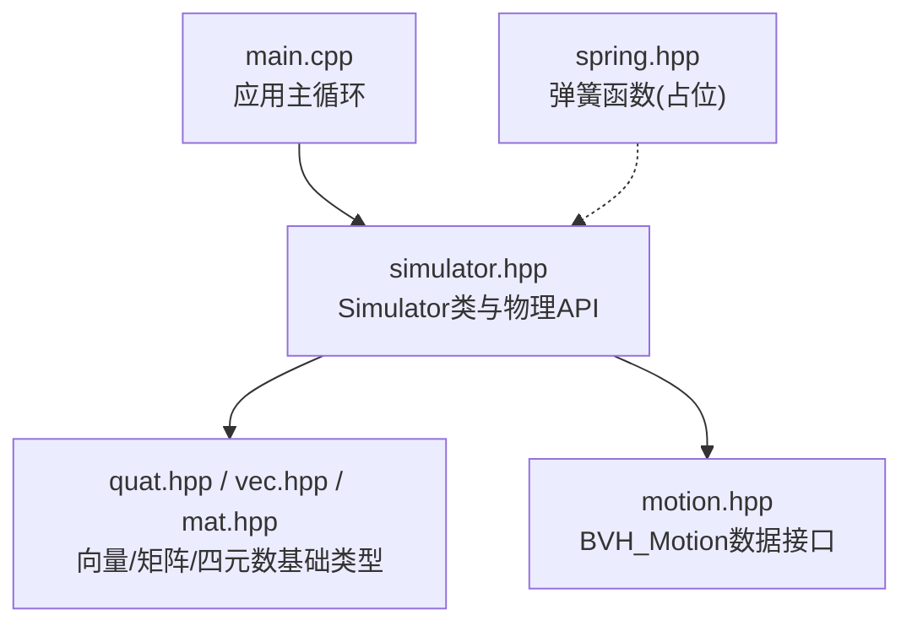
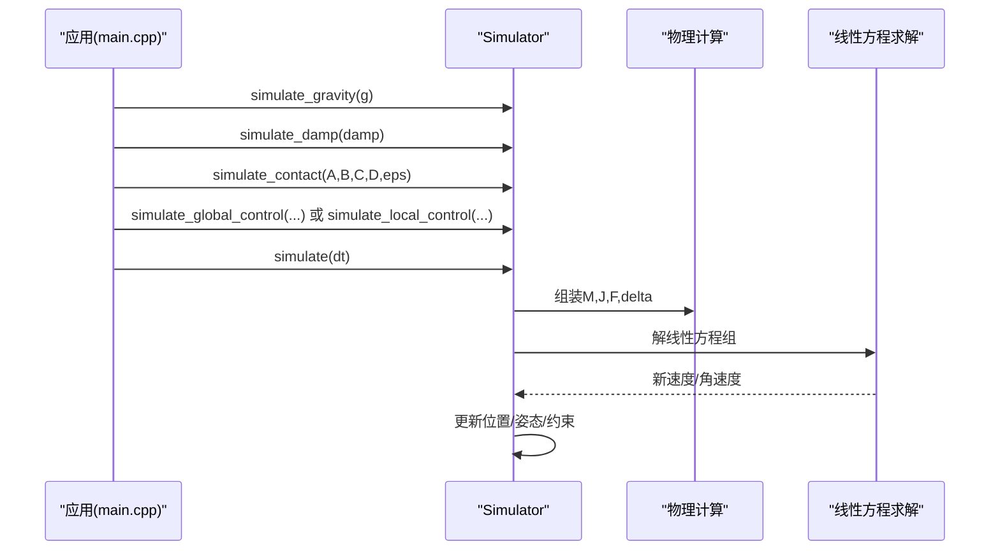
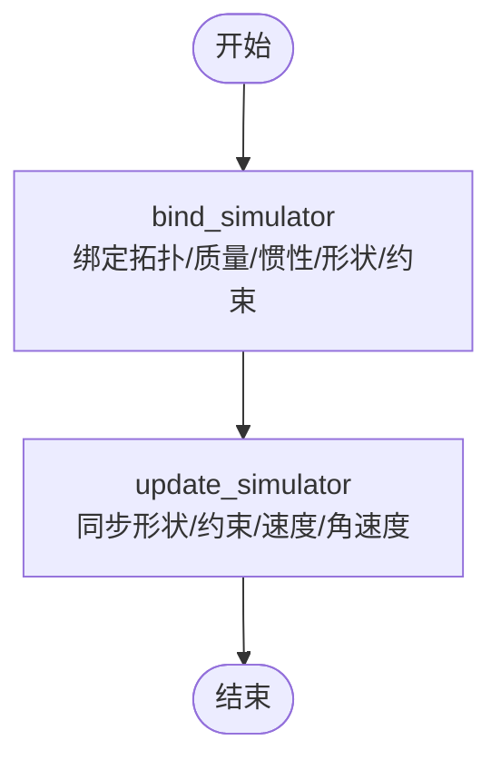
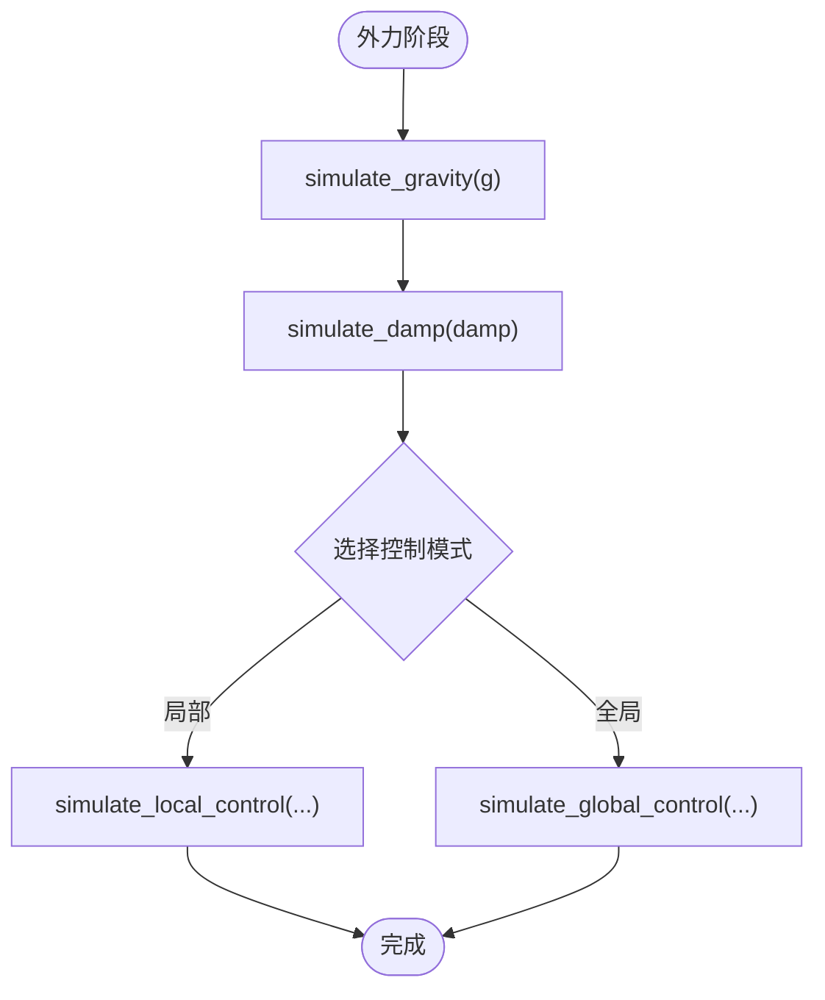
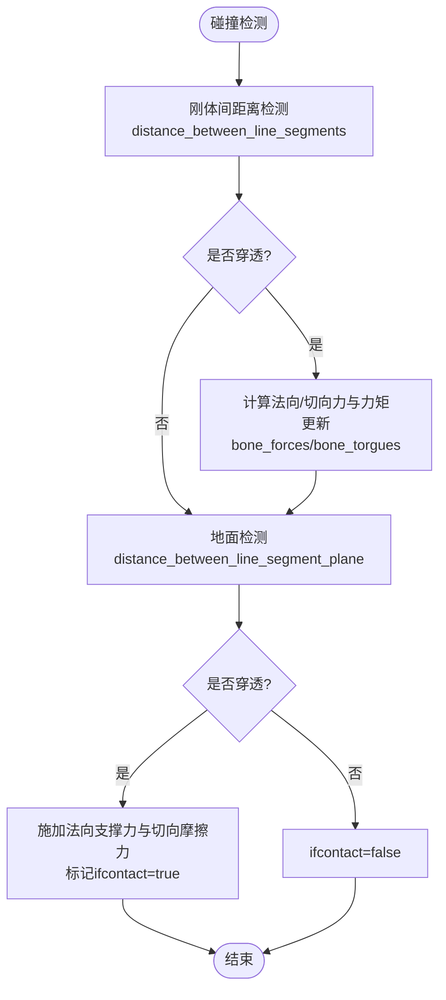
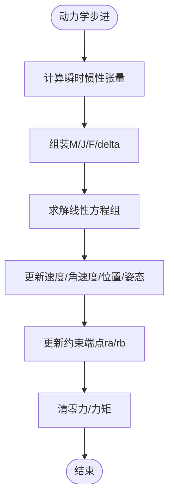
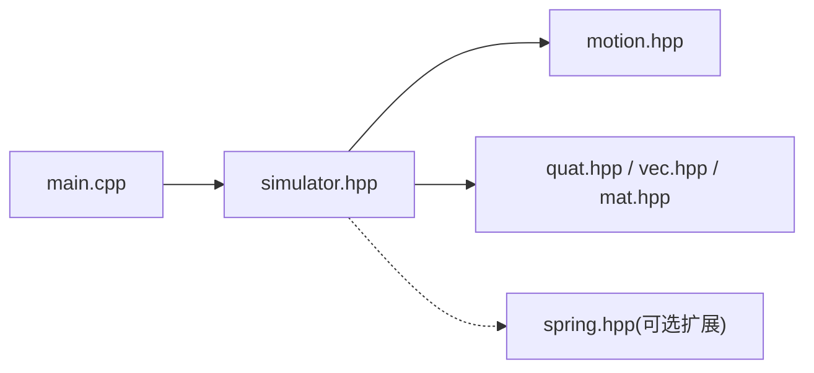
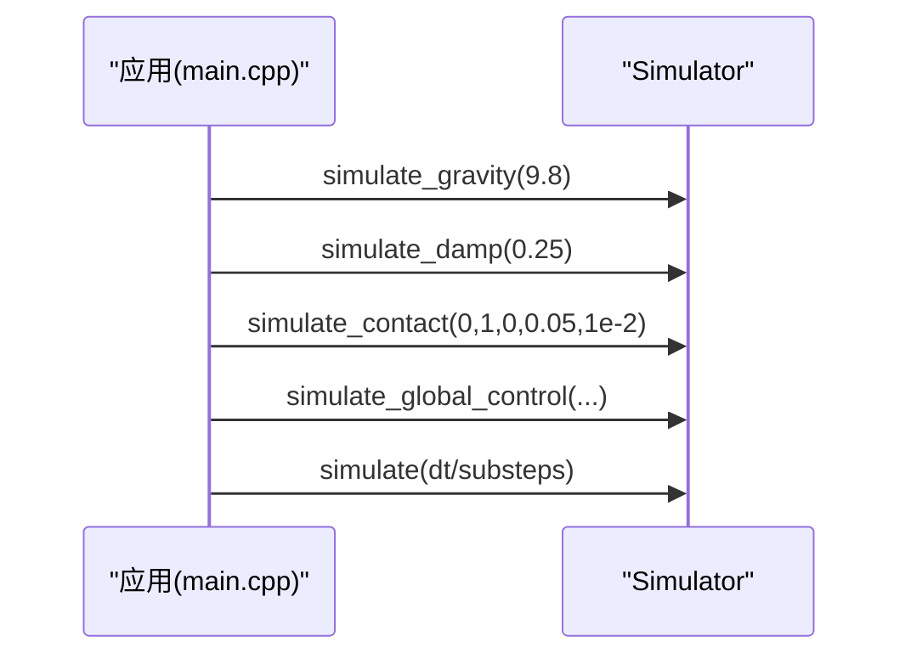

# 物理仿真API

> **版本提示（2.0）**：本文撰写于 1.x 时期，描述的是旧的实现形态——入口在根目录 `main.cpp`，功能由根目录 `.hpp` 头文件库提供，窗口用 raylib、显示用 OpenCV highgui。2.0 已把这些头文件移到 `Source/Legacy/`，渲染默认走 GPU，窗口与 UI 换成 GLFW + ImGui，`main.cpp` 拆成 `Source/Launch/Private/` 下的 `Main.cpp` 与 `Application`。文中的文件路径、行号与调用链可能已失效，请以根目录的「项目概述」「快速开始」「故障排除」三篇与当前源码为准。

<cite>
**本文引用的文件**   
- [simulator.hpp](file://simulator.hpp)
- [spring.hpp](file://spring.hpp)
- [main.cpp](file://main.cpp)
- [README.md](file://README.md)
</cite>

## 目录
1. [简介](#简介)
2. [项目结构](#项目结构)
3. [核心组件](#核心组件)
4. [架构总览](#架构总览)
5. [详细组件分析](#详细组件分析)
6. [依赖关系分析](#依赖关系分析)
7. [性能与优化](#性能与优化)
8. [故障排查指南](#故障排查指南)
9. [结论](#结论)
10. [附录：示例与最佳实践](#附录示例与最佳实践)

## 简介
本文件为物理仿真系统的完整API文档，聚焦于Simulator类的核心接口与使用方式。内容涵盖刚体（骨骼）初始化、约束设置、动力学更新、重力/阻尼/碰撞检测等物理参数配置、时间步长控制、状态同步与恢复方法，以及调试与性能优化建议。同时说明弹簧相关接口的现状与扩展点。

## 项目结构
本项目是一个角色运动渲染与仿真器，核心物理逻辑集中在头文件中，主程序负责驱动仿真循环与渲染。关键文件如下：
- simulator.hpp：定义Simulator类、数据结构、物理计算与约束求解、绑定与更新工具函数
- spring.hpp：提供弹簧相关函数的占位接口（当前未实现具体物理）
- main.cpp：应用主循环，调用物理API进行每帧仿真与控制
- README.md：构建与运行说明



图表来源
- [main.cpp:300-345](file://main.cpp#L300-L345)
- [simulator.hpp:321-355](file://simulator.hpp#L321-L355)
- [README.md:1-22](file://README.md#L1-L22)

章节来源
- [README.md:1-22](file://README.md#L1-L22)

## 核心组件
本节概述Simulator类的职责与主要成员：
- 刚体（骨骼）属性：质量、惯性张量、形状（位置、旋转、半径、长度）、接触标记
- 运动学/动力学状态：线速度、角速度、力、力矩
- 约束：link结构描述两刚体间的连接几何与误差
- 控制：局部/全局目标姿态驱动的力矩生成
- 物理步进：重力、阻尼、碰撞检测、约束求解与状态更新

章节来源
- [simulator.hpp:302-355](file://simulator.hpp#L302-L355)

## 架构总览
下图展示一次典型仿真帧的调用流程：应用层在每帧中依次添加外力（重力、阻尼）、执行碰撞检测、施加控制力矩，然后调用求解器推进系统状态。



图表来源
- [main.cpp:320-339](file://main.cpp#L320-L339)
- [simulator.hpp:343-348](file://simulator.hpp#L343-L348)
- [simulator.hpp:543-624](file://simulator.hpp#L543-L624)

## 详细组件分析

### Simulator类与数据结构
- link：描述两个刚体之间的连接几何（端点ra/rb）与当前误差delta
- shape：刚体形状（胶囊体近似），包含位置pos、旋转rot、半径radius、长度length、接触标记ifcontact
- Simulator成员：
  - bone_ids/bone_parents：骨骼拓扑
  - bone_offsets/bone_quat_compensates：初始偏移与补偿四元数
  - bone_masses/bone_inertias：质量与惯性张量
  - bone_links/bone_shapes：约束与形状
  - bone_vels/bone_avels：线速度与角速度
  - bone_forces/bone_torgues：累积力与力矩
  - accumulated_ek_rots/last_ek_rots：控制积分与微分项缓存

```mermaid
classDiagram
class link {
+int a
+int b
+vec3 ra
+vec3 rb
+vec3 delta
}
class shape {
+vec3 pos
+quat rot
+double radius
+double length
+bool ifcontact
}
class Simulator {
+array1d<int> bone_ids
+array1d<int> bone_parents
+array1d<vec3> bone_offsets
+array1d<quat> bone_quat_compensates
+array1d<double> bone_masses
+array1d<mat3> bone_inertias
+array1d<link> bone_links
+array1d<shape> bone_shapes
+array1d<vec3> bone_vels
+array1d<vec3> bone_avels
+array1d<vec3> bone_forces
+array1d<vec3> bone_torgues
+array1d<vec3> accumulated_ek_rots
+array1d<vec3> last_ek_rots
+simulate_gravity(g)
+simulate_damp(damp)
+simulate_contact(A,B,C,D,eps)
+simulate_local_control(target_local_rotations)
+simulate_global_control(target_local_rotations)
+simulate(dt)
+batch_forward_kinematics_full(...)
+revise_anim_bones(...)
}
Simulator --> link : "使用"
Simulator --> shape : "使用"
```

图表来源
- [simulator.hpp:302-355](file://simulator.hpp#L302-L355)

章节来源
- [simulator.hpp:302-355](file://simulator.hpp#L302-L355)

### 刚体初始化与绑定
- bind_simulator：从BVH动画帧绑定骨骼拓扑、初始偏移、质量、惯性、形状与约束；根据骨架几何估算各段胶囊体的半径与长度，并填充惯性张量
- update_simulator：将最新动画帧映射到Simulator的形状与约束，计算速度与角速度，重置接触标记



图表来源
- [simulator.hpp:664-847](file://simulator.hpp#L664-L847)
- [simulator.hpp:849-909](file://simulator.hpp#L849-L909)

章节来源
- [simulator.hpp:664-847](file://simulator.hpp#L664-L847)
- [simulator.hpp:849-909](file://simulator.hpp#L849-L909)

### 物理参数与外力
- 重力：simulate_gravity(g)，向每个刚体施加向下的重力
- 阻尼：simulate_damp(damp)，对线速度与角速度施加粘性阻尼
- 控制力矩：
  - simulate_local_control：基于局部目标姿态生成关节力矩（含积分/微分项）
  - simulate_global_control：基于全局前向运动学目标姿态生成力矩



图表来源
- [simulator.hpp:343-348](file://simulator.hpp#L343-L348)
- [simulator.hpp:357-372](file://simulator.hpp#L357-L372)
- [simulator.hpp:437-541](file://simulator.hpp#L437-L541)

章节来源
- [simulator.hpp:357-372](file://simulator.hpp#L357-L372)
- [simulator.hpp:437-541](file://simulator.hpp#L437-L541)

### 碰撞检测与响应
- 刚体间碰撞：通过线段-线段距离计算，判断是否穿透，计算法向与切向摩擦分量，施加冲量式力与力矩
- 地面碰撞：平面A·x + B·y + C·z + D = 0，检测线段与平面距离，若穿透则施加法向支撑力与切向摩擦力，并标记ifcontact



图表来源
- [simulator.hpp:374-435](file://simulator.hpp#L374-L435)
- [simulator.hpp:191-300](file://simulator.hpp#L191-L300)

章节来源
- [simulator.hpp:374-435](file://simulator.hpp#L374-L435)
- [simulator.hpp:191-300](file://simulator.hpp#L191-L300)

### 动力学求解与时间步长
- 求解器步骤：
  - 计算瞬时惯性张量（随姿态变化）
  - 组装质量矩阵M、约束雅可比J、外力F与约束误差delta
  - 构造增广线性系统并求解，得到新的速度与角速度
  - 更新位置与姿态，更新约束端点ra/rb，清零力/力矩
- 时间步长：simulate(h=dt)，默认约1/60秒；主循环可按帧内多次子步推进



图表来源
- [simulator.hpp:543-624](file://simulator.hpp#L543-L624)

章节来源
- [simulator.hpp:543-624](file://simulator.hpp#L543-L624)

### 弹簧系统接口
- spring.hpp提供两个占位函数：
  - decay_spring_implicit_damping_pos：位置弹簧隐式阻尼（未实现）
  - decay_spring_implicit_damping_rot：旋转弹簧隐式阻尼（未实现）
- 当前项目中未直接调用这些函数；可作为未来扩展点，用于附加弹性约束或柔体效果

章节来源
- [spring.hpp:1-21](file://spring.hpp#L1-L21)

### 状态保存与恢复
- 当前代码未提供显式的快照/回放API。可通过以下方式实现：
  - 保存：记录Simulator中的bone_shapes（位置/旋转）、bone_vels、bone_avels、bone_links（ra/rb/delta）等
  - 恢复：将上述字段写回对应数组
- 注意：由于Simulator内部大量使用array1d/slice1d，需确保尺寸一致后再赋值

章节来源
- [simulator.hpp:321-355](file://simulator.hpp#L321-L355)

## 依赖关系分析
- 外部依赖：OpenCV、OpenMP、raylib（构建与运行时）
- 内部依赖：
  - motion.hpp：BVH_Motion数据接口，用于绑定初始骨架
  - quat.hpp/vec.hpp/mat.hpp：基础数学类型与运算
  - array1d/slice1d：容器与视图类型（由其他头文件提供）



图表来源
- [README.md:1-22](file://README.md#L1-L22)
- [simulator.hpp:4-5](file://simulator.hpp#L4-L5)

章节来源
- [README.md:1-22](file://README.md#L1-L22)

## 性能与优化
- 并行化：矩阵乘法已使用OpenMP并行加速（#pragma omp parallel for）
- 数值稳定性：
  - 避免除零：距离计算中使用max(den, 1e-8)
  - 小步长：默认dt≈1/60，必要时可减小dt提高稳定性
- 碰撞参数调优：
  - 刚度kp与阻尼kd影响接触稳定性；过大可能导致抖动，过小导致穿透
  - eps控制穿透阈值，合理设置可减少误检
- 控制参数：
  - 局部/全局控制的增益系数需按场景调整，避免过激力矩导致发散
- 内存与缓存：
  - 批量操作（如batch_forward_kinematics_full）减少重复计算
  - 避免频繁分配容器，复用已有数组

章节来源
- [simulator.hpp:61-79](file://simulator.hpp#L61-L79)
- [simulator.hpp:229-300](file://simulator.hpp#L229-L300)
- [simulator.hpp:374-435](file://simulator.hpp#L374-L435)
- [simulator.hpp:437-541](file://simulator.hpp#L437-L541)

## 故障排查指南
- 穿透严重：
  - 增大碰撞刚度kp或减小eps
  - 检查地面平面参数A,B,C,D是否正确
- 抖动/不稳定：
  - 减小dt或增加子步次数
  - 降低控制增益，避免过激力矩
- 刚体分离：
  - 检查约束ra/rb与bone_shapes的相对位置是否合理
  - 确认惯性张量与质量匹配
- 性能瓶颈：
  - 确认OpenMP可用且线程数合适
  - 减少不必要的容器分配与拷贝

章节来源
- [simulator.hpp:374-435](file://simulator.hpp#L374-L435)
- [simulator.hpp:543-624](file://simulator.hpp#L543-L624)

## 结论
Simulator提供了完整的刚体动力学仿真能力，包括重力、阻尼、碰撞检测与约束求解，支持局部与全局姿态控制。通过合理的参数调节与时间步长控制，可在不同场景下获得稳定且高效的物理行为。弹簧接口目前为占位，便于后续扩展。

## 附录：示例与最佳实践

### 典型仿真循环（每帧）
- 步骤：
  1) 添加重力与阻尼
  2) 执行碰撞检测
  3) 施加控制力矩（全局或局部）
  4) 调用simulate推进状态
  5) 将仿真结果映射回模型/动画



图表来源
- [main.cpp:320-339](file://main.cpp#L320-L339)

章节来源
- [main.cpp:320-339](file://main.cpp#L320-L339)

### 刚体与约束设置
- 使用bind_simulator从BVH帧初始化骨架拓扑、质量、惯性、形状与约束
- 使用update_simulator将最新动画帧同步到Simulator的状态

章节来源
- [simulator.hpp:664-847](file://simulator.hpp#L664-L847)
- [simulator.hpp:849-909](file://simulator.hpp#L849-L909)

### 碰撞事件处理
- 读取shape.ifcontact判断是否接触地面
- 根据接触点与法向/切向方向计算摩擦力与支撑力（已在simulate_contact中实现）

章节来源
- [simulator.hpp:374-435](file://simulator.hpp#L374-L435)

### 弹簧系统扩展
- 可在现有约束基础上引入弹簧力，例如在link上附加弹性项
- 使用spring.hpp中的占位函数作为扩展入口

章节来源
- [spring.hpp:1-21](file://spring.hpp#L1-L21)