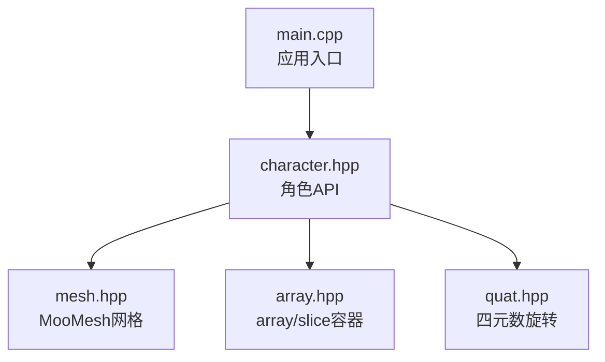
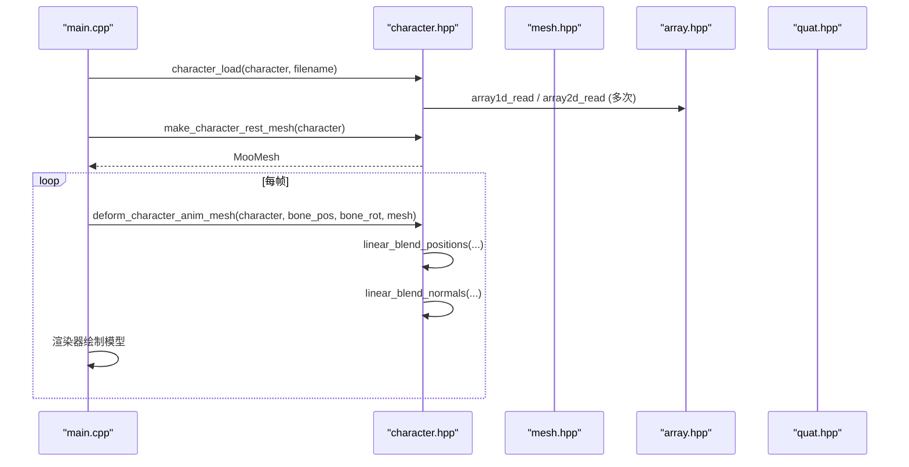
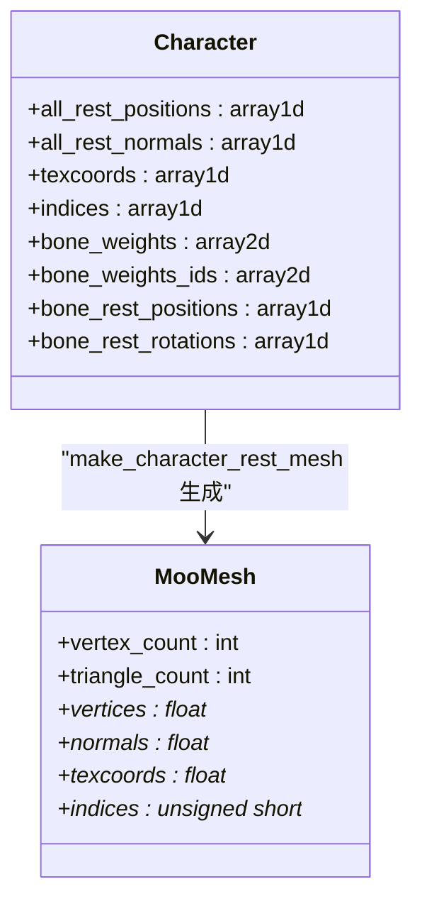
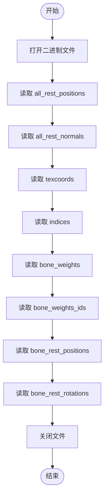
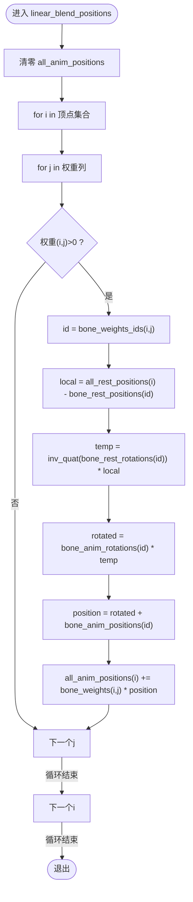
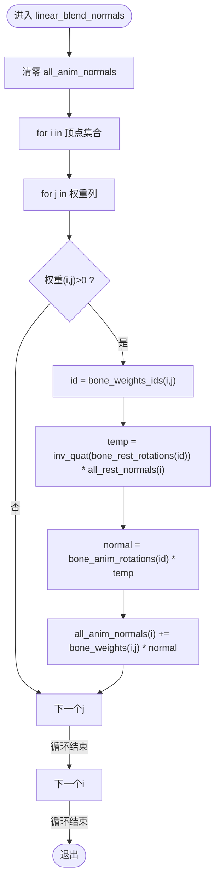
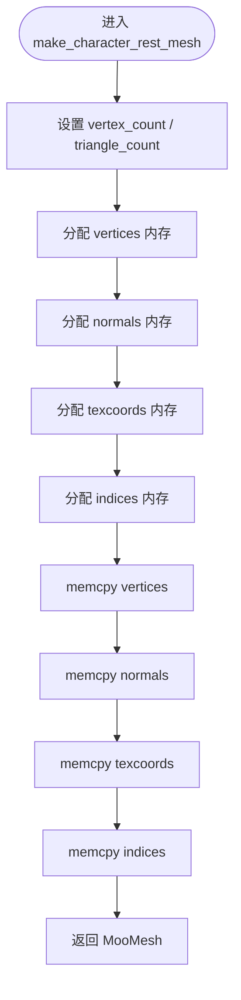
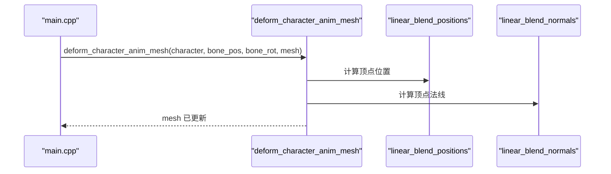
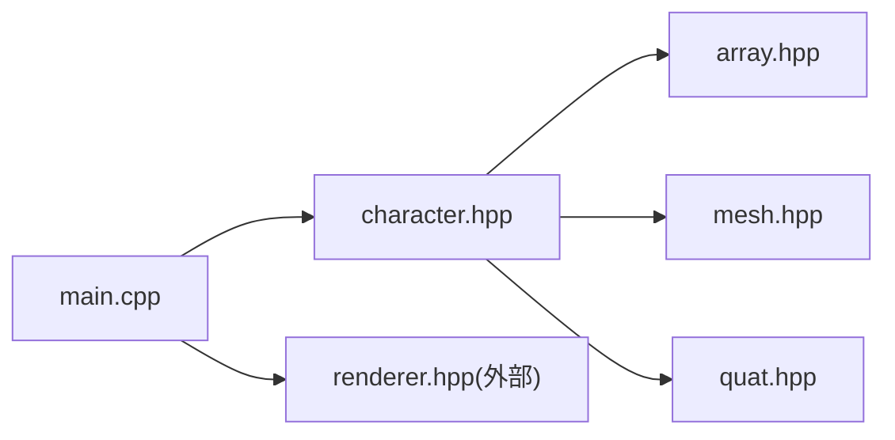
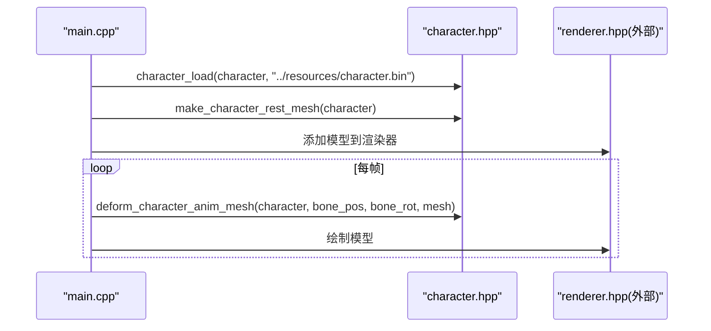

# 角色系统API

> **版本提示（2.0）**：本文撰写于 1.x 时期，描述的是旧的实现形态——入口在根目录 `main.cpp`，功能由根目录 `.hpp` 头文件库提供，窗口用 raylib、显示用 OpenCV highgui。2.0 已把这些头文件移到 `Source/Legacy/`，渲染默认走 GPU，窗口与 UI 换成 GLFW + ImGui，`main.cpp` 拆成 `Source/Launch/Private/` 下的 `Main.cpp` 与 `Application`。文中的文件路径、行号与调用链可能已失效，请以根目录的「项目概述」「快速开始」「故障排除」三篇与当前源码为准。

<cite>
**本文引用的文件**   
- [character.hpp](file://character.hpp)
- [main.cpp](file://main.cpp)
- [mesh.hpp](file://mesh.hpp)
- [array.hpp](file://array.hpp)
- [quat.hpp](file://quat.hpp)
</cite>

## 目录
1. [简介](#简介)
2. [项目结构](#项目结构)
3. [核心组件](#核心组件)
4. [架构总览](#架构总览)
5. [详细组件分析](#详细组件分析)
6. [依赖关系分析](#依赖关系分析)
7. [性能考虑](#性能考虑)
8. [故障排查指南](#故障排查指南)
9. [结论](#结论)
10. [附录：完整使用示例与最佳实践](#附录完整使用示例与最佳实践)

## 简介
本文件为“角色系统”的完整API文档，聚焦于角色网格与骨骼蒙皮的加载、静态网格构建、动画变形以及渲染流程。内容涵盖：
- Character 结构体成员定义与用途（顶点位置、法线、纹理坐标、索引、权重等）
- character_load 函数参数、返回值与二进制文件格式
- linear_blend_positions 与 linear_blend_normals 的线性混合蒙皮算法实现细节
- make_character_rest_mesh 如何从 Character 数据创建静态网格
- deform_character_anim_mesh 的动画变形过程与骨骼变换对顶点的影响
- 完整的代码级使用示例路径与错误处理、内存管理最佳实践

## 项目结构
角色系统相关代码主要位于以下头文件与主程序入口：
- character.hpp：角色数据结构与蒙皮/变形API
- mesh.hpp：渲染用网格MooMesh定义与基础几何构造
- array.hpp：一维/二维数组与切片slice工具，提供读写接口
- quat.hpp：四元数与旋转相关运算
- main.cpp：应用层集成示例，展示加载、变形与渲染流程

图表来源
- [main.cpp:53-124](file://main.cpp#L53-L124)
- [character.hpp:35-164](file://character.hpp#L35-L164)
- [mesh.hpp:6-14](file://mesh.hpp#L6-L14)
- [array.hpp:16-43](file://array.hpp#L16-L43)
- [quat.hpp:6-24](file://quat.hpp#L6-L24)

章节来源
- [main.cpp:53-124](file://main.cpp#L53-L124)
- [character.hpp:35-164](file://character.hpp#L35-L164)

## 核心组件
本节概述Character结构体及其关键API的职责与输入输出。

- Character 结构体
  - all_rest_positions：角色在绑定姿态下的所有顶点位置（每顶点一个三维向量）
  - all_rest_normals：绑定姿态下的顶点法线（每顶点一个三维向量）
  - texcoords：纹理坐标（每顶点一个二维向量）
  - indices：三角形索引（无符号短整型三元组）
  - bone_weights：每个顶点对应骨骼的权重矩阵（行=顶点，列=参与该顶点的骨骼数量）
  - bone_weights_ids：每个顶点对应的骨骼ID（与bone_weights同形）
  - bone_rest_positions：每根骨骼在绑定姿态下的世界位置
  - bone_rest_rotations：每根骨骼在绑定姿态下的世界旋转（四元数）

- character_load
  - 作用：从二进制文件读取角色数据并填充Character结构体
  - 参数：character（引用，输出），filename（C风格字符串，输入）
  - 返回：无
  - 文件顺序：all_rest_positions → all_rest_normals → texcoords → indices → bone_weights → bone_weights_ids → bone_rest_positions → bone_rest_rotations

- linear_blend_positions
  - 作用：基于多骨骼旋转和平移对顶点位置进行线性混合蒙皮
  - 输入：当前帧骨骼动画位置/旋转、绑定姿态顶点/骨骼位置/旋转、权重与权重ID
  - 输出：写入all_anim_positions（每顶点一个三维向量）

- linear_blend_normals
  - 作用：基于多骨骼旋转对顶点法线进行线性混合
  - 输入：当前帧骨骼动画旋转、绑定姿态法线与骨骼旋转、权重与权重ID
  - 输出：写入all_anim_normals（每顶点一个三维向量）

- make_character_rest_mesh
  - 作用：将Character中的静态数据拷贝到MooMesh，用于初始渲染
  - 输入：Character（只读）
  - 输出：MooMesh（包含顶点、法线、纹理坐标、索引及计数）

- deform_character_anim_mesh
  - 作用：根据当前帧骨骼动画更新MooMesh的顶点与法线
  - 输入：Character（只读）、当前帧骨骼动画位置/旋转、MooMesh（引用，输出）
  - 内部调用：linear_blend_positions 与 linear_blend_normals

章节来源
- [character.hpp:35-164](file://character.hpp#L35-L164)

## 架构总览
下图展示了角色系统在应用中的整体数据流：从二进制文件加载角色数据，构建静态网格，再在每一帧根据骨骼动画变形网格并渲染。

图表来源
- [main.cpp:72-124](file://main.cpp#L72-L124)
- [main.cpp:424-428](file://main.cpp#L424-L428)
- [character.hpp:49-66](file://character.hpp#L49-L66)
- [character.hpp:123-164](file://character.hpp#L123-L164)
- [array.hpp:91-106](file://array.hpp#L91-L106)
- [array.hpp:158-176](file://array.hpp#L158-L176)

## 详细组件分析

### Character 结构体与骨骼枚举
- Bones 枚举定义了23根骨骼的语义标识，包括躯干、四肢、头部等，便于在运动数据中按索引访问对应骨骼。
- Character 聚合了网格几何（位置、法线、UV、索引）与蒙皮信息（权重、权重ID、绑定姿态骨骼位姿）。

图表来源
- [character.hpp:8-47](file://character.hpp#L8-L47)
- [mesh.hpp:6-14](file://mesh.hpp#L6-L14)

章节来源
- [character.hpp:8-47](file://character.hpp#L8-L47)
- [mesh.hpp:6-14](file://mesh.hpp#L6-L14)

### character_load 函数与文件格式
- 功能：以二进制方式打开文件，依次读取Character各字段。
- 文件顺序（严格）：
  1. all_rest_positions（array1d<vec3>）
  2. all_rest_normals（array1d<vec3>）
  3. texcoords（array1d<vec2>）
  4. indices（array1d<unsigned short>）
  5. bone_weights（array2d<float>）
  6. bone_weights_ids（array2d<unsigned short>）
  7. bone_rest_positions（array1d<vec3>）
  8. bone_rest_rotations（array1d<quat>）
- 底层读写由 array1d_read/array2d_read 完成，先写尺寸，再写数据块。

图表来源
- [character.hpp:49-66](file://character.hpp#L49-L66)
- [array.hpp:91-106](file://array.hpp#L91-L106)
- [array.hpp:158-176](file://array.hpp#L158-L176)

章节来源
- [character.hpp:49-66](file://character.hpp#L49-L66)
- [array.hpp:91-106](file://array.hpp#L91-L106)
- [array.hpp:158-176](file://array.hpp#L158-L176)

### linear_blend_positions 线性混合蒙皮（位置）
- 输入参数说明：
  - all_anim_positions：输出缓冲区，每顶点一个三维向量
  - bone_anim_positions：当前帧每根骨骼的世界位置
  - bone_anim_rotations：当前帧每根骨骼的世界旋转（四元数）
  - all_rest_positions：绑定姿态下顶点位置
  - bone_rest_positions：绑定姿态下骨骼世界位置
  - bone_rest_rotations：绑定姿态下骨骼世界旋转（四元数）
  - bone_weights_ids：每顶点关联的骨骼ID列表
  - bone_weights：每顶点对应骨骼的权重
- 计算过程：
  - 对每个顶点i，初始化输出为零
  - 遍历该顶点关联的骨骼j：
    - 若权重>0，则取骨骼ID=id
    - 计算局部偏移：all_rest_positions[i] - bone_rest_positions[id]
    - 反旋回绑定姿态：inv_quat(bone_rest_rotations[id]) * 局部偏移
    - 应用当前帧旋转：bone_anim_rotations[id] * 上一步结果
    - 平移至当前骨骼位置：+ bone_anim_positions[id]
    - 加权累加到 all_anim_positions[i]
- 复杂度：O(V × K)，V为顶点数，K为每顶点最多影响骨骼数（通常为4）
- 数值稳定性：仅当权重>0时参与计算，避免无效骨骼贡献

图表来源
- [character.hpp:68-95](file://character.hpp#L68-L95)
- [quat.hpp:66-81](file://quat.hpp#L66-L81)
- [quat.hpp:98-101](file://quat.hpp#L98-L101)

章节来源
- [character.hpp:68-95](file://character.hpp#L68-L95)
- [quat.hpp:66-81](file://quat.hpp#L66-L81)
- [quat.hpp:98-101](file://quat.hpp#L98-L101)

### linear_blend_normals 线性混合蒙皮（法线）
- 输入参数说明：
  - all_anim_normals：输出缓冲区，每顶点一个三维向量
  - bone_anim_rotations：当前帧每根骨骼的世界旋转（四元数）
  - all_rest_normals：绑定姿态下顶点法线
  - bone_rest_rotations：绑定姿态下骨骼世界旋转（四元数）
  - bone_weights_ids：每顶点关联的骨骼ID列表
  - bone_weights：每顶点对应骨骼的权重
- 计算过程：
  - 对每个顶点i，初始化输出为零
  - 遍历该顶点关联的骨骼j：
    - 若权重>0，则取骨骼ID=id
    - 将绑定法线反旋回绑定姿态：inv_quat(bone_rest_rotations[id]) * all_rest_normals(i)
    - 应用当前帧旋转：bone_anim_rotations[id] * 上一步结果
    - 加权累加到 all_anim_normals(i)
- 注意：法线不参与位移，仅受旋转影响；通常需要在着色阶段归一化

图表来源
- [character.hpp:97-121](file://character.hpp#L97-L121)
- [quat.hpp:66-81](file://quat.hpp#L66-L81)
- [quat.hpp:98-101](file://quat.hpp#L98-L101)

章节来源
- [character.hpp:97-121](file://character.hpp#L97-L121)
- [quat.hpp:66-81](file://quat.hpp#L66-L81)
- [quat.hpp:98-101](file://quat.hpp#L98-L101)

### make_character_rest_mesh 静态网格构建
- 功能：将Character中的静态几何数据复制到MooMesh，分配GPU可消费的顶点/法线/UV/索引缓冲
- 步骤：
  - 设置顶点数与三角面数
  - 分配内存（float* 与 unsigned short*）
  - 使用memcpy拷贝数据
- 注意：该函数使用C风格的malloc/free，需确保后续释放逻辑正确

图表来源
- [character.hpp:123-140](file://character.hpp#L123-L140)
- [mesh.hpp:6-14](file://mesh.hpp#L6-L14)

章节来源
- [character.hpp:123-140](file://character.hpp#L123-L140)
- [mesh.hpp:6-14](file://mesh.hpp#L6-L14)

### deform_character_anim_mesh 动画变形
- 功能：根据当前帧骨骼动画更新MooMesh的顶点与法线
- 内部流程：
  - 调用 linear_blend_positions 更新顶点位置
  - 调用 linear_blend_normals 更新顶点法线
- 输入：
  - Character（只读）
  - bone_anim_positions/bone_anim_rotations（当前帧骨骼位姿）
  - mesh（引用，输出）

图表来源
- [character.hpp:142-164](file://character.hpp#L142-L164)
- [character.hpp:68-121](file://character.hpp#L68-L121)

章节来源
- [character.hpp:142-164](file://character.hpp#L142-L164)

## 依赖关系分析
- character.hpp 依赖：
  - array.hpp：提供array1d/array2d与slice1d/slice2d，以及读写接口
  - mesh.hpp：提供MooMesh结构
  - quat.hpp：提供四元数与旋转操作
- main.cpp 集成：
  - 加载角色与数据库
  - 构建静态网格并转换为模型
  - 每帧更新骨骼动画并变形网格
  - 渲染模型与光源

图表来源
- [character.hpp:4-6](file://character.hpp#L4-L6)
- [main.cpp:8-17](file://main.cpp#L8-L17)

章节来源
- [character.hpp:4-6](file://character.hpp#L4-L6)
- [main.cpp:8-17](file://main.cpp#L8-L17)

## 性能考虑
- 时间复杂度
  - linear_blend_positions/normals：O(V × K)，其中V为顶点数，K为每顶点最多影响骨骼数（典型值为4）
  - 可通过限制K值与跳过零权重优化
- 空间复杂度
  - Character存储原始几何与蒙皮数据，MooMesh存储副本；注意重复分配带来的内存占用
- I/O
  - character_load使用顺序二进制读取，建议批量预加载以减少IO开销
- 数值精度
  - 法线在混合后建议在着色阶段归一化，避免光照误差
- 并行化
  - 顶点循环可并行化（OpenMP/CPU多线程或GPU Compute Shader）
- 缓存友好
  - 将权重与ID布局为紧凑结构，减少跨步访问

[本节为通用指导，不直接分析具体文件]

## 故障排查指南
- 文件加载失败
  - fopen返回空指针：检查文件路径与权限
  - assert断言失败：确认二进制文件格式与顺序一致
- 内存问题
  - malloc失败：检查可用内存与分配大小
  - 未释放内存：确保在应用退出前释放MooMesh分配的缓冲
- 渲染异常
  - 顶点/法线未更新：确认deform_character_anim_mesh在每帧被调用
  - 法线方向异常：检查四元数旋转方向与坐标系约定
- 性能瓶颈
  - 高顶点数或大权重列：考虑减少K值或使用GPU蒙皮

章节来源
- [character.hpp:49-66](file://character.hpp#L49-L66)
- [character.hpp:123-140](file://character.hpp#L123-L140)

## 结论
角色系统通过Character结构体集中管理网格与蒙皮数据，并提供简洁的API完成从二进制文件加载、静态网格构建到动画变形的全流程。linear_blend_positions与linear_blend_normals实现了标准的线性混合蒙皮，配合bones枚举与绑定姿态数据，能够高效驱动复杂角色动画。结合main.cpp的集成示例，开发者可以快速上手并进行扩展与优化。

[本节为总结性内容，不直接分析具体文件]

## 附录：完整使用示例与最佳实践

### 使用流程概览
- 初始化窗口与相机
- 加载角色数据（character_load）
- 构建静态网格（make_character_rest_mesh）
- 将网格转为模型并加入渲染器
- 每帧：
  - 获取或计算当前帧骨骼动画（位置/旋转）
  - 调用 deform_character_anim_mesh 更新网格
  - 渲染模型

图表来源
- [main.cpp:72-124](file://main.cpp#L72-L124)
- [main.cpp:424-428](file://main.cpp#L424-L428)
- [character.hpp:49-66](file://character.hpp#L49-L66)
- [character.hpp:123-164](file://character.hpp#L123-L164)

### 代码示例路径
- 加载角色与构建静态网格：
  - [main.cpp:72-124](file://main.cpp#L72-L124)
- 每帧变形网格并渲染：
  - [main.cpp:424-428](file://main.cpp#L424-L428)

### 错误处理与内存管理最佳实践
- 文件I/O
  - 在character_load中检查fopen返回值，必要时返回错误码或抛出异常
  - 确保fclose在所有路径上执行（包括异常分支）
- 内存分配
  - make_character_rest_mesh使用malloc分配缓冲，应在应用退出或网格销毁时free
  - 建议使用RAII封装MooMesh，自动管理生命周期
- 数值稳定
  - 在着色阶段对法线进行归一化
  - 对接近单位四元数的情况做特殊处理以避免除零或NaN
- 性能优化
  - 将权重与ID合并为紧凑结构，提升缓存命中率
  - 对顶点循环进行SIMD或并行化优化
  - 预计算绑定姿态下的逆旋转，减少每帧计算量

章节来源
- [character.hpp:49-66](file://character.hpp#L49-L66)
- [character.hpp:123-140](file://character.hpp#L123-L140)
- [main.cpp:72-124](file://main.cpp#L72-L124)
- [main.cpp:424-428](file://main.cpp#L424-L428)