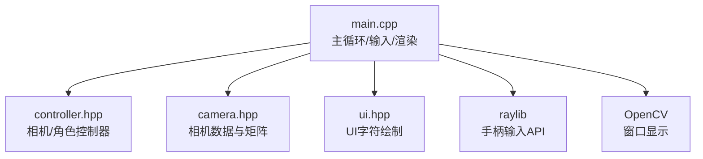
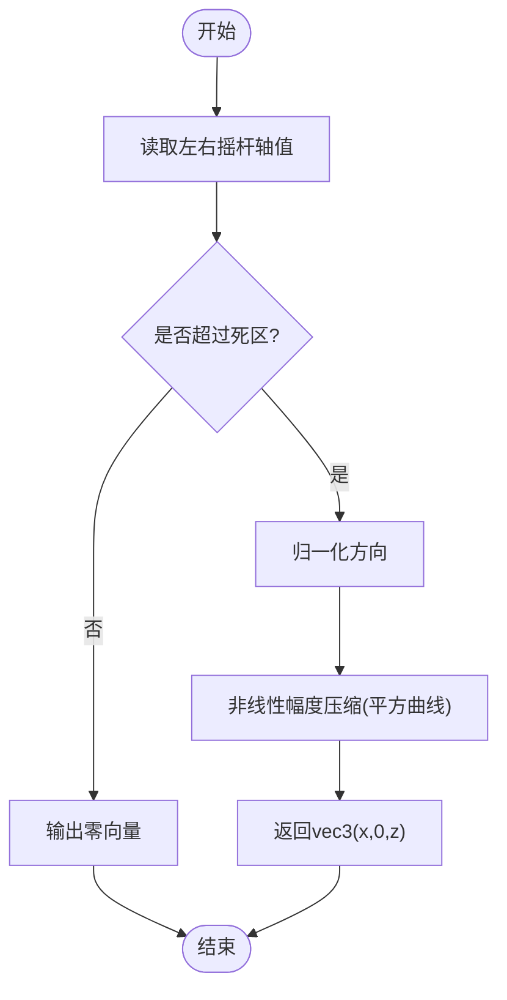
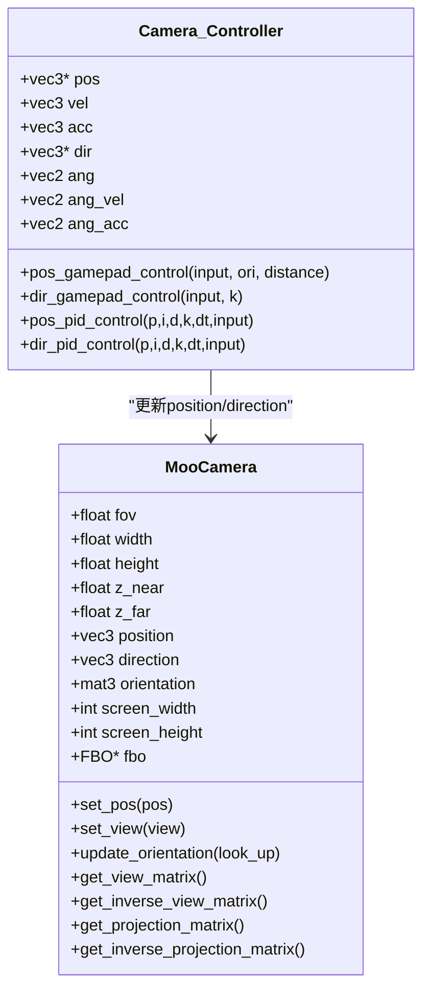
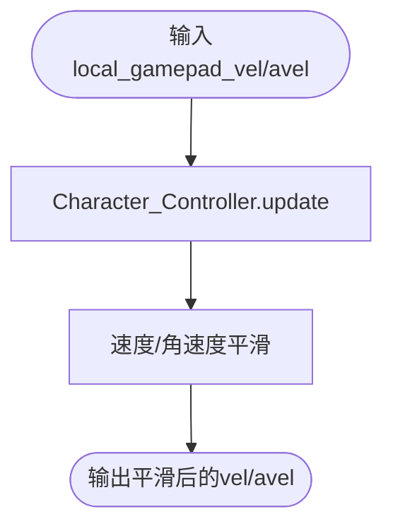
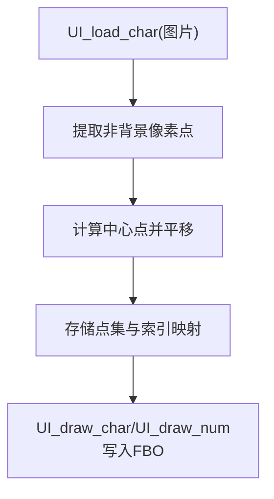
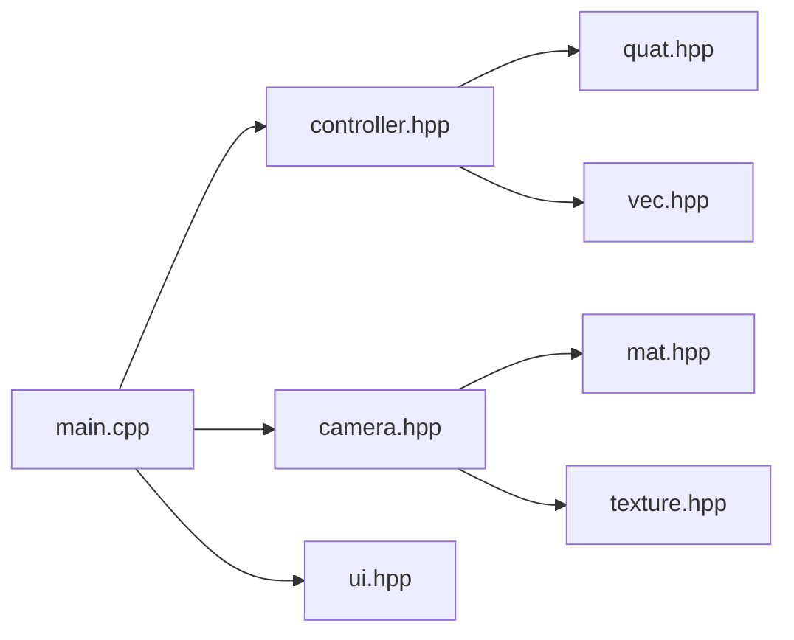

# 交互系统

> **版本提示（2.0）**：本文撰写于 1.x 时期，描述的是旧的实现形态——入口在根目录 `main.cpp`，功能由根目录 `.hpp` 头文件库提供，窗口用 raylib、显示用 OpenCV highgui。2.0 已把这些头文件移到 `Source/Legacy/`，渲染默认走 GPU，窗口与 UI 换成 GLFW + ImGui，`main.cpp` 拆成 `Source/Launch/Private/` 下的 `Main.cpp` 与 `Application`。文中的文件路径、行号与调用链可能已失效，请以根目录的「项目概述」「快速开始」「故障排除」三篇与当前源码为准。

<cite>
**本文引用的文件**   
- [main.cpp](file://main.cpp)
- [controller.hpp](file://controller.hpp)
- [camera.hpp](file://camera.hpp)
- [ui.hpp](file://ui.hpp)
- [README.md](file://README.md)
</cite>

## 目录
1. [简介](#简介)
2. [项目结构](#项目结构)
3. [核心组件](#核心组件)
4. [架构总览](#架构总览)
5. [详细组件分析](#详细组件分析)
6. [依赖关系分析](#依赖关系分析)
7. [性能与扩展性](#性能与扩展性)
8. [故障排查指南](#故障排查指南)
9. [结论](#结论)
10. [附录：输入设备扩展指南](#附录输入设备扩展指南)

## 简介
本技术文档聚焦于 MooLab 交互系统，围绕以下目标展开：
- 手柄输入处理机制：按键映射、摇杆输入、震动反馈（现状说明）
- 相机控制系统设计：第一人称视角、第三人称跟随、自由视角等模式实现思路
- 用户界面系统架构：UI 元素管理、事件处理、界面布局
- 输入设备扩展：如何接入更多类型的控制器和设备
- 交互逻辑应用示例：通过用户输入控制角色行为与相机视角
- 与主游戏循环的集成方式及输入事件传播机制

本项目基于 raylib 获取手柄信号，结合自研仿真器与渲染管线完成实时可视化。当前代码库中未包含震动反馈相关 API 调用；相机模式以“跟随角色”的第三人称为主，第一人称/自由视角可通过现有控制器接口扩展。

**章节来源**
- [README.md:1-22](file://README.md#L1-L22)

## 项目结构
交互系统相关文件与职责概览：
- main.cpp：主循环、资源初始化、手柄输入采集、相机更新、渲染与 OpenCV 显示
- controller.hpp：相机控制器（PID/手柄控制）、角色控制器（速度平滑与状态机占位）
- camera.hpp：相机数据结构与视图/投影矩阵计算
- ui.hpp：像素级 UI 字符绘制（数字/字母），用于调试信息叠加



**图表来源**
- [main.cpp:53-160](file://main.cpp#L53-L160)
- [controller.hpp:7-108](file://controller.hpp#L7-L108)
- [camera.hpp:7-36](file://camera.hpp#L7-L36)
- [ui.hpp:13-18](file://ui.hpp#L13-L18)

**章节来源**
- [main.cpp:53-160](file://main.cpp#L53-L160)
- [controller.hpp:7-108](file://controller.hpp#L7-L108)
- [camera.hpp:7-36](file://camera.hpp#L7-L36)
- [ui.hpp:13-18](file://ui.hpp#L13-L18)

## 核心组件
- 手柄输入采集与预处理
  - 左摇杆：全局移动方向（经相机朝向旋转后映射为角色的局部速度）
  - 右摇杆：相机方向控制（水平偏航角与垂直俯仰角）
  - 死区处理与非线性缩放，提升操控手感
- 相机控制系统
  - 位置控制：pos_gamepad_control 将角色位置作为参考点，沿相机朝向偏移固定距离
  - 方向控制：dir_gamepad_control 根据右摇杆调整球坐标角度并更新方向向量
  - PID 控制接口预留：pos_pid_control/dir_pid_control 可用于更平滑的跟踪
- 角色控制器
  - Character_Controller.update 对速度与角速度进行多帧平滑，便于动作匹配或运动规划
- UI 系统
  - 基于像素点的字符模板，支持数字与字母绘制到 FBO，用于调试信息叠加

**章节来源**
- [main.cpp:30-51](file://main.cpp#L30-L51)
- [main.cpp:223-233](file://main.cpp#L223-L233)
- [main.cpp:440-451](file://main.cpp#L440-L451)
- [controller.hpp:8-108](file://controller.hpp#L8-L108)
- [controller.hpp:120-162](file://controller.hpp#L120-L162)
- [ui.hpp:20-150](file://ui.hpp#L20-L150)

## 架构总览
交互系统在主循环中的执行顺序如下：
1. 读取左右摇杆输入并进行死区与非线性处理
2. 将左摇杆输入转换为全局速度/角速度，再转为角色局部坐标系下的期望速度
3. 使用角色控制器进行速度平滑
4. 驱动仿真器更新物理状态（重力、阻尼、接触、力矩控制）
5. 更新相机位置与方向（跟随角色）
6. 渲染场景至 FBO，并通过 OpenCV 窗口显示
7. 可选：在 FBO 上绘制 UI 调试信息

```mermaid
sequenceDiagram
participant Loop as "主循环(main.cpp)"
participant Input as "手柄输入(gamepad_get_stick)"
participant CC as "相机控制器(Camera_Controller)"
participant Sim as "仿真器(Simulator)"
participant Cam as "相机(MooCamera)"
participant Render as "渲染(draw)"
participant CV as "OpenCV显示"
Loop->>Input : 读取左右摇杆
Input-->>Loop : 返回标准化向量
Loop->>Loop : 计算全局/局部速度
Loop->>Sim : 物理步进(重力/阻尼/接触/控制)
Sim-->>Loop : 更新骨骼/模型姿态
Loop->>CC : dir_gamepad_control(右摇杆)
Loop->>CC : pos_gamepad_control(角色位置+朝向)
CC-->>Cam : 更新position/direction
Loop->>Render : 渲染场景到FBO
Render-->>CV : 图像转OpenCV并显示
```

**图表来源**
- [main.cpp:223-233](file://main.cpp#L223-L233)
- [main.cpp:317-345](file://main.cpp#L317-L345)
- [main.cpp:440-451](file://main.cpp#L440-L451)
- [main.cpp:466-472](file://main.cpp#L466-L472)
- [main.cpp:508-509](file://main.cpp#L508-L509)

## 详细组件分析

### 手柄输入处理
- 摇杆读取与预处理
  - 使用 raylib 的 GetGamepadAxisMovement 获取左右摇杆轴值
  - 计算模长，超过死区时归一化方向并按平方曲线压缩幅度，增强精细操控
  - 返回 vec3(x, 0, z)，其中 y 恒为 0，表示平面移动
- 输入到控制的映射
  - 左摇杆：乘以系数后按相机朝向旋转到世界空间，得到 global_gamepad_vel
  - 根据角色朝向计算 global_gamepad_avel（用于转向意图表达）
  - 再将 global 速度转换回角色局部坐标系 local_gamepad_vel/avel，供后续控制使用



**图表来源**
- [main.cpp:30-51](file://main.cpp#L30-L51)

**章节来源**
- [main.cpp:30-51](file://main.cpp#L30-L51)
- [main.cpp:223-233](file://main.cpp#L223-L233)

### 相机控制系统
- 相机控制器 Camera_Controller
  - 成员：位置指针、方向指针、球坐标角度(ang)、角速度/加速度
  - 方法：
    - pos_gamepad_control：以输入点为参考，沿相机朝向偏移固定距离设置相机位置
    - dir_gamepad_control：根据输入调整球坐标角度并更新方向向量
    - pos_pid_control/dir_pid_control：PID 控制接口，用于平滑跟踪目标位置/方向
  - bind_controller：绑定相机位置与方向指针，并初始化角度
- 相机 MooCamera
  - 维护 position、direction、orientation、视锥参数、屏幕尺寸、FBO
  - 提供 get_view_matrix/get_projection_matrix 等矩阵生成方法



**图表来源**
- [controller.hpp:7-108](file://controller.hpp#L7-L108)
- [camera.hpp:7-36](file://camera.hpp#L7-L36)

**章节来源**
- [controller.hpp:7-108](file://controller.hpp#L7-L108)
- [camera.hpp:7-36](file://camera.hpp#L7-L36)
- [main.cpp:63-68](file://main.cpp#L63-L68)
- [main.cpp:440-451](file://main.cpp#L440-L451)

### 角色控制器与交互逻辑
- Character_Controller.update
  - 维护最近几帧的速度/角速度缓存，并进行加权平滑，降低突变
  - 记录上一帧旋转 rotation0，用于将历史速度变换到当前局部坐标系
- 主循环中：
  - 将左摇杆输入转换为局部速度/角速度
  - 可调用 update 进行平滑（当前代码注释部分展示了 motion matching 的触发条件）
  - 将平滑后的速度/角速度用于动作选择或仿真控制（当前演示以仿真器为主）



**图表来源**
- [controller.hpp:120-162](file://controller.hpp#L120-L162)
- [main.cpp:223-233](file://main.cpp#L223-L233)

**章节来源**
- [controller.hpp:120-162](file://controller.hpp#L120-L162)
- [main.cpp:223-233](file://main.cpp#L223-L233)

### 用户界面系统
- UI 字符模板加载
  - UI_load_char：从图片中提取非背景像素点，计算中心点并平移，存储为点集
  - 建立字符到索引的映射表 distances
- UI 绘制
  - UI_draw_char/UI_draw_num：根据字符/数字查找点集，写入 FBO 指定颜色
  - 支持数字 0-100 的两位数字绘制（个位与十位分别定位）



**图表来源**
- [ui.hpp:20-72](file://ui.hpp#L20-L72)
- [ui.hpp:74-150](file://ui.hpp#L74-L150)

**章节来源**
- [ui.hpp:20-150](file://ui.hpp#L20-L150)

## 依赖关系分析
- 外部依赖
  - raylib：提供窗口、渲染、手柄输入 API
  - OpenCV：用于窗口显示渲染结果
- 内部模块耦合
  - main.cpp 依赖 controller.hpp、camera.hpp、ui.hpp
  - controller.hpp 依赖 quat.hpp、vec.hpp（数学基础）
  - camera.hpp 依赖 mat.hpp、texture.hpp（矩阵与纹理/FBO）



**图表来源**
- [main.cpp:8-17](file://main.cpp#L8-L17)
- [controller.hpp:4-5](file://controller.hpp#L4-L5)
- [camera.hpp:4-5](file://camera.hpp#L4-L5)

**章节来源**
- [main.cpp:8-17](file://main.cpp#L8-L17)
- [controller.hpp:4-5](file://controller.hpp#L4-L5)
- [camera.hpp:4-5](file://camera.hpp#L4-L5)

## 性能与扩展性
- 性能要点
  - 摇杆输入预处理采用轻量数学运算，开销极低
  - 相机控制使用球坐标角度增量更新，避免频繁四元数插值
  - UI 绘制直接写像素到 FBO，适合调试信息叠加，但大量绘制会影响帧率
- 扩展建议
  - 增加震动反馈：可在主循环中调用 SetGamepadVibration 对应 API（当前代码未使用）
  - 多设备支持：扩展枚举 GAMEPAD_PLAYER 与轴常量，支持多个手柄
  - 相机模式切换：在第一人称/自由视角下，修改 dir_gamepad_control 与 pos_gamepad_control 的行为

[本节为通用指导，不直接分析具体文件]

## 故障排查指南
- 摇杆无响应
  - 检查 deadzone 阈值是否过大，导致输入被清零
  - 确认 raylib 正确识别手柄设备
- 相机抖动或不稳定
  - 调整 dir_gamepad_control 的增益 k，或启用 dir_pid_control 进行平滑
  - 检查相机朝向 look_up 向量是否正确
- UI 字符错位或不可见
  - 确认 UI_load_char 的图片背景色阈值是否合适
  - 检查 UI_draw_* 的目标 FBO 尺寸与坐标范围

**章节来源**
- [main.cpp:30-51](file://main.cpp#L30-L51)
- [controller.hpp:96-101](file://controller.hpp#L96-L101)
- [ui.hpp:20-72](file://ui.hpp#L20-L72)

## 结论
MooLab 的交互系统以简洁高效的输入预处理为基础，结合相机控制器与角色控制器，实现了稳定的第三人称跟随视角与角色运动控制。UI 子系统提供像素级绘制能力，便于调试与信息叠加。未来可扩展震动反馈、多设备支持与多种相机模式，进一步提升交互体验。

[本节为总结性内容，不直接分析具体文件]

## 附录：输入设备扩展指南
- 按键映射
  - 在 main.cpp 中扩展按键检测逻辑，例如读取键盘/鼠标状态，映射到角色速度/角速度或相机控制
- 摇杆输入
  - 复用 gamepad_get_stick 的预处理流程，适配不同设备的轴映射
- 震动反馈
  - 在合适的时机调用 SetGamepadVibration(left_motor, right_motor, duration)（需引入 raylib 震动 API）
- 多设备
  - 扩展 GAMEPAD_PLAYER 枚举，遍历多个手柄索引，聚合输入或独立控制
- 事件传播
  - 建议在 main.cpp 中定义统一的事件总线，将输入事件分发到角色控制器、相机控制器与 UI 层

[本节为概念性指导，不直接分析具体文件]