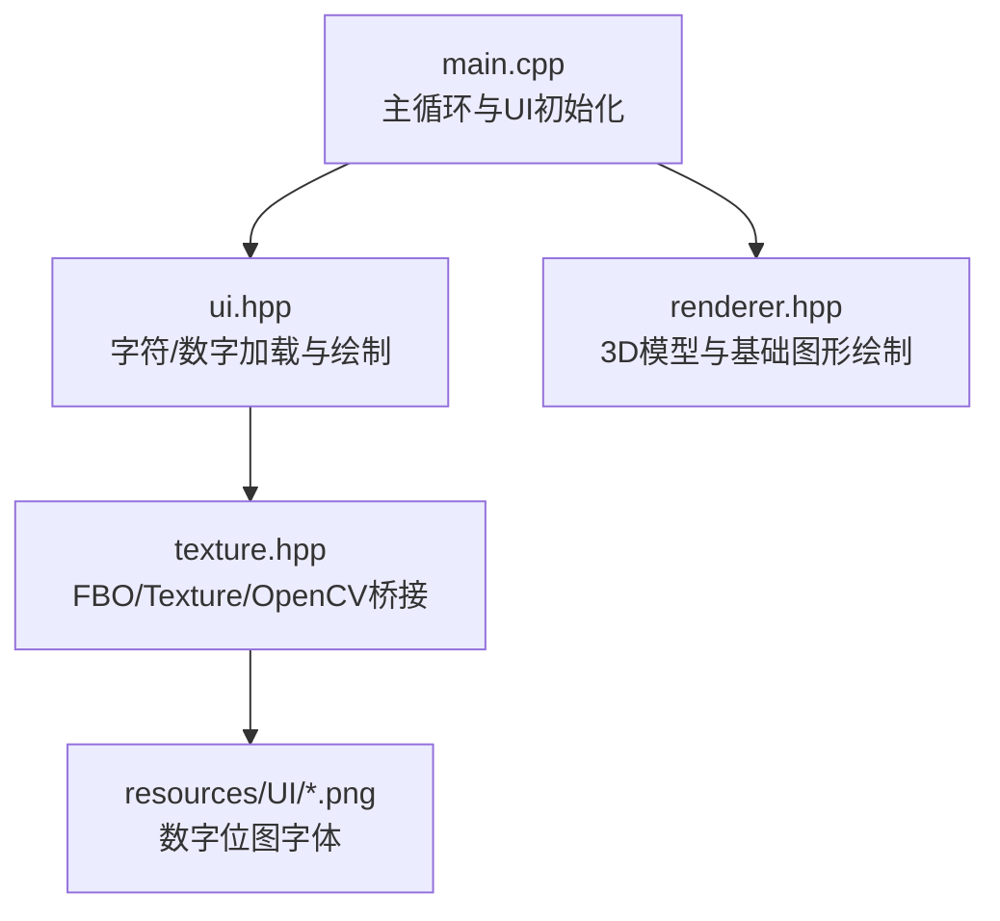
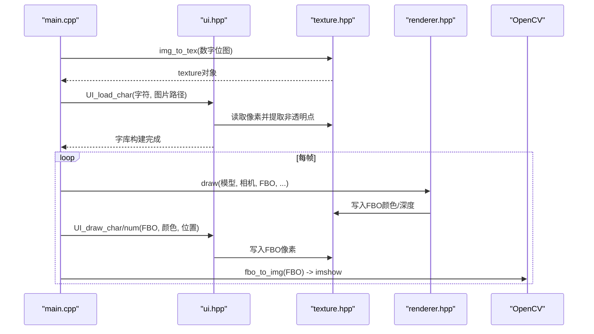
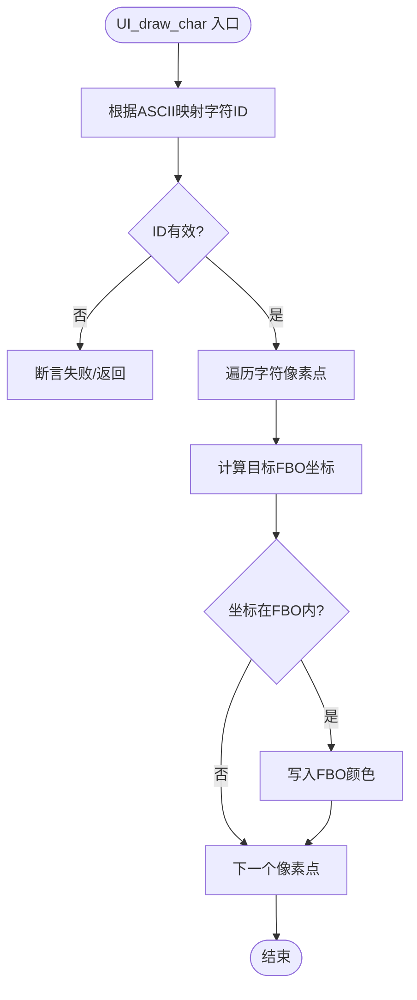
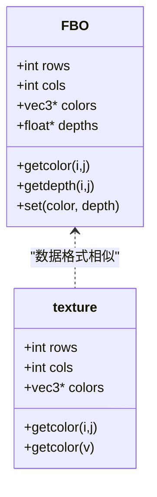
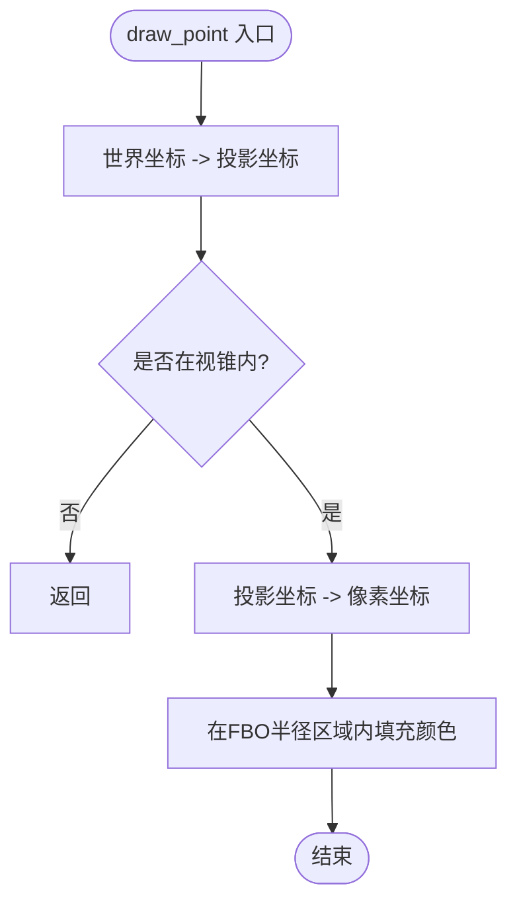
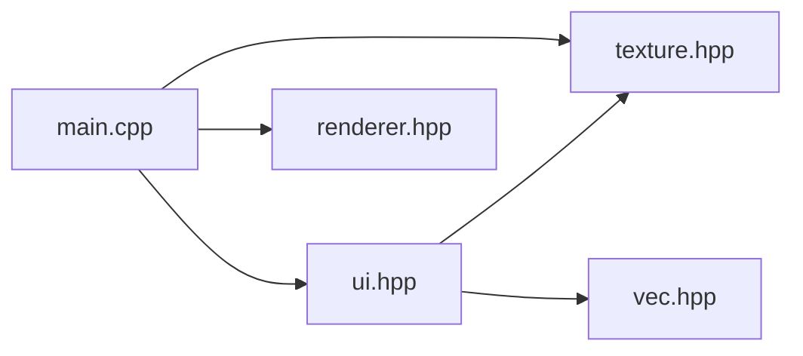

# 用户界面系统

> **版本提示（2.0）**：本文撰写于 1.x 时期，描述的是旧的实现形态——入口在根目录 `main.cpp`，功能由根目录 `.hpp` 头文件库提供，窗口用 raylib、显示用 OpenCV highgui。2.0 已把这些头文件移到 `Source/Legacy/`，渲染默认走 GPU，窗口与 UI 换成 GLFW + ImGui，`main.cpp` 拆成 `Source/Launch/Private/` 下的 `Main.cpp` 与 `Application`。文中的文件路径、行号与调用链可能已失效，请以根目录的「项目概述」「快速开始」「故障排除」三篇与当前源码为准。

<cite>
**本文引用的文件**   
- [ui.hpp](file://ui.hpp)
- [main.cpp](file://main.cpp)
- [texture.hpp](file://texture.hpp)
- [vec.hpp](file://vec.hpp)
- [renderer.hpp](file://renderer.hpp)
</cite>

## 目录
1. [简介](#简介)
2. [项目结构](#项目结构)
3. [核心组件](#核心组件)
4. [架构总览](#架构总览)
5. [详细组件分析](#详细组件分析)
6. [依赖关系分析](#依赖关系分析)
7. [性能考量](#性能考量)
8. [故障排查指南](#故障排查指南)
9. [结论](#结论)
10. [附录：UI开发示例与扩展指南](#附录ui开发示例与扩展指南)

## 简介
本技术文档聚焦于MooLab中的用户界面（UI）子系统，该系统基于像素级绘制实现，通过离屏缓冲（FBO）将字符/数字等UI元素直接写入颜色缓冲区，再与主渲染管线结合输出到OpenCV窗口。文档将深入解释UI组件的架构设计、界面元素管理、事件处理机制、布局方式，以及与主游戏循环的集成；同时给出响应式设计的思路、定制与扩展方法，并提供交互式界面的开发示例。

## 项目结构
- UI相关头文件位于根目录：ui.hpp
- UI资源为位图字体图片，位于 resources/UI/0.png ~ 9.png
- 主程序入口 main.cpp 负责初始化UI字库、构建渲染器、运行主循环并显示结果
- 纹理与离屏缓冲定义在 texture.hpp，向量数学工具在 vec.hpp
- 渲染管线在 renderer.hpp，提供点、线、曲线绘制以及模型光栅化

图表来源
- [main.cpp:137-149](file://main.cpp#L137-L149)
- [ui.hpp:20-150](file://ui.hpp#L20-L150)
- [texture.hpp:11-63](file://texture.hpp#L11-L63)
- [renderer.hpp:241-379](file://renderer.hpp#L241-L379)

章节来源
- [main.cpp:53-160](file://main.cpp#L53-L160)
- [ui.hpp:1-152](file://ui.hpp#L1-L152)
- [texture.hpp:11-112](file://texture.hpp#L11-L112)

## 核心组件
- MooUI/Moochar：UI字库容器与单个字符的像素点集
- UI_load_char：从位图字体图片解析非透明像素点，归一化中心后存入字库
- UI_draw_char/UI_draw_num：根据字符或数字索引，将对应像素点写入FBO指定位置
- FBO/texture：离屏缓冲与纹理数据结构，提供颜色/深度访问与图像转换
- 渲染器draw_point/draw_line/draw_curve：提供基础2D图形绘制能力，可与UI组合使用

章节来源
- [ui.hpp:7-18](file://ui.hpp#L7-L18)
- [ui.hpp:20-150](file://ui.hpp#L20-L150)
- [texture.hpp:11-63](file://texture.hpp#L11-L63)
- [renderer.hpp:241-379](file://renderer.hpp#L241-L379)

## 架构总览
UI子系统采用“离线像素绘制 + 主渲染管线”的混合架构：
- 启动阶段：main.cpp加载数字位图字体至MooUI
- 每帧：主循环更新仿真/相机/灯光，调用渲染器绘制3D场景到FBO
- UI层：在FBO上以像素坐标直接写入字符/数字的颜色值，叠加到场景之上
- 输出：将FBO转换为OpenCV图像并显示

图表来源
- [main.cpp:137-149](file://main.cpp#L137-L149)
- [main.cpp:467-508](file://main.cpp#L467-L508)
- [ui.hpp:20-150](file://ui.hpp#L20-L150)
- [texture.hpp:55-63](file://texture.hpp#L55-L63)
- [renderer.hpp:213-239](file://renderer.hpp#L213-L239)

## 详细组件分析

### UI字库与字符绘制（ui.hpp）
- 数据结构
  - Moochar：包含字符名与其像素点集合（相对中心偏移）
  - MooUI：维护字符ID映射、字符列表与容量计数
- 关键流程
  - UI_load_char：读取位图，扫描非透明像素，计算包围盒中心，将像素点相对中心归一化，建立字符ID映射
  - UI_draw_char：根据ASCII码映射到字库索引，遍历像素点写入FBO指定位置
  - UI_draw_num：支持0-100的数字绘制，按个位/十位分别定位绘制
- 复杂度
  - 加载：O(W*H)，W/H为位图宽高
  - 绘制：O(P)，P为字符像素点数
- 错误处理
  - 越界检查：确保写入FBO坐标在有效范围内
  - 断言：字符ID有效性校验

图表来源
- [ui.hpp:74-101](file://ui.hpp#L74-L101)

章节来源
- [ui.hpp:7-18](file://ui.hpp#L7-L18)
- [ui.hpp:20-150](file://ui.hpp#L20-L150)

### 离屏缓冲与纹理（texture.hpp）
- FBO：二维颜色/深度缓冲，提供行列尺寸与像素访问接口
- texture：内存纹理，支持浮点坐标采样
- 辅助函数
  - concatenate_two_fbos：拼接两个FBO（用于多视图/分屏）
  - fbo_to_img/tex_to_img：与OpenCV Mat互转
  - img_to_tex：从图片文件创建纹理

图表来源
- [texture.hpp:11-34](file://texture.hpp#L11-L34)
- [texture.hpp:65-84](file://texture.hpp#L65-L84)

章节来源
- [texture.hpp:11-112](file://texture.hpp#L11-L112)

### 基础图形绘制（renderer.hpp）
- draw_point：投影变换后在FBO中画点
- draw_line：Bresenham算法绘制直线
- draw_curve：根据速度预测绘制曲线轨迹
- 这些函数可直接与UI组合，形成调试可视化或HUD元素

图表来源
- [renderer.hpp:241-265](file://renderer.hpp#L241-L265)

章节来源
- [renderer.hpp:241-379](file://renderer.hpp#L241-L379)

## 依赖关系分析
- ui.hpp 依赖 texture.hpp（img_to_tex/FBO）、vec.hpp（vec2/vec3）
- main.cpp 引入 ui.hpp、renderer.hpp、texture.hpp，并在主循环中协调UI与渲染
- 资源依赖：resources/UI/*.png 作为数字位图字体

图表来源
- [ui.hpp:4-5](file://ui.hpp#L4-L5)
- [main.cpp:8-17](file://main.cpp#L8-L17)

章节来源
- [ui.hpp:1-152](file://ui.hpp#L1-L152)
- [main.cpp:1-17](file://main.cpp#L1-L17)

## 性能考量
- 字库加载一次性开销：O(W*H)扫描位图，建议预加载并缓存
- 每帧UI绘制：取决于字符数与像素密度，尽量合并绘制区域以减少边界判断
- FBO写入：直接像素写入效率高，但应避免频繁跨区写入造成缓存抖动
- 与渲染管线耦合：UI绘制在3D场景之后，避免遮挡问题；必要时可分层渲染

[本节为通用指导，不直接分析具体文件]

## 故障排查指南
- 字符未显示
  - 检查位图路径是否正确，是否成功加载为texture
  - 确认字符ID映射逻辑与ASCII范围匹配
- 字符错位或溢出
  - 检查UI_draw_char传入的起始坐标是否在FBO范围内
  - 确认FBO尺寸与窗口分辨率一致
- 颜色异常
  - 检查颜色值是否被clampv截断
  - 确认FBO颜色通道顺序与OpenCV转换一致

章节来源
- [ui.hpp:74-101](file://ui.hpp#L74-L101)
- [texture.hpp:55-63](file://texture.hpp#L55-L63)

## 结论
MooLab的UI子系统以轻量级像素绘制为核心，通过位图字体与FBO直接写入的方式，实现了高效且灵活的界面叠加。该方案与主渲染管线解耦清晰，便于扩展自定义控件与调试可视化。尽管当前主要面向数字显示，但其架构为后续扩展文本、按钮、滑块等交互控件提供了坚实基础。

[本节为总结性内容，不直接分析具体文件]

## 附录：UI开发示例与扩展指南

### 创建交互式界面与控制面板
- 步骤概览
  - 在主循环前加载所需数字/字符位图至MooUI
  - 在每帧渲染后，调用UI_draw_char/UI_draw_num绘制状态信息（如时间、帧号、参数）
  - 使用renderer.hpp的基础绘图函数绘制指示线、点、曲线，增强可读性
  - 将FBO转为OpenCV图像并显示，结合cv::createTrackbar实现实时参数调节

- 参考路径
  - 字库初始化：[main.cpp:137-149](file://main.cpp#L137-L149)
  - 每帧渲染与显示：[main.cpp:467-508](file://main.cpp#L467-L508)
  - OpenCV滑条示例：[main.cpp:214-218](file://main.cpp#L214-L218)

章节来源
- [main.cpp:137-149](file://main.cpp#L137-L149)
- [main.cpp:214-218](file://main.cpp#L214-L218)
- [main.cpp:467-508](file://main.cpp#L467-L508)

### 自定义控件
- 文本控件：扩展UI_load_char以支持更多字符，或引入字体打包工具生成完整字库
- 进度条/滑块：利用draw_line与UI_draw_num组合绘制刻度与指针
- 图标按钮：新增位图图标，复用UI_draw_char的像素写入逻辑

章节来源
- [ui.hpp:20-150](file://ui.hpp#L20-L150)
- [renderer.hpp:241-379](file://renderer.hpp#L241-L379)

### 主题样式
- 颜色主题：统一封装颜色常量，通过UI_draw_*的参数传入不同配色
- 字号缩放：调整位图字体尺寸或在绘制时进行像素缩放（需扩展UI_draw_*）

章节来源
- [ui.hpp:74-150](file://ui.hpp#L74-L150)

### 动画效果
- 淡入淡出：在每帧对颜色值进行插值后再写入FBO
- 滚动文字：逐列移动像素点集合，配合定时器控制帧率

章节来源
- [ui.hpp:74-150](file://ui.hpp#L74-L150)

### 响应式设计与自适应布局
- 适配不同分辨率：根据FBO尺寸动态计算UI元素的起始坐标与间距
- 分屏显示：使用concatenate_two_fbos拼接多个视图，左侧场景右侧UI

章节来源
- [texture.hpp:36-53](file://texture.hpp#L36-L53)