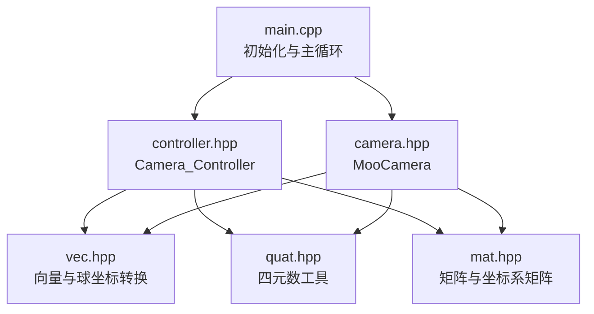
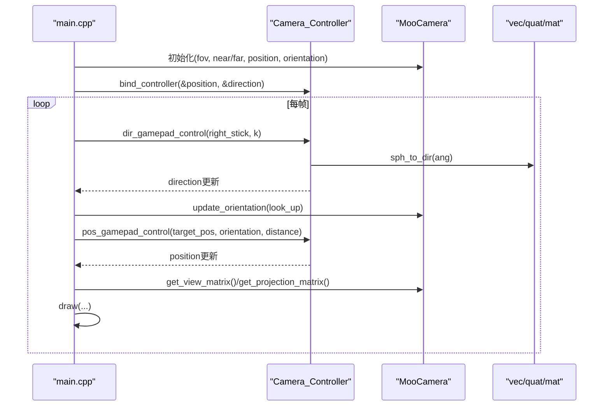
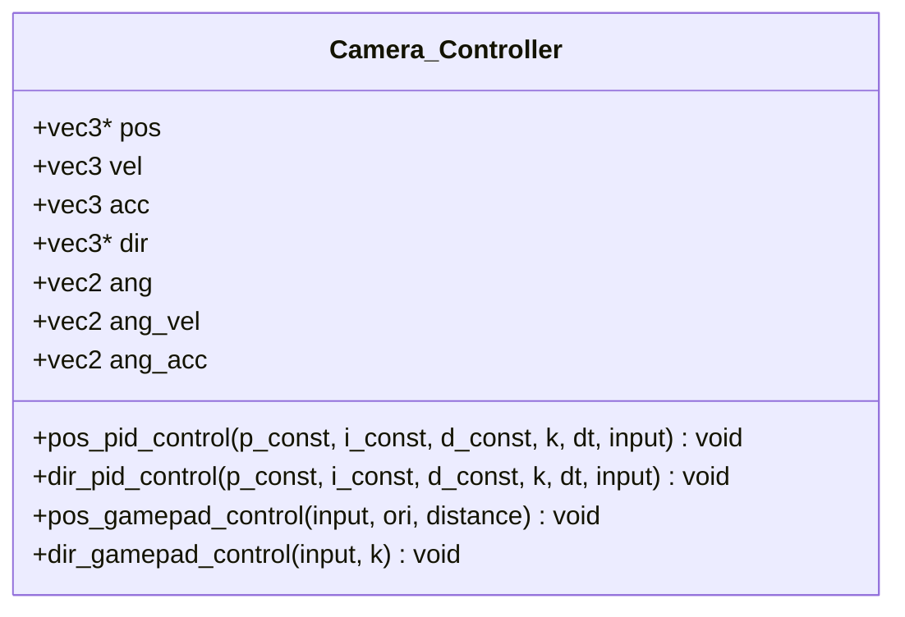
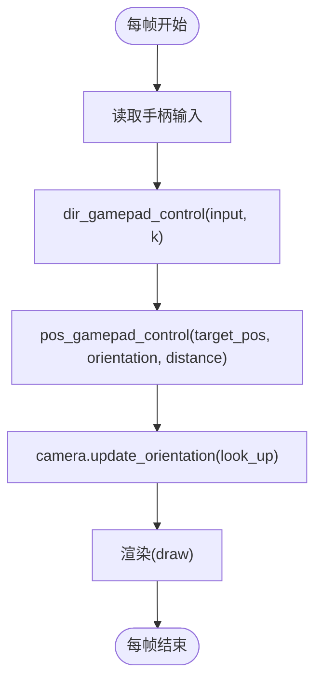
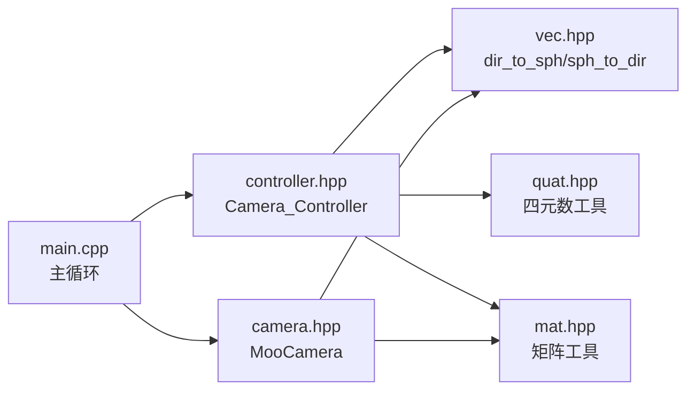

# 相机控制系统

> **版本提示（2.0）**：本文撰写于 1.x 时期，描述的是旧的实现形态——入口在根目录 `main.cpp`，功能由根目录 `.hpp` 头文件库提供，窗口用 raylib、显示用 OpenCV highgui。2.0 已把这些头文件移到 `Source/Legacy/`，渲染默认走 GPU，窗口与 UI 换成 GLFW + ImGui，`main.cpp` 拆成 `Source/Launch/Private/` 下的 `Main.cpp` 与 `Application`。文中的文件路径、行号与调用链可能已失效，请以根目录的「项目概述」「快速开始」「故障排除」三篇与当前源码为准。

<cite>
**本文引用的文件**   
- [camera.hpp](file://camera.hpp)
- [controller.hpp](file://controller.hpp)
- [main.cpp](file://main.cpp)
- [vec.hpp](file://vec.hpp)
- [quat.hpp](file://quat.hpp)
- [mat.hpp](file://mat.hpp)
</cite>

## 目录
1. [简介](#简介)
2. [项目结构](#项目结构)
3. [核心组件](#核心组件)
4. [架构总览](#架构总览)
5. [详细组件分析](#详细组件分析)
6. [依赖关系分析](#依赖关系分析)
7. [性能与调参建议](#性能与调参建议)
8. [故障排查指南](#故障排查指南)
9. [结论](#结论)

## 简介
本技术文档聚焦于MooLab中的相机控制系统，围绕Camera_Controller类展开，系统阐述其位置控制、方向控制、PID控制器实现、球坐标与笛卡尔坐标转换、角度限制与边界处理，以及与角色（骨骼/模型）的绑定机制。同时给出实际应用场景（第三人称跟随、自由视角切换）、参数调试方法与常见问题解决方案，帮助读者快速理解并优化相机行为。

## 项目结构
相机相关代码主要分布在以下头文件中：
- camera.hpp：定义MooCamera结构体及其视图/投影矩阵计算、朝向更新等基础能力
- controller.hpp：定义Camera_Controller类，包含位置与方向的PID控制、手柄输入控制、以及绑定函数
- main.cpp：主循环中初始化相机、绑定控制器、每帧更新相机姿态与位置，驱动渲染
- vec.hpp / quat.hpp / mat.hpp：向量、四元数、矩阵及常用数学工具（含球坐标与笛卡尔坐标转换、坐标系矩阵构建等）

图表来源
- [main.cpp:53-68](file://main.cpp#L53-L68)
- [controller.hpp:7-108](file://controller.hpp#L7-L108)
- [camera.hpp:7-71](file://camera.hpp#L7-L71)
- [vec.hpp:181-193](file://vec.hpp#L181-L193)
- [mat.hpp:138-145](file://mat.hpp#L138-L145)

章节来源
- [main.cpp:53-68](file://main.cpp#L53-L68)
- [controller.hpp:7-108](file://controller.hpp#L7-L108)
- [camera.hpp:7-71](file://camera.hpp#L7-L71)

## 核心组件
- MooCamera：封装相机位置、方向、朝向矩阵、视口与近远裁剪面，提供视图矩阵、投影矩阵及其逆矩阵的计算方法，支持通过look-up向量更新朝向。
- Camera_Controller：封装相机位置与方向的控制器状态（速度、加速度、角度、角速度、角加速度），提供：
  - pos_pid_control：基于误差序列的位置PID控制
  - dir_pid_control：基于球坐标的角度PID控制
  - pos_gamepad_control：基于目标点与相机朝向的第三人称跟随定位
  - dir_gamepad_control：基于手柄输入的视角旋转控制
  - bind_controller：将控制器与相机位置/方向指针绑定，并初始化角度为当前方向对应的球坐标

章节来源
- [camera.hpp:7-71](file://camera.hpp#L7-L71)
- [controller.hpp:7-108](file://controller.hpp#L7-L108)

## 架构总览
相机控制系统的运行流程如下：
- 初始化阶段：创建MooCamera实例，设置初始位置、方向与朝向；创建Camera_Controller并通过bind_controller绑定到相机位置与方向指针。
- 每帧更新：读取手柄输入，调用dir_gamepad_control更新相机方向；根据角色当前位置与相机朝向，调用pos_gamepad_control更新相机位置；随后更新相机朝向矩阵。
- 渲染阶段：使用MooCamera的视图矩阵与投影矩阵进行场景渲染。

图表来源
- [main.cpp:63-68](file://main.cpp#L63-L68)
- [main.cpp:440-451](file://main.cpp#L440-L451)
- [controller.hpp:96-108](file://controller.hpp#L96-L108)
- [camera.hpp:48-66](file://camera.hpp#L48-L66)

## 详细组件分析

### Camera_Controller类设计
- 数据成员
  - 位置控制：*pos（指向相机位置）、vel、acc
  - 方向控制：*dir（指向相机方向）、ang（球坐标角度）、ang_vel、ang_acc
- 关键方法
  - pos_pid_control：对位置误差e_k进行离散PID计算，得到加速度acc，积分速度与位置
  - dir_pid_control：将目标方向转换为球坐标，对角度误差进行离散PID计算，更新角度并约束范围，再转回笛卡尔方向
  - pos_gamepad_control：以目标点为中心，沿相机朝向偏移固定距离得到相机位置
  - dir_gamepad_control：根据手柄左右摇杆调整水平角与垂直角，并限制角度范围
  - bind_controller：绑定指针并初始化角度

图表来源
- [controller.hpp:7-36](file://controller.hpp#L7-L36)

章节来源
- [controller.hpp:7-108](file://controller.hpp#L7-L108)

### 位置PID控制：pos_pid_control
- 数学原理
  - 误差序列：e_k = input - pos_k
  - 离散PID公式（实现形式）：acc = k * (p*(e_k - e_{k-1}) + i*e_k - d*(e_k - 2*e_{k-1} + e_{k-2}))
  - 速度积分：vel = vel + acc*dt
  - 位置积分：pos = pos + vel*dt
- 参数说明
  - p_const：比例增益，影响响应速度
  - i_const：积分增益，消除稳态误差
  - d_const：微分增益，抑制超调与震荡
  - k：整体缩放系数，调节控制强度
  - dt：时间步长
- 复杂度
  - 每帧O(1)，仅涉及常数次数学运算
- 适用场景
  - 平滑跟踪目标点，如第三人称跟随时相机位置跟随角色髋部

章节来源
- [controller.hpp:18-57](file://controller.hpp#L18-L57)

### 方向PID控制：dir_pid_control
- 数学原理
  - 目标方向input转换为球坐标target_ang = dir_to_sph(input)
  - 角度误差：ang_ek = target_ang - ang
  - 水平角环化处理：circulate_float(ang_ek.x, -PI, PI)
  - 离散PID公式（同位置PID形式）：ang_acc = k * (p*(ang_ek - ang_ek_prev) + i*ang_ek - d*(ang_ek - 2*ang_ek_prev + ang_ek_prev2))
  - 角速度积分：ang_vel = ang_vel + ang_acc*dt
  - 角度积分：ang = ang + ang_vel*dt
  - 角度边界约束：水平角[-PI, PI]，垂直角[0, PI]
  - 方向重建：*dir = sph_to_dir(ang)
- 参数说明
  - 同上，但作用于角度空间
- 复杂度
  - 每帧O(1)，包含三角函数与环化操作
- 适用场景
  - 平滑转向，避免抖动与过冲

章节来源
- [controller.hpp:59-87](file://controller.hpp#L59-L87)

### 手柄控制模式
- pos_gamepad_control
  - 以目标点input为中心，沿相机朝向orientation的正Z轴偏移distance得到相机位置
  - 适用于第三人称跟随：相机始终位于角色后方一定距离
- dir_gamepad_control
  - 水平角：ang.x -= k * input.x，并进行环化处理
  - 垂直角：ang.y += k * input.z，并限制在[PI/2, PI - 0.1]防止穿地或倒置
  - 方向重建：*dir = sph_to_dir(ang)

章节来源
- [controller.hpp:89-101](file://controller.hpp#L89-L101)

### 相机与角色的绑定机制
- 绑定函数bind_controller
  - 将Camera_Controller的*pos与*dir分别指向MooCamera.position与MooCamera.direction
  - 初始化ang为当前方向的球坐标，保证后续控制从当前视角开始
- 主循环中的使用
  - 每帧先更新方向（dir_gamepad_control），再更新位置（pos_gamepad_control），最后更新相机朝向矩阵（update_orientation）
  - 目标点通常取角色髋部位置，距离由distance参数控制

图表来源
- [main.cpp:440-451](file://main.cpp#L440-L451)
- [controller.hpp:96-108](file://controller.hpp#L96-L108)

章节来源
- [main.cpp:440-451](file://main.cpp#L440-L451)
- [controller.hpp:103-108](file://controller.hpp#L103-L108)

### 球坐标系与笛卡尔坐标系的转换
- 方向向量v归一化后转换为球坐标(angle.theta, angle.phi)
  - theta = atan2(v.x, v.z)
  - phi = acos(clamp(v.y, -1, 1))
- 球坐标(angle)转换为方向向量
  - x = sin(theta)*sin(phi)
  - y = cos(phi)
  - z = cos(theta)*sin(phi)
- 这些转换用于将方向控制映射到角度空间，便于PID控制与角度边界处理

章节来源
- [vec.hpp:181-193](file://vec.hpp#L181-L193)

### 角度限制与边界处理
- 水平角环化：确保角度在[-PI, PI]范围内，避免绕圈累积误差
- 垂直角限制：限制在[PI/2, PI - 0.1]，防止相机朝下穿透地面或过度仰角
- 这些处理保证视角控制的稳定性与可预测性

章节来源
- [controller.hpp:77-84](file://controller.hpp#L77-L84)
- [controller.hpp:98-100](file://controller.hpp#L98-L100)

### 相机朝向与视图矩阵
- MooCamera::update_orientation
  - 使用look_up向量与-current direction构建局部坐标系矩阵
  - 内部调用get_coordinate_matrix(-direction, look_up)生成朝向矩阵
- 视图矩阵与投影矩阵
  - get_view_matrix：返回刚体运动逆变换矩阵（朝向+平移）
  - get_projection_matrix：返回透视投影矩阵（near/far, width/height）

章节来源
- [camera.hpp:48-66](file://camera.hpp#L48-L66)
- [mat.hpp:138-145](file://mat.hpp#L138-L145)
- [mat.hpp:186-212](file://mat.hpp#L186-L212)

## 依赖关系分析
- Camera_Controller依赖vec.hpp（向量与球坐标转换）、quat.hpp（四元数工具，虽未直接调用但在系统中广泛使用）、mat.hpp（矩阵工具，用于坐标系矩阵）
- MooCamera依赖mat.hpp（视图/投影矩阵）、vec.hpp（向量）
- main.cpp协调Camera_Controller与MooCamera，并在每帧更新相机状态

图表来源
- [controller.hpp:7-108](file://controller.hpp#L7-L108)
- [camera.hpp:7-71](file://camera.hpp#L7-L71)
- [vec.hpp:181-193](file://vec.hpp#L181-L193)
- [mat.hpp:138-145](file://mat.hpp#L138-L145)

章节来源
- [controller.hpp:7-108](file://controller.hpp#L7-L108)
- [camera.hpp:7-71](file://camera.hpp#L7-L71)
- [main.cpp:53-68](file://main.cpp#L53-L68)

## 性能与调参建议
- PID参数调优步骤
  - 先调P：增大p_const使响应更快，观察是否出现振荡
  - 再调D：适当增加d_const抑制超调与高频抖动
  - 最后调I：小幅度增加i_const消除稳态误差，注意积分饱和
  - 调整k：整体缩放控制强度，避免过大导致不稳定
- 角度边界与阻尼
  - 合理设置dir_gamepad_control的k值，避免视角旋转过快
  - 垂直角上限建议保留一定余量（如PI - 0.1），避免极端视角
- 跟随距离与高度
  - pos_gamepad_control的distance决定跟随距离，可根据场景尺度调整
  - 若需固定高度，可在目标点中设置y分量（例如角色髋部高度）
- 数值稳定性
  - 确保dt稳定（主循环帧率稳定），必要时对dt做限幅或平均
  - 向量归一化与角度环化已内置保护，避免除零与角度溢出

[本节为通用指导，不直接分析具体文件]

## 故障排查指南
- 相机抖动或震荡
  - 检查PID参数是否过大，尤其是P与D；逐步减小p_const与d_const
  - 确认dt是否稳定，避免帧率波动导致控制不稳定
- 视角无法向上或向下
  - 检查垂直角限制范围是否正确，确保PI/2到PI-0.1区间合理
  - 确认dir_gamepad_control的k符号与输入方向一致
- 相机位置跳变
  - 检查pos_gamepad_control的目标点是否与角色骨骼对齐（如髋部）
  - 确认distance为正且不过大，避免相机远离角色
- 方向更新异常
  - 确认update_orientation的look_up向量正确（通常为世界Y轴）
  - 检查get_coordinate_matrix的输入方向与上向量是否正交

章节来源
- [controller.hpp:59-101](file://controller.hpp#L59-L101)
- [camera.hpp:48-51](file://camera.hpp#L48-L51)

## 结论
MooLab的相机控制系统以Camera_Controller为核心，结合MooCamera的基础能力，实现了稳定的位置与方向控制。通过球坐标与笛卡尔坐标的相互转换，系统在角度空间实施PID控制，配合角度边界处理，保证了视角控制的平滑与鲁棒性。主循环中将手柄输入、角色位置与相机朝向有机结合，提供了第三人称跟随与自由视角两种常用模式。通过合理的PID参数调优与边界设置，可在不同场景中取得良好的观感体验。

[本节为总结性内容，不直接分析具体文件]