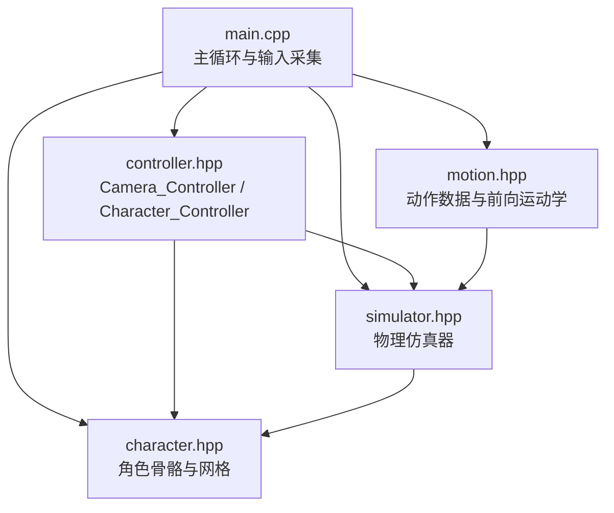
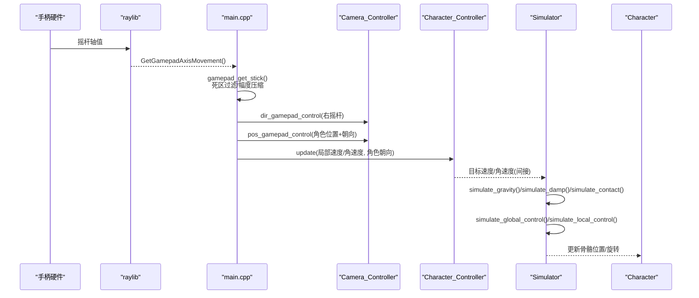
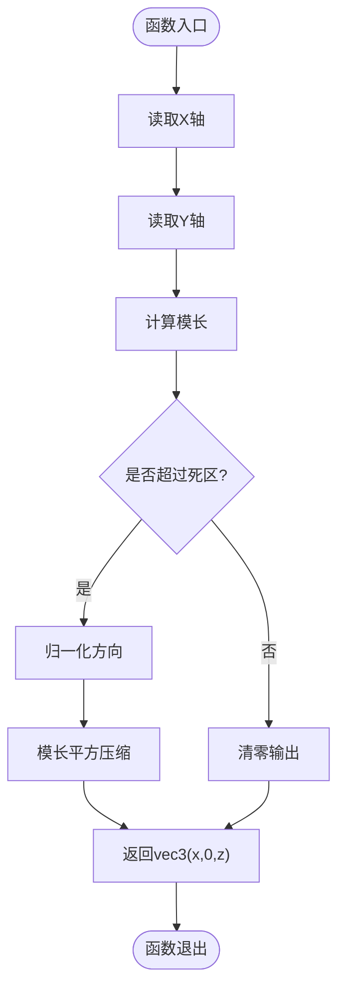
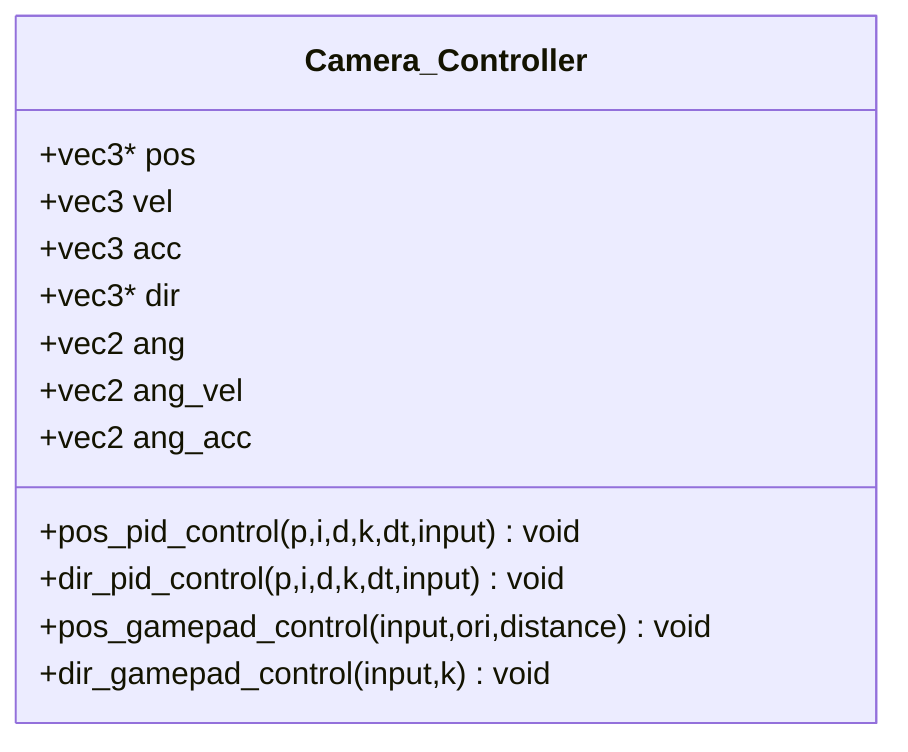
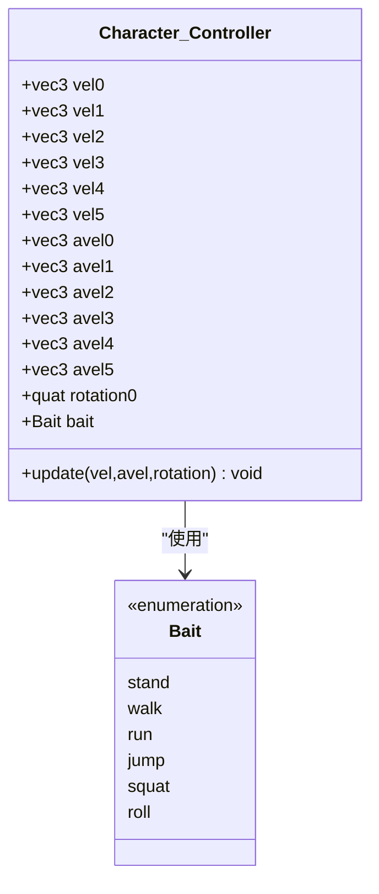
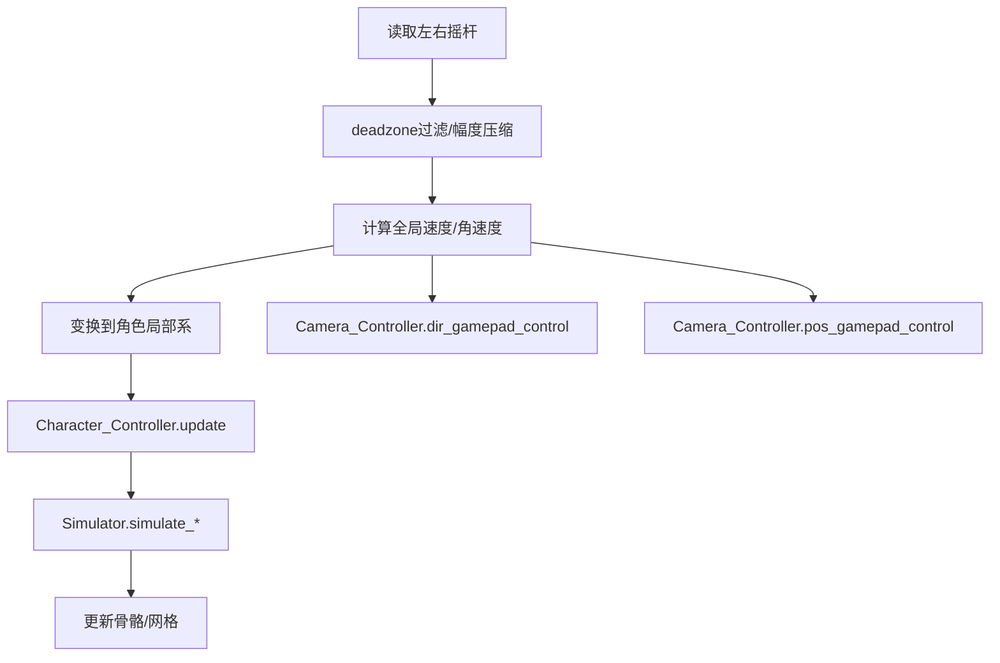
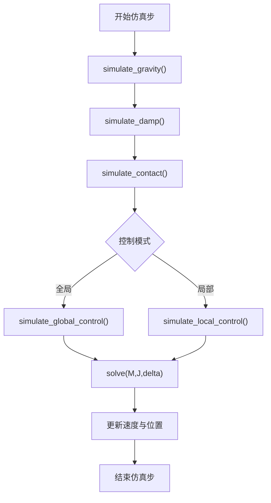
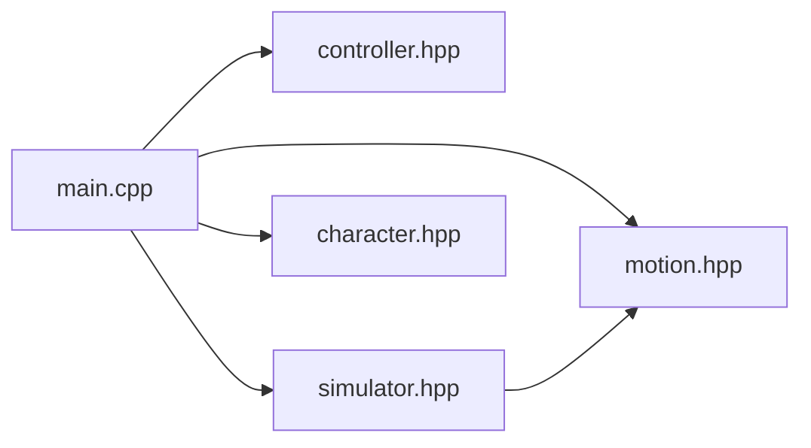

# 输入处理系统

> **版本提示（2.0）**：本文撰写于 1.x 时期，描述的是旧的实现形态——入口在根目录 `main.cpp`，功能由根目录 `.hpp` 头文件库提供，窗口用 raylib、显示用 OpenCV highgui。2.0 已把这些头文件移到 `Source/Legacy/`，渲染默认走 GPU，窗口与 UI 换成 GLFW + ImGui，`main.cpp` 拆成 `Source/Launch/Private/` 下的 `Main.cpp` 与 `Application`。文中的文件路径、行号与调用链可能已失效，请以根目录的「项目概述」「快速开始」「故障排除」三篇与当前源码为准。

<cite>
**本文引用的文件**   
- [main.cpp](file://main.cpp)
- [controller.hpp](file://controller.hpp)
- [character.hpp](file://character.hpp)
- [simulator.hpp](file://simulator.hpp)
- [motion.hpp](file://motion.hpp)
</cite>

## 目录
1. [引言](#引言)
2. [项目结构](#项目结构)
3. [核心组件](#核心组件)
4. [架构总览](#架构总览)
5. [详细组件分析](#详细组件分析)
6. [依赖关系分析](#依赖关系分析)
7. [性能与稳定性](#性能与稳定性)
8. [故障排查指南](#故障排查指南)
9. [结论](#结论)
10. [附录：配置与使用示例](#附录配置与使用示例)

## 引言
本技术文档聚焦于 MooLab 的输入处理子系统，围绕手柄输入采集、摇杆信号过滤与转换、角色控制状态机（Character_Controller）、以及从原始输入到最终控制指令的完整链路展开。文档同时说明如何扩展新的输入设备与控制模式，并给出可操作的配置与使用指引。

## 项目结构
MooLab 的输入处理主要分布在以下模块：
- main.cpp：入口程序，负责初始化窗口、相机、控制器、仿真器、渲染器等；实现手柄摇杆读取与基础滤波；将输入转换为全局/局部速度与角速度，驱动相机与角色控制。
- controller.hpp：定义 Camera_Controller（相机控制）与 Character_Controller（角色控制），以及动作枚举 Bait。
- character.hpp：角色骨骼与网格数据模型，提供骨骼动画顶点/法线形变接口。
- simulator.hpp：物理仿真器，包含重力、阻尼、碰撞、力矩控制等。
- motion.hpp：BVH 动作数据结构与批量前向运动学工具。

图表来源
- [main.cpp:53-167](file://main.cpp#L53-L167)
- [controller.hpp:7-162](file://controller.hpp#L7-L162)
- [simulator.hpp:321-624](file://simulator.hpp#L321-L624)
- [character.hpp:35-164](file://character.hpp#L35-L164)
- [motion.hpp:37-150](file://motion.hpp#L37-L150)

章节来源
- [main.cpp:53-167](file://main.cpp#L53-L167)

## 核心组件
- 手柄输入采集与滤波：通过 raylib 获取左右摇杆轴值，进行死区过滤与幅度非线性压缩，输出标准化三维向量。
- 相机控制：基于右摇杆更新相机朝向，左摇杆结合角色位置更新相机位置。
- 角色控制：Character_Controller 维护多帧历史速度/角速度缓冲，进行平滑过渡与姿态对齐，配合 Bait 枚举表达动作意图。
- 物理仿真：Simulator 提供重力、阻尼、碰撞检测与力矩控制，将控制指令转化为关节力/力矩。
- 动作数据：BVH_Motion 提供骨骼局部位置/旋转序列，用于前向运动学与动作拼接/混合。

章节来源
- [main.cpp:30-51](file://main.cpp#L30-L51)
- [controller.hpp:7-162](file://controller.hpp#L7-L162)
- [simulator.hpp:321-624](file://simulator.hpp#L321-L624)
- [motion.hpp:37-150](file://motion.hpp#L37-L150)

## 架构总览
下图展示从手柄输入到最终控制指令的端到端流程：

图表来源
- [main.cpp:30-51](file://main.cpp#L30-L51)
- [main.cpp:223-233](file://main.cpp#L223-L233)
- [main.cpp:440-451](file://main.cpp#L440-L451)
- [controller.hpp:96-108](file://controller.hpp#L96-L108)
- [controller.hpp:143-162](file://controller.hpp#L143-L162)
- [simulator.hpp:357-624](file://simulator.hpp#L357-L624)

## 详细组件分析

### 手柄输入采集与滤波（gamepad_get_stick）
- 功能要点
  - 读取左右摇杆 X/Y 轴值。
  - 计算模长，若小于死区阈值则置零，避免漂移。
  - 对有效输入进行方向归一化，并对模长进行平方压缩，提升小幅度输入的灵敏度。
  - 返回 vec3(x, 0, z)，便于后续与二维平面交互。
- 复杂度
  - O(1) 每帧。
- 兼容性
  - 依赖 raylib 的 GAMEPAD_PLAYER/GAMEPAD_AXIS_* 常量，适配常见手柄布局。

图表来源
- [main.cpp:30-51](file://main.cpp#L30-L51)

章节来源
- [main.cpp:30-51](file://main.cpp#L30-L51)

### 相机控制（Camera_Controller）
- 功能要点
  - 方向控制：dir_gamepad_control 根据右摇杆调整球坐标角度，限制俯仰范围，更新朝向。
  - 位置控制：pos_gamepad_control 以角色某点为参考，沿相机朝向偏移固定距离设置相机位置。
  - PID 控制接口：提供 pos_pid_control/dir_pid_control，便于未来接入更复杂的跟踪策略。
- 关键参数
  - k：方向增益；distance：相机跟随距离；ori：相机朝向矩阵。

图表来源
- [controller.hpp:7-108](file://controller.hpp#L7-L108)

章节来源
- [controller.hpp:7-108](file://controller.hpp#L7-L108)

### 角色控制（Character_Controller）与动作枚举（Bait）
- 设计动机
  - 通过多帧历史速度/角速度缓冲（vel0..vel5, avel0..avel5）实现速度平滑过渡，减少抖动。
  - 在 update 中先将上一帧速度/角速度按当前朝向对齐，再与新输入融合，保证世界坐标系与角色局部坐标系的一致性。
  - Bait 枚举表示动作意图（站立、行走、奔跑、跳跃、蹲伏、翻滚），可用于上层状态机或动作选择。
- 数据结构
  - vel0..vel5, avel0..avel5：历史速度/角速度缓冲。
  - rotation0：参考朝向四元数。
  - bait：动作意图枚举。
- 算法要点
  - 对齐：inv_quat(rotation) * rotation0 * vel5，将上一帧速度转换到当前角色局部系。
  - 平滑：线性插值组合 vel0..vel5 与 avel0..avel5，权重逐步偏向最新输入。

图表来源
- [controller.hpp:110-162](file://controller.hpp#L110-L162)

章节来源
- [controller.hpp:110-162](file://controller.hpp#L110-L162)

### 输入信号到控制指令的转换流程
- 步骤概览
  1. 读取左右摇杆，经 deadzone 与幅度压缩得到标准化输入。
  2. 将左摇杆映射为角色的局部速度/角速度：
     - 全局速度 = 相机朝向旋转后的缩放向量。
     - 全局角速度 = 由角色朝向与全局速度叉积估算。
     - 局部速度/角速度 = 通过角色朝向四元数反变换回局部系。
  3. 调用 Character_Controller.update 进行平滑与对齐。
  4. 将控制结果传递给仿真器（在本仓库中主要通过全局/局部力矩控制驱动）。
  5. 相机方向与位置分别由右摇杆与角色位置更新。

图表来源
- [main.cpp:223-233](file://main.cpp#L223-L233)
- [controller.hpp:143-162](file://controller.hpp#L143-L162)
- [simulator.hpp:357-624](file://simulator.hpp#L357-L624)

章节来源
- [main.cpp:223-233](file://main.cpp#L223-L233)

### 物理仿真与力矩控制（Simulator）
- 功能要点
  - 重力与阻尼：对所有骨骼施加重力与速度阻尼。
  - 碰撞检测：骨骼间与地面碰撞，产生法向与切向摩擦力。
  - 控制模式：
    - simulate_global_control：基于目标局部旋转的前向运动学，计算误差角速度，生成各关节力矩。
    - simulate_local_control：考虑接触约束，针对接触腿根节点施加根力/根力矩，其余关节按误差分配力矩。
  - 数值求解：构建质量矩阵 M、雅可比 J、约束残差 delta，解线性方程组更新速度与位置。
- 复杂度
  - 每步 O(N^3) 量级（取决于骨骼数量 N 与约束规模）。
- 稳定性
  - 通过 kp/kd 参数调节碰撞刚度与阻尼，避免穿透与振荡。

图表来源
- [simulator.hpp:357-624](file://simulator.hpp#L357-L624)

章节来源
- [simulator.hpp:357-624](file://simulator.hpp#L357-L624)

### 角色骨骼与网格（Character）
- 功能要点
  - 存储角色静态网格、骨骼绑定权重、骨骼初始位姿。
  - 提供线性混合（skinning）接口，将骨骼动画位置/旋转应用到网格顶点与法线。
- 使用场景
  - 将仿真器输出的骨骼位姿写入 mesh，供渲染器绘制。

章节来源
- [character.hpp:35-164](file://character.hpp#L35-L164)

### 动作数据与前向运动学（Motion）
- 功能要点
  - BVH_Motion 存储骨骼局部位置/旋转序列与父子关系。
  - batch_forward_kinematics_full 批量计算全局骨骼位姿。
  - 提供动作子序列、拼接、混合、循环构建等工具。
- 使用场景
  - 作为仿真器的目标轨迹或离线数据源。

章节来源
- [motion.hpp:37-150](file://motion.hpp#L37-L150)

## 依赖关系分析
- 模块耦合
  - main.cpp 强依赖 controller.hpp（相机/角色控制）、simulator.hpp（物理）、character.hpp（角色网格）、motion.hpp（动作数据）。
  - controller.hpp 依赖 quat.hpp/vec.hpp（数学库）。
  - simulator.hpp 依赖 motion.hpp（动作数据）。
- 外部依赖
  - raylib：手柄输入与窗口管理。
  - OpenCV：图像显示（非输入路径）。
- 潜在环依赖
  - 无直接循环依赖；main.cpp 作为顶层编排者。

图表来源
- [main.cpp:8-17](file://main.cpp#L8-L17)
- [controller.hpp:4-5](file://controller.hpp#L4-L5)
- [simulator.hpp:4](file://simulator.hpp#L4)

章节来源
- [main.cpp:8-17](file://main.cpp#L8-L17)
- [controller.hpp:4-5](file://controller.hpp#L4-L5)
- [simulator.hpp:4](file://simulator.hpp#L4)

## 性能与稳定性
- 输入采样频率
  - 每帧一次摇杆读取，O(1)。
- 控制平滑
  - Character_Controller 的多阶缓冲降低速度突变，提高稳定性。
- 物理求解
  - 大规模骨骼时，线性方程求解可能成为瓶颈；建议：
    - 合理设置 simulate_time（每帧多次子步进）与 dt。
    - 调低 kp/kd 以避免刚性过大导致数值不稳定。
- 渲染路径
  - 当前采用一次性渲染，避免延迟渲染开销。

[本节为通用指导，不直接分析具体文件]

## 故障排查指南
- 摇杆无响应或漂移
  - 检查 deadzone 阈值是否过小；适当增大死区。
  - 确认 raylib 的 GAMEPAD_PLAYER 索引是否正确。
- 角色移动卡顿或抖动
  - 调整 Character_Controller.update 中的平滑系数（如 0.8/0.2 等权重）。
  - 检查角色朝向 rotation0 是否与当前朝向一致。
- 相机抖动或越界
  - 调整 dir_gamepad_control 的 k 值与俯仰角限制。
  - 确保 pos_gamepad_control 的距离 distance 合理。
- 物理不稳定（穿透/振荡）
  - 降低碰撞刚度 kp 或增加阻尼 kd。
  - 减小 simulate_global_control/simulate_local_control 的控制增益。

章节来源
- [main.cpp:30-51](file://main.cpp#L30-L51)
- [controller.hpp:96-108](file://controller.hpp#L96-L108)
- [controller.hpp:143-162](file://controller.hpp#L143-L162)
- [simulator.hpp:374-434](file://simulator.hpp#L374-L434)
- [simulator.hpp:437-541](file://simulator.hpp#L437-L541)

## 结论
MooLab 的输入处理系统以简洁可靠的管线实现了从手柄输入到角色/相机控制的闭环：摇杆信号经死区与幅度压缩后，转换为全局/局部速度/角速度，并通过 Character_Controller 的平滑机制稳定地驱动物理仿真器。相机控制独立于角色控制，便于灵活调试。整体架构清晰、扩展性强，适合在此基础上添加更多输入设备与控制模式。

[本节为总结性内容，不直接分析具体文件]

## 附录：配置与使用示例
- 基本配置
  - 在 main.cpp 中初始化 Camera_Controller 与 Character_Controller，并绑定相机指针。
  - 设置 Character_Controller.rotation0 为初始朝向。
- 使用步骤
  - 每帧调用 gamepad_get_stick 获取左右摇杆输入。
  - 计算全局/局部速度与角速度，调用 Character_Controller.update。
  - 调用 Simulator 的 simulate_* 方法执行物理步进。
  - 调用 Camera_Controller.dir_gamepad_control 与 pos_gamepad_control 更新相机。
- 扩展新输入设备
  - 新增一个输入适配器函数，封装不同设备的原始信号，统一输出标准化的 vec3 输入。
  - 在 main.cpp 的主循环中替换或并行接入该适配器。
  - 如需按键映射，可在适配器层建立键位到行为（如 Bait）的映射表。
- 扩展新控制模式
  - 在 Controller 层新增控制方法（例如基于键盘/鼠标的速度估计）。
  - 在 Character_Controller 中增加对应状态的平滑逻辑。
  - 在 Simulator 中增加新的力/力矩注入方式（如基于肌肉模型的力生成）。

章节来源
- [main.cpp:53-167](file://main.cpp#L53-L167)
- [main.cpp:223-233](file://main.cpp#L223-L233)
- [controller.hpp:7-162](file://controller.hpp#L7-L162)