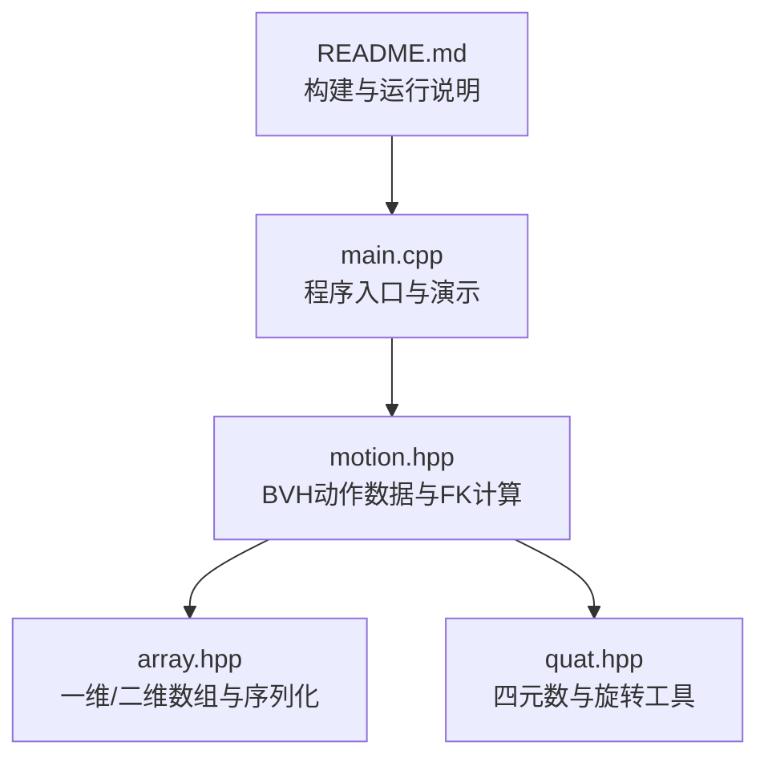
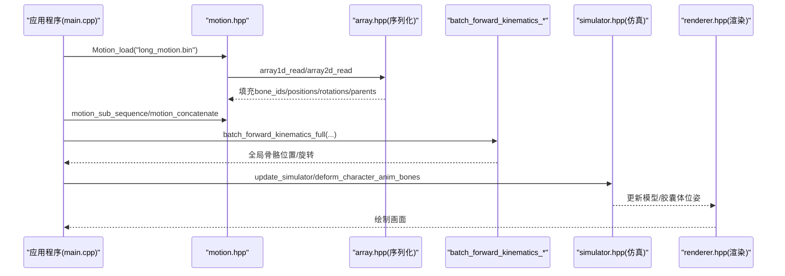
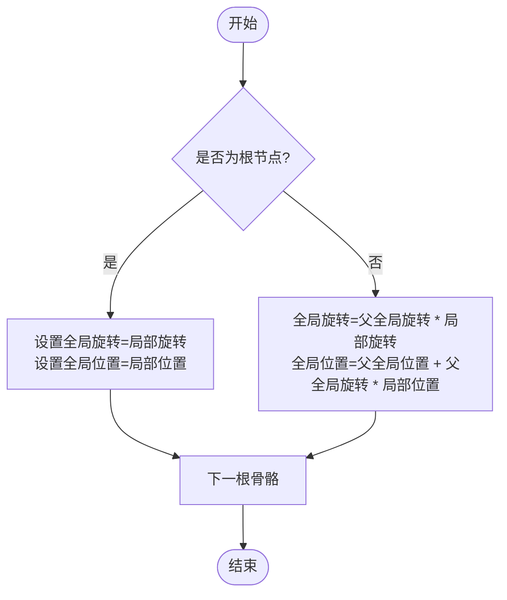
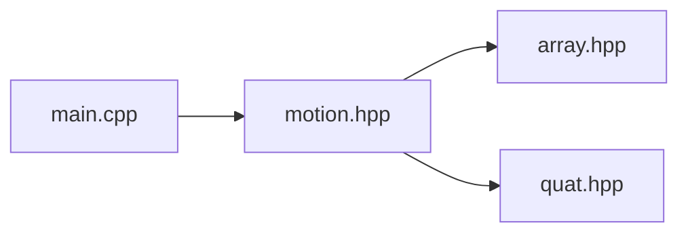

# BVH动作数据

> **版本提示（2.0）**：本文撰写于 1.x 时期，描述的是旧的实现形态——入口在根目录 `main.cpp`，功能由根目录 `.hpp` 头文件库提供，窗口用 raylib、显示用 OpenCV highgui。2.0 已把这些头文件移到 `Source/Legacy/`，渲染默认走 GPU，窗口与 UI 换成 GLFW + ImGui，`main.cpp` 拆成 `Source/Launch/Private/` 下的 `Main.cpp` 与 `Application`。文中的文件路径、行号与调用链可能已失效，请以根目录的「项目概述」「快速开始」「故障排除」三篇与当前源码为准。

<cite>
**本文引用的文件**   
- [motion.hpp](file://motion.hpp)
- [array.hpp](file://array.hpp)
- [quat.hpp](file://quat.hpp)
- [main.cpp](file://main.cpp)
- [README.md](file://README.md)
</cite>

## 目录
1. [引言](#引言)
2. [项目结构](#项目结构)
3. [核心组件](#核心组件)
4. [架构总览](#架构总览)
5. [详细组件分析](#详细组件分析)
6. [依赖关系分析](#依赖关系分析)
7. [性能与优化建议](#性能与优化建议)
8. [故障排查指南](#故障排查指南)
9. [结论](#结论)
10. [附录：BVH二进制格式规范与示例流程](#附录bvh二进制格式规范与示例流程)

## 引言
本技术文档聚焦于BVH动作数据处理模块，围绕BVH_Motion数据结构、Motion_load/Motion_save序列化机制、前向运动学批量计算函数（full/part/root）、以及骨骼变换的数学原理进行系统化说明。同时给出BVH二进制文件格式规范与自定义动作数据的创建方法，并提供在工程中加载、处理与播放动作数据的实际使用路径。

## 项目结构
本项目为角色运动渲染与仿真器，包含几何、物理、动画、渲染等子系统。BVH动作数据相关逻辑集中在motion.hpp中，并通过main.cpp演示如何加载、拼接、混合与驱动仿真/渲染管线。

图表来源
- [main.cpp:53-100](file://main.cpp#L53-L100)
- [motion.hpp:37-96](file://motion.hpp#L37-L96)
- [array.hpp:91-176](file://array.hpp#L91-L176)
- [quat.hpp:6-24](file://quat.hpp#L6-L24)
- [README.md:1-15](file://README.md#L1-L15)

章节来源
- [README.md:1-15](file://README.md#L1-L15)
- [main.cpp:53-100](file://main.cpp#L53-L100)

## 核心组件
- BVH_Motion：存储每帧每根骨骼的局部位置与局部旋转，以及骨骼ID与父节点索引。
- Motion_load / Motion_save：基于array1d/array2d的二进制读写接口，实现动作数据的持久化。
- batch_forward_kinematics_full/part/root：三套批量前向运动学计算，分别对应“完全自驱动”、“带外部根姿态”和“仅应用根变换到已计算结果”。
- 辅助工具：序列截取、拼接、两动作插值、循环闭合、方向对齐与平移修正等。

章节来源
- [motion.hpp:37-96](file://motion.hpp#L37-L96)
- [motion.hpp:98-120](file://motion.hpp#L98-L120)
- [motion.hpp:122-198](file://motion.hpp#L122-L198)

## 架构总览
BVH动作数据在系统中的典型调用链如下：

图表来源
- [main.cpp:81-98](file://main.cpp#L81-L98)
- [main.cpp:204-208](file://main.cpp#L204-L208)
- [main.cpp:292-345](file://main.cpp#L292-L345)
- [motion.hpp:72-96](file://motion.hpp#L72-L96)
- [motion.hpp:122-198](file://motion.hpp#L122-L198)

## 详细组件分析

### BVH_Motion数据结构
- bone_ids：每根骨骼的标识符（枚举或自定义ID）。
- bone_local_positions：[帧×骨骼]的局部位置矩阵，表示相对于父节点的偏移。
- bone_local_rotations：[帧×骨骼]的局部旋转四元数，表示相对于父节点的朝向。
- bone_parents：每根骨骼的父节点索引；根节点通常为-1。
- nframes()/nbones()：便捷访问帧数与骨骼数。

该结构以紧凑的连续内存布局组织，便于批量计算与高效序列化。

章节来源
- [motion.hpp:37-70](file://motion.hpp#L37-L70)

### 序列化：Motion_load与Motion_save
- 写入顺序：bone_ids → bone_local_positions → bone_local_rotations → bone_parents。
- 读取顺序：与写入一致，确保反序列化正确。
- 底层依赖：array1d_write/read与array2d_write/read负责维度与数据块写入。

二进制文件布局约定（见附录）：
- 每个array1d先写int size，再写size个T元素。
- 每个array2d先写int rows，再写int cols，再写rows*cols个T元素。

章节来源
- [motion.hpp:72-96](file://motion.hpp#L72-L96)
- [array.hpp:91-106](file://array.hpp#L91-L106)
- [array.hpp:158-176](file://array.hpp#L158-L176)

### 前向运动学（Batch Forward Kinematics）
三类批量FK函数的输入均为单帧的局部数据，输出为全局骨骼位置与旋转。

- batch_forward_kinematics_full
  - 适用场景：直接根据动作数据中的根节点局部位移/旋转作为世界根变换。
  - 算法要点：按父子顺序遍历，根节点直接使用local_pos/local_rot；子节点用父节点的全局旋转与位置叠加自身局部偏移。
  - 复杂度：O(Nbones)。

- batch_forward_kinematics_part
  - 适用场景：需要外部指定根的姿态与位置（例如将动作嵌入到不同世界坐标系或受控机器人上）。
  - 参数：root_anim_positions, root_anim_rotations。
  - 算法要点：根节点覆盖为外部传入的根姿态/位置，其余与full相同。

- batch_forward_kinematics_root
  - 适用场景：对已经计算好的全局结果，统一施加一个根变换（如整体移动/旋转），常用于对齐视角或二次校正。
  - 算法要点：对每个骨骼的全局位置/旋转左乘根的四元数并加上根的位移。

图表来源
- [motion.hpp:122-149](file://motion.hpp#L122-L149)
- [motion.hpp:152-181](file://motion.hpp#L152-L181)
- [motion.hpp:184-198](file://motion.hpp#L184-L198)

章节来源
- [motion.hpp:122-198](file://motion.hpp#L122-L198)

### 骨骼变换数学原理
- 四元数旋转：使用quat类型及其乘法、向量旋转变换、slerp、avel/vel等工具。
- 向量变换：通过四元数右乘向量实现旋转，结合父节点全局位置完成层级叠加。
- 层级关系：bone_parents定义树形拓扑；FK假设骨骼按从根到叶的顺序排列，保证父节点先于子节点计算。

关键工具与概念：
- quat::operator*(quat, vec3)：四元数旋转三维向量。
- slerp：球面线性插值，用于平滑旋转过渡。
- quat_to_avel/avel_to_quat：角速度与四元数的互转，用于循环闭合与速度估计。
- euler_YXZ_to_quat/quaternion分解：用于面向方向的Y轴分解与对齐。

章节来源
- [quat.hpp:6-24](file://quat.hpp#L6-L24)
- [quat.hpp:66-81](file://quat.hpp#L66-L81)
- [quat.hpp:155-180](file://quat.hpp#L155-L180)
- [quat.hpp:182-210](file://quat.hpp#L182-L210)
- [motion.hpp:200-264](file://motion.hpp#L200-L264)

### 动作剪辑与混合
- motion_sub_sequence：截取时间片段。
- motion_concatenate：纵向拼接两段动作。
- blend_two_motions：按alpha在两动作间插值（位置线性插值，旋转球面插值）。
- build_loop_motion：对首尾差异进行速度/角速度补偿以实现循环。
- translation_and_rotation：对整段动作进行根平移与朝向对齐。
- concatenate_two_motions：两段动作在衔接处进行平滑过渡。

章节来源
- [motion.hpp:98-120](file://motion.hpp#L98-L120)
- [motion.hpp:213-291](file://motion.hpp#L213-L291)
- [motion.hpp:293-377](file://motion.hpp#L293-L377)

### 在工程中的使用示例
- 加载动作：main.cpp中调用Motion_load读取长动作文件。
- 动作分段与拼接：使用motion_sub_sequence与concatenate_two_motions组合多段动作。
- 驱动仿真与渲染：调用batch_forward_kinematics_full得到全局骨骼姿态，随后更新仿真器与渲染模型。

章节来源
- [main.cpp:81-98](file://main.cpp#L81-L98)
- [main.cpp:204-208](file://main.cpp#L204-L208)
- [main.cpp:292-345](file://main.cpp#L292-L345)

## 依赖关系分析
- motion.hpp依赖：
  - array.hpp：提供array1d/array2d及序列化读写。
  - quat.hpp：提供四元数与旋转工具。
  - spring.hpp：被include但未在本节重点展开。
- main.cpp依赖：
  - motion.hpp：动作加载、处理与FK。
  - simulator.hpp/renderer.hpp：仿真与渲染（非本节重点）。

图表来源
- [motion.hpp:1-6](file://motion.hpp#L1-L6)
- [main.cpp:8-17](file://main.cpp#L8-L17)

章节来源
- [motion.hpp:1-6](file://motion.hpp#L1-L6)
- [main.cpp:8-17](file://main.cpp#L8-L17)

## 性能与优化建议
- 批量FK为O(Nbones)，适合逐帧调用；若需进一步优化，可考虑SIMD或并行化外层帧循环。
- 避免频繁分配：尽量复用slice1d/slice2d输出缓冲区，减少临时对象开销。
- 缓存父指针：若骨骼树静态不变，可在初始化时预计算排序后的遍历顺序，避免重复判断。
- I/O优化：大动作文件建议使用内存映射或分块读取，减少阻塞。

[本节为通用指导，不直接分析具体文件]

## 故障排查指南
- 文件打开失败：Motion_load/Motion_save使用assert检查FILE*有效性，请确认路径与工作目录正确。
- 数据错位：确保写入与读取顺序一致；检查array1d/array2d的维度是否匹配预期。
- 根节点异常：确保bone_parents中根节点为-1，且骨骼顺序满足父先子后。
- 旋转奇异：当角度接近0或π时注意数值稳定性，代码中已有保护分支（如avel/avel_to_quat）。

章节来源
- [motion.hpp:72-96](file://motion.hpp#L72-L96)
- [array.hpp:91-106](file://array.hpp#L91-L106)
- [array.hpp:158-176](file://array.hpp#L158-L176)

## 结论
BVH动作数据模块以简洁的数据结构与高效的批量FK为核心，配合完善的序列化与动作编辑工具，能够支撑从离线动作处理到在线仿真/渲染的完整流程。通过合理选择full/part/root三种FK模式，并结合动作剪辑与混合工具，可实现灵活的动作驱动方案。

[本节为总结性内容，不直接分析具体文件]

## 附录：BVH二进制格式规范与示例流程

### 二进制文件布局
- 头信息：无额外头部，直接按字段顺序写入。
- 字段顺序：
  1) bone_ids：array1d<int>
     - 写入：int size，随后size个int
  2) bone_local_positions：array2d<vec3>
     - 写入：int rows，int cols，随后rows*cols个vec3
  3) bone_local_rotations：array2d<quat>
     - 写入：int rows，int cols，随后rows*cols个quat
  4) bone_parents：array1d<int>
     - 写入：int size，随后size个int

- 数据类型尺寸：
  - int：4字节
  - float：4字节
  - vec3：3个float（12字节）
  - quat：4个float（16字节）

- 字节序：平台原生字节序（x86/x64小端）。跨平台交换需显式转换。

章节来源
- [motion.hpp:72-96](file://motion.hpp#L72-L96)
- [array.hpp:91-106](file://array.hpp#L91-L106)
- [array.hpp:158-176](file://array.hpp#L158-L176)

### 自定义动作数据创建步骤
1) 准备骨骼拓扑
- 定义bone_ids与bone_parents，确保根节点parent为-1，其他节点指向其父节点。
- 建议按从根到叶的顺序编号，便于FK计算。

2) 生成每帧局部数据
- 对于每帧t与每根骨骼i：
  - 计算bone_local_positions(t,i)：相对于父节点的偏移。
  - 计算bone_local_rotations(t,i)：相对于父节点的局部旋转（四元数）。

3) 组装BVH_Motion
- 设置nframes与nbones，resize相应数组。
- 填充bone_ids、bone_local_positions、bone_local_rotations、bone_parents。

4) 保存为二进制
- 调用Motion_save(motion, "your_motion.bin")。

5) 验证与回放
- 使用Motion_load加载，调用batch_forward_kinematics_full获取全局姿态，并进行可视化或仿真。

章节来源
- [motion.hpp:37-70](file://motion.hpp#L37-L70)
- [motion.hpp:72-96](file://motion.hpp#L72-L96)
- [motion.hpp:122-149](file://motion.hpp#L122-L149)

### 在工程中加载、处理与播放的动作流
- 加载：Motion_load读取长动作文件。
- 处理：使用motion_sub_sequence与concatenate_two_motions进行分段与拼接。
- 播放：每帧调用batch_forward_kinematics_full，将结果传递给仿真器与渲染器。

章节来源
- [main.cpp:81-98](file://main.cpp#L81-L98)
- [main.cpp:204-208](file://main.cpp#L204-L208)
- [main.cpp:292-345](file://main.cpp#L292-L345)