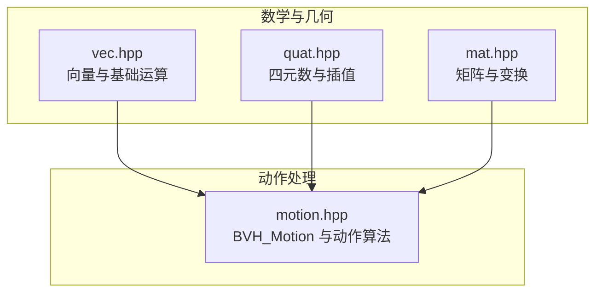
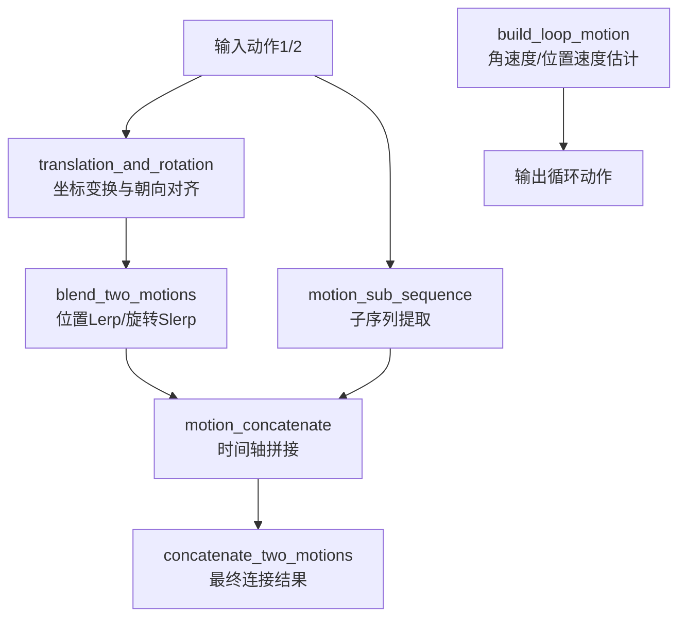
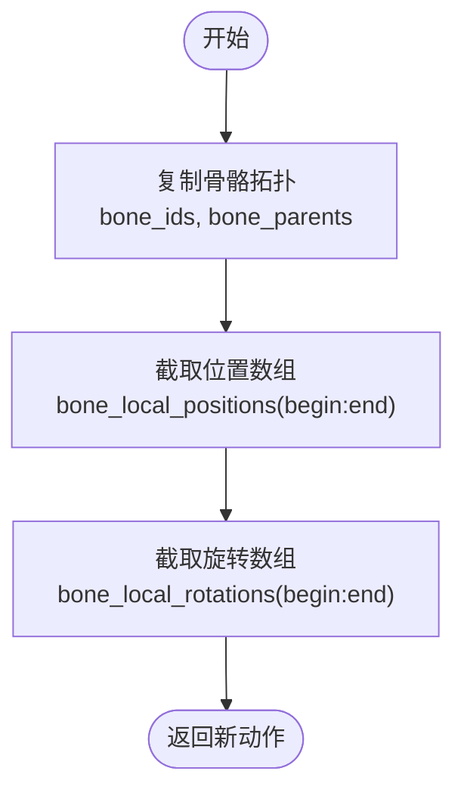
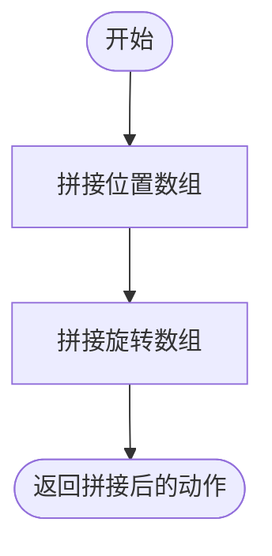
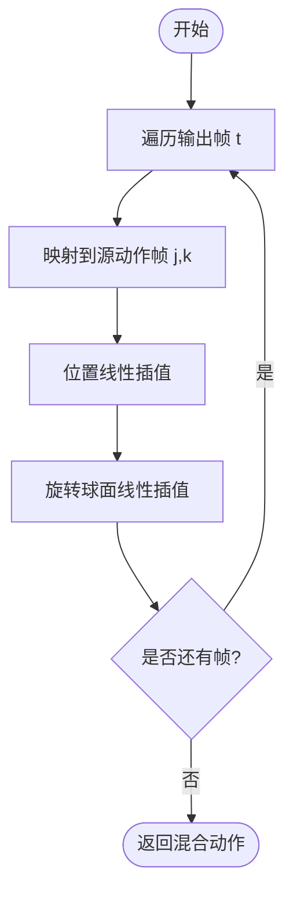
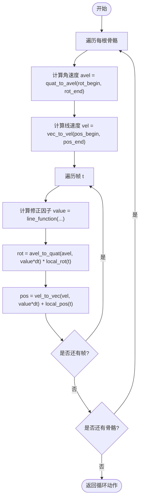
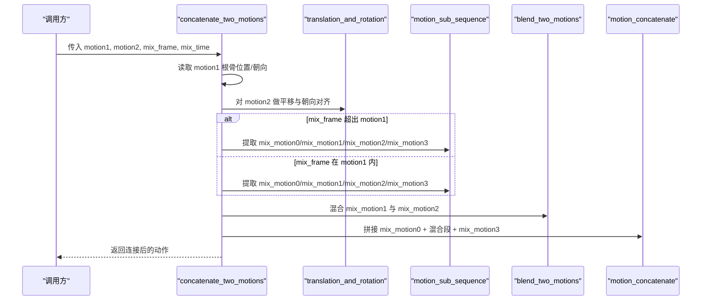
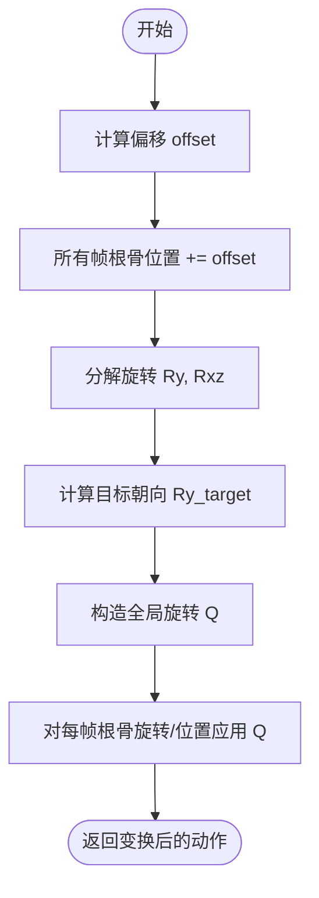
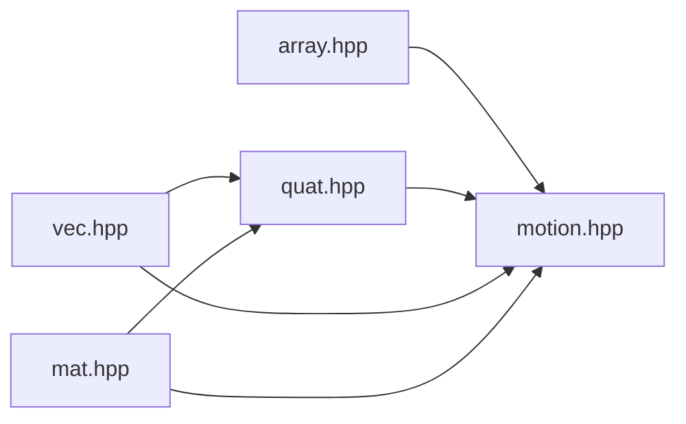

# 动作处理算法

> **版本提示（2.0）**：本文撰写于 1.x 时期，描述的是旧的实现形态——入口在根目录 `main.cpp`，功能由根目录 `.hpp` 头文件库提供，窗口用 raylib、显示用 OpenCV highgui。2.0 已把这些头文件移到 `Source/Legacy/`，渲染默认走 GPU，窗口与 UI 换成 GLFW + ImGui，`main.cpp` 拆成 `Source/Launch/Private/` 下的 `Main.cpp` 与 `Application`。文中的文件路径、行号与调用链可能已失效，请以根目录的「项目概述」「快速开始」「故障排除」三篇与当前源码为准。

<cite>
**本文引用的文件**   
- [motion.hpp](file://motion.hpp)
- [quat.hpp](file://quat.hpp)
- [vec.hpp](file://vec.hpp)
- [mat.hpp](file://mat.hpp)
</cite>

## 目录
1. [引言](#引言)
2. [项目结构](#项目结构)
3. [核心组件](#核心组件)
4. [架构总览](#架构总览)
5. [详细组件分析](#详细组件分析)
6. [依赖关系分析](#依赖关系分析)
7. [性能与复杂度](#性能与复杂度)
8. [故障排查指南](#故障排查指南)
9. [结论](#结论)
10. [附录：使用示例与最佳实践](#附录使用示例与最佳实践)

## 引言
本技术文档聚焦于动作（BVH 风格）处理算法，系统性解析以下关键函数与流程：
- 子序列提取 motion_sub_sequence
- 动作拼接 motion_concatenate
- 动作混合 blend_two_motions（位置线性插值、旋转球面线性插值 Slerp）
- 循环构建 build_loop_motion（角速度估计、位置速度估计、平滑过渡）
- 动作连接 concatenate_two_motions（坐标变换、朝向对齐、混合帧）
- 平移与旋转 translation_and_rotation（目标位置调整、朝向旋转、坐标系变换）

这些算法共同构成一套完整的动作编辑与合成工具链，适用于动画制作中的片段裁剪、拼接、过渡、循环与重定向等常见任务。

## 项目结构
本项目采用头文件组织数学与几何基础类型与运算，并在 motion.hpp 中实现动作处理的核心算法。主要文件职责如下：
- vec.hpp：向量类型与基本运算（点积、叉积、归一化、线性插值、方向/球坐标转换、速度与位移互转）
- quat.hpp：四元数类型与运算（乘法、逆、欧拉与四元数互转、Slerp、轴角表示、Rodrigues 矩阵）
- mat.hpp：3x3/4x4 矩阵与常用变换（Rodrigues、坐标矩阵、投影矩阵等）
- motion.hpp：动作数据结构 BVH_Motion 及动作处理算法（子序列、拼接、前向运动学、分解旋转、平移旋转、混合、循环构建、动作连接）

图表来源
- [vec.hpp:1-295](file://vec.hpp#L1-L295)
- [quat.hpp:1-229](file://quat.hpp#L1-L229)
- [mat.hpp:1-215](file://mat.hpp#L1-L215)
- [motion.hpp:1-379](file://motion.hpp#L1-L379)

章节来源
- [motion.hpp:1-379](file://motion.hpp#L1-L379)
- [vec.hpp:1-295](file://vec.hpp#L1-L295)
- [quat.hpp:1-229](file://quat.hpp#L1-L229)
- [mat.hpp:1-215](file://mat.hpp#L1-L215)

## 核心组件
- BVH_Motion：动作数据容器，包含骨骼 ID、父节点索引、每帧的局部位置与局部旋转数组，提供 nframes()/nbones() 接口。
- 动作处理函数族：
  - motion_sub_sequence：按帧范围提取子序列
  - motion_concatenate：将两段动作在时间轴上拼接
  - blend_two_motions：对两段动作进行逐帧混合（位置 Lerp，旋转 Slerp）
  - build_loop_motion：为一段动作构建可循环播放的修正版本
  - concatenate_two_motions：将两段动作在指定帧处平滑连接
  - translation_and_rotation：对动作整体做目标位置与朝向的坐标变换

章节来源
- [motion.hpp:37-70](file://motion.hpp#L37-L70)
- [motion.hpp:98-120](file://motion.hpp#L98-L120)
- [motion.hpp:213-264](file://motion.hpp#L213-L264)
- [motion.hpp:266-291](file://motion.hpp#L266-L291)
- [motion.hpp:293-330](file://motion.hpp#L293-L330)
- [motion.hpp:332-377](file://motion.hpp#L332-L377)

## 架构总览
动作处理管线由“基础数学库”支撑，上层通过 motion.hpp 提供的函数完成动作的切片、拼接、混合、循环与连接。下图展示各函数的调用关系与数据流向。

图表来源
- [motion.hpp:213-264](file://motion.hpp#L213-L264)
- [motion.hpp:98-120](file://motion.hpp#L98-L120)
- [motion.hpp:266-291](file://motion.hpp#L266-L291)
- [motion.hpp:293-330](file://motion.hpp#L293-L330)
- [motion.hpp:332-377](file://motion.hpp#L332-L377)

## 详细组件分析

### 子序列提取 motion_sub_sequence
- 功能：从原动作中提取 begin 到 end 的帧区间，复制骨骼拓扑信息（bone_ids、bone_parents），并截取对应的位置与旋转数组。
- 复杂度：O((end-begin)*bones)，空间开销与子序列大小成正比。
- 适用场景：剪辑、分段处理、拼接前的边界准备。

图表来源
- [motion.hpp:98-108](file://motion.hpp#L98-L108)

章节来源
- [motion.hpp:98-108](file://motion.hpp#L98-L108)

### 动作拼接 motion_concatenate
- 功能：将两段动作在时间轴上直接拼接，保持骨骼拓扑一致。
- 复杂度：O(N1+N2) 时间，O(N1+N2) 空间。
- 注意事项：要求两段动作具有相同的骨骼拓扑（bone_ids、bone_parents）。

图表来源
- [motion.hpp:110-120](file://motion.hpp#L110-L120)

章节来源
- [motion.hpp:110-120](file://motion.hpp#L110-L120)

### 动作混合 blend_two_motions
- 功能：对两段动作进行逐帧混合，位置使用线性插值（Lerp），旋转使用球面线性插值（Slerp）。
- 参数 alpha：长度为输出帧数的权重数组，通常按时间均匀采样。
- 插值策略：
  - 位置：lerp(p1, p2, alpha)
  - 旋转：slerp(q1, q2, alpha)
- 复杂度：O(T*bones)，T 为输出帧数。

图表来源
- [motion.hpp:266-291](file://motion.hpp#L266-L291)
- [vec.hpp:157-160](file://vec.hpp#L157-L160)
- [quat.hpp:155-180](file://quat.hpp#L155-L180)

章节来源
- [motion.hpp:266-291](file://motion.hpp#L266-L291)
- [vec.hpp:157-160](file://vec.hpp#L157-L160)
- [quat.hpp:155-180](file://quat.hpp#L155-L180)

### 循环构建 build_loop_motion
- 功能：对一段动作进行“首尾闭合”的修正，使其可无缝循环播放。
- 核心步骤：
  - 计算每根骨骼的首尾旋转差，得到平均角速度 avel（单位：弧度/秒或角度/秒，取决于内部实现）。
  - 计算首尾位置差，得到平均线速度 vel。
  - 对每一帧应用一个随时间递减的修正因子（line_function），逐步补偿旋转与位置差异，使末帧接近初帧状态。
- 关键点：
  - avel_to_quat 将角速度转换为增量四元数。
  - vel_to_vec 将速度转换为位移增量。
  - line_function 用于控制修正强度随时间的分布（通常为线性衰减）。

图表来源
- [motion.hpp:293-330](file://motion.hpp#L293-L330)
- [quat.hpp:182-210](file://quat.hpp#L182-L210)
- [vec.hpp:195-203](file://vec.hpp#L195-L203)

章节来源
- [motion.hpp:293-330](file://motion.hpp#L293-L330)
- [quat.hpp:182-210](file://quat.hpp#L182-L210)
- [vec.hpp:195-203](file://vec.hpp#L195-L203)

### 动作连接 concatenate_two_motions
- 功能：将两段动作在指定帧 mix_frame 处平滑连接，混合时长为 mix_time。
- 核心逻辑：
  - 从 motion1 的 mix_frame 处获取根骨位置与朝向，作为目标坐标系。
  - 对 motion2 执行 translation_and_rotation，将其平移到该位置并对齐朝向。
  - 根据 mix_frame 是否在 motion1 范围内，划分四个子序列：
    - mix_motion0：mix_frame 之前的 motion1 部分
    - mix_motion1：mix_frame 附近的 motion1 尾部（用于混合）
    - mix_motion2：对齐后的 motion2 头部（用于混合）
    - mix_motion3：对齐后的 motion2 剩余部分
  - 使用 blend_two_motions 对 mix_motion1 与 mix_motion2 进行混合。
  - 最后用 motion_concatenate 将三部分拼接。

图表来源
- [motion.hpp:332-377](file://motion.hpp#L332-L377)
- [motion.hpp:213-264](file://motion.hpp#L213-L264)
- [motion.hpp:98-120](file://motion.hpp#L98-L120)
- [motion.hpp:266-291](file://motion.hpp#L266-L291)

章节来源
- [motion.hpp:332-377](file://motion.hpp#L332-L377)

### 平移与旋转 translation_and_rotation
- 功能：对整段动作施加统一的平移与朝向变换，使动作的根骨在指定帧移动到目标位置，并面向目标方向。
- 关键步骤：
  - 计算偏移 offset = target_translation_xz - motion.bone_local_positions(frame_num, 0)。
  - 对所有帧的根骨位置加上 offset。
  - 分解当前根骨旋转为绕 Y 轴的 Ry 与其余 Rxz。
  - 计算目标朝向的四元数 Ry_target（基于 Z 轴与目标方向的夹角）。
  - 构造全局旋转 Q = Ry_target * Rxz * inv(Ry*Rxz)，对每帧的根骨旋转与位置进行统一变换。
- 数学要点：
  - 使用 dir_to_sph 将方向转为球坐标，再转回欧拉/四元数。
  - 使用 rot_vec_to_quat 将轴角表示转为四元数。
  - 对位置进行旋转变换时，以参考帧根骨位置为中心进行相对旋转。

图表来源
- [motion.hpp:213-264](file://motion.hpp#L213-L264)
- [vec.hpp:181-193](file://vec.hpp#L181-L193)
- [quat.hpp:103-112](file://quat.hpp#L103-L112)

章节来源
- [motion.hpp:213-264](file://motion.hpp#L213-L264)
- [vec.hpp:181-193](file://vec.hpp#L181-L193)
- [quat.hpp:103-112](file://quat.hpp#L103-L112)

## 依赖关系分析
- motion.hpp 依赖：
  - array.hpp：二维/一维数组操作（子序列、拼接、读写）
  - quat.hpp：四元数运算（Slerp、轴角、欧拉互转）
  - spring.hpp：未在本节直接使用，但可能用于其他系统
- vec.hpp、mat.hpp 提供底层向量与矩阵运算，被 quat.hpp 与 motion.hpp 广泛使用。

图表来源
- [motion.hpp:1-10](file://motion.hpp#L1-L10)
- [quat.hpp:1-10](file://quat.hpp#L1-L10)
- [vec.hpp:1-10](file://vec.hpp#L1-L10)
- [mat.hpp:1-10](file://mat.hpp#L1-L10)

章节来源
- [motion.hpp:1-10](file://motion.hpp#L1-L10)
- [quat.hpp:1-10](file://quat.hpp#L1-L10)
- [vec.hpp:1-10](file://vec.hpp#L1-L10)
- [mat.hpp:1-10](file://mat.hpp#L1-L10)

## 性能与复杂度
- motion_sub_sequence：O((end-begin)*bones)
- motion_concatenate：O(N1+N2)
- blend_two_motions：O(T*bones)，T 为输出帧数
- build_loop_motion：O(F*bones)，F 为帧数
- concatenate_two_motions：包含多次子序列与混合，总体 O((N1+N2)*bones)
- translation_and_rotation：O(F*bones)

优化建议：
- 批量处理：尽量合并多次子序列与拼接操作，减少中间对象创建。
- 预计算：对频繁使用的旋转分解与目标朝向四元数进行缓存。
- 内存复用：在可能的情况下复用输出数组，避免重复分配。

[本节为通用性能讨论，不直接分析具体代码行]

## 故障排查指南
常见问题与定位方法：
- 拼接失败或数据错位：检查两段动作的骨骼拓扑是否一致（bone_ids、bone_parents）。
- 混合出现抖动：确认 alpha 数组长度与输出帧数一致，且插值顺序正确。
- 循环播放出现跳变：检查 build_loop_motion 的角速度与速度估计是否合理，以及 line_function 的衰减曲线是否合适。
- 朝向异常：检查 translation_and_rotation 的目标方向是否为 XZ 平面，并确保四元数分解与旋转组合顺序正确。

章节来源
- [motion.hpp:98-120](file://motion.hpp#L98-L120)
- [motion.hpp:266-291](file://motion.hpp#L266-L291)
- [motion.hpp:293-330](file://motion.hpp#L293-L330)
- [motion.hpp:213-264](file://motion.hpp#L213-L264)

## 结论
本套动作处理算法提供了从基础切片、拼接到高级混合与循环构建的完整能力。通过四元数与向量数学库的支持，实现了稳定、可控的动作编辑流程。在实际动画制作中，可结合这些函数完成动作剪辑、过渡、重定向与循环播放等任务，提升内容生产效率与表现力。

[本节为总结性内容，不直接分析具体代码行]

## 附录：使用示例与最佳实践
- 动作剪辑与拼接
  - 使用 motion_sub_sequence 提取所需片段
  - 使用 motion_concatenate 将多个片段串联
- 动作过渡
  - 使用 blend_two_motions 在两段动作之间进行平滑过渡
  - 设置合适的 alpha 曲线以获得自然的过渡效果
- 循环动画
  - 使用 build_loop_motion 生成可无缝循环的动作
  - 调整 half_life 与 dt 参数以匹配角色节奏
- 动作重定向
  - 使用 translation_and_rotation 将动作平移到目标位置并对齐朝向
  - 在 concatenate_two_motions 中先对齐再混合，确保连接自然

[本节为概念性指导，不直接分析具体代码行]