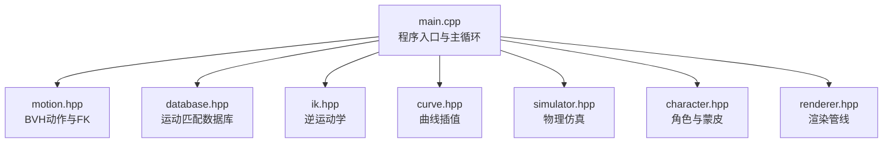
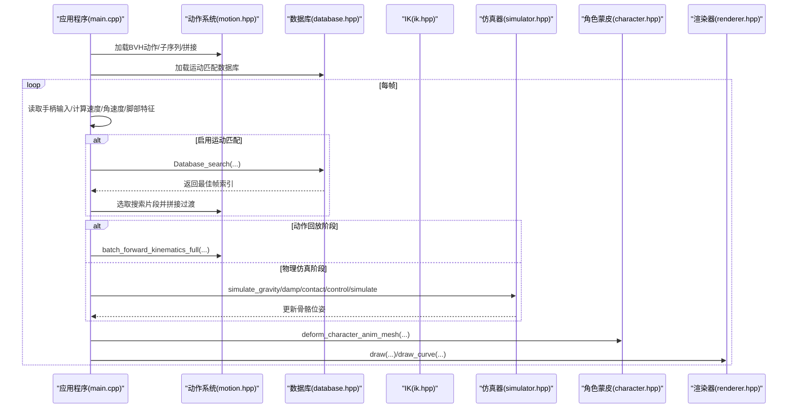
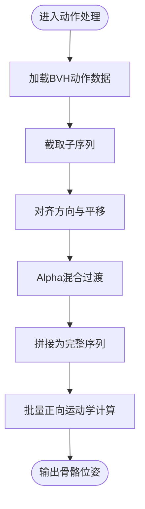
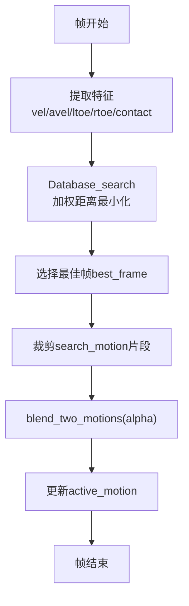
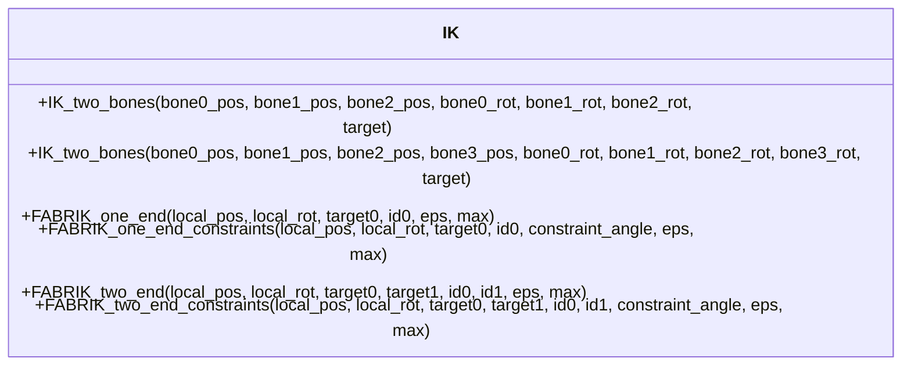
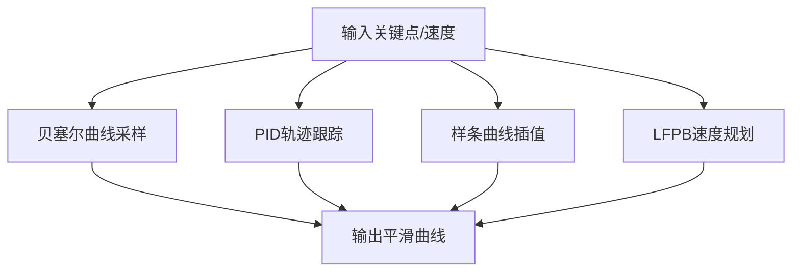
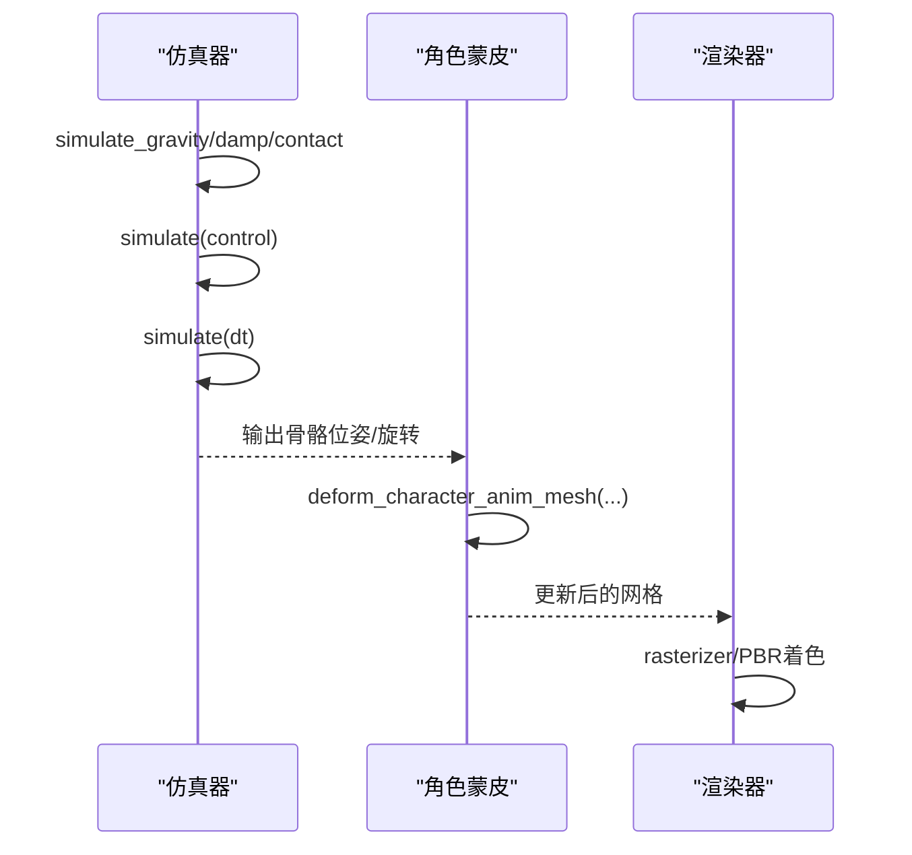
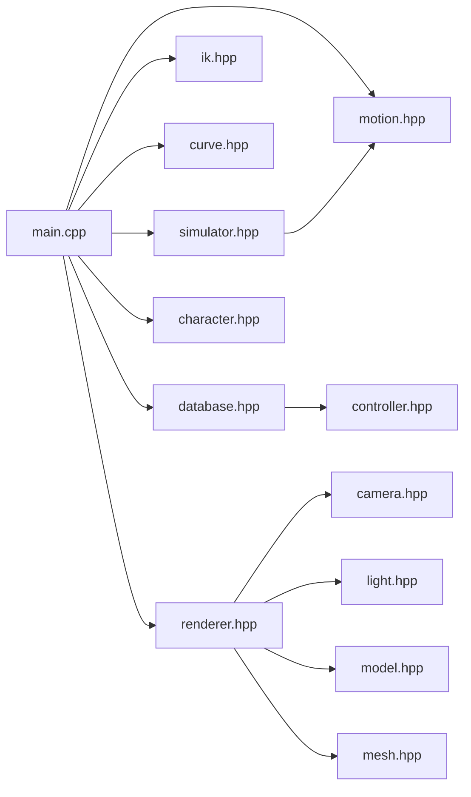
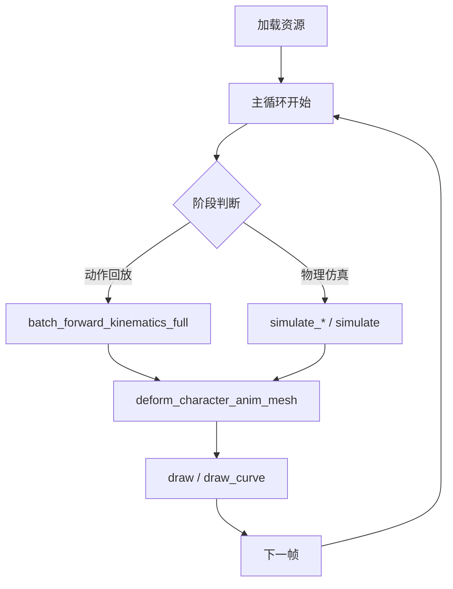

# 动画系统

> **版本提示（2.0）**：本文撰写于 1.x 时期，描述的是旧的实现形态——入口在根目录 `main.cpp`，功能由根目录 `.hpp` 头文件库提供，窗口用 raylib、显示用 OpenCV highgui。2.0 已把这些头文件移到 `Source/Legacy/`，渲染默认走 GPU，窗口与 UI 换成 GLFW + ImGui，`main.cpp` 拆成 `Source/Launch/Private/` 下的 `Main.cpp` 与 `Application`。文中的文件路径、行号与调用链可能已失效，请以根目录的「项目概述」「快速开始」「故障排除」三篇与当前源码为准。

<cite>
**本文引用的文件**   
- [README.md](file://README.md)
- [main.cpp](file://main.cpp)
- [motion.hpp](file://motion.hpp)
- [database.hpp](file://database.hpp)
- [ik.hpp](file://ik.hpp)
- [curve.hpp](file://curve.hpp)
- [simulator.hpp](file://simulator.hpp)
- [character.hpp](file://character.hpp)
- [renderer.hpp](file://renderer.hpp)
</cite>

## 目录
1. [简介](#简介)
2. [项目结构](#项目结构)
3. [核心组件](#核心组件)
4. [架构总览](#架构总览)
5. [详细组件分析](#详细组件分析)
6. [依赖关系分析](#依赖关系分析)
7. [性能与优化](#性能与优化)
8. [故障排查指南](#故障排查指南)
9. [结论](#结论)
10. [附录：工具与示例流程](#附录工具与示例流程)

## 简介
本仓库实现了一个面向角色运动渲染与仿真的动画系统，涵盖BVH动作数据解析、时间轴管理、运动匹配（Motion Matching）特征提取与数据库搜索、逆运动学（IK）求解、曲线插值平滑以及物理仿真与渲染管线。系统基于C++，使用raylib进行窗口/输入处理，OpenCV用于调试显示，并通过自研渲染器完成PBR材质与阴影绘制。

## 项目结构
- 顶层入口 main.cpp 负责初始化相机、控制器、角色、数据库、动作库、仿真器、渲染器与UI，并驱动主循环。
- motion.hpp 定义BVH动作数据结构与批量正向运动学、动作拼接/混合等工具函数。
- database.hpp 提供运动匹配所需的特征数据库结构与搜索算法。
- ik.hpp 提供两骨/多骨IK与FABRIK迭代求解。
- curve.hpp 提供贝塞尔曲线、样条曲线、PID轨迹生成与LFPB速度规划等插值方法。
- simulator.hpp 实现刚体动力学、约束求解、碰撞检测与控制力矩注入。
- character.hpp 定义角色网格与蒙皮权重，支持线性插值蒙皮变形。
- renderer.hpp 实现几何绑定、光栅化、PBR着色与辅助绘图工具。

图表来源
- [main.cpp:53-160](file://main.cpp#L53-L160)
- [motion.hpp:37-150](file://motion.hpp#L37-L150)
- [database.hpp:7-129](file://database.hpp#L7-L129)
- [ik.hpp:7-422](file://ik.hpp#L7-L422)
- [curve.hpp:8-275](file://curve.hpp#L8-L275)
- [simulator.hpp:321-624](file://simulator.hpp#L321-L624)
- [character.hpp:35-166](file://character.hpp#L35-L166)
- [renderer.hpp:17-239](file://renderer.hpp#L17-L239)

章节来源
- [README.md:1-22](file://README.md#L1-L22)
- [main.cpp:53-160](file://main.cpp#L53-L160)

## 核心组件
- BVH动作数据与时间轴管理：通过BVH_Motion存储骨骼局部位置/旋转、父子关系与帧序列；提供子序列截取、拼接、混合、朝向对齐与循环构建等工具。
- 运动匹配数据库：存储帧索引、接触状态、速度/角速度多步预测与脚部特征；提供排序、修正与加权距离搜索。
- 逆运动学：两骨/三骨/四骨IK与FABRIK单端/双端约束求解，用于脚锁与末端目标定位。
- 曲线插值：递归贝塞尔、样条曲线、PID轨迹与LFPB速度规划，用于动作过渡与轨迹平滑。
- 物理仿真：重力、阻尼、地面/刚体碰撞、关节约束与全局/局部控制力矩注入，解算速度与姿态更新。
- 角色蒙皮：按骨骼权重对顶点位置与法线进行线性插值变形。
- 渲染管线：几何绑定、相机/材质参数绑定、三角形光栅化与PBR着色。

章节来源
- [motion.hpp:37-379](file://motion.hpp#L37-L379)
- [database.hpp:7-129](file://database.hpp#L7-L129)
- [ik.hpp:7-422](file://ik.hpp#L7-L422)
- [curve.hpp:8-275](file://curve.hpp#L8-L275)
- [simulator.hpp:321-624](file://simulator.hpp#L321-L624)
- [character.hpp:35-166](file://character.hpp#L35-L166)
- [renderer.hpp:17-239](file://renderer.hpp#L17-L239)

## 架构总览
系统以main.cpp为中枢，协调各子系统：
- 加载角色与数据库，准备BVH动作序列。
- 在每帧中计算当前角色的速度、角速度、脚部相对位置与接触状态。
- 可选地执行运动匹配搜索，选择最佳帧区间并进行动作过渡。
- 根据阶段切换至动作回放或物理仿真，注入控制力矩与碰撞响应。
- 将仿真结果映射回骨骼，更新模型变换，最终由渲染器输出图像。

图表来源
- [main.cpp:223-549](file://main.cpp#L223-L549)
- [motion.hpp:122-198](file://motion.hpp#L122-L198)
- [database.hpp:74-127](file://database.hpp#L74-L127)
- [ik.hpp:7-103](file://ik.hpp#L7-L103)
- [simulator.hpp:357-624](file://simulator.hpp#L357-L624)
- [character.hpp:142-164](file://character.hpp#L142-L164)
- [renderer.hpp:213-239](file://renderer.hpp#L213-L239)

## 详细组件分析

### BVH动作数据与时间轴管理
- 数据结构：BVH_Motion包含骨骼ID、父子关系、每帧的局部位置与旋转数组，并提供nframes()/nbones()访问接口。
- 时间轴操作：
  - 子序列截取：motion_sub_sequence按帧范围抽取片段。
  - 拼接与混合：motion_concatenate与blend_two_motions支持线性插值位置与球面插值旋转。
  - 朝向对齐与平移：translation_and_rotation将根节点对齐到目标XZ平面朝向与位置。
  - 循环构建：build_loop_motion通过均匀分布的角速度/线速度使首尾帧平滑衔接。
  - 两段动作拼接：concatenate_two_motions先对齐第二段的方向与位置，再在mix_time内做alpha混合过渡。
- 正向运动学：batch_forward_kinematics_full/part/root分别支持从根开始、给定根位姿或仅应用根变换的全量/部分/根级FK。

图表来源
- [motion.hpp:98-120](file://motion.hpp#L98-L120)
- [motion.hpp:213-264](file://motion.hpp#L213-L264)
- [motion.hpp:266-330](file://motion.hpp#L266-L330)
- [motion.hpp:332-377](file://motion.hpp#L332-L377)
- [motion.hpp:122-198](file://motion.hpp#L122-L198)

章节来源
- [motion.hpp:37-379](file://motion.hpp#L37-L379)

### 运动匹配算法（特征提取、数据库搜索、动作过渡）
- 特征采集：
  - 主体速度与角速度：在角色局部坐标系下计算Body Entity的速度与角速度。
  - 脚部相对位置：左右脚趾相对于主体的位置向量。
  - 接触判定：依据身体速度与脚速点积比较判断当前支撑脚。
- 数据库结构：Database保存帧索引、接触状态、多步速度/角速度预测与脚部特征矩阵。
- 搜索策略：Database_search遍历候选帧，过滤接触状态一致项，计算加权误差（速度差、角速度差、脚部位置差），返回最小误差对应的帧号。
- 动作过渡：主循环中根据搜索结果选取search_motion并与active_motion拼接，使用blend_two_motions在重叠区间进行平滑过渡。

图表来源
- [main.cpp:347-387](file://main.cpp#L347-L387)
- [database.hpp:7-129](file://database.hpp#L7-L129)
- [motion.hpp:266-291](file://motion.hpp#L266-L291)

章节来源
- [main.cpp:347-387](file://main.cpp#L347-L387)
- [database.hpp:7-129](file://database.hpp#L7-L129)
- [motion.hpp:266-291](file://motion.hpp#L266-L291)

### 逆运动学（IK）系统
- 两骨IK：IK_two_bones通过余弦定理计算关节角度，构造旋转四元数并依次更新三个骨骼的位姿与旋转。
- 多骨IK扩展：重载版本支持四骨链，保持相同思路但增加中间关节偏移与旋转传递。
- FABRIK：
  - 单端约束：FABRIK_one_end/FABRIK_one_end_constraints迭代调整链上点以满足末端目标，支持角度约束。
  - 双端约束：FABRIK_two_end/FABRIK_two_end_constraints同时满足两端目标，并在约束超限时限制关节弯曲角度。
- 应用：主循环中预留了脚锁调用逻辑，可根据contact状态对左右腿链执行IK以抑制滑步。

图表来源
- [ik.hpp:7-103](file://ik.hpp#L7-L103)
- [ik.hpp:105-248](file://ik.hpp#L105-L248)
- [ik.hpp:250-420](file://ik.hpp#L250-L420)

章节来源
- [ik.hpp:7-422](file://ik.hpp#L7-L422)

### 曲线插值与平滑
- 贝塞尔曲线：recursive_bezier与bezier_curve实现递归德卡斯特里奥算法，采样生成平滑路径。
- PID轨迹：PID_curve通过比例-积分-微分控制跟踪离散点列，生成连续轨迹。
- 样条曲线：spine_curve基于三次样条插值，估计端点速度并逐段插值。
- LFPB速度规划：LFPB计算分段加速度/匀速/减速的时间分配，生成符合加减速约束的轨迹。

图表来源
- [curve.hpp:8-38](file://curve.hpp#L8-L38)
- [curve.hpp:41-96](file://curve.hpp#L41-L96)
- [curve.hpp:98-152](file://curve.hpp#L98-L152)
- [curve.hpp:190-272](file://curve.hpp#L190-L272)

章节来源
- [curve.hpp:8-275](file://curve.hpp#L8-L275)

### 物理仿真与渲染
- 仿真器：
  - 重力与阻尼：simulate_gravity与simulate_damp为每个刚体施加力与力矩。
  - 碰撞检测：simulate_contact实现地面与刚体间线段-平面/线段-线段距离计算，并施加弹簧-阻尼反作用力。
  - 控制注入：simulate_global_control与simulate_local_control根据目标骨骼旋转计算误差角速度并注入力矩。
  - 动力学求解：simulate组装质量矩阵M、雅可比J与约束残差delta，求解线性方程组更新速度与姿态。
- 角色蒙皮：deform_character_anim_mesh根据骨骼位姿与权重对顶点位置与法线进行线性插值。
- 渲染管线：bind_geometry_info/bind_camera_parameters/bind_material_parameters设置几何与材质，rasterizer进行三角形光栅化与深度测试，draw_point/draw_line/draw_curve提供调试可视化。

图表来源
- [simulator.hpp:357-624](file://simulator.hpp#L357-L624)
- [character.hpp:142-164](file://character.hpp#L142-L164)
- [renderer.hpp:121-239](file://renderer.hpp#L121-L239)

章节来源
- [simulator.hpp:357-624](file://simulator.hpp#L357-L624)
- [character.hpp:142-164](file://character.hpp#L142-L164)
- [renderer.hpp:121-239](file://renderer.hpp#L121-L239)

## 依赖关系分析
- main.cpp依赖所有子系统头文件，承担装配与调度职责。
- motion.hpp依赖array/quat/spring基础类型。
- database.hpp依赖controller与motion。
- ik.hpp依赖array/quat。
- curve.hpp依赖array/global/vec。
- simulator.hpp依赖motion及自定义矩阵运算。
- character.hpp依赖array/mesh/quat。
- renderer.hpp依赖camera/light/model/mesh。

图表来源
- [main.cpp:8-17](file://main.cpp#L8-L17)
- [database.hpp:4-5](file://database.hpp#L4-L5)
- [simulator.hpp:4](file://simulator.hpp#L4)
- [renderer.hpp:4-7](file://renderer.hpp#L4-L7)

章节来源
- [main.cpp:8-17](file://main.cpp#L8-L17)
- [database.hpp:4-5](file://database.hpp#L4-L5)
- [simulator.hpp:4](file://simulator.hpp#L4)
- [renderer.hpp:4-7](file://renderer.hpp#L4-L7)

## 性能与优化
- 并行化：矩阵乘法与光栅化循环使用OpenMP并行加速。
- 数值稳定性：acos/clampf避免非法输入；距离计算加入epsilon阈值防止抖动。
- 时间步进：仿真循环内多次小步长迭代提高稳定性。
- 内存布局：大量使用自定义array1d/array2d与slice视图减少拷贝开销。
- 建议：
  - 对大规模动作数据库可引入KD树或近似最近邻搜索降低Database_search复杂度。
  - 对IK迭代次数max与eps进行自适应调节以提升收敛效率。
  - 对曲线采样数量sample_num按需调整平衡精度与性能。

[本节为通用指导，不直接分析具体文件]

## 故障排查指南
- 动作数据加载失败：检查二进制文件格式与读写顺序是否一致，确认文件路径与工作目录。
- 运动匹配无结果：确认Database_load成功且db.nframes()非零；检查contact过滤条件与权重配置。
- IK无法到达目标：检查骨骼长度与目标距离是否可达；增大max迭代次数或放宽eps。
- 仿真不稳定：减小dt或增加simulate_time；调整kp/kd参数；检查地面平面方程A,B,C,D。
- 渲染异常：确认相机近裁剪面z_near设置合理；检查三角形可见性剔除与深度写入。

章节来源
- [main.cpp:72-98](file://main.cpp#L72-L98)
- [database.hpp:21-47](file://database.hpp#L21-L47)
- [ik.hpp:105-248](file://ik.hpp#L105-L248)
- [simulator.hpp:374-435](file://simulator.hpp#L374-L435)
- [renderer.hpp:121-211](file://renderer.hpp#L121-L211)

## 结论
该动画系统以模块化设计整合了动作数据管理、运动匹配、IK求解、曲线平滑与物理仿真，具备完整的端到端动画制作与渲染能力。通过合理的权重配置与参数调优，可在交互控制下实现稳定自然的角色运动表现。

[本节为总结性内容，不直接分析具体文件]

## 附录：工具与示例流程

### 动作数据编辑与生成工具使用方法
- 原始BVH数据预处理：
  - 使用motion_sub_sequence截取所需片段。
  - 使用translation_and_rotation对齐方向与位置。
  - 使用concatenate_two_motions与blend_two_motions进行拼接与过渡。
- 特征提取与数据库构建：
  - 在主循环中计算vel/avel/ltoe/rtoe/contact，填充Database结构。
  - 使用Database_sort与Database_revise整理与修正特征。
  - 使用Database_save持久化数据库。
- 运行与调试：
  - 使用cv::imshow与trackbar实时调节权重参数。
  - 使用draw_curve可视化速度预测轨迹。

章节来源
- [motion.hpp:98-120](file://motion.hpp#L98-L120)
- [motion.hpp:213-264](file://motion.hpp#L213-L264)
- [motion.hpp:266-377](file://motion.hpp#L266-L377)
- [database.hpp:49-72](file://database.hpp#L49-L72)
- [database.hpp:35-47](file://database.hpp#L35-L47)
- [main.cpp:214-218](file://main.cpp#L214-L218)
- [renderer.hpp:375-426](file://renderer.hpp#L375-L426)

### 实际动画制作示例（从原始动作到渲染）
- 步骤概览：
  1. 加载角色与数据库，准备BVH动作序列。
  2. 在主循环中计算当前帧特征并可选执行运动匹配。
  3. 根据阶段切换动作回放或物理仿真，注入控制力矩与碰撞响应。
  4. 将仿真结果映射回骨骼，更新模型变换。
  5. 调用渲染器输出图像，并可绘制关键点与预测曲线。
- 关键调用路径：
  - 动作回放：batch_forward_kinematics_full -> deform_character_anim_mesh -> draw。
  - 物理仿真：simulate_* -> simulate -> deform_character_anim_mesh -> draw。
  - 运动匹配：Database_search -> concatenate_two_motions -> active_motion更新。

图表来源
- [main.cpp:296-345](file://main.cpp#L296-L345)
- [main.cpp:424-472](file://main.cpp#L424-L472)
- [motion.hpp:122-198](file://motion.hpp#L122-L198)
- [character.hpp:142-164](file://character.hpp#L142-L164)
- [renderer.hpp:213-239](file://renderer.hpp#L213-L239)

章节来源
- [main.cpp:296-345](file://main.cpp#L296-L345)
- [main.cpp:424-472](file://main.cpp#L424-L472)
- [motion.hpp:122-198](file://motion.hpp#L122-L198)
- [character.hpp:142-164](file://character.hpp#L142-L164)
- [renderer.hpp:213-239](file://renderer.hpp#L213-L239)