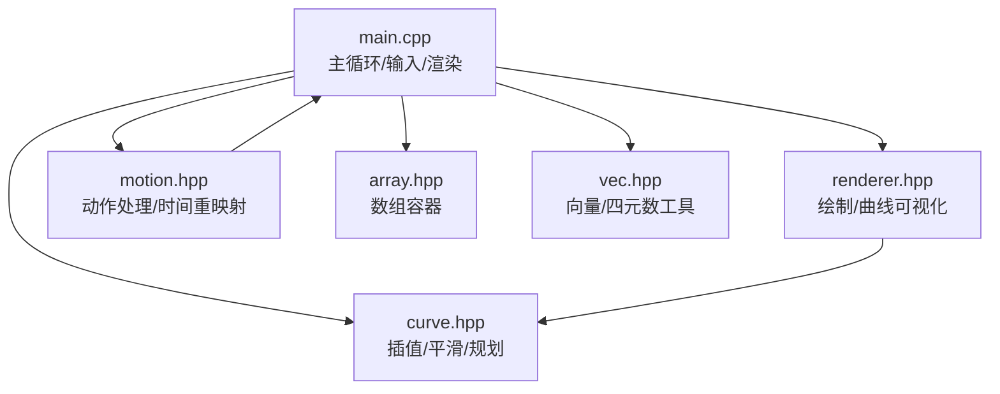
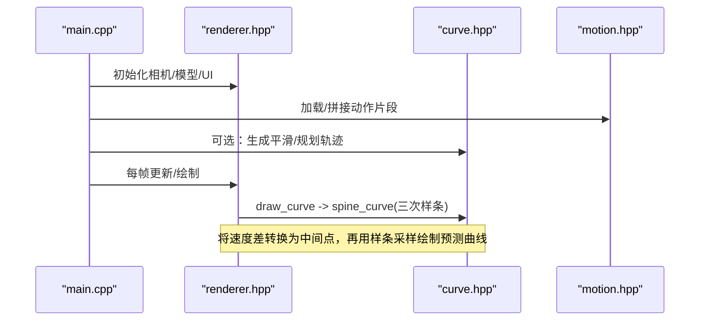
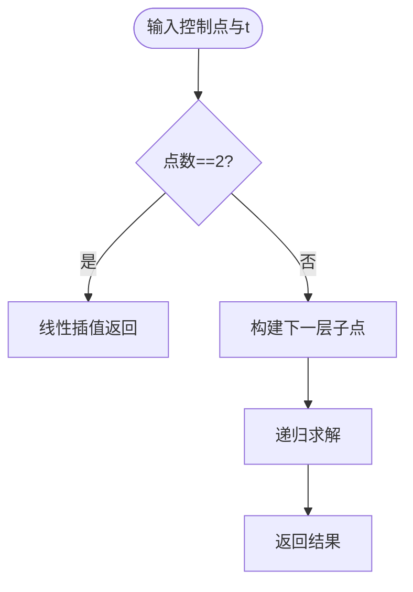
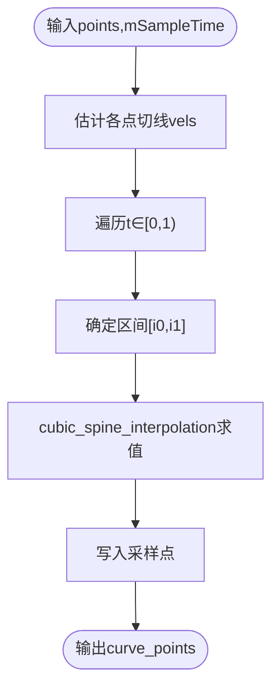
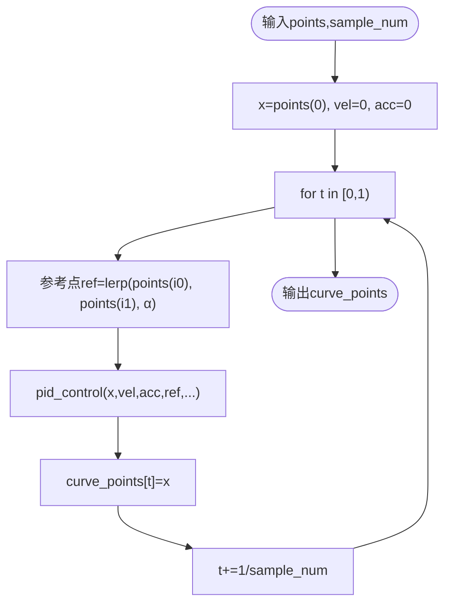
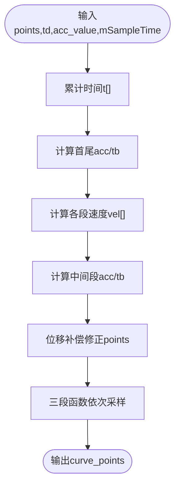
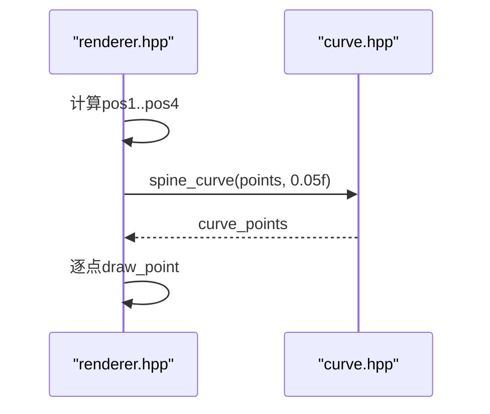
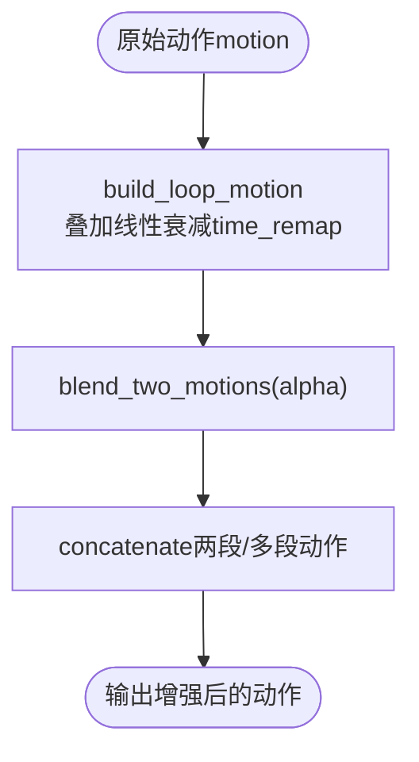
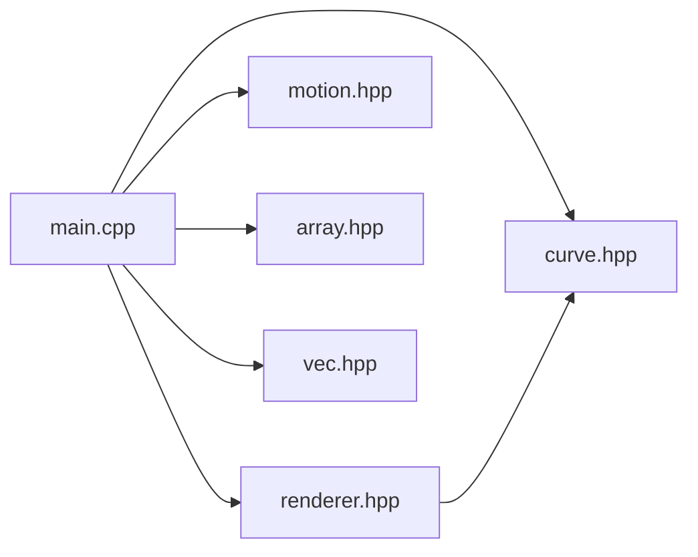

# 曲线插值技术

> **版本提示（2.0）**：本文撰写于 1.x 时期，描述的是旧的实现形态——入口在根目录 `main.cpp`，功能由根目录 `.hpp` 头文件库提供，窗口用 raylib、显示用 OpenCV highgui。2.0 已把这些头文件移到 `Source/Legacy/`，渲染默认走 GPU，窗口与 UI 换成 GLFW + ImGui，`main.cpp` 拆成 `Source/Launch/Private/` 下的 `Main.cpp` 与 `Application`。文中的文件路径、行号与调用链可能已失效，请以根目录的「项目概述」「快速开始」「故障排除」三篇与当前源码为准。

<cite>
**本文引用的文件**   
- [README.md](file://README.md)
- [curve.hpp](file://curve.hpp)
- [main.cpp](file://main.cpp)
- [renderer.hpp](file://renderer.hpp)
- [array.hpp](file://array.hpp)
- [vec.hpp](file://vec.hpp)
- [motion.hpp](file://motion.hpp)
</cite>

## 目录
1. [引言](#引言)
2. [项目结构](#项目结构)
3. [核心组件](#核心组件)
4. [架构总览](#架构总览)
5. [详细组件分析](#详细组件分析)
6. [依赖关系分析](#依赖关系分析)
7. [性能与精度](#性能与精度)
8. [故障排查指南](#故障排查指南)
9. [结论](#结论)
10. [附录：使用指南与示例](#附录使用指南与示例)

## 引言
本技术文档围绕“曲线插值技术”展开，结合仓库中的实现，系统梳理以下主题：
- 插值算法：线性插值、三次样条（分段三次 Hermite）、贝塞尔曲线、PID 平滑轨迹、LFPB（加减速规划）等。
- 曲线拟合与动画平滑：最小二乘/多项式拟合在本仓库未直接出现，但提供了基于速度/加速度约束的分段平滑方案；同时给出运动混合与时间重映射的实用方法。
- 时间轴插值：帧率转换、时间重映射、变速播放的实现思路与工程要点。
- 参数化方法：弧长参数化、均匀参数化、自适应采样在现有代码中的体现与扩展建议。
- 精度控制与性能优化：内存管理、计算复杂度、实时性保证的工程实践。
- 工具使用与示例：关键帧设置、曲线调节、预览效果的操作流程与示例路径。

## 项目结构
本项目为角色运动渲染与仿真器，核心包含：
- 基础数学与数据结构：向量、矩阵、数组容器等。
- 曲线与轨迹模块：贝塞尔、三次样条、PID 平滑、LFPB 加减速规划。
- 渲染与交互：相机、模型、UI、绘制曲线等。
- 动作与仿真：BVH 动作处理、运动混合、时间重映射、物理仿真。

图表来源
- [main.cpp:53-170](file://main.cpp#L53-L170)
- [renderer.hpp:375-426](file://renderer.hpp#L375-L426)
- [curve.hpp:8-272](file://curve.hpp#L8-L272)
- [motion.hpp:293-379](file://motion.hpp#L293-L379)
- [array.hpp:16-88](file://array.hpp#L16-L88)
- [vec.hpp:75-160](file://vec.hpp#L75-L160)

章节来源
- [README.md:1-22](file://README.md#L1-L22)
- [main.cpp:53-170](file://main.cpp#L53-L170)

## 核心组件
- 曲线与轨迹
  - 贝塞尔曲线：递归 De Casteljau 算法，支持任意维度点集采样生成曲线点序列。
  - 三次样条（分段三次 Hermite）：通过相邻点估计切线（速度），构造分段三次多项式插值。
  - PID 平滑：对目标轨迹进行一维 PID 控制，输出平滑轨迹，适合动画过渡。
  - LFPB 加减速规划：按给定时间段与最大加速度，计算三段式（加速-匀速-减速）轨迹并采样。
- 数据与数学
  - array1d/array2d：动态数组与二维数组，提供切片 view 与读写接口。
  - vec3/quat 工具：向量运算、速度/角速度换算、球坐标转换等。
- 渲染与可视化
  - draw_curve：根据起始位置与速度差，构造若干中间点，再调用三次样条采样绘制预测曲线。
- 动作与时间
  - build_loop_motion：对动作进行循环增强，叠加线性衰减的时间重映射，用于平滑过渡与变速播放。

章节来源
- [curve.hpp:8-272](file://curve.hpp#L8-L272)
- [array.hpp:16-88](file://array.hpp#L16-L88)
- [vec.hpp:75-160](file://vec.hpp#L75-L160)
- [renderer.hpp:375-426](file://renderer.hpp#L375-L426)
- [motion.hpp:293-379](file://motion.hpp#L293-L379)

## 架构总览
下图展示曲线插值相关模块在主循环与渲染管线中的协作关系。

图表来源
- [main.cpp:53-170](file://main.cpp#L53-L170)
- [renderer.hpp:375-426](file://renderer.hpp#L375-L426)
- [curve.hpp:98-152](file://curve.hpp#L98-L152)
- [motion.hpp:293-379](file://motion.hpp#L293-L379)

## 详细组件分析

### 贝塞尔曲线（递归 De Casteljau）
- 数学原理
  - 对 n 个控制点 P_i，定义递归：P_i^k(t) = (1-t) P_i^{k-1}(t) + t P_{i+1}^{k-1}(t)，最终得到曲线点 B(t)。
  - 时间参数 t ∈ [0,1]，可均匀采样或按弧长参数化采样。
- 实现要点
  - recursive_bezier：递归降阶至两点线性插值。
  - bezier_curve：对 t 均匀采样，生成曲线点序列。
- 复杂度
  - 单次求值 O(n^2)，n 为控制点数；采样 N 次则 O(N·n^2)。
- 适用场景
  - 局部形状编辑、关键帧之间的平滑过渡。

图表来源
- [curve.hpp:8-38](file://curve.hpp#L8-L38)

章节来源
- [curve.hpp:8-38](file://curve.hpp#L8-L38)

### 三次样条（分段三次 Hermite）
- 数学原理
  - 在区间 [x0, x1] 上构造三次多项式 p(t)=at^3+bt^2+ct+d，满足端点位置与切线（速度）约束。
  - 切线估计：v0=(x1-x(-1))/2，v1=(x(2)-x0)/2（中心差分）。
- 实现要点
  - cubic_spine_interpolation：计算系数 a,b,c,d 并求值。
  - spine_curve：遍历区间，按 mSampleTime 采样生成密集点列。
- 复杂度
  - 每段 O(1)，N 段采样 M 点总体 O(M)。
- 适用场景
  - 快速、稳定的分段平滑；常用于预测曲线绘制与动画过渡。

图表来源
- [curve.hpp:98-152](file://curve.hpp#L98-L152)

章节来源
- [curve.hpp:98-152](file://curve.hpp#L98-L152)

### PID 平滑轨迹
- 数学原理
  - 离散 PID：acc = k*(P·Δe + I·e - D·Δ²e)，积分项 e，微分项 Δ²e，比例项 Δe。
  - 状态更新：vel += acc·dt，x += vel·dt。
- 实现要点
  - pid_control：维护历史误差 ek_0/ek_1/ek_2，增量式 PID。
  - PID_curve：对目标点序列做线性插值作为参考，逐帧输出平滑轨迹。
- 复杂度
  - 每步 O(1)，N 步总体 O(N)。
- 适用场景
  - 一维信号平滑、动画过渡、避免突变。

图表来源
- [curve.hpp:40-96](file://curve.hpp#L40-L96)

章节来源
- [curve.hpp:40-96](file://curve.hpp#L40-L96)

### LFPB 加减速规划（三段式）
- 数学原理
  - 将每段位移分为加速-匀速-减速三段，给定最大加速度与时间段 td，求解加速时间 tb 与匀速速度 v。
  - 三段位移公式分别由 LFPB_function0/1/2 给出。
- 实现要点
  - 边界条件：首尾段特殊处理（若位移为 0，则无加速/减速）。
  - 速度一致性：相邻段速度差决定加速度方向与大小。
  - 位移补偿：对中间关键点进行位移修正以保证连续。
  - 采样：按 mSampleTime 对三段函数依次采样。
- 复杂度
  - 预处理 O(N)，采样 O(M)，总体 O(N+M)。
- 适用场景
  - 关节角度/位置的平滑加减速规划，避免冲击与抖动。

图表来源
- [curve.hpp:154-272](file://curve.hpp#L154-L272)

章节来源
- [curve.hpp:154-272](file://curve.hpp#L154-L272)

### 预测曲线绘制（渲染侧）
- 功能说明
  - 根据当前位置 pos0 与速度差 (vel5-vel0)，构造多个中间点 pos1..pos4，再以三次样条采样绘制预测轨迹。
- 实现要点
  - draw_curve：计算中间点，调用 spine_curve 采样，逐点绘制。
- 适用场景
  - 可视化角色未来轨迹，辅助调试与预览。

图表来源
- [renderer.hpp:375-426](file://renderer.hpp#L375-L426)
- [curve.hpp:98-152](file://curve.hpp#L98-L152)

章节来源
- [renderer.hpp:375-426](file://renderer.hpp#L375-L426)

### 时间轴插值与变速播放
- 循环增强与时间重映射
  - build_loop_motion：对动作进行循环增强，叠加线性衰减因子 line_function，对旋转与位置进行时间重映射，实现平滑过渡与变速播放。
- 帧率转换
  - 通过 dt 与 simulate_time 控制仿真步进频率；渲染目标 FPS 固定为 60。
- 变速播放
  - 通过改变 alpha 或 value 的分布（如线性衰减），实现对动作片段的加速/减速播放。

图表来源
- [motion.hpp:293-379](file://motion.hpp#L293-L379)

章节来源
- [motion.hpp:293-379](file://motion.hpp#L293-L379)

## 依赖关系分析
- 模块耦合
  - main.cpp 依赖 renderer.hpp、curve.hpp、motion.hpp、array.hpp、vec.hpp。
  - renderer.hpp 依赖 curve.hpp（spine_curve）与 vec.hpp（几何工具）。
  - motion.hpp 与 main.cpp 紧密配合，负责动作处理与时间重映射。
- 外部库
  - raylib：窗口与输入。
  - OpenCV：图像显示与 UI 滑块。
  - 其他：SIMD/OpenMP 等（视构建配置而定）。

图表来源
- [main.cpp:8-17](file://main.cpp#L8-L17)
- [renderer.hpp:375-426](file://renderer.hpp#L375-L426)
- [curve.hpp:4-6](file://curve.hpp#L4-L6)
- [motion.hpp:293-379](file://motion.hpp#L293-L379)

章节来源
- [main.cpp:8-17](file://main.cpp#L8-L17)
- [renderer.hpp:375-426](file://renderer.hpp#L375-L426)
- [curve.hpp:4-6](file://curve.hpp#L4-L6)
- [motion.hpp:293-379](file://motion.hpp#L293-L379)

## 性能与精度
- 计算复杂度
  - 贝塞尔：O(N·n^2)，N 为采样数，n 为控制点数。可通过降低采样数或减少控制点优化。
  - 三次样条：O(M)，M 为采样点数，适合实时。
  - PID：O(N)，每步常数开销，适合在线平滑。
  - LFPB：预处理 O(N)，采样 O(M)，整体高效。
- 内存管理
  - array1d/array2d 使用 malloc/realloc/free，注意避免频繁 resize 导致碎片；批量分配更优。
  - slice1d/slice2d 仅视图，零拷贝，适合传递子区间。
- 精度控制
  - mSampleTime 越小，曲线越密，精度越高，但计算量越大。
  - PID 参数（P/I/D/k/dt）需调参以平衡响应速度与超调。
  - LFPB 的 acc_value 与 td 影响平滑度与能耗（加速度峰值）。
- 实时性保证
  - 渲染目标 FPS 固定 60，仿真步进 dt 与 simulate_time 控制物理更新频率。
  - 避免在每帧进行昂贵操作（如大规模重分配），尽量预分配与复用缓冲区。

章节来源
- [array.hpp:67-88](file://array.hpp#L67-L88)
- [curve.hpp:27-38](file://curve.hpp#L27-L38)
- [curve.hpp:116-152](file://curve.hpp#L116-L152)
- [curve.hpp:66-96](file://curve.hpp#L66-L96)
- [curve.hpp:190-272](file://curve.hpp#L190-L272)
- [main.cpp:60-62](file://main.cpp#L60-L62)

## 故障排查指南
- 曲线不平滑或抖动
  - 检查 PID 参数是否过大导致超调；适当减小 P 或增大 D。
  - 调整 mSampleTime，过大会导致采样不足，过小增加计算压力。
- 轨迹不连续或速度突变
  - 检查 LFPB 的 acc_value 与 td 是否合理；确保相邻段速度一致。
  - 确认首尾段边界条件（位移为 0 时 acc/tb 置 0）。
- 渲染曲线异常
  - 检查 draw_curve 中中间点计算是否正确；确保速度差非零且符号一致。
  - 确认 spine_curve 的采样范围与索引无误。
- 性能瓶颈
  - 减少每帧采样数量；复用 array1d 缓冲区，避免频繁分配。
  - 将离线计算（如 LFPB 预处理）移至帧外。

章节来源
- [curve.hpp:40-96](file://curve.hpp#L40-L96)
- [curve.hpp:190-272](file://curve.hpp#L190-L272)
- [renderer.hpp:375-426](file://renderer.hpp#L375-L426)
- [array.hpp:67-88](file://array.hpp#L67-L88)

## 结论
本仓库实现了多种实用的曲线插值与平滑技术：
- 贝塞尔曲线适用于局部形状编辑；
- 三次样条提供稳定高效的平滑插值；
- PID 平滑适合一维信号的过渡控制；
- LFPB 加减速规划保障运动的物理合理性；
- 渲染侧的预测曲线可视化有助于调试与预览；
- 动作层面的时间重映射与混合支持变速播放与平滑过渡。
在实际工程中，应结合采样密度、参数调优与内存管理，兼顾精度与实时性。

## 附录：使用指南与示例
- 关键帧设置
  - 使用贝塞尔曲线的控制点定义关键姿态；或通过 LFPB 的关键点与时间段 td 定义加减速节奏。
- 曲线调节
  - 调整 PID 参数以获得更柔和的过渡；调整 mSampleTime 控制曲线密度。
- 预览效果
  - 使用 draw_curve 可视化预测轨迹；结合 OpenCV 滑块实时调参。
- 实际示例路径
  - 贝塞尔/样条/PID/LFPB 实现：[curve.hpp:8-272](file://curve.hpp#L8-L272)
  - 预测曲线绘制：[renderer.hpp:375-426](file://renderer.hpp#L375-L426)
  - 动作循环增强与时间重映射：[motion.hpp:293-379](file://motion.hpp#L293-L379)
  - 主循环与渲染集成：[main.cpp:53-170](file://main.cpp#L53-L170)

章节来源
- [curve.hpp:8-272](file://curve.hpp#L8-L272)
- [renderer.hpp:375-426](file://renderer.hpp#L375-L426)
- [motion.hpp:293-379](file://motion.hpp#L293-L379)
- [main.cpp:53-170](file://main.cpp#L53-L170)