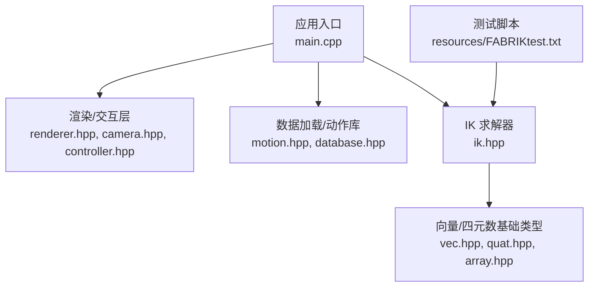
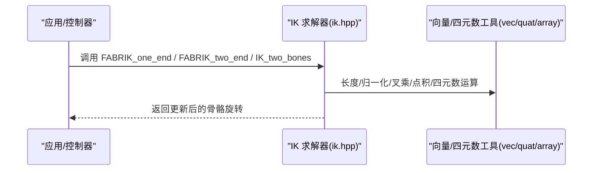
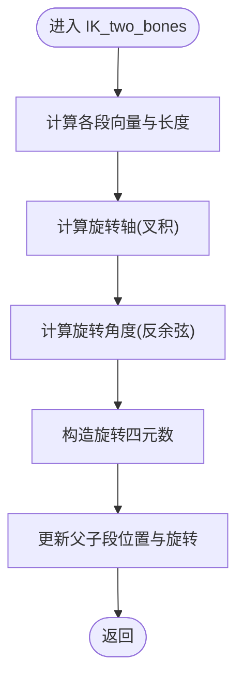
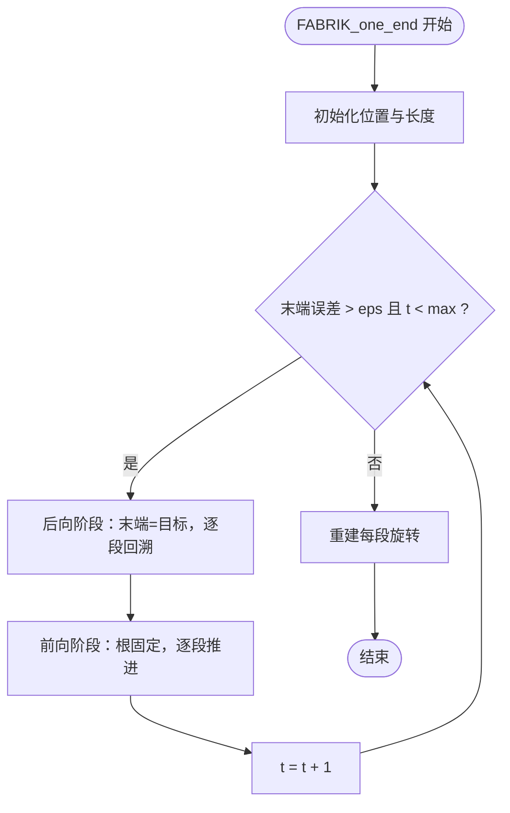
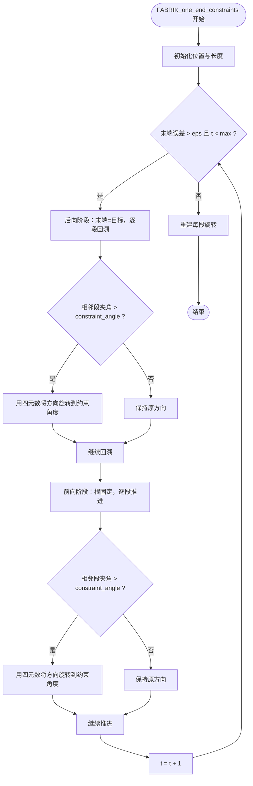
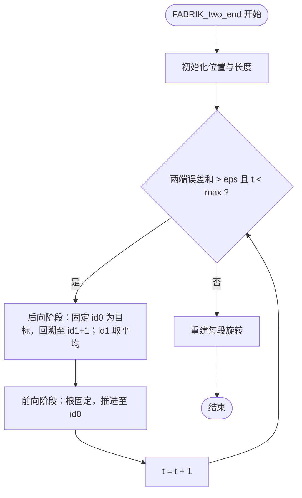
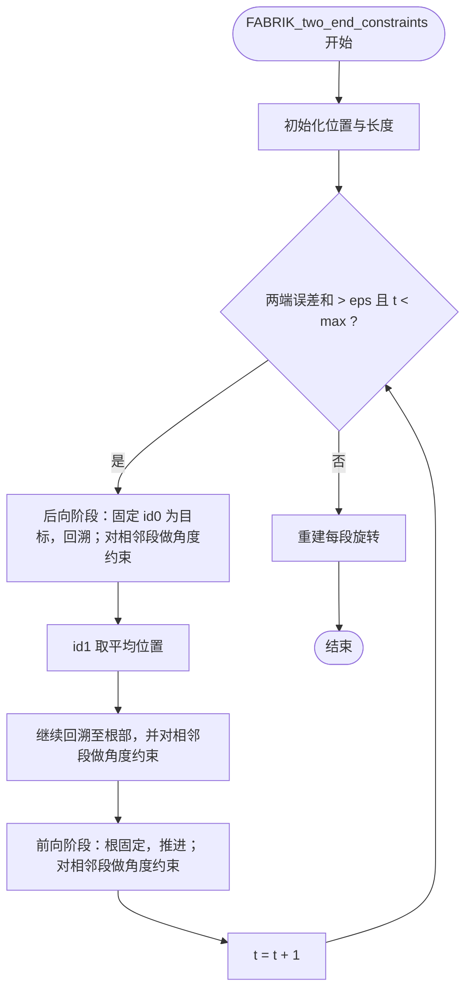
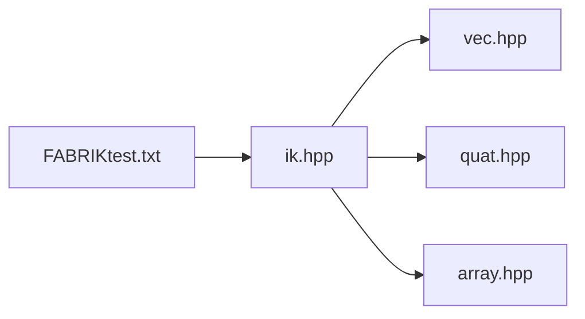

# 逆运动学系统

> **版本提示（2.0）**：本文撰写于 1.x 时期，描述的是旧的实现形态——入口在根目录 `main.cpp`，功能由根目录 `.hpp` 头文件库提供，窗口用 raylib、显示用 OpenCV highgui。2.0 已把这些头文件移到 `Source/Legacy/`，渲染默认走 GPU，窗口与 UI 换成 GLFW + ImGui，`main.cpp` 拆成 `Source/Launch/Private/` 下的 `Main.cpp` 与 `Application`。文中的文件路径、行号与调用链可能已失效，请以根目录的「项目概述」「快速开始」「故障排除」三篇与当前源码为准。

<cite>
**本文引用的文件**   
- [ik.hpp](file://ik.hpp)
- [FABRIKtest.txt](file://resources\FABRIKtest.txt)
- [README.md](file://README.md)
</cite>

## 目录
1. [简介](#简介)
2. [项目结构](#项目结构)
3. [核心组件](#核心组件)
4. [架构总览](#架构总览)
5. [详细组件分析](#详细组件分析)
6. [依赖关系分析](#依赖关系分析)
7. [性能与收敛性](#性能与收敛性)
8. [故障排查指南](#故障排查指南)
9. [结论](#结论)
10. [附录：参数调优与实践示例](#附录参数调优与实践示例)

## 简介
本仓库实现了一个面向角色与机器人动画的逆运动学（IK）子系统，提供两类求解器：
- 解析型双/三骨链 IK：通过几何三角关系直接计算关节旋转，适用于短链、低自由度场景。
- 迭代型 FABRIK（Forward And Backward Reaching Inverse Kinematics）：支持单末端、双末端以及角度约束，适合长链、多目标与复杂约束场景。

文档将围绕以下主题展开：
- IK 数学原理与算法选择（解析法 vs 迭代法）
- 从目标位置到骨骼角度的转换流程
- 约束处理与收敛判断
- 不同算法的适用场景与性能特征
- 在角色动画中的典型用例（脚部放置、手部抓取、姿态调整）
- 参数调优指南（阈值、迭代次数、阻尼/约束角度等）
- 自定义控制器与约束求解器的扩展方法

## 项目结构
本项目以 C++ 为主，包含渲染、相机、模型、材质、运动数据、IK 等模块。与 IK 直接相关的核心文件如下：
- ik.hpp：定义所有 IK 函数（解析 IK 与 FABRIK）
- resources/FABRIKtest.txt：演示如何使用 FABRIK 进行可视化调试
- README.md：构建说明与环境依赖

图表来源
- [README.md:1-22](file://README.md#L1-L22)
- [FABRIKtest.txt:1-20](file://resources\FABRIKtest.txt#L1-L20)
- [ik.hpp:1-10](file://ik.hpp#L1-L10)

章节来源
- [README.md:1-22](file://README.md#L1-L22)

## 核心组件
- 解析 IK（两骨/三骨链）
  - 输入：各段骨骼当前位置与旋转、目标末端位置
  - 输出：更新后的骨骼位置与旋转
  - 特点：闭式解、无迭代、速度快；对可达性与奇异点敏感
- FABRIK（前向-后向反向运动学）
  - 单末端：控制一个末端到达目标
  - 双末端：同时控制两个末端（如双手或双脚）
  - 带角度约束：限制相邻骨段夹角，避免不自然弯曲
  - 特点：迭代、鲁棒性强、易于加入约束；收敛速度与 eps、max 相关

章节来源
- [ik.hpp:7-103](file://ik.hpp#L7-L103)
- [ik.hpp:105-420](file://ik.hpp#L105-L420)

## 架构总览
IK 子系统对外暴露一组函数接口，供上层控制器调用。整体流程如下：
- 上层传入骨骼局部位置与旋转、目标位置（可含多个目标）
- IK 求解器根据策略（解析或迭代）计算新的关节旋转
- 将结果写回骨骼旋转，驱动网格渲染

图表来源
- [ik.hpp:105-162](file://ik.hpp#L105-L162)
- [ik.hpp:250-315](file://ik.hpp#L250-L315)
- [ik.hpp:7-103](file://ik.hpp#L7-L103)

## 详细组件分析

### 解析 IK：两骨/三骨链
- 数学思路
  - 利用余弦定理计算两段之间的夹角变化，得到绕相应轴的旋转四元数
  - 通过相对偏移与相对旋转组合，逐步更新各段位置与旋转
- 关键步骤
  - 计算各段向量与长度
  - 计算旋转轴（叉积）与角度（反余弦）
  - 构造旋转四元数并应用到父/子段
- 复杂度
  - O(1)，无循环
- 适用场景
  - 短链、快速响应、无需复杂约束

图表来源
- [ik.hpp:7-51](file://ik.hpp#L7-L51)
- [ik.hpp:53-103](file://ik.hpp#L53-L103)

章节来源
- [ik.hpp:7-103](file://ik.hpp#L7-L103)

### FABRIK：单末端
- 算法流程
  - 初始化：复制局部位置为世界位置，预计算每段长度
  - 迭代：
    - 后向阶段：固定末端为目标，逐段沿连线方向回溯，保持段长
    - 前向阶段：固定根节点，逐段沿连线方向推进，保持段长
  - 终止条件：末端误差小于 eps 或达到最大迭代次数 max
  - 旋转重建：根据初始局部方向与最终世界方向差，计算每段旋转
- 复杂度
  - 每次迭代 O(n)，n 为骨骼段数
- 适用场景
  - 单臂/单腿抓取、简单末端定位

图表来源
- [ik.hpp:105-162](file://ik.hpp#L105-L162)

章节来源
- [ik.hpp:105-162](file://ik.hpp#L105-L162)

### FABRIK：单末端 + 角度约束
- 新增能力
  - 在前后向阶段中，若相邻骨段夹角超过 constraint_angle，则使用四元数将当前段方向旋转到允许的最大角度内
- 收敛与稳定性
  - 约束可能使目标不可达，但仍会在 max 次迭代后停止
- 适用场景
  - 需要限制关节弯曲范围（如肘/膝）

图表来源
- [ik.hpp:164-248](file://ik.hpp#L164-L248)

章节来源
- [ik.hpp:164-248](file://ik.hpp#L164-L248)

### FABRIK：双末端
- 算法要点
  - 同时控制两个末端（id0、id1），在迭代中分别设置目标或取平均位置
  - 终止条件为两端误差之和小于 eps
- 适用场景
  - 双手抓握、双脚落地、双臂协同

图表来源
- [ik.hpp:250-315](file://ik.hpp#L250-L315)

章节来源
- [ik.hpp:250-315](file://ik.hpp#L250-L315)

### FABRIK：双末端 + 角度约束
- 新增能力
  - 在双末端迭代过程中，对每个方向的相邻段夹角进行约束检查与修正
- 适用场景
  - 双臂/双腿协同且需限制关节角度

图表来源
- [ik.hpp:317-420](file://ik.hpp#L317-L420)

章节来源
- [ik.hpp:317-420](file://ik.hpp#L317-L420)

### 从目标位置到骨骼角度的转换过程
- 解析 IK
  - 通过余弦定理求角度差，再转换为四元数旋转，依次作用于父子段
- FABRIK
  - 迭代更新世界坐标位置，最后比较“初始局部方向”与“最终世界方向”，用叉积与点积计算旋转轴与角度，生成四元数
- 约束处理
  - 角度约束：当相邻段夹角超过阈值时，使用四元数将方向旋转到允许范围内
- 收敛判断
  - 基于末端误差（单端）或两端误差和（双端）与 eps 的比较，结合最大迭代次数 max

章节来源
- [ik.hpp:7-103](file://ik.hpp#L7-L103)
- [ik.hpp:105-420](file://ik.hpp#L105-L420)

## 依赖关系分析
- 内部依赖
  - vec.hpp、quat.hpp、array.hpp：提供向量、四元数与数组切片操作
- 外部依赖（构建与运行）
  - OpenCV、OpenMP、Raylib（由 README 说明）
- 调用关系
  - 上层控制器/测试脚本调用 ik.hpp 提供的函数
  - FABRIKtest.txt 展示了如何加载角色/机器人数据并调用 FABRIK

图表来源
- [ik.hpp:1-5](file://ik.hpp#L1-L5)
- [FABRIKtest.txt:1-20](file://resources\FABRIKtest.txt#L1-L20)

章节来源
- [README.md:1-22](file://README.md#L1-L22)
- [FABRIKtest.txt:1-20](file://resources\FABRIKtest.txt#L1-L20)

## 性能与收敛性
- 解析 IK
  - 时间复杂度 O(1)，空间 O(1)
  - 优点：瞬时求解；缺点：仅适用于短链，无法表达复杂约束
- FABRIK
  - 时间复杂度 O(n·k)，n 为段数，k 为迭代次数
  - 收敛速度受 eps、max、约束强度影响
  - 优点：鲁棒、易扩展约束；缺点：迭代开销
- 建议
  - 短链优先使用解析 IK
  - 长链或多目标使用 FABRIK
  - 合理设置 eps 与 max，平衡精度与性能

[本节为通用指导，不直接分析具体文件]

## 故障排查指南
- 目标不可达
  - 现象：迭代达到 max 仍未收敛
  - 排查：检查目标是否在可达域内；适当增大 max 或放宽约束角度
- 抖动或不稳定
  - 现象：末端位置震荡
  - 排查：减小 eps 或增加阻尼（可通过平滑目标轨迹或降低步长）
- 关节角度异常
  - 现象：出现过度弯曲或翻转
  - 排查：检查 constraint_angle 是否过小；确认四元数旋转方向正确
- 性能瓶颈
  - 现象：帧率下降
  - 排查：减少 max；合并多次 IK 调用；使用更短的链或分层 IK

章节来源
- [ik.hpp:105-420](file://ik.hpp#L105-L420)

## 结论
本 IK 子系统提供了从解析到迭代的完整方案，覆盖短链快速求解与长链复杂约束两大需求。FABRIK 系列函数具备良好的可扩展性，便于引入更多约束与多目标优化。在实际角色动画中，可根据任务选择合适的求解器，并通过参数调优获得稳定、自然的运动效果。

[本节为总结性内容，不直接分析具体文件]

## 附录：参数调优与实践示例

### 参数调优指南
- 收敛阈值 eps
  - 越小越精确，但可能需要更多迭代；建议从 1e-4~1e-3 起步
- 最大迭代次数 max
  - 越大越可能收敛，但耗时增加；建议从 10~20 起步
- 约束角度 constraint_angle
  - 控制相邻段最大夹角；过大导致不自然，过小可能导致不可达
- 双末端权重
  - 双末端场景中，两端误差和作为收敛判据；必要时可对两端误差加权

章节来源
- [ik.hpp:105-420](file://ik.hpp#L105-L420)

### 实践示例：使用 FABRIK 进行可视化调试
- 参考资源脚本
  - resources/FABRIKtest.txt 展示了如何加载角色/机器人数据，初始化位置与长度，并在循环中进行后向与前向阶段可视化
- 关键点
  - 初始化：复制局部位置为世界位置，预计算段长
  - 迭代：后向阶段固定末端为目标，前向阶段固定根节点
  - 可视化：每步绘制骨骼点与目标点，便于观察收敛过程

章节来源
- [FABRIKtest.txt:120-206](file://resources\FABRIKtest.txt#L120-L206)

### 自定义 IK 控制器与约束求解器扩展
- 设计思路
  - 封装统一的 IK 接口，接受目标集合与约束描述
  - 在 FABRIK 迭代中加入自定义约束（如平面接触、重力对齐、目标优先级）
  - 使用阻尼或平滑策略提升稳定性
- 扩展点
  - 在前后向阶段插入约束修正逻辑
  - 动态调整 eps、max、constraint_angle
  - 多目标加权与优先级调度

[本节为概念性指导，不直接分析具体文件]