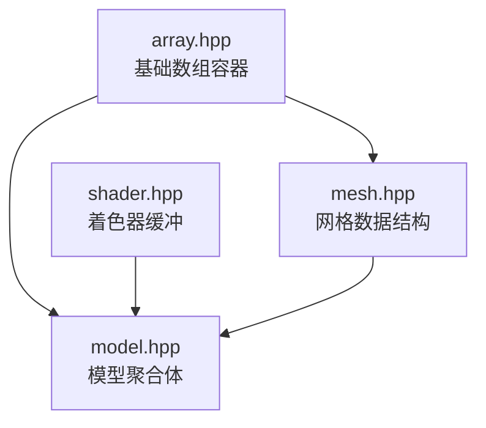
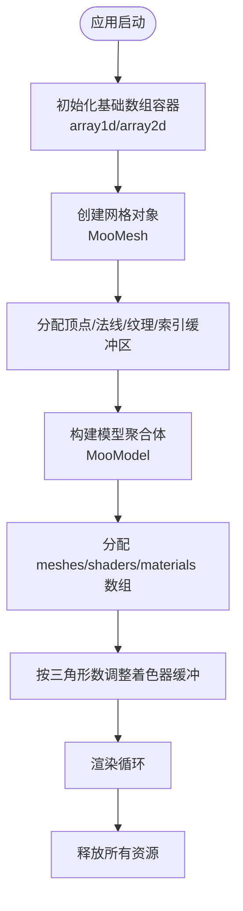
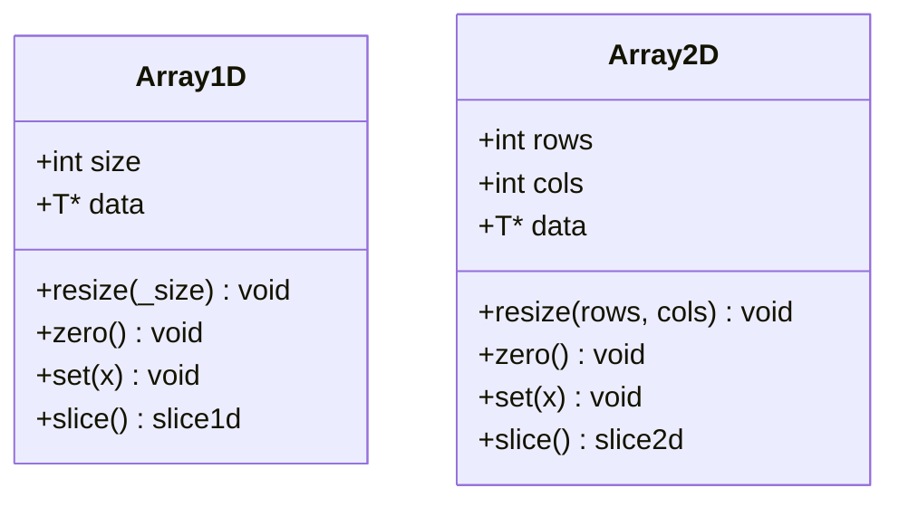
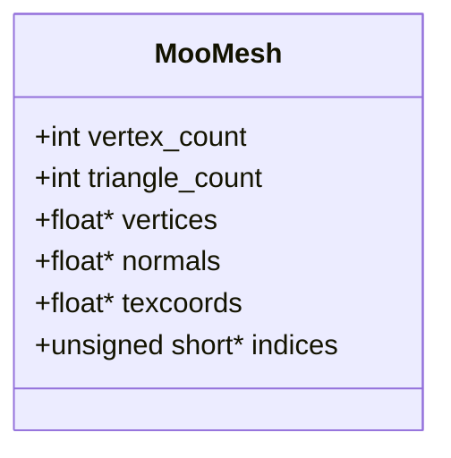
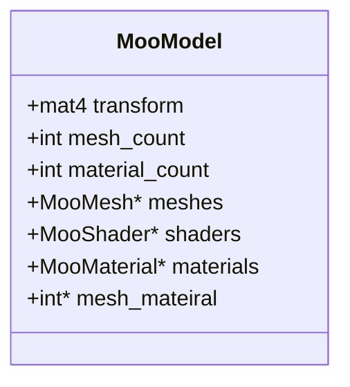
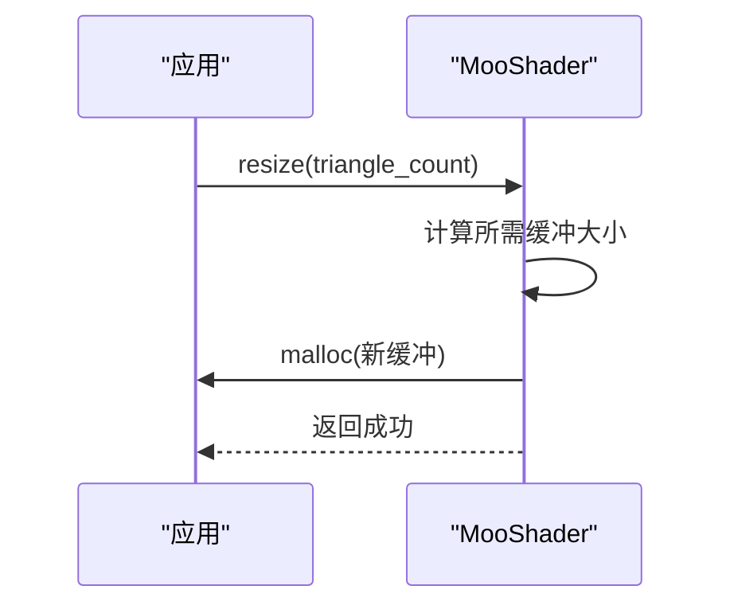
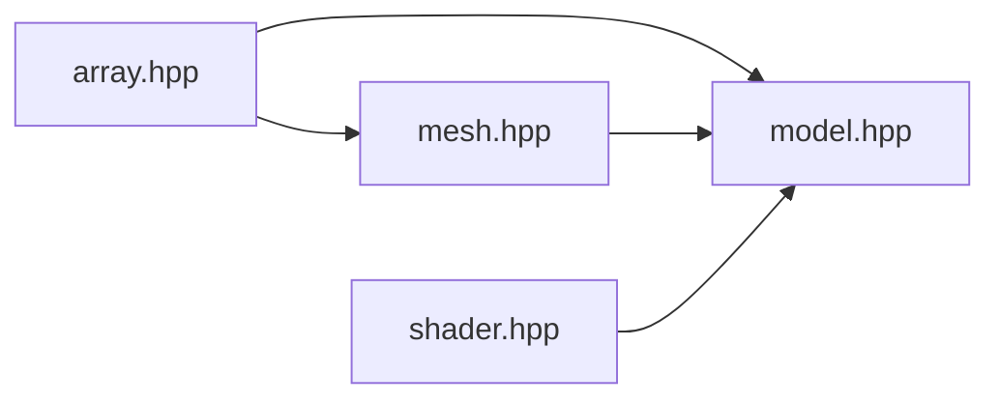

# 内存管理优化

> **版本提示（2.0）**：本文撰写于 1.x 时期，描述的是旧的实现形态——入口在根目录 `main.cpp`，功能由根目录 `.hpp` 头文件库提供，窗口用 raylib、显示用 OpenCV highgui。2.0 已把这些头文件移到 `Source/Legacy/`，渲染默认走 GPU，窗口与 UI 换成 GLFW + ImGui，`main.cpp` 拆成 `Source/Launch/Private/` 下的 `Main.cpp` 与 `Application`。文中的文件路径、行号与调用链可能已失效，请以根目录的「项目概述」「快速开始」「故障排除」三篇与当前源码为准。

<cite>
**本文引用的文件**   
- [README.md](file://README.md)
- [array.hpp](file://array.hpp)
- [mesh.hpp](file://mesh.hpp)
- [model.hpp](file://model.hpp)
- [shader.hpp](file://shader.hpp)
</cite>

## 目录
1. [简介](#简介)
2. [项目结构](#项目结构)
3. [核心组件](#核心组件)
4. [架构总览](#架构总览)
5. [详细组件分析](#详细组件分析)
6. [依赖关系分析](#依赖关系分析)
7. [性能考量](#性能考量)
8. [故障排查指南](#故障排查指南)
9. [结论](#结论)
10. [附录](#附录)

## 简介
本指南面向 MooLab 项目的内存管理优化，聚焦以下目标：
- 自定义内存分配器与对象池的设计思路、适用场景与配置方法
- 数据结构布局优化：采用 SoA（Structure of Arrays）提升缓存命中率
- 大对象与小对象的分配策略，降低内存碎片化
- 垃圾回收与对象生命周期管理的最佳实践
- 内存泄漏检测与性能分析工具使用（Valgrind、AddressSanitizer 等）

MooLab 是一个角色运动渲染与仿真器，依赖 OpenCV、OpenMP、raylib。构建与运行说明见 README。

**章节来源**
- [README.md:1-22](file://README.md#L1-L22)

## 项目结构
仓库根目录包含大量头文件与资源脚本，核心内存相关实现集中在基础容器与图形数据结构的头文件中。本次优化重点涉及：
- array.hpp：提供一维/二维数组容器与切片视图，内部基于 C 标准库 malloc/realloc/free 进行内存管理
- mesh.hpp：定义网格数据结构并多处直接调用 malloc 分配顶点、法线、纹理坐标与索引缓冲区
- model.hpp：模型聚合体，持有多个 Mesh、Shader、Material 的指针数组
- shader.hpp：着色器缓冲在运行时按三角形数量动态分配

**图示来源**
- [array.hpp:45-88](file://array.hpp#L45-L88)
- [mesh.hpp:6-14](file://mesh.hpp#L6-L14)
- [model.hpp:8-19](file://model.hpp#L8-L19)
- [shader.hpp:88-108](file://shader.hpp#L88-L108)

**章节来源**
- [array.hpp:45-88](file://array.hpp#L45-L88)
- [mesh.hpp:6-14](file://mesh.hpp#L6-L14)
- [model.hpp:8-19](file://model.hpp#L8-L19)
- [shader.hpp:88-108](file://shader.hpp#L88-L108)

## 核心组件
- 基础数组容器（array1d/array2d）
  - 提供 resize、zero、set、slice 等操作
  - 底层通过 malloc/realloc/free 管理连续内存块
  - 支持读写序列化接口（array1d_write/array1d_read 等）
- 网格数据结构（MooMesh）
  - 以多段独立指针存储顶点、法线、纹理坐标与索引
  - 多处构造函数中直接调用 malloc 分配各属性缓冲区
- 模型聚合体（MooModel）
  - 持有 meshes/shaders/materials/mesh_mateiral 等指针数组
  - 通过 malloc 为这些数组分配内存
- 着色器缓冲（MooShader）
  - 根据三角形数量动态分配顶点载荷数组

这些组件共同构成了当前项目的内存分配热点区域，也是后续引入自定义分配器与对象池的重点改造点。

**章节来源**
- [array.hpp:45-88](file://array.hpp#L45-L88)
- [array.hpp:108-156](file://array.hpp#L108-L156)
- [mesh.hpp:6-14](file://mesh.hpp#L6-L14)
- [mesh.hpp:40-48](file://mesh.hpp#L40-L48)
- [mesh.hpp:178-186](file://mesh.hpp#L178-L186)
- [mesh.hpp:286-294](file://mesh.hpp#L286-L294)
- [model.hpp:8-19](file://model.hpp#L8-L19)
- [model.hpp:27-40](file://model.hpp#L27-L40)
- [shader.hpp:88-108](file://shader.hpp#L88-L108)

## 架构总览
下图展示从基础容器到图形数据的内存分配路径，以及未来可引入的自定义分配器与对象池位置。

**图示来源**
- [array.hpp:45-88](file://array.hpp#L45-L88)
- [mesh.hpp:40-48](file://mesh.hpp#L40-L48)
- [model.hpp:27-40](file://model.hpp#L27-L40)
- [shader.hpp:88-108](file://shader.hpp#L88-L108)

## 详细组件分析

### 基础数组容器（array1d/array2d）
- 设计要点
  - 使用模板封装一维/二维连续内存块，对外暴露 size/rows/cols 与 data 指针
  - resize 分支处理三种情况：释放、首次分配、扩容
  - 提供 zero/set/slice 等常用操作，便于批量数据操作
- 复杂度
  - 访问 O(1)，扩容均摊 O(n)（realloc 可能触发拷贝）
  - 空间开销低，仅维护尺寸与单指针
- 优化建议
  - 引入容量（capacity）字段，避免频繁 realloc
  - 预分配策略：按增长因子（如 1.5x~2x）扩容，减少分配次数
  - 将分配逻辑下沉至自定义分配器，统一跟踪分配/释放

**图示来源**
- [array.hpp:45-88](file://array.hpp#L45-L88)
- [array.hpp:108-156](file://array.hpp#L108-L156)

**章节来源**
- [array.hpp:45-88](file://array.hpp#L45-L88)
- [array.hpp:108-156](file://array.hpp#L108-L156)

### 网格数据结构（MooMesh）
- 设计要点
  - 以多段独立指针组织顶点、法线、纹理坐标与索引
  - 构造函数内多次调用 malloc 分配不同属性缓冲区
- 问题识别
  - 多处重复的 malloc 调用，易遗漏 free，增加内存泄漏风险
  - 属性分散导致缓存局部性较差
- 优化方向
  - 引入统一的分配器接口，集中管理分配/释放
  - 考虑将属性合并为 SoA 布局，或至少对高频访问属性做对齐与紧凑排列
  - 为小网格提供栈上或池化分配，减少系统分配开销

**图示来源**
- [mesh.hpp:6-14](file://mesh.hpp#L6-L14)

**章节来源**
- [mesh.hpp:6-14](file://mesh.hpp#L6-L14)
- [mesh.hpp:40-48](file://mesh.hpp#L40-L48)
- [mesh.hpp:178-186](file://mesh.hpp#L178-L186)
- [mesh.hpp:286-294](file://mesh.hpp#L286-L294)

### 模型聚合体（MooModel）
- 设计要点
  - 持有 meshes/shaders/materials/mesh_mateiral 等指针数组
  - 通过 malloc 为这些数组分配内存
- 问题识别
  - 多层指针间接访问，影响缓存命中
  - 未显式释放，存在潜在泄漏
- 优化方向
  - 使用自定义分配器统一管理子对象数组
  - 引入对象池复用常见大小的数组（如固定数量的 Mesh/Shader）
  - 提供 RAII 包装，确保析构时正确释放

**图示来源**
- [model.hpp:8-19](file://model.hpp#L8-L19)

**章节来源**
- [model.hpp:8-19](file://model.hpp#L8-L19)
- [model.hpp:27-40](file://model.hpp#L27-L40)

### 着色器缓冲（MooShader）
- 设计要点
  - 根据三角形数量动态调整顶点载荷数组大小
  - 使用 malloc/free 管理缓冲
- 问题识别
  - 每帧或每次几何变化都可能触发重新分配
  - 缺少容量管理与复用机制
- 优化方向
  - 引入 capacity 与 resize 语义，避免频繁分配
  - 使用对象池缓存已分配的缓冲，按三角形规模分级复用

**图示来源**
- [shader.hpp:88-108](file://shader.hpp#L88-L108)

**章节来源**
- [shader.hpp:88-108](file://shader.hpp#L88-L108)

## 依赖关系分析
- 模块耦合
  - array.hpp 被 mesh.hpp/model.hpp 间接依赖（作为基础容器）
  - mesh.hpp 被 model.hpp 组合使用
  - shader.hpp 与 model.hpp 通过着色器数组关联
- 外部依赖
  - 构建依赖 OpenCV、OpenMP、raylib（由 README 指定）
- 潜在循环依赖
  - 当前头文件间未见明显循环引用

**图示来源**
- [array.hpp:45-88](file://array.hpp#L45-L88)
- [mesh.hpp:6-14](file://mesh.hpp#L6-L14)
- [model.hpp:8-19](file://model.hpp#L8-L19)
- [shader.hpp:88-108](file://shader.hpp#L88-L108)

**章节来源**
- [array.hpp:45-88](file://array.hpp#L45-L88)
- [mesh.hpp:6-14](file://mesh.hpp#L6-L14)
- [model.hpp:8-19](file://model.hpp#L8-L19)
- [shader.hpp:88-108](file://shader.hpp#L88-L108)

## 性能考量
- 缓存局部性与 SoA 布局
  - 当前 MooMesh 将顶点、法线、纹理坐标、索引分属不同数组，属于典型的 SoA 思想；但每个属性数组内部仍按元素顺序存放，有利于 SIMD 向量化与顺序访问
  - 建议在高频遍历路径（如渲染管线）优先访问同一属性的连续数组，以提升缓存命中率
- 分配策略
  - 小对象（如小型网格、临时缓冲）建议使用对象池，减少系统分配开销与碎片
  - 大对象（如大型模型缓冲）建议采用分页或分段池，避免单次分配过大导致碎片
- 扩容策略
  - 为 array1d/array2d 引入 capacity 与增长因子，减少 realloc 频率
- 内存对齐
  - 对 SIMD 友好的类型（如 vec3/vec4）建议按 16 字节对齐，提升向量运算效率

[本节为通用性能指导，不直接分析具体文件]

## 故障排查指南
- 内存泄漏检测
  - Valgrind（Linux/macOS）
    - 安装后运行：valgrind --leak-check=full ./MooLab.exe
    - 关注“definitely lost”“indirectly lost”报告，定位未释放的 malloc/free 配对
  - AddressSanitizer（跨平台）
    - 编译启用 -fsanitize=address -g，运行程序后查看堆栈回溯
    - 适用于快速发现越界访问、重复释放等问题
- 常见问题定位
  - 检查 mesh.hpp 中的多处 malloc 是否均有对应 free
  - 检查 model.hpp 中 meshes/shaders/materials/mesh_mateiral 的释放逻辑
  - 检查 shader.hpp 中 resize 后的旧缓冲是否释放
- 调试建议
  - 在关键分配点插入日志，记录分配大小与来源
  - 使用内存快照工具对比前后帧的内存占用变化

**章节来源**
- [mesh.hpp:40-48](file://mesh.hpp#L40-L48)
- [mesh.hpp:178-186](file://mesh.hpp#L178-L186)
- [mesh.hpp:286-294](file://mesh.hpp#L286-L294)
- [model.hpp:27-40](file://model.hpp#L27-L40)
- [shader.hpp:88-108](file://shader.hpp#L88-L108)

## 结论
- 当前项目的基础数组容器与图形数据结构已具备较好的连续内存组织基础，适合进一步优化为高性能渲染与仿真流水线
- 建议优先引入自定义分配器与对象池，统一接管 malloc/realloc/free，并提供容量管理与复用机制
- 在数据布局上坚持 SoA 原则，结合 SIMD 与缓存友好访问模式，显著提升性能
- 配合 Valgrind 与 AddressSanitizer 等工具，持续监控内存健康状态，确保长期稳定性

[本节为总结性内容，不直接分析具体文件]

## 附录
- 自定义分配器设计要点
  - 线程安全：为多线程环境提供锁或无锁队列
  - 粒度控制：区分小对象池与大对象池，设置合适的块大小与阈值
  - 统计信息：记录分配次数、失败次数、碎片率、峰值内存
- 对象池配置建议
  - 预分配阶段：根据场景规模估算最大并发对象数，一次性分配池内存
  - 回收策略：空闲对象及时归还，避免长时间占用
  - 扩容策略：池满时按增长因子扩展，避免频繁重建
- 生命周期管理最佳实践
  - RAII 封装：为所有拥有资源的对象提供析构释放逻辑
  - 所有权清晰：明确谁负责分配与释放，避免双重释放或悬垂指针
  - 测试覆盖：为关键路径编写单元测试，验证分配/释放的正确性

[本节为通用指导，不直接分析具体文件]