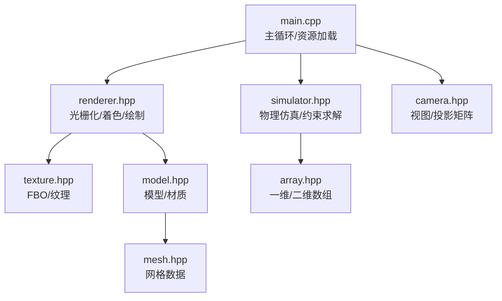
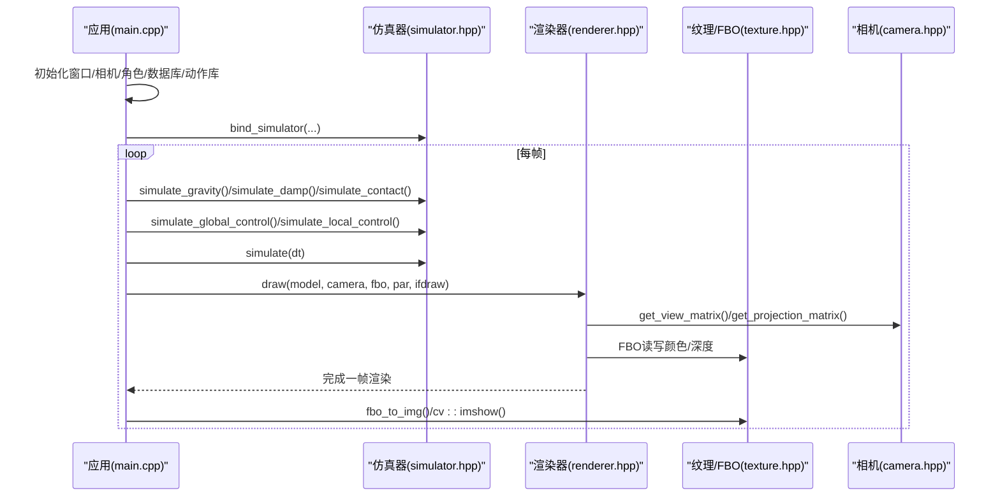
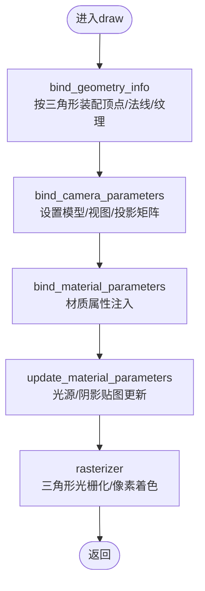
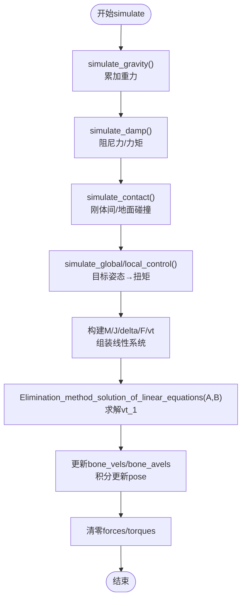
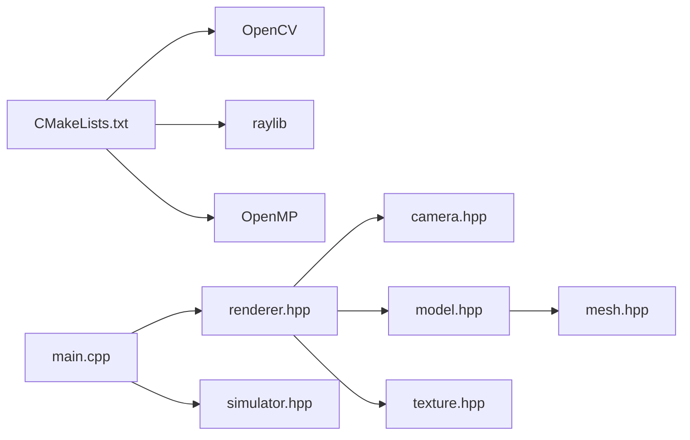

# 性能优化

> **版本提示（2.0）**：本文撰写于 1.x 时期，描述的是旧的实现形态——入口在根目录 `main.cpp`，功能由根目录 `.hpp` 头文件库提供，窗口用 raylib、显示用 OpenCV highgui。2.0 已把这些头文件移到 `Source/Legacy/`，渲染默认走 GPU，窗口与 UI 换成 GLFW + ImGui，`main.cpp` 拆成 `Source/Launch/Private/` 下的 `Main.cpp` 与 `Application`。文中的文件路径、行号与调用链可能已失效，请以根目录的「项目概述」「快速开始」「故障排除」三篇与当前源码为准。

<cite>
**本文引用的文件**   
- [main.cpp](file://main.cpp)
- [CMakeLists.txt](file://CMakeLists.txt)
- [renderer.hpp](file://renderer.hpp)
- [simulator.hpp](file://simulator.hpp)
- [camera.hpp](file://camera.hpp)
- [texture.hpp](file://texture.hpp)
- [mesh.hpp](file://mesh.hpp)
- [model.hpp](file://model.hpp)
- [array.hpp](file://array.hpp)
</cite>

## 目录
1. [引言](#引言)
2. [项目结构](#项目结构)
3. [核心组件](#核心组件)
4. [架构总览](#架构总览)
5. [详细组件分析](#详细组件分析)
6. [依赖关系分析](#依赖关系分析)
7. [性能考量与优化策略](#性能考量与优化策略)
8. [故障排查指南](#故障排查指南)
9. [结论](#结论)
10. [附录：编译与平台调优清单](#附录编译与平台调优清单)

## 引言
本指南面向MooLab项目的性能优化，聚焦渲染管线、物理仿真、并行计算、内存布局与缓存友好性、性能分析与监控、以及大规模场景优化。文档基于仓库现有实现进行代码级剖析，给出可落地的优化建议与最佳实践，帮助在不同硬件平台上获得更稳定、更高的帧率与吞吐。

## 项目结构
MooLab采用自研软件光栅化渲染器（raylib窗口+OpenCV显示），结合自定义物理仿真器与骨骼动画系统。关键模块包括：
- 主循环与资源初始化：main.cpp
- 渲染管线：renderer.hpp（光栅化、着色、绘制）
- 物理仿真：simulator.hpp（重力/阻尼/碰撞/约束求解）
- 相机与FBO：camera.hpp, texture.hpp
- 几何与模型：mesh.hpp, model.hpp
- 基础数组容器：array.hpp

**图示来源**
- [main.cpp:53-160](file://main.cpp#L53-L160)
- [renderer.hpp:17-22](file://renderer.hpp#L17-L22)
- [simulator.hpp:321-355](file://simulator.hpp#L321-L355)
- [camera.hpp:7-36](file://camera.hpp#L7-L36)
- [texture.hpp:11-34](file://texture.hpp#L11-L34)
- [model.hpp:8-19](file://model.hpp#L8-L19)
- [mesh.hpp:6-14](file://mesh.hpp#L6-L14)
- [array.hpp:45-88](file://array.hpp#L45-L88)

**章节来源**
- [main.cpp:53-160](file://main.cpp#L53-L160)
- [CMakeLists.txt:1-66](file://CMakeLists.txt#L1-L66)

## 核心组件
- 渲染器：提供几何绑定、相机参数注入、材质参数注入、逐三角形光栅化与像素着色；支持PBR/纹理/法线/灯光多种着色路径。
- 物理仿真器：维护骨骼质量、惯性、连接约束、形状体（胶囊体），实现重力、阻尼、刚体间与地面碰撞、局部/全局力矩控制，并通过线性方程组求解速度增量更新位姿。
- 相机与FBO：管理视口、近远裁剪面、视图/投影矩阵，使用CPU侧FBO存储颜色与深度缓冲。
- 网格与模型：以顶点/法线/纹理坐标/索引组织三角网格，模型聚合多个网格与材质并持有变换矩阵。
- 数组容器：提供动态一维/二维数组，支持resize、zero、切片等常用操作。

**章节来源**
- [renderer.hpp:17-22](file://renderer.hpp#L17-L22)
- [renderer.hpp:121-239](file://renderer.hpp#L121-L239)
- [simulator.hpp:321-355](file://simulator.hpp#L321-L355)
- [simulator.hpp:357-624](file://simulator.hpp#L357-L624)
- [camera.hpp:7-36](file://camera.hpp#L7-L36)
- [texture.hpp:11-34](file://texture.hpp#L11-L34)
- [mesh.hpp:6-14](file://mesh.hpp#L6-L14)
- [model.hpp:8-19](file://model.hpp#L8-L19)
- [array.hpp:45-88](file://array.hpp#L45-L88)

## 架构总览
下图展示从主循环到渲染与仿真的调用链，体现数据流与控制流的关键节点。

**图示来源**
- [main.cpp:223-549](file://main.cpp#L223-L549)
- [simulator.hpp:357-624](file://simulator.hpp#L357-L624)
- [renderer.hpp:213-239](file://renderer.hpp#L213-L239)
- [camera.hpp:53-70](file://camera.hpp#L53-L70)
- [texture.hpp:55-63](file://texture.hpp#L55-L63)

## 详细组件分析

### 渲染管线与批处理
- 几何绑定：将网格的顶点、法线、纹理坐标按三角形索引装配到每个三角形的shader数据结构中，便于后续光栅化阶段快速访问。
- 相机与材质注入：为每个shader设置模型/视图/投影矩阵、屏幕到世界逆变换、相机位置/方向、近裁剪面，以及材质属性（反照率、粗糙度、金属度、BRDF/Eavg LUT）。
- 光栅化：对每个三角形进行视锥剔除（近裁剪面）、投影与标准化设备坐标转换、包围盒裁剪、逐像素重心坐标测试与深度写入；根据着色类型走不同着色路径（PBR/纹理/法线/灯光）。
- 绘制接口：遍历模型的多个mesh，依次绑定几何/相机/材质参数后调用光栅化。

**图示来源**
- [renderer.hpp:33-92](file://renderer.hpp#L33-L92)
- [renderer.hpp:213-239](file://renderer.hpp#L213-L239)
- [renderer.hpp:121-210](file://renderer.hpp#L121-L210)

**章节来源**
- [renderer.hpp:33-92](file://renderer.hpp#L33-L92)
- [renderer.hpp:121-239](file://renderer.hpp#L121-L239)

### 物理仿真与并行化
- 重力与阻尼：对每个骨骼施加重力与线性/角速度阻尼，形成力与力矩累积。
- 碰撞检测：胶囊体间线段距离计算与地面平面距离计算，产生弹性/粘性接触力与摩擦力，标记接触状态。
- 控制输入：局部/全局力矩控制通过目标姿态误差生成关节扭矩，部分逻辑包含积分项与微分项。
- 动力学求解：构建质量矩阵M、约束雅可比J、残差delta，组装KKT型线性系统并消元求解，更新速度与角速度，再积分更新位姿。

**图示来源**
- [simulator.hpp:357-624](file://simulator.hpp#L357-L624)

**章节来源**
- [simulator.hpp:357-624](file://simulator.hpp#L357-L624)

### OpenMP并行计算现状与建议
- 当前已使用OpenMP的地方：
  - 矩阵乘法：外层行循环使用`#pragma omp parallel for`，提升乘加运算并行度。
  - 光栅化三角形循环：对三角形数量进行并行，线程内执行像素扫描与着色。
- 风险与注意事项：
  - 光栅化中对FBO的深度/颜色写入存在并发写竞争，需确保同一像素不被多线程同时写入，或引入线程私有缓冲区/原子操作/分块策略。
  - 矩阵乘法中的并行是安全的（无共享写冲突），但需注意数据局部性与缓存命中。
- 任务分解与同步建议：
  - 将三角形划分为tile（如8x8像素块），每个线程处理一个tile，减少跨线程对FBO的随机访问。
  - 在控制/碰撞等独立于时间步的部分使用`#pragma omp parallel for`，避免在约束求解内部引入细粒度并行。

**章节来源**
- [simulator.hpp:61-79](file://simulator.hpp#L61-L79)
- [renderer.hpp:121-210](file://renderer.hpp#L121-L210)

### 缓存友好的数据布局设计
- 顶点/法线/纹理坐标分离存储：Mesh结构中vertices/normals/texcoords分别以连续float数组存放，有利于顺序读取。
- 三角形装配：按索引将三个顶点的属性打包到shader.triangle的数据结构中，减少光栅化阶段的间接寻址。
- 一维/二维数组：array1d/array2d以单块内存存储元素，提供零拷贝切片与批量读写，利于SIMD与向量化。
- 建议：
  - 尽量保持AoS（Array of Structures）到SoA（Structure of Arrays）的转换仅在需要时进行；对于大量向量运算（如速度/角速度更新），优先使用SoA以提升缓存命中率。
  - 避免频繁realloc导致内存碎片；对大对象（如FBO、纹理）预分配并复用。

**章节来源**
- [mesh.hpp:6-14](file://mesh.hpp#L6-L14)
- [renderer.hpp:33-59](file://renderer.hpp#L33-L59)
- [array.hpp:45-88](file://array.hpp#L45-L88)
- [array.hpp:108-176](file://array.hpp#L108-L176)

### 内存池管理与生命周期
- 当前实现多使用malloc/free直接管理内存（如FBO、纹理、Mesh、Model），未引入显式内存池。
- 风险点：
  - 频繁创建/销毁临时对象（如每帧构造曲线点数组）可能带来分配开销。
  - FBO与纹理在程序启动时一次性分配，但在某些路径下可能被重复拷贝或转换（如fbo_to_img）。
- 建议：
  - 引入对象池（Object Pool）用于高频小对象（如临时vec3/quat、中间结果）。
  - 复用FBO与纹理缓冲区，避免每帧重新分配。
  - 对大型数组（如特征矩阵、运动序列）使用预分配与双缓冲，减少运行时resize。

**章节来源**
- [texture.hpp:11-34](file://texture.hpp#L11-L34)
- [texture.hpp:86-100](file://texture.hpp#L86-L100)
- [main.cpp:406-419](file://main.cpp#L406-L419)

## 依赖关系分析
- 外部依赖：OpenCV（图像IO与显示）、raylib（窗口与手柄输入）、OpenMP（并行）。
- 内部耦合：
  - main.cpp依赖所有子系统，承担资源加载与帧循环调度。
  - renderer.hpp依赖camera/model/mesh/shader，负责渲染流程编排。
  - simulator.hpp依赖motion/array，负责物理计算。
  - texture.hpp提供FBO与纹理工具函数，被renderer与main共用。

**图示来源**
- [CMakeLists.txt:11-13](file://CMakeLists.txt#L11-L13)
- [CMakeLists.txt:56-60](file://CMakeLists.txt#L56-L60)
- [main.cpp:8-17](file://main.cpp#L8-L17)
- [renderer.hpp:4-7](file://renderer.hpp#L4-L7)
- [model.hpp:4-6](file://model.hpp#L4-L6)
- [texture.hpp:4-9](file://texture.hpp#L4-L9)

**章节来源**
- [CMakeLists.txt:1-66](file://CMakeLists.txt#L1-L66)
- [main.cpp:8-17](file://main.cpp#L8-L17)

## 性能考量与优化策略

### 渲染批处理与可见性优化
- 批处理：
  - 合并相同材质的mesh以减少状态切换；当前draw按mesh逐个绑定参数，建议在渲染前按材质分组，减少bind_*调用次数。
  - 将多次draw调用合并为单次批次，降低CPU端状态设置开销。
- 可见性：
  - 在光栅化前增加粗略的视锥剔除与遮挡剔除（例如基于包围球/包围盒），减少无效三角形的光栅化。
  - 利用相机FOV与近裁剪面提前丢弃不可见三角形（已有近裁剪判断，可扩展为AABB/OBB剔除）。

**章节来源**
- [renderer.hpp:121-210](file://renderer.hpp#L121-L210)
- [main.cpp:466-472](file://main.cpp#L466-L472)

### 物理计算并行化
- 重力/阻尼/碰撞：
  - 对骨骼循环使用`#pragma omp parallel for`，注意碰撞检测O(n^2)复杂度，可通过空间划分（BVH/网格）降低复杂度。
- 控制与约束：
  - 控制扭矩计算可并行化；约束求解本身为稠密线性系统，不建议在求解内部并行，可在预处理（构建M/J/delta）阶段并行。
- 同步：
  - 避免在并行区域内对共享变量进行非原子写；必要时使用线程私有副本，最后归约汇总。

**章节来源**
- [simulator.hpp:357-435](file://simulator.hpp#L357-L435)
- [simulator.hpp:437-541](file://simulator.hpp#L437-L541)
- [simulator.hpp:543-624](file://simulator.hpp#L543-L624)

### 内存池与缓存友好性
- 预分配：
  - 对FBO、纹理、Mesh、Model等大对象在启动时一次性分配，避免运行时realloc。
- SoA布局：
  - 对高频访问的向量数据（如bone_vels/bone_avels/bone_forces）采用SoA，提升SIMD与缓存命中率。
- 减少拷贝：
  - 避免每帧复制整个FBO或纹理；使用指针交换或双缓冲技术。

**章节来源**
- [texture.hpp:11-34](file://texture.hpp#L11-L34)
- [array.hpp:45-88](file://array.hpp#L45-L88)
- [simulator.hpp:321-355](file://simulator.hpp#L321-L355)

### OpenMP配置与最佳实践
- 启用OpenMP：
  - CMake中find_package(OpenMP REQUIRED COMPONENTS CXX)，链接OpenMP::OpenMP_CXX。
- 任务分解：
  - 对独立迭代（矩阵乘法、重力/阻尼、三角形循环）使用`#pragma omp parallel for`。
  - 对复杂循环（如碰撞检测）考虑task-based并行或分块策略。
- 同步：
  - 避免在并行区内对共享数据进行无序写；必要时使用critical/atomic或线程私有变量。
- 线程数：
  - 根据CPU核心数设置OMP_NUM_THREADS，避免超线程导致的争用。

**章节来源**
- [CMakeLists.txt:13](file://CMakeLists.txt#L13)
- [CMakeLists.txt:56-60](file://CMakeLists.txt#L56-L60)
- [simulator.hpp:61-79](file://simulator.hpp#L61-L79)
- [renderer.hpp:121-210](file://renderer.hpp#L121-L210)

### 缓存友好数据布局技巧
- 顺序访问：
  - 保证热点数据（如顶点属性、FBO像素）顺序访问，减少跨行跳跃。
- 对齐与填充：
  - 对结构体成员进行对齐，避免伪共享；对数组长度适当填充以提升向量化效率。
- 局部性：
  - 将经常一起访问的数据放在相邻内存（如将三角形与其对应的材质ID放在一起）。

**章节来源**
- [mesh.hpp:6-14](file://mesh.hpp#L6-L14)
- [renderer.hpp:33-59](file://renderer.hpp#L33-L59)
- [texture.hpp:11-34](file://texture.hpp#L11-L34)

### 性能分析与监控
- 帧率统计：
  - 使用raylib的SetTargetFPS控制目标帧率，结合GetTime/GetFrameTime统计每帧耗时。
- 内存使用：
  - 监控FBO与纹理大小，避免重复分配；记录峰值内存占用。
- I/O与显示：
  - OpenCV的cv::imshow可能成为瓶颈，建议使用异步显示或降低显示频率。

**章节来源**
- [main.cpp:61](file://main.cpp#L61)
- [texture.hpp:55-63](file://texture.hpp#L55-L63)

### 不同硬件平台的调优建议
- CPU：
  - 调整OpenMP线程数与亲和性，匹配物理核心数；启用编译器自动向量化（-O3/-march=native）。
- GPU（若未来迁移至GPU）：
  - 将光栅化与着色移至GPU，使用Compute Shader或Ray Tracing加速；CPU仅负责调度与数据准备。
- 内存带宽受限平台：
  - 优先SoA布局与预取优化，减少随机访问；压缩纹理与顶点格式。

[本节为通用指导，不直接分析具体文件]

### Release版本编译优化选项
- 当前CMake已设置C++17标准与MSVC警告选项；建议在Release模式下启用：
  - /O2（最大优化）、/GL（Whole Program Optimization）、/LTCG（Link Time Code Generation）、/arch:AVX2（若目标CPU支持）。
- 关闭调试信息：/Zi移除或改为/ZI（仅保留必要符号）。
- 并行编译：/MP已启用，可进一步提升构建速度。

**章节来源**
- [CMakeLists.txt:50-54](file://CMakeLists.txt#L50-L54)

### 大规模场景优化策略
- 视锥剔除：
  - 在渲染前对模型/网格进行包围球/包围盒测试，剔除完全在视锥外的对象。
- LOD系统：
  - 根据距离选择不同细节级别的网格，减少远距离对象的三角形数量。
- 遮挡剔除：
  - 使用Z-buffer预pass或硬件Occlusion Query减少片元着色开销。
- 实例化渲染：
  - 对重复对象（如植被、装饰物）使用实例化渲染，减少draw调用与状态切换。

[本节为概念性内容，不直接分析具体文件]

## 故障排查指南
- 渲染闪烁或撕裂：
  - 检查FBO清空逻辑与深度写入顺序；确保每帧正确重置颜色/深度缓冲。
- 物理不稳定：
  - 检查约束求解的数值稳定性（条件数过大），适当增大正则化项或减小dt。
- 帧率骤降：
  - 定位OpenCV显示与图像转换开销；降低显示分辨率或频率。
- 内存泄漏：
  - 检查malloc/free配对，确保FBO/纹理/Mesh在程序退出前释放。

**章节来源**
- [texture.hpp:19-26](file://texture.hpp#L19-L26)
- [simulator.hpp:543-624](file://simulator.hpp#L543-L624)
- [main.cpp:508-549](file://main.cpp#L508-L549)

## 结论
MooLab的渲染与物理子系统具备清晰的模块化结构，已在关键路径引入OpenMP并行。进一步优化应聚焦于：
- 渲染批处理与可见性剔除，减少无效计算；
- 物理计算的并行化与空间划分，降低碰撞复杂度；
- 内存池与SoA布局，提升缓存命中率与分配效率；
- 性能监控与平台特定优化，确保在不同硬件上稳定高帧率。

[本节为总结性内容，不直接分析具体文件]

## 附录：编译与平台调优清单
- 构建系统：
  - CMake + vcpkg管理依赖；OpenCV/raylib/OpenMP通过find_package引入。
- MSVC优化：
  - Release模式启用/O2/GL/LTCG；/MP并行编译；/utf-8确保中文注释正确解析。
- 运行环境：
  - 工作目录切换到resources/，确保资源路径一致。
- 性能基准：
  - 使用Release版本进行测试；记录帧率、内存峰值、CPU/GPU利用率。

**章节来源**
- [CMakeLists.txt:1-66](file://CMakeLists.txt#L1-L66)
- [README.md:7-15](file://README.md#L7-L15)