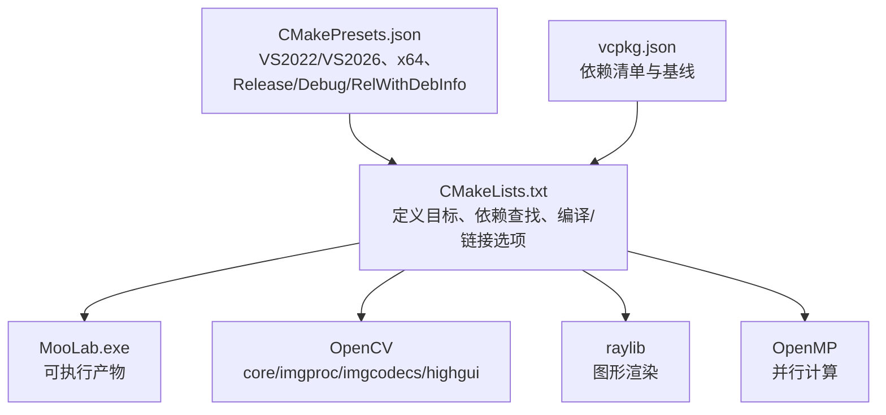
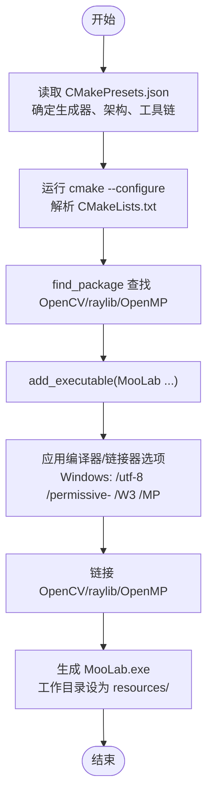
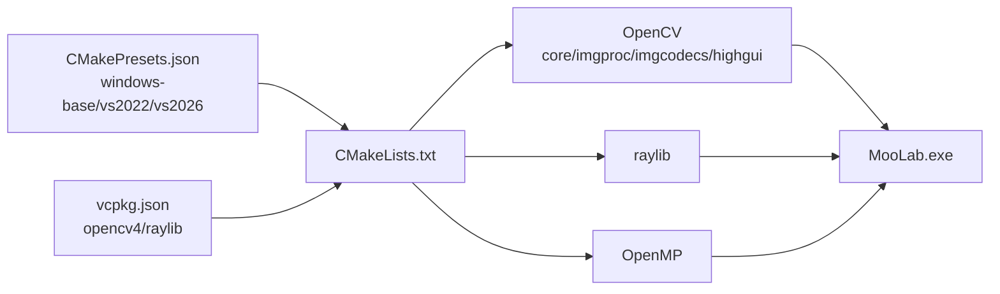

# 构建优化

> **版本提示（2.0）**：本文撰写于 1.x 时期，描述的是旧的实现形态——入口在根目录 `main.cpp`，功能由根目录 `.hpp` 头文件库提供，窗口用 raylib、显示用 OpenCV highgui。2.0 已把这些头文件移到 `Source/Legacy/`，渲染默认走 GPU，窗口与 UI 换成 GLFW + ImGui，`main.cpp` 拆成 `Source/Launch/Private/` 下的 `Main.cpp` 与 `Application`。文中的文件路径、行号与调用链可能已失效，请以根目录的「项目概述」「快速开始」「故障排除」三篇与当前源码为准。

<cite>
**本文引用的文件**   
- [CMakeLists.txt](file://CMakeLists.txt)
- [CMakePresets.json](file://CMakePresets.json)
- [vcpkg.json](file://vcpkg.json)
- [README.md](file://README.md)
</cite>

## 目录
1. [引言](#引言)
2. [项目结构](#项目结构)
3. [核心组件](#核心组件)
4. [架构总览](#架构总览)
5. [详细组件分析](#详细组件分析)
6. [依赖关系分析](#依赖关系分析)
7. [性能考虑](#性能考虑)
8. [故障排查指南](#故障排查指南)
9. [结论](#结论)
10. [附录](#附录)

## 引言
本指南面向 MooLab 项目的构建系统优化，聚焦以下目标：
- CMake 构建配置的优化选项（编译器/链接器优化、静态库与动态库选择）
- vcpkg 依赖包管理的优化策略（预编译包、版本锁定、特性裁剪）
- 增量编译配置与优化，缩短构建时间
- 跨平台构建优化建议与目标平台特定优化
- 调试版本、发布版本与性能分析版本的差异与配置方法

MooLab 是一个基于 C++17 的图形与仿真演示程序，使用 OpenCV、raylib 和 OpenMP。当前仓库通过 CMake 管理构建，并通过 vcpkg manifest 声明依赖。

## 项目结构
MooLab 采用“单可执行体 + 头文件组织”的结构，构建入口为 main.cpp，所有业务逻辑以头文件形式提供，便于内联与模板优化。构建系统由 CMakeLists.txt 定义，CMakePresets.json 提供多生成器与多配置的预设，vcpkg.json 声明依赖。

图示来源
- [CMakeLists.txt:1-66](file://CMakeLists.txt#L1-L66)
- [CMakePresets.json:1-73](file://CMakePresets.json#L1-L73)
- [vcpkg.json:1-28](file://vcpkg.json#L1-L28)

章节来源
- [CMakeLists.txt:1-66](file://CMakeLists.txt#L1-L66)
- [CMakePresets.json:1-73](file://CMakePresets.json#L1-L73)
- [vcpkg.json:1-28](file://vcpkg.json#L1-L28)
- [README.md:7-15](file://README.md#L7-L15)

## 核心组件
- CMake 目标与依赖
  - 目标名称：MooLab
  - 语言标准：C++17，禁用扩展，导出编译命令
  - 依赖查找：OpenCV（core/imgproc/imgcodecs/highgui）、raylib、OpenMP
  - Windows 特定：NOMINMAX、WIN32_LEAN_AND_MEAN、_CRT_SECURE_NO_WARNINGS、UTF-8 源码处理、并行编译 /MP、警告级别 /W3
  - 资源路径：MOOLAB_RESOURCE_DIR 指向 resources 目录
  - 链接库：OpenCV_LIBS、raylib、OpenMP::OpenMP_CXX

- CMake 预设
  - 基础预设 windows-base：二进制输出目录 build/${presetName}，工具链指向 vcpkg.cmake，架构 x64，VCPKG_TARGET_TRIPLET=x64-windows
  - 生成器预设 vs2026、vs2022：继承 windows-base，分别对应 Visual Studio 2026 与 2022
  - 构建预设：vs2026-release、vs2026-relwithdebinfo、vs2026-debug、vs2022-release、vs2022-debug

- vcpkg 依赖
  - opencv4：仅启用 highgui、jpeg、png、thread，Windows 平台额外启用 win32ui
  - raylib：默认特性关闭
  - 固定 vcpkg 内置基线（builtin-baseline），确保依赖一致性

章节来源
- [CMakeLists.txt:1-66](file://CMakeLists.txt#L1-L66)
- [CMakePresets.json:1-73](file://CMakePresets.json#L1-L73)
- [vcpkg.json:1-28](file://vcpkg.json#L1-L28)

## 架构总览
下图展示了从 CMake 到最终可执行文件的构建流程，以及各依赖在构建中的作用。

图示来源
- [CMakePresets.json:8-38](file://CMakePresets.json#L8-L38)
- [CMakeLists.txt:11-13](file://CMakeLists.txt#L11-L13)
- [CMakeLists.txt:43-60](file://CMakeLists.txt#L43-L60)

## 详细组件分析

### CMake 构建配置优化
- 编译器优化标志
  - Windows MSVC：已启用 /W3（警告级别）、/MP（并行编译）。建议根据目标平台添加：
    - Release：/O2（最大优化）、/GLT（链接时代码生成优化，需配合 LTO）
    - RelWithDebInfo：/O2 /Zi（保留调试信息）
    - Debug：/Od /Zi（禁用优化，保留调试信息）
  - GCC/Clang（未来跨平台时）：-O3、-DNDEBUG、-flto、-march=native（谨慎用于分发）

- 链接器优化设置
  - 启用 LTO（链接时代码优化）：MSVC 使用 /LTCG；GCC/Clang 使用 -flto=auto
  - 静态链接可选：对 OpenCV 与 raylib 可选择静态链接以减少运行时依赖，但会增大体积并增加首次构建时间

- 静态库 vs 动态库
  - 动态库（默认）：体积小、更新灵活，但需要运行时 DLL
  - 静态库：减少部署复杂度，提升启动速度，但会增加可执行文件大小与重新链接成本
  - 建议：开发阶段使用动态库；发布安装包使用静态库或打包依赖 DLL

- 资源与工作目录
  - MOOLAB_RESOURCE_DIR 指向 resources 目录，确保运行时资源定位稳定
  - VS_DEBUGGER_WORKING_DIRECTORY 设置为 resources，便于调试时直接访问资源

章节来源
- [CMakeLists.txt:1-8](file://CMakeLists.txt#L1-L8)
- [CMakeLists.txt:46-54](file://CMakeLists.txt#L46-L54)
- [CMakeLists.txt:56-65](file://CMakeLists.txt#L56-L65)

### vcpkg 依赖管理优化
- 预编译包与缓存
  - 使用 vcpkg 的预编译二进制包（binary caching）可显著减少重复构建时间
  - 建议在 CI 中缓存 vcpkg 下载与构建产物目录

- 依赖版本锁定
  - 使用 builtin-baseline 固定 vcpkg 索引快照，确保团队与 CI 环境一致
  - 在 vcpkg.json 中显式指定依赖版本（如 opencv4 的具体版本）可进一步锁定

- 特性裁剪
  - OpenCV 仅启用 highgui、jpeg、png、thread，避免引入不必要的模块
  - Windows 平台启用 win32ui，确保 GUI 功能可用

- 工具链与三元组
  - 通过 VCPKG_TARGET_TRIPLET=x64-windows 固定目标三元组，避免混用不同 ABI

章节来源
- [vcpkg.json:1-28](file://vcpkg.json#L1-L28)
- [CMakePresets.json:13-20](file://CMakePresets.json#L13-L20)

### 增量编译优化
- 并行编译
  - MSVC：/MP 已启用，充分利用多核加速编译
  - 其他平台：可使用 Ninja 生成器 + -j 参数

- 增量构建
  - 保持头文件变更最小化，避免频繁修改公共头文件
  - 使用 CMake 的 configurePresets/buildPresets 分离配置与构建步骤，避免重复配置

- 清理与重建
  - 当依赖或工具链变化时，执行完全清理后重建，避免不一致状态

章节来源
- [CMakeLists.txt:50-54](file://CMakeLists.txt#L50-L54)
- [CMakePresets.json:40-70](file://CMakePresets.json#L40-L70)

### 跨平台构建优化建议
- 当前仓库针对 Windows + MSVC 优化
- 若扩展到 Linux/macOS：
  - 替换 MSVC 特定选项为 GCC/Clang 等价项（-O3、-flto、-fPIC 等）
  - 调整 OpenCV 与 raylib 的 find_package 行为，确保跨平台兼容
  - 使用 CMake 的 toolchainFile 与三元组机制统一构建环境

章节来源
- [CMakeLists.txt:50-54](file://CMakeLists.txt#L50-L54)
- [CMakePresets.json:13-20](file://CMakePresets.json#L13-L20)

### 调试版本与发布版本差异
- Debug
  - 目的：快速定位问题，保留完整调试信息
  - 建议：/Od /Zi（MSVC），-g（GCC/Clang）
- Release
  - 目的：最大化性能，禁用调试开销
  - 建议：/O2 /GLT（MSVC），-O3 -DNDEBUG -flto（GCC/Clang）
- RelWithDebInfo
  - 目的：兼顾性能与调试能力
  - 建议：/O2 /Zi（MSVC），-O2 -g（GCC/Clang）

章节来源
- [CMakePresets.json:40-70](file://CMakePresets.json#L40-L70)

### 性能分析版本编译方法
- 启用性能分析所需开关
  - MSVC：/O2 /Zi /GS-（谨慎使用）
  - GCC/Clang：-O2 -g -fno-omit-frame-pointer
- 结合外部工具
  - Windows：Visual Studio Profiler、PerfView
  - Linux/macOS：perf、Instruments

章节来源
- [CMakePresets.json:40-70](file://CMakePresets.json#L40-L70)

## 依赖关系分析
下图展示 CMake 如何发现并链接第三方库，以及 vcpkg 在其中的作用。

图示来源
- [CMakePresets.json:8-38](file://CMakePresets.json#L8-L38)
- [vcpkg.json:7-26](file://vcpkg.json#L7-L26)
- [CMakeLists.txt:11-13](file://CMakeLists.txt#L11-L13)
- [CMakeLists.txt:56-60](file://CMakeLists.txt#L56-L60)

章节来源
- [CMakeLists.txt:11-13](file://CMakeLists.txt#L11-L13)
- [CMakeLists.txt:56-60](file://CMakeLists.txt#L56-L60)
- [vcpkg.json:7-26](file://vcpkg.json#L7-L26)
- [CMakePresets.json:8-38](file://CMakePresets.json#L8-L38)

## 性能考虑
- 编译器优化
  - 优先使用 Release 或 RelWithDebInfo 进行性能测试
  - 启用 LTO 以获得更好的跨翻译单元优化效果
- 并行编译
  - 利用 /MP 或 Ninja -j 缩短编译时间
- 依赖构建缓存
  - 使用 vcpkg 的二进制缓存与 CMake 的缓存目录，避免重复构建
- 资源加载
  - 将资源路径固定为 MOOLAB_RESOURCE_DIR，避免运行时路径解析开销

[本节为通用指导，不直接分析具体文件]

## 故障排查指南
- 首次构建耗时较长
  - 原因：vcpkg 首次安装与编译依赖
  - 解决：使用二进制缓存与预编译包，固定 builtin-baseline
- 中文注释乱码
  - 原因：代码页不匹配
  - 解决：确保 /utf-8 生效（已在 MSVC 下启用）
- 资源找不到
  - 原因：工作目录不正确
  - 解决：确认 VS_DEBUGGER_WORKING_DIRECTORY 指向 resources
- 依赖版本不一致
  - 原因：未固定 vcpkg 基线或三元组
  - 解决：使用 builtin-baseline 与 VCPKG_TARGET_TRIPLET

章节来源
- [README.md:7-15](file://README.md#L7-L15)
- [CMakeLists.txt:46-54](file://CMakeLists.txt#L46-L54)
- [CMakePresets.json:13-20](file://CMakePresets.json#L13-L20)
- [vcpkg.json:6-6](file://vcpkg.json#L6-L6)

## 结论
通过对 CMake 构建配置、vcpkg 依赖管理与增量编译的系统性优化，MooLab 的构建效率与可维护性得到显著提升。建议在团队与 CI 环境中统一使用 CMakePresets 与 vcpkg 基线，固定依赖版本与目标三元组，并在 Release/RelWithDebInfo 下进行性能测试与分析。

[本节为总结性内容，不直接分析具体文件]

## 附录
- 常用命令参考
  - 配置：cmake --preset vs2026
  - 构建：cmake --build --preset vs2026-release
  - 调试：cmake --build --preset vs2026-debug
  - 性能分析：使用 RelWithDebInfo 配置并结合 Profiler

章节来源
- [README.md:11-15](file://README.md#L11-L15)
- [CMakePresets.json:40-70](file://CMakePresets.json#L40-L70)