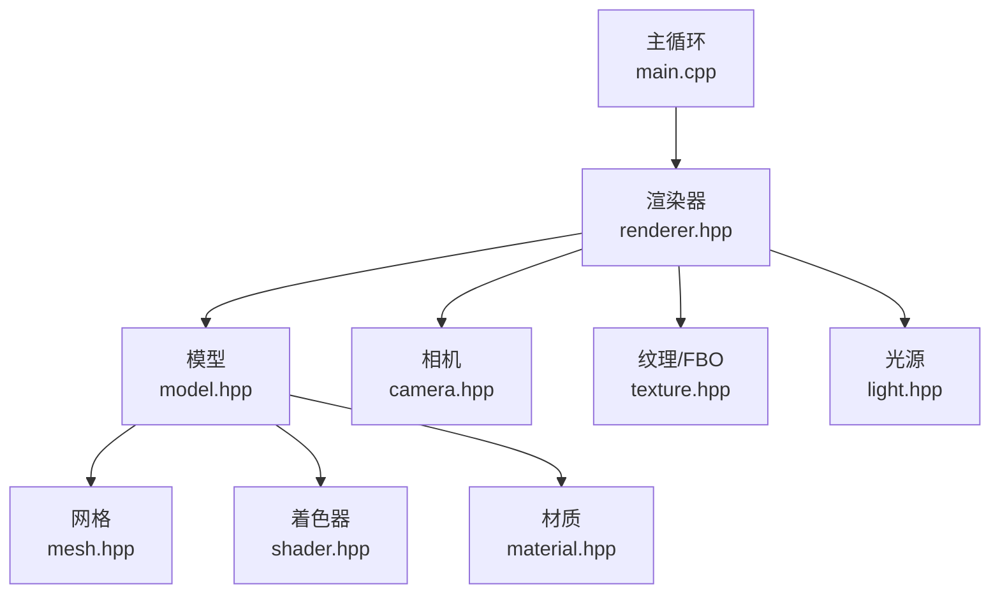
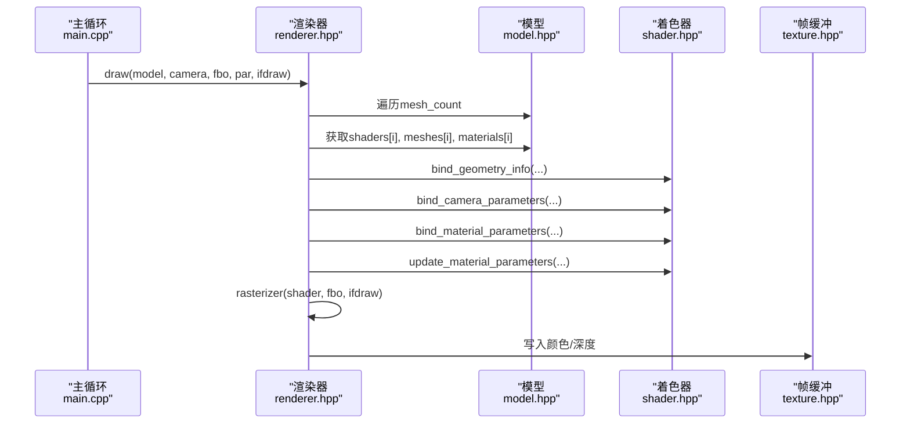
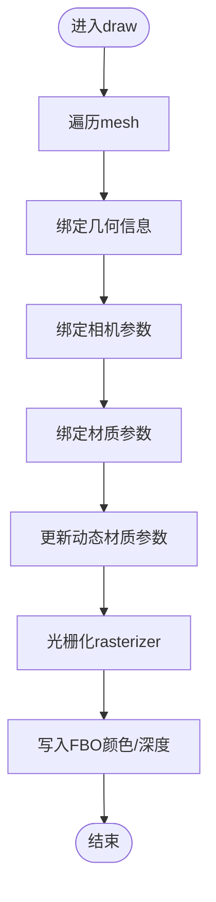
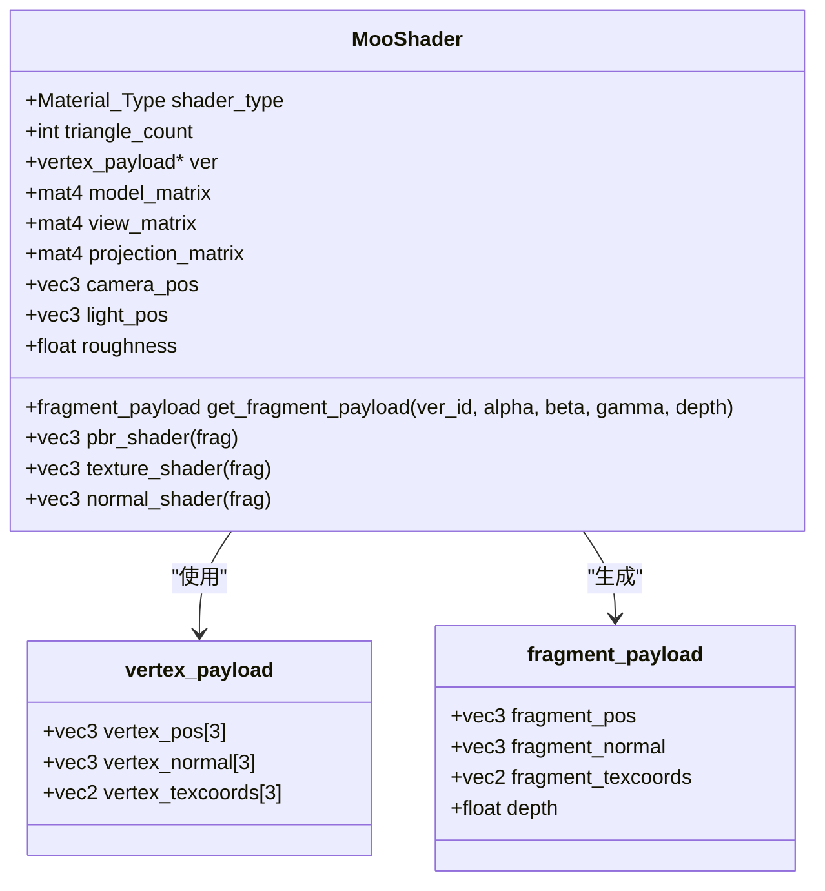
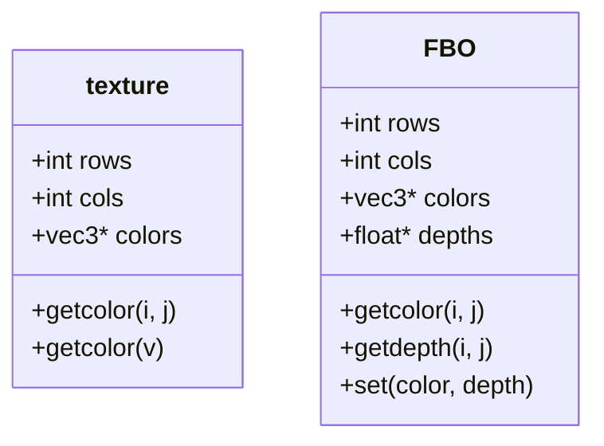
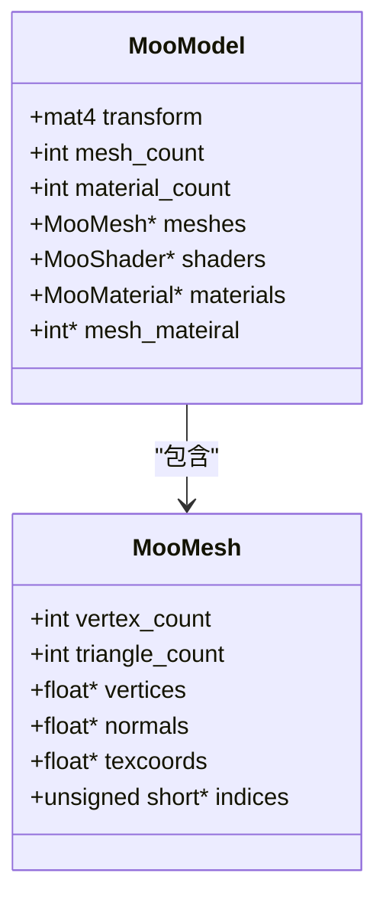
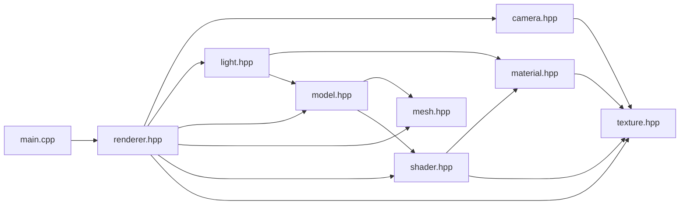

# 渲染优化

> **版本提示（2.0）**：本文撰写于 1.x 时期，描述的是旧的实现形态——入口在根目录 `main.cpp`，功能由根目录 `.hpp` 头文件库提供，窗口用 raylib、显示用 OpenCV highgui。2.0 已把这些头文件移到 `Source/Legacy/`，渲染默认走 GPU，窗口与 UI 换成 GLFW + ImGui，`main.cpp` 拆成 `Source/Launch/Private/` 下的 `Main.cpp` 与 `Application`。文中的文件路径、行号与调用链可能已失效，请以根目录的「项目概述」「快速开始」「故障排除」三篇与当前源码为准。

<cite>
**本文引用的文件**   
- [main.cpp](file://main.cpp)
- [renderer.hpp](file://renderer.hpp)
- [shader.hpp](file://shader.hpp)
- [texture.hpp](file://texture.hpp)
- [mesh.hpp](file://mesh.hpp)
- [model.hpp](file://model.hpp)
- [material.hpp](file://material.hpp)
- [camera.hpp](file://camera.hpp)
- [light.hpp](file://light.hpp)
</cite>

## 目录
1. [引言](#引言)
2. [项目结构](#项目结构)
3. [核心组件](#核心组件)
4. [架构总览](#架构总览)
5. [详细组件分析](#详细组件分析)
6. [依赖关系分析](#依赖关系分析)
7. [性能考量与优化策略](#性能考量与优化策略)
8. [故障排查指南](#故障排查指南)
9. [结论](#结论)

## 引言
本指南面向MooLab渲染系统，聚焦于可落地的性能优化实践。文档基于仓库中的软件光栅化管线实现，围绕以下目标展开：
- 绘制批处理：合并绘制调用、减少状态切换开销
- GPU缓存友好的数据布局：顶点/索引缓冲组织
- 纹理压缩与mipmap：降低显存带宽压力
- 剔除优化：视锥剔除与遮挡剔除
- 着色器优化：分支预测、指令重排等技巧
- 渲染路径对比与移动平台建议

## 项目结构
MooLab采用自研软件光栅化管线，核心由相机、模型、材质、着色器、网格、纹理/FBO以及主循环组成。渲染流程从主循环发起，经渲染器绑定几何与材质参数后进入光栅化阶段，最终写入帧缓冲。

图表来源
- [main.cpp:149-159](file://main.cpp#L149-L159)
- [renderer.hpp:17-22](file://renderer.hpp#L17-L22)
- [model.hpp:8-19](file://model.hpp#L8-L19)
- [mesh.hpp:6-14](file://mesh.hpp#L6-L14)
- [shader.hpp:35-86](file://shader.hpp#L35-L86)
- [material.hpp:15-30](file://material.hpp#L15-L30)
- [camera.hpp:7-36](file://camera.hpp#L7-L36)
- [texture.hpp:11-34](file://texture.hpp#L11-L34)
- [light.hpp:16-25](file://light.hpp#L16-L25)

章节来源
- [main.cpp:53-159](file://main.cpp#L53-L159)
- [renderer.hpp:17-22](file://renderer.hpp#L17-L22)
- [model.hpp:8-19](file://model.hpp#L8-L19)

## 核心组件
- 渲染器（MooRenderer）：管理模型与光源集合，提供draw入口
- 模型（MooModel）：封装变换矩阵、网格数组、着色器数组、材质数组及映射
- 网格（MooMesh）：顶点、法线、纹理坐标、索引的容器
- 着色器（MooShader）：三角形计数、逐三角顶点载荷、投影/视图/模型矩阵、材质采样与PBR/纹理/法线着色
- 纹理/FBO（texture/FBO）：图像数据与颜色/深度缓冲
- 相机（MooCamera）：视口、近远平面、视图/投影矩阵、FBO指针
- 光源（Point_Light/Polygon_Light）：点光源与多边形光源数据结构

章节来源
- [renderer.hpp:17-31](file://renderer.hpp#L17-L31)
- [model.hpp:8-19](file://model.hpp#L8-L19)
- [mesh.hpp:6-14](file://mesh.hpp#L6-L14)
- [shader.hpp:19-86](file://shader.hpp#L19-L86)
- [texture.hpp:11-34](file://texture.hpp#L11-L34)
- [camera.hpp:7-36](file://camera.hpp#L7-L36)
- [light.hpp:16-40](file://light.hpp#L16-L40)

## 架构总览
下图展示一次典型渲染调用的时序：主循环准备模型与光源，调用draw；渲染器为每个mesh绑定几何、相机、材质参数，随后进行光栅化并写入FBO。

图表来源
- [main.cpp:466-472](file://main.cpp#L466-L472)
- [renderer.hpp:213-239](file://renderer.hpp#L213-L239)
- [renderer.hpp:121-211](file://renderer.hpp#L121-L211)
- [shader.hpp:110-125](file://shader.hpp#L110-L125)
- [texture.hpp:11-34](file://texture.hpp#L11-L34)

## 详细组件分析

### 渲染器与绘制流程
- MooRenderer持有models与lights列表，draw函数对每个mesh依次执行几何绑定、相机参数绑定、材质参数绑定，然后调用rasterizer完成光栅化。
- rasterizer内部使用OpenMP并行遍历三角形，计算裁剪、投影、屏幕包围盒、重心坐标与深度测试，再根据shader_type选择LIGHT/PBR/TEXTURE/NORMALS着色路径写入FBO。

图表来源
- [renderer.hpp:213-239](file://renderer.hpp#L213-L239)
- [renderer.hpp:121-211](file://renderer.hpp#L121-L211)

章节来源
- [renderer.hpp:213-239](file://renderer.hpp#L213-L239)
- [renderer.hpp:121-211](file://renderer.hpp#L121-L211)

### 着色器与PBR路径
- MooShader维护triangle_count与vertex_payload数组，get_fragment_payload在光栅化中插值位置、法线与纹理坐标。
- pbr_shader实现GGX NDF、Schlick近似、Smith遮蔽、Fresnel与多重散射BRDF查找表，结合光照方向与辐射度输出颜色。

图表来源
- [shader.hpp:19-86](file://shader.hpp#L19-L86)
- [shader.hpp:110-125](file://shader.hpp#L110-L125)
- [shader.hpp:199-237](file://shader.hpp#L199-L237)

章节来源
- [shader.hpp:19-86](file://shader.hpp#L19-L86)
- [shader.hpp:110-125](file://shader.hpp#L110-L125)
- [shader.hpp:199-237](file://shader.hpp#L199-L237)

### 纹理与帧缓冲
- texture以二维数组存储RGB像素，提供按浮点坐标取色接口。
- FBO维护颜色与深度缓冲，并提供行列访问与批量设置方法。

图表来源
- [texture.hpp:65-84](file://texture.hpp#L65-L84)
- [texture.hpp:11-34](file://texture.hpp#L11-L34)

章节来源
- [texture.hpp:11-34](file://texture.hpp#L11-L34)
- [texture.hpp:65-84](file://texture.hpp#L65-L84)

### 网格与模型
- MooMesh包含顶点、法线、纹理坐标与索引数组，支持三角形、立方体、胶囊体等基础几何构造。
- MooModel将多个mesh与其对应shader和material关联，并提供mesh_mateiral映射。

图表来源
- [mesh.hpp:6-14](file://mesh.hpp#L6-L14)
- [model.hpp:8-19](file://model.hpp#L8-L19)

章节来源
- [mesh.hpp:6-14](file://mesh.hpp#L6-L14)
- [model.hpp:8-19](file://model.hpp#L8-L19)

## 依赖关系分析
- main.cpp负责初始化相机、控制器、角色、仿真器、材质、模型与渲染器，并在每帧更新模型变换与光源位置后调用draw。
- renderer.hpp依赖camera.hpp、light.hpp、model.hpp、mesh.hpp，并通过shader.hpp与texture.hpp完成渲染。
- shader.hpp依赖material.hpp、texture.hpp、mat.hpp、vec.hpp等数学与材质类型。
- model.hpp依赖mesh.hpp与shader.hpp。
- material.hpp依赖global.hpp与texture.hpp。
- camera.hpp依赖mat.hpp与texture.hpp。
- light.hpp依赖material.hpp、model.hpp与texture.hpp。

图表来源
- [main.cpp:8-17](file://main.cpp#L8-L17)
- [renderer.hpp:4-8](file://renderer.hpp#L4-L8)
- [model.hpp:4-6](file://model.hpp#L4-L6)
- [shader.hpp:4-8](file://shader.hpp#L4-L8)
- [material.hpp:4-5](file://material.hpp#L4-L5)
- [camera.hpp:4-5](file://camera.hpp#L4-L5)
- [light.hpp:4-6](file://light.hpp#L4-L6)

章节来源
- [main.cpp:8-17](file://main.cpp#L8-L17)
- [renderer.hpp:4-8](file://renderer.hpp#L4-L8)
- [model.hpp:4-6](file://model.hpp#L4-L6)
- [shader.hpp:4-8](file://shader.hpp#L4-L8)
- [material.hpp:4-5](file://material.hpp#L4-L5)
- [camera.hpp:4-5](file://camera.hpp#L4-L5)
- [light.hpp:4-6](file://light.hpp#L4-L6)

## 性能考量与优化策略

### 绘制批处理与状态合并
- 现状：draw对每个mesh分别绑定几何、相机、材质参数，再调用rasterizer。若同一帧存在大量小mesh，会产生多次状态切换与重复绑定开销。
- 优化建议：
  - 同材质mesh合并：将相同material_type与纹理图集的mesh合并为单一draw调用，减少bind_material_parameters与update_material_parameters次数。
  - 统一矩阵与相机参数：在批次内复用view/projection/screen_to_world矩阵，避免重复赋值。
  - 使用实例化或索引缓冲合并：将多个mesh的indices拼接，通过偏移与长度控制绘制范围，降低draw调用数量。

章节来源
- [renderer.hpp:213-239](file://renderer.hpp#L213-L239)

### GPU缓存友好的数据布局
- 现状：MooMesh以分离数组存储vertices/normals/texcoords/indices；rasterizer按三角形顺序访问vertex_payload，间接通过indices寻址。
- 优化建议：
  - AOS转SOA或紧凑AoS：将顶点属性打包为连续结构体（如pos+normal+texcoord），提升缓存局部性。
  - 索引缓冲优化：确保indices顺序尽量顺序访问，减少随机跳转；对共享边进行顶点重用。
  - 对齐与填充：保证顶点结构体大小对齐到硬件友好边界（如16字节），避免跨行访问。

章节来源
- [mesh.hpp:6-14](file://mesh.hpp#L6-L14)
- [renderer.hpp:33-59](file://renderer.hpp#L33-L59)

### 纹理压缩与mipmap
- 现状：texture以未压缩RGB浮点数组存储，img_to_tex直接拷贝像素数据；无mipmap层级。
- 优化建议：
  - 启用纹理压缩格式（如ASTC/ETC2/DXT），在加载时解码为GPU原生格式，减少显存占用与带宽。
  - 生成mipmap链：为不同距离的物体选择合适层级，降低过采样与纹理抖动。
  - 纹理图集：将多张小图合并为大图集，减少纹理切换与采样开销。

章节来源
- [texture.hpp:86-100](file://texture.hpp#L86-L100)

### 视锥剔除与遮挡剔除
- 现状：rasterizer仅做简单的近裁剪判断（z_near），未实现完整视锥剔除与遮挡剔除。
- 优化建议：
  - 视锥剔除：在CPU侧对模型/网格的包围球/包围盒进行视锥测试，剔除不可见对象后再进入draw。
  - 遮挡剔除：利用深度预pass或硬件Z-buffer结果，在片段阶段跳过被遮挡片段的着色计算。
  - 层次化剔除：构建场景树（BVH/OBB Tree），快速剪枝大范围不可见区域。

章节来源
- [renderer.hpp:121-211](file://renderer.hpp#L121-L211)

### 着色器优化最佳实践
- 分支预测：
  - 减少if/else分支，使用条件表达式与混合操作替代。
  - 将频繁分支外提至CPU或预处理阶段。
- 指令重排：
  - 先计算公共项（如NdotV、NdotL、H向量），避免重复计算。
  - 使用查表（BRDF/Eavg LUT）替代复杂函数。
- 精度与数据类型：
  - 在移动端优先使用half精度，减少带宽与功耗。
  - 避免不必要的pow/exp/log，用近似函数替代。

章节来源
- [shader.hpp:199-237](file://shader.hpp#L199-L237)

### 渲染路径对比分析
- LIGHT路径：简单纯色输出，适合调试与可视化。
- TEXTURE路径：直接采样albedo贴图，轻量但缺乏光照。
- NORMALS路径：法线可视化，用于调试法线一致性。
- PBR路径：包含GGX、Smith、Fresnel与多重散射BRDF，质量高但计算密集。

建议：
- 开发期使用NORMALS/TEXTURE路径快速验证几何与UV。
- 正式渲染使用PBR路径，并根据设备能力降级为简化BRDF或关闭多重散射。

章节来源
- [renderer.hpp:167-205](file://renderer.hpp#L167-L205)
- [shader.hpp:199-237](file://shader.hpp#L199-L237)

### 移动平台特殊优化
- 降低分辨率与抗锯齿：减小FBO尺寸，禁用或降低MSAA。
- 限制纹理尺寸与mipmap层级：控制在设备推荐范围内，避免超采样。
- 减少draw调用：合并mesh、使用实例化渲染。
- 着色器简化：关闭多重散射BRDF，使用单层反射近似。
- 内存与带宽：使用压缩纹理，避免频繁CPU-GPU同步。

章节来源
- [texture.hpp:11-34](file://texture.hpp#L11-L34)
- [renderer.hpp:121-211](file://renderer.hpp#L121-L211)

## 故障排查指南
- 画面全黑或颜色异常：
  - 检查FBO尺寸与相机投影矩阵是否匹配。
  - 确认纹理坐标与贴图尺寸一致，避免越界。
- 性能骤降：
  - 统计draw调用次数与三角形数量，定位热点mesh。
  - 检查是否存在大量小mesh导致状态切换频繁。
- 阴影或深度问题：
  - 确认z_near/z_far设置合理，避免深度冲突。
  - 检查深度写入与比较逻辑是否正确。

章节来源
- [texture.hpp:11-34](file://texture.hpp#L11-L34)
- [camera.hpp:63-70](file://camera.hpp#L63-L70)
- [renderer.hpp:121-211](file://renderer.hpp#L121-L211)

## 结论
MooLab的软件光栅化管线提供了清晰的渲染框架，便于扩展与优化。通过绘制批处理、数据布局优化、纹理压缩与mipmap、视锥/遮挡剔除以及着色器优化，可以显著提升渲染性能与稳定性。建议在开发过程中逐步引入这些优化，并结合实际场景与设备进行针对性调优。