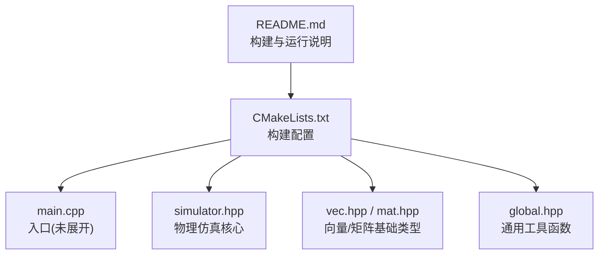
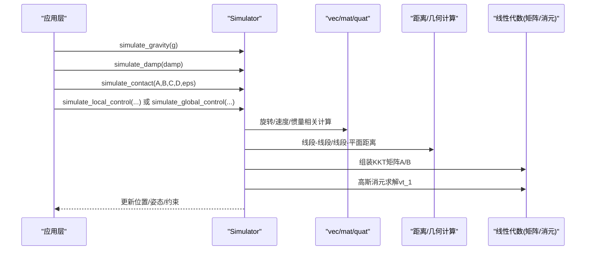
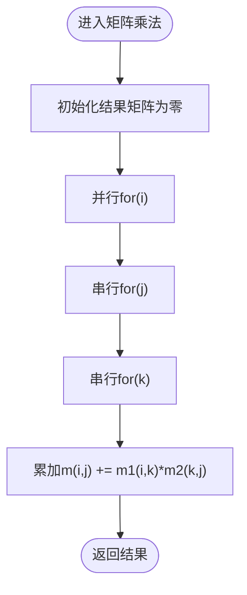
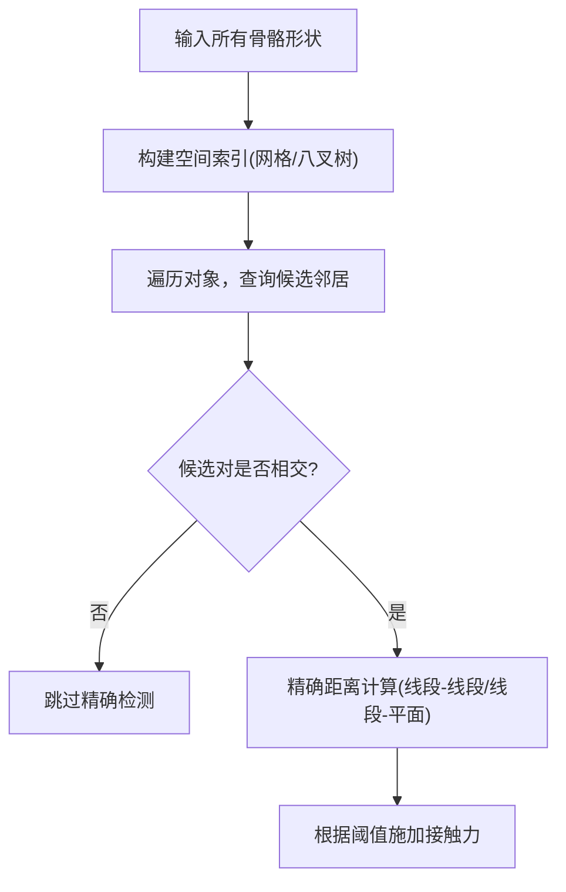
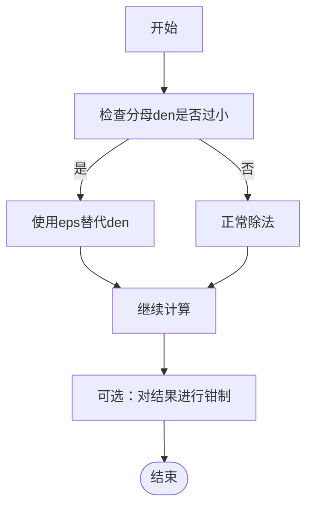
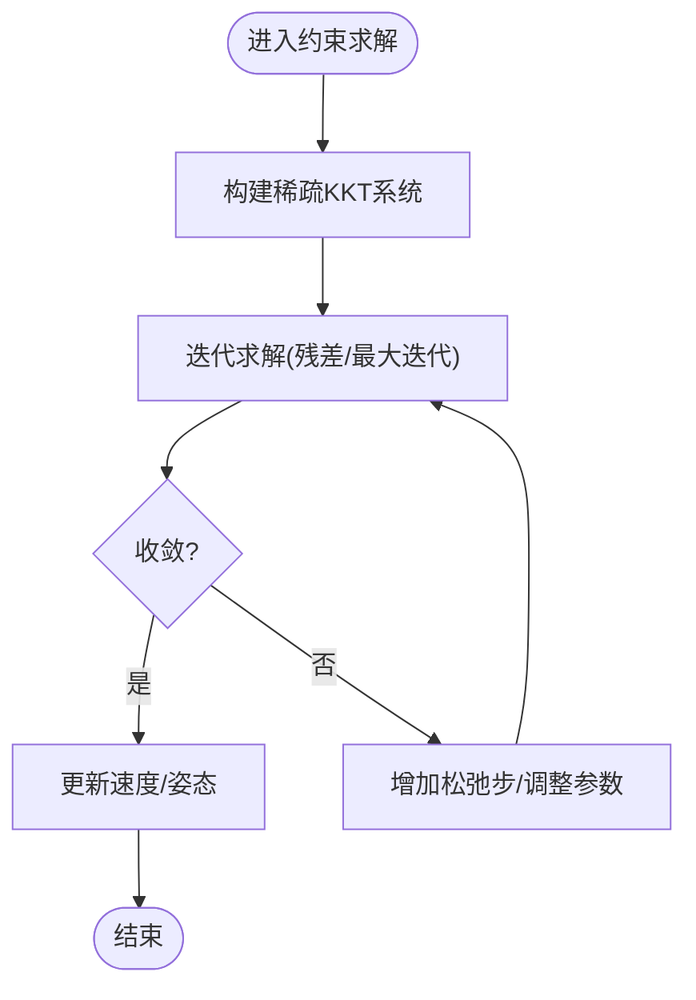
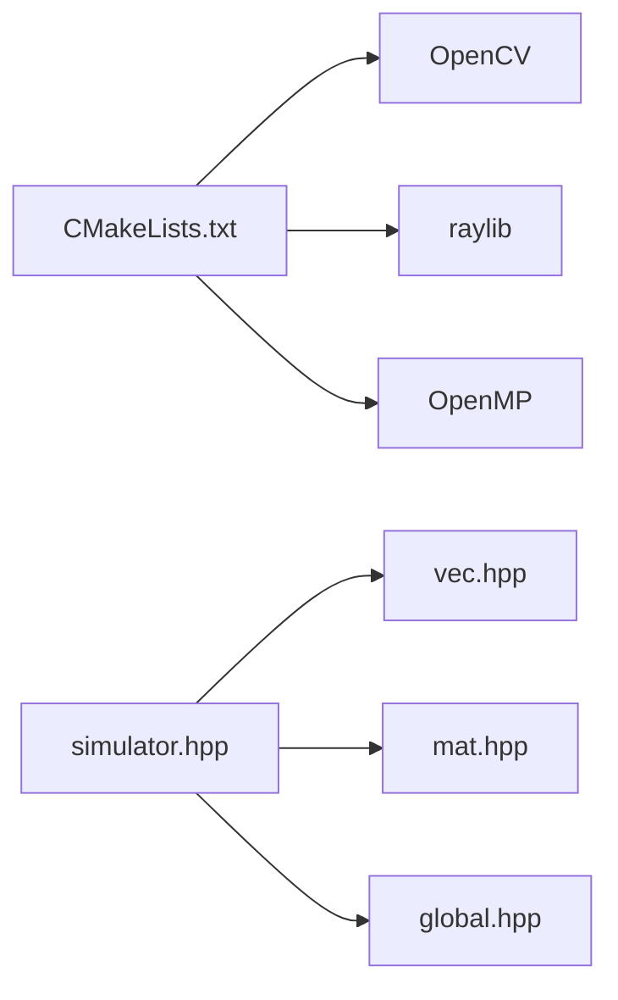

# 物理计算优化

> **版本提示（2.0）**：本文撰写于 1.x 时期，描述的是旧的实现形态——入口在根目录 `main.cpp`，功能由根目录 `.hpp` 头文件库提供，窗口用 raylib、显示用 OpenCV highgui。2.0 已把这些头文件移到 `Source/Legacy/`，渲染默认走 GPU，窗口与 UI 换成 GLFW + ImGui，`main.cpp` 拆成 `Source/Launch/Private/` 下的 `Main.cpp` 与 `Application`。文中的文件路径、行号与调用链可能已失效，请以根目录的「项目概述」「快速开始」「故障排除」三篇与当前源码为准。

<cite>
**本文引用的文件**   
- [README.md](file://README.md)
- [CMakeLists.txt](file://CMakeLists.txt)
- [simulator.hpp](file://simulator.hpp)
- [vec.hpp](file://vec.hpp)
- [mat.hpp](file://mat.hpp)
- [global.hpp](file://global.hpp)
</cite>

## 目录
1. [引言](#引言)
2. [项目结构](#项目结构)
3. [核心组件](#核心组件)
4. [架构总览](#架构总览)
5. [详细组件分析](#详细组件分析)
6. [依赖分析](#依赖分析)
7. [性能考虑](#性能考虑)
8. [故障排查指南](#故障排查指南)
9. [结论](#结论)

## 引言
本指南面向MooLab物理仿真系统的性能优化，聚焦以下方面：
- OpenMP并行计算的配置与使用（任务分解、线程同步、数据共享）
- SIMD向量化优化的实现思路与落地建议
- 空间分割算法的选择与碰撞检测优化（网格、四叉树/八叉树）
- 数值稳定性技巧，避免物理仿真发散
- 大规模刚体系统优化策略（约束求解器选择、迭代控制）

## 项目结构
MooLab是一个角色运动渲染与仿真器，依赖OpenCV、raylib与OpenMP。构建系统通过CMake管理，并在Windows下通过vcpkg自动安装依赖。程序启动时将工作目录切换到resources，便于读取资源。

**图表来源**
- [CMakeLists.txt:10-13](file://CMakeLists.txt#L10-L13)
- [CMakeLists.txt:43-60](file://CMakeLists.txt#L43-L60)
- [README.md:1-15](file://README.md#L1-L15)

**章节来源**
- [README.md:1-15](file://README.md#L1-L15)
- [CMakeLists.txt:10-13](file://CMakeLists.txt#L10-L13)
- [CMakeLists.txt:43-60](file://CMakeLists.txt#L43-L60)

## 核心组件
- 物理仿真核心：Simulator类及其方法，负责重力、阻尼、接触力、控制力矩、动力学步进与约束求解。
- 数学基础：vec/mat/quat等基础类型与运算，支撑物理计算。
- 几何与距离：点线、线段、平面之间的距离计算，用于碰撞检测。
- 线性代数：矩阵乘法、转置、分块设置、高斯消元求解线性方程组。

关键路径：
- 每帧调用simulate_gravity/simulate_damp/simulate_contact/simulate_local_control或simulate_global_control，最后simulate完成动力学更新。
- 约束求解采用KKT形式组装A/B矩阵，并用高斯消元法求解vt_1，再更新速度与姿态。

**章节来源**
- [simulator.hpp:321-355](file://simulator.hpp#L321-L355)
- [simulator.hpp:357-435](file://simulator.hpp#L357-L435)
- [simulator.hpp:543-624](file://simulator.hpp#L543-L624)
- [simulator.hpp:154-189](file://simulator.hpp#L154-L189)

## 架构总览
下图展示物理仿真主流程与关键模块的交互关系。

**图表来源**
- [simulator.hpp:357-435](file://simulator.hpp#L357-L435)
- [simulator.hpp:543-624](file://simulator.hpp#L543-L624)
- [simulator.hpp:154-189](file://simulator.hpp#L154-L189)

## 详细组件分析

### OpenMP并行计算配置与使用
- 构建配置：CMake中find_package(OpenMP REQUIRED COMPONENTS CXX)，并链接OpenMP::OpenMP_CXX。
- 代码中使用：矩阵乘法的三重循环外层使用#pragma omp parallel for进行行级并行化。

建议与实践要点：
- 任务分解策略
  - 对独立元素访问的循环优先使用parallel for；当前矩阵乘法按行划分是合理的。
  - 对于SIMD友好的内层累加，可进一步结合编译器自动向量化提示（如restrict指针、连续内存布局）。
- 线程同步机制
  - 当前矩阵乘法无写竞争，无需额外同步；若引入累积变量需使用reduction。
  - 在接触力累加时，确保每个骨骼的forces/torques写入不冲突（当前为顺序遍历，安全）。
- 数据共享模式
  - 尽量将只读数据声明为const引用；将频繁分配的对象提升到循环外复用，减少动态分配开销。
  - 避免在并行域内打印或I/O操作，防止输出交错与锁竞争。

**图表来源**
- [simulator.hpp:61-79](file://simulator.hpp#L61-L79)

**章节来源**
- [CMakeLists.txt:13](file://CMakeLists.txt#L13)
- [CMakeLists.txt:56-60](file://CMakeLists.txt#L56-L60)
- [simulator.hpp:61-79](file://simulator.hpp#L61-L79)

### SIMD向量化优化
现状与建议：
- vec/mat/vec3/vec4提供大量inline算术运算，有利于编译器自动向量化。
- 建议在热点循环中：
  - 使用连续数组（array1d/array2d底层为连续内存）以利于SIMD加载。
  - 避免分支与函数调用，保持数据局部性。
  - 对dot/cross等短向量运算，可考虑显式SIMD intrinsic（如__m128），但需谨慎对齐与边界处理。
- 注意：编译器在Release模式下通常能自动向量化简单循环；复杂循环可通过循环展开、减少依赖链提升向量化效果。

**章节来源**
- [vec.hpp:75-179](file://vec.hpp#L75-L179)
- [mat.hpp:7-85](file://mat.hpp#L7-L85)
- [simulator.hpp:61-79](file://simulator.hpp#L61-L79)

### 空间分割算法与碰撞检测优化
现状：
- 当前contact检测为O(N^2)的线段-线段与线段-平面检测，适用于小规模骨架。
- 线段端点由骨骼形状（圆柱近似）两端点生成，半径用于阈值判断。

优化方向：
- 网格划分（Grid/Spatial Hashing）
  - 将场景划分为均匀网格，仅检查同一网格或相邻网格内的对象对。
  - 适合分布较均匀的刚体；哈希表维护网格到对象列表的映射。
- 四叉树/八叉树（Quadtree/Octree）
  - 自适应细分，适合非均匀分布；节点存储包围盒，快速剔除不相交子树。
- BVH（层次包围盒）
  - 针对静态/半静态环境，预构建BVH加速近邻查询。
- 与现有代码集成
  - 在simulate_contact前加入空间分割预处理，生成候选对集合，再执行精确距离计算。
  - 保持原有距离计算不变，仅在候选阶段做粗筛。

[此图为概念流程，不对应具体源码]

**章节来源**
- [simulator.hpp:374-435](file://simulator.hpp#L374-L435)
- [simulator.hpp:229-300](file://simulator.hpp#L229-L300)

### 数值稳定性优化技巧
现状与问题：
- 距离计算中多处使用std::max(den, 1e-8)避免除零。
- normalize等函数使用eps保护分母。
- 矩阵求逆inv_mat中对det小于eps的情况直接返回原矩阵，避免奇异矩阵导致不稳定。
- 控制回路中存在对角线元素B(k,k)的除法，若接近零可能导致数值爆炸。

改进建议：
- 统一数值容差常量，避免散落的硬编码阈值。
- 在求解线性方程组时，增加对角占优或Tikhonov正则项，提升条件数。
- 对B(k,k)接近零时，采用伪逆或截断策略，避免除以极小值。
- 对速度/角速度进行钳制，防止过大值导致后续步长发散。
- 对惯性矩阵添加微小正则项，保证正定性。

**图表来源**
- [simulator.hpp:229-300](file://simulator.hpp#L229-L300)
- [mat.hpp:111-136](file://mat.hpp#L111-L136)
- [vec.hpp:152-155](file://vec.hpp#L152-L155)

**章节来源**
- [simulator.hpp:229-300](file://simulator.hpp#L229-L300)
- [mat.hpp:111-136](file://mat.hpp#L111-L136)
- [vec.hpp:152-155](file://vec.hpp#L152-L155)

### 大规模刚体系统优化策略
现状：
- 约束求解采用一次性组装KKT矩阵A/B，并使用高斯消元法求解，复杂度较高且不具备迭代收敛控制。
- 接触力采用弹簧-阻尼模型（kp/kd），参数较大可能引起 stiff 系统，需要较小时间步或隐式积分。

优化方向：
- 约束求解器选择
  - 迭代式：Projective Dynamics、PBD、XPBD，适合大规模实时仿真。
  - 直接式：稀疏LU/Cholesky（Eigen/CXSparse），配合稀疏矩阵格式降低内存与计算量。
- 迭代次数控制
  - 引入残差阈值与最大迭代次数，提前终止。
  - 对接触约束采用多步松弛（multi-step relaxation），逐步收敛。
- 时间积分
  - 对stiff接触改用半隐式欧拉或更稳定的积分方案。
  - 自适应时间步长，基于误差估计调整dt。
- 数据结构
  - 使用稀疏矩阵存储M/J，避免全矩阵组装。
  - 预分配与重用缓冲区，减少动态分配。

[此图为概念流程，不对应具体源码]

**章节来源**
- [simulator.hpp:543-624](file://simulator.hpp#L543-L624)
- [simulator.hpp:154-189](file://simulator.hpp#L154-L189)

## 依赖分析
- 构建依赖：OpenCV、raylib、OpenMP。
- 运行时依赖：OpenCV库、raylib库、OpenMP运行时。
- 内部依赖：simulator.hpp依赖vec.hpp、mat.hpp、global.hpp提供的数学与工具函数。

**图表来源**
- [CMakeLists.txt:11-13](file://CMakeLists.txt#L11-L13)
- [CMakeLists.txt:56-60](file://CMakeLists.txt#L56-L60)
- [simulator.hpp:1-5](file://simulator.hpp#L1-L5)

**章节来源**
- [CMakeLists.txt:11-13](file://CMakeLists.txt#L11-L13)
- [CMakeLists.txt:56-60](file://CMakeLists.txt#L56-L60)
- [simulator.hpp:1-5](file://simulator.hpp#L1-L5)

## 性能考虑
- 并行化
  - 将更多独立循环（如重力、阻尼、控制力矩）改为parallel for，注意数据竞争与归约。
  - 对接触力累加，若改为并行，需对每个骨骼的forces/torques进行原子或私有副本+合并。
- 向量化
  - 保持数据连续、避免分支；对热点函数（dot/cross/normalize）进行微优化。
- I/O与调试
  - 移除或条件编译掉print语句，避免阻塞与缓存抖动。
- 内存
  - 预分配大矩阵与数组，避免在热路径中动态分配。
  - 复用临时矩阵（如inertias、F、vt、M、J、delta），减少分配与释放。

[本节为通用指导，不直接分析具体文件]

## 故障排查指南
常见问题与定位：
- 数值发散
  - 检查距离计算中的den是否为极小值；确认eps使用合理。
  - 检查线性求解中B(k,k)是否接近零；必要时增加正则项或截断。
- 接触不稳定
  - 调整kp/kd参数，避免过大的刚度导致stiff系统。
  - 减小时间步长或改用隐式积分。
- 并行结果不一致
  - 检查是否存在写竞争；确保每个线程写入不同元素或使用reduction。
  - 避免在并行域中进行I/O或随机数生成（全局状态）。

**章节来源**
- [simulator.hpp:229-300](file://simulator.hpp#L229-L300)
- [simulator.hpp:154-189](file://simulator.hpp#L154-L189)
- [simulator.hpp:374-435](file://simulator.hpp#L374-L435)

## 结论
通过对OpenMP并行化、SIMD向量化、空间分割、数值稳定性与约束求解器的系统性优化，可显著提升MooLab物理仿真的性能与稳定性。建议优先改造热点循环的并行化与向量化，引入空间索引降低碰撞检测复杂度，并对约束求解器进行稀疏化与迭代控制，以获得可扩展的大规模刚体仿真能力。

[本节为总结，不直接分析具体文件]