# 动作格式扩展

> **版本提示（2.0）**：本文撰写于 1.x 时期，描述的是旧的实现形态——入口在根目录 `main.cpp`，功能由根目录 `.hpp` 头文件库提供，窗口用 raylib、显示用 OpenCV highgui。2.0 已把这些头文件移到 `Source/Legacy/`，渲染默认走 GPU，窗口与 UI 换成 GLFW + ImGui，`main.cpp` 拆成 `Source/Launch/Private/` 下的 `Main.cpp` 与 `Application`。文中的文件路径、行号与调用链可能已失效，请以根目录的「项目概述」「快速开始」「故障排除」三篇与当前源码为准。

<cite>
**本文引用的文件**   
- [main.cpp](file://main.cpp)
- [motion.hpp](file://motion.hpp)
- [database.hpp](file://database.hpp)
- [array.hpp](file://array.hpp)
- [README.md](file://README.md)
</cite>

## 目录
1. [引言](#引言)
2. [项目结构](#项目结构)
3. [核心组件](#核心组件)
4. [架构总览](#架构总览)
5. [详细组件分析](#详细组件分析)
6. [依赖关系分析](#依赖关系分析)
7. [性能考虑](#性能考虑)
8. [故障排查指南](#故障排查指南)
9. [结论](#结论)
10. [附录：格式转换与扩展实践](#附录格式转换与扩展实践)

## 引言
本指南面向需要在 MooLab 中扩展“动作数据格式”的开发者，目标是说明如何新增动画文件格式解析器、将外部格式映射到 MooLab 内部数据结构、扩展 BVH 骨骼节点与通道处理，并完善动作数据的预处理/后处理（时间轴对齐、插值）以及动作数据库的特征提取与检索。文档同时给出从其他动画格式转换为 MooLab 内部格式的完整流程示例。

MooLab 是一个角色运动渲染与仿真器，当前以二进制序列化的动作数据为核心载体，并通过前向运动学、动力学仿真与 UI/渲染管线驱动可视化。

**章节来源**
- [README.md:1-22](file://README.md#L1-L22)

## 项目结构
本项目采用单头文件模块化组织，关键模块包括：
- 动作数据模型与工具：motion.hpp
- 动作数据库与检索：database.hpp
- 基础数组容器与序列化：array.hpp
- 应用入口与主循环：main.cpp
- 构建与依赖说明：README.md

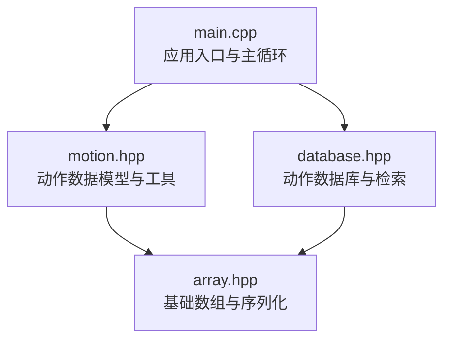

**图表来源**
- [main.cpp:1-18](file://main.cpp#L1-L18)
- [motion.hpp:1-10](file://motion.hpp#L1-L10)
- [database.hpp:1-6](file://database.hpp#L1-L6)
- [array.hpp:1-10](file://array.hpp#L1-L10)

**章节来源**
- [main.cpp:1-18](file://main.cpp#L1-L18)
- [motion.hpp:1-10](file://motion.hpp#L1-L10)
- [database.hpp:1-6](file://database.hpp#L1-L6)
- [array.hpp:1-10](file://array.hpp#L1-L10)

## 核心组件
- 动作数据模型 BVH_Motion
  - 存储每帧的骨骼局部位置与旋转、骨骼父子关系与 ID。
  - 提供批量前向运动学、片段截取、拼接、混合、循环化、平移与朝向对齐等工具函数。
- 动作数据库 Database
  - 存储帧索引、接触状态、速度/角速度多步预测特征、脚部相对位置等特征矩阵。
  - 提供加载/保存、排序、修正（重算速度/角速度）、基于特征的检索。
- 基础数组 array1d/array2d 与读写
  - 提供动态一维/二维数组、切片访问、内存管理、二进制读写接口。
  - 所有动作与数据库数据均通过该层进行持久化。

**章节来源**
- [motion.hpp:37-96](file://motion.hpp#L37-L96)
- [database.hpp:7-47](file://database.hpp#L7-L47)
- [array.hpp:45-106](file://array.hpp#L45-L106)
- [array.hpp:108-176](file://array.hpp#L108-L176)

## 架构总览
下图展示动作数据在系统中的流转：外部资源被加载为 BVH_Motion，随后用于前向运动学计算、仿真更新、特征提取与数据库构建，最终参与检索与播放。

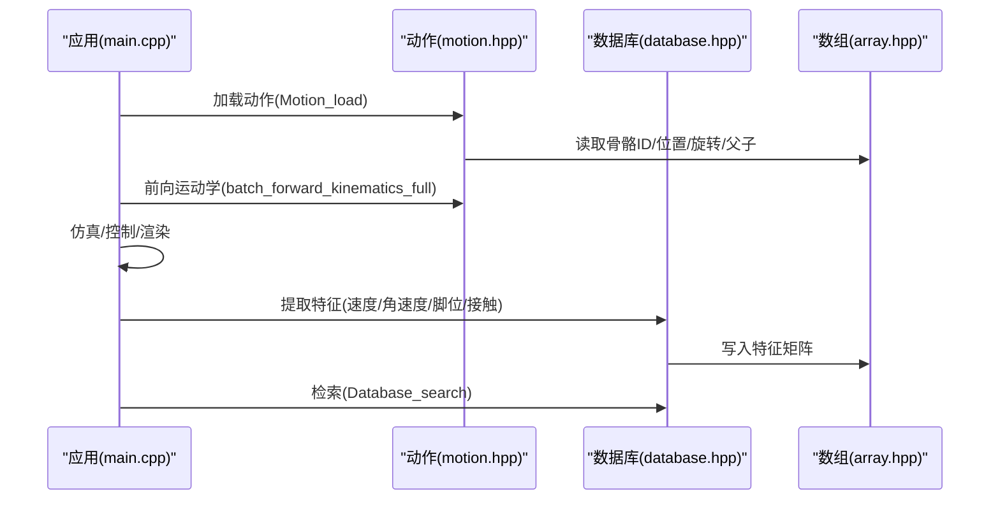

**图表来源**
- [main.cpp:72-98](file://main.cpp#L72-L98)
- [motion.hpp:72-96](file://motion.hpp#L72-L96)
- [motion.hpp:122-150](file://motion.hpp#L122-L150)
- [database.hpp:49-72](file://database.hpp#L49-L72)
- [database.hpp:74-127](file://database.hpp#L74-L127)

## 详细组件分析

### 动作数据模型 BVH_Motion
- 数据结构
  - bone_ids：骨骼标识
  - bone_local_positions：nframes × nbones 的局部位置矩阵
  - bone_local_rotations：nframes × nbones 的四元数旋转矩阵
  - bone_parents：父骨骼索引（根为 -1）
- 关键方法
  - Motion_load/Motion_save：二进制读写
  - motion_sub_sequence/motion_concatenate：片段与拼接
  - batch_forward_kinematics_full/part/root：批量前向运动学
  - translation_and_rotation：根骨平移与朝向对齐
  - blend_two_motions：双动作线性/球面插值混合
  - build_loop_motion：循环化（补偿首尾差）
  - concatenate_two_motions：两段动作平滑衔接（含过渡段）

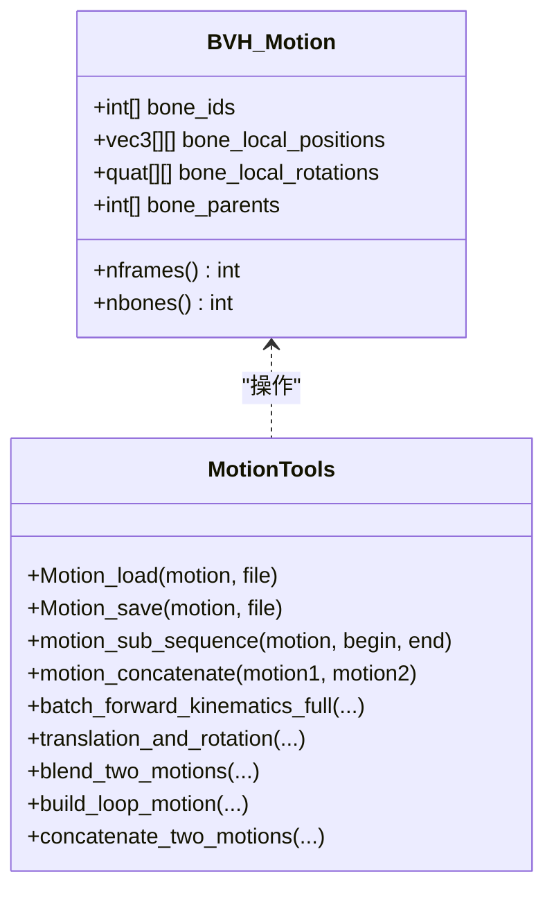

**图表来源**
- [motion.hpp:37-96](file://motion.hpp#L37-L96)
- [motion.hpp:98-120](file://motion.hpp#L98-L120)
- [motion.hpp:122-198](file://motion.hpp#L122-L198)
- [motion.hpp:213-264](file://motion.hpp#L213-L264)
- [motion.hpp:266-330](file://motion.hpp#L266-L330)
- [motion.hpp:332-377](file://motion.hpp#L332-L377)

**章节来源**
- [motion.hpp:37-96](file://motion.hpp#L37-L96)
- [motion.hpp:98-120](file://motion.hpp#L98-L120)
- [motion.hpp:122-198](file://motion.hpp#L122-L198)
- [motion.hpp:213-264](file://motion.hpp#L213-L264)
- [motion.hpp:266-330](file://motion.hpp#L266-L330)
- [motion.hpp:332-377](file://motion.hpp#L332-L377)

### 动作数据库 Database
- 数据结构
  - frames：帧索引序列
  - contacts：接触状态序列
  - vels/avels：多步速度/角速度预测（列维度表示不同未来时刻）
  - features：特征向量（如左右脚相对位置、速度等）
- 关键方法
  - Database_load/Database_save：二进制读写
  - Database_sort：按特征重排
  - Database_revise：基于差分窗口重算速度与角速度
  - Database_search：加权距离匹配检索最佳帧

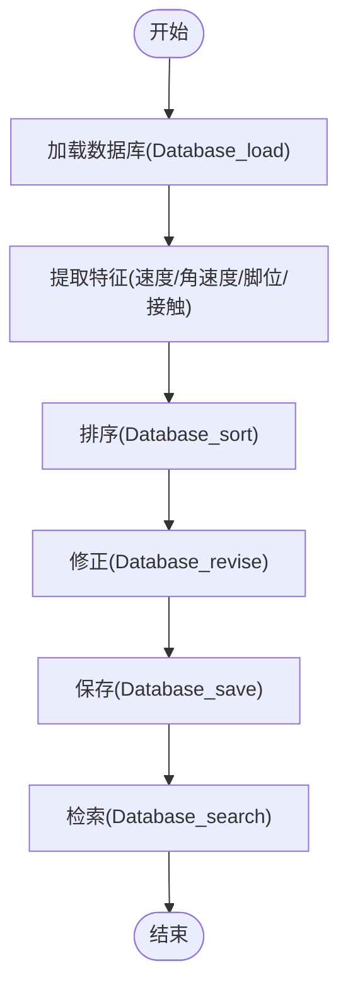

**图表来源**
- [database.hpp:21-47](file://database.hpp#L21-L47)
- [database.hpp:49-72](file://database.hpp#L49-L72)
- [database.hpp:74-127](file://database.hpp#L74-L127)

**章节来源**
- [database.hpp:7-47](file://database.hpp#L7-L47)
- [database.hpp:49-72](file://database.hpp#L49-L72)
- [database.hpp:74-127](file://database.hpp#L74-L127)

### 基础数组与序列化 array1d/array2d
- 功能要点
  - 动态分配/释放、resize、零初始化、切片访问
  - 二进制读写接口：array1d_read/write、array2d_read/write
  - 子序列与拼接：array2d_sub_sequence、array2d_concatenate
- 作用
  - 作为 BVH_Motion 与 Database 的底层存储与 I/O 抽象

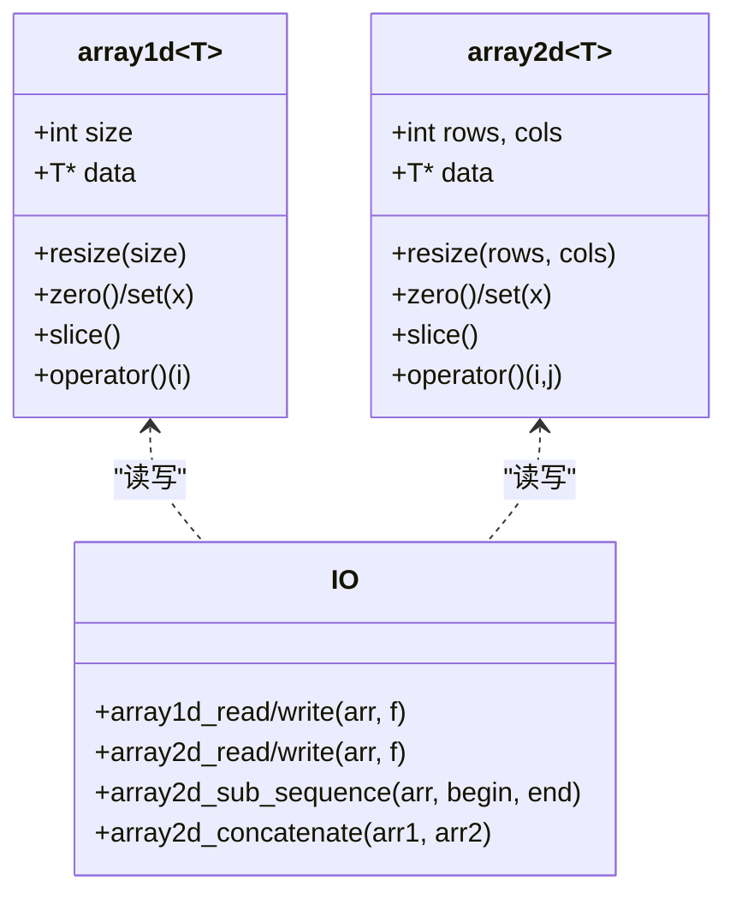

**图表来源**
- [array.hpp:45-106](file://array.hpp#L45-L106)
- [array.hpp:108-176](file://array.hpp#L108-L176)
- [array.hpp:198-217](file://array.hpp#L198-L217)

**章节来源**
- [array.hpp:45-106](file://array.hpp#L45-L106)
- [array.hpp:108-176](file://array.hpp#L108-L176)
- [array.hpp:198-217](file://array.hpp#L198-L217)

## 依赖关系分析
- main.cpp 依赖 motion.hpp、database.hpp、array.hpp 提供的动作与数据库能力
- motion.hpp 依赖 array.hpp 的数据结构与序列化
- database.hpp 依赖 motion.hpp 的动作类型与 array.hpp 的序列化

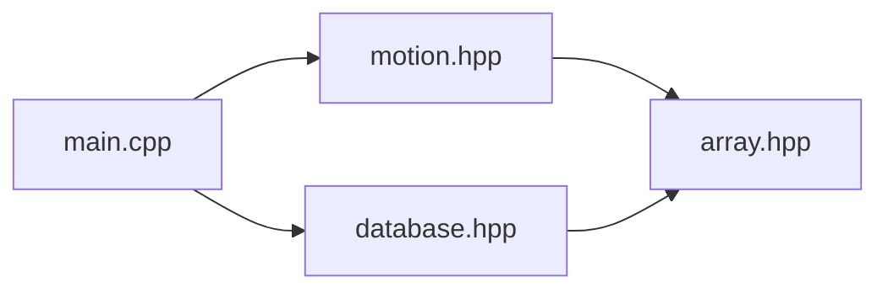

**图表来源**
- [main.cpp:8-17](file://main.cpp#L8-L17)
- [motion.hpp:4-6](file://motion.hpp#L4-L6)
- [database.hpp:4-5](file://database.hpp#L4-L5)

**章节来源**
- [main.cpp:8-17](file://main.cpp#L8-L17)
- [motion.hpp:4-6](file://motion.hpp#L4-L6)
- [database.hpp:4-5](file://database.hpp#L4-L5)

## 性能考虑
- 批量前向运动学避免逐顶点计算，减少重复变换开销
- 使用 array2d_sub_sequence/concatenate 进行连续内存拷贝，降低碎片化
- 数据库检索采用加权欧氏距离，可结合特征归一化与降维优化
- 动作混合使用 slerp/lerp，保证旋转插值稳定且高效
- 循环化动作时仅对根骨与末端差值做全局补偿，避免全量复杂计算

[本节为通用指导，不直接分析具体文件]

## 故障排查指南
- 文件读取失败
  - 检查路径与工作目录；程序启动会切换到 resources 目录
  - 确认二进制文件由 array1d_write/array2d_write 生成，否则读入尺寸不匹配
- 动作长度或骨骼数量不一致
  - 拼接/混合前确保两动作具有相同的骨骼拓扑（bone_ids/bone_parents）
  - 使用 motion_sub_sequence 裁剪至一致范围后再拼接
- 检索结果异常
  - 检查 Database_revise 是否已执行，确保速度与角速度一致性
  - 调整权重 weight_vel/weight_avel/weight_toe 以平衡各特征贡献
- 渲染抖动或滑步
  - 检查 contact 判定逻辑与脚部特征是否正确
  - 必要时启用脚锁 IK 或调整仿真参数

**章节来源**
- [main.cpp:53-65](file://main.cpp#L53-L65)
- [database.hpp:62-72](file://database.hpp#L62-L72)
- [database.hpp:74-127](file://database.hpp#L74-L127)

## 结论
MooLab 的动作系统以 BVH_Motion 为核心数据结构，配合 array 层的统一序列化与 Database 的特征库，形成从解析、预处理、仿真到检索的完整闭环。扩展新格式的关键在于：
- 将外部格式解析为 BVH_Motion
- 利用现有工具完成时间轴对齐、混合与循环化
- 提取特征并入库，实现检索与实时切换

遵循上述模式即可低成本接入多种动画格式，并保持运行时一致性与高性能。

[本节为总结性内容，不直接分析具体文件]

## 附录：格式转换与扩展实践

### 支持新的动画文件格式（设计原则）
- 目标
  - 将任意动画格式（如 FBX、GLTF、BVH 文本等）解析为 BVH_Motion
- 步骤
  1. 定义解析器接口：输入原始字节流或文本，输出 BVH_Motion
  2. 骨架映射：将源格式骨骼树映射到 BVH_Motion.bone_parents 与 bone_ids
  3. 通道映射：将源格式的位置/旋转通道映射到 bone_local_positions/rotations
  4. 时间轴对齐：统一采样率与帧长，必要时重采样
  5. 根骨对齐：使用 translation_and_rotation 对齐起始帧的平移与朝向
  6. 持久化：调用 Motion_save 写入 .bin

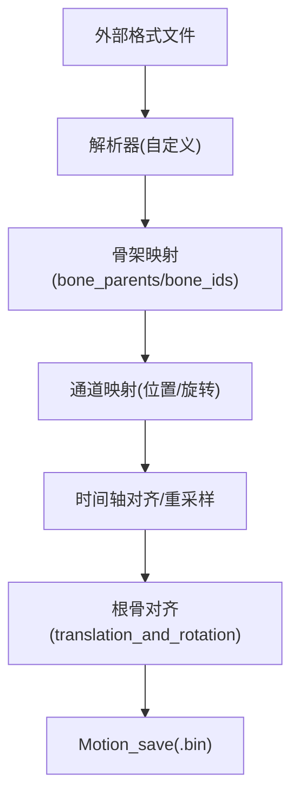

[本图为概念流程，不直接对应具体源码文件]

### BVH 扩展：新增骨骼节点与动画通道
- 新增骨骼节点
  - 在骨架映射阶段插入新节点，设置其父节点索引与初始偏移
  - 确保后续前向运动学能正确传播变换
- 新增动画通道
  - 将新通道的轨迹数据填充到对应骨骼的 bone_local_positions/rotations
  - 若通道包含额外信息（如缩放），可在 BVH_Motion 扩展字段或在预处理阶段转为等效位移/旋转

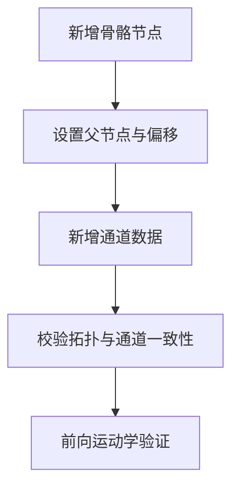

[本图为概念流程，不直接对应具体源码文件]

### 动作数据预处理与后处理
- 预处理
  - 时间轴对齐：统一 FPS 与时长，必要时插值重采样
  - 根骨对齐：对齐起始帧的平移与朝向，便于拼接与检索
  - 去噪与约束：限制关节角度范围、去除异常帧
- 后处理
  - 循环化：build_loop_motion 消除首尾差异
  - 混合：blend_two_motions 实现跨动作平滑过渡
  - 拼接：concatenate_two_motions 实现两段动作无缝衔接

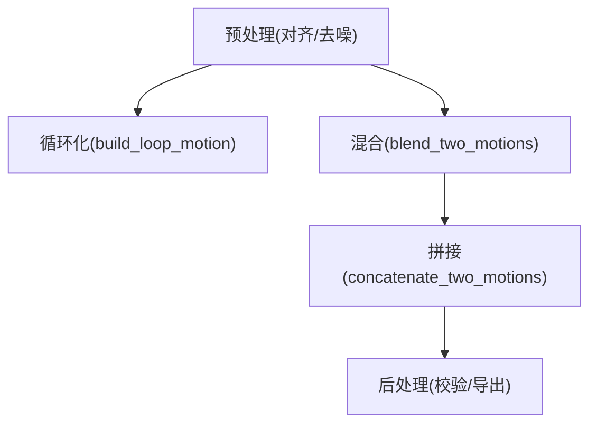

**图表来源**
- [motion.hpp:213-264](file://motion.hpp#L213-L264)
- [motion.hpp:266-330](file://motion.hpp#L266-L330)
- [motion.hpp:332-377](file://motion.hpp#L332-L377)

**章节来源**
- [motion.hpp:213-264](file://motion.hpp#L213-L264)
- [motion.hpp:266-330](file://motion.hpp#L266-L330)
- [motion.hpp:332-377](file://motion.hpp#L332-L377)

### 动作数据库扩展：特征提取与检索算法
- 特征扩展
  - 在 Database.features 中追加新特征列（如重心高度、地面反力估计等）
  - 在 Database.revise 中根据新特征计算多步预测
- 检索算法
  - 在 Database_search 中为新特征增加权重项，并调整距离度量
  - 可选：引入 KD-Tree/ANN 加速近邻搜索

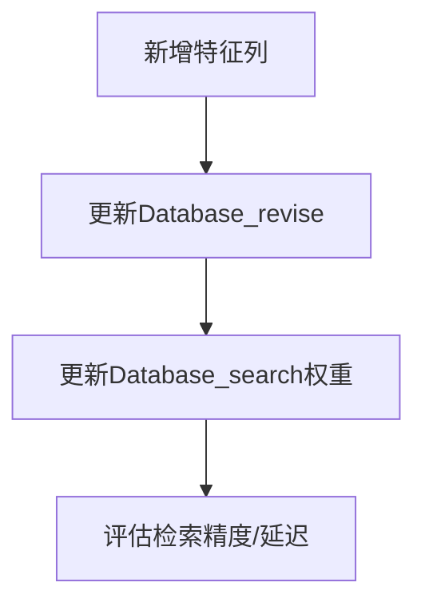

**图表来源**
- [database.hpp:62-72](file://database.hpp#L62-L72)
- [database.hpp:74-127](file://database.hpp#L74-L127)

**章节来源**
- [database.hpp:62-72](file://database.hpp#L62-L72)
- [database.hpp:74-127](file://database.hpp#L74-L127)

### 具体格式转换示例：从外部格式到 MooLab 内部格式
- 输入：某外部动画文件（含骨架树与多通道轨迹）
- 输出：.bin 文件（可由 Motion_load 直接加载）
- 步骤
  1. 解析骨架：建立 bone_parents 与 bone_ids 映射
  2. 解析通道：将位置/旋转通道写入 bone_local_positions/rotations
  3. 时间轴对齐：统一采样率，必要时插值
  4. 根骨对齐：调用 translation_and_rotation 对齐起始帧
  5. 持久化：调用 Motion_save 写出 .bin
  6. 验证：在主程序中调用 Motion_load 与前向运动学验证

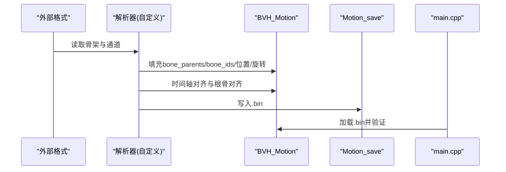

[本图为概念流程，不直接对应具体源码文件]

### 运行与集成提示
- 构建与运行
  - 参考 README 中的构建步骤，确保依赖安装与预设配置正确
  - 程序启动后会切换到 resources 目录，请确保 .bin 文件位于该目录下
- 集成建议
  - 将解析器封装为独立模块，对外暴露统一的 BVH_Motion 接口
  - 在 main.cpp 中按需替换或扩展动作加载逻辑

**章节来源**
- [README.md:7-15](file://README.md#L7-L15)
- [main.cpp:53-65](file://main.cpp#L53-L65)