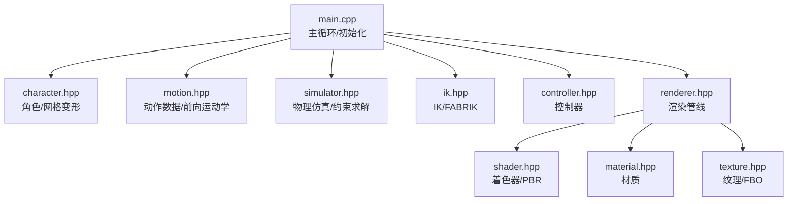
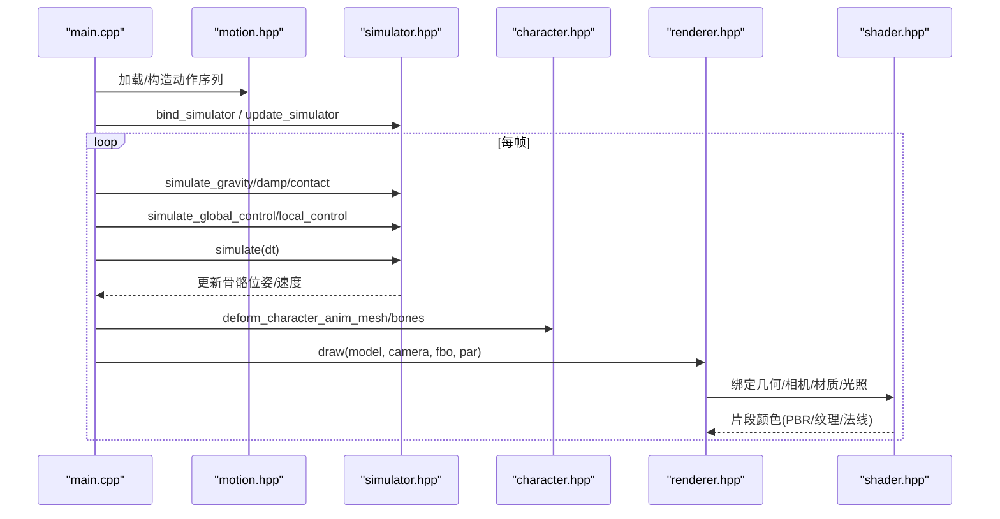
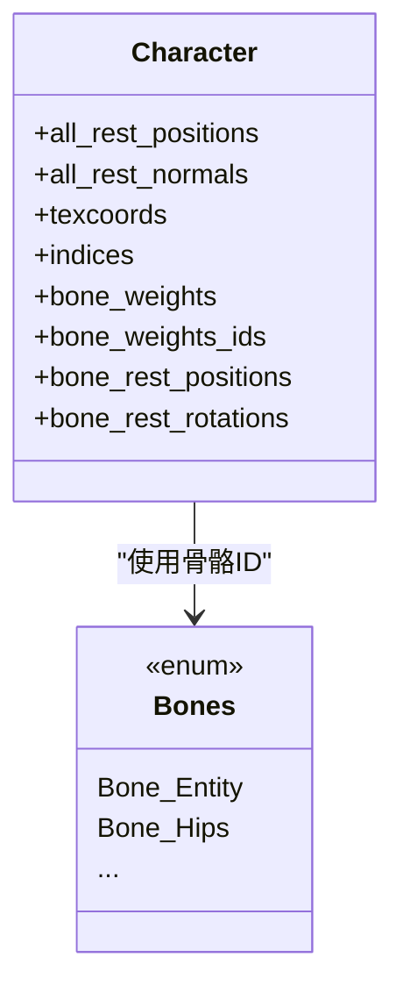
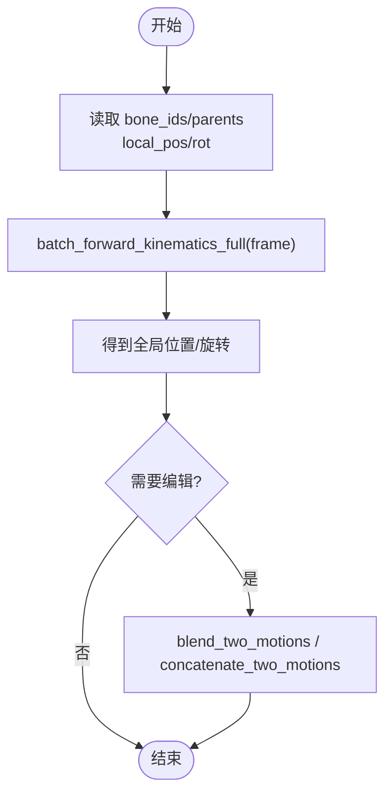
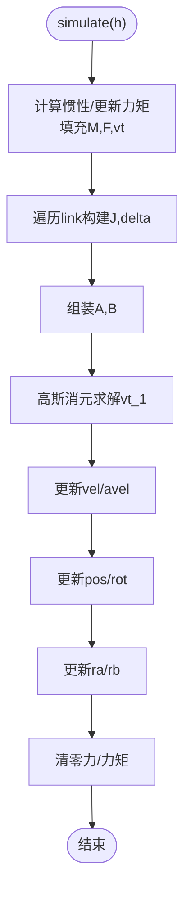
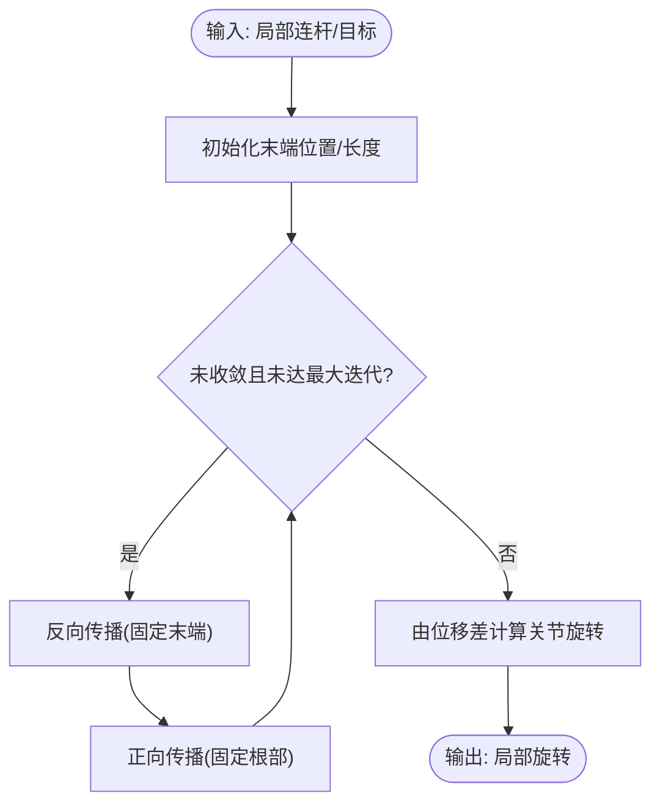
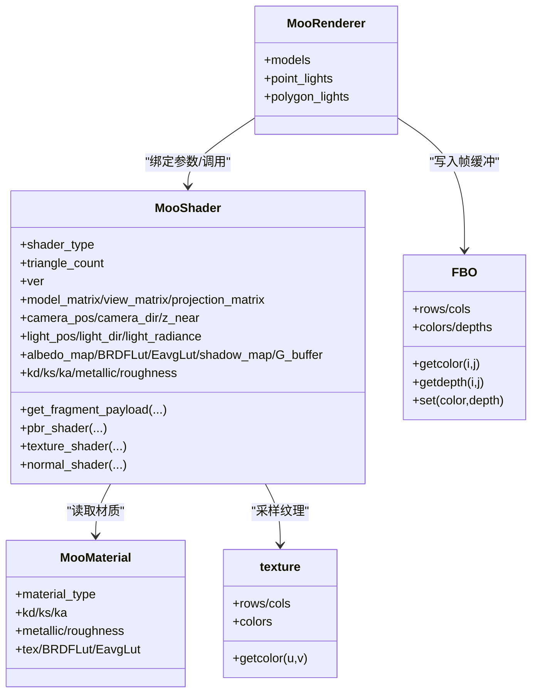
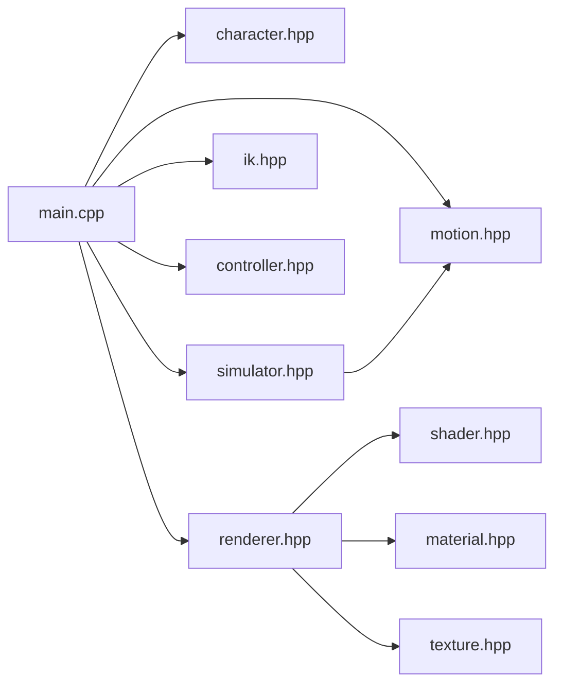

# 扩展开发

> **版本提示（2.0）**：本文撰写于 1.x 时期，描述的是旧的实现形态——入口在根目录 `main.cpp`，功能由根目录 `.hpp` 头文件库提供，窗口用 raylib、显示用 OpenCV highgui。2.0 已把这些头文件移到 `Source/Legacy/`，渲染默认走 GPU，窗口与 UI 换成 GLFW + ImGui，`main.cpp` 拆成 `Source/Launch/Private/` 下的 `Main.cpp` 与 `Application`。文中的文件路径、行号与调用链可能已失效，请以根目录的「项目概述」「快速开始」「故障排除」三篇与当前源码为准。

<cite>
**本文引用的文件**   
- [README.md](file://README.md)
- [main.cpp](file://main.cpp)
- [character.hpp](file://character.hpp)
- [simulator.hpp](file://simulator.hpp)
- [motion.hpp](file://motion.hpp)
- [ik.hpp](file://ik.hpp)
- [controller.hpp](file://controller.hpp)
- [renderer.hpp](file://renderer.hpp)
- [shader.hpp](file://shader.hpp)
- [material.hpp](file://material.hpp)
- [texture.hpp](file://texture.hpp)
</cite>

## 目录
1. [简介](#简介)
2. [项目结构](#项目结构)
3. [核心组件](#核心组件)
4. [架构总览](#架构总览)
5. [详细组件分析](#详细组件分析)
6. [依赖关系分析](#依赖关系分析)
7. [性能与可扩展性](#性能与可扩展性)
8. [故障排查指南](#故障排查指南)
9. [结论](#结论)
10. [附录：从零开始的扩展示例](#附录从零开始的扩展示例)

## 简介
本指南面向希望在 MooLab 中扩展功能的开发者，覆盖以下主题：
- 添加新的骨骼类型与关节约束（含数据结构和求解器）
- 自定义物理约束（方程建立与数值求解）
- 扩展材质系统与着色器效果
- 动作数据格式扩展与新动画文件格式支持
- 插件化架构设计与可插拔模块实现
- 测试、调试与系统集成注意事项

MooLab 是一个角色运动渲染与仿真器，依赖 OpenCV、OpenMP、raylib。构建与运行说明见 README。

**章节来源**
- [README.md:1-22](file://README.md#L1-L22)

## 项目结构
仓库采用“按功能域组织”的扁平结构，核心头文件位于根目录，资源在 resources/ 下。关键模块如下：
- 输入与主循环：main.cpp
- 角色与网格变形：character.hpp
- 动作数据与正向运动学：motion.hpp
- 物理仿真与约束求解：simulator.hpp
- 逆向运动学与约束：ik.hpp
- 控制器（相机/角色）：controller.hpp
- 渲染管线与光栅化：renderer.hpp
- 着色器与PBR：shader.hpp
- 材质定义：material.hpp
- 纹理与FBO：texture.hpp

**图表来源**
- [main.cpp:53-160](file://main.cpp#L53-L160)
- [character.hpp:35-166](file://character.hpp#L35-L166)
- [motion.hpp:37-150](file://motion.hpp#L37-L150)
- [simulator.hpp:321-624](file://simulator.hpp#L321-L624)
- [ik.hpp:7-422](file://ik.hpp#L7-L422)
- [controller.hpp:7-386](file://controller.hpp#L7-L386)
- [renderer.hpp:17-239](file://renderer.hpp#L17-L239)
- [shader.hpp:35-255](file://shader.hpp#L35-L255)
- [material.hpp:7-32](file://material.hpp#L7-L32)
- [texture.hpp:11-112](file://texture.hpp#L11-L112)

**章节来源**
- [main.cpp:53-160](file://main.cpp#L53-L160)

## 核心组件
- 角色与网格变形：Character 存储顶点、法线、UV、索引、骨骼权重与绑定信息；提供线性混合变形函数。
- 动作系统：BVH_Motion 保存骨骼局部位置/旋转、父子关系；提供批量前向运动学、片段截取、拼接、对齐等工具。
- 物理仿真：Simulator 维护刚体形状、质量、惯性、速度/角速度、力/力矩、约束 link；通过矩阵方程求解速度与约束反作用力。
- IK：IK_two_bones 与 FABRIK 系列提供链式末端目标求解与角度约束。
- 控制器：Camera_Controller 与 Character_Controller 提供PID/手柄控制与状态平滑。
- 渲染：MooRenderer 管理模型与光源；rasterizer 完成光栅化与着色器调用；支持 PBR/纹理/法线显示。
- 着色器：MooShader 封装顶点/片段处理回调，内置 PBR 计算与多散射近似。
- 材质：MooMaterial 统一材质参数与纹理引用。
- 纹理/FBO：texture 与 FBO 提供图像加载、采样与帧缓冲读写。

**章节来源**
- [character.hpp:35-166](file://character.hpp#L35-L166)
- [motion.hpp:37-150](file://motion.hpp#L37-L150)
- [simulator.hpp:321-624](file://simulator.hpp#L321-L624)
- [ik.hpp:7-422](file://ik.hpp#L7-L422)
- [controller.hpp:7-386](file://controller.hpp#L7-L386)
- [renderer.hpp:17-239](file://renderer.hpp#L17-L239)
- [shader.hpp:35-255](file://shader.hpp#L35-L255)
- [material.hpp:7-32](file://material.hpp#L7-L32)
- [texture.hpp:11-112](file://texture.hpp#L11-L112)

## 架构总览
下图展示从主循环到渲染的关键调用链，以及数据流向。

**图表来源**
- [main.cpp:292-472](file://main.cpp#L292-L472)
- [simulator.hpp:357-624](file://simulator.hpp#L357-L624)
- [character.hpp:142-166](file://character.hpp#L142-L166)
- [renderer.hpp:213-239](file://renderer.hpp#L213-L239)
- [shader.hpp:199-237](file://shader.hpp#L199-L237)

## 详细组件分析

### 骨骼与角色数据扩展
- 骨骼枚举：Bones 定义了角色骨骼编号，新增骨骼需在此扩展并保证与动作数据的父子关系一致。
- Character 数据结构：包含静态网格、权重、绑定骨骼位置/旋转；新增骨骼时确保权重矩阵维度匹配。
- 变形流程：linear_blend_positions/normals 基于四权重进行线性混合；新增骨骼后需在绑定阶段写入权重。

**图表来源**
- [character.hpp:8-47](file://character.hpp#L8-L47)

**章节来源**
- [character.hpp:8-47](file://character.hpp#L8-L47)
- [character.hpp:68-166](file://character.hpp#L68-L166)

### 动作数据与正向运动学
- BVH_Motion：保存每帧的局部位置/旋转与父子关系；nframes()/nbones() 提供尺寸查询。
- 批量前向运动学：batch_forward_kinematics_full 根据父节点累积得到全局位姿。
- 动作编辑：sub_sequence、concatenate、translation_and_rotation、blend_two_motions 等工具用于剪辑、拼接、对齐与混合。

**图表来源**
- [motion.hpp:37-150](file://motion.hpp#L37-L150)
- [motion.hpp:266-377](file://motion.hpp#L266-L377)

**章节来源**
- [motion.hpp:37-150](file://motion.hpp#L37-L150)
- [motion.hpp:266-377](file://motion.hpp#L266-L377)

### 物理仿真与约束求解
- Simulator 数据结构：
  - 刚体形状 shape（位置、旋转、半径、长度、接触标志）
  - 约束 link（两端点 a/b、相对偏移 ra/rb、误差 delta）
  - 动力学量：质量、惯性、速度/角速度、力/力矩
- 约束求解流程：
  - 组装质量矩阵 M、约束雅可比 J、误差向量 delta
  - 构建增广矩阵 A=[M J; J^T 0] 与右端 B=[M*v+F; delta]
  - 使用高斯消元求解 vt_1，更新速度与姿态，刷新约束相对偏移
- 重力/阻尼/碰撞：
  - simulate_gravity 累加重力
  - simulate_damp 施加线性/角阻尼
  - simulate_contact 线段-平面/线段-线段碰撞检测，计算法向与切向摩擦力

**图表来源**
- [simulator.hpp:543-624](file://simulator.hpp#L543-L624)
- [simulator.hpp:357-435](file://simulator.hpp#L357-L435)

**章节来源**
- [simulator.hpp:321-624](file://simulator.hpp#L321-L624)
- [simulator.hpp:849-933](file://simulator.hpp#L849-L933)

### 逆向运动学与关节约束
- IK_two_bones：两骨/三骨链末端目标求解，基于余弦定理与轴角旋转更新各关节。
- FABRIK_one_end/two_end：迭代投影法，支持角度约束版本 constraints，限制相邻连杆夹角。
- 适用场景：脚锁、末端抓取、肢体可达性修正。

**图表来源**
- [ik.hpp:105-162](file://ik.hpp#L105-L162)
- [ik.hpp:250-315](file://ik.hpp#L250-L315)

**章节来源**
- [ik.hpp:7-422](file://ik.hpp#L7-L422)

### 控制器与交互
- Camera_Controller：PID 控制相机位置/朝向，支持手柄输入映射。
- Character_Controller：对速度/角速度进行多阶平滑，便于动作匹配或控制策略。
- formation/two_wheeled_car：演示群体编队与两轮车运动学控制。

**章节来源**
- [controller.hpp:7-386](file://controller.hpp#L7-L386)

### 渲染管线与着色器
- renderer.hpp：
  - 绑定几何/相机/材质/光照参数
  - rasterizer 完成三角形裁剪、光栅化、深度测试与着色器调用
  - draw_point/draw_line/draw_curve 辅助可视化
- shader.hpp：
  - MooShader 封装顶点/片段回调，支持 PBR/纹理/法线三种模式
  - 内置 GGX NDF、Schlick G、Smith G、Fresnel 与多散射 BRDF 近似
- material.hpp：
  - MooMaterial 统一材质类型与参数（漫反射/镜面/环境、金属度、粗糙度、纹理）
- texture.hpp：
  - FBO 帧缓冲与 texture 纹理对象，OpenCV 图像加载/转换

**图表来源**
- [renderer.hpp:17-239](file://renderer.hpp#L17-L239)
- [shader.hpp:35-255](file://shader.hpp#L35-L255)
- [material.hpp:7-32](file://material.hpp#L7-L32)
- [texture.hpp:11-112](file://texture.hpp#L11-L112)

**章节来源**
- [renderer.hpp:17-239](file://renderer.hpp#L17-L239)
- [shader.hpp:35-255](file://shader.hpp#L35-L255)
- [material.hpp:7-32](file://material.hpp#L7-L32)
- [texture.hpp:11-112](file://texture.hpp#L11-L112)

## 依赖关系分析
- main.cpp 依赖所有子系统：角色、动作、仿真、IK、控制器、渲染、UI、数据库、网络等。
- simulator.hpp 依赖 motion.hpp（骨架拓扑）。
- renderer.hpp 依赖 camera/light/model/mesh，并通过 shader/material/texture 完成渲染。
- shader.hpp 依赖 global/mat/vec/texture/material。

**图表来源**
- [main.cpp:8-17](file://main.cpp#L8-L17)
- [simulator.hpp:4-5](file://simulator.hpp#L4-L5)
- [renderer.hpp:4-8](file://renderer.hpp#L4-L8)
- [shader.hpp:4-8](file://shader.hpp#L4-L8)

**章节来源**
- [main.cpp:8-17](file://main.cpp#L8-L17)
- [simulator.hpp:4-5](file://simulator.hpp#L4-L5)
- [renderer.hpp:4-8](file://renderer.hpp#L4-L8)
- [shader.hpp:4-8](file://shader.hpp#L4-L8)

## 性能与可扩展性
- 并行化：矩阵乘法、光栅化循环使用 OpenMP 并行加速。
- 数值稳定性：距离计算与分母保护（max(den, 1e-8)），避免奇异。
- 可扩展点：
  - 新增骨骼/约束：扩展 Bones/BVH_Motion/Simulator 数据结构并在绑定阶段初始化。
  - 新材质/着色器：在 Material_Type 与 shader_type 中添加枚举，实现对应 fragment 着色逻辑。
  - 新动作格式：在 motion.hpp 中增加解析器，复用 BVH_Motion 数据结构。
  - 插件化：将子系统封装为接口类，通过工厂/注册表注入实现。

[本节为通用指导，不直接分析具体文件]

## 故障排查指南
- 仿真崩溃/发散：
  - 检查质量/惯性设置是否合理，避免过大导致数值不稳定。
  - 校验约束 link 的 ra/rb 是否与形状 pos/rot 一致。
- 碰撞异常：
  - 调整 eps 阈值与 kp/kd 参数，避免穿透或过强反弹。
- 渲染黑屏/闪烁：
  - 确认 FBO 尺寸与投影/视口一致，z_near 设置合理。
  - 检查纹理坐标与 UV 范围。
- 动作错位：
  - 核对 Bones 与 BVH_Motion 的父子关系与顺序一致性。
  - 使用 batch_forward_kinematics_root 校正根节点变换。

**章节来源**
- [simulator.hpp:374-435](file://simulator.hpp#L374-L435)
- [renderer.hpp:121-211](file://renderer.hpp#L121-L211)
- [motion.hpp:184-198](file://motion.hpp#L184-L198)

## 结论
MooLab 提供了完整的角色仿真与渲染框架。通过扩展骨骼/约束、材质/着色器、动作格式与控制器，可以灵活地添加新功能。建议在扩展时遵循现有数据流与接口约定，保持模块化与可测试性。

[本节为总结，不直接分析具体文件]

## 附录：从零开始的扩展示例

### 示例一：添加新的骨骼类型与关节约束
步骤：
1. 在 Bones 枚举中新增骨骼 ID，并确保与动作数据一致。
2. 在 BVH_Motion 的父子关系中声明该骨骼的 parent。
3. 在 Simulator::bind_simulator 中为该骨骼创建 shape/link，并设置质量/惯性。
4. 如需新约束，扩展 link 结构或在 simulate 中新增约束雅可比项。

参考路径：
- [character.hpp:8-33](file://character.hpp#L8-L33)
- [motion.hpp:8-35](file://motion.hpp#L8-L35)
- [simulator.hpp:664-847](file://simulator.hpp#L664-L847)

**章节来源**
- [character.hpp:8-33](file://character.hpp#L8-L33)
- [motion.hpp:8-35](file://motion.hpp#L8-L35)
- [simulator.hpp:664-847](file://simulator.hpp#L664-L847)

### 示例二：自定义物理约束（方程与求解）
步骤：
1. 定义约束方程（如距离/角度/平面接触），写出残差 r(q)。
2. 计算雅可比 J = ∂r/∂q，组装到 A,B 矩阵。
3. 在 simulate 中追加约束行，保持 M 对称正定。
4. 使用现有高斯消元求解 vt_1，验证收敛性与稳定性。

参考路径：
- [simulator.hpp:543-624](file://simulator.hpp#L543-L624)
- [simulator.hpp:154-189](file://simulator.hpp#L154-L189)

**章节来源**
- [simulator.hpp:543-624](file://simulator.hpp#L543-L624)
- [simulator.hpp:154-189](file://simulator.hpp#L154-L189)

### 示例三：扩展材质系统与着色器
步骤：
1. 在 Material_Type 与 shader_type 中添加新枚举值。
2. 在 MooMaterial 中添加必要参数（如次表面散射系数）。
3. 在 MooShader 中实现对应的 fragment 着色逻辑（如 subsurface_shader）。
4. 在 renderer.hpp 的 rasterizer 分支中调用新着色器。

参考路径：
- [material.hpp:7-32](file://material.hpp#L7-L32)
- [shader.hpp:35-255](file://shader.hpp#L35-L255)
- [renderer.hpp:167-205](file://renderer.hpp#L167-L205)

**章节来源**
- [material.hpp:7-32](file://material.hpp#L7-L32)
- [shader.hpp:35-255](file://shader.hpp#L35-L255)
- [renderer.hpp:167-205](file://renderer.hpp#L167-L205)

### 示例四：动作数据格式扩展（新文件格式）
步骤：
1. 定义新文件格式解析器，输出 BVH_Motion 所需字段（bone_ids/parents/local_pos/local_rot）。
2. 复用 Motion_load/Motion_save 的序列化接口以兼容现有工具链。
3. 在 main.cpp 中替换动作加载路径，验证帧数与骨骼数一致性。

参考路径：
- [motion.hpp:72-96](file://motion.hpp#L72-L96)
- [main.cpp:72-98](file://main.cpp#L72-L98)

**章节来源**
- [motion.hpp:72-96](file://motion.hpp#L72-L96)
- [main.cpp:72-98](file://main.cpp#L72-L98)

### 示例五：插件化架构设计（可插拔模块）
建议模式：
- 抽象接口：为每个子系统定义纯虚接口（如 ISimulator、IMaterial、IMotionLoader）。
- 工厂/注册表：集中管理插件实例，运行时动态加载。
- 配置驱动：通过 JSON/YAML 配置选择具体实现。
- 生命周期：init/update/render/destruct 明确阶段。

当前代码未提供插件机制，可按上述模式在现有模块外新增 plugin/ 目录，逐步迁移。

[本节为概念性指导，不直接分析具体文件]

### 示例六：测试与调试方法
- 单元测试：针对 IK/solver 的边界条件（退化链、零长度连杆）编写用例。
- 可视化调试：使用 draw_point/draw_line 绘制约束残差、接触点、雅可比方向。
- 性能剖析：启用 OpenMP 统计热点，优化内层循环与内存访问。
- 回归测试：对比不同 dt/参数下的能量守恒与轨迹误差。

参考路径：
- [renderer.hpp:241-426](file://renderer.hpp#L241-L426)
- [simulator.hpp:374-435](file://simulator.hpp#L374-L435)

**章节来源**
- [renderer.hpp:241-426](file://renderer.hpp#L241-L426)
- [simulator.hpp:374-435](file://simulator.hpp#L374-L435)