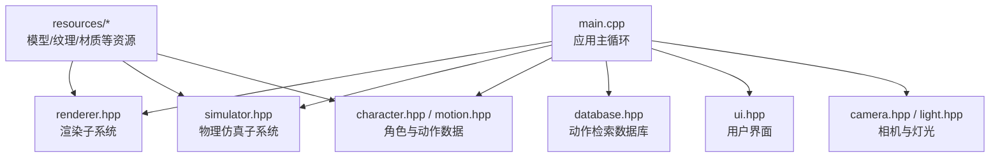
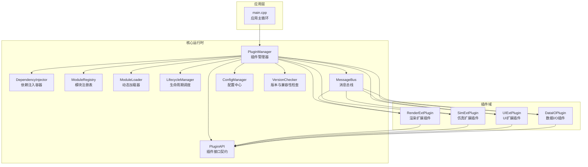
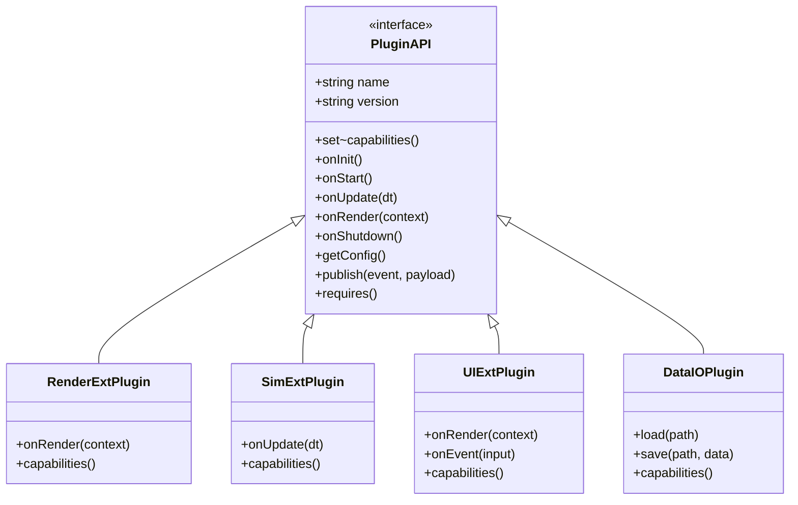
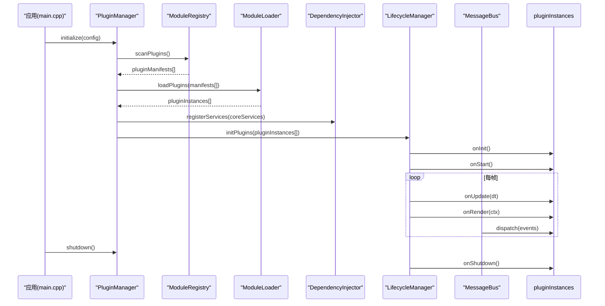
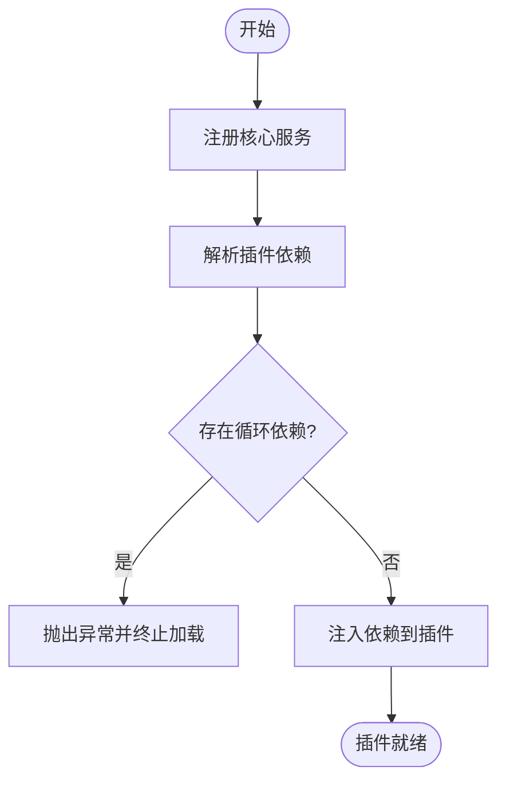
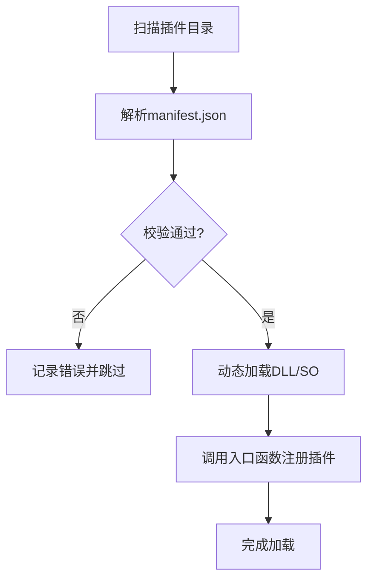
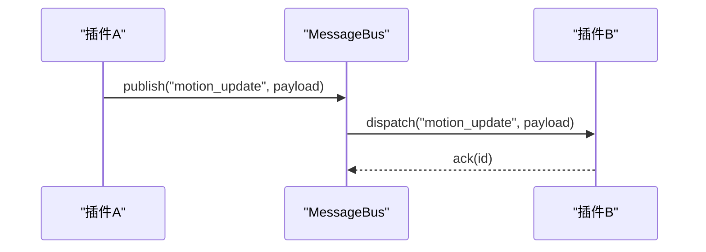
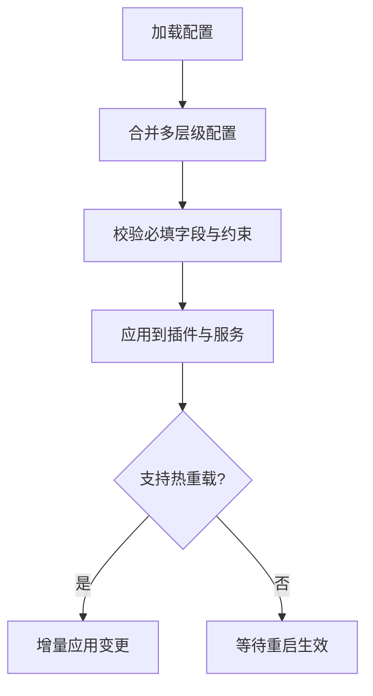
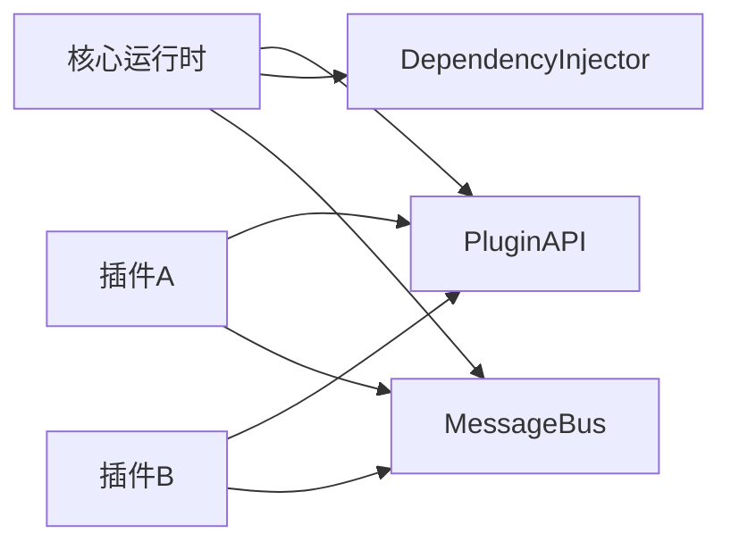
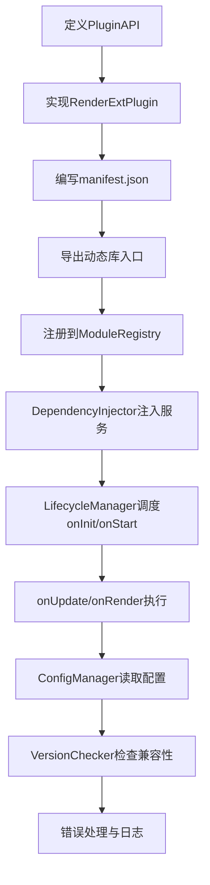

# 插件架构设计

> **版本提示（2.0）**：本文撰写于 1.x 时期，描述的是旧的实现形态——入口在根目录 `main.cpp`，功能由根目录 `.hpp` 头文件库提供，窗口用 raylib、显示用 OpenCV highgui。2.0 已把这些头文件移到 `Source/Legacy/`，渲染默认走 GPU，窗口与 UI 换成 GLFW + ImGui，`main.cpp` 拆成 `Source/Launch/Private/` 下的 `Main.cpp` 与 `Application`。文中的文件路径、行号与调用链可能已失效，请以根目录的「项目概述」「快速开始」「故障排除」三篇与当前源码为准。

<cite>
**本文引用的文件**   
- [README.md](file://README.md)
- [main.cpp](file://main.cpp)
- [global.hpp](file://global.hpp)
- [core.hpp](file://core.hpp)
</cite>

## 目录
1. [引言](#引言)
2. [项目结构](#项目结构)
3. [核心组件](#核心组件)
4. [架构总览](#架构总览)
5. [详细组件分析](#详细组件分析)
6. [依赖关系分析](#依赖关系分析)
7. [性能考量](#性能考量)
8. [故障排查指南](#故障排查指南)
9. [结论](#结论)
10. [附录：插件开发端到端示例](#附录插件开发端到端示例)

## 引言
本文件面向 MooLab 项目的“插件架构设计”目标，基于仓库现有代码与工程组织，给出可落地的插件系统设计蓝图。需要特别说明的是：当前仓库未包含现成的插件系统实现；因此本文在尊重现有代码的前提下，提出一套与既有模块（渲染、仿真、UI、数据等）解耦的插件化方案，涵盖设计模式、接口规范、生命周期管理、依赖注入、模块注册/发现/加载、通信协议、错误处理、配置管理与版本兼容性检查，并提供从接口定义到功能实现的端到端示例流程。

## 项目结构
MooLab 是一个角色运动渲染与仿真器，使用 raylib、OpenCV、OpenMP 等库，主程序入口为 main.cpp，核心头文件分布在根目录的 .hpp 文件中。资源位于 resources 目录。

图示来源
- [main.cpp:53-170](file://main.cpp#L53-L170)
- [README.md:1-22](file://README.md#L1-L22)

章节来源
- [README.md:1-22](file://README.md#L1-L22)
- [main.cpp:53-170](file://main.cpp#L53-L170)

## 核心组件
- 应用主循环与装配：main.cpp 负责初始化窗口、相机、控制器、角色、数据库、动作、仿真器、光源、模型、材质、渲染器与 UI，并在帧循环中驱动仿真、更新、渲染与输入处理。
- 基础工具与断言：global.hpp 提供通用数学与随机工具；core.hpp 提供致命错误与断言宏，用于不变式校验与外部输入错误处理。
- 领域子系统：渲染、仿真、角色/动作、数据库、UI、相机/灯光等以头文件形式组织，便于扩展与替换。

章节来源
- [main.cpp:53-170](file://main.cpp#L53-L170)
- [global.hpp:1-186](file://global.hpp#L1-L186)
- [core.hpp:1-34](file://core.hpp#L1-L34)

## 架构总览
下图展示“插件化后”的系统分层与交互关系。核心运行时（Core Runtime）暴露统一接口，插件通过标准接口接入，由插件管理器完成注册、发现、加载、生命周期调度与依赖解析。

图示来源
- [main.cpp:53-170](file://main.cpp#L53-L170)
- [core.hpp:10-31](file://core.hpp#L10-L31)

## 详细组件分析

### 插件接口契约（PluginAPI）
- 设计模式：抽象基类 + 工厂方法 + 钩子回调
- 职责边界：
  - 生命周期钩子：onInit、onStart、onUpdate、onRender、onShutdown
  - 能力声明：capabilities（如渲染、仿真、UI、I/O）
  - 配置访问：getConfig()
  - 事件发布：publish(event, payload)
  - 依赖查询：requires() 返回所需其他插件或核心服务
- 稳定性要求：ABI 稳定，二进制兼容；C++ ABI 变更需通过版本号隔离

图示来源
- [core.hpp:10-31](file://core.hpp#L10-L31)

章节来源
- [core.hpp:10-31](file://core.hpp#L10-L31)

### 插件管理器（PluginManager）
- 职责：
  - 扫描并发现插件（文件系统约定 + 清单元数据）
  - 解析依赖图并进行拓扑排序
  - 按阶段调用生命周期钩子
  - 维护依赖注入容器，向插件注入核心服务（渲染上下文、仿真状态、UI 事件总线等）
  - 协调消息总线进行插件间通信
  - 执行配置合并与校验
  - 执行版本与兼容性检查
- 关键流程：
  - 启动阶段：扫描 -> 解析 -> 校验 -> 构建依赖图 -> 实例化 -> onInit -> onStart
  - 运行阶段：onUpdate -> onRender（按优先级顺序）
  - 关闭阶段：onShutdown -> 释放资源

图示来源
- [main.cpp:53-170](file://main.cpp#L53-L170)
- [core.hpp:10-31](file://core.hpp#L10-L31)

章节来源
- [main.cpp:53-170](file://main.cpp#L53-L170)
- [core.hpp:10-31](file://core.hpp#L10-L31)

### 依赖注入机制（DependencyInjector）
- 设计要点：
  - 服务注册：registerService(type, instance)
  - 按需解析：resolve<T>()
  - 作用域：单例、每帧、每插件私有
  - 循环依赖检测：构建时检测，失败则抛出明确错误
- 与插件的关系：
  - 插件通过 requires() 声明依赖，容器自动注入
  - 核心服务（渲染上下文、仿真状态、UI 事件、配置）作为内置服务提供

图示来源
- [core.hpp:10-31](file://core.hpp#L10-L31)

章节来源
- [core.hpp:10-31](file://core.hpp#L10-L31)

### 模块注册、发现与加载
- 注册：插件导出统一的元数据（名称、版本、能力、依赖、入口函数）
- 发现：扫描指定目录下的插件包（约定目录结构 + manifest.json）
- 加载：根据平台动态库机制（Windows DLL / Linux SO）加载并调用入口函数
- 校验：签名校验（可选）、版本范围校验、能力匹配校验

图示来源
- [main.cpp:53-170](file://main.cpp#L53-L170)

章节来源
- [main.cpp:53-170](file://main.cpp#L53-L170)

### 插件间通信协议与数据交换格式
- 通信协议：基于 MessageBus 的事件驱动模型
  - 事件类型：枚举或字符串标识
  - 载荷：JSON 或自定义二进制格式（高性能路径）
  - 订阅/发布：插件订阅感兴趣的事件，发布事件携带载荷
- 数据交换：
  - 轻量控制信号：JSON
  - 大体积数据（网格、纹理、动作片段）：共享内存或零拷贝缓冲区（通过核心运行时分配）
- 安全与隔离：
  - 插件沙箱（可选）：限制 I/O、网络、线程数
  - 权限模型：仅允许访问声明的能力

图示来源
- [main.cpp:53-170](file://main.cpp#L53-L170)

章节来源
- [main.cpp:53-170](file://main.cpp#L53-L170)

### 错误处理与异常管理机制
- 策略：
  - 致命错误：使用 core.hpp 的 MOO_CHECK_ALWAYS/MOO_CHECK 进行不变式与外部输入校验，失败直接中止
  - 可恢复错误：插件内部捕获并上报给 PluginManager，由管理器决定降级或回滚
  - 日志与诊断：结构化日志（时间戳、插件ID、事件ID、堆栈）
- 建议：
  - 所有插件对外抛出的异常必须被包装为统一错误码
  - 崩溃恢复：关键路径使用 try/catch 包裹，避免主循环崩溃

章节来源
- [core.hpp:10-31](file://core.hpp#L10-L31)

### 配置管理与版本控制
- 配置管理：
  - 集中式 ConfigManager，支持 JSON/YAML 配置文件
  - 层级覆盖：默认配置 -> 环境配置 -> 运行时配置
  - 热重载：支持部分配置热更新（需谨慎）
- 版本控制与兼容性：
  - 插件 manifest 声明 min_core_version、max_core_version
  - 运行时 VersionChecker 比较版本范围，不满足则拒绝加载
  - 能力矩阵：插件声明 capabilities，运行时校验是否满足

图示来源
- [main.cpp:53-170](file://main.cpp#L53-L170)

章节来源
- [main.cpp:53-170](file://main.cpp#L53-L170)

## 依赖关系分析
- 耦合度：
  - 插件与核心运行时通过 PluginAPI 解耦
  - 插件之间通过 MessageBus 解耦
  - 依赖注入容器统一管理依赖，降低硬编码耦合
- 内聚性：
  - 每个插件聚焦单一职责（渲染扩展、仿真扩展、UI 扩展、数据 I/O）
- 潜在风险：
  - 动态加载失败（路径、符号缺失）
  - 版本不兼容导致运行时崩溃
  - 事件风暴（高频率事件导致性能退化）

图示来源
- [main.cpp:53-170](file://main.cpp#L53-L170)
- [core.hpp:10-31](file://core.hpp#L10-L31)

章节来源
- [main.cpp:53-170](file://main.cpp#L53-L170)
- [core.hpp:10-31](file://core.hpp#L10-L31)

## 性能考量
- 插件加载：
  - 延迟加载：仅在需要时加载插件，减少启动开销
  - 预编译与缓存：对常用插件进行预编译与符号缓存
- 运行时：
  - 事件批处理：批量处理事件，减少锁竞争与上下文切换
  - 零拷贝传输：大数据通过共享内存或内存池传递
- 渲染与仿真：
  - 插件渲染回调应尽量避免频繁状态切换
  - 仿真扩展应避免阻塞主线程，采用异步任务队列

[本节为通用指导，无需具体文件引用]

## 故障排查指南
- 常见问题：
  - 插件无法加载：检查路径、依赖库、符号导出、manifest 合法性
  - 版本不兼容：核对 min/max_core_version 与核心运行时版本
  - 事件无响应：确认订阅是否正确、事件名是否一致、载荷序列化是否成功
  - 崩溃定位：启用结构化日志与堆栈输出，结合 core.hpp 的断言信息
- 建议步骤：
  - 最小化复现：禁用非必要插件，逐步启用定位问题
  - 日志分析：关注插件 ID、事件 ID、错误码
  - 隔离测试：将插件放入独立进程进行冒烟测试

章节来源
- [core.hpp:10-31](file://core.hpp#L10-L31)

## 结论
本文在尊重 MooLab 现有代码结构的基础上，提出了一套完整的插件化架构设计方案，涵盖接口契约、生命周期管理、依赖注入、模块注册/发现/加载、通信协议、错误处理、配置管理与版本兼容性检查。该方案与现有渲染、仿真、UI、数据等子系统解耦，具备良好的可扩展性与可维护性。后续可在工程中逐步落地，优先实现 PluginAPI 与 PluginManager，再迭代完善通信、配置与版本检查等能力。

[本节为总结性内容，无需具体文件引用]

## 附录：插件开发端到端示例
以下示例展示从零开始开发一个“渲染扩展插件”的完整流程，包括接口定义、插件实现、注册与加载、生命周期调用、配置与版本检查、错误处理。

- 步骤概览
  1. 定义插件接口（PluginAPI）
  2. 实现插件类（RenderExtPlugin）
  3. 编写插件清单（manifest.json）
  4. 实现动态加载入口（导出符号）
  5. 注册插件（ModuleRegistry）
  6. 注入依赖（DependencyInjector）
  7. 生命周期调度（LifecycleManager）
  8. 配置与版本检查（ConfigManager + VersionChecker）
  9. 错误处理与日志（core.hpp 断言 + 结构化日志）

图示来源
- [main.cpp:53-170](file://main.cpp#L53-L170)
- [core.hpp:10-31](file://core.hpp#L10-L31)

章节来源
- [main.cpp:53-170](file://main.cpp#L53-L170)
- [core.hpp:10-31](file://core.hpp#L10-L31)