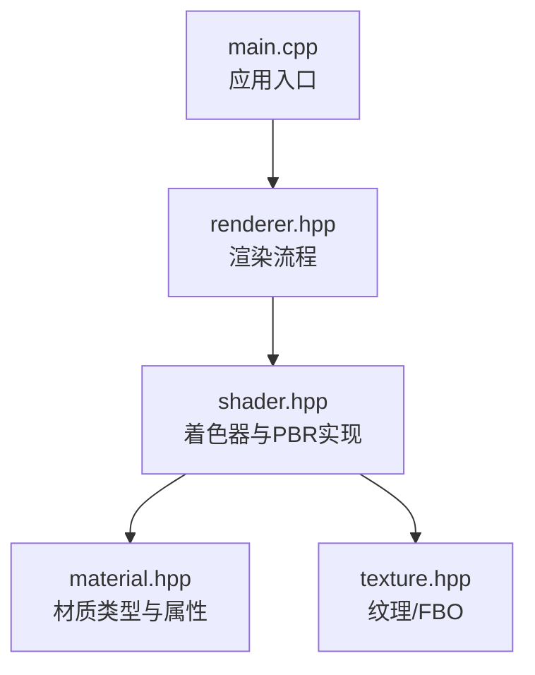
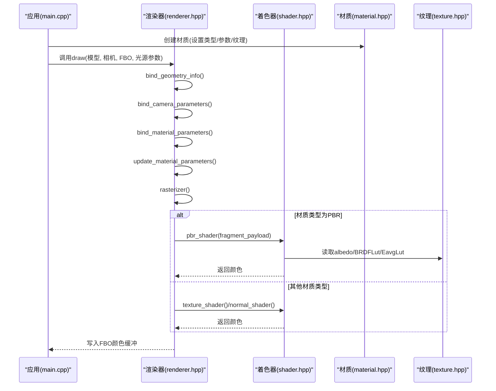
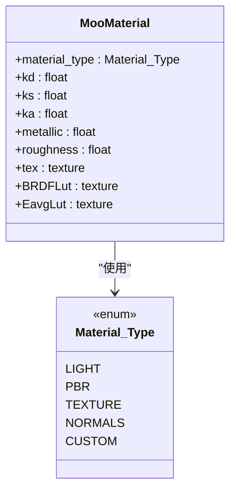
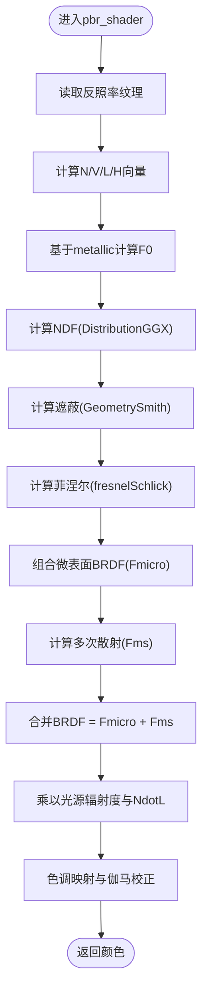
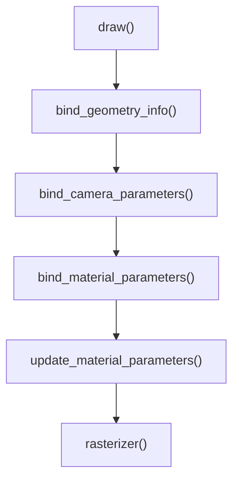
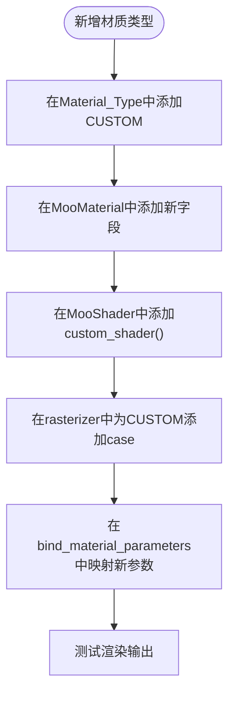
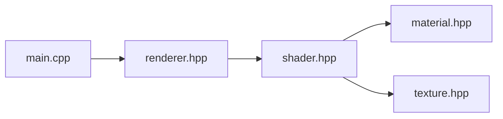

# 材质系统扩展

> **版本提示（2.0）**：本文撰写于 1.x 时期，描述的是旧的实现形态——入口在根目录 `main.cpp`，功能由根目录 `.hpp` 头文件库提供，窗口用 raylib、显示用 OpenCV highgui。2.0 已把这些头文件移到 `Source/Legacy/`，渲染默认走 GPU，窗口与 UI 换成 GLFW + ImGui，`main.cpp` 拆成 `Source/Launch/Private/` 下的 `Main.cpp` 与 `Application`。文中的文件路径、行号与调用链可能已失效，请以根目录的「项目概述」「快速开始」「故障排除」三篇与当前源码为准。

<cite>
**本文引用的文件**   
- [material.hpp](file://material.hpp)
- [shader.hpp](file://shader.hpp)
- [renderer.hpp](file://renderer.hpp)
- [texture.hpp](file://texture.hpp)
- [main.cpp](file://main.cpp)
</cite>

## 目录
1. [简介](#简介)
2. [项目结构](#项目结构)
3. [核心组件](#核心组件)
4. [架构总览](#架构总览)
5. [详细组件分析](#详细组件分析)
6. [依赖关系分析](#依赖关系分析)
7. [性能与优化](#性能与优化)
8. [故障排查指南](#故障排查指南)
9. [结论](#结论)
10. [附录：完整开发示例](#附录完整开发示例)

## 简介
本文面向MooLab项目的材质系统扩展，目标是帮助开发者理解如何添加新的材质类型、扩展PBR材质模型、实现自定义着色器效果，并将材质与渲染管线正确集成。文档从枚举与数据结构出发，逐步深入到PBR着色器实现、参数绑定机制、栅格化流程，最后给出完整的开发示例与调试优化建议。

## 项目结构
本项目采用“头文件即模块”的轻量组织方式，材质相关代码主要分布在以下文件中：
- material.hpp：定义材质类型枚举与材质数据体
- shader.hpp：定义着色器数据体、PBR数学函数与具体着色器实现
- renderer.hpp：定义渲染流程（几何绑定、相机/材质参数绑定、光栅化）
- texture.hpp：纹理与FBO的数据结构与工具函数
- main.cpp：应用入口，演示材质创建与渲染调用

图表来源
- [main.cpp:109-130](file://main.cpp#L109-L130)
- [renderer.hpp:74-92](file://renderer.hpp#L74-L92)
- [shader.hpp:199-237](file://shader.hpp#L199-L237)
- [material.hpp:7-30](file://material.hpp#L7-L30)
- [texture.hpp:65-100](file://texture.hpp#L65-L100)

章节来源
- [main.cpp:109-130](file://main.cpp#L109-L130)
- [renderer.hpp:74-92](file://renderer.hpp#L74-L92)
- [shader.hpp:199-237](file://shader.hpp#L199-L237)
- [material.hpp:7-30](file://material.hpp#L7-L30)
- [texture.hpp:65-100](file://texture.hpp#L65-L100)

## 核心组件
- 材质类型与属性
  - Material_Type：当前包含LIGHT、PBR、TEXTURE、NORMALS四种类型
  - MooMaterial：材质数据体，包含基础反射系数kd/ks/ka、PBR参数metallic/roughness以及纹理tex、BRDFLut、EavgLut
- 着色器与PBR
  - MooShader：承载着色器状态（矩阵、相机、光源、纹理指针、材质参数），并提供pbr_shader、texture_shader、normal_shader等具体着色器方法
  - PBR数学库：DistributionGGX、GeometrySchlickGGX、GeometrySmith、fresnelSchlick、AverageFresnel、MultiScatterBRDF
- 渲染管线
  - bind_geometry_info：将顶点/法线/纹理坐标打包到着色器的三角形缓冲区
  - bind_camera_parameters：绑定模型视图投影矩阵与相机参数
  - bind_material_parameters：将材质属性映射到着色器
  - rasterizer：光栅化循环，按shader_type分发到对应着色器计算颜色

章节来源
- [material.hpp:7-30](file://material.hpp#L7-L30)
- [shader.hpp:35-86](file://shader.hpp#L35-L86)
- [shader.hpp:127-237](file://shader.hpp#L127-L237)
- [renderer.hpp:33-92](file://renderer.hpp#L33-L92)
- [renderer.hpp:121-211](file://renderer.hpp#L121-L211)

## 架构总览
下图展示了材质与着色器在渲染管线中的交互关系：应用层创建材质并绑定到模型，渲染器在每帧将几何、相机、材质与光源参数注入着色器，随后在光栅化阶段根据材质类型选择对应的着色器计算最终颜色。

图表来源
- [main.cpp:109-130](file://main.cpp#L109-L130)
- [renderer.hpp:213-239](file://renderer.hpp#L213-L239)
- [renderer.hpp:121-211](file://renderer.hpp#L121-L211)
- [shader.hpp:199-237](file://shader.hpp#L199-L237)
- [texture.hpp:65-100](file://texture.hpp#L65-L100)

## 详细组件分析

### 材质类型与属性扩展
- 扩展点
  - 在Material_Type中添加新类型（例如CUSTOM）
  - 在MooMaterial中新增字段以支持新材质的参数（如漫反射贴图、高光贴图、自发光强度等）
- 注意事项
  - 保持向后兼容：已有材质类型不应被修改或删除
  - 为新类型提供默认值或初始化逻辑，避免未初始化访问
  - 若引入新纹理，需在bind_material_parameters中将其映射到着色器

图表来源
- [material.hpp:7-30](file://material.hpp#L7-L30)

章节来源
- [material.hpp:7-30](file://material.hpp#L7-L30)

### PBR材质模型扩展
- 现有实现要点
  - 使用GGX分布函数、Schlick近似菲涅尔、Smith遮蔽项
  - 通过BRDFLut与EavgLut进行多次散射近似
  - 金属度metallic用于混合F0（基元反射率）
- 扩展方向
  - 替换或增强NDF/G/F项的实现（例如改用Trowbridge-Reitz或其他经验模型）
  - 增加次表面散射、各向异性、体积散射等新特性
  - 调整色调映射与HDR处理（当前为简单的 Reinhard 映射与伽马校正）

图表来源
- [shader.hpp:127-237](file://shader.hpp#L127-L237)

章节来源
- [shader.hpp:127-237](file://shader.hpp#L127-L237)

### 材质与着色器的绑定机制
- 绑定流程
  - bind_geometry_info：将索引、顶点、法线、纹理坐标打包到着色器的三角形缓冲区
  - bind_camera_parameters：绑定模型矩阵、视图/投影矩阵、屏幕到世界矩阵、相机位置/方向、近裁剪面
  - bind_material_parameters：将材质的纹理指针与标量参数拷贝到着色器
  - update_material_parameters：更新动态光源与阴影贴图
- 关键点
  - 所有材质参数必须通过bind_material_parameters注入，否则着色器将使用旧值或未初始化值
  - 纹理指针需确保生命周期有效（通常由材质对象持有）

图表来源
- [renderer.hpp:33-92](file://renderer.hpp#L33-L92)
- [renderer.hpp:213-239](file://renderer.hpp#L213-L239)

章节来源
- [renderer.hpp:33-92](file://renderer.hpp#L33-L92)
- [renderer.hpp:213-239](file://renderer.hpp#L213-L239)

### 自定义光照模型与表面效果
- 扩展步骤
  - 在Material_Type中添加新类型（例如CUSTOM）
  - 在MooMaterial中新增所需参数（如自发光强度、各向异性轴、粗糙度各向异性等）
  - 在MooShader中新增着色器方法（例如custom_shader）
  - 在rasterizer的switch分支中为该类型添加case，调用自定义着色器
  - 在bind_material_parameters中将新参数映射到着色器
- 示例说明
  - 自定义表面效果可基于法线、切线空间、UV导数等输入进行计算
  - 可复用现有PBR数学函数或引入新的物理模型

图表来源
- [material.hpp:7-30](file://material.hpp#L7-L30)
- [shader.hpp:35-86](file://shader.hpp#L35-L86)
- [renderer.hpp:167-204](file://renderer.hpp#L167-L204)
- [renderer.hpp:74-84](file://renderer.hpp#L74-L84)

章节来源
- [material.hpp:7-30](file://material.hpp#L7-L30)
- [shader.hpp:35-86](file://shader.hpp#L35-L86)
- [renderer.hpp:167-204](file://renderer.hpp#L167-L204)
- [renderer.hpp:74-84](file://renderer.hpp#L74-L84)

## 依赖关系分析
- 组件耦合
  - renderer.hpp依赖shader.hpp与material.hpp，负责参数绑定与光栅化调度
  - shader.hpp依赖material.hpp与texture.hpp，实现具体着色器逻辑
  - main.cpp作为应用入口，实例化材质与模型并调用渲染器
- 外部依赖
  - texture.hpp依赖OpenCV用于图像加载与格式转换
  - 全局数学库（vec/mat等）在多个头文件中被引用

图表来源
- [main.cpp:109-130](file://main.cpp#L109-L130)
- [renderer.hpp:74-92](file://renderer.hpp#L74-L92)
- [shader.hpp:199-237](file://shader.hpp#L199-L237)
- [texture.hpp:65-100](file://texture.hpp#L65-L100)

章节来源
- [main.cpp:109-130](file://main.cpp#L109-L130)
- [renderer.hpp:74-92](file://renderer.hpp#L74-L92)
- [shader.hpp:199-237](file://shader.hpp#L199-L237)
- [texture.hpp:65-100](file://texture.hpp#L65-L100)

## 性能与优化
- 并行化
  - 光栅化循环已使用OpenMP并行化（pragma omp parallel for），注意线程安全与内存分配
- 纹理访问
  - 减少重复纹理采样；必要时缓存常用结果（如NdotV/NdotL）
  - 合理选择纹理分辨率，平衡质量与带宽
- 数值稳定性
  - 分母加小常数防止除零（当前已在部分路径处理）
  - 使用clamp/max等函数保证输入范围合法
- 色调映射与伽马
  - 当前使用简单Reinhard映射与伽马校正，可根据场景动态调整参数
- 资源管理
  - 纹理与FBO的生命周期需与材质/相机一致，避免悬空指针

[本节为通用指导，不直接分析具体文件]

## 故障排查指南
- 常见问题
  - 材质参数未生效：检查是否调用bind_material_parameters且参数赋值正确
  - 纹理显示异常：确认纹理路径与格式正确，OpenCV加载成功
  - 颜色过曝或过暗：检查光源辐射度、色调映射参数、伽马校正
  - 崩溃或断言失败：检查FBO/纹理索引越界、空指针访问
- 定位方法
  - 在rasterizer中打印关键变量（NdotL、NdotV、F0、BRDF）
  - 使用normal_shader可视化法线，验证几何与法线是否正确
  - 使用texture_shader仅显示反照率，排除光照计算问题

章节来源
- [renderer.hpp:121-211](file://renderer.hpp#L121-L211)
- [shader.hpp:239-252](file://shader.hpp#L239-L252)

## 结论
MooLab的材质系统以简洁的头文件模块化设计为基础，通过Material_Type与MooMaterial定义材质类型与属性，借助MooShader实现具体着色器逻辑，并由renderer.hpp完成参数绑定与光栅化调度。扩展新材质类型时，只需在枚举与数据体中增加字段，并在着色器与渲染器中添加对应分支即可。PBR模型提供了可扩展的数学库与多次散射近似，便于进一步定制光照与表面效果。

[本节为总结性内容，不直接分析具体文件]

## 附录：完整开发示例
以下示例展示从零开始添加一种名为CUSTOM的新材质类型的完整流程：

- 步骤一：扩展材质类型与属性
  - 在Material_Type中添加CUSTOM
  - 在MooMaterial中添加新字段（例如emissive_strength、anisotropy_axis）

- 步骤二：实现自定义着色器
  - 在MooShader中新增custom_shader(fragment_payload&)方法
  - 在custom_shader中实现你的光照/表面算法（可复用PBR数学函数）

- 步骤三：注册到渲染管线
  - 在rasterizer的switch分支中为CUSTOM添加case，调用custom_shader
  - 在bind_material_parameters中将新字段映射到着色器

- 步骤四：应用层使用
  - 在main.cpp中创建MooMaterial(CUSTOM)，设置新字段与纹理
  - 将材质应用到模型并调用draw进行渲染

- 步骤五：调试与优化
  - 先用texture_shader验证纹理加载
  - 再用normal_shader验证法线
  - 逐步启用custom_shader并调整参数，观察渲染效果

章节来源
- [material.hpp:7-30](file://material.hpp#L7-L30)
- [shader.hpp:35-86](file://shader.hpp#L35-L86)
- [renderer.hpp:167-204](file://renderer.hpp#L167-L204)
- [renderer.hpp:74-84](file://renderer.hpp#L74-L84)
- [main.cpp:109-130](file://main.cpp#L109-L130)