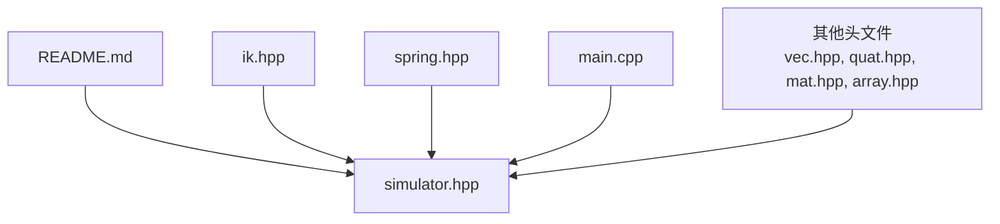
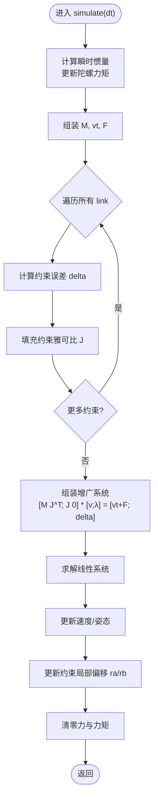
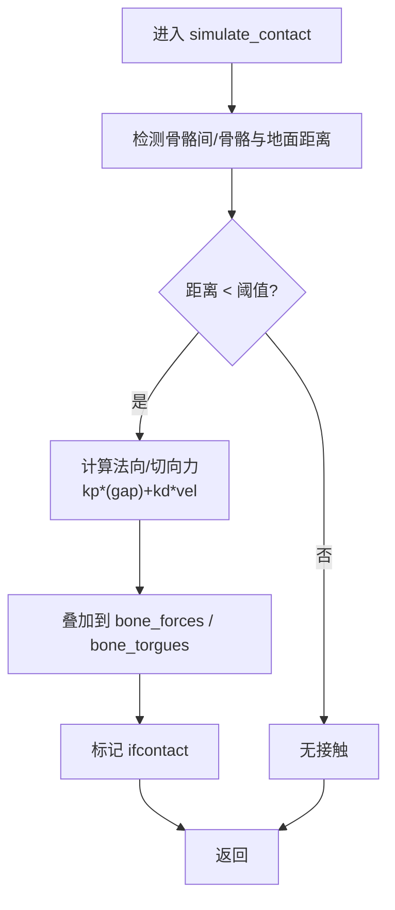
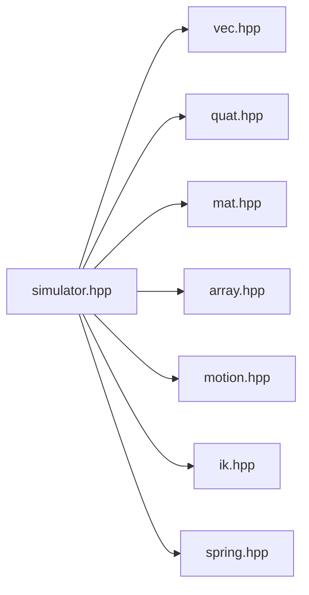

# 物理约束扩展

> **版本提示（2.0）**：本文撰写于 1.x 时期，描述的是旧的实现形态——入口在根目录 `main.cpp`，功能由根目录 `.hpp` 头文件库提供，窗口用 raylib、显示用 OpenCV highgui。2.0 已把这些头文件移到 `Source/Legacy/`，渲染默认走 GPU，窗口与 UI 换成 GLFW + ImGui，`main.cpp` 拆成 `Source/Launch/Private/` 下的 `Main.cpp` 与 `Application`。文中的文件路径、行号与调用链可能已失效，请以根目录的「项目概述」「快速开始」「故障排除」三篇与当前源码为准。

<cite>
**本文引用的文件**   
- [README.md](file://README.md)
- [simulator.hpp](file://simulator.hpp)
- [spring.hpp](file://spring.hpp)
- [ik.hpp](file://ik.hpp)
</cite>

## 目录
1. [引言](#引言)
2. [项目结构](#项目结构)
3. [核心组件](#核心组件)
4. [架构总览](#架构总览)
5. [详细组件分析](#详细组件分析)
6. [依赖关系分析](#依赖关系分析)
7. [性能与稳定性](#性能与稳定性)
8. [故障排查指南](#故障排查指南)
9. [结论](#结论)
10. [附录：约束实现示例与集成步骤](#附录约束实现示例与集成步骤)

## 引言
本指南面向希望在 MooLab 中扩展“物理约束”的开发者。当前代码库已包含一个基于线性互补/拉格朗日乘子形式的骨架动力学求解器，以及若干几何距离工具、IK 算法和弹簧函数占位。我们将围绕以下目标展开：
- 如何对自定义物理约束进行数学建模（约束方程）与数值求解（雅可比、误差向量、线性系统组装）。
- 约束求解器的架构设计：约束类型分类、求解策略选择与扩展点。
- 如何将新约束类型集成到 Simulator 类中，包括初始化、更新与求解接口。
- 给出具体约束实现示例（如弹簧约束、距离约束、角度约束）的实现思路与关键步骤。
- 约束参数调优方法与稳定性分析，以及与既有约束（如接触约束）的交互处理。

## 项目结构
MooLab 是一个角色运动渲染与仿真器，主要依赖 OpenCV、OpenMP、raylib。仓库根目录包含大量头文件，其中与物理约束扩展最相关的是：
- simulator.hpp：定义 Simulator 类、约束数据结构 link、求解主循环 simulate()、碰撞检测等。
- ik.hpp：提供 IK 算法（FABRIK），可作为位置/角度约束的参考实现。
- spring.hpp：提供弹簧相关函数的占位实现，可用于软约束或阻尼项。
- README.md：构建说明与依赖信息。



图表来源
- [README.md:1-22](file://README.md#L1-L22)
- [simulator.hpp:321-355](file://simulator.hpp#L321-L355)

章节来源
- [README.md:1-22](file://README.md#L1-L22)

## 核心组件
- Simulator 类：封装骨骼质量、惯量、形状、速度、角速度、力与力矩、约束 link 等状态；提供重力、阻尼、接触、控制、正向运动学、步进 simulate() 等方法。
- link 结构体：表示两个骨骼之间的约束连接，包含两端索引 a/b、局部偏移 ra/rb、当前误差 delta。
- shape 结构体：用于碰撞检测的几何体（球/圆柱近似），包含位置、旋转、半径、长度、是否接触标志。
- 几何工具：点到平面、线段到平面、点到线段、线段到线段的距离计算，供接触与约束使用。
- IK 算法：FABRIK 系列方法，展示如何通过迭代满足端点/角度约束并反解关节旋转。
- 弹簧函数：隐式阻尼弹簧的占位实现，可用于软约束或附加阻尼。

章节来源
- [simulator.hpp:302-355](file://simulator.hpp#L302-L355)
- [simulator.hpp:191-300](file://simulator.hpp#L191-L300)
- [ik.hpp:164-353](file://ik.hpp#L164-L353)
- [spring.hpp:1-21](file://spring.hpp#L1-L21)

## 架构总览
Simulator::simulate() 是约束求解的核心入口。其流程如下：
1. 为每个骨骼计算瞬时转动惯量矩阵，更新陀螺力矩项。
2. 组装质量矩阵 M、速度-力向量 vt、外力 F。
3. 遍历所有 link 约束，计算约束误差 delta，并填充约束雅可比 J。
4. 构造增广线性系统 [M J^T; J 0] * [v; λ] = [vt+F; delta]。
5. 调用 Elimination_method_solution_of_linear_equations() 求解 v 与拉格朗日乘子 λ。
6. 更新速度与姿态，更新约束局部偏移 ra/rb，清零力与力矩。



图表来源
- [simulator.hpp:543-624](file://simulator.hpp#L543-L624)

章节来源
- [simulator.hpp:543-624](file://simulator.hpp#L543-L624)

## 详细组件分析

### 约束数据模型与现有约束
- link 结构体：
  - a, b：约束两端的骨骼索引。
  - ra, rb：约束点在骨骼局部坐标系中的偏移。
  - delta：当前约束误差（在 simulate() 中根据当前位置差计算）。
- 现有约束类型：
  - 骨架连杆约束（由 bone_links 数组表达）：通过 J 与 delta 将两端位置差映射为约束方程。
  - 接触约束（地面与刚体间）：在 simulate_contact() 中以弹簧-阻尼形式施加法向与切向力，不直接参与线性系统求解，而是作为外力/力矩注入。

```mermaid
classDiagram
class Simulator {
+array1d<int> bone_ids
+array1d<int> bone_parents
+array1d<vec3> bone_offsets
+array1d<quat> bone_quat_compensates
+array1d<double> bone_masses
+array1d<mat3> bone_inertias
+array1d<link> bone_links
+array1d<shape> bone_shapes
+array1d<vec3> bone_vels
+array1d<vec3> bone_avels
+array1d<vec3> bone_forces
+array1d<vec3> bone_torgues
+simulate_gravity(g)
+simulate_damp(damp)
+simulate_contact(A,B,C,D,eps)
+simulate_local_control(target_local_rotations)
+simulate_global_control(target_local_rotations)
+simulate(h)
+batch_forward_kinematics_full(...)
+revise_anim_bones(bone_anim_rotations)
}
class link {
+int a
+int b
+vec3 ra
+vec3 rb
+vec3 delta
}
class shape {
+vec3 pos
+quat rot
+double radius
+double length
+bool ifcontact
}
Simulator "1" o-- "*" link : "bone_links"
Simulator "1" o-- "*" shape : "bone_shapes"
```

图表来源
- [simulator.hpp:302-355](file://simulator.hpp#L302-L355)

章节来源
- [simulator.hpp:302-355](file://simulator.hpp#L302-L355)

### 约束求解器架构与策略
- 约束分类：
  - 硬约束（等式约束）：例如骨架连杆约束，以等式形式出现在 J*v = delta 中，通过拉格朗日乘子 λ 求解。
  - 软约束（不等式/惩罚项）：例如接触约束，以弹簧-阻尼力形式注入外力/力矩，不参与线性系统。
- 求解策略：
  - 线性系统采用高斯消元法（Elimination_method_solution_of_linear_equations），时间复杂度 O(n^3)，适合中小规模系统。
  - 约束雅可比 J 按每条 link 行块填充，每行对应三维误差向量。
- 扩展点：
  - 新增约束类型需在 assemble 阶段补充 J 的行块与 delta 的值。
  - 若为软约束，可在外力/力矩注入阶段添加相应项。

```mermaid
sequenceDiagram
participant S as "Simulator : : simulate"
participant L as "link 约束"
participant J as "约束雅可比 J"
participant A as "增广矩阵 A"
participant X as "未知数 [v;λ]"
participant R as "右端项 B"
S->>S : 计算惯量/更新陀螺力矩
S->>S : 组装 M, vt, F
loop 遍历所有 link
S->>L : 计算 delta
S->>J : 填充 J 的行块
end
S->>A : 组装 [M J^T; J 0]
S->>R : 组装 [vt+F; delta]
S->>X : 求解线性系统
S->>S : 更新速度与姿态
S->>L : 更新 ra/rb
```

图表来源
- [simulator.hpp:543-624](file://simulator.hpp#L543-L624)

章节来源
- [simulator.hpp:543-624](file://simulator.hpp#L543-L624)

### 接触约束与外部力的注入
- 接触检测：
  - 骨骼形状用圆柱/球近似，计算线段到线段、线段到平面的距离。
  - 当距离小于阈值时，计算法向与切向力，叠加到 bone_forces 与 bone_torgues。
- 参数：
  - kp（刚度）、kd（阻尼）可调，影响接触响应与稳定性。
- 与求解器交互：
  - 接触力作为外力/力矩注入，不影响 J 与 delta，保持硬约束求解不变。



图表来源
- [simulator.hpp:374-435](file://simulator.hpp#L374-L435)

章节来源
- [simulator.hpp:374-435](file://simulator.hpp#L374-L435)

### IK 约束参考实现
- FABRIK_one_end_constraints / FABRIK_two_end_constraints：
  - 通过前向/反向迭代调整骨骼位置以满足端点目标或双端点目标。
  - 最终将位置偏差转换为关节旋转（轴角表示）。
- 适用场景：
  - 作为位置/角度约束的启发式求解器，可辅助调试或作为软约束的初始猜测。

章节来源
- [ik.hpp:164-353](file://ik.hpp#L164-L353)

## 依赖关系分析
- Simulator 依赖：
  - vec.hpp、quat.hpp、mat.hpp、array.hpp：基础向量、四元数、矩阵、数组容器。
  - motion.hpp：绑定模拟器与 BVH 动作数据。
- 约束相关依赖：
  - 几何工具函数（distance_between_*）用于接触与约束计算。
  - 线性代数工具（matrix 操作、转置、拼接、消元求解）。
- 外部库：
  - OpenCV、raylib、OpenMP（构建与并行化）。



图表来源
- [simulator.hpp:1-10](file://simulator.hpp#L1-L10)
- [README.md:1-22](file://README.md#L1-L22)

章节来源
- [README.md:1-22](file://README.md#L1-L22)

## 性能与稳定性
- 线性系统求解：
  - 使用显式高斯消元，O(n^3)。对于大规模约束系统，建议考虑稀疏求解器或预条件技术。
- 并行化：
  - 矩阵乘法已使用 OpenMP 并行循环，可进一步对约束装配与距离检测进行并行优化。
- 稳定性：
  - 接触约束的 kp/kd 需合理设置以避免数值振荡。
  - 时间步长 dt 过小可提高稳定性但增加计算成本。
- 约束耦合：
  - 多约束同时存在时，J 的条件数可能恶化，需关注数值稳定性。

[本节为通用指导，不直接分析具体文件]

## 故障排查指南
- 约束未生效：
  - 检查 link 的 a/b 索引是否正确，ra/rb 是否在骨骼局部坐标系中正确设置。
  - 确认 delta 的计算是否与约束方程一致。
- 求解发散或抖动：
  - 降低 kp 或增大 kd，减小 dt，检查 J 的条件数。
- 接触穿透或过强反弹：
  - 调整 eps 阈值与 kp/kd，确保接触检测与力注入逻辑正确。

章节来源
- [simulator.hpp:374-435](file://simulator.hpp#L374-L435)
- [simulator.hpp:543-624](file://simulator.hpp#L543-L624)

## 结论
MooLab 的约束求解器以线性系统为核心，支持硬约束（通过 J 与 delta）与软约束（通过外力/力矩注入）。扩展新约束的关键在于：
- 明确约束方程与雅可比 J 的行块。
- 在 assemble 阶段正确填充 delta 与 J。
- 如需软约束，在外力/力矩注入阶段添加相应项。
- 结合 IK 与弹簧函数进行参数调优与稳定性分析。

[本节为总结性内容，不直接分析具体文件]

## 附录：约束实现示例与集成步骤

### 数学建模与数值求解要点
- 硬约束（等式）：
  - 约束方程：g(q) = 0，线性化后为 J*q_dot = -ḡ。
  - 在 simulate() 中，delta 应设置为 -ḡ/h 或等效形式，J 为约束对速度的雅可比。
- 软约束（惩罚）：
  - 以弹簧-阻尼形式 f = kp*g + kd*ġ 注入外力/力矩。
  - 适用于需要柔性的约束（如软连接、弹性关节）。

[本节为概念性说明，不直接分析具体文件]

### 集成新约束到 Simulator 的步骤
1. 定义约束数据结构（可选）：
   - 若约束复杂，可新增结构体存储参数（如刚度、阻尼、目标值）。
2. 初始化：
   - 在 bind_simulator() 或 update_simulator() 中设置约束参数与初始状态。
3. 更新：
   - 在每帧更新约束几何（如 ra/rb、目标位置/角度）。
4. 求解：
   - 在 simulate() 的约束装配阶段，填充 J 的行块与 delta。
   - 若为软约束，在 force/torque 注入阶段添加相应项。
5. 验证：
   - 使用 IK 或已知解析解进行单元测试。

章节来源
- [simulator.hpp:664-847](file://simulator.hpp#L664-L847)
- [simulator.hpp:849-909](file://simulator.hpp#L849-L909)

### 具体约束实现示例（思路与关键点）

#### 弹簧约束（软约束）
- 数学模型：
  - 以两点间位移为 g，f = kp*g + kd*ġ。
- 实现要点：
  - 在 force/torque 注入阶段计算弹簧力，并叠加到 bone_forces/bone_torgues。
  - 可使用 spring.hpp 中的 decay_spring_implicit_damping_pos 作为参考。

章节来源
- [spring.hpp:6-14](file://spring.hpp#L6-L14)
- [simulator.hpp:357-372](file://simulator.hpp#L357-L372)

#### 距离约束（硬约束）
- 数学模型：
  - 约束两端点距离等于目标长度：||p1 - p2|| - L = 0。
- 实现要点：
  - 计算 delta = ||p1 - p2|| - L。
  - J 的行块为约束对速度的雅可比（位置导数）。
  - 在 assemble 阶段填充 J 与 delta。

章节来源
- [simulator.hpp:573-584](file://simulator.hpp#L573-L584)

#### 角度约束（硬约束）
- 数学模型：
  - 两骨骼轴向夹角等于目标角度：θ(p1,p2) - θ_target = 0。
- 实现要点：
  - 计算角度误差与雅可比（涉及四元数/轴角转换）。
  - 在 assemble 阶段填充 J 与 delta。

章节来源
- [simulator.hpp:543-624](file://simulator.hpp#L543-L624)

### 约束参数调优与稳定性分析
- 刚度 kp：
  - 越大越接近硬约束，但可能导致数值不稳定。
- 阻尼 kd：
  - 抑制振荡，提高稳定性，但过大可能使系统过于迟缓。
- 时间步长 dt：
  - 较小 dt 提高稳定性，但增加计算成本。
- 接触阈值 eps：
  - 影响接触检测灵敏度，需与 kp/kd 配合调参。

[本节为通用指导，不直接分析具体文件]

### 与其他约束的交互处理
- 硬约束与软约束共存：
  - 硬约束通过 J/delta 参与线性系统，软约束通过外力/力矩注入。
- 约束优先级：
  - 可通过权重或分层求解策略处理冲突约束。
- 耦合效应：
  - 多约束同时作用时，注意 J 的条件数与数值稳定性。

[本节为概念性说明，不直接分析具体文件]