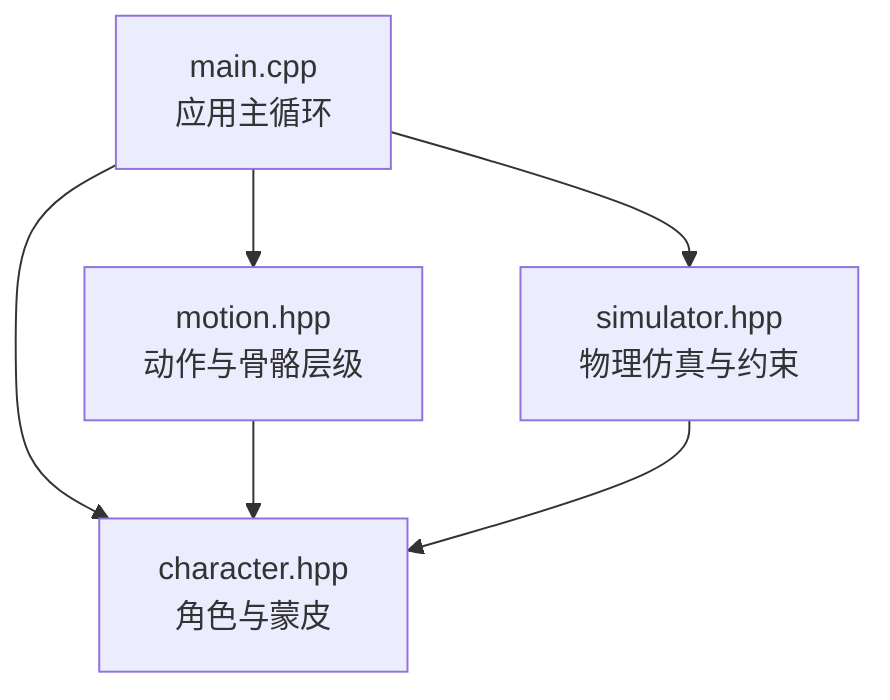
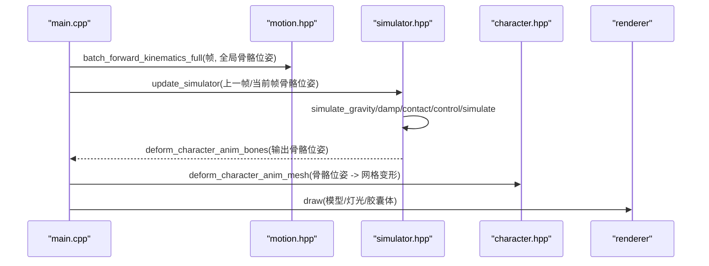
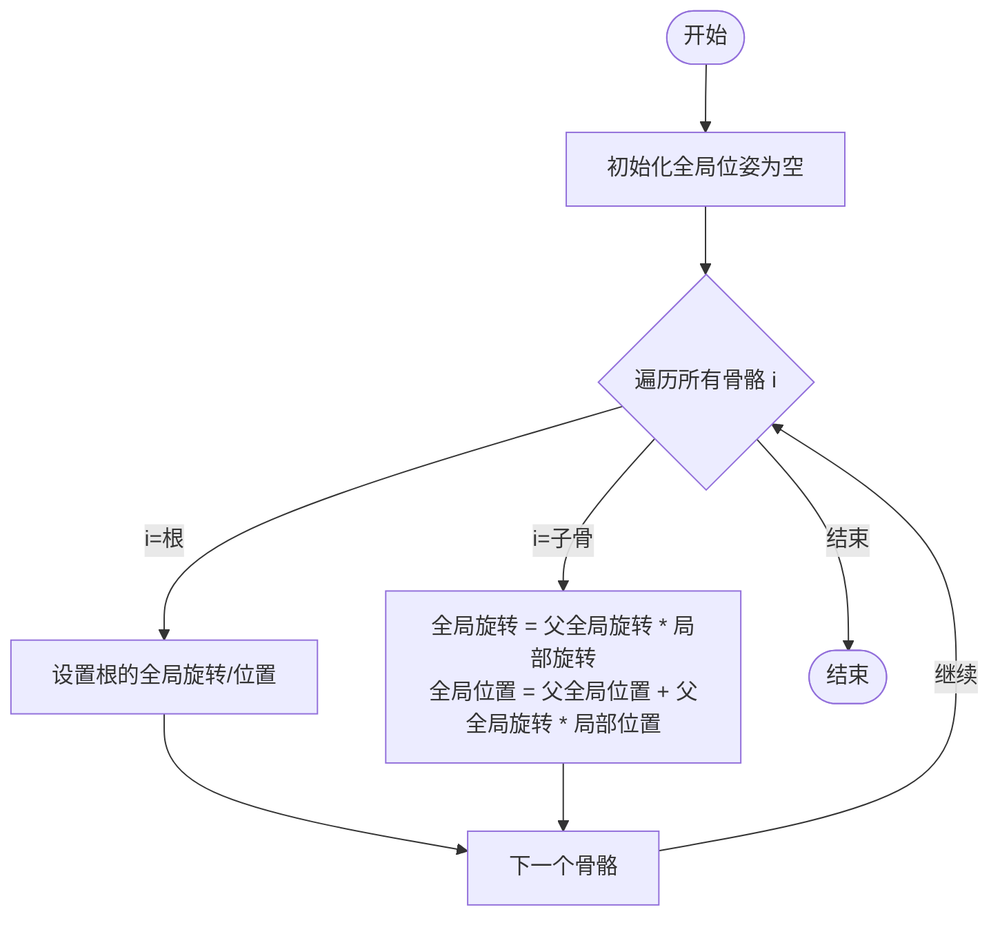
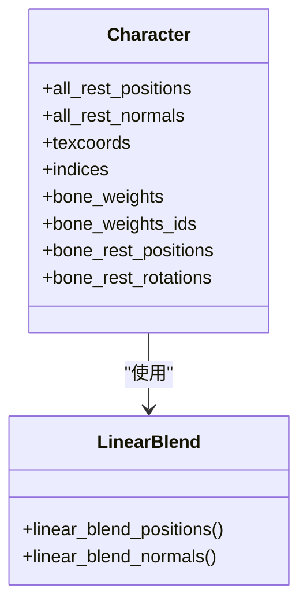
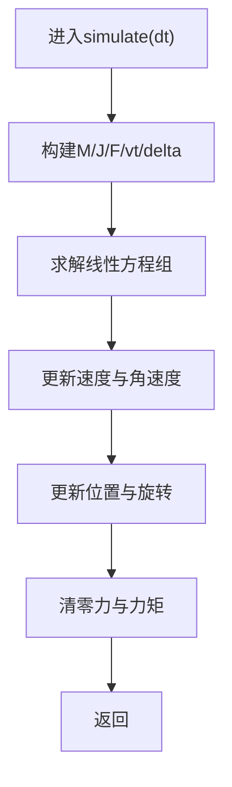
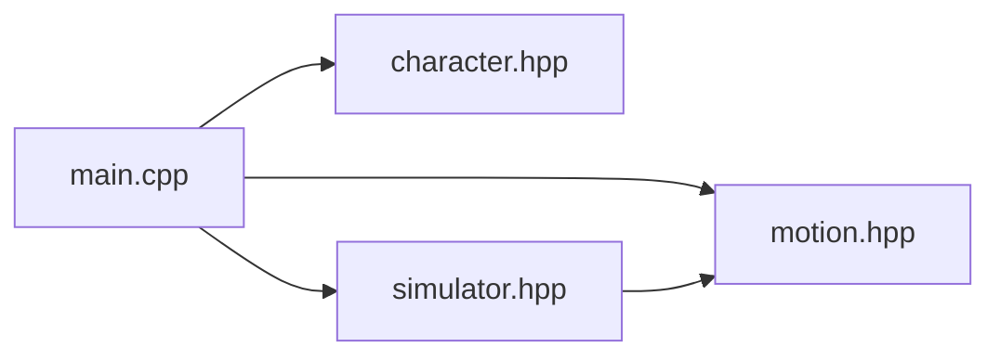
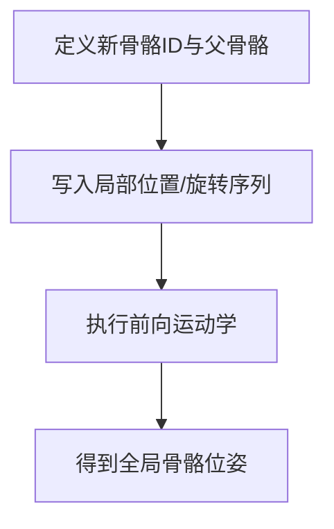
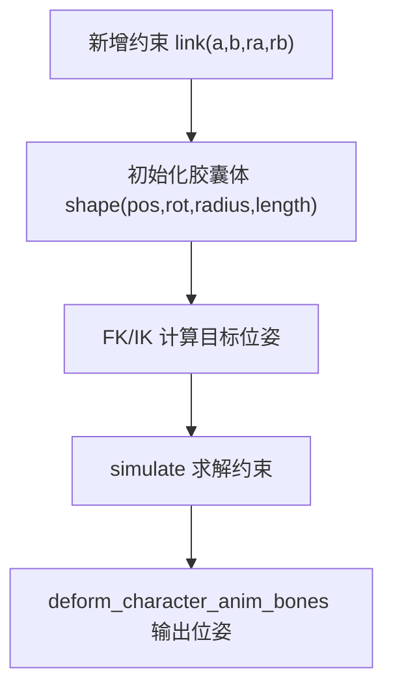

# 骨骼系统扩展

> **版本提示（2.0）**：本文撰写于 1.x 时期，描述的是旧的实现形态——入口在根目录 `main.cpp`，功能由根目录 `.hpp` 头文件库提供，窗口用 raylib、显示用 OpenCV highgui。2.0 已把这些头文件移到 `Source/Legacy/`，渲染默认走 GPU，窗口与 UI 换成 GLFW + ImGui，`main.cpp` 拆成 `Source/Launch/Private/` 下的 `Main.cpp` 与 `Application`。文中的文件路径、行号与调用链可能已失效，请以根目录的「项目概述」「快速开始」「故障排除」三篇与当前源码为准。

<cite>
**本文引用的文件**   
- [README.md](file://README.md)
- [main.cpp](file://main.cpp)
- [character.hpp](file://character.hpp)
- [motion.hpp](file://motion.hpp)
- [simulator.hpp](file://simulator.hpp)
</cite>

## 目录
1. [简介](#简介)
2. [项目结构](#项目结构)
3. [核心组件](#核心组件)
4. [架构总览](#架构总览)
5. [详细组件分析](#详细组件分析)
6. [依赖关系分析](#依赖关系分析)
7. [性能考虑](#性能考虑)
8. [故障排查指南](#故障排查指南)
9. [结论](#结论)
10. [附录：从定义新骨骼到完整动画的实操流程](#附录从定义新骨骼到完整动画的实操流程)

## 简介
本文件面向需要在 MooLab 中扩展“骨骼系统”的开发者，目标是说明如何添加新的骨骼类型与关节约束、建立父子层级与变换矩阵、扩展蒙皮权重系统以支持新骨骼，并提供序列化/反序列化方法与性能优化建议。文档同时给出从定义新骨骼到实现完整动画效果的端到端流程指引，帮助读者在不直接粘贴代码的前提下完成集成。

## 项目结构
MooLab 是一个角色运动渲染与仿真器，核心由以下模块组成：
- 动作数据与骨骼层级：motion.hpp（BVH_Motion、骨骼枚举、前向运动学）
- 角色模型与蒙皮：character.hpp（Character、线性混合蒙皮）
- 物理仿真与约束：simulator.hpp（Simulator、碰撞、控制、动力学求解）
- 应用主循环：main.cpp（加载资源、驱动仿真、渲染）

图表来源
- [main.cpp:53-102](file://main.cpp#L53-L102)
- [motion.hpp:37-96](file://motion.hpp#L37-L96)
- [character.hpp:35-66](file://character.hpp#L35-L66)
- [simulator.hpp:321-355](file://simulator.hpp#L321-L355)

章节来源
- [README.md:1-22](file://README.md#L1-L22)
- [main.cpp:53-102](file://main.cpp#L53-L102)

## 核心组件
- 骨骼标识与层级
  - Bones 枚举：用于角色渲染时的骨骼索引（如根、骨盆、四肢等）。
  - Motion_Bones 枚举：用于 BVH 动作数据的骨骼索引。
  - BVH_Motion：包含每帧的局部位置与旋转、父子关系数组 bone_parents。
- 角色与蒙皮
  - Character：存储顶点/法线/纹理坐标/索引、蒙皮权重与骨骼绑定信息、骨骼静止姿态。
  - linear_blend_positions/normals：基于多骨骼旋转和平移对顶点/法线进行线性混合。
- 物理仿真
  - Simulator：维护胶囊体形状、质量、惯性、约束 link、速度/角速度、力/扭矩，提供重力、阻尼、接触、控制与动力学求解。
  - bind_simulator/update_simulator/deform_character_anim_bones：将动作或仿真结果映射为可渲染的骨骼位姿。

章节来源
- [character.hpp:8-47](file://character.hpp#L8-L47)
- [motion.hpp:8-70](file://motion.hpp#L8-L70)
- [simulator.hpp:302-355](file://simulator.hpp#L302-L355)

## 架构总览
下图展示从动作数据到最终渲染的关键调用链，包括前向运动学、物理仿真、蒙皮变形与绘制。

图表来源
- [main.cpp:204-208](file://main.cpp#L204-L208)
- [main.cpp:292-345](file://main.cpp#L292-L345)
- [main.cpp:424-428](file://main.cpp#L424-L428)
- [motion.hpp:122-150](file://motion.hpp#L122-L150)
- [simulator.hpp:357-624](file://simulator.hpp#L357-L624)
- [character.hpp:142-164](file://character.hpp#L142-L164)

## 详细组件分析

### 骨骼标识与层级（Bones/Motion_Bones/BVH_Motion）
- Bones 枚举定义了渲染侧骨骼标识；Motion_Bones 枚举定义动作侧骨骼标识。两者不必一一对应，但通常通过映射保持一致性。
- BVH_Motion 的核心字段：
  - bone_ids：骨骼ID列表
  - bone_local_positions/bone_local_rotations：每帧的局部位移与旋转
  - bone_parents：父子关系（父为-1表示根）
- 前向运动学（FK）：
  - batch_forward_kinematics_full：按父子顺序累积旋转与平移，计算全局骨骼位姿。
  - batch_forward_kinematics_part/root：允许替换根位姿或在已有全局位姿上叠加根变换。

图表来源
- [motion.hpp:122-150](file://motion.hpp#L122-L150)

章节来源
- [motion.hpp:8-70](file://motion.hpp#L8-L70)
- [motion.hpp:122-198](file://motion.hpp#L122-L198)

### 角色结构与蒙皮权重（Character/linear_blend_*）
- Character 字段：
  - all_rest_positions/all_rest_normals/texcoords/indices：静态网格数据
  - bone_weights/bone_weights_ids：每个顶点对应的骨骼ID与权重（稀疏列）
  - bone_rest_positions/bone_rest_rotations：骨骼在静止姿态下的全局位置与旋转
- 蒙皮算法：
  - linear_blend_positions：对每个顶点，根据权重聚合各骨骼变换后的位置
  - linear_blend_normals：对每个顶点，根据权重聚合各骨骼旋转后的法线
- 网格构建与变形：
  - make_character_rest_mesh：从 Character 构造初始网格
  - deform_character_anim_mesh：将骨骼动画位姿应用到网格

图表来源
- [character.hpp:35-47](file://character.hpp#L35-L47)
- [character.hpp:68-121](file://character.hpp#L68-L121)

章节来源
- [character.hpp:35-164](file://character.hpp#L35-L164)

### 物理仿真与约束（Simulator）
- 数据结构：
  - bone_shapes：胶囊体（位置、旋转、半径、长度、是否触地）
  - bone_masses/bone_inertias：质量与惯性
  - bone_links：两骨骼间的约束（连接点相对偏移 ra/rb）
  - bone_vels/bone_avels：线速度与角速度
  - bone_forces/bone_torgues：外力与外力矩
- 关键方法：
  - simulate_gravity/damp：施加重力与阻尼
  - simulate_contact：刚体间与地面碰撞检测与响应
  - simulate_global_control/simulate_local_control：根据目标骨骼旋转生成力矩
  - simulate：组装质量矩阵 M、约束雅可比 J，求解并更新速度与位姿
  - bind_simulator/update_simulator：将动作或仿真状态映射为胶囊体与约束
  - deform_character_anim_bones：从仿真结果恢复骨骼位姿供渲染使用

图表来源
- [simulator.hpp:543-624](file://simulator.hpp#L543-L624)

章节来源
- [simulator.hpp:302-355](file://simulator.hpp#L302-L355)
- [simulator.hpp:357-624](file://simulator.hpp#L357-L624)
- [simulator.hpp:664-847](file://simulator.hpp#L664-L847)
- [simulator.hpp:849-930](file://simulator.hpp#L849-L930)

### 主循环中的骨骼与动画流（main.cpp）
- 加载角色与动作数据，构建初始网格与可视化胶囊体
- 每帧：
  - 读取手柄输入，计算目标速度/角速度
  - 若处于动作阶段：batch_forward_kinematics_full 获取骨骼位姿
  - 若处于仿真阶段：update_simulator + simulate 多次步进，deform_character_anim_bones 回写骨骼位姿
  - deform_character_anim_mesh 将骨骼位姿应用到网格
  - 更新相机、灯光、绘制模型

章节来源
- [main.cpp:53-102](file://main.cpp#L53-L102)
- [main.cpp:204-208](file://main.cpp#L204-L208)
- [main.cpp:292-345](file://main.cpp#L292-L345)
- [main.cpp:424-428](file://main.cpp#L424-L428)

## 依赖关系分析
- main.cpp 依赖 motion.hpp（动作与FK）、character.hpp（角色与蒙皮）、simulator.hpp（仿真与约束）
- simulator.hpp 依赖 motion.hpp（骨骼层级）
- character.hpp 依赖基础数学库（quat/mesh/array），不直接依赖 motion/simulator

图表来源
- [main.cpp:8-17](file://main.cpp#L8-L17)
- [simulator.hpp:4-4](file://simulator.hpp#L4-L4)

章节来源
- [main.cpp:8-17](file://main.cpp#L8-L17)
- [simulator.hpp:4-4](file://simulator.hpp#L4-L4)

## 性能考虑
- 前向运动学与蒙皮
  - 骨骼数量与顶点数较大时，线性混合是主要开销。建议：
    - 限制每个顶点的有效骨骼权重数量（减少 bone_weights_ids 列宽）
    - 使用 SIMD 或 GPU 加速（例如将线性混合移至着色器）
- 物理仿真
  - 约束数量较多时，线性方程组规模增大。建议：
    - 合并冗余约束，减少 bone_links 数量
    - 调整求解步长 dt 与内部迭代次数
    - 利用 OpenMP 并行化（项目中已对部分矩阵乘法启用并行）
- I/O 与资源
  - 批量读写二进制数据（array1d_read/write、array2d_read/write）避免频繁磁盘访问
  - 预分配内存，减少运行时分配

[本节为通用指导，无需具体文件引用]

## 故障排查指南
- 骨骼错位或形变异常
  - 检查 bone_parents 是否正确，确保根节点 parent=-1
  - 确认 bone_rest_positions/bone_rest_rotations 与骨骼枚举一致
  - 验证 bone_weights_ids 与 bone_weights 维度匹配且每行非零权重之和归一化
- 仿真不稳定或抖动
  - 调整阻尼与刚度参数（simulate_damp、contact 的 kp/kd）
  - 检查惯性矩阵与质量分布是否合理
  - 减小 dt 或增加 simulate_time 提高稳定性
- 渲染闪烁或穿透
  - 检查胶囊体半径与长度是否与骨骼间距匹配
  - 调整地面碰撞阈值 eps

章节来源
- [character.hpp:42-66](file://character.hpp#L42-L66)
- [simulator.hpp:374-435](file://simulator.hpp#L374-L435)
- [simulator.hpp:664-847](file://simulator.hpp#L664-L847)

## 结论
MooLab 的骨骼系统以 BVH 动作数据为核心，结合角色蒙皮与物理仿真，形成从动作到渲染的完整管线。扩展新骨骼类型与关节约束需要协调三处：骨骼标识与层级、角色蒙皮权重、仿真约束与可视化。遵循本文的流程与注意事项，可在保持现有架构稳定的前提下平滑扩展。

[本节为总结，无需具体文件引用]

## 附录：从定义新骨骼到完整动画的实操流程

### 步骤一：定义新骨骼标识
- 在 Bones 枚举中添加新骨骼标识符（用于渲染侧）
- 在 Motion_Bones 枚举中添加对应动作骨骼标识符（用于动作侧）
- 确保两个枚举的数量与语义一致，便于后续映射

章节来源
- [character.hpp:8-33](file://character.hpp#L8-L33)
- [motion.hpp:8-35](file://motion.hpp#L8-L35)

### 步骤二：扩展 Character 结构以支持新骨骼数据
- 若新骨骼参与蒙皮，需确保：
  - bone_weights_ids 中包含新骨骼ID
  - bone_weights 中对应权重有效
  - bone_rest_positions/bone_rest_rotations 包含新骨骼的静止姿态
- 若新骨骼不参与蒙皮，仅需保证 FK 能正确传播其位姿

章节来源
- [character.hpp:35-47](file://character.hpp#L35-L47)
- [character.hpp:68-121](file://character.hpp#L68-L121)

### 步骤三：建立父子层级与变换矩阵
- 在 BVH_Motion.bone_parents 中为新骨骼指定父骨骼
- 在动作数据中为新骨骼提供每帧的局部位置与旋转
- 使用 batch_forward_kinematics_full 计算全局位姿

图表来源
- [motion.hpp:122-150](file://motion.hpp#L122-L150)

章节来源
- [motion.hpp:37-96](file://motion.hpp#L37-L96)
- [motion.hpp:122-150](file://motion.hpp#L122-L150)

### 步骤四：扩展蒙皮权重系统
- 为新骨骼添加顶点权重：
  - 在 bone_weights_ids 中记录新骨骼ID
  - 在 bone_weights 中设置对应权重值（建议归一化）
- 运行 linear_blend_positions/normals 验证形变效果

章节来源
- [character.hpp:42-66](file://character.hpp#L42-L66)
- [character.hpp:68-121](file://character.hpp#L68-L121)

### 步骤五：添加关节约束（物理仿真）
- 在 Simulator.bone_links 中添加新约束（a/b 为两端骨骼索引，ra/rb 为连接点偏移）
- 在 bind_simulator/update_simulator 中初始化新骨骼对应的胶囊体形状与补偿旋转
- 在 simulate 中通过约束雅可比参与动力学求解

图表来源
- [simulator.hpp:302-355](file://simulator.hpp#L302-L355)
- [simulator.hpp:664-847](file://simulator.hpp#L664-L847)
- [simulator.hpp:849-930](file://simulator.hpp#L849-L930)

章节来源
- [simulator.hpp:302-355](file://simulator.hpp#L302-L355)
- [simulator.hpp:664-847](file://simulator.hpp#L664-L847)
- [simulator.hpp:849-930](file://simulator.hpp#L849-L930)

### 步骤六：序列化与反序列化
- 动作数据：
  - Motion_load/Motion_save：读写 bone_ids、bone_local_positions、bone_local_rotations、bone_parents
- 角色数据：
  - character_load：读取 all_rest_positions、normals、texcoords、indices、bone_weights、bone_weights_ids、bone_rest_positions、bone_rest_rotations

章节来源
- [motion.hpp:72-96](file://motion.hpp#L72-L96)
- [character.hpp:49-66](file://character.hpp#L49-L66)

### 步骤七：端到端示例流程（无代码片段）
- 在 Bones/Motion_Bones 中添加新骨骼ID
- 在 BVH_Motion 中为该骨骼设置父骨骼与局部轨迹
- 在 Character 中为该骨骼配置静止姿态与蒙皮权重
- 在 Simulator 中为该骨骼添加约束与胶囊体形状
- 在主循环中：
  - 使用 batch_forward_kinematics_full 获取骨骼位姿
  - 如需物理交互，调用 update_simulator + simulate
  - 使用 deform_character_anim_mesh 将位姿应用到网格
  - 渲染模型与胶囊体

章节来源
- [main.cpp:204-208](file://main.cpp#L204-L208)
- [main.cpp:292-345](file://main.cpp#L292-L345)
- [main.cpp:424-428](file://main.cpp#L424-L428)
- [motion.hpp:122-150](file://motion.hpp#L122-L150)
- [character.hpp:142-164](file://character.hpp#L142-L164)
- [simulator.hpp:664-847](file://simulator.hpp#L664-L847)