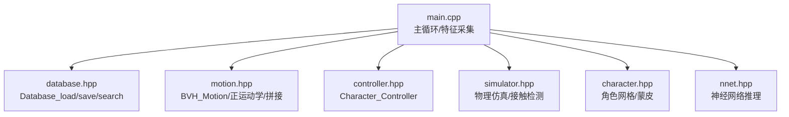
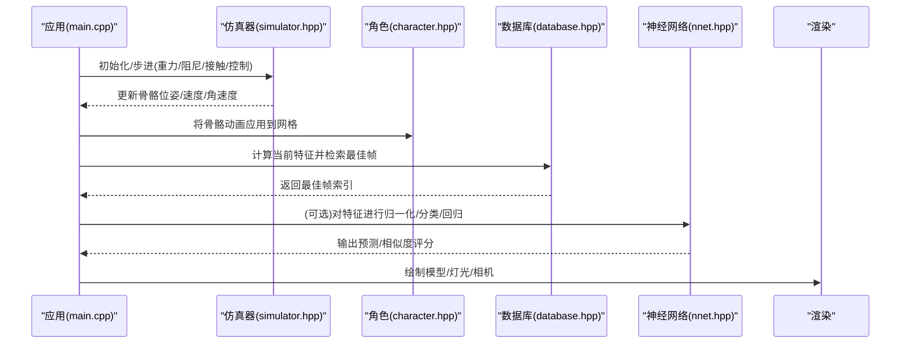
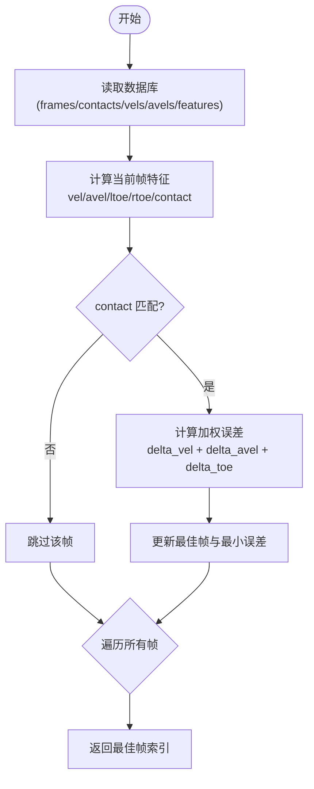
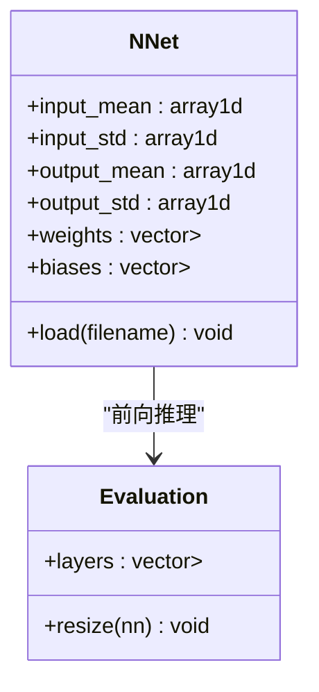
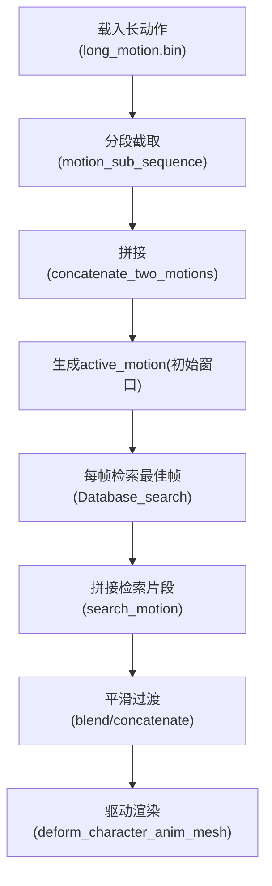
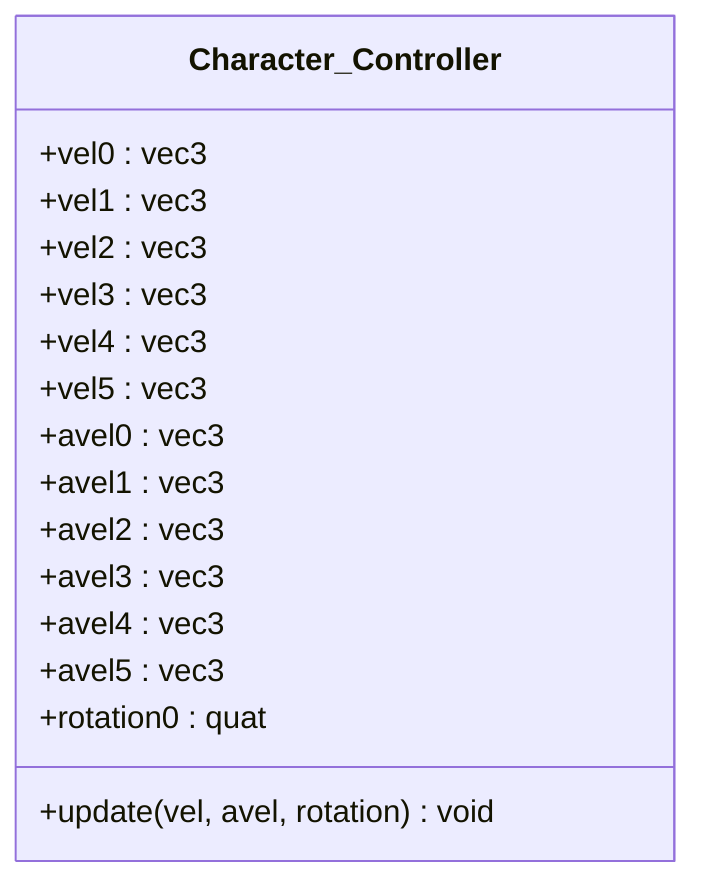
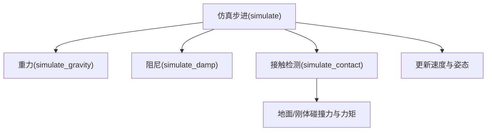
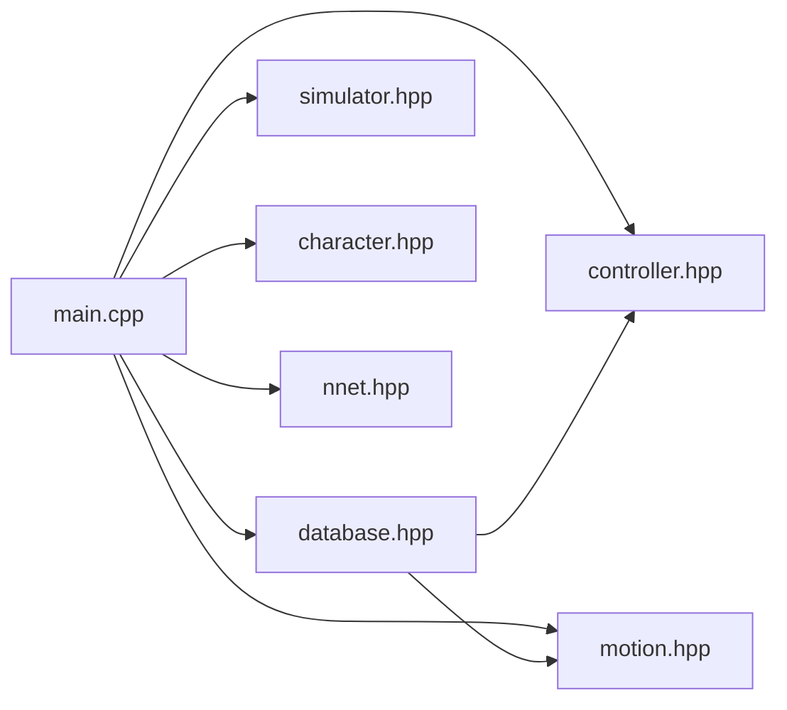
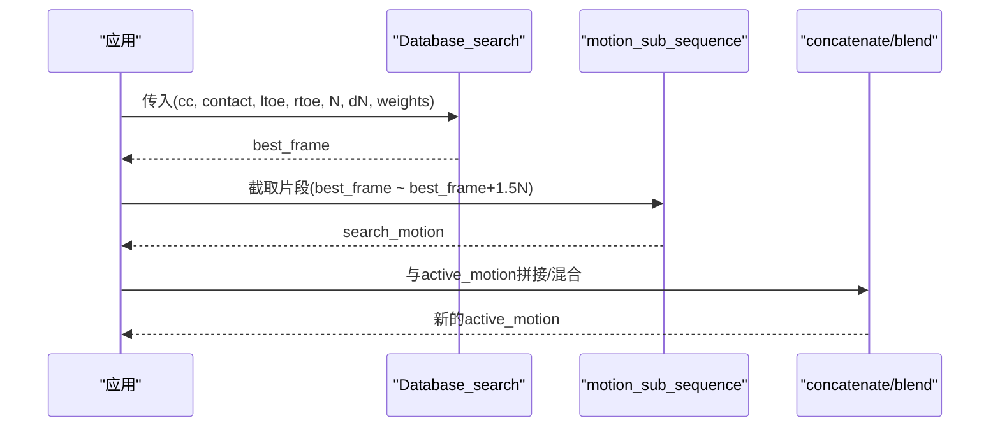
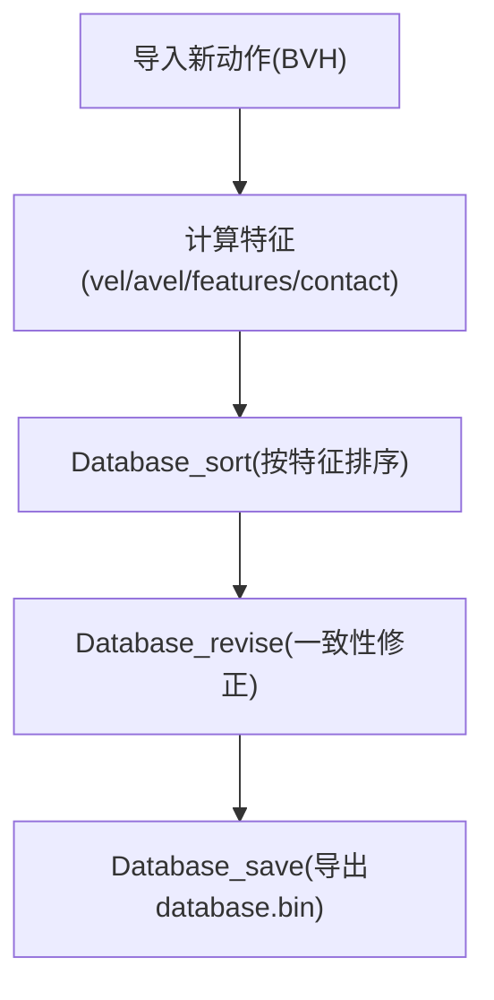

# 数据库系统

> **版本提示（2.0）**：本文撰写于 1.x 时期，描述的是旧的实现形态——入口在根目录 `main.cpp`，功能由根目录 `.hpp` 头文件库提供，窗口用 raylib、显示用 OpenCV highgui。2.0 已把这些头文件移到 `Source/Legacy/`，渲染默认走 GPU，窗口与 UI 换成 GLFW + ImGui，`main.cpp` 拆成 `Source/Launch/Private/` 下的 `Main.cpp` 与 `Application`。文中的文件路径、行号与调用链可能已失效，请以根目录的「项目概述」「快速开始」「故障排除」三篇与当前源码为准。

<cite>
**本文引用的文件**   
- [README.md](file://README.md)
- [main.cpp](file://main.cpp)
- [database.hpp](file://database.hpp)
- [nnet.hpp](file://nnet.hpp)
- [motion.hpp](file://motion.hpp)
- [controller.hpp](file://controller.hpp)
- [character.hpp](file://character.hpp)
- [simulator.hpp](file://simulator.hpp)
</cite>

## 目录
1. [简介](#简介)
2. [项目结构](#项目结构)
3. [核心组件](#核心组件)
4. [架构总览](#架构总览)
5. [详细组件分析](#详细组件分析)
6. [依赖关系分析](#依赖关系分析)
7. [性能与实时性优化](#性能与实时性优化)
8. [故障排查指南](#故障排查指南)
9. [结论](#结论)
10. [附录：查询示例与维护流程](#附录查询示例与维护流程)

## 简介
本技术文档围绕 MooLab 的“运动匹配数据库系统”展开，重点说明以下方面：
- 运动特征提取算法：骨骼位置、速度、角速度等特征的量化方法。
- 数据库存储结构与检索机制：动作数据的索引、排序、相似度计算与检索流程。
- 神经网络在运动匹配中的应用：特征归一化/反归一化、前向推理接口（可用于分类或相似度回归）。
- 数据库维护与更新：新动作添加、特征库扩展、权重调参与导出。
- 实际查询示例：根据当前状态检索合适的动作片段。
- 与动画系统的集成方式及实时检索的性能优化策略。

本项目基于 C++ 与 Raylib/OpenCV，参考 Motion Matching 思想实现离线特征构建与在线检索匹配。

**章节来源**
- [README.md:1-22](file://README.md#L1-L22)

## 项目结构
仓库根目录包含渲染、仿真、角色、控制器、运动数据、数据库与神经网络等模块。与数据库系统直接相关的核心文件如下：
- database.hpp：数据库结构、加载/保存、排序、修订与搜索。
- motion.hpp：BVH 动作数据结构、正运动学、动作拼接/混合、平移旋转对齐。
- controller.hpp：Character_Controller 用于维护多时间步的速度/角速度历史。
- nnet.hpp：轻量级神经网络推理框架（层线性、激活、归一化/反归一化）。
- main.cpp：主循环、特征采集、数据库使用入口、与仿真/渲染集成。
- character.hpp：角色网格与骨骼绑定信息。
- simulator.hpp：物理仿真器，提供接触检测、力矩控制等能力。

**图表来源**
- [main.cpp:53-110](file://main.cpp#L53-L110)
- [database.hpp:21-47](file://database.hpp#L21-L47)
- [motion.hpp:37-96](file://motion.hpp#L37-L96)
- [controller.hpp:120-162](file://controller.hpp#L120-L162)
- [simulator.hpp:321-355](file://simulator.hpp#L321-L355)
- [character.hpp:35-66](file://character.hpp#L35-L66)
- [nnet.hpp:8-41](file://nnet.hpp#L8-L41)

**章节来源**
- [main.cpp:53-110](file://main.cpp#L53-L110)

## 核心组件
- Database：存储帧索引、接触标记、多时间步速度与角速度、脚部特征等；提供加载/保存、按特征排序、多步修订与加权相似度搜索。
- BVH_Motion：动作序列的骨骼局部位置/旋转、父子关系；提供批量正运动学、动作拼接/混合、平移旋转对齐。
- Character_Controller：维护最近若干时间步的局部速度与角速度历史，供匹配时比较。
- nnet：轻量神经网络推理，支持输入/输出归一化、线性层、ELU/ReLU 激活，以及四元数编解码。
- Simulator：物理仿真，提供重力、阻尼、碰撞检测、全局/局部力矩控制，为特征计算与交互提供基础。
- Character：角色网格与蒙皮权重，用于将骨骼动画映射到顶点。

**章节来源**
- [database.hpp:7-19](file://database.hpp#L7-L19)
- [motion.hpp:37-96](file://motion.hpp#L37-L96)
- [controller.hpp:120-162](file://controller.hpp#L120-L162)
- [nnet.hpp:8-41](file://nnet.hpp#L8-L41)
- [simulator.hpp:321-355](file://simulator.hpp#L321-L355)
- [character.hpp:35-66](file://character.hpp#L35-L66)

## 架构总览
下图展示数据库系统与动画/仿真/神经网络的协作关系：主循环负责采集当前帧的运动特征，调用数据库检索最相似的动作片段，再与当前活动片段进行平滑过渡，最终驱动渲染。

**图表来源**
- [main.cpp:295-345](file://main.cpp#L295-L345)
- [database.hpp:74-127](file://database.hpp#L74-L127)
- [nnet.hpp:127-155](file://nnet.hpp#L127-L155)

## 详细组件分析

### 数据库结构与特征提取
- 数据结构
  - frames：有效帧索引数组。
  - contacts：每帧的接触标记（例如左右脚切换）。
  - vels：每帧的多时间步线速度（含当前帧与未来若干步），维度为 [Nframes, 6]。
  - avels：每帧的多时间步角速度（Y轴为主），维度为 [Nframes, 6]。
  - features：脚部相关特征（左/右脚相对位置、速度等），维度为 [Nframes, 4]。
- 特征量化方法
  - 线速度：通过相邻帧根节点位移差除以时间间隔得到，并在多个未来时间步上采样（dN 步进）。
  - 角速度：通过相邻帧根节点四元数差转换为角速度，同样在多时间步上采样。
  - 脚部特征：左右脚相对于根节点的局部位置与速度，用于抑制滑步与增强落地稳定性。
- 数据库操作
  - Database_load/Database_save：二进制读写。
  - Database_sort：按外部特征矩阵重排数据库中的特征列。
  - Database_revise：基于多时间步速度/角速度进行一致性修正。
  - Database_search：加权相似度搜索，考虑速度误差、角速度误差与脚部特征误差。

**图表来源**
- [database.hpp:21-47](file://database.hpp#L21-L47)
- [database.hpp:62-72](file://database.hpp#L62-L72)
- [database.hpp:74-127](file://database.hpp#L74-L127)

**章节来源**
- [database.hpp:7-19](file://database.hpp#L7-L19)
- [database.hpp:21-47](file://database.hpp#L21-L47)
- [database.hpp:49-72](file://database.hpp#L49-L72)
- [database.hpp:74-127](file://database.hpp#L74-L127)

### 神经网络在运动匹配中的应用
- 网络结构
  - 支持多层全连接网络，权重与偏置以二维/一维数组存储。
  - 输入/输出均值与标准差用于归一化/反归一化。
- 推理流程
  - 输入层归一化 -> 线性层 -> ELU/ReLU 激活（最后一层不激活）-> 输出反归一化。
  - 提供 float 向量与 quat 四元数的编解码接口，便于姿态类特征处理。
- 在匹配中的作用
  - 可对高维特征进行降维/分类，或将相似度作为回归目标输出。
  - 可与数据库检索结果融合，提升鲁棒性与泛化能力。

**图表来源**
- [nnet.hpp:8-41](file://nnet.hpp#L8-L41)
- [nnet.hpp:110-155](file://nnet.hpp#L110-L155)
- [nnet.hpp:157-233](file://nnet.hpp#L157-L233)

**章节来源**
- [nnet.hpp:8-41](file://nnet.hpp#L8-L41)
- [nnet.hpp:45-107](file://nnet.hpp#L45-L107)
- [nnet.hpp:127-155](file://nnet.hpp#L127-L155)
- [nnet.hpp:157-233](file://nnet.hpp#L157-L233)

### 动作数据处理与动画系统集成
- 动作数据结构
  - BVH_Motion 包含骨骼 ID、局部位置/旋转、父节点索引。
- 正运动学
  - batch_forward_kinematics_full/part/root：从局部空间到世界空间的批量 FK。
- 动作拼接与混合
  - concatenate_two_motions：两段动作在衔接处进行插值混合。
  - blend_two_motions：按 alpha 曲线对两动作进行逐帧插值。
  - translation_and_rotation：对动作进行平移与朝向对齐。
- 与数据库/仿真的集成
  - 主循环中先使用动作数据驱动一段时间，随后切换到仿真结果，保证稳定性。
  - 数据库检索到的最佳帧片段可被拼接进 active_motion，形成连续播放。

**图表来源**
- [main.cpp:78-94](file://main.cpp#L78-L94)
- [motion.hpp:98-120](file://motion.hpp#L98-L120)
- [motion.hpp:213-264](file://motion.hpp#L213-L264)
- [motion.hpp:266-291](file://motion.hpp#L266-L291)
- [motion.hpp:332-377](file://motion.hpp#L332-L377)

**章节来源**
- [motion.hpp:37-96](file://motion.hpp#L37-L96)
- [motion.hpp:122-198](file://motion.hpp#L122-L198)
- [motion.hpp:213-264](file://motion.hpp#L213-L264)
- [motion.hpp:266-291](file://motion.hpp#L266-L291)
- [motion.hpp:332-377](file://motion.hpp#L332-L377)
- [main.cpp:78-94](file://main.cpp#L78-L94)

### 控制器与特征历史
- Character_Controller 维护 vel0..vel5 与 avel0..avel5 的历史，并通过 update 函数以不同权重组合生成多时间步特征，使匹配更稳健。
- 主循环中将手柄输入转换为全局/局部速度与角速度，并传入控制器更新。

**图表来源**
- [controller.hpp:120-162](file://controller.hpp#L120-L162)

**章节来源**
- [controller.hpp:120-162](file://controller.hpp#L120-L162)
- [main.cpp:224-234](file://main.cpp#L224-L234)

### 物理仿真与接触检测
- 仿真器提供重力、阻尼、刚体间与地面碰撞检测，以及全局/局部力矩控制。
- 接触检测结果影响 contact 标记与脚部锁定逻辑，从而改善匹配质量。

**图表来源**
- [simulator.hpp:357-372](file://simulator.hpp#L357-L372)
- [simulator.hpp:374-435](file://simulator.hpp#L374-L435)
- [simulator.hpp:543-624](file://simulator.hpp#L543-L624)

**章节来源**
- [simulator.hpp:321-355](file://simulator.hpp#L321-L355)
- [simulator.hpp:357-435](file://simulator.hpp#L357-L435)
- [simulator.hpp:543-624](file://simulator.hpp#L543-L624)

## 依赖关系分析
- 模块耦合
  - main.cpp 依赖 database/motion/controller/simulator/character/nnet。
  - database.hpp 依赖 controller.hpp 与 motion.hpp。
  - motion.hpp 依赖 quat/array/spring 等基础数学与工具。
  - nnet.hpp 依赖 array/global 等基础类型。
- 外部依赖
  - Raylib：窗口与输入。
  - OpenCV：图像显示与 UI 滑块。
  - vcpkg：依赖管理。

**图表来源**
- [main.cpp:8-17](file://main.cpp#L8-L17)
- [database.hpp:4-5](file://database.hpp#L4-L5)

**章节来源**
- [main.cpp:8-17](file://main.cpp#L8-L17)
- [database.hpp:4-5](file://database.hpp#L4-L5)

## 性能与实时性优化
- 特征预计算与缓存
  - 将多时间步速度与角速度、脚部特征预先写入 database.bin，避免运行时重复计算。
- 检索优化
  - 仅对满足 contact 条件的帧进行评分，减少无效计算。
  - 调整权重 weight_vel/weight_avel/weight_toe 平衡匹配精度与稳定性。
- 并行与向量化
  - 仿真器内部使用 OpenMP 加速矩阵运算（如矩阵乘法）。
- 渲染管线
  - 采用一次渲染路径，避免延迟渲染开销。
- 建议
  - 对大规模动作库引入空间索引（如 KD-tree）或近似最近邻（ANN）加速检索。
  - 将神经网络用于特征降维或相似度打分，降低直接欧氏距离的噪声。
  - 对 Database_search 增加早停或分桶筛选，减少全表扫描。

[本节为通用指导，不直接分析具体文件]

## 故障排查指南
- 数据库加载失败
  - 检查 database.bin 是否存在且格式正确；确保文件路径与工作目录一致。
- 检索结果异常
  - 检查 contact 标记是否正确；确认 ltoe/rtoe 特征是否合理。
  - 调整权重参数（UI 滑块）观察效果变化。
- 滑步或抖动
  - 启用脚部锁定（IK_two_bones）或提高 toe 权重。
  - 检查仿真接触检测参数（地面平面方程与阻尼系数）。
- 神经网络推理错误
  - 确认输入/输出尺寸与网络定义一致；检查归一化参数是否与训练集一致。

**章节来源**
- [database.hpp:21-47](file://database.hpp#L21-L47)
- [database.hpp:74-127](file://database.hpp#L74-L127)
- [main.cpp:214-218](file://main.cpp#L214-L218)
- [simulator.hpp:374-435](file://simulator.hpp#L374-L435)
- [nnet.hpp:157-233](file://nnet.hpp#L157-L233)

## 结论
MooLab 的数据库系统以离线特征构建与在线检索为核心，结合物理仿真与动画系统，实现了稳定的运动匹配。通过多时间步速度与角速度、脚部特征与接触标记的综合评估，系统在复杂交互下仍能保持较好的连贯性与稳定性。神经网络模块提供了可扩展的特征处理能力，便于后续引入更复杂的分类或回归任务。

[本节为总结性内容，不直接分析具体文件]

## 附录：查询示例与维护流程

### 实际数据库查询示例
- 步骤
  1. 在主循环中计算当前帧的局部速度/角速度、左右脚相对位置与接触标记。
  2. 调用 Database_search(db, cc, contact, ltoe, rtoe, N=50, dN=10, weight_vel, weight_avel, weight_toe)。
  3. 获取 best_frame，截取 search_motion = motion_sub_sequence(motion, best_frame, best_frame + 1.5*N)。
  4. 将 search_motion 与 active_motion 进行拼接/混合，形成新的活动片段。
- 关键参数
  - N：检索窗口长度（帧数）。
  - dN：多时间步采样步长。
  - weight_vel/weight_avel/weight_toe：各分量权重，可通过 UI 滑块调节。

**图表来源**
- [database.hpp:74-127](file://database.hpp#L74-L127)
- [motion.hpp:98-120](file://motion.hpp#L98-L120)
- [motion.hpp:332-377](file://motion.hpp#L332-L377)
- [main.cpp:250-290](file://main.cpp#L250-L290)

**章节来源**
- [database.hpp:74-127](file://database.hpp#L74-L127)
- [motion.hpp:98-120](file://motion.hpp#L98-L120)
- [motion.hpp:332-377](file://motion.hpp#L332-L377)
- [main.cpp:250-290](file://main.cpp#L250-L290)

### 数据库维护与更新指南
- 新增动作
  1. 准备新的 BVH 动作文件，载入并截取所需片段。
  2. 计算多时间步速度与角速度、脚部特征与接触标记。
  3. 使用 Database_sort 按特征排序，必要时调用 Database_revise 进行一致性修正。
  4. 调用 Database_save 导出 database.bin。
- 特征库扩展
  - 若需新增特征维度，修改 Database.features 列数，并同步更新 Database_search 的误差计算。
- 权重调参
  - 通过 UI 滑块调整 weight_vel/weight_avel/weight_toe，观察匹配效果并记录最优参数。

**图表来源**
- [database.hpp:49-72](file://database.hpp#L49-L72)
- [database.hpp:35-47](file://database.hpp#L35-L47)
- [main.cpp:567-610](file://main.cpp#L567-L610)

**章节来源**
- [database.hpp:49-72](file://database.hpp#L49-L72)
- [database.hpp:35-47](file://database.hpp#L35-L47)
- [main.cpp:567-610](file://main.cpp#L567-L610)