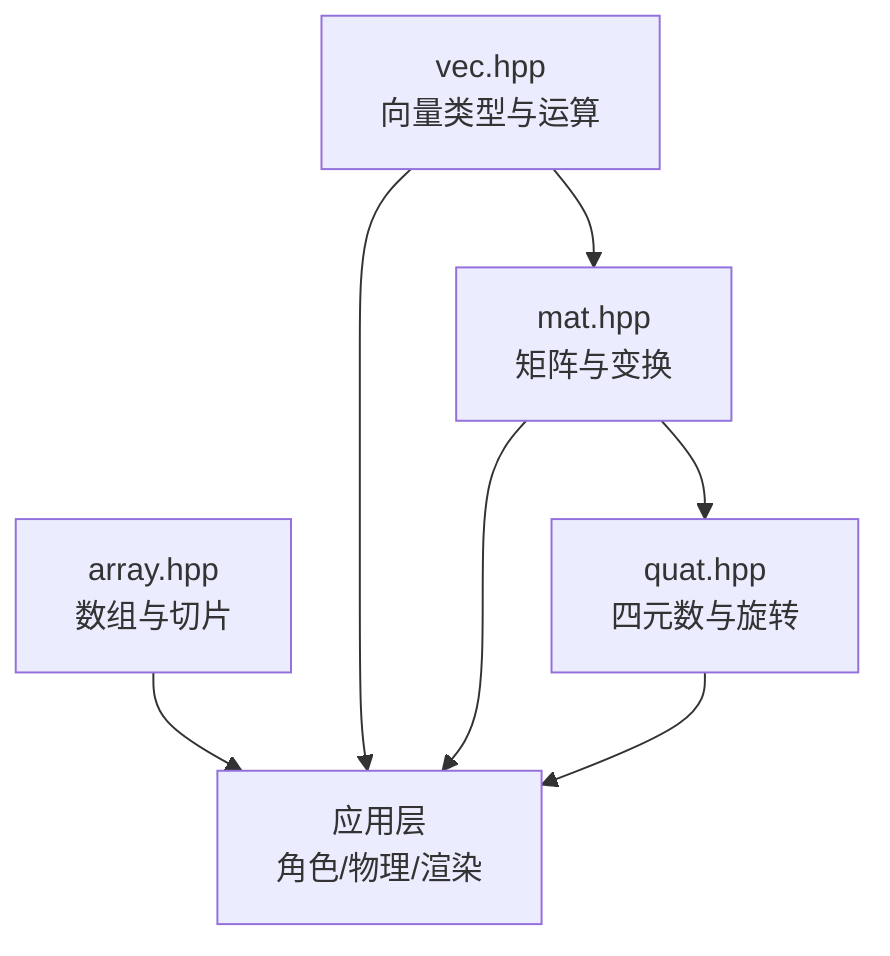
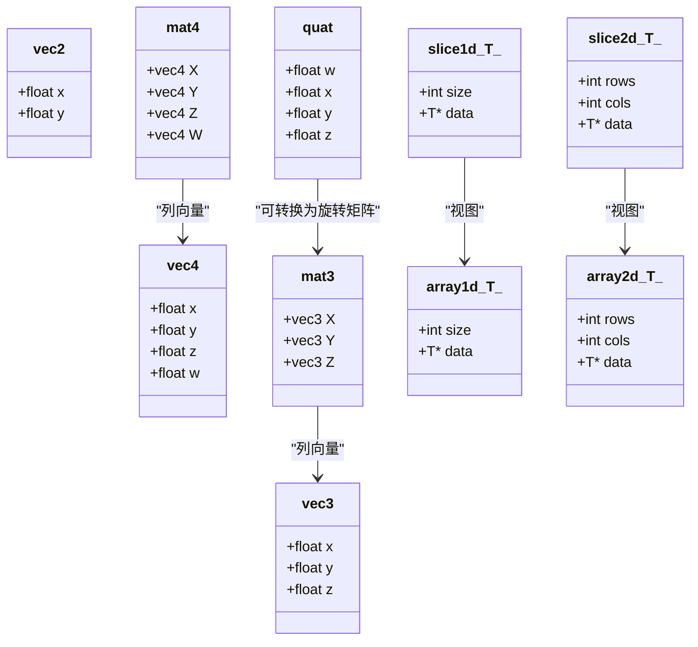
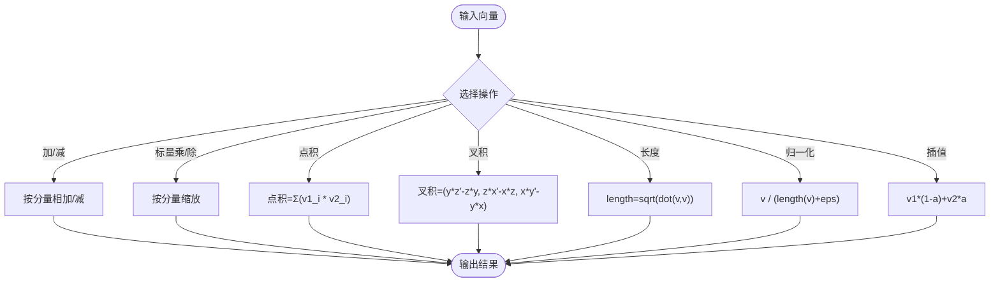
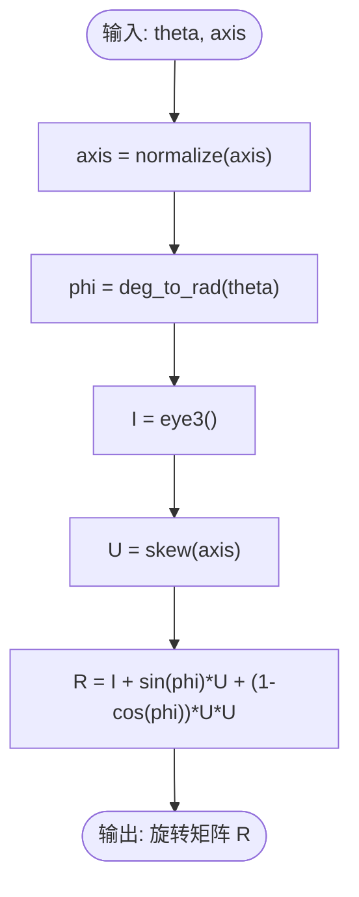
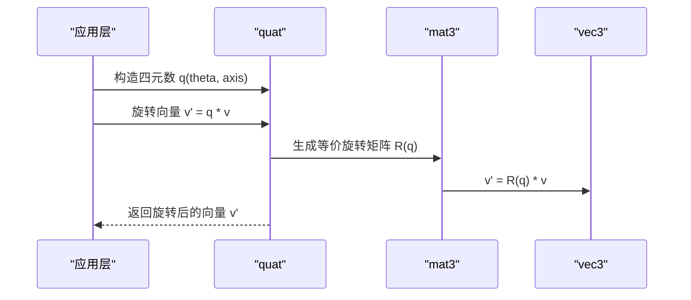
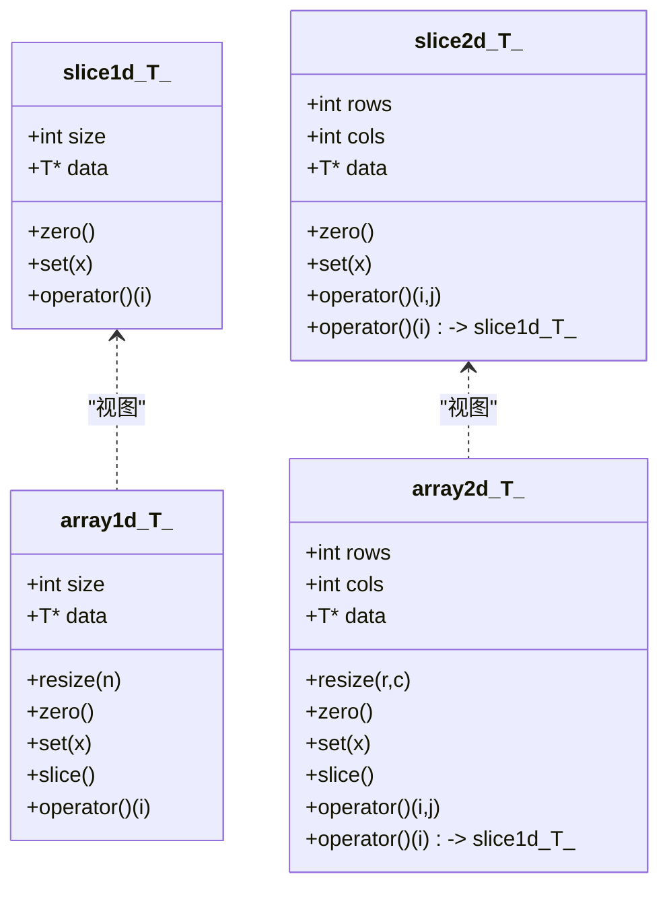
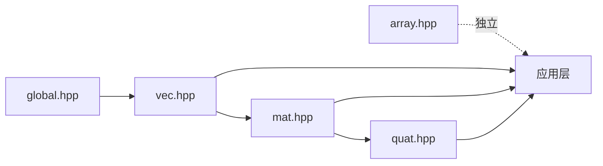

# 数学基础

> **版本提示（2.0）**：本文撰写于 1.x 时期，描述的是旧的实现形态——入口在根目录 `main.cpp`，功能由根目录 `.hpp` 头文件库提供，窗口用 raylib、显示用 OpenCV highgui。2.0 已把这些头文件移到 `Source/Legacy/`，渲染默认走 GPU，窗口与 UI 换成 GLFW + ImGui，`main.cpp` 拆成 `Source/Launch/Private/` 下的 `Main.cpp` 与 `Application`。文中的文件路径、行号与调用链可能已失效，请以根目录的「项目概述」「快速开始」「故障排除」三篇与当前源码为准。

<cite>
**本文引用的文件**   
- [vec.hpp](file://vec.hpp)
- [mat.hpp](file://mat.hpp)
- [quat.hpp](file://quat.hpp)
- [array.hpp](file://array.hpp)
- [README.md](file://README.md)
</cite>

## 目录
1. [简介](#简介)
2. [项目结构](#项目结构)
3. [核心组件](#核心组件)
4. [架构总览](#架构总览)
5. [详细组件分析](#详细组件分析)
6. [依赖关系分析](#依赖关系分析)
7. [性能与数值稳定性](#性能与数值稳定性)
8. [故障排查指南](#故障排查指南)
9. [结论](#结论)
10. [附录：在角色动画与物理仿真中的应用示例](#附录在角色动画与物理仿真中的应用示例)

## 简介
本文件面向MooLab项目的底层数学库，系统性梳理向量、矩阵、四元数与数组数据结构的设计与实现，帮助开发者理解其在角色动画与物理仿真中的使用方式。内容涵盖：
- 向量运算（vec.hpp）：vec2/vec3/vec4的定义与常用操作（加减、缩放、点积、叉积、归一化、插值等）
- 矩阵变换（mat.hpp）：3x3与4x4矩阵的构造、乘法、转置、求逆、坐标系构建、相机投影与刚体运动矩阵
- 四元数（quat.hpp）：旋转表示、四元数乘积、球面线性插值、与欧拉角互转、角速度与角位移转换
- 数组数据结构（array.hpp）：一维/二维动态数组与切片视图，便于高效存储与访问

## 项目结构
本项目为C++工程，核心数学工具以头文件形式提供，便于跨模块复用。关键文件如下：
- vec.hpp：向量类型与运算
- mat.hpp：3x3/4x4矩阵与几何变换
- quat.hpp：四元数与旋转相关工具
- array.hpp：通用数组与切片视图
- README.md：项目说明与构建指引

图表来源
- [vec.hpp:1-295](file://vec.hpp#L1-L295)
- [mat.hpp:1-215](file://mat.hpp#L1-L215)
- [quat.hpp:1-229](file://quat.hpp#L1-L229)
- [array.hpp:1-220](file://array.hpp#L1-L220)

章节来源
- [README.md:1-22](file://README.md#L1-L22)

## 核心组件
- 向量（vec2/vec3/vec4）：提供基本算术、点积、叉积、长度、归一化、插值、坐标转换等函数
- 矩阵（mat3/mat4）：提供单位矩阵、矩阵乘法、转置、行列式、求逆、坐标系构建、相机投影矩阵、刚体运动矩阵
- 四元数（quat）：提供旋转四元数构造、四元数乘法、向量旋转、球面线性插值、与欧拉角互转、角速度/角位移转换、Rodrigues矩阵转换
- 数组（array1d/array2d）：提供动态内存管理、切片视图、读写接口、拼接与子序列提取

章节来源
- [vec.hpp:1-295](file://vec.hpp#L1-L295)
- [mat.hpp:1-215](file://mat.hpp#L1-L215)
- [quat.hpp:1-229](file://quat.hpp#L1-L229)
- [array.hpp:1-220](file://array.hpp#L1-L220)

## 架构总览
数学库采用分层设计：向量作为最基础的数据类型；矩阵由向量列组成；四元数通过矩阵或向量进行旋转计算；数组用于批量数据组织。上层应用（如角色动画、物理仿真、渲染管线）组合这些工具完成具体功能。

图表来源
- [vec.hpp:6-295](file://vec.hpp#L6-L295)
- [mat.hpp:7-157](file://mat.hpp#L7-L157)
- [quat.hpp:6-24](file://quat.hpp#L6-L24)
- [array.hpp:16-43](file://array.hpp#L16-L43)
- [array.hpp:45-88](file://array.hpp#L45-L88)
- [array.hpp:108-156](file://array.hpp#L108-L156)

## 详细组件分析

### 向量（vec.hpp）
- 数据类型
  - vec2：二维浮点向量，包含x/y分量
  - vec3：三维浮点向量，包含x/y/z分量
  - vec4：四维浮点向量，包含x/y/z/w分量，常用于齐次坐标
- 基本运算
  - 加法/减法：按分量相加/相减
  - 标量乘法/除法：对每个分量进行缩放
  - 点积：返回标量，用于角度、投影、能量等计算
  - 叉积（仅vec3）：返回垂直于两向量的新向量，用于法线、扭矩等
  - 长度与归一化：length计算模长，normalize返回单位向量并加入极小epsilon避免除零
  - 插值lerp：线性插值，常用于动画过渡
  - 其他：clampv/powv/mix/dir_to_sph/sph_to_dir/vel_to_vec等辅助函数
- 复杂度
  - 所有运算均为O(1)，适合高频调用场景

图表来源
- [vec.hpp:20-73](file://vec.hpp#L20-L73)
- [vec.hpp:94-179](file://vec.hpp#L94-L179)
- [vec.hpp:240-293](file://vec.hpp#L240-L293)

章节来源
- [vec.hpp:1-295](file://vec.hpp#L1-L295)

### 矩阵（mat.hpp）
- 数据类型
  - mat3：由三个vec3列向量X/Y/Z构成，表示线性变换
  - mat4：由四个vec4列向量X/Y/Z/W构成，支持仿射变换与透视投影
- 基本运算
  - 单位矩阵eye3/eye4
  - 矩阵加法/减法、标量乘除
  - 矩阵-向量乘法：将向量从局部空间变换到世界空间或反之
  - 矩阵-矩阵乘法：组合多个变换
  - 转置trans_mat、行列式determine、求逆inv_mat
  - 坐标系构建get_coordinate_matrix：基于给定Z轴与Y轴构建正交基
  - 相机投影矩阵get_camera_projection_matrix及其逆矩阵
  - 刚体运动矩阵get_rigid_body_motion_matrix与逆变换
- 旋转与Rodrigues公式
  - Rodrigues(theta, axis)：根据旋转轴与角度生成旋转矩阵
  - 与四元数相互转换：quat_to_Rodrigues

图表来源
- [mat.hpp:77-85](file://mat.hpp#L77-L85)

章节来源
- [mat.hpp:1-215](file://mat.hpp#L1-L215)

### 四元数（quat.hpp）
- 数据类型
  - quat：w/x/y/z分量，默认单位四元数
- 构造与运算
  - 从轴角构造：quat(theta, axis)
  - 四元数加法、标量乘、四元数乘法（非交换）
  - 向量旋转：q * v，内部通过等价旋转矩阵实现
  - 点积、共轭/逆inv_quat
  - 球面线性插值slerp：保证最短路径与匀速旋转
  - 与欧拉角互转：euler_YXZ_to_quat / quat_to_euler_YXZ
  - 角速度与角位移：avel_to_quat / quat_to_avel
  - 向量到四元数：vec_to_quat(v1, v2)
  - 与Rodrigues矩阵转换：quat_to_Rodrigues
- 数值处理
  - acos参数钳制到[-1,1]
  - 接近单位四元数的快速路径（避免奇异）

图表来源
- [quat.hpp:10-24](file://quat.hpp#L10-L24)
- [quat.hpp:66-81](file://quat.hpp#L66-L81)
- [mat.hpp:77-85](file://mat.hpp#L77-L85)

章节来源
- [quat.hpp:1-229](file://quat.hpp#L1-L229)

### 数组数据结构（array.hpp）
- 切片视图
  - slice1d<T>/slice2d<T>：轻量级视图，指向连续内存块，支持zero/set与索引访问
- 动态数组
  - array1d<T>/array2d<T>：封装malloc/realloc/free，提供resize、zero/set、slice、读写接口
  - 二维数组行/列设置与子序列拼接、截取
- 适用场景
  - 批量轨迹数据、骨骼姿态、物理状态快照等

图表来源
- [array.hpp:16-43](file://array.hpp#L16-L43)
- [array.hpp:45-88](file://array.hpp#L45-L88)
- [array.hpp:108-156](file://array.hpp#L108-L156)

章节来源
- [array.hpp:1-220](file://array.hpp#L1-L220)

## 依赖关系分析
- vec.hpp：不依赖其他自定义头文件（仅依赖全局工具global.hpp）
- mat.hpp：依赖vec.hpp与global.hpp
- quat.hpp：依赖mat.hpp（间接依赖vec.hpp）
- array.hpp：独立模板库，不依赖数学类型

图表来源
- [vec.hpp:1-4](file://vec.hpp#L1-L4)
- [mat.hpp:1-5](file://mat.hpp#L1-L5)
- [quat.hpp:1-4](file://quat.hpp#L1-L4)
- [array.hpp:1-6](file://array.hpp#L1-L6)

章节来源
- [vec.hpp:1-295](file://vec.hpp#L1-L295)
- [mat.hpp:1-215](file://mat.hpp#L1-L215)
- [quat.hpp:1-229](file://quat.hpp#L1-L229)
- [array.hpp:1-220](file://array.hpp#L1-L220)

## 性能与数值稳定性
- 性能
  - 向量/矩阵/四元数运算均为O(1)，适合实时循环
  - 使用inline函数减少调用开销
  - 数组通过连续内存布局提升缓存友好性
- 数值稳定性
  - 归一化与反三角函数均引入epsilon或钳制，避免除零与定义域错误
  - 矩阵求逆前检查行列式阈值，退化时回退原矩阵
  - 四元数插值与角速度计算考虑接近单位四元数的快速路径

章节来源
- [vec.hpp:65-68](file://vec.hpp#L65-L68)
- [vec.hpp:152-155](file://vec.hpp#L152-L155)
- [vec.hpp:280-283](file://vec.hpp#L280-L283)
- [mat.hpp:111-136](file://mat.hpp#L111-L136)
- [quat.hpp:155-180](file://quat.hpp#L155-L180)
- [quat.hpp:182-210](file://quat.hpp#L182-L210)

## 故障排查指南
- 向量归一化异常
  - 现象：长度接近0导致NaN或Inf
  - 排查：确认输入是否已钳制或添加epsilon
  - 参考：[vec.hpp:65-68](file://vec.hpp#L65-L68), [vec.hpp:152-155](file://vec.hpp#L152-L155), [vec.hpp:280-283](file://vec.hpp#L280-L283)
- 矩阵求逆失败
  - 现象：行列式过小导致不稳定
  - 排查：检查变换是否退化（如缩放为0），必要时先做正则化
  - 参考：[mat.hpp:111-136](file://mat.hpp#L111-L136)
- 四元数插值抖动
  - 现象：短弧与长弧选择不当导致跳变
  - 排查：确保dot(q1,q2)<0时翻转符号，使用slerp
  - 参考：[quat.hpp:155-180](file://quat.hpp#L155-L180)
- 数组越界
  - 现象：assert失败或崩溃
  - 排查：检查索引范围与size/rows/cols一致性
  - 参考：[array.hpp:27-28](file://array.hpp#L27-L28), [array.hpp:41-43](file://array.hpp#L41-L43), [array.hpp:60-61](file://array.hpp#L60-L61), [array.hpp:121-123](file://array.hpp#L121-L123)

章节来源
- [vec.hpp:65-68](file://vec.hpp#L65-L68)
- [vec.hpp:152-155](file://vec.hpp#L152-L155)
- [vec.hpp:280-283](file://vec.hpp#L280-L283)
- [mat.hpp:111-136](file://mat.hpp#L111-L136)
- [quat.hpp:155-180](file://quat.hpp#L155-L180)
- [array.hpp:27-28](file://array.hpp#L27-L28)
- [array.hpp:41-43](file://array.hpp#L41-L43)
- [array.hpp:60-61](file://array.hpp#L60-L61)
- [array.hpp:121-123](file://array.hpp#L121-L123)

## 结论
MooLab的数学库提供了稳定高效的向量、矩阵、四元数与数组工具，覆盖角色动画与物理仿真所需的核心数学能力。其设计强调：
- 简洁的类型与操作接口
- 数值鲁棒性（epsilon与钳制）
- 高性能（inline与连续内存）
- 可扩展性（模板与视图）

建议在上层应用中优先使用提供的工具函数，避免重复造轮子，并确保在关键路径上进行数值校验与性能测试。

## 附录：在角色动画与物理仿真中的应用示例
以下示例展示如何在角色动画与物理仿真中组合使用上述数学工具。为避免泄露源码，仅提供步骤与对应代码片段路径。

- 角色关节旋转插值
  - 步骤：读取上一帧与当前帧的四元数，使用slerp得到平滑过渡
  - 参考：[quat.hpp:155-180](file://quat.hpp#L155-L180)
- 从欧拉角生成四元数
  - 步骤：将YXZ顺序的欧拉角转换为四元数，再用于骨骼旋转
  - 参考：[quat.hpp:134-140](file://quat.hpp#L134-L140)
- 将四元数转换为旋转矩阵
  - 步骤：quat_to_Rodrigues得到mat3，用于顶点变换或碰撞法线更新
  - 参考：[quat.hpp:221-226](file://quat.hpp#L221-L226), [mat.hpp:77-85](file://mat.hpp#L77-L85)
- 刚体运动矩阵构建
  - 步骤：使用orientation与position构建mat4，应用于质心位置与姿态同步
  - 参考：[mat.hpp:186-194](file://mat.hpp#L186-L194)
- 相机投影与视锥裁剪
  - 步骤：根据near/far/r/t构建投影矩阵，并在渲染前进行裁剪
  - 参考：[mat.hpp:196-212](file://mat.hpp#L196-L212)
- 批量姿态数据存储
  - 步骤：使用array2d<T>存储多帧骨骼姿态，配合slice2d进行批次处理
  - 参考：[array.hpp:108-156](file://array.hpp#L108-L156), [array.hpp:16-43](file://array.hpp#L16-L43)

章节来源
- [quat.hpp:134-140](file://quat.hpp#L134-L140)
- [quat.hpp:155-180](file://quat.hpp#L155-L180)
- [quat.hpp:221-226](file://quat.hpp#L221-L226)
- [mat.hpp:77-85](file://mat.hpp#L77-L85)
- [mat.hpp:186-212](file://mat.hpp#L186-L212)
- [array.hpp:16-43](file://array.hpp#L16-L43)
- [array.hpp:108-156](file://array.hpp#L108-L156)