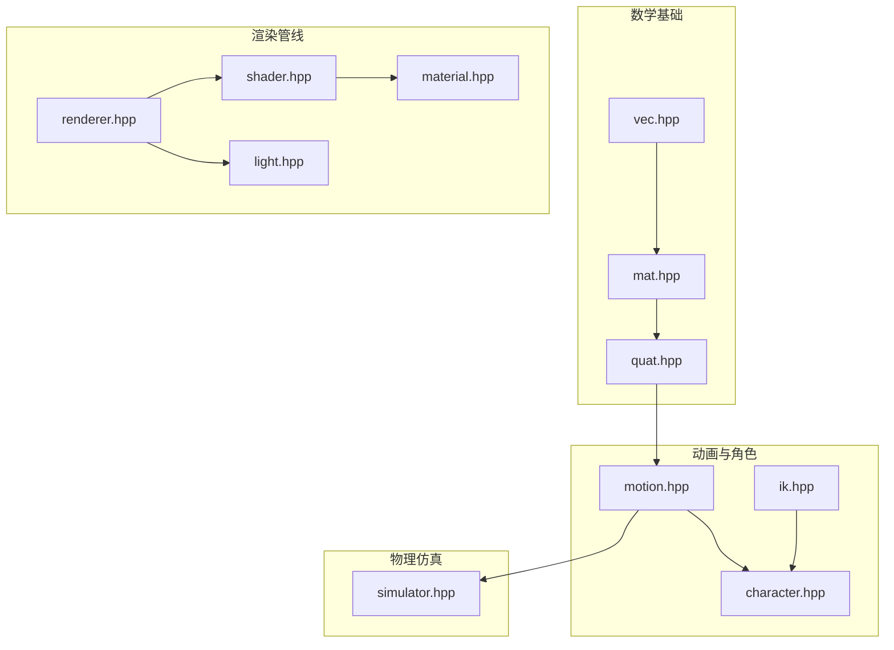
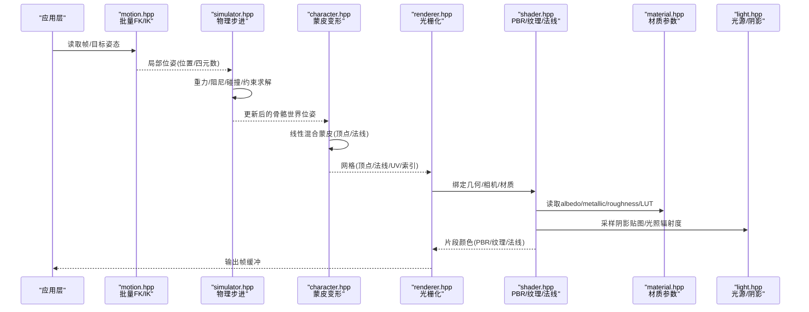
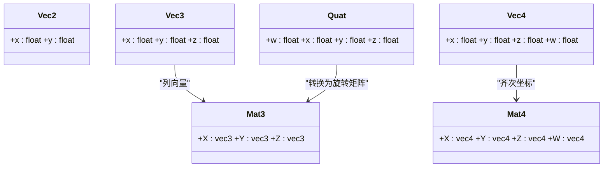
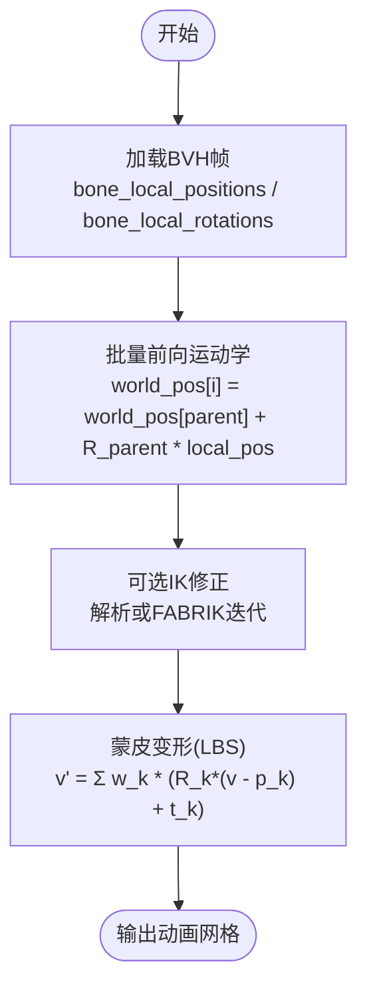
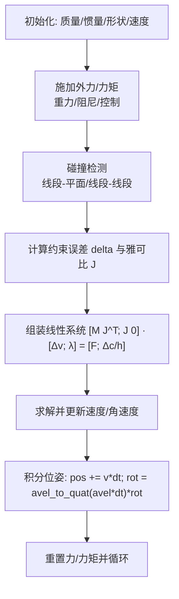
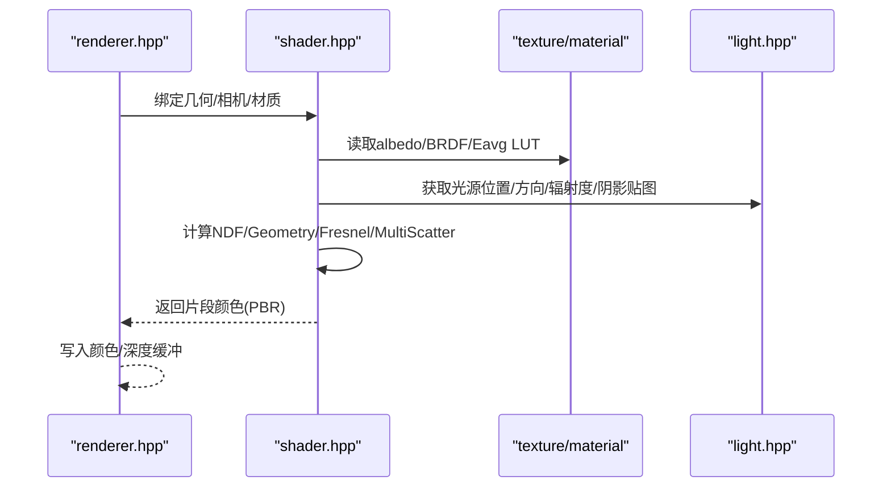
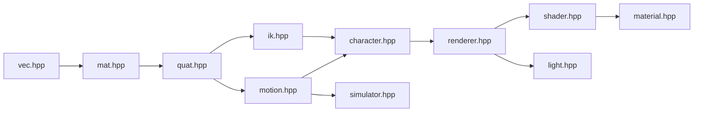

# 核心概念

> **版本提示（2.0）**：本文撰写于 1.x 时期，描述的是旧的实现形态——入口在根目录 `main.cpp`，功能由根目录 `.hpp` 头文件库提供，窗口用 raylib、显示用 OpenCV highgui。2.0 已把这些头文件移到 `Source/Legacy/`，渲染默认走 GPU，窗口与 UI 换成 GLFW + ImGui，`main.cpp` 拆成 `Source/Launch/Private/` 下的 `Main.cpp` 与 `Application`。文中的文件路径、行号与调用链可能已失效，请以根目录的「项目概述」「快速开始」「故障排除」三篇与当前源码为准。

<cite>
**本文引用的文件**   
- [README.md](file://README.md)
- [vec.hpp](file://vec.hpp)
- [mat.hpp](file://mat.hpp)
- [quat.hpp](file://quat.hpp)
- [motion.hpp](file://motion.hpp)
- [ik.hpp](file://ik.hpp)
- [character.hpp](file://character.hpp)
- [simulator.hpp](file://simulator.hpp)
- [renderer.hpp](file://renderer.hpp)
- [shader.hpp](file://shader.hpp)
- [material.hpp](file://material.hpp)
- [light.hpp](file://light.hpp)
</cite>

## 目录
1. [引言](#引言)
2. [项目结构](#项目结构)
3. [核心组件](#核心组件)
4. [架构总览](#架构总览)
5. [详细组件分析](#详细组件分析)
6. [依赖关系分析](#依赖关系分析)
7. [性能与优化](#性能与优化)
8. [故障排查指南](#故障排查指南)
9. [结论](#结论)

## 引言
本文件面向MooLab项目的底层数学与图形学基础，系统性梳理角色动画、物理仿真与渲染管线中的关键概念与实现。内容覆盖：
- 线性代数基础：向量、矩阵、四元数及其在动画与物理中的应用
- 角色动画：前向运动学、骨骼层级、蒙皮变形（线性混合）
- 物理仿真：刚体动力学、碰撞检测、约束求解
- 图形学：PBR材质模型、光照计算、阴影映射与光栅化流程
文档以“从概念到代码”的方式组织，配合图示帮助读者建立直观理解。

## 项目结构
MooLab采用模块化头文件组织，核心模块包括：
- 数学基础：vec.hpp、mat.hpp、quat.hpp
- 动画与IK：motion.hpp、ik.hpp、character.hpp
- 物理仿真：simulator.hpp
- 渲染管线：renderer.hpp、shader.hpp、material.hpp、light.hpp
- 入口与说明：main.cpp、README.md

图表来源
- [vec.hpp:1-295](file://vec.hpp#L1-L295)
- [mat.hpp:1-215](file://mat.hpp#L1-L215)
- [quat.hpp:1-229](file://quat.hpp#L1-L229)
- [motion.hpp:1-379](file://motion.hpp#L1-L379)
- [ik.hpp:1-422](file://ik.hpp#L1-L422)
- [character.hpp:1-166](file://character.hpp#L1-L166)
- [simulator.hpp:1-933](file://simulator.hpp#L1-L933)
- [renderer.hpp:1-429](file://renderer.hpp#L1-L429)
- [shader.hpp:1-255](file://shader.hpp#L1-L255)
- [material.hpp:1-32](file://material.hpp#L1-L32)
- [light.hpp:1-43](file://light.hpp#L1-L43)

章节来源
- [README.md:1-22](file://README.md#L1-L22)

## 核心组件
- 向量/矩阵/四元数：提供基础运算、坐标变换、旋转表示与插值
- 动画系统：BVH数据、批量前向运动学、IK（解析与FABRIK）、蒙皮线性混合
- 物理仿真：重力/阻尼、碰撞检测（线段-平面、线段-线段）、约束求解（拉格朗日乘子法）
- 渲染管线：几何绑定、光栅化、PBR着色器、阴影贴图、材质参数

章节来源
- [vec.hpp:1-295](file://vec.hpp#L1-L295)
- [mat.hpp:1-215](file://mat.hpp#L1-L215)
- [quat.hpp:1-229](file://quat.hpp#L1-L229)
- [motion.hpp:1-379](file://motion.hpp#L1-L379)
- [ik.hpp:1-422](file://ik.hpp#L1-L422)
- [character.hpp:1-166](file://character.hpp#L1-L166)
- [simulator.hpp:1-933](file://simulator.hpp#L1-L933)
- [renderer.hpp:1-429](file://renderer.hpp#L1-L429)
- [shader.hpp:1-255](file://shader.hpp#L1-L255)
- [material.hpp:1-32](file://material.hpp#L1-L32)
- [light.hpp:1-43](file://light.hpp#L1-L43)

## 架构总览
下图展示从输入动画到最终像素输出的完整流程：

图表来源
- [motion.hpp:122-182](file://motion.hpp#L122-L182)
- [simulator.hpp:357-624](file://simulator.hpp#L357-L624)
- [character.hpp:68-164](file://character.hpp#L68-L164)
- [renderer.hpp:121-239](file://renderer.hpp#L121-L239)
- [shader.hpp:199-237](file://shader.hpp#L199-L237)
- [material.hpp:15-30](file://material.hpp#L15-L30)
- [light.hpp:16-33](file://light.hpp#L16-L33)

## 详细组件分析

### 线性代数基础：向量、矩阵、四元数
- 向量运算：加减、点积、叉积、归一化、球面坐标转换、速度/位移互转
- 矩阵运算：3x3/4x4基本运算、行列式、逆矩阵、坐标系构建、Rodrigues公式、相机投影矩阵
- 四元数：构造（轴角）、乘法、共轭/逆、欧拉角转换、球面插值slerp、角速度互转、向量到四元数、四元数到旋转矩阵

图表来源
- [vec.hpp:6-295](file://vec.hpp#L6-L295)
- [mat.hpp:7-215](file://mat.hpp#L7-L215)
- [quat.hpp:6-229](file://quat.hpp#L6-L229)

章节来源
- [vec.hpp:1-295](file://vec.hpp#L1-L295)
- [mat.hpp:1-215](file://mat.hpp#L1-L215)
- [quat.hpp:1-229](file://quat.hpp#L1-L229)

### 角色动画：前向运动学与蒙皮变形
- BVH数据结构：每帧的局部位置与局部旋转、父子关系
- 批量前向运动学：自根节点向下累积世界位姿
- IK：解析解（两骨/三骨）与FABRIK（单端/双端，支持角度约束）
- 蒙皮变形：线性混合（LBS），对顶点位置与法线分别加权组合

图表来源
- [motion.hpp:122-182](file://motion.hpp#L122-L182)
- [ik.hpp:7-103](file://ik.hpp#L7-L103)
- [ik.hpp:105-420](file://ik.hpp#L105-L420)
- [character.hpp:68-121](file://character.hpp#L68-L121)

章节来源
- [motion.hpp:1-379](file://motion.hpp#L1-L379)
- [ik.hpp:1-422](file://ik.hpp#L1-L422)
- [character.hpp:1-166](file://character.hpp#L1-L166)

### 物理仿真：刚体动力学、碰撞检测与约束求解
- 刚体属性：质量、转动惯量、形状（圆柱/球近似）、速度与角速度
- 外力与力矩：重力、阻尼、接触反作用力
- 碰撞检测：线段-平面、线段-线段；地面摩擦建模
- 约束求解：基于拉格朗日乘子的线性方程组（M·Δv + J^T·λ = F, J·Δv = Δc/h）

图表来源
- [simulator.hpp:357-435](file://simulator.hpp#L357-L435)
- [simulator.hpp:543-624](file://simulator.hpp#L543-L624)

章节来源
- [simulator.hpp:1-933](file://simulator.hpp#L1-L933)

### 图形学：PBR渲染、光照与阴影映射
- 渲染管线：几何绑定→视图/投影变换→光栅化→片段着色
- PBR着色：GGX NDF、Schlick几何项、Fresnel、多次散射BRDF、色调映射与伽马校正
- 阴影映射：通过FBO深度图进行遮挡测试
- 材质参数：albedo、metallic、roughness、BRDF/Eavg查找表

图表来源
- [renderer.hpp:121-239](file://renderer.hpp#L121-L239)
- [shader.hpp:127-237](file://shader.hpp#L127-L237)
- [material.hpp:15-30](file://material.hpp#L15-L30)
- [light.hpp:16-33](file://light.hpp#L16-L33)

章节来源
- [renderer.hpp:1-429](file://renderer.hpp#L1-L429)
- [shader.hpp:1-255](file://shader.hpp#L1-L255)
- [material.hpp:1-32](file://material.hpp#L1-L32)
- [light.hpp:1-43](file://light.hpp#L1-L43)

## 依赖关系分析
- 数学基础被所有上层模块依赖
- 动画模块依赖四元数与向量；IK与FK共同作用于骨骼位姿
- 物理仿真依赖运动学结果，并通过约束将动力学与几何耦合
- 渲染模块依赖相机、材质、光源与着色器；PBR需要LUT与纹理

图表来源
- [vec.hpp:1-295](file://vec.hpp#L1-L295)
- [mat.hpp:1-215](file://mat.hpp#L1-L215)
- [quat.hpp:1-229](file://quat.hpp#L1-L229)
- [motion.hpp:1-379](file://motion.hpp#L1-L379)
- [ik.hpp:1-422](file://ik.hpp#L1-L422)
- [character.hpp:1-166](file://character.hpp#L1-L166)
- [simulator.hpp:1-933](file://simulator.hpp#L1-L933)
- [renderer.hpp:1-429](file://renderer.hpp#L1-L429)
- [shader.hpp:1-255](file://shader.hpp#L1-L255)
- [material.hpp:1-32](file://material.hpp#L1-L32)
- [light.hpp:1-43](file://light.hpp#L1-L43)

## 性能与优化
- 并行化：矩阵乘法与光栅化使用OpenMP并行加速
- 数值稳定：向量/矩阵求逆加入eps防除零；四元数插值处理接近重合情况
- 缓存友好：批量操作减少重复计算（如批量FK、批量蒙皮）
- 建议：
  - 对大规模网格的光栅化可考虑分块与视锥剔除
  - 物理步长dt调小以提升稳定性，必要时引入隐式积分
  - PBR LUT预计算与纹理压缩降低带宽

[本节为通用指导，不直接分析具体文件]

## 故障排查指南
- 动画异常
  - 检查BVH父子关系与根节点旋转分解是否正确
  - 确认IK目标可达性，避免奇异配置导致角度爆炸
- 物理不稳定
  - 调整阻尼与刚度系数；检查碰撞半径与距离阈值
  - 约束求解失败时检查雅可比与质量矩阵条件数
- 渲染问题
  - 确认投影矩阵近远平面设置合理
  - 检查PBR材质参数与LUT采样坐标范围
  - 阴影贴图分辨率不足会导致锯齿或伪影

章节来源
- [simulator.hpp:374-435](file://simulator.hpp#L374-L435)
- [simulator.hpp:543-624](file://simulator.hpp#L543-L624)
- [renderer.hpp:196-212](file://renderer.hpp#L196-L212)
- [shader.hpp:199-237](file://shader.hpp#L199-L237)

## 结论
MooLab以清晰的数学基础为核心，构建了从动画到物理再到渲染的完整技术栈。通过向量/矩阵/四元数统一表达空间变换，结合批量FK与IK生成角色姿态，借助刚体动力学与约束求解实现稳定交互，最后以PBR管线产出高质量图像。该架构便于扩展与替换各子系统，适合教学与原型开发。