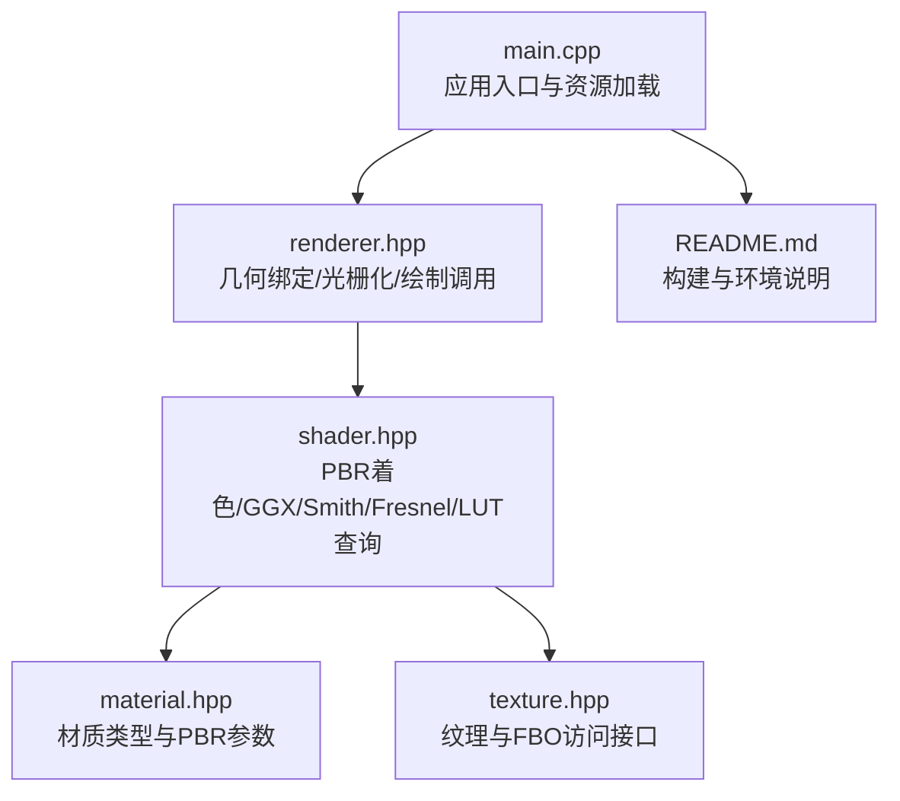
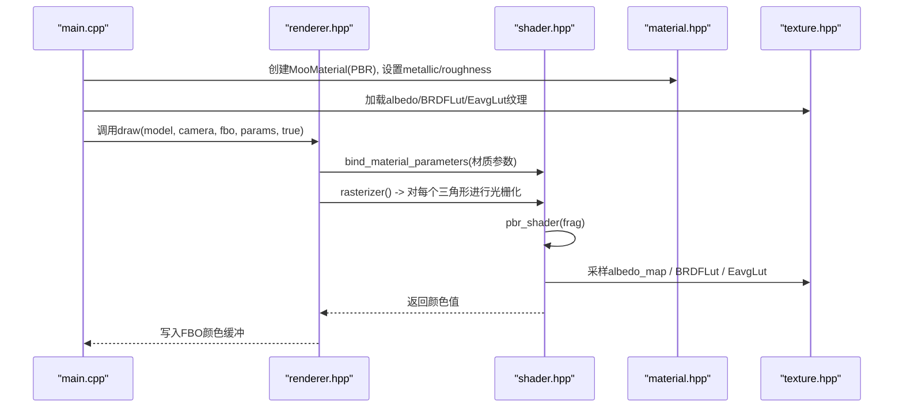
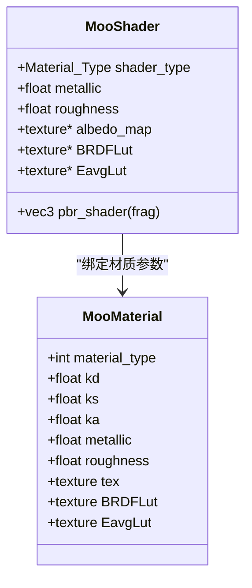
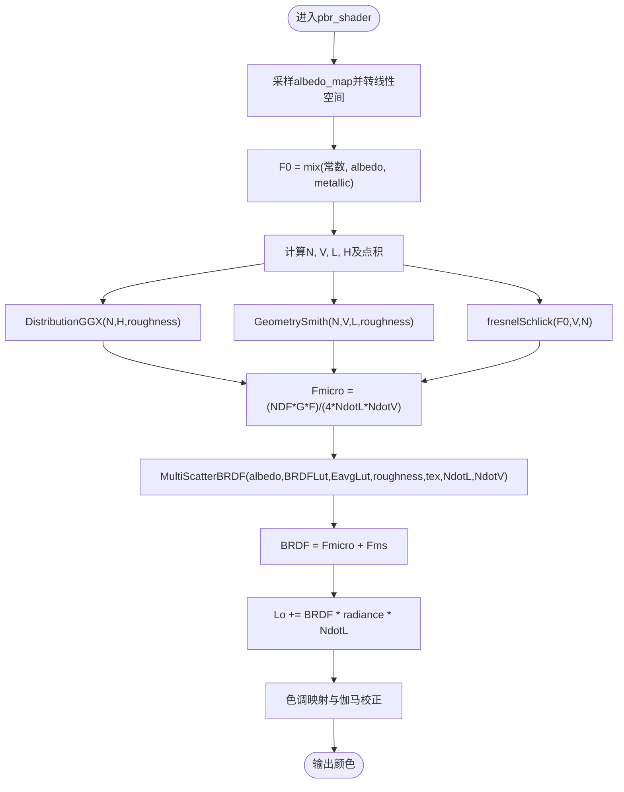
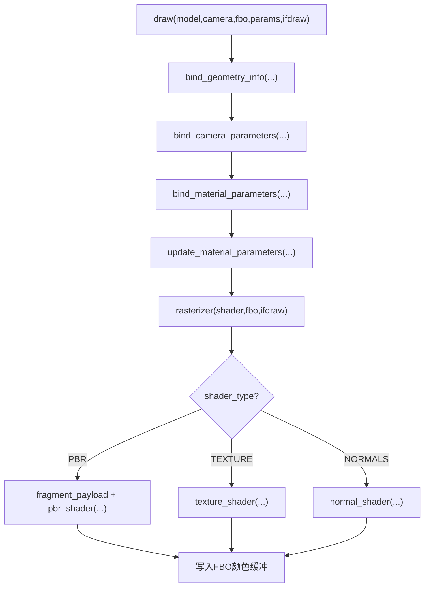
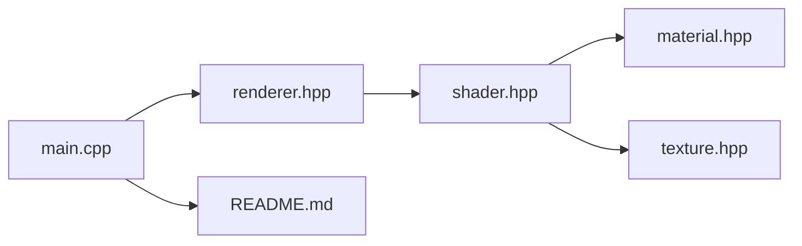

# PBR材质模型

> **版本提示（2.0）**：本文撰写于 1.x 时期，描述的是旧的实现形态——入口在根目录 `main.cpp`，功能由根目录 `.hpp` 头文件库提供，窗口用 raylib、显示用 OpenCV highgui。2.0 已把这些头文件移到 `Source/Legacy/`，渲染默认走 GPU，窗口与 UI 换成 GLFW + ImGui，`main.cpp` 拆成 `Source/Launch/Private/` 下的 `Main.cpp` 与 `Application`。文中的文件路径、行号与调用链可能已失效，请以根目录的「项目概述」「快速开始」「故障排除」三篇与当前源码为准。

<cite>
**本文引用的文件**   
- [README.md](file://README.md)
- [main.cpp](file://main.cpp)
- [material.hpp](file://material.hpp)
- [shader.hpp](file://shader.hpp)
- [renderer.hpp](file://renderer.hpp)
- [texture.hpp](file://texture.hpp)
</cite>

## 目录
1. [引言](#引言)
2. [项目结构](#项目结构)
3. [核心组件](#核心组件)
4. [架构总览](#架构总览)
5. [详细组件分析](#详细组件分析)
6. [依赖关系分析](#依赖关系分析)
7. [性能与优化建议](#性能与优化建议)
8. [故障排查指南](#故障排查指南)
9. [结论](#结论)

## 引言
本文件面向MooLab中的PBR（基于物理的渲染）材质系统，目标是帮助开发者理解并正确使用其中的金属度-粗糙度工作流、BRDF实现、微表面理论、能量守恒以及LUT辅助的多重散射近似。文档将结合源码路径与图示，逐步解释从材质定义、参数绑定、光栅化到着色计算的完整流程，并提供可操作的调参与排错建议。

## 项目结构
MooLab采用C++/Raylib/OpenCV构建，PBR相关代码主要分布在以下文件：
- 材质定义与默认值：material.hpp
- 着色器与PBR计算：shader.hpp
- 渲染管线与参数绑定：renderer.hpp
- 纹理与FBO工具：texture.hpp
- 应用入口与资源加载：main.cpp
- 项目说明与构建指引：README.md

图表来源
- [main.cpp:109-129](file://main.cpp#L109-L129)
- [renderer.hpp:74-92](file://renderer.hpp#L74-L92)
- [shader.hpp:129-239](file://shader.hpp#L129-L239)
- [material.hpp:7-31](file://material.hpp#L7-L31)
- [texture.hpp:65-101](file://texture.hpp#L65-L101)
- [README.md:7-15](file://README.md#L7-L15)

章节来源
- [README.md:7-15](file://README.md#L7-L15)
- [main.cpp:109-129](file://main.cpp#L109-L129)

## 核心组件
- 材质数据与类型
  - MooMaterial包含材质类型、传统Phong系数（kd/ks/ka）、PBR参数（metallic、roughness）、漫反射贴图（albedo tex）、BRDF LUT与Eavg LUT。
  - 默认构造为非金属（metallic=0），粗糙度默认0.5，确保未初始化时行为确定。
- 着色器与PBR计算
  - MooShader提供PBR着色函数pbr_shader，内部实现GGX NDF、Schlick近似、Smith遮蔽、Fresnel、多重散射BRDF近似，并进行色调映射与伽马校正。
  - 通过纹理采样获取albedo、BRDFLut、EavgLut，用于多散射项的能量修正。
- 渲染管线
  - renderer.hpp负责几何信息绑定、相机参数绑定、材质参数绑定、光栅化与逐像素着色调用。
  - draw流程中为每个mesh调用bind_*系列函数后执行rasterizer，并在PBR模式下调用shader.pbr_shader。
- 纹理与FBO
  - texture封装了图像读取、颜色采样；FBO提供颜色与深度缓冲读写接口。

章节来源
- [material.hpp:7-31](file://material.hpp#L7-L31)
- [shader.hpp:129-239](file://shader.hpp#L129-L239)
- [renderer.hpp:74-92](file://renderer.hpp#L74-L92)
- [texture.hpp:65-101](file://texture.hpp#L65-L101)

## 架构总览
下图展示从应用入口到PBR着色的关键调用链与数据流向。

图表来源
- [main.cpp:109-129](file://main.cpp#L109-L129)
- [renderer.hpp:213-239](file://renderer.hpp#L213-L239)
- [renderer.hpp:121-211](file://renderer.hpp#L121-L211)
- [shader.hpp:201-239](file://shader.hpp#L201-L239)
- [texture.hpp:65-101](file://texture.hpp#L65-L101)

## 详细组件分析

### 材质系统与金属度-粗糙度工作流
- 材质类型枚举包含LIGHT/PBR/TEXTURE/NORMALS，PBR模式启用基于物理的着色。
- MooMaterial默认构造将metallic设为0（非金属），roughness设为0.5，避免栈上残值影响F0混合。
- 在main.cpp中，材质被赋予albedo贴图、BRDFLut与EavgLut，并设置较低的粗糙度以呈现光滑表面效果。

图表来源
- [material.hpp:7-31](file://material.hpp#L7-L31)
- [shader.hpp:35-65](file://shader.hpp#L35-L65)
- [renderer.hpp:74-84](file://renderer.hpp#L74-L84)

章节来源
- [material.hpp:7-31](file://material.hpp#L7-L31)
- [main.cpp:109-129](file://main.cpp#L109-L129)

### BRDF实现与微表面理论
- GGX法线分布函数（NDF）：DistributionGGX使用roughness^2作为a^2，按标准GGX公式计算NdotH相关的分布。
- Schlick几何遮蔽：GeometrySchlickGGX根据roughness推导k，并按Schlick形式计算G1。
- Smith遮蔽组合：GeometrySmith将入射与出射方向的G1相乘得到整体遮蔽项。
- Fresnel近似：fresnelSchlick使用F0与NdotV的5次幂近似，F0由albedo与metallic混合得到。
- 多重散射BRDF近似：MultiScatterBRDF通过BRDFLut与EavgLut查询E_o、E_i、E_avg，并结合AverageFresnel估算F_add与F_ms，最终叠加到单散射项。

图表来源
- [shader.hpp:129-199](file://shader.hpp#L129-L199)
- [shader.hpp:201-239](file://shader.hpp#L201-L239)

章节来源
- [shader.hpp:129-239](file://shader.hpp#L129-L239)

### 环境贴图与IBL（基于图像的照明）
- 当前实现中，albedo贴图来自resources/skybox.png，但PBR着色仅使用其作为漫反射颜色，并未直接进行IBL积分或环境光照贡献。
- BRDFLut与EavgLut用于多重散射能量的近似修正，而非IBL的环境辐射采样。
- 若需扩展IBL，可在现有框架中增加环境贴图采样与预过滤步骤，并将结果与BRDF项相加。

章节来源
- [main.cpp:112-119](file://main.cpp#L112-L119)
- [shader.hpp:181-199](file://shader.hpp#L181-L199)

### 渲染管线与参数绑定
- bind_geometry_info：将顶点位置、法线、纹理坐标打包为每三角形的payload，供光栅化阶段插值。
- bind_camera_parameters：传入模型矩阵、视图/投影矩阵、屏幕到世界逆变换、相机位置等。
- bind_material_parameters：将材质中的albedo、BRDFLut、EavgLut与metallic/roughness拷贝至shader。
- update_material_parameters：更新光源位置、方向、辐射强度与阴影贴图。
- rasterizer：遍历三角形，进行视锥剔除、投影变换、屏幕包围盒扫描、重心坐标判断与深度测试，随后根据shader_type调用对应着色函数（PBR/TEXTURE/NORMALS）。

图表来源
- [renderer.hpp:33-92](file://renderer.hpp#L33-L92)
- [renderer.hpp:121-211](file://renderer.hpp#L121-L211)

章节来源
- [renderer.hpp:33-92](file://renderer.hpp#L33-L92)
- [renderer.hpp:121-211](file://renderer.hpp#L121-L211)

### 代码级示例路径（不展示具体代码内容）
- 材质默认值与非金属设定：[material.hpp:29-30](file://material.hpp#L29-L30)
- 纹理与LUT加载：[main.cpp:112-119](file://main.cpp#L112-L119)
- 材质参数绑定：[renderer.hpp:74-84](file://renderer.hpp#L74-L84)
- GGX NDF实现：[shader.hpp:129-142](file://shader.hpp#L129-L142)
- Schlick几何遮蔽：[shader.hpp:144-165](file://shader.hpp#L144-L165)
- Fresnel近似：[shader.hpp:167-172](file://shader.hpp#L167-L172)
- 多重散射BRDF近似：[shader.hpp:181-199](file://shader.hpp#L181-L199)
- PBR主流程（F0混合、NDF/G/F、色调映射）：[shader.hpp:201-239](file://shader.hpp#L201-L239)

## 依赖关系分析
- 模块耦合
  - main.cpp依赖renderer.hpp与material.hpp，负责资源加载与绘制调度。
  - renderer.hpp依赖shader.hpp与texture.hpp，完成几何/相机/材质绑定与光栅化。
  - shader.hpp依赖material.hpp与texture.hpp，实现PBR数学与纹理采样。
- 外部库
  - OpenCV用于图像读取与显示（img_to_tex/fbo_to_img）。
  - Raylib用于窗口与输入（main.cpp开头引入raylib.h）。

图表来源
- [main.cpp:1-17](file://main.cpp#L1-L17)
- [renderer.hpp:1-8](file://renderer.hpp#L1-L8)
- [shader.hpp:1-8](file://shader.hpp#L1-L8)
- [material.hpp:1-5](file://material.hpp#L1-L5)
- [texture.hpp:1-9](file://texture.hpp#L1-L9)
- [README.md:1-5](file://README.md#L1-L5)

章节来源
- [main.cpp:1-17](file://main.cpp#L1-L17)
- [renderer.hpp:1-8](file://renderer.hpp#L1-L8)
- [shader.hpp:1-8](file://shader.hpp#L1-L8)
- [material.hpp:1-5](file://material.hpp#L1-L5)
- [texture.hpp:1-9](file://texture.hpp#L1-L9)
- [README.md:1-5](file://README.md#L1-L5)

## 性能与优化建议
- 光栅化并行化
  - rasterizer已使用OpenMP并行循环遍历三角形，建议在Release模式下运行以获得更好性能。
- 纹理与LUT缓存
  - BRDFLut与EavgLut在材质间共享，避免重复加载；确保纹理尺寸合理以减少内存占用。
- 数值稳定性
  - 分母保护：4*NdotL*NdotV的最小值保护已在实现中使用，避免除零。
- 色调映射与伽马
  - 当前实现使用Reinhard式映射与sRGB伽马校正，符合常规显示管线。

[本节为通用指导，不直接分析具体文件]

## 故障排查指南
- 材质参数未生效
  - 检查bind_material_parameters是否正确将metallic/roughness与纹理指针赋值给shader。
  - 参考路径：[renderer.hpp:74-84](file://renderer.hpp#L74-L84)
- 纹理或LUT为空
  - 确认img_to_tex成功加载albedo/BRDFLut/EavgLut，且路径正确。
  - 参考路径：[main.cpp:112-119](file://main.cpp#L112-L119)
- 颜色过暗或过亮
  - 检查albedo是否已转换为线性空间（powv(..., 2.2)），以及输出是否进行了伽马校正。
  - 参考路径：[shader.hpp:201-239](file://shader.hpp#L201-L239)
- 高光异常或闪烁
  - 检查roughness范围与NDF/G的计算，确保NdotL/NdotV非负且分母保护有效。
  - 参考路径：[shader.hpp:129-165](file://shader.hpp#L129-L165)

章节来源
- [renderer.hpp:74-84](file://renderer.hpp#L74-L84)
- [main.cpp:112-119](file://main.cpp#L112-L119)
- [shader.hpp:129-239](file://shader.hpp#L129-L239)

## 结论
MooLab的PBR材质系统围绕金属度-粗糙度工作流展开，实现了GGX NDF、Schlick近似、Smith遮蔽与Fresnel，并通过BRDFLut与EavgLut进行多重散射能量的近似修正。渲染管线清晰地将材质、几何、相机与光源参数绑定到着色器，并在光栅化阶段调用PBR着色函数。当前实现未直接使用IBL进行环境光照，但提供了扩展的基础设施。开发者可通过调整metallic与roughness、校准albedo与LUT，获得更真实的材质表现。

[本节为总结性内容，不直接分析具体文件]