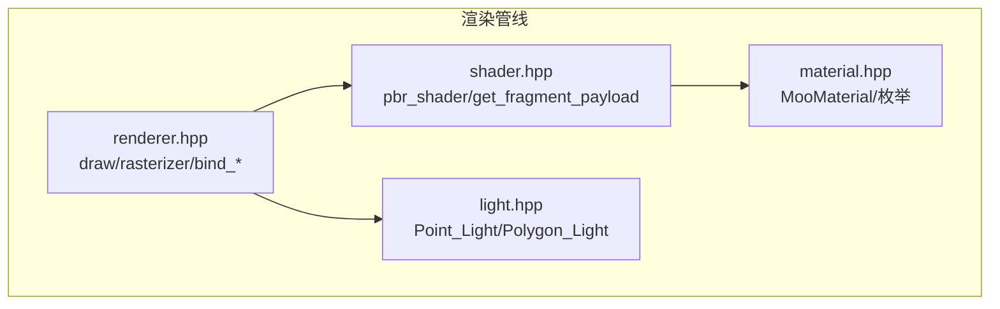
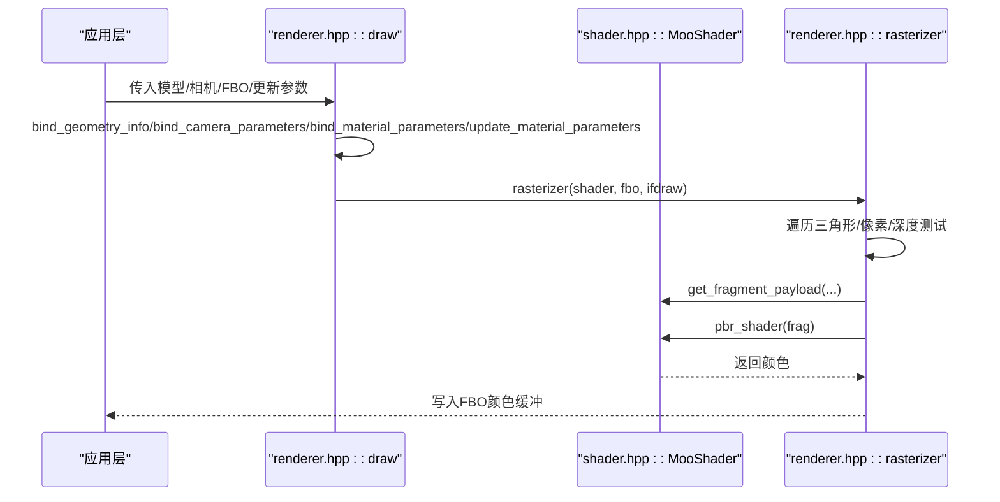
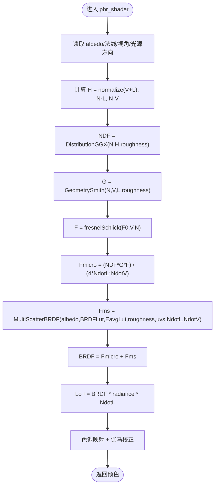
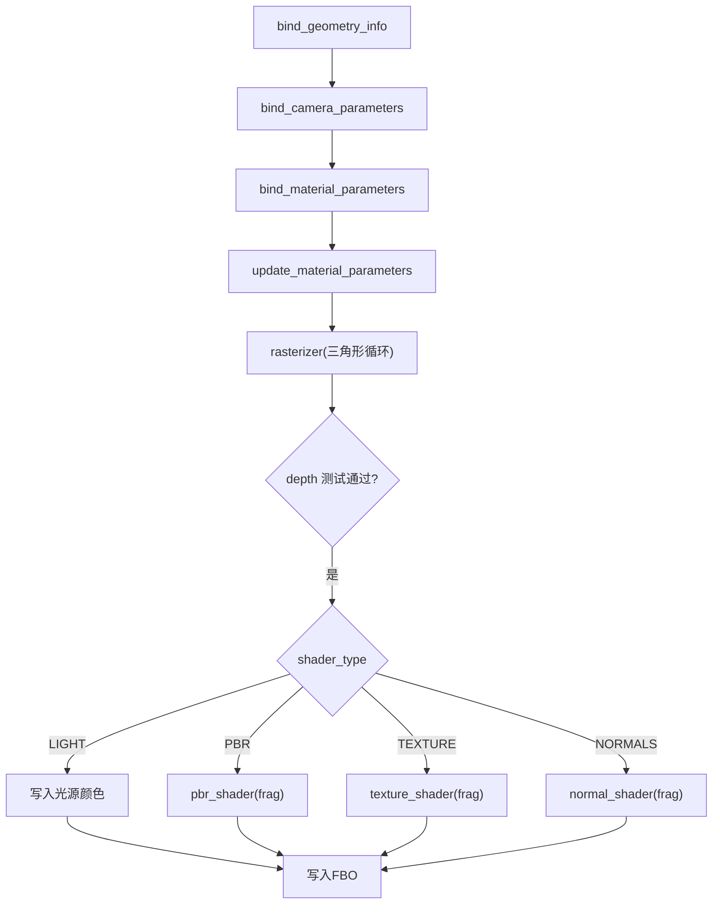
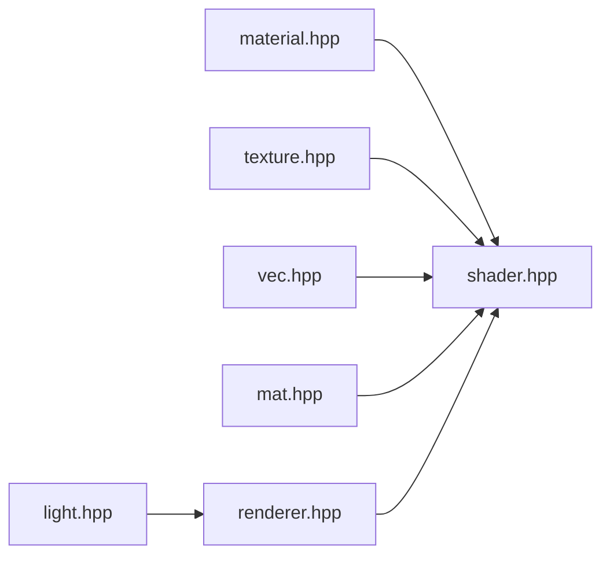

# 光照系统

> **版本提示（2.0）**：本文撰写于 1.x 时期，描述的是旧的实现形态——入口在根目录 `main.cpp`，功能由根目录 `.hpp` 头文件库提供，窗口用 raylib、显示用 OpenCV highgui。2.0 已把这些头文件移到 `Source/Legacy/`，渲染默认走 GPU，窗口与 UI 换成 GLFW + ImGui，`main.cpp` 拆成 `Source/Launch/Private/` 下的 `Main.cpp` 与 `Application`。文中的文件路径、行号与调用链可能已失效，请以根目录的「项目概述」「快速开始」「故障排除」三篇与当前源码为准。

<cite>
**本文引用的文件**   
- [light.hpp](file://light.hpp)
- [material.hpp](file://material.hpp)
- [shader.hpp](file://shader.hpp)
- [renderer.hpp](file://renderer.hpp)
</cite>

## 目录
1. [简介](#简介)
2. [项目结构](#项目结构)
3. [核心组件](#核心组件)
4. [架构总览](#架构总览)
5. [详细组件分析](#详细组件分析)
6. [依赖关系分析](#依赖关系分析)
7. [性能与优化](#性能与优化)
8. [故障排查指南](#故障排查指南)
9. [结论](#结论)
10. [附录：代码示例路径](#附录代码示例路径)

## 简介
本文件为 MooLab 实时渲染引擎的光照系统文档，聚焦以下主题：
- 光源类型与实现：点光源、多边形光（面光）；环境光与方向光在现有管线中的接入方式。
- 光照模型：Phong 参数化（漫反射/镜面反射/环境光系数）与 PBR（GGX NDF + Schlick-Smith G + Schlick F + 多次散射 BRDF）。
- 阴影映射：深度纹理生成、阴影采样接口预留、PCF 过滤的扩展位置。
- 衰减、偏移与质量优化：衰减策略、阴影偏移与 PCF 采样窗口的工程建议。
- 可操作示例：通过“代码片段路径”定位到具体实现位置，便于快速上手与二次开发。

## 项目结构
MooLab 的光照相关逻辑主要分布在以下头文件中：
- light.hpp：光源数据结构与可视化辅助。
- material.hpp：材质枚举与 PBR 参数（金属度、粗糙度、BRDF/Eavg LUT）。
- shader.hpp：着色器数据、PBR 计算函数、片段载荷构造。
- renderer.hpp：几何绑定、相机/材质参数绑定、光栅化与绘制流程。

图表来源
- [renderer.hpp:61-92](file://renderer.hpp#L61-L92)
- [shader.hpp:112-239](file://shader.hpp#L112-L239)
- [material.hpp:7-31](file://material.hpp#L7-L31)
- [light.hpp:16-41](file://light.hpp#L16-L41)

章节来源
- [light.hpp:1-44](file://light.hpp#L1-L44)
- [material.hpp:1-33](file://material.hpp#L1-L33)
- [shader.hpp:1-257](file://shader.hpp#L1-L257)
- [renderer.hpp:1-429](file://renderer.hpp#L1-L429)

## 核心组件
- 光源
  - Point_Light：包含位置、方向、辐射强度，以及 shadow_map 指针（当前未实现，置空）。
  - Polygon_Light：用于面光，包含多个顶点位置、方向与辐射强度。
- 材质
  - MooMaterial：支持 LIGHT/PBR/TEXTURE/NORMALS 等材质类型；PBR 参数包括 metallic、roughness、albedo/BRDFLut/EavgLut 纹理。
- 着色器
  - MooShader：持有矩阵、相机、光源、材质与纹理引用；提供 pbr_shader、texture_shader、normal_shader 三种着色模式。
  - 片段载荷 fragment_payload：封装插值后的世界空间位置、法线、UV 与深度。
- 渲染器
  - draw/rasterizer：负责将几何数据绑定到着色器，执行三角形光栅化与逐像素着色。
  - bind_* 系列：统一注入相机、材质、光源参数至着色器。

章节来源
- [light.hpp:16-41](file://light.hpp#L16-L41)
- [material.hpp:7-31](file://material.hpp#L7-L31)
- [shader.hpp:19-91](file://shader.hpp#L19-L91)
- [renderer.hpp:33-92](file://renderer.hpp#L33-L92)

## 架构总览
下图展示从几何到片段的完整调用链，以及 PBR 着色入口。

图表来源
- [renderer.hpp:213-239](file://renderer.hpp#L213-L239)
- [renderer.hpp:121-211](file://renderer.hpp#L121-L211)
- [shader.hpp:112-127](file://shader.hpp#L112-L127)
- [shader.hpp:201-239](file://shader.hpp#L201-L239)

## 详细组件分析

### 光源类型与实现
- 点光源（Point_Light）
  - 属性：位置、方向、辐射强度、shadow_map（当前为空）。
  - 用途：作为单点能量源，参与 PBR 计算中的 L 向量构建与 radiance 输入。
  - 可视化：get_light_model 使用立方体网格并设置变换，以 LIGHT 材质渲染出可见的点光源标记。
- 多边形光（Polygon_Light）
  - 属性：多个顶点位置、方向、辐射强度。
  - 用途：面向面光近似或区域光的扩展基础。
- 环境光与方向光
  - 当前代码中未显式定义 Ambient/DirectLight 结构体；可通过统一光源接口（如 light_pos/light_dir/light_radiance）进行抽象扩展。
  - 建议在 update_material_parameters 中增加环境光项，或在 PBR 着色器中叠加环境项。

章节来源
- [light.hpp:16-41](file://light.hpp#L16-L41)
- [light.hpp:28-34](file://light.hpp#L28-L34)
- [renderer.hpp:86-92](file://renderer.hpp#L86-L92)

### Phong 光照模型（参数化）
- 材质侧提供了 kd（漫反射）、ks（镜面反射）、ka（环境光）三个标量系数，可用于经典 Phong/Blinn-Phong 模型。
- 当前主渲染路径默认走 PBR 着色；若需启用 Phong，可在 rasterizer 分支中添加对应着色器模式，并在材质绑定中传递 kd/ks/ka。

章节来源
- [material.hpp:7-31](file://material.hpp#L7-L31)
- [renderer.hpp:167-205](file://renderer.hpp#L167-L205)

### PBR 光照模型（GGX + Smith + Schlick + 多次散射）
- GGX 法线分布函数 DistributionGGX：基于 roughness 的 a^2 分布，分母采用 (N·H)^2*(a^2-1)+1 的形式。
- Schlick-Smith 几何遮蔽 GeometrySmith：分别对入射与视角方向使用 Schlick-GGX G1 近似，再相乘得到 G。
- Schlick 菲涅尔 fresnelSchlick：基于 F0 与 N·V 的幂次近似。
- 多次散射 BRDF MultiScatterBRDF：利用 BRDFLut/EavgLut 与 albedo 估算 F_add 与 F_ms，并与微表面项相加。
- 最终输出：Lo = Lo + BRDF * radiance * N·L，并进行色调映射与伽马校正。

图表来源
- [shader.hpp:129-199](file://shader.hpp#L129-L199)
- [shader.hpp:201-239](file://shader.hpp#L201-L239)

章节来源
- [shader.hpp:129-239](file://shader.hpp#L129-L239)

### 阴影映射技术（深度纹理与采样）
- 深度纹理生成
  - FBO_types 定义了 shadow 通道；MooShader 持有 shadow_map 指针，但当前注释指出“阴影贴图尚未实现”，shadow_map 初始化为 NULL。
  - 典型流程：以光源为相机投影，渲染场景深度到 shadow_map；随后在主渲染阶段采样该深度图判断遮挡。
- 阴影采样与 PCF
  - 当前代码未实现实际采样与 PCF 滤波；可在 pbr_shader 中根据 frag.fragment_pos 转换到光源空间后，对 shadow_map 进行多邻域采样并平均。
- 阴影偏移
  - 为避免自阴影伪影，可在采样前对深度进行微小偏移（bias），或使用法线相关的偏移策略。

章节来源
- [shader.hpp:10-17](file://shader.hpp#L10-L17)
- [shader.hpp:55-59](file://shader.hpp#L55-L59)
- [light.hpp:22-25](file://light.hpp#L22-L25)

### 光栅化与绘制流程
- 几何绑定：bind_geometry_info 将索引/顶点/法线/UV 打包进 vertex_payload。
- 参数绑定：bind_camera_parameters 注入模型/视图/投影矩阵与相机信息；bind_material_parameters 注入材质与纹理；update_material_parameters 注入光源与 shadow_map。
- 光栅化：rasterizer 并行遍历三角形，计算屏幕包围盒，逐像素做深度测试与着色。
- 着色分支：根据 shader_type 选择 LIGHT/PBR/TEXTURE/NORMALS 着色路径。

图表来源
- [renderer.hpp:33-92](file://renderer.hpp#L33-L92)
- [renderer.hpp:121-211](file://renderer.hpp#L121-L211)

章节来源
- [renderer.hpp:33-92](file://renderer.hpp#L33-L92)
- [renderer.hpp:121-211](file://renderer.hpp#L121-L211)

## 依赖关系分析
- 模块耦合
  - renderer.hpp 依赖 light.hpp（光源）、model/mesh/camera（几何与相机）。
  - shader.hpp 依赖 material.hpp（材质）、mat/vec/texture（数学与纹理）。
  - material.hpp 依赖 global/texture（基础类型与纹理）。
- 外部依赖
  - 依赖自定义数学库（vec/mat/quat）与纹理/FBO 抽象。
- 潜在环依赖
  - 当前头文件间无直接循环包含；注意避免新增 include 导致环依赖。

图表来源
- [light.hpp:1-6](file://light.hpp#L1-L6)
- [material.hpp:1-5](file://material.hpp#L1-L5)
- [shader.hpp:1-8](file://shader.hpp#L1-L8)
- [renderer.hpp:1-7](file://renderer.hpp#L1-L7)

章节来源
- [light.hpp:1-6](file://light.hpp#L1-L6)
- [material.hpp:1-5](file://material.hpp#L1-L5)
- [shader.hpp:1-8](file://shader.hpp#L1-L8)
- [renderer.hpp:1-7](file://renderer.hpp#L1-L7)

## 性能与优化
- 光栅化并行化
  - 已使用 OpenMP 并行遍历三角形，提升吞吐。
- 内存分配
  - MooShader::resize 仅在尺寸变化时重新分配，避免频繁 malloc 导致的泄漏与抖动。
- PBR 计算开销
  - 多次查找 LUT（BRDFLut/EavgLut）与 pow/sqrt 运算较多，可考虑预计算或近似表。
- 阴影质量与性能
  - 建议动态调整 shadow_map 分辨率与 PCF 采样半径；对远处光源降低精度。
- 色调映射与伽马
  - 已在 pbr_shader 末尾进行色调映射与伽马校正，确保显示正确。

章节来源
- [renderer.hpp:121-127](file://renderer.hpp#L121-L127)
- [shader.hpp:93-110](file://shader.hpp#L93-L110)
- [shader.hpp:232-239](file://shader.hpp#L232-L239)

## 故障排查指南
- 阴影贴图未生效
  - 现象：场景中无阴影或出现黑屏。
  - 原因：shadow_map 指针为空且未实现采样。
  - 处理：先实现光源空间的深度渲染，再在主渲染阶段采样 shadow_map 并加入 PCF。
- 材质参数未初始化
  - 现象：金属度参与混合时结果不稳定。
  - 原因：旧实现未初始化 metallic，现给出默认非金属值。
  - 处理：保持默认值或显式赋值。
- 着色器类型不匹配
  - 现象：渲染结果为纯色或法线视图。
  - 原因：shader_type 设置错误。
  - 处理：检查材质类型与 draw 流程中的绑定。

章节来源
- [light.hpp:22-25](file://light.hpp#L22-L25)
- [material.hpp:29-31](file://material.hpp#L29-L31)
- [renderer.hpp:167-205](file://renderer.hpp#L167-L205)

## 结论
MooLab 的光照系统以 PBR 为核心，具备可扩展的光源与材质体系。当前已实现 GGX-Schlick-Smith 微表面模型与多次散射 BRDF 的框架，并通过 renderer 管线完成几何绑定与光栅化。阴影映射接口已预留，后续可按需实现深度纹理生成与 PCF 滤波以获得更真实的阴影效果。对于 Phong 模型，可利用现有材质系数进行扩展。

## 附录：代码示例路径
- 点光源结构与可视化
  - [light.hpp:16-41](file://light.hpp#L16-L41)
  - [light.hpp:28-34](file://light.hpp#L28-L34)
- 材质与 PBR 参数
  - [material.hpp:7-31](file://material.hpp#L7-L31)
- 着色器与 PBR 计算
  - [shader.hpp:112-127](file://shader.hpp#L112-L127)
  - [shader.hpp:129-199](file://shader.hpp#L129-L199)
  - [shader.hpp:201-239](file://shader.hpp#L201-L239)
- 渲染管线与参数绑定
  - [renderer.hpp:33-92](file://renderer.hpp#L33-L92)
  - [renderer.hpp:121-211](file://renderer.hpp#L121-L211)
  - [renderer.hpp:213-239](file://renderer.hpp#L213-L239)