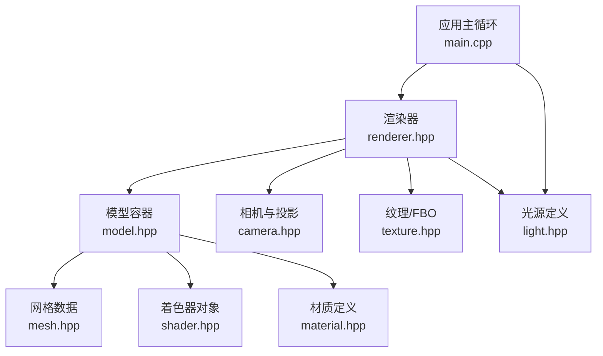
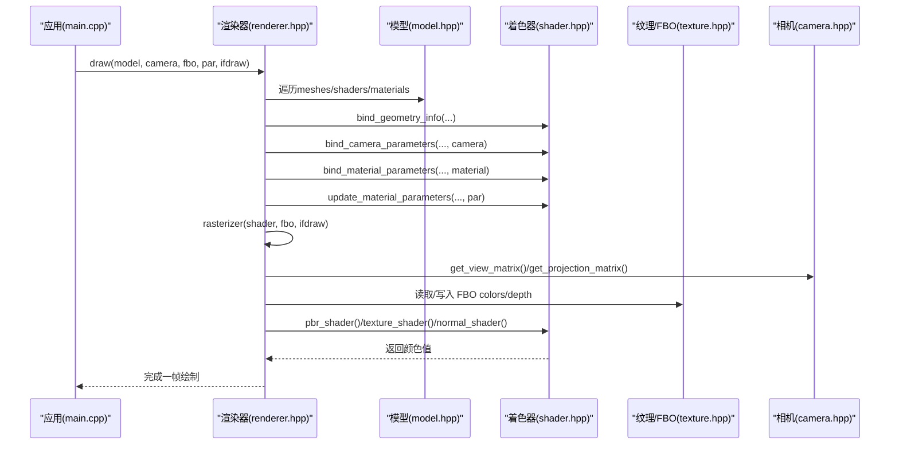
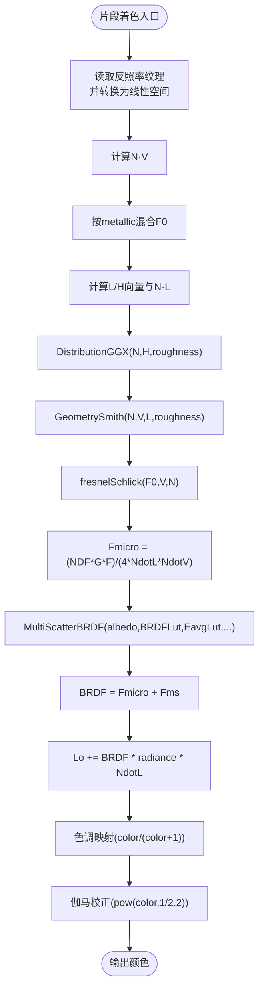
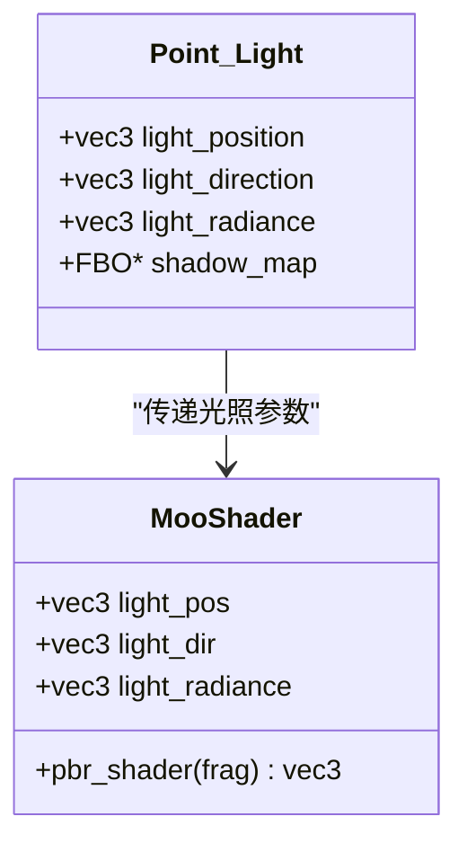
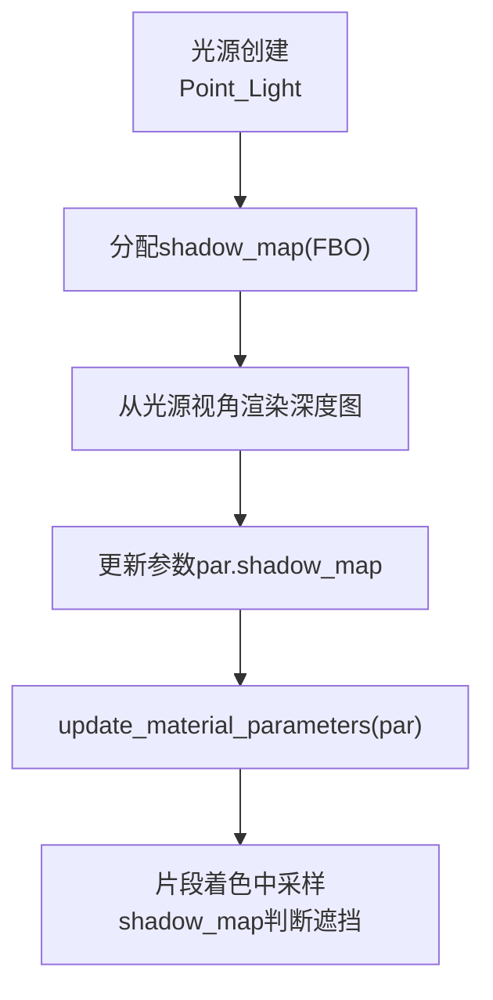
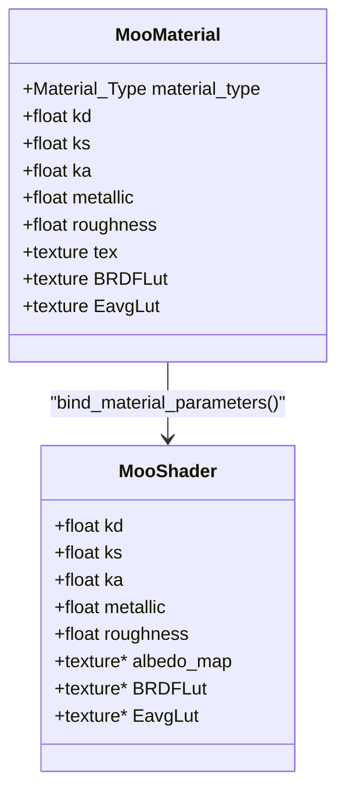
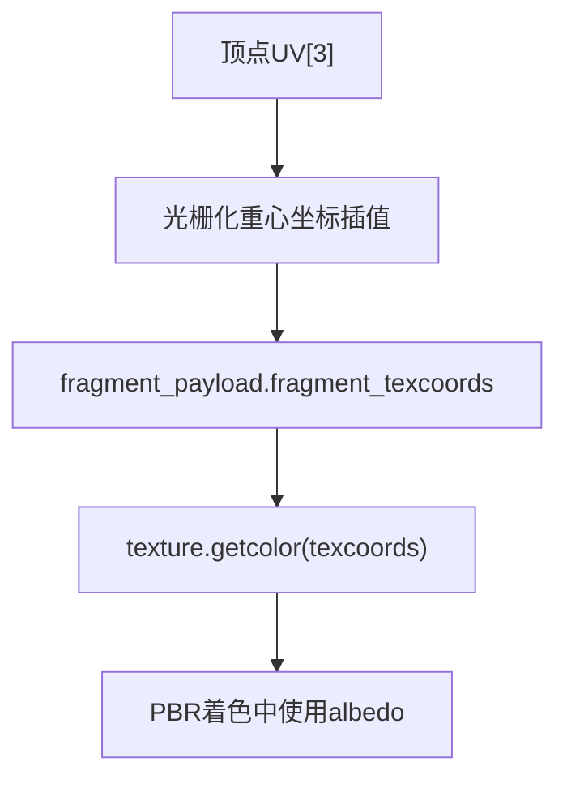
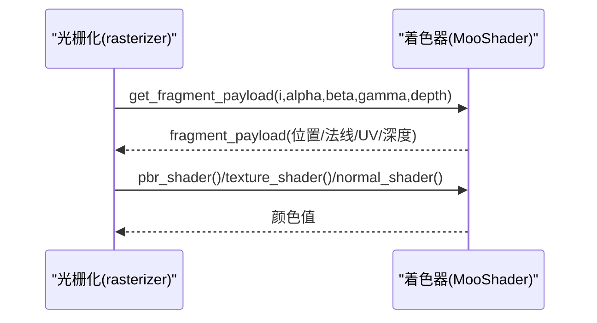
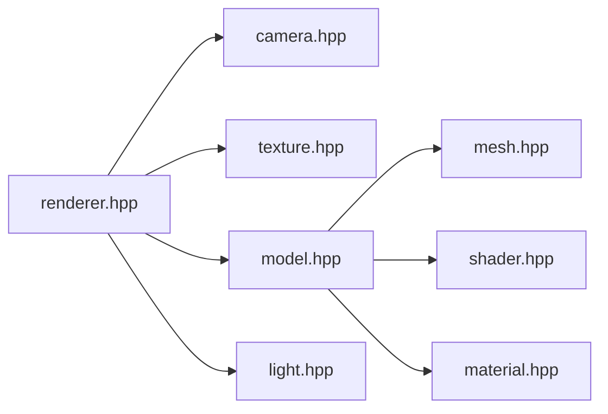

# 渲染管线概念

> **版本提示（2.0）**：本文撰写于 1.x 时期，描述的是旧的实现形态——入口在根目录 `main.cpp`，功能由根目录 `.hpp` 头文件库提供，窗口用 raylib、显示用 OpenCV highgui。2.0 已把这些头文件移到 `Source/Legacy/`，渲染默认走 GPU，窗口与 UI 换成 GLFW + ImGui，`main.cpp` 拆成 `Source/Launch/Private/` 下的 `Main.cpp` 与 `Application`。文中的文件路径、行号与调用链可能已失效，请以根目录的「项目概述」「快速开始」「故障排除」三篇与当前源码为准。

<cite>
**本文引用的文件**   
- [main.cpp](file://main.cpp)
- [renderer.hpp](file://renderer.hpp)
- [shader.hpp](file://shader.hpp)
- [material.hpp](file://material.hpp)
- [light.hpp](file://light.hpp)
- [texture.hpp](file://texture.hpp)
- [mesh.hpp](file://mesh.hpp)
- [model.hpp](file://model.hpp)
- [camera.hpp](file://camera.hpp)
</cite>

## 目录
1. [简介](#简介)
2. [项目结构](#项目结构)
3. [核心组件](#核心组件)
4. [架构总览](#架构总览)
5. [详细组件分析](#详细组件分析)
6. [依赖关系分析](#依赖关系分析)
7. [性能考虑](#性能考虑)
8. [故障排查指南](#故障排查指南)
9. [结论](#结论)
10. [附录](#附录)

## 简介
本文件面向MooLab项目的渲染管线，系统阐述以下核心主题：
- PBR（基于物理的渲染）模型：漫反射、镜面反射与环境光遮蔽的计算思路与实现要点
- 光照模型：环境光、方向光、点光源与聚光灯的着色计算方式
- 阴影映射：深度纹理生成与阴影采样算法
- 材质系统：金属度-粗糙度工作流与自定义材质属性
- 纹理映射与UV坐标处理
- 着色器编程基础：顶点着色器与片段着色器的执行流程
- 代码级示例路径，帮助开发者理解图形渲染的核心原理与实现方法

## 项目结构
MooLab采用自研轻量渲染管线，围绕“模型-材质-着色器-光-相机-帧缓冲”组织。关键模块职责如下：
- main.cpp：应用主循环、资源加载、仿真驱动、绘制调用入口
- renderer.hpp：几何绑定、光栅化、逐像素着色调度、辅助绘图工具
- shader.hpp：PBR着色、纹理/法线显示着色、GGX/Schlick/Smith等PBR函数
- material.hpp：材质类型与参数（kd/ks/ka/metallic/roughness/LUT纹理）
- light.hpp：点光源与多边形光源数据结构及可视化模型
- texture.hpp：FBO与纹理封装、图像读写、颜色/深度访问接口
- mesh.hpp：基础网格（三角、立方体、胶囊体）生成
- model.hpp：模型容器（Mesh/Shader/Material映射）
- camera.hpp：相机矩阵、视口投影、FBO挂载

图表来源
- [main.cpp:149-159](file://main.cpp#L149-L159)
- [renderer.hpp:213-239](file://renderer.hpp#L213-L239)
- [model.hpp:8-43](file://model.hpp#L8-L43)
- [shader.hpp:35-86](file://shader.hpp#L35-L86)
- [material.hpp:15-30](file://material.hpp#L15-L30)
- [light.hpp:16-33](file://light.hpp#L16-L33)
- [texture.hpp:11-34](file://texture.hpp#L11-L34)
- [camera.hpp:7-36](file://camera.hpp#L7-L36)

章节来源
- [main.cpp:53-160](file://main.cpp#L53-L160)
- [renderer.hpp:17-31](file://renderer.hpp#L17-L31)
- [model.hpp:8-43](file://model.hpp#L8-L43)

## 核心组件
- 渲染器（MooRenderer）：管理模型与光源集合，提供draw()统一绘制入口
- 着色器（MooShader）：承载三角形顶点载荷、相机/材质/光照参数，并提供PBR/纹理/法线着色函数
- 材质（MooMaterial）：定义材质类型与PBR参数（kd/ks/ka/metallic/roughness），以及BRDF/Eavg LUT纹理
- 光源（Point_Light/Polygon_Light）：描述位置、方向、辐射强度，支持阴影贴图指针
- 纹理与FBO（texture/FBO）：封装颜色/深度缓冲与纹理采样接口
- 网格（MooMesh）：顶点、法线、UV、索引数据，提供基础几何构造
- 模型（MooModel）：将Mesh/Shader/Material组合为可绘制实体
- 相机（MooCamera）：视图/投影矩阵、屏幕到世界逆变换、FBO挂载

章节来源
- [renderer.hpp:17-31](file://renderer.hpp#L17-L31)
- [shader.hpp:35-86](file://shader.hpp#L35-L86)
- [material.hpp:15-30](file://material.hpp#L15-L30)
- [light.hpp:16-40](file://light.hpp#L16-L40)
- [texture.hpp:11-34](file://texture.hpp#L11-L34)
- [mesh.hpp:6-14](file://mesh.hpp#L6-L14)
- [model.hpp:8-19](file://model.hpp#L8-L19)
- [camera.hpp:7-36](file://camera.hpp#L7-L36)

## 架构总览
渲染管线整体流程：
1. 应用层准备模型、材质、光源、相机，并设置更新参数（如光源位置/辐射/阴影贴图）
2. draw()遍历模型的每个Mesh，绑定几何、相机、材质与动态参数
3. rasterizer()对每个三角形进行裁剪、投影、光栅化、深度测试
4. 根据材质类型选择着色函数：LIGHT/PBR/TEXTURE/NORMALS
5. 写入FBO的颜色与深度缓冲区

图表来源
- [main.cpp:453-472](file://main.cpp#L453-L472)
- [renderer.hpp:213-239](file://renderer.hpp#L213-L239)
- [renderer.hpp:121-211](file://renderer.hpp#L121-L211)
- [shader.hpp:199-237](file://shader.hpp#L199-L237)
- [camera.hpp:53-70](file://camera.hpp#L53-L70)
- [texture.hpp:11-34](file://texture.hpp#L11-L34)

## 详细组件分析

### PBR模型与着色
- 漫反射与镜面反射：通过GGX分布函数、Schlick几何项、Smith遮蔽项与Fresnel项组合，得到微表面BRDF；同时引入多次散射BRDF修正能量守恒
- 环境光遮蔽：使用EavgLut与BRDFLut近似间接照明与平均菲涅尔项，结合albedo进行能量平衡
- 色调映射与伽马校正：输出前进行Reinhard色调映射与sRGB伽马校正

图表来源
- [shader.hpp:127-197](file://shader.hpp#L127-L197)
- [shader.hpp:199-237](file://shader.hpp#L199-L237)

章节来源
- [shader.hpp:127-237](file://shader.hpp#L127-L237)

### 光照模型
- 点光源：在PBR着色中作为单一入射光方向L与辐射强度radiance参与计算
- 方向光/环境光：当前实现以单点光源为主，环境光可通过初始Lo或LUT近似体现
- 聚光灯：未直接实现专用着色分支，但可在光源数据结构扩展后复用PBR着色逻辑

图表来源
- [light.hpp:16-25](file://light.hpp#L16-L25)
- [shader.hpp:51-58](file://shader.hpp#L51-L58)
- [shader.hpp:199-237](file://shader.hpp#L199-L237)

章节来源
- [light.hpp:16-40](file://light.hpp#L16-L40)
- [shader.hpp:51-58](file://shader.hpp#L51-L58)
- [shader.hpp:199-237](file://shader.hpp#L199-L237)

### 阴影映射技术
- 深度纹理生成：Point_Light包含shadow_map指针，用于存储从光源视角的深度信息
- 阴影采样：MooShader持有shadow_map指针，可在片段着色中进行阴影检测（当前代码已预留字段，具体采样逻辑可扩展至着色函数）
- 更新机制：updated_paramters将shadow_map与光源动态参数传递给着色器

图表来源
- [light.hpp:16-25](file://light.hpp#L16-L25)
- [renderer.hpp:24-31](file://renderer.hpp#L24-L31)
- [renderer.hpp:86-92](file://renderer.hpp#L86-L92)
- [shader.hpp:55-59](file://shader.hpp#L55-L59)

章节来源
- [light.hpp:16-25](file://light.hpp#L16-L25)
- [renderer.hpp:24-31](file://renderer.hpp#L24-L31)
- [renderer.hpp:86-92](file://renderer.hpp#L86-L92)
- [shader.hpp:55-59](file://shader.hpp#L55-L59)

### 材质系统（金属度-粗糙度工作流）
- 材质类型：LIGHT/PBR/TEXTURE/NORMALS
- PBR参数：kd/ks/ka（传统系数）、metallic/roughness（金属度-粗糙度）
- LUT纹理：BRDFLut与EavgLut用于近似多次散射与平均菲涅尔项
- 绑定流程：bind_material_parameters将材质参数注入MooShader

图表来源
- [material.hpp:15-30](file://material.hpp#L15-L30)
- [shader.hpp:61-65](file://shader.hpp#L61-L65)
- [renderer.hpp:74-84](file://renderer.hpp#L74-L84)

章节来源
- [material.hpp:15-30](file://material.hpp#L15-L30)
- [shader.hpp:61-65](file://shader.hpp#L61-L65)
- [renderer.hpp:74-84](file://renderer.hpp#L74-L84)

### 纹理映射与UV坐标处理
- 纹理采样：texture::getcolor支持浮点坐标与vec2坐标，内部进行边界钳位与整数索引转换
- UV插值：rasterizer中通过重心坐标(alpha/beta/gamma)插值顶点UV，传入片段着色
- 反照率纹理：PBR着色中读取albedo并进行伽马校正到线性空间

图表来源
- [renderer.hpp:121-211](file://renderer.hpp#L121-L211)
- [shader.hpp:110-125](file://shader.hpp#L110-L125)
- [texture.hpp:65-84](file://texture.hpp#L65-L84)
- [shader.hpp:199-237](file://shader.hpp#L199-L237)

章节来源
- [renderer.hpp:121-211](file://renderer.hpp#L121-L211)
- [shader.hpp:110-125](file://shader.hpp#L110-L125)
- [texture.hpp:65-84](file://texture.hpp#L65-L84)
- [shader.hpp:199-237](file://shader.hpp#L199-L237)

### 着色器编程基础（顶点/片段流程）
- 顶点阶段：将三角形三个顶点的position/normal/texcoords拷贝到vertex_payload，供光栅化插值
- 片段阶段：根据重心坐标插值得到fragment_pos/fragment_normal/fragment_texcoords/depth，再进入具体着色函数
- 着色函数：PBR/TEXTURE/NORMALS三种模式，分别计算最终颜色

图表来源
- [renderer.hpp:121-211](file://renderer.hpp#L121-L211)
- [shader.hpp:110-125](file://shader.hpp#L110-L125)
- [shader.hpp:199-252](file://shader.hpp#L199-L252)

章节来源
- [renderer.hpp:121-211](file://renderer.hpp#L121-L211)
- [shader.hpp:110-125](file://shader.hpp#L110-L125)
- [shader.hpp:199-252](file://shader.hpp#L199-L252)

## 依赖关系分析
- 渲染器依赖相机矩阵与FBO，负责几何绑定与光栅化
- 着色器依赖材质与纹理，负责PBR计算与输出颜色
- 模型聚合Mesh/Shader/Material，便于批量绘制
- 光源提供光照参数与阴影贴图指针
- 纹理/FBO提供颜色与深度存取接口

图表来源
- [renderer.hpp:1-8](file://renderer.hpp#L1-L8)
- [model.hpp:1-7](file://model.hpp#L1-L7)
- [shader.hpp:1-8](file://shader.hpp#L1-L8)
- [material.hpp:1-5](file://material.hpp#L1-L5)
- [light.hpp:1-6](file://light.hpp#L1-L6)
- [texture.hpp:1-9](file://texture.hpp#L1-L9)
- [camera.hpp:1-5](file://camera.hpp#L1-L5)

章节来源
- [renderer.hpp:1-8](file://renderer.hpp#L1-L8)
- [model.hpp:1-7](file://model.hpp#L1-L7)
- [shader.hpp:1-8](file://shader.hpp#L1-L8)
- [material.hpp:1-5](file://material.hpp#L1-L5)
- [light.hpp:1-6](file://light.hpp#L1-L6)
- [texture.hpp:1-9](file://texture.hpp#L1-L9)
- [camera.hpp:1-5](file://camera.hpp#L1-L5)

## 性能考虑
- 并行光栅化：rasterizer使用OpenMP并行遍历三角形，提升吞吐
- 简单深度测试：每像素比较深度值，避免复杂阴影采样开销
- 纹理采样：使用最近邻采样与边界钳位，减少插值复杂度
- 建议优化：
  - 将重复计算的矩阵乘法缓存（如view/projection/screen_to_world）
  - 对大场景使用剔除（AABB/OBB）减少无效三角形
  - 阴影贴图使用PCF滤波时注意采样次数与分辨率权衡

章节来源
- [renderer.hpp:121-211](file://renderer.hpp#L121-L211)
- [texture.hpp:65-84](file://texture.hpp#L65-L84)

## 故障排查指南
- 颜色异常或过曝：检查PBR着色中的色调映射与伽马校正顺序，确认albedo是否先转线性空间
- 阴影缺失或错误：确认shadow_map是否正确赋值给MooShader，并确保光源视角深度图已正确生成
- UV错位或纹理拉伸：检查顶点UV与纹理尺寸匹配，确认插值与采样边界钳位正常
- 法线显示异常：确保法线在片段着色前归一化，且模型矩阵变换后的法线需按逆转置处理（当前实现简化）

章节来源
- [shader.hpp:199-237](file://shader.hpp#L199-L237)
- [renderer.hpp:86-92](file://renderer.hpp#L86-L92)
- [texture.hpp:65-84](file://texture.hpp#L65-L84)

## 结论
MooLab的渲染管线以自研光栅化为核心，结合PBR着色、材质系统与纹理/FBO封装，提供了可扩展的渲染框架。当前实现聚焦于点光源PBR与基础阴影映射字段预留，适合进一步扩展多光源、高级阴影与全局光照能力。

## 附录
- 代码示例路径（不展示具体代码内容）：
  - PBR着色主流程：[shader.hpp:199-237](file://shader.hpp#L199-L237)
  - GGX/Smith/Schlick函数：[shader.hpp:127-197](file://shader.hpp#L127-L197)
  - 光栅化与逐像素着色调度：[renderer.hpp:121-211](file://renderer.hpp#L121-L211)
  - 材质参数绑定：[renderer.hpp:74-84](file://renderer.hpp#L74-L84)
  - 光源与阴影贴图指针：[light.hpp:16-25](file://light.hpp#L16-L25), [renderer.hpp:24-31](file://renderer.hpp#L24-L31)
  - 纹理采样接口：[texture.hpp:65-84](file://texture.hpp#L65-L84)
  - 模型构建与绘制入口：[model.hpp:21-43](file://model.hpp#L21-L43), [main.cpp:453-472](file://main.cpp#L453-L472)