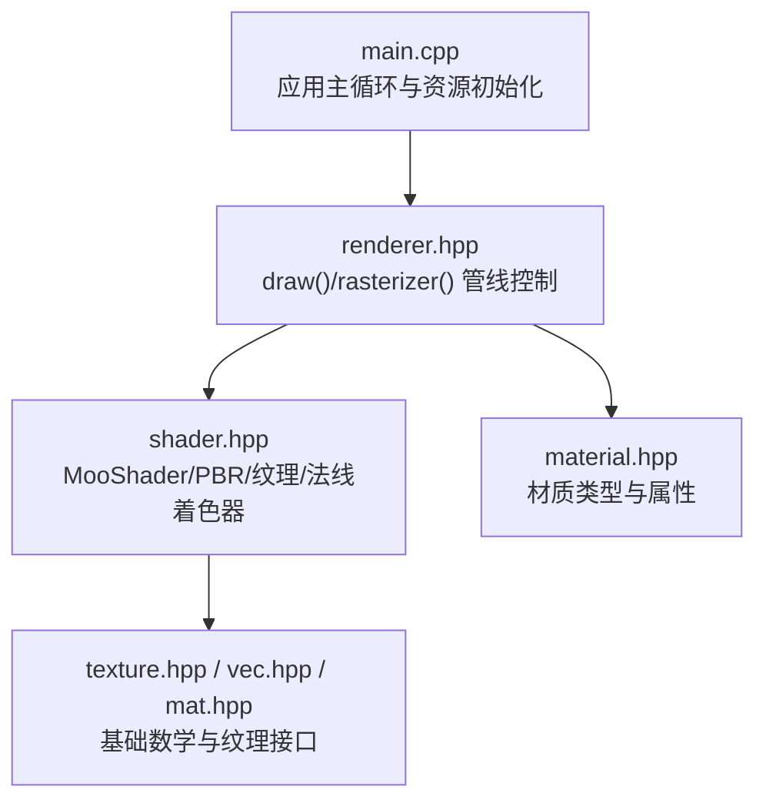
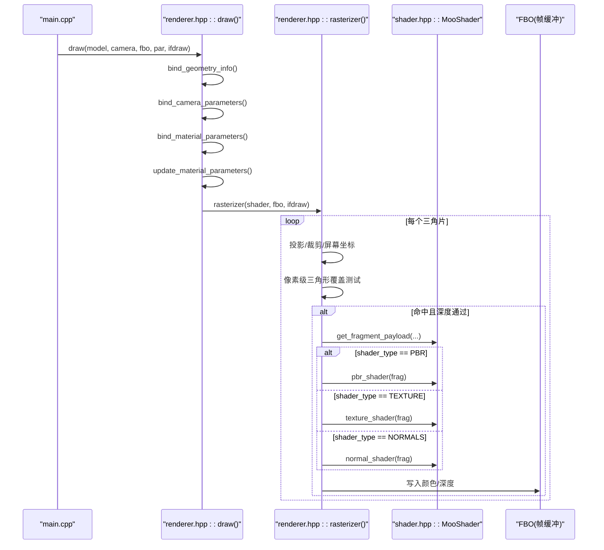
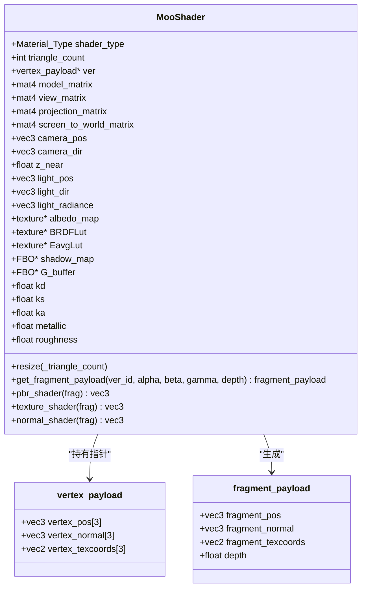
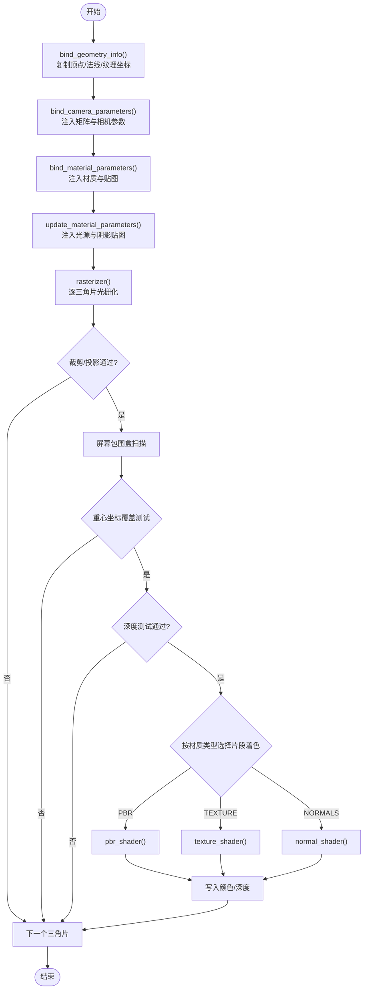
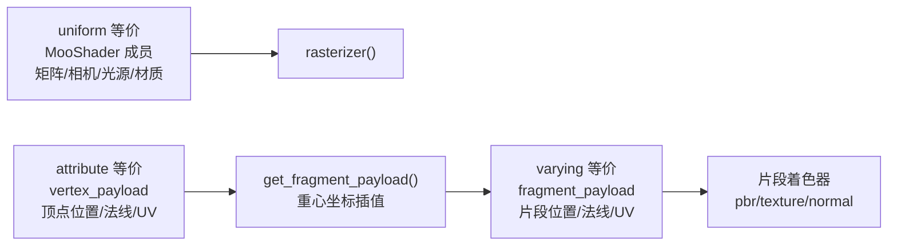
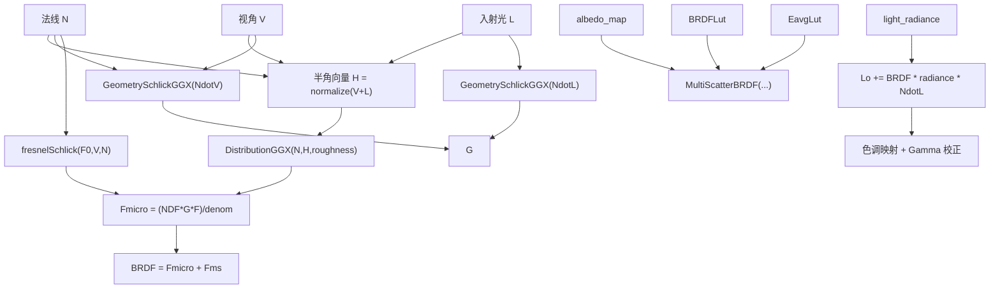
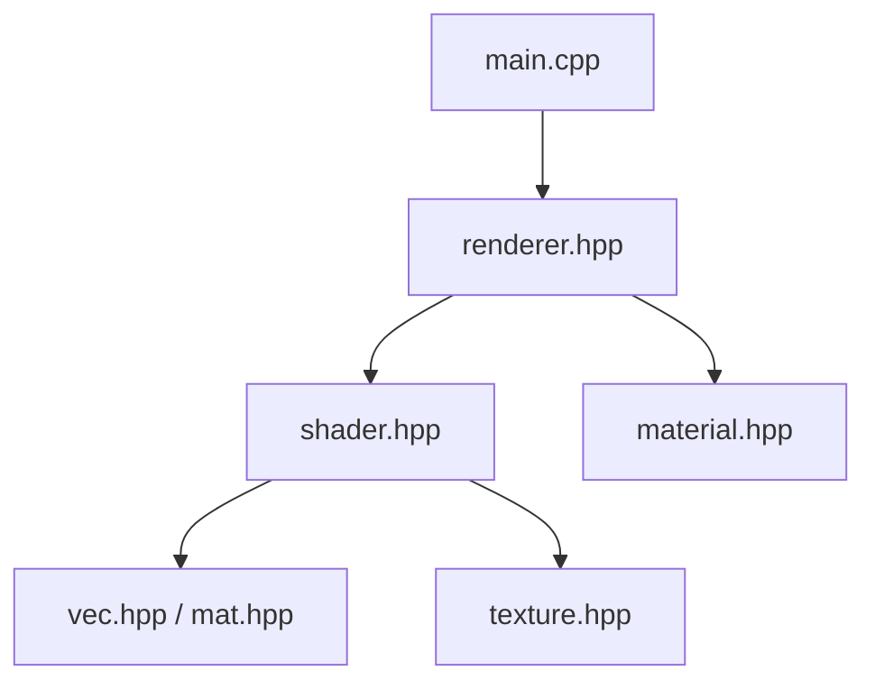

# 着色器编程

> **版本提示（2.0）**：本文撰写于 1.x 时期，描述的是旧的实现形态——入口在根目录 `main.cpp`，功能由根目录 `.hpp` 头文件库提供，窗口用 raylib、显示用 OpenCV highgui。2.0 已把这些头文件移到 `Source/Legacy/`，渲染默认走 GPU，窗口与 UI 换成 GLFW + ImGui，`main.cpp` 拆成 `Source/Launch/Private/` 下的 `Main.cpp` 与 `Application`。文中的文件路径、行号与调用链可能已失效，请以根目录的「项目概述」「快速开始」「故障排除」三篇与当前源码为准。

<cite>
**本文引用的文件**   
- [shader.hpp](file://shader.hpp)
- [renderer.hpp](file://renderer.hpp)
- [material.hpp](file://material.hpp)
- [main.cpp](file://main.cpp)
</cite>

## 目录
1. [简介](#简介)
2. [项目结构](#项目结构)
3. [核心组件](#核心组件)
4. [架构总览](#架构总览)
5. [详细组件分析](#详细组件分析)
6. [依赖关系分析](#依赖关系分析)
7. [性能与优化](#性能与优化)
8. [故障排查](#故障排查)
9. [结论](#结论)
10. [附录：GLSL 对照与最佳实践](#附录glsl-对照与最佳实践)

## 简介
本文件面向 MooLab 项目的“着色器编程”主题，系统梳理项目中基于 CPU 软件光栅化与片段着色实现的渲染管线。尽管本项目未直接使用 GLSL 源码，但通过 C++ 中的 MooShader、MooRenderer 等模块，完整实现了顶点/片段阶段的核心逻辑、矩阵变换、向量运算、PBR 光照模型与多材质切换。文档将帮助读者理解：
- 数据在 CPU 侧如何组织并驱动“类 GPU 可编程管线”的计算
- 顶点与片段阶段的职责划分与数据插值机制
- uniform/attribute/varying 的等价概念在本工程中的映射方式
- 矩阵变换、向量运算与 PBR 光照的实现思路
- 如何在现有框架中扩展自定义着色器（如新增材质类型）

## 项目结构
围绕着色器相关代码，主要涉及以下文件：
- shader.hpp：定义 MooShader、顶点/片段载荷、PBR 计算函数与多种着色器实现
- renderer.hpp：几何绑定、相机参数绑定、材质参数绑定、光栅化与绘制流程
- material.hpp：材质类型枚举与材质属性
- main.cpp：应用入口，负责资源加载、场景设置与调用 draw() 进行渲染

图表来源
- [main.cpp:149-160](file://main.cpp#L149-L160)
- [renderer.hpp:213-239](file://renderer.hpp#L213-L239)
- [shader.hpp:35-91](file://shader.hpp#L35-L91)
- [material.hpp:7-13](file://material.hpp#L7-L13)

章节来源
- [main.cpp:53-160](file://main.cpp#L53-L160)
- [renderer.hpp:17-31](file://renderer.hpp#L17-L31)
- [shader.hpp:35-91](file://shader.hpp#L35-L91)
- [material.hpp:7-13](file://material.hpp#L7-L13)

## 核心组件
- MooShader：封装了当前三角片的顶点载荷、相机/投影矩阵、光源与材质参数，并提供 PBR、纹理、法线三种片段着色实现。
- MooRenderer：负责几何信息绑定、相机与材质参数注入、光栅化遍历像素、深度测试与颜色写入。
- MooMaterial：材质类型（LIGHT/PBR/TEXTURE/NORMALS）及物理属性（kd/ks/ka/metallic/roughness）与贴图指针。

章节来源
- [shader.hpp:35-91](file://shader.hpp#L35-L91)
- [renderer.hpp:17-31](file://renderer.hpp#L17-L31)
- [material.hpp:7-31](file://material.hpp#L7-L31)

## 架构总览
下图展示了从应用到片元着色的调用链与数据流向。注意：本实现为 CPU 软件光栅化，并非 OpenGL/GLSL 管线，但概念上与 GPU 管线一致。

图表来源
- [main.cpp:467-472](file://main.cpp#L467-L472)
- [renderer.hpp:213-239](file://renderer.hpp#L213-L239)
- [renderer.hpp:121-211](file://renderer.hpp#L121-L211)
- [shader.hpp:112-127](file://shader.hpp#L112-L127)
- [shader.hpp:201-254](file://shader.hpp#L201-L254)

## 详细组件分析

### MooShader：数据结构与片段着色
- 数据结构
  - vertex_payload：每三角片保存三个顶点的位置、法线与纹理坐标
  - fragment_payload：片段级别的位置、法线、纹理坐标与深度
  - MooShader：包含材质类型、三角片数量、顶点载荷指针、视图/投影/模型矩阵、相机参数、光源参数、纹理/LUT 指针、阴影/G-buffer 指针以及 PBR 参数（kd/ks/ka/metallic/roughness）
- 关键方法
  - resize：按三角片数量分配/释放顶点载荷缓冲
  - get_fragment_payload：根据重心坐标插值出片段位置、法线与纹理坐标，并进行模型空间标准化
  - pbr_shader：GGX NDF + Schlick/Smith G + Fresnel + 多重散射 BRDF 近似 + HDR 色调映射 + Gamma 校正
  - texture_shader：采样漫反射贴图
  - normal_shader：输出法线可视化

图表来源
- [shader.hpp:19-33](file://shader.hpp#L19-L33)
- [shader.hpp:35-91](file://shader.hpp#L35-L91)

章节来源
- [shader.hpp:19-33](file://shader.hpp#L19-L33)
- [shader.hpp:35-91](file://shader.hpp#L35-L91)
- [shader.hpp:93-127](file://shader.hpp#L93-L127)
- [shader.hpp:201-254](file://shader.hpp#L201-L254)

### 光栅化与绘制流程（CPU 软件管线）
- 几何绑定：bind_geometry_info 将索引、顶点、法线、纹理坐标拷贝至 MooShader.ver
- 相机参数绑定：bind_camera_parameters 注入模型/视图/投影矩阵、相机位置/方向、近裁剪面与 G-buffer
- 材质参数绑定：bind_material_parameters 注入漫反射贴图、BRDF/Eavg LUT 与 PBR 参数
- 动态参数更新：update_material_parameters 注入光源位置/方向/辐射度与阴影贴图
- 光栅化：rasterizer 对每个三角片执行裁剪、投影、屏幕包围盒扫描、重心坐标覆盖测试与深度测试，并按材质类型调用对应片段着色

图表来源
- [renderer.hpp:33-92](file://renderer.hpp#L33-L92)
- [renderer.hpp:121-211](file://renderer.hpp#L121-L211)

章节来源
- [renderer.hpp:33-92](file://renderer.hpp#L33-L92)
- [renderer.hpp:121-211](file://renderer.hpp#L121-L211)
- [renderer.hpp:213-239](file://renderer.hpp#L213-L239)

### 变量传递机制（uniform/attribute/varying 的等价映射）
由于本项目采用 CPU 软件管线，没有 GLSL 编译链接过程，变量传递以 C++ 结构与函数参数形式完成：
- uniform（全局常量）：MooShader 中的矩阵、相机、光源、材质参数等，由 bind_* 系列函数统一注入
- attribute（逐顶点输入）：vertex_payload 中的顶点位置/法线/纹理坐标，由 bind_geometry_info 填充
- varying（逐片段插值）：fragment_payload 中的片段位置/法线/纹理坐标，由 get_fragment_payload 使用重心坐标插值得到

图表来源
- [renderer.hpp:33-92](file://renderer.hpp#L33-L92)
- [shader.hpp:112-127](file://shader.hpp#L112-L127)

章节来源
- [renderer.hpp:33-92](file://renderer.hpp#L33-L92)
- [shader.hpp:112-127](file://shader.hpp#L112-L127)

### 矩阵变换、向量运算与光照计算
- 矩阵变换：view/projection/model 矩阵在 bind_camera_parameters 中注入；rasterizer 中进行模型视图与投影变换，得到裁剪/标准化设备坐标
- 向量运算：大量使用 vec3/vec4 的点积、叉积、归一化、混合等操作，用于法线处理、视角/半角向量计算
- 光照计算（PBR）：
  - GGX NDF：DistributionGGX
  - Schlick/Smith G：GeometrySchlickGGX 与 GeometrySmith
  - Fresnel：fresnelSchlick
  - 多重散射 BRDF：MultiScatterBRDF（结合 BRDFLut/EavgLut）
  - 最终颜色：Lo = Lo + BRDF * radiance * NdotL，随后进行色调映射与 Gamma 校正

图表来源
- [shader.hpp:129-199](file://shader.hpp#L129-L199)
- [shader.hpp:201-239](file://shader.hpp#L201-L239)

章节来源
- [shader.hpp:129-199](file://shader.hpp#L129-L199)
- [shader.hpp:201-239](file://shader.hpp#L201-L239)

### 材质系统与着色器类型
- Material_Type：LIGHT/PBR/TEXTURE/NORMALS
- MooMaterial：材质类型与物理参数（kd/ks/ka/metallic/roughness），以及漫反射贴图与 BRDF/Eavg LUT
- 在 draw() 中，针对每个模型的 mesh，绑定几何/相机/材质参数后进入 rasterizer()，按 shader_type 分支调用不同片段着色

章节来源
- [material.hpp:7-31](file://material.hpp#L7-L31)
- [renderer.hpp:213-239](file://renderer.hpp#L213-L239)
- [renderer.hpp:167-205](file://renderer.hpp#L167-L205)

## 依赖关系分析
- main.cpp 负责创建相机、灯光、模型与材质，并将它们加入渲染器，最后调用 draw()
- renderer.hpp 提供 draw() 与 rasterizer()，串联几何绑定、参数注入与像素级着色
- shader.hpp 提供 MooShader 与具体片段着色实现
- material.hpp 提供材质类型与属性

图表来源
- [main.cpp:149-160](file://main.cpp#L149-L160)
- [renderer.hpp:213-239](file://renderer.hpp#L213-L239)
- [shader.hpp:35-91](file://shader.hpp#L35-L91)
- [material.hpp:7-31](file://material.hpp#L7-L31)

章节来源
- [main.cpp:149-160](file://main.cpp#L149-L160)
- [renderer.hpp:213-239](file://renderer.hpp#L213-L239)
- [shader.hpp:35-91](file://shader.hpp#L35-L91)
- [material.hpp:7-31](file://material.hpp#L7-L31)

## 性能与优化
- 并行化：rasterizer 中对三角片循环使用 OpenMP 并行（#pragma omp parallel for），可显著提升吞吐
- 内存管理：MooShader::resize 仅在尺寸变化时重新分配，避免频繁 malloc/free 导致的泄漏与抖动
- 深度测试：先做屏幕包围盒与重心坐标覆盖测试，再写深度与颜色，减少不必要的片段着色开销
- 数值稳定性：分母使用 std::max(..., 0.001) 防止除零；HDR 色调映射与 Gamma 校正保证显示范围合理

章节来源
- [renderer.hpp:121-211](file://renderer.hpp#L121-L211)
- [shader.hpp:93-110](file://shader.hpp#L93-L110)
- [shader.hpp:220-239](file://shader.hpp#L220-L239)

## 故障排查
- 颜色全黑或过曝
  - 检查光源辐射度与 PBR 参数是否合理
  - 确认色调映射与 Gamma 校正步骤是否被调用
- 法线可视化异常
  - 确认 fragment_normal 是否正确插值与标准化
- 纹理颜色不正确
  - 检查 albedo_map 是否已正确加载与采样
- 深度冲突或闪烁
  - 检查近裁剪面 z_near 与深度写入顺序
- 内存泄漏或崩溃
  - 确保 MooShader::resize 正确释放旧缓冲并在尺寸变化时重新分配

章节来源
- [shader.hpp:93-110](file://shader.hpp#L93-L110)
- [shader.hpp:201-254](file://shader.hpp#L201-L254)
- [renderer.hpp:121-211](file://renderer.hpp#L121-L211)

## 结论
MooLab 通过 CPU 软件光栅化与片段着色，完整复现了现代渲染管线的核心思想：几何装配、投影与裁剪、光栅化、插值与片段着色。虽然未使用 GLSL，但 MooShader/MooRenderer/MooMaterial 的设计清晰映射了 uniform/attribute/varying 的概念，并提供了可扩展的材质体系与 PBR 光照实现。开发者可在该框架基础上，轻松添加新的材质类型与着色算法，逐步掌握 GPU 可编程管线的理念与实践。

## 附录：GLSL 对照与最佳实践
- 变量传递
  - uniform：在 GLSL 中声明为 uniform，在本工程中对应 MooShader 的成员变量，由 bind_* 函数注入
  - attribute：在 GLSL 中声明为 attribute，在本工程中对应 vertex_payload 的逐顶点数据，由 bind_geometry_info 填充
  - varying：在 GLSL 中声明为 varying，在本工程中对应 fragment_payload 的插值结果，由 get_fragment_payload 计算
- 矩阵与向量
  - 建议使用列主序矩阵与 vec3/vec4 运算；注意标准化与点积前的合法性检查
- 光照模型
  - PBR 推荐遵循 Cook-Torrance 微表面模型，结合 GGX NDF、Schlick/Smith G、Fresnel 与能量守恒的多重散射近似
- 调试技巧
  - 使用 NORMALS 材质观察法线分布
  - 使用 TEXTURE 材质验证贴图采样与 UV 布局
  - 调整 roughness/metallic 观察镜面高光与金属感变化
- 扩展建议
  - 新增材质类型：在 Material_Type 中添加枚举，并在 rasterizer() 的 switch 分支中实现对应片段着色
  - 增加环境光遮蔽/SSAO：在 fragment_payload 中增加 AO 字段，并在片段着色中融合

章节来源
- [material.hpp:7-13](file://material.hpp#L7-L13)
- [renderer.hpp:167-205](file://renderer.hpp#L167-L205)
- [shader.hpp:129-254](file://shader.hpp#L129-L254)