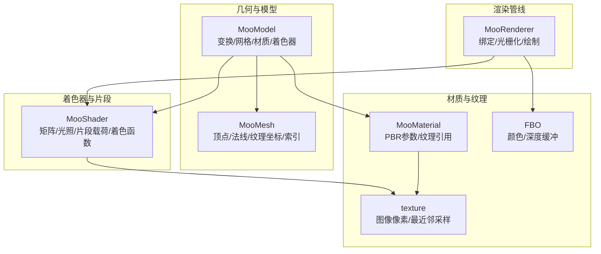
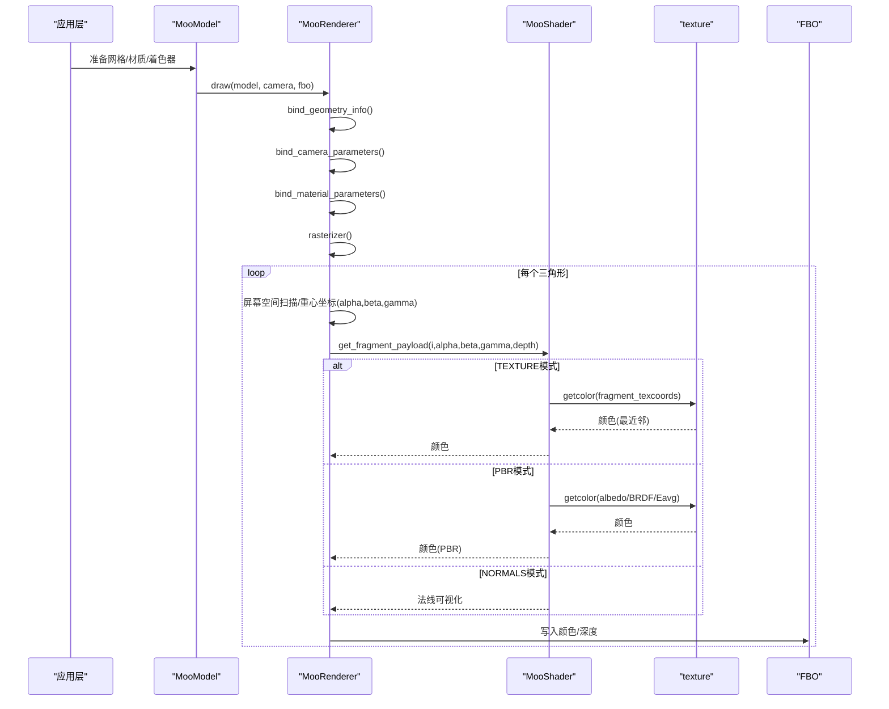
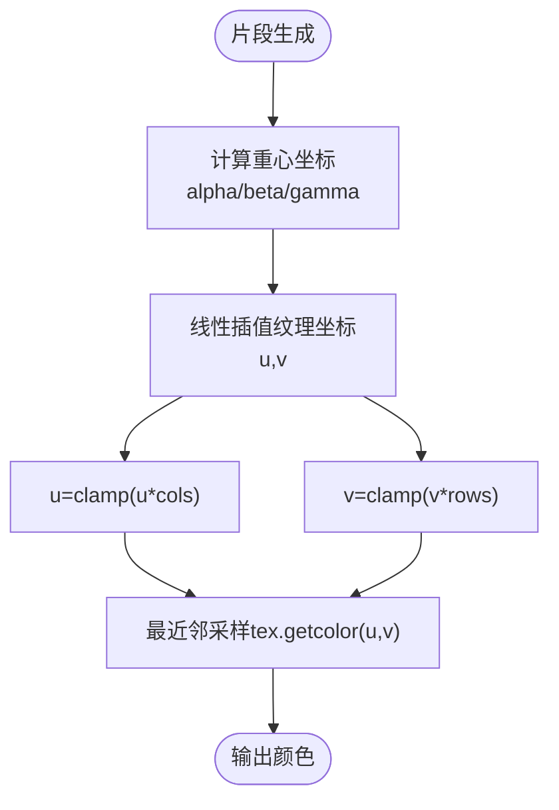
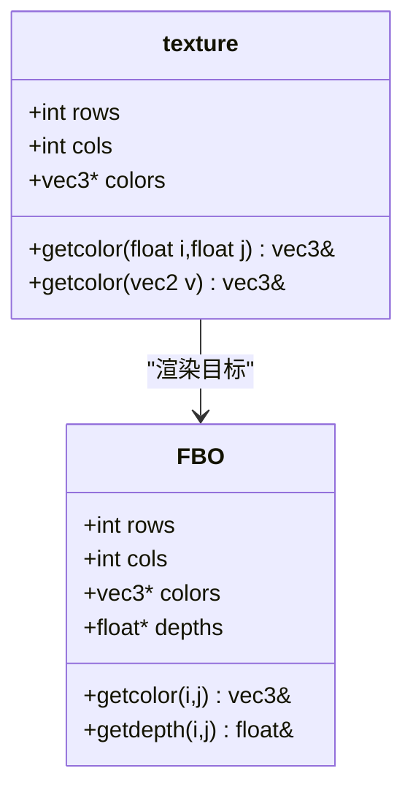
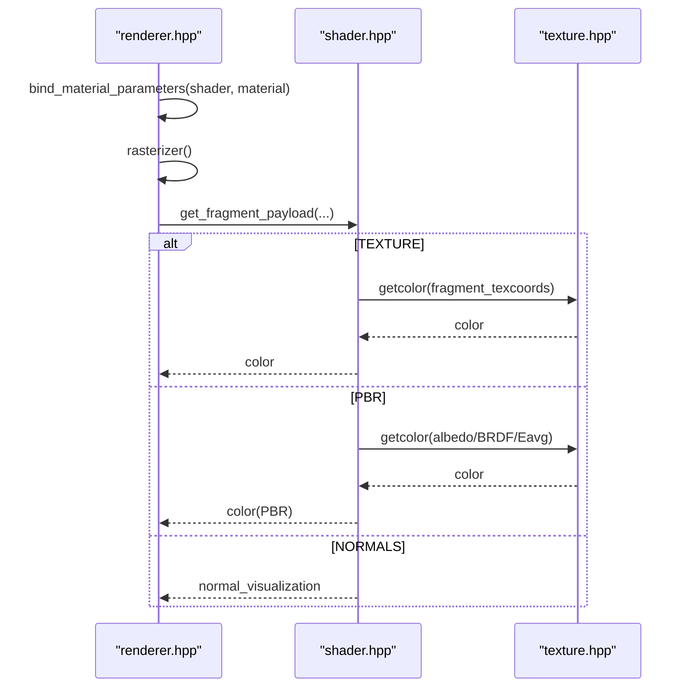
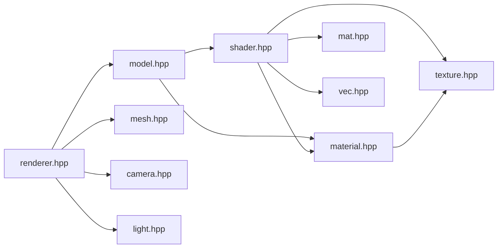

# 纹理映射

> **版本提示（2.0）**：本文撰写于 1.x 时期，描述的是旧的实现形态——入口在根目录 `main.cpp`，功能由根目录 `.hpp` 头文件库提供，窗口用 raylib、显示用 OpenCV highgui。2.0 已把这些头文件移到 `Source/Legacy/`，渲染默认走 GPU，窗口与 UI 换成 GLFW + ImGui，`main.cpp` 拆成 `Source/Launch/Private/` 下的 `Main.cpp` 与 `Application`。文中的文件路径、行号与调用链可能已失效，请以根目录的「项目概述」「快速开始」「故障排除」三篇与当前源码为准。

<cite>
**本文引用的文件**   
- [texture.hpp](file://texture.hpp)
- [material.hpp](file://material.hpp)
- [shader.hpp](file://shader.hpp)
- [mesh.hpp](file://mesh.hpp)
- [model.hpp](file://model.hpp)
- [renderer.hpp](file://renderer.hpp)
</cite>

## 目录
1. [简介](#简介)
2. [项目结构](#项目结构)
3. [核心组件](#核心组件)
4. [架构总览](#架构总览)
5. [详细组件分析](#详细组件分析)
6. [依赖关系分析](#依赖关系分析)
7. [性能与优化](#性能与优化)
8. [故障排查指南](#故障排查指南)
9. [结论](#结论)

## 简介
本文面向MooLab项目的纹理映射子系统，系统梳理UV坐标、纹理坐标插值、采样策略、贴图类型（漫反射/法线/高度/遮罩）以及加载管理与渲染管线集成。文档以代码为依据，结合可视化图示，帮助开发者理解纹理在3D渲染中的作用与优化技巧。

## 项目结构
本项目采用“数据+管线”的模块化组织：
- 几何与模型：mesh.hpp、model.hpp
- 材质与纹理：material.hpp、texture.hpp
- 着色器与片段计算：shader.hpp
- 光栅化与绘制：renderer.hpp

图表来源
- [mesh.hpp:6-14](file://mesh.hpp#L6-L14)
- [model.hpp:8-19](file://model.hpp#L8-L19)
- [material.hpp:15-31](file://material.hpp#L15-L31)
- [texture.hpp:65-84](file://texture.hpp#L65-L84)
- [shader.hpp:35-91](file://shader.hpp#L35-L91)
- [renderer.hpp:17-22](file://renderer.hpp#L17-L22)

章节来源
- [mesh.hpp:6-14](file://mesh.hpp#L6-L14)
- [model.hpp:8-19](file://model.hpp#L8-L19)
- [material.hpp:15-31](file://material.hpp#L15-L31)
- [texture.hpp:65-84](file://texture.hpp#L65-L84)
- [shader.hpp:35-91](file://shader.hpp#L35-L91)
- [renderer.hpp:17-22](file://renderer.hpp#L17-L22)

## 核心组件
- 纹理数据结构与采样
  - texture：二维像素数组，提供按浮点坐标的最近邻采样接口。
  - img_to_tex/tex_to_img：OpenCV图像与内部纹理格式互转。
- 材质与纹理绑定
  - MooMaterial：包含漫反射/金属度/粗糙度等PBR参数，并持有albedo/BRDF/Eavg LUT等纹理指针。
- 着色器与片段载荷
  - vertex_payload/fragment_payload：三角形顶点属性与插值后的片段属性（位置、法线、纹理坐标、深度）。
  - MooShader：持有投影/视图/模型矩阵、光照参数、纹理指针；实现PBR/纹理/法线三种片段着色。
- 光栅化与绘制
  - renderer.hpp：将几何信息绑定到着色器，进行光栅化、深度测试与片段着色调用。

章节来源
- [texture.hpp:65-101](file://texture.hpp#L65-L101)
- [material.hpp:15-31](file://material.hpp#L15-L31)
- [shader.hpp:19-33](file://shader.hpp#L19-L33)
- [shader.hpp:35-91](file://shader.hpp#L35-L91)
- [renderer.hpp:33-59](file://renderer.hpp#L33-L59)

## 架构总览
下图展示从模型到片段的完整数据流，重点体现UV坐标如何参与插值与采样。

图表来源
- [renderer.hpp:213-239](file://renderer.hpp#L213-L239)
- [renderer.hpp:121-211](file://renderer.hpp#L121-L211)
- [shader.hpp:112-127](file://shader.hpp#L112-L127)
- [shader.hpp:201-247](file://shader.hpp#L201-L247)
- [texture.hpp:65-84](file://texture.hpp#L65-L84)

## 详细组件分析

### UV坐标系统与纹理坐标插值
- UV定义
  - 顶点属性包含vec2纹理坐标，用于将二维纹理映射到三维表面。
- 插值原理
  - 光栅化阶段对三角形内像素计算重心坐标alpha/beta/gamma，随后线性插值得到片段纹理坐标：
    fragment_texcoords = alpha * v0.tex + beta * v1.tex + gamma * v2.tex
- 边界处理
  - 纹理采样时通过clampf将坐标限制在[0, rows-1]和[0, cols-1]范围内，避免越界。

图表来源
- [renderer.hpp:121-211](file://renderer.hpp#L121-L211)
- [shader.hpp:112-127](file://shader.hpp#L112-L127)
- [texture.hpp:70-81](file://texture.hpp#L70-L81)

章节来源
- [mesh.hpp:6-14](file://mesh.hpp#L6-L14)
- [renderer.hpp:121-211](file://renderer.hpp#L121-L211)
- [shader.hpp:112-127](file://shader.hpp#L112-L127)
- [texture.hpp:70-81](file://texture.hpp#L70-L81)

### 纹理采样技术
- 最近邻采样
  - texture::getcolor使用整数索引直接取像素，无插值，速度快但可能出现锯齿。
- 双线性插值
  - 当前实现未提供双线性插值；可在getcolor中扩展为四邻域加权平均。
- 各向异性过滤
  - 当前实现未提供各向异性过滤；可基于倾斜因子与方向权重改进长距离斜切表面的采样质量。

图表来源
- [texture.hpp:65-84](file://texture.hpp#L65-L84)
- [texture.hpp:11-34](file://texture.hpp#L11-L34)

章节来源
- [texture.hpp:65-84](file://texture.hpp#L65-L84)

### 纹理压缩格式与内存优化
- 当前实现
  - 使用OpenCV读取BGR图像，转换为RGB并转为float32通道存储于CPU侧数组。
  - 未使用GPU纹理对象或压缩格式（如BC/DXT/ASTC），也未做mipmap。
- 建议优化
  - 引入GPU纹理API（如OpenGL/Vulkan）并选择合适压缩格式（根据平台支持）。
  - 预计算mipmap以降低远距离采样的带宽与混叠。
  - 使用纹理图集减少状态切换与批渲染次数。
  - 按需加载与缓存常用贴图，释放不活跃资源。

章节来源
- [texture.hpp:86-101](file://texture.hpp#L86-L101)
- [texture.hpp:103-111](file://texture.hpp#L103-L111)

### 法线贴图、高度贴图与遮罩贴图
- 用途说明
  - 法线贴图：在不增加几何面数的情况下模拟表面细节起伏，增强高光与阴影细节。
  - 高度贴图：用于视差/位移贴图或离线生成法线贴图，表达表面高低信息。
  - 遮罩贴图：控制不同材质的混合区域（如地面与草地交界）。
- 实现要点
  - 法线贴图：在片段着色中读取法线贴图，构建切线空间基，将法线转换至世界/观察空间后参与光照。
  - 高度贴图：可驱动视差遮蔽或作为遮罩输入影响粗糙度/金属度。
  - 遮罩贴图：根据遮罩值混合多组材质参数（kd/ks/ka/metallic/roughness）或多张纹理。
- 当前代码现状
  - 材质结构支持多种纹理指针（albedo/BRDF/Eavg），但未显式提供法线/高度/遮罩字段；可在MooMaterial中扩展相应纹理指针并在着色器中接入。

章节来源
- [material.hpp:15-31](file://material.hpp#L15-L31)
- [shader.hpp:201-247](file://shader.hpp#L201-L247)

### 纹理加载、管理与缓存机制
- 加载流程
  - img_to_tex：读取图像→颜色空间转换→数据类型转换→拷贝到texture.colors。
  - tex_to_img：反向转换用于调试/导出。
- 管理现状
  - 纹理由材质持有，着色器通过材质指针访问；未见全局纹理缓存或引用计数。
- 建议机制
  - 建立纹理管理器：路径→纹理实例的映射，支持共享与延迟加载。
  - 生命周期管理：引用计数或RAII包装，自动释放不再使用的纹理。
  - 异步加载：后台线程解码与上传，主线程仅持有句柄。

章节来源
- [texture.hpp:86-101](file://texture.hpp#L86-L101)
- [texture.hpp:103-111](file://texture.hpp#L103-L111)
- [material.hpp:15-31](file://material.hpp#L15-L31)

### 具体示例：纹理绑定、采样与效果应用
- 纹理绑定
  - 通过bind_material_parameters将材质的albedo/BRDF/Eavg纹理指针赋给着色器。
- 纹理采样
  - 在TEXTURE/PBR模式中，片段着色调用texture::getcolor获取颜色。
- 效果应用
  - TEXTURE模式：直接输出漫反射颜色。
  - PBR模式：基于albedo与BRDF/Eavg LUT计算多重散射BRDF，并进行色调映射与伽马校正。
  - NORMALS模式：将法线向量归一化后可视化。

图表来源
- [renderer.hpp:74-84](file://renderer.hpp#L74-L84)
- [renderer.hpp:121-211](file://renderer.hpp#L121-L211)
- [shader.hpp:201-247](file://shader.hpp#L201-L247)
- [texture.hpp:65-84](file://texture.hpp#L65-L84)

章节来源
- [renderer.hpp:74-84](file://renderer.hpp#L74-L84)
- [renderer.hpp:121-211](file://renderer.hpp#L121-L211)
- [shader.hpp:201-247](file://shader.hpp#L201-L247)
- [texture.hpp:65-84](file://texture.hpp#L65-L84)

## 依赖关系分析
- 模块耦合
  - renderer.hpp依赖model.hpp、mesh.hpp、camera.hpp、light.hpp，负责几何绑定与光栅化。
  - shader.hpp依赖material.hpp、texture.hpp、mat.hpp、vec.hpp，负责片段着色与数学运算。
  - model.hpp依赖mesh.hpp、shader.hpp，组装网格、材质与着色器。
  - material.hpp依赖texture.hpp，承载纹理引用。
  - texture.hpp依赖opencv与vec.hpp，提供图像与基础向量类型。

图表来源
- [renderer.hpp:1-8](file://renderer.hpp#L1-L8)
- [model.hpp:1-7](file://model.hpp#L1-L7)
- [shader.hpp:1-8](file://shader.hpp#L1-L8)
- [material.hpp:1-5](file://material.hpp#L1-L5)
- [texture.hpp:1-9](file://texture.hpp#L1-L9)

章节来源
- [renderer.hpp:1-8](file://renderer.hpp#L1-L8)
- [model.hpp:1-7](file://model.hpp#L1-L7)
- [shader.hpp:1-8](file://shader.hpp#L1-L8)
- [material.hpp:1-5](file://material.hpp#L1-L5)
- [texture.hpp:1-9](file://texture.hpp#L1-L9)

## 性能与优化
- 采样质量与速度权衡
  - 当前最近邻采样最快但易出现锯齿；建议在关键视角或近距离物体上启用双线性插值，必要时加入各向异性过滤。
- 带宽与缓存
  - 减少纹理切换，合并材质或使用纹理图集。
  - 预生成mipmap，降低远距离采样带宽与混叠。
- 并行与批处理
  - 光栅化已使用并行循环；确保纹理访问局部性良好，避免跨行跳跃导致的缓存失效。
- 内存占用
  - 避免重复加载相同纹理；实现纹理缓存与引用计数。
  - 考虑压缩格式（GPU侧）以减少显存占用与带宽压力。

[本节为通用指导，无需特定文件来源]

## 故障排查指南
- 图像加载失败
  - 现象：img_to_tex返回空图或断言失败。
  - 排查：确认路径正确、文件格式受支持；检查OpenCV初始化与环境变量。
- 纹理坐标越界
  - 现象：采样异常或崩溃。
  - 排查：确认UV范围与纹理尺寸匹配；检查插值与clamp逻辑。
- 颜色空间问题
  - 现象：颜色过亮/偏色。
  - 排查：确认BGR↔RGB转换与伽马校正（2.2）一致。
- 法线可视化异常
  - 现象：法线贴图显示不正确。
  - 排查：确认法线空间（切线/世界）转换正确；检查法线归一化。

章节来源
- [texture.hpp:86-101](file://texture.hpp#L86-L101)
- [texture.hpp:103-111](file://texture.hpp#L103-L111)
- [shader.hpp:249-254](file://shader.hpp#L249-L254)

## 结论
MooLab的纹理映射子系统以简洁的数据结构与明确的管线分工实现了基础的纹理绑定、插值与采样能力。当前实现聚焦于最近邻采样与CPU侧纹理存储，适合教学与原型开发。若追求更高画质与性能，建议引入双线性/各向异性过滤、GPU纹理与压缩格式、mipmap与纹理缓存机制，并扩展法线/高度/遮罩贴图的完整工作流。