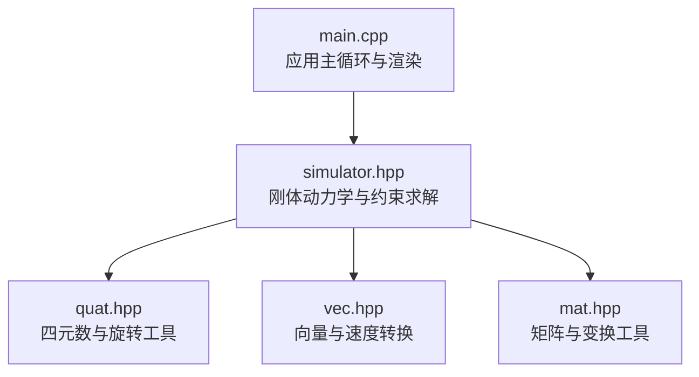
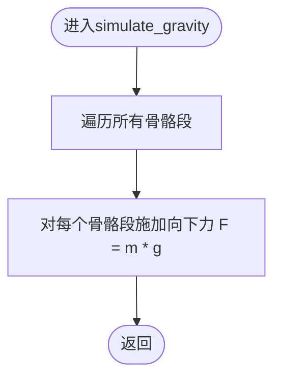
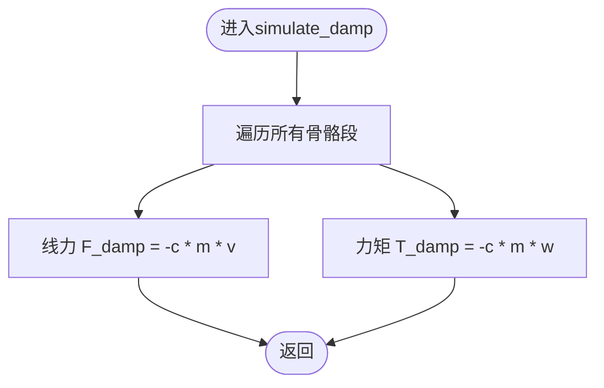
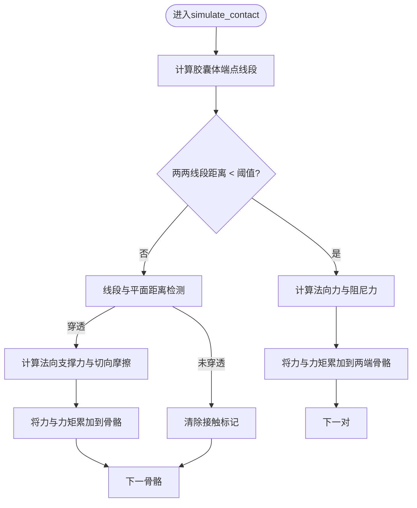
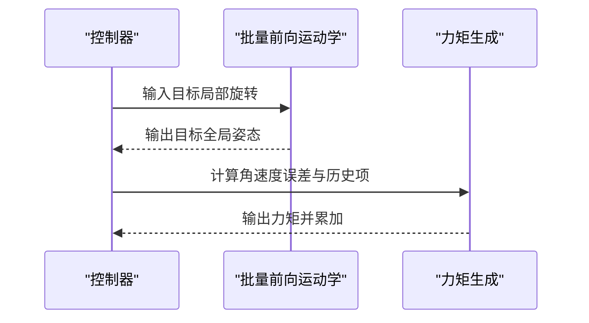
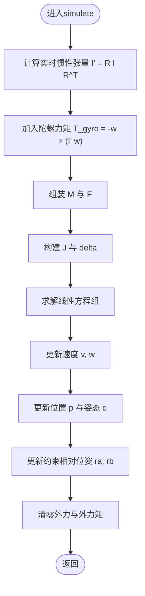
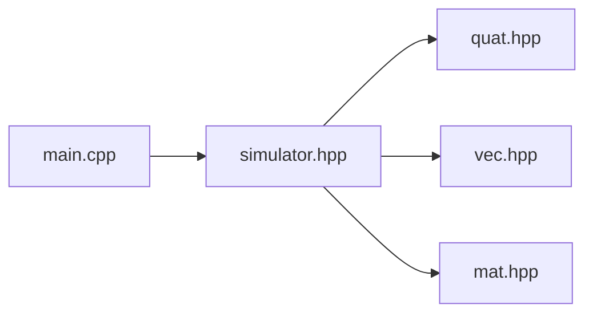

# 刚体动力学

> **版本提示（2.0）**：本文撰写于 1.x 时期，描述的是旧的实现形态——入口在根目录 `main.cpp`，功能由根目录 `.hpp` 头文件库提供，窗口用 raylib、显示用 OpenCV highgui。2.0 已把这些头文件移到 `Source/Legacy/`，渲染默认走 GPU，窗口与 UI 换成 GLFW + ImGui，`main.cpp` 拆成 `Source/Launch/Private/` 下的 `Main.cpp` 与 `Application`。文中的文件路径、行号与调用链可能已失效，请以根目录的「项目概述」「快速开始」「故障排除」三篇与当前源码为准。

<cite>
**本文引用的文件**   
- [simulator.hpp](file://simulator.hpp)
- [main.cpp](file://main.cpp)
- [quat.hpp](file://quat.hpp)
- [vec.hpp](file://vec.hpp)
- [mat.hpp](file://mat.hpp)
</cite>

## 目录
1. [引言](#引言)
2. [项目结构](#项目结构)
3. [核心组件](#核心组件)
4. [架构总览](#架构总览)
5. [详细组件分析](#详细组件分析)
6. [依赖关系分析](#依赖关系分析)
7. [性能与数值积分](#性能与数值积分)
8. [故障排查指南](#故障排查指南)
9. [结论](#结论)

## 引言
本文件面向MooLab项目中的刚体动力学子系统，重点解释牛顿运动定律在角色动画中的应用：力的计算、力矩的生成与角动量守恒的实现。文档围绕Simulator类展开，说明质量矩阵、惯性张量、速度与角速度的更新机制；阐述重力模拟、阻尼系统与碰撞响应的数学原理；并给出参数调优策略与数值积分方法的选择建议，帮助开发者理解刚体动力学在角色动画中的核心作用。

## 项目结构
本项目采用C++实现，物理仿真核心位于simulator.hpp，主循环与渲染集成于main.cpp，四元数与向量/矩阵工具分别位于quat.hpp、vec.hpp、mat.hpp。资源脚本（MATLAB）用于辅助验证或离线实验，但本代码库的核心运行逻辑由上述C++头文件提供。



图表来源
- [main.cpp:53-100](file://main.cpp#L53-L100)
- [simulator.hpp:321-355](file://simulator.hpp#L321-L355)
- [quat.hpp:182-226](file://quat.hpp#L182-L226)
- [vec.hpp:200-210](file://vec.hpp#L200-L210)
- [mat.hpp:186-194](file://mat.hpp#L186-L194)

章节来源
- [main.cpp:53-100](file://main.cpp#L53-L100)
- [simulator.hpp:321-355](file://simulator.hpp#L321-L355)

## 核心组件
- Simulator：管理角色骨骼的刚体属性（质量、惯性张量）、形状（胶囊体半径与长度）、连接（关节约束）、状态（位置、姿态、线速度、角速度），以及每步的外力与外力矩累积。
- 物理模块：重力、阻尼、碰撞检测与响应、约束求解（线性方程组）。
- 控制模块：局部控制与全局控制，将目标姿态转换为力矩以驱动刚体系统。
- 运动学工具：批量前向运动学、姿态补偿、速度/角速度估计与四元数更新。

章节来源
- [simulator.hpp:321-355](file://simulator.hpp#L321-L355)
- [simulator.hpp:357-435](file://simulator.hpp#L357-L435)
- [simulator.hpp:437-541](file://simulator.hpp#L437-L541)
- [simulator.hpp:543-624](file://simulator.hpp#L543-L624)

## 架构总览
下图展示从主循环到物理仿真的调用链，包括重力、阻尼、碰撞与控制注入，最终通过约束求解更新速度与位置。

```mermaid
sequenceDiagram
participant App as "应用(main.cpp)"
participant Sim as "仿真器(Simulator)"
participant Grav as "重力(simulate_gravity)"
participant Damp as "阻尼(simulate_damp)"
participant Coll as "碰撞(simulate_contact)"
participant Ctrl as "控制(局部/全局)"
participant Solve as "求解(simulate)"
App->>Sim : 初始化绑定(bind_simulator)
loop 每帧
App->>Sim : simulate_gravity(g)
App->>Sim : simulate_damp(damp)
App->>Sim : simulate_contact(A,B,C,D,eps)
alt 控制阶段
App->>Sim : simulate_global_control(...)
or
App->>Sim : simulate_local_control(...)
end
App->>Sim : simulate(dt)
Sim-->>App : 更新后的位置/姿态
end
```

图表来源
- [main.cpp:320-339](file://main.cpp#L320-L339)
- [simulator.hpp:357-372](file://simulator.hpp#L357-L372)
- [simulator.hpp:374-435](file://simulator.hpp#L374-L435)
- [simulator.hpp:437-541](file://simulator.hpp#L437-L541)
- [simulator.hpp:543-624](file://simulator.hpp#L543-L624)

## 详细组件分析

### 刚体属性与状态管理
- 质量与惯性张量：每个骨骼段具有标量质量与3x3惯性张量；惯性张量随姿态实时更新，体现角动量的方向性。
- 形状与连接：每个骨骼段用胶囊体表示（半径与长度），并通过link结构描述相邻骨骼间的相对位姿差，作为约束项参与求解。
- 速度与角速度：维护线速度与角速度数组，并在每步中根据外力和约束进行更新。
- 外力与外力矩：每步累积来自重力、阻尼、碰撞与控制的作用，随后清零以避免重复影响。

章节来源
- [simulator.hpp:321-355](file://simulator.hpp#L321-L355)
- [simulator.hpp:784-804](file://simulator.hpp#L784-L804)
- [simulator.hpp:811-819](file://simulator.hpp#L811-L819)

### 重力模拟
重力为恒定向下的体积力，按质量累加至各骨骼段的线力上，符合F=mg。



图表来源
- [simulator.hpp:357-363](file://simulator.hpp#L357-L363)

章节来源
- [simulator.hpp:357-363](file://simulator.hpp#L357-L363)

### 阻尼系统
阻尼同时作用于线速度与角速度，形式为与速度成比例的阻力，有助于抑制数值振荡与能量增长。



图表来源
- [simulator.hpp:365-372](file://simulator.hpp#L365-L372)

章节来源
- [simulator.hpp:365-372](file://simulator.hpp#L365-L372)

### 碰撞检测与响应
- 刚体间碰撞：对每对骨骼段的胶囊体端点进行线段距离计算，若穿透则基于弹簧-阻尼模型产生法向力与切向摩擦力，并转化为力与力矩。
- 地面碰撞：使用平面方程检测线段与平面的距离，若穿透则施加法向支撑力与切向摩擦，并标记接触状态。



图表来源
- [simulator.hpp:374-435](file://simulator.hpp#L374-L435)

章节来源
- [simulator.hpp:374-435](file://simulator.hpp#L374-L435)

### 控制模块（局部与全局）
- 局部控制：依据目标局部旋转与当前姿态差异，计算角速度误差，并通过PID-like项生成力矩，考虑接触计数对根节点的控制分配。
- 全局控制：先通过批量前向运动学得到目标全局姿态，再计算角速度误差并生成力矩，不严格满足物理但效果直观。



图表来源
- [simulator.hpp:437-541](file://simulator.hpp#L437-L541)
- [simulator.hpp:634-662](file://simulator.hpp#L634-L662)

章节来源
- [simulator.hpp:437-541](file://simulator.hpp#L437-L541)
- [simulator.hpp:634-662](file://simulator.hpp#L634-L662)

### 物理状态更新与约束求解
每步物理更新流程如下：
1. 计算实时惯性张量：I' = R I R^T，其中R为姿态旋转矩阵。
2. 加入陀螺力矩项：T_gyro = -w × (I' w)，体现角动量守恒导致的非线性力矩。
3. 组装质量矩阵M与外力向量F：平移部分为m/h*I_3，旋转部分为I'/h。
4. 构建约束雅可比J与误差delta：基于相邻骨骼的相对位移差，除以时间步长。
5. 求解线性方程组：[M J^T; J 0] [v; λ] = [F; delta]，得到新速度与拉格朗日乘子。
6. 更新位置与姿态：p ← p + v·dt，q ← q ⊗ exp(w·dt)。
7. 更新约束相对位姿ra、rb，并清零外力与外力矩。



图表来源
- [simulator.hpp:543-624](file://simulator.hpp#L543-L624)

章节来源
- [simulator.hpp:543-624](file://simulator.hpp#L543-L624)

### 数值工具与数据流
- 四元数与旋转：quat_to_Rodrigues将四元数转为旋转矩阵；avel_to_quat与quat_to_avel在角速度与四元数之间转换；inv_quat用于逆运算。
- 向量与速度：vel_to_vec将线速度转换为位移增量；vec_to_vel估计离散速度。
- 矩阵与变换：get_rigid_body_motion_matrix等工具用于刚体位姿矩阵构造。

章节来源
- [quat.hpp:182-226](file://quat.hpp#L182-L226)
- [vec.hpp:200-210](file://vec.hpp#L200-L210)
- [mat.hpp:186-194](file://mat.hpp#L186-L194)

## 依赖关系分析
- Simulator依赖quat.hpp与vec.hpp提供的旋转与速度工具，依赖mat.hpp的矩阵操作。
- main.cpp负责初始化、绑定Simulator、每帧调用物理模块并将结果映射回渲染模型。
- 约束求解依赖于线性方程组求解器（高斯消去），该求解器在simulator.hpp内部实现。



图表来源
- [main.cpp:53-100](file://main.cpp#L53-L100)
- [simulator.hpp:321-355](file://simulator.hpp#L321-L355)
- [quat.hpp:182-226](file://quat.hpp#L182-L226)
- [vec.hpp:200-210](file://vec.hpp#L200-L210)
- [mat.hpp:186-194](file://mat.hpp#L186-L194)

章节来源
- [main.cpp:53-100](file://main.cpp#L53-L100)
- [simulator.hpp:321-355](file://simulator.hpp#L321-L355)

## 性能与数值积分
- 数值积分方法：本实现采用半隐式欧拉（Symplectic Euler）风格的速度-位置更新，即先解出速度，再用速度更新位置与姿态。该方法在刚体系统中具备较好的稳定性与能量特性。
- 时间步长dt：默认约1/60秒，可在主循环中调整simulate_time与dt以平衡精度与性能。
- 约束求解复杂度：线性方程组规模随骨骼数量与约束数量增长，O((6N+3L)^3)的高阶开销显著，需限制骨骼数量或采用稀疏求解器优化。
- 并行化：矩阵乘法已使用OpenMP并行加速，可进一步对碰撞检测与约束装配进行并行化。
- 参数调优策略：
  - 重力g：通常取9.8，可根据场景尺度调整。
  - 阻尼damp：较小值（如0.25~0.5）抑制数值发散，过大将导致过阻尼。
  - 碰撞刚度kp与阻尼kd：kp控制穿透恢复强度，kd控制冲击衰减；地面碰撞kp≈10000、kd≈100较稳健。
  - 控制增益：全局/局部控制的角速度误差比例项与微分项需根据动作幅度与稳定性权衡。

章节来源
- [main.cpp:164-168](file://main.cpp#L164-L168)
- [main.cpp:320-339](file://main.cpp#L320-L339)
- [simulator.hpp:543-624](file://simulator.hpp#L543-L624)
- [simulator.hpp:374-435](file://simulator.hpp#L374-L435)

## 故障排查指南
- 穿透与抖动：
  - 检查碰撞检测阈值eps与半径设置是否合理；适当增大kp或减小eps。
  - 确认地面平面方程A,B,C,D是否正确，法向方向是否与重力相反。
- 不稳定或爆炸：
  - 降低控制增益（比例项与微分项），避免过激力矩。
  - 增加阻尼damp，抑制高频振荡。
- 角动量异常：
  - 确认惯性张量I与姿态R的更新顺序正确，陀螺力矩项是否被加入。
  - 检查avel_to_quat与quat_to_Rodrigues的使用一致性。
- 约束失效：
  - 检查link的ra、rb与delta更新是否在每步后重置。
  - 确保约束雅可比J的符号与维度正确。

章节来源
- [simulator.hpp:374-435](file://simulator.hpp#L374-L435)
- [simulator.hpp:543-624](file://simulator.hpp#L543-L624)
- [quat.hpp:182-226](file://quat.hpp#L182-L226)

## 结论
MooLab的刚体动力学子系统以Simulator为核心，结合重力、阻尼与碰撞响应，通过约束求解实现稳定的刚体运动。其关键数学原理包括：质量的线性动量方程、惯性张量与陀螺力矩的角动量守恒、弹簧-阻尼模型的碰撞响应，以及半隐式欧拉的数值积分。开发者可通过调整时间步长、阻尼、碰撞刚度与控制增益，获得稳定且自然的角色动画效果。建议在大规模骨架场景中引入稀疏求解与并行化，以提升性能与可扩展性。