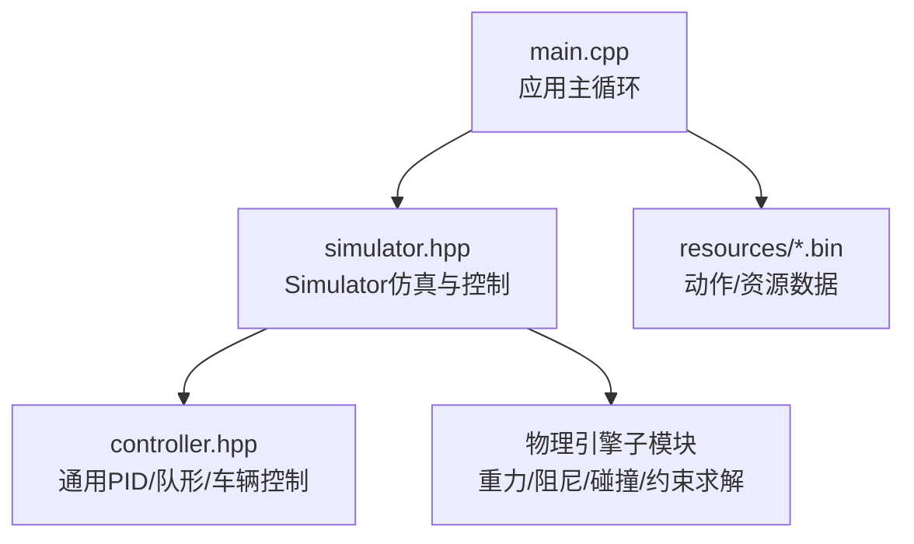
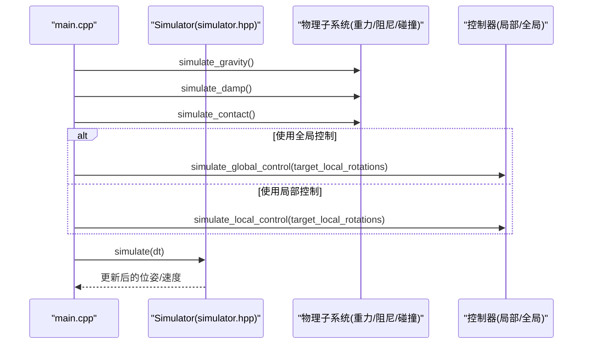
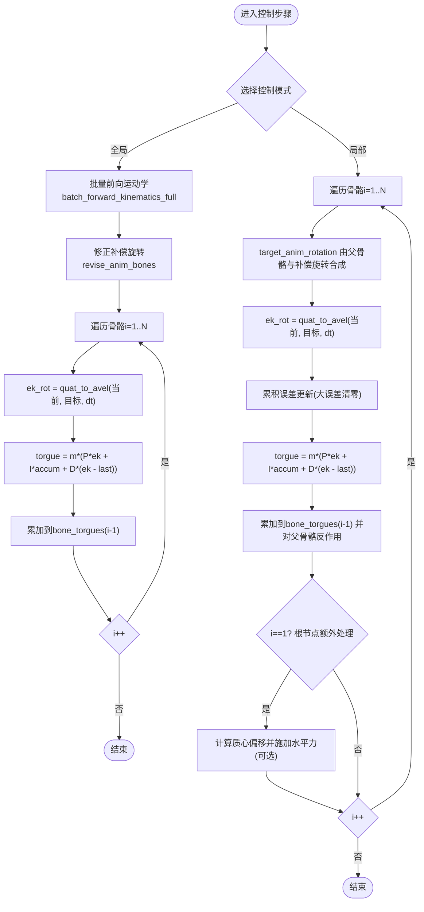
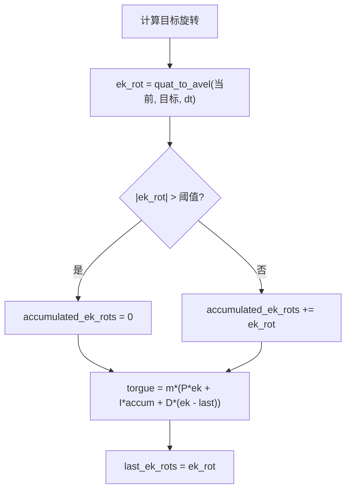
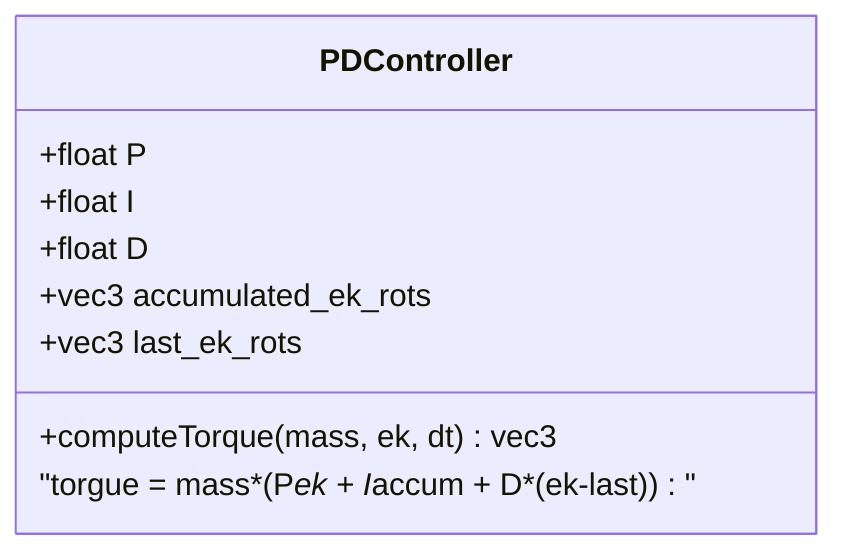
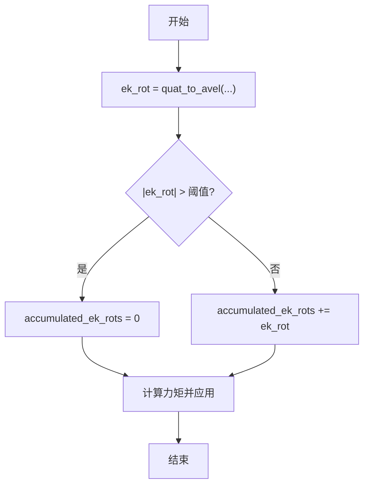
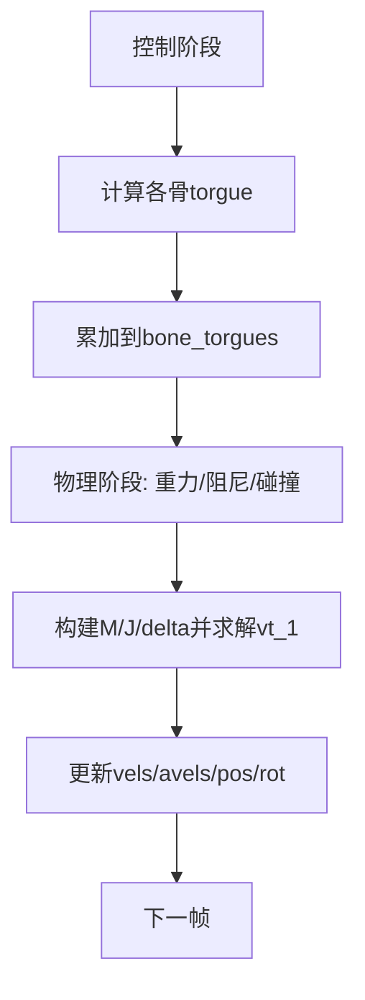
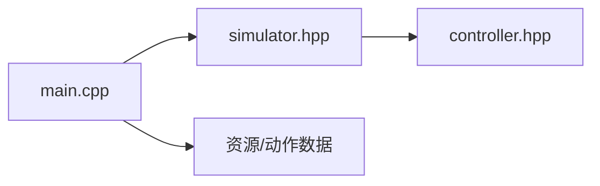

# 控制系统

> **版本提示（2.0）**：本文撰写于 1.x 时期，描述的是旧的实现形态——入口在根目录 `main.cpp`，功能由根目录 `.hpp` 头文件库提供，窗口用 raylib、显示用 OpenCV highgui。2.0 已把这些头文件移到 `Source/Legacy/`，渲染默认走 GPU，窗口与 UI 换成 GLFW + ImGui，`main.cpp` 拆成 `Source/Launch/Private/` 下的 `Main.cpp` 与 `Application`。文中的文件路径、行号与调用链可能已失效，请以根目录的「项目概述」「快速开始」「故障排除」三篇与当前源码为准。

<cite>
**本文引用的文件**   
- [controller.hpp](file://controller.hpp)
- [simulator.hpp](file://simulator.hpp)
- [main.cpp](file://main.cpp)
</cite>

## 目录
1. [引言](#引言)
2. [项目结构](#项目结构)
3. [核心组件](#核心组件)
4. [架构总览](#架构总览)
5. [详细组件分析](#详细组件分析)
6. [依赖关系分析](#依赖关系分析)
7. [性能与稳定性](#性能与稳定性)
8. [故障排查指南](#故障排查指南)
9. [结论](#结论)
10. [附录：参数调优与实践建议](#附录参数调优与实践建议)

## 引言
本文件面向MooLab项目的角色控制系统，重点解释局部控制（local control）与全局控制（global control）的区别、目标旋转的计算与误差反馈机制、PD控制器（比例-微分控制器）的实现原理与调参方法，以及累积误差补偿机制如何防止长期运行漂移。文档同时给出simulate_local_control与simulate_global_control的调用流程与实现要点，说明扭矩计算、力分配与稳定性保证策略，并总结控制参数对角色行为的影响和优化思路。

## 项目结构
本项目在仿真循环中通过Simulator执行物理步进，并在每步注入控制力矩；主程序负责读取动作数据、绑定仿真器、渲染与交互。关键文件职责如下：
- controller.hpp：通用PID/游戏手柄控制、队形控制、双轮车运动学等辅助控制逻辑。
- simulator.hpp：刚体动力学仿真、碰撞检测、局部/全局控制、前向运动学与约束求解。
- main.cpp：应用入口，驱动仿真循环，选择并切换局部/全局控制模式。

图表来源
- [main.cpp:223-345](file://main.cpp#L223-L345)
- [simulator.hpp:321-624](file://simulator.hpp#L321-L624)
- [controller.hpp:1-110](file://controller.hpp#L1-L110)

章节来源
- [main.cpp:53-170](file://main.cpp#L53-L170)
- [simulator.hpp:321-355](file://simulator.hpp#L321-L355)
- [controller.hpp:1-36](file://controller.hpp#L1-L36)

## 核心组件
- Simulator：封装骨骼质量、惯性、连接、形状、速度/角速度、力/力矩、累积误差等状态，提供simulate_gravity、simulate_damp、simulate_contact、simulate_local_control、simulate_global_control、simulate等方法。
- Camera_Controller / Character_Controller / formation / two_wheeled_car：通用控制工具，包含位置/方向PID、队形生成与跟踪、两轮车速度与姿态控制。
- main.cpp：将动作帧作为目标姿态输入到Simulator的控制接口，并在仿真步进前后进行数据更新与渲染。

章节来源
- [simulator.hpp:321-355](file://simulator.hpp#L321-L355)
- [controller.hpp:7-141](file://controller.hpp#L7-L141)
- [main.cpp:95-170](file://main.cpp#L95-L170)

## 架构总览
下图展示从主循环到控制器的调用链，以及局部/全局控制的选择点。

图表来源
- [main.cpp:320-339](file://main.cpp#L320-L339)
- [simulator.hpp:357-435](file://simulator.hpp#L357-L435)
- [simulator.hpp:437-541](file://simulator.hpp#L437-L541)
- [simulator.hpp:543-624](file://simulator.hpp#L543-L624)

## 详细组件分析

### 局部控制 vs 全局控制
- 全局控制（simulate_global_control）
  - 基于目标局部关节旋转，先做批量前向运动学得到各骨骼的全局姿态，再修正补偿旋转，最后逐骨计算误差角速度并施加力矩。
  - 特点：不直接考虑接触约束，但能产生“符合视觉预期”的姿态跟踪效果；适合快速验证或离线回放。
- 局部控制（simulate_local_control）
  - 直接以目标局部旋转为参考，计算当前骨骼与目标之间的误差角速度，结合累积误差与上一帧误差的微分项，按质量加权输出力矩；根节点额外计算质心偏移并施加水平力（代码注释部分），用于维持整体平衡。
  - 特点：更贴近物理，需要仔细调参以获得稳定行走/跑动。

图表来源
- [simulator.hpp:512-541](file://simulator.hpp#L512-L541)
- [simulator.hpp:437-510](file://simulator.hpp#L437-L510)
- [simulator.hpp:634-662](file://simulator.hpp#L634-L662)

章节来源
- [simulator.hpp:437-541](file://simulator.hpp#L437-L541)
- [simulator.hpp:634-662](file://simulator.hpp#L634-L662)

### 目标旋转的计算与误差反馈机制
- 目标旋转来源
  - 全局控制：对输入的局部旋转序列做批量前向运动学，得到全局姿态，再进行补偿修正。
  - 局部控制：根据父骨骼姿态与补偿旋转，合成每个骨骼的目标局部旋转。
- 误差计算
  - 使用quat_to_avel将“当前姿态到目标姿态”的差转换为角速度向量ek_rot，作为误差信号。
- 反馈项
  - 比例项：P * ek_rot，直接响应误差大小。
  - 积分项：I * accumulated_ek_rots，累积历史误差，消除稳态偏差（当前实现中I系数常为0）。
  - 微分项：D * (ek_rot - last_ek_rots)，抑制超调和振荡。
- 稳定性保护
  - 当|ek_rot|超过阈值时，重置累积误差，避免长期积分导致漂移。

图表来源
- [simulator.hpp:521-539](file://simulator.hpp#L521-L539)
- [simulator.hpp:449-502](file://simulator.hpp#L449-L502)

章节来源
- [simulator.hpp:521-539](file://simulator.hpp#L521-L539)
- [simulator.hpp:449-502](file://simulator.hpp#L449-L502)

### PD控制器（比例-微分控制器）实现原理与调参
- 实现要点
  - 比例系数P：增大可加快响应，但过大易引起抖动。
  - 微分系数D：增大可抑制振荡，提高稳定性，但过大会放大噪声。
  - 积分系数I：用于消除稳态误差；当前实现中I多为0，若需消除静态偏差可适当引入。
- 调参建议
  - 先设I=0，逐步增大P至接近临界振荡，再引入D抑制振荡，最后微调P/D达到平滑跟踪。
  - 对根节点（全身平衡）与末端肢体分别调参，根节点通常需要更大的P和适当的D。
- 代码中的典型形式
  - torgue = mass * (P * ek + I * accum + D * (ek - last))
  - 根节点还可能叠加水平力以纠正质心偏移（代码注释分支）。

图表来源
- [simulator.hpp:521-539](file://simulator.hpp#L521-L539)
- [simulator.hpp:449-502](file://simulator.hpp#L449-L502)

章节来源
- [simulator.hpp:521-539](file://simulator.hpp#L521-L539)
- [simulator.hpp:449-502](file://simulator.hpp#L449-L502)

### 累积误差补偿机制与防漂移
- 机制
  - 每步将ek_rot累加到accumulated_ek_rots，形成积分项。
  - 当|ek_rot|超过阈值时，清空累积误差，避免长期积分导致的漂移。
- 适用场景
  - 存在持续小误差的系统（如地面摩擦、数值误差）可通过I项消除稳态偏差。
  - 在大扰动或失步情况下，阈值清零可快速恢复。

图表来源
- [simulator.hpp:521-539](file://simulator.hpp#L521-L539)
- [simulator.hpp:449-502](file://simulator.hpp#L449-L502)

章节来源
- [simulator.hpp:521-539](file://simulator.hpp#L521-L539)
- [simulator.hpp:449-502](file://simulator.hpp#L449-L502)

### 扭矩计算、力分配与稳定性保证
- 扭矩计算
  - 逐骨计算ek_rot，并按质量加权输出torgue，累加到对应骨骼的bone_torgues。
  - 局部控制中，对父骨骼施加反作用力矩，满足牛顿第三定律。
- 力分配
  - 根节点在局部控制中计算质心偏移，并施加水平力（代码注释分支），以维持整体平衡。
- 稳定性保证
  - 碰撞检测与阻尼：simulate_contact与simulate_damp提供接触力与速度阻尼，增强稳定性。
  - 约束求解：simulate中构建质量矩阵M与约束雅可比J，解线性方程组更新速度与位姿，确保约束一致性。

图表来源
- [simulator.hpp:437-541](file://simulator.hpp#L437-L541)
- [simulator.hpp:357-435](file://simulator.hpp#L357-L435)
- [simulator.hpp:543-624](file://simulator.hpp#L543-L624)

章节来源
- [simulator.hpp:437-541](file://simulator.hpp#L437-L541)
- [simulator.hpp:357-435](file://simulator.hpp#L357-L435)
- [simulator.hpp:543-624](file://simulator.hpp#L543-L624)

### 代码示例路径：simulate_local_control 与 simulate_global_control
- simulate_global_control
  - 调用批量前向运动学得到全局姿态，修正补偿旋转，逐骨计算误差与力矩。
  - 参考路径：[simulator.hpp:512-541](file://simulator.hpp#L512-L541)
- simulate_local_control
  - 合成目标局部旋转，计算误差与力矩，根节点附加质心偏移力（注释分支），并考虑接触计数。
  - 参考路径：[simulator.hpp:437-510](file://simulator.hpp#L437-L510)
- 主循环调用
  - 在main.cpp中根据时间步选择全局或局部控制，并传入动作帧的局部旋转序列。
  - 参考路径：[main.cpp:320-339](file://main.cpp#L320-L339)

章节来源
- [simulator.hpp:437-541](file://simulator.hpp#L437-L541)
- [main.cpp:320-339](file://main.cpp#L320-L339)

## 依赖关系分析
- 耦合关系
  - main.cpp依赖simulator.hpp提供的控制接口与物理步进。
  - simulator.hpp内部耦合了运动学、碰撞、约束求解与控制器逻辑。
  - controller.hpp提供通用PID与队形控制，供其他模块复用。
- 外部依赖
  - 动作数据（BVH_Motion）与资源文件（character.bin、database.bin等）通过main.cpp加载。
- 潜在循环依赖
  - 当前结构无直接循环依赖；控制器与仿真器职责清晰分离。

图表来源
- [main.cpp:8-17](file://main.cpp#L8-L17)
- [simulator.hpp:321-355](file://simulator.hpp#L321-L355)
- [controller.hpp:1-36](file://controller.hpp#L1-L36)

章节来源
- [main.cpp:8-17](file://main.cpp#L8-L17)
- [simulator.hpp:321-355](file://simulator.hpp#L321-L355)
- [controller.hpp:1-36](file://controller.hpp#L1-L36)

## 性能与稳定性
- 性能
  - 批量前向运动学与约束求解为O(N)与O((6N+3L)^3)量级（N骨骼数，L连接数），在人体模型规模下可接受。
  - 碰撞检测为O(N^2)对骨骼胶囊体，可通过空间划分优化。
- 稳定性
  - 阻尼与碰撞刚度/阻尼系数影响稳定性；过大可能导致数值不稳定，过小则穿透严重。
  - 控制参数P/D需与仿真步长dt匹配；dt越小，P可适度增大以提升响应。

章节来源
- [simulator.hpp:543-624](file://simulator.hpp#L543-L624)
- [simulator.hpp:374-435](file://simulator.hpp#L374-L435)

## 故障排查指南
- 症状：角色抖动或高频振荡
  - 可能原因：P过大或D不足
  - 解决：降低P或增大D，检查dt是否过小导致微分项放大噪声
- 症状：角色缓慢漂移或无法回到目标姿态
  - 可能原因：I=0导致稳态误差未消除
  - 解决：适当引入I项，或检查累积误差阈值是否过早清零
- 症状：脚部穿透地面或弹跳
  - 可能原因：碰撞刚度kp或阻尼kd设置不当
  - 解决：调整kp/kd，或减小dt提升数值精度
- 症状：根节点失衡摔倒
  - 可能原因：根节点水平力未启用或参数不合适
  - 解决：启用根节点质心偏移力分支，或调整根节点P/D

章节来源
- [simulator.hpp:437-541](file://simulator.hpp#L437-L541)
- [simulator.hpp:374-435](file://simulator.hpp#L374-L435)

## 结论
MooLab的控制系统通过局部与全局两种模式实现角色姿态跟踪：全局控制侧重视觉效果与快速验证，局部控制更贴近物理且需精细调参。PD控制器以误差角速度为核心反馈信号，结合累积误差与微分项提升稳定性。主循环在每步注入控制力矩，并通过物理引擎的阻尼、碰撞与约束求解保证系统稳定。合理设置P/D/I与碰撞参数，可在不同任务中取得良好表现。

## 附录：参数调优与实践建议
- 控制参数
  - P：先从小到大增加至出现轻微振荡，再引入D抑制。
  - D：逐步增加至振荡消失，注意避免过度阻尼导致响应迟缓。
  - I：仅在存在稳态误差时启用，配合阈值清零防止漂移。
- 物理参数
  - 阻尼：simulate_damp的阻尼系数需与dt匹配，避免数值不稳定。
  - 碰撞：kp/kd需平衡穿透与稳定性，必要时减小dt。
- 实践建议
  - 先用全局控制验证动作轨迹，再切换到局部控制进行物理一致性优化。
  - 对根节点与末端肢体分别调参，根节点更注重整体平衡，末端注重精准跟踪。

章节来源
- [simulator.hpp:437-541](file://simulator.hpp#L437-L541)
- [simulator.hpp:357-435](file://simulator.hpp#L357-L435)
- [main.cpp:320-339](file://main.cpp#L320-L339)