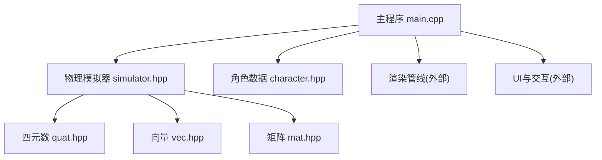
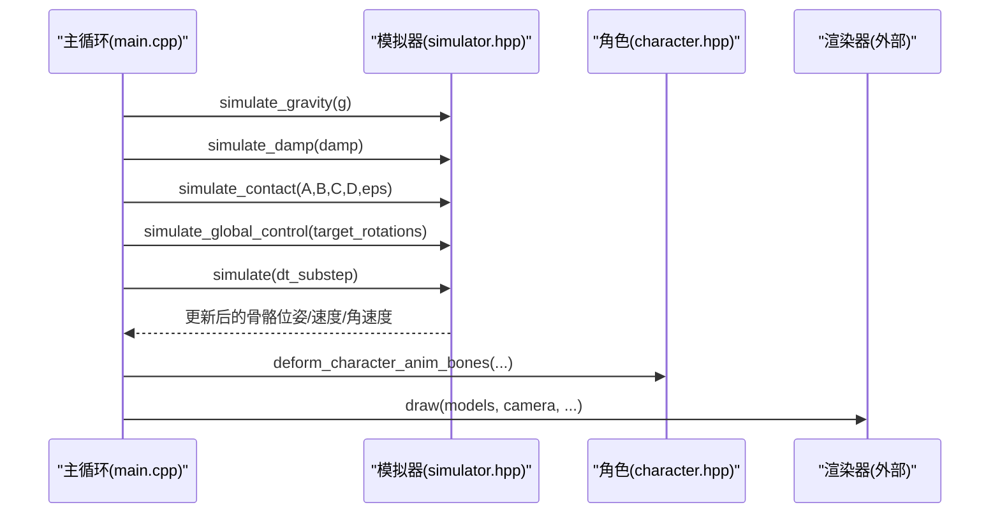
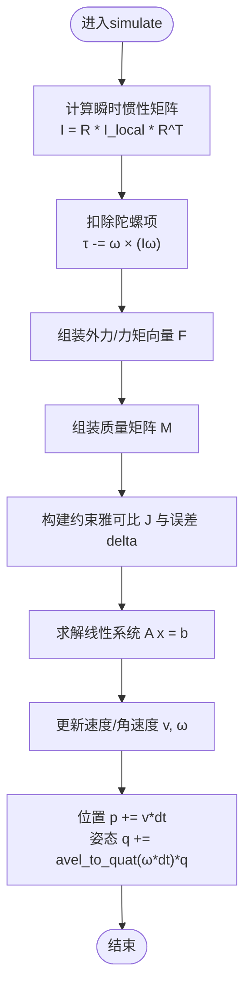
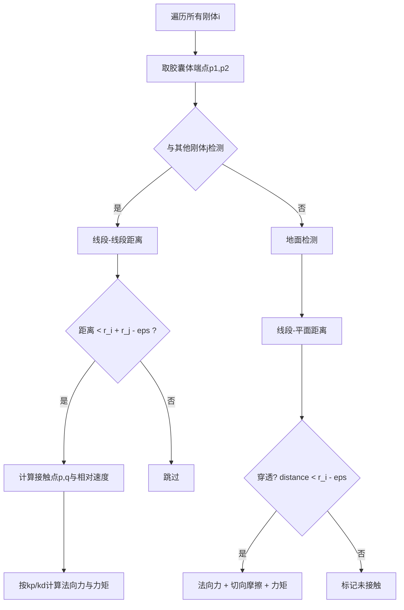
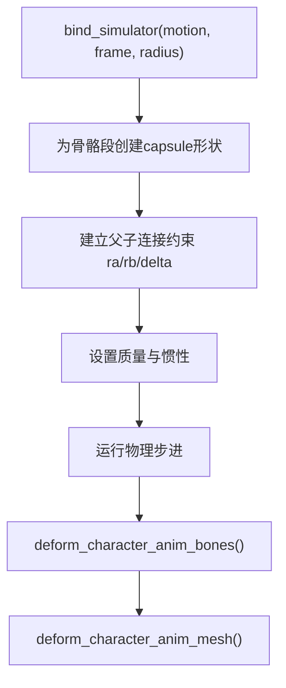
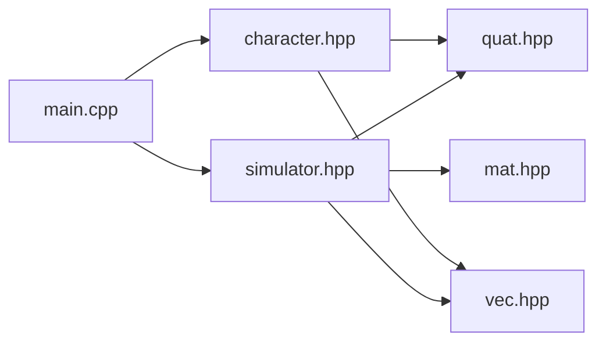

# 物理仿真概念

> **版本提示（2.0）**：本文撰写于 1.x 时期，描述的是旧的实现形态——入口在根目录 `main.cpp`，功能由根目录 `.hpp` 头文件库提供，窗口用 raylib、显示用 OpenCV highgui。2.0 已把这些头文件移到 `Source/Legacy/`，渲染默认走 GPU，窗口与 UI 换成 GLFW + ImGui，`main.cpp` 拆成 `Source/Launch/Private/` 下的 `Main.cpp` 与 `Application`。文中的文件路径、行号与调用链可能已失效，请以根目录的「项目概述」「快速开始」「故障排除」三篇与当前源码为准。

<cite>
**本文引用的文件**   
- [main.cpp](file://main.cpp)
- [simulator.hpp](file://simulator.hpp)
- [character.hpp](file://character.hpp)
- [quat.hpp](file://quat.hpp)
- [vec.hpp](file://vec.hpp)
- [mat.hpp](file://mat.hpp)
- [README.md](file://README.md)
</cite>

## 目录
1. [引言](#引言)
2. [项目结构](#项目结构)
3. [核心组件](#核心组件)
4. [架构总览](#架构总览)
5. [详细组件分析](#详细组件分析)
6. [依赖关系分析](#依赖关系分析)
7. [性能与数值稳定性](#性能与数值稳定性)
8. [故障排查指南](#故障排查指南)
9. [结论](#结论)
10. [附录：代码示例路径](#附录代码示例路径)

## 引言
本文件面向MooLab项目的物理仿真核心，系统梳理刚体动力学、碰撞检测、约束求解、数值积分与阻尼耗散等关键概念，并结合仓库中的实际实现进行对照说明。文档旨在帮助开发者理解角色动画驱动下的物理引擎如何工作，包括从骨骼到刚体的绑定、力/力矩的累积、约束方程的构建与求解，以及最终将仿真结果回写到动画骨架并渲染的流程。

## 项目结构
MooLab是一个基于C++的角色运动渲染与仿真器，使用raylib进行窗口与输入管理，OpenCV用于图像显示，并通过vcpkg自动管理依赖。核心物理逻辑集中在模拟器模块中，主循环负责帧级调度、控制输入、物理步进与渲染更新。



图表来源
- [main.cpp:53-160](file://main.cpp#L53-L160)
- [simulator.hpp:321-355](file://simulator.hpp#L321-L355)
- [character.hpp:35-47](file://character.hpp#L35-L47)
- [quat.hpp:6-24](file://quat.hpp#L6-L24)
- [vec.hpp:75-82](file://vec.hpp#L75-L82)
- [mat.hpp:7-14](file://mat.hpp#L7-L14)

章节来源
- [README.md:1-22](file://README.md#L1-L22)
- [main.cpp:53-160](file://main.cpp#L53-L160)

## 核心组件
- 物理模拟器（Simulator）：维护每个刚体（对应骨骼段）的质量、转动惯量、位置、姿态、速度、角速度、外力与外力矩；提供重力、阻尼、碰撞检测、约束求解与时间步进接口。
- 角色模型（Character）：存储网格顶点、法线、纹理坐标、索引、骨骼权重与骨骼初始位姿，用于将仿真后的骨骼位姿反插值到网格上。
- 数学基础：向量（vec）、四元数（quat）、矩阵（mat）及其运算工具，支撑旋转、叉乘、点积、Rodrigues公式等。
- 主循环（main）：读取动作数据、初始化相机/灯光/渲染器、每帧调用物理步进、更新骨骼与模型、绘制输出。

章节来源
- [simulator.hpp:321-355](file://simulator.hpp#L321-L355)
- [character.hpp:35-47](file://character.hpp#L35-L47)
- [quat.hpp:6-24](file://quat.hpp#L6-L24)
- [vec.hpp:75-82](file://vec.hpp#L75-L82)
- [mat.hpp:7-14](file://mat.hpp#L7-L14)
- [main.cpp:53-160](file://main.cpp#L53-L160)

## 架构总览
下图展示一帧内从输入到物理再到渲染的整体流程。



图表来源
- [main.cpp:320-345](file://main.cpp#L320-L345)
- [simulator.hpp:357-624](file://simulator.hpp#L357-L624)
- [character.hpp:142-164](file://character.hpp#L142-L164)

## 详细组件分析

### 刚体动力学与牛顿定律
- 质量与惯性：每个刚体具有质量与局部惯性张量，在每一步根据当前姿态转换为世界坐标系下的瞬时惯性矩阵。
- 力与力矩：重力作为体积力累加到每个刚体；阻尼对平动速度与角速度施加线性阻力；控制策略（全局/局部）通过目标姿态差计算期望角速度误差，进而产生力矩。
- 运动学更新：在约束求解后，根据解出的速度/角速度对位置与姿态进行积分更新。



图表来源
- [simulator.hpp:543-624](file://simulator.hpp#L543-L624)

章节来源
- [simulator.hpp:543-624](file://simulator.hpp#L543-L624)

### 碰撞检测算法
- 刚体间碰撞：将每个骨骼段近似为胶囊体（圆柱+半球），用两端点表示线段，计算两线段之间的最短距离；若小于半径和减去阈值，则判定碰撞。
- 地面碰撞：将胶囊体端点线段与平面（Ax + By + Cz + D = 0）求交距离；若穿透，则沿法向施加法向力与切向摩擦力。
- 距离计算工具：
  - 点到平面距离
  - 线段到平面距离（返回投影参数λ）
  - 点到线段距离（返回投影参数λ）
  - 线段到线段距离（返回两个投影参数λ1, λ2）



图表来源
- [simulator.hpp:374-435](file://simulator.hpp#L374-L435)
- [simulator.hpp:191-300](file://simulator.hpp#L191-L300)

章节来源
- [simulator.hpp:191-300](file://simulator.hpp#L191-L300)
- [simulator.hpp:374-435](file://simulator.hpp#L374-L435)

### 约束求解系统
- 约束类型：关节连接约束（link），保证父子骨骼在连接处保持几何一致性（ra/rb偏移不变）。
- 约束建模：对每个link构造雅可比J与误差delta，将其与动力学方程组合成增广线性系统，采用高斯消元求解拉格朗日乘子与速度修正。
- 弹簧/距离/角度约束：当前实现以“连接约束”为主，未直接实现弹簧或角度约束；可通过扩展J与delta加入额外约束项。

```mermaid
classDiagram
class Simulator {
+array1d<int> bone_ids
+array1d<int> bone_parents
+array1d<double> bone_masses
+array1d<mat3> bone_inertias
+array1d<link> bone_links
+array1d<shape> bone_shapes
+array1d<vec3> bone_vels
+array1d<vec3> bone_avels
+array1d<vec3> bone_forces
+array1d<vec3> bone_torgues
+simulate_gravity(g)
+simulate_damp(damp)
+simulate_contact(A,B,C,D,eps)
+simulate_local_control(target)
+simulate_global_control(target)
+simulate(dt)
}
class link {
+int a
+int b
+vec3 ra
+vec3 rb
+vec3 delta
}
class shape {
+vec3 pos
+quat rot
+double radius
+double length
+bool ifcontact
}
Simulator --> link : "包含"
Simulator --> shape : "包含"
```

图表来源
- [simulator.hpp:302-355](file://simulator.hpp#L302-L355)
- [simulator.hpp:572-617](file://simulator.hpp#L572-L617)

章节来源
- [simulator.hpp:302-355](file://simulator.hpp#L302-L355)
- [simulator.hpp:572-617](file://simulator.hpp#L572-L617)

### 数值积分方法
- 当前实现：在solve之后对位置与姿态进行显式欧拉式更新（p += v*dt；q = avel_to_quat(ω*dt) * q）。该方法简单高效，适合实时仿真，但存在能量漂移与精度受限的问题。
- RK4建议：对于需要更高精度的场景，可在速度/角速度层面采用RK4多步采样，再统一更新位置/姿态；代价是每步多次评估力/约束。
- 优缺点对比：
  - 欧拉法：实现简单、开销低；易发散、能量不守恒。
  - RK4：精度高、更稳定；计算量大，需更多函数求值。

章节来源
- [simulator.hpp:600-624](file://simulator.hpp#L600-L624)

### 阻尼系统与能量耗散
- 线性阻尼：对每个刚体施加与速度/角速度成正比的阻力，减少动能，抑制数值振荡。
- 碰撞耗散：碰撞响应中包含与相对速度相关的阻尼项（kd），有助于吸收冲击能量。
- 调参建议：阻尼系数过大可能导致动作迟缓；过小则可能引起抖动或穿透。

章节来源
- [simulator.hpp:365-372](file://simulator.hpp#L365-L372)
- [simulator.hpp:391-407](file://simulator.hpp#L391-L407)
- [simulator.hpp:416-427](file://simulator.hpp#L416-L427)

### 控制策略（全局/局部）
- 全局控制：基于目标姿态序列，通过前向运动学得到期望姿态，计算角速度误差并生成力矩，效果直观但非严格物理一致。
- 局部控制：考虑接触状态，结合根节点受力与扭矩，更符合物理但参数敏感。
- 应用：在主循环中按帧选择一种控制方式，配合物理步进实现角色动画的物理化表现。

章节来源
- [simulator.hpp:437-541](file://simulator.hpp#L437-L541)
- [main.cpp:327-338](file://main.cpp#L327-L338)

### 从骨骼到刚体的绑定与回写
- 绑定：根据BVH动作某一帧的前向运动学结果，为每个骨骼段创建胶囊体形状、设置质量与惯性，建立父子连接约束。
- 回写：仿真结束后，将刚体位姿映射回骨骼空间，更新动画骨架，再驱动网格形变。



图表来源
- [simulator.hpp:664-847](file://simulator.hpp#L664-L847)
- [simulator.hpp:911-930](file://simulator.hpp#L911-L930)
- [character.hpp:142-164](file://character.hpp#L142-L164)

章节来源
- [simulator.hpp:664-847](file://simulator.hpp#L664-L847)
- [simulator.hpp:911-930](file://simulator.hpp#L911-L930)
- [character.hpp:142-164](file://character.hpp#L142-L164)

## 依赖关系分析
- 主程序依赖模拟器、角色、数学库与渲染/UI子系统。
- 模拟器依赖数学库（向量、四元数、矩阵）与动作数据（BVH_Motion）。
- 角色模块依赖数学库与网格数据结构。



图表来源
- [main.cpp:8-17](file://main.cpp#L8-L17)
- [simulator.hpp:4-5](file://simulator.hpp#L4-L5)
- [character.hpp:4-6](file://character.hpp#L4-L6)

章节来源
- [main.cpp:8-17](file://main.cpp#L8-L17)
- [simulator.hpp:4-5](file://simulator.hpp#L4-L5)
- [character.hpp:4-6](file://character.hpp#L4-L6)

## 性能与数值稳定性
- 并行化：矩阵乘法已使用OpenMP并行加速，提升大规模线性代数运算效率。
- 条件数与稳定性：增广系统A的条件数受质量矩阵与约束雅可比影响；过大的刚度系数kp可能导致病态矩阵，需权衡穿透抑制与数值稳定。
- 时间步长：dt越小越稳定但开销越大；可结合substep（simulate_time）提高稳定性。
- 内存与缓存：批量操作（如批量FK、批量形变）有利于缓存命中与减少重复计算。

章节来源
- [simulator.hpp:61-79](file://simulator.hpp#L61-L79)
- [simulator.hpp:543-624](file://simulator.hpp#L543-L624)

## 故障排查指南
- 穿透严重：检查碰撞阈值eps与刚度系数kp；适当增大kp或减小eps，同时避免过度导致不稳定。
- 抖动或发散：降低阻尼系数或时间步长；检查约束是否合理（ra/rb是否正确更新）。
- 角色姿态异常：确认四元数更新顺序与补偿四元数（bone_quat_compensates）是否正确；检查IK或控制策略的参数范围。
- 性能瓶颈：确认OpenMP可用；减少不必要的中间对象分配；优化批量操作。

章节来源
- [simulator.hpp:374-435](file://simulator.hpp#L374-L435)
- [simulator.hpp:664-847](file://simulator.hpp#L664-L847)
- [main.cpp:320-345](file://main.cpp#L320-L345)

## 结论
MooLab的物理仿真围绕“骨骼→刚体”的映射展开，通过重力、阻尼、碰撞与控制力矩共同驱动，并在每帧构建并求解带约束的动力学系统。其优势在于实现简洁、易于集成到角色动画管线；改进方向包括引入更稳健的积分器（如RK4）、扩展约束类型（弹簧/角度）、优化碰撞层次结构与数值稳定性。

## 附录：代码示例路径
- 主循环物理步进与控制调用
  - [main.cpp:320-345](file://main.cpp#L320-L345)
- 重力与阻尼
  - [simulator.hpp:357-372](file://simulator.hpp#L357-L372)
- 碰撞检测（刚体-刚体、刚体-地面）
  - [simulator.hpp:374-435](file://simulator.hpp#L374-L435)
- 距离计算工具
  - [simulator.hpp:191-300](file://simulator.hpp#L191-L300)
- 约束求解与时间步进
  - [simulator.hpp:543-624](file://simulator.hpp#L543-L624)
- 全局/局部控制
  - [simulator.hpp:437-541](file://simulator.hpp#L437-L541)
- 绑定与回写
  - [simulator.hpp:664-847](file://simulator.hpp#L664-L847)
  - [simulator.hpp:911-930](file://simulator.hpp#L911-L930)
  - [character.hpp:142-164](file://character.hpp#L142-L164)
- 数学基础（四元数/向量/矩阵）
  - [quat.hpp:6-24](file://quat.hpp#L6-L24)
  - [vec.hpp:75-82](file://vec.hpp#L75-L82)
  - [mat.hpp:7-14](file://mat.hpp#L7-L14)