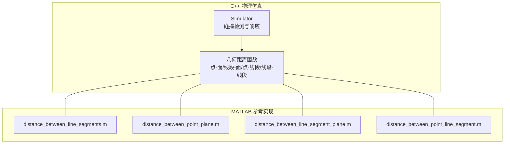
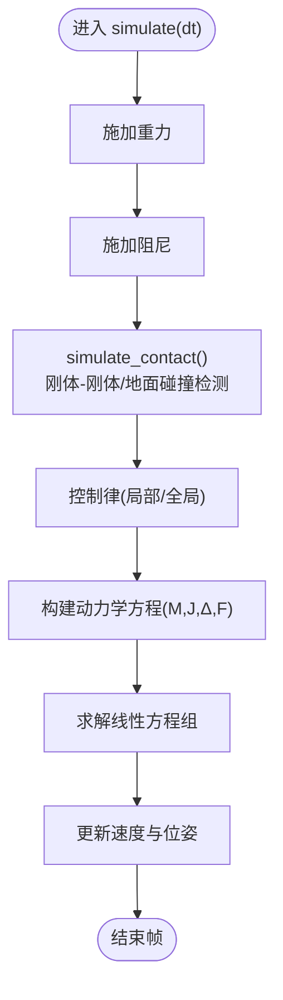
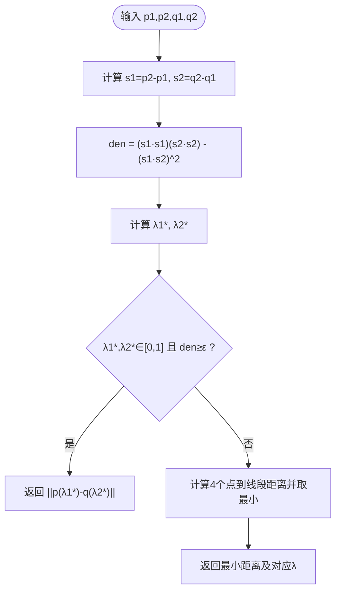
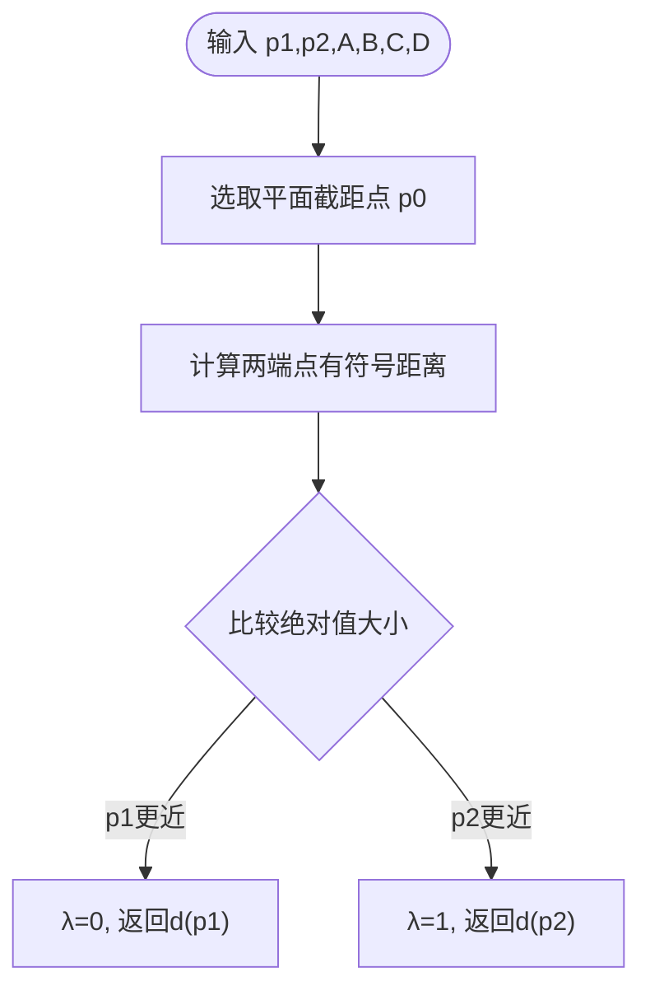
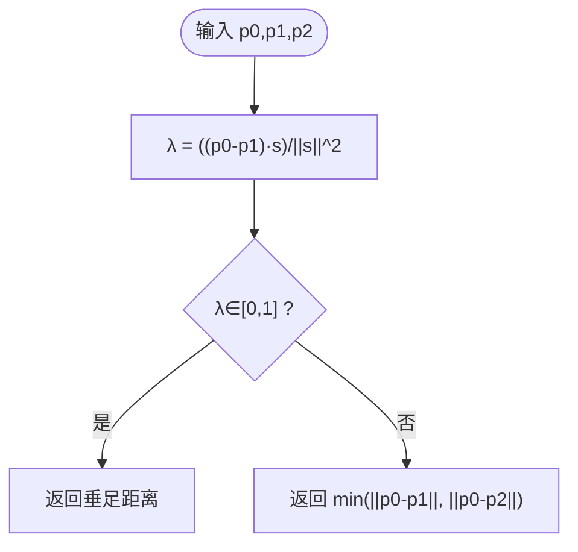
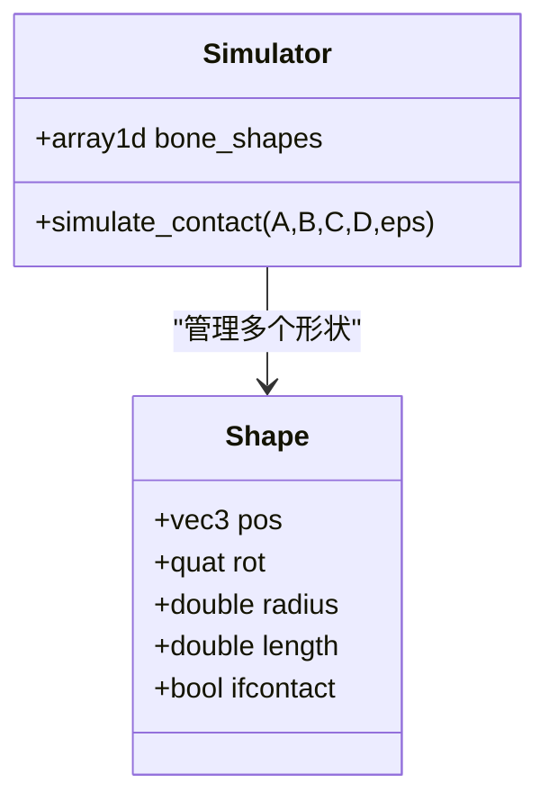
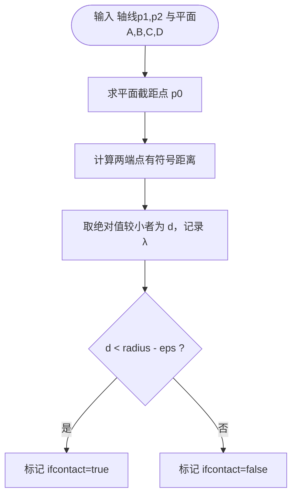
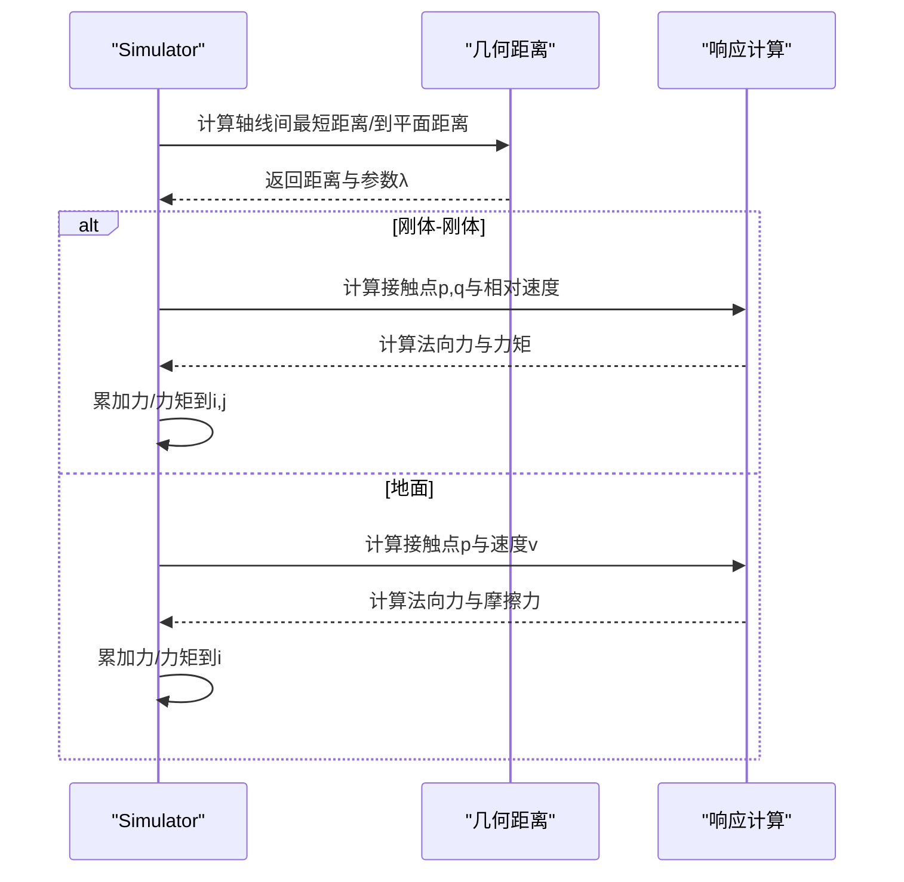
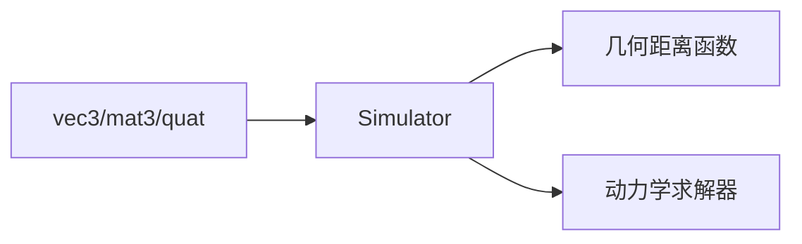

# 碰撞检测算法

> **版本提示（2.0）**：本文撰写于 1.x 时期，描述的是旧的实现形态——入口在根目录 `main.cpp`，功能由根目录 `.hpp` 头文件库提供，窗口用 raylib、显示用 OpenCV highgui。2.0 已把这些头文件移到 `Source/Legacy/`，渲染默认走 GPU，窗口与 UI 换成 GLFW + ImGui，`main.cpp` 拆成 `Source/Launch/Private/` 下的 `Main.cpp` 与 `Application`。文中的文件路径、行号与调用链可能已失效，请以根目录的「项目概述」「快速开始」「故障排除」三篇与当前源码为准。

<cite>
**本文引用的文件**   
- [simulator.hpp](file://simulator.hpp)
- [distance_between_line_segments.m](file://resources/distance_between_line_segments.m)
- [distance_between_point_plane.m](file://resources/distance_between_point_plane.m)
- [distance_between_line_segment_plane.m](file://resources/distance_between_line_segment_plane.m)
- [distance_between_point_line_segment.m](file://resources/distance_between_point_line_segment.m)
</cite>

## 目录
1. [简介](#简介)
2. [项目结构](#项目结构)
3. [核心组件](#核心组件)
4. [架构总览](#架构总览)
5. [详细组件分析](#详细组件分析)
6. [依赖关系分析](#依赖关系分析)
7. [性能考虑](#性能考虑)
8. [故障排查指南](#故障排查指南)
9. [结论](#结论)

## 简介
本文件面向MooLab项目的碰撞检测子系统，系统性梳理以下关键内容：
- 线段与线段的距离计算（向量投影、参数化表示、边界条件处理）
- 包围盒/形状碰撞检测（圆柱体、球体的近似表示与接触判断）
- 地面碰撞检测的数学模型（平面方程、法向量、穿透深度估计）
- 碰撞响应机制（弹簧-阻尼系统参数、力与力矩分配策略）
- 代码级实现路径与流程图示，便于定位与二次开发

## 项目结构
本项目在C++侧提供物理仿真与碰撞检测的核心逻辑，同时在MATLAB脚本中提供了若干几何距离计算的参考实现。与碰撞检测直接相关的文件如下：
- C++侧：[simulator.hpp](file://simulator.hpp) 包含Simulator类、几何距离函数、碰撞检测与响应主流程
- MATLAB侧：四个距离计算脚本用于验证或辅助理解几何算法

图表来源
- [simulator.hpp:191-300](file://simulator.hpp#L191-L300)
- [simulator.hpp:374-435](file://simulator.hpp#L374-L435)
- [distance_between_line_segments.m:1-32](file://resources/distance_between_line_segments.m#L1-L32)
- [distance_between_point_plane.m:1-3](file://resources/distance_between_point_plane.m#L1-L3)
- [distance_between_line_segment_plane.m:1-22](file://resources/distance_between_line_segment_plane.m#L1-L22)
- [distance_between_point_line_segment.m:1-18](file://resources/distance_between_point_line_segment.m#L1-L18)

章节来源
- [simulator.hpp:191-300](file://simulator.hpp#L191-L300)
- [simulator.hpp:374-435](file://simulator.hpp#L374-L435)

## 核心组件
- 几何距离工具
  - 点到平面距离
  - 线段到平面距离
  - 点到线段距离
  - 线段到线段距离
- 形状定义
  - 每个骨骼段用“胶囊体”近似：中心位置、朝向四元数、半径、长度；两端端点由中心与朝向推导
- 碰撞检测
  - 刚体-刚体：基于两胶囊体轴线的最短距离
  - 地面碰撞：基于平面方程与轴线最近点的有符号距离
- 碰撞响应
  - 弹簧-阻尼模型：法向弹性+阻尼，切向摩擦分量
  - 力与力矩分配到各骨骼节点

章节来源
- [simulator.hpp:191-300](file://simulator.hpp#L191-L300)
- [simulator.hpp:311-318](file://simulator.hpp#L311-L318)
- [simulator.hpp:374-435](file://simulator.hpp#L374-L435)

## 架构总览
下图展示从输入（骨骼姿态、质量、惯量等）到输出（速度更新、位置/旋转更新）的完整流程，其中碰撞检测与响应是关键分支。

图表来源
- [simulator.hpp:357-372](file://simulator.hpp#L357-L372)
- [simulator.hpp:374-435](file://simulator.hpp#L374-L435)
- [simulator.hpp:543-624](file://simulator.hpp#L543-L624)

## 详细组件分析

### 线段与线段的距离计算
- 数学要点
  - 两条线段分别参数化为 p(λ1)=p1+λ1·s1 与 q(λ2)=q1+λ2·s2，其中 s1=p2-p1，s2=q2-q1
  - 通过最小化 ||p(λ1)-q(λ2)||^2 得到闭式解 λ1*, λ2*
  - 若 λ1*, λ2* ∈ [0,1] 且分母非退化，则返回该内部解的距离
  - 否则回退为点到线段的距离组合，取最小值
- 数值稳定性
  - 使用 max(den, ε) 或 std::max(den, 1e-8) 避免除零
- 代码路径
  - C++实现：[distance_between_line_segments:256-300](file://simulator.hpp#L256-L300)
  - MATLAB参考：[distance_between_line_segments.m:1-32](file://resources/distance_between_line_segments.m#L1-L32)

图表来源
- [simulator.hpp:256-300](file://simulator.hpp#L256-L300)
- [distance_between_line_segments.m:1-32](file://resources/distance_between_line_segments.m#L1-L32)

章节来源
- [simulator.hpp:256-300](file://simulator.hpp#L256-L300)
- [distance_between_line_segments.m:1-32](file://resources/distance_between_line_segments.m#L1-L32)

### 点到平面与线段到平面的距离
- 点到平面
  - 平面方程 Ax+By+Cz+D=0，法向量 n=(A,B,C)
  - 距离 d=|Ax+By+Cz+D|/||n||
  - 代码路径：[distance_between_point_plane:191-194](file://simulator.hpp#L191-L194)，MATLAB参考：[distance_between_point_plane.m:1-3](file://resources/distance_between_point_plane.m#L1-L3)
- 线段到平面
  - 先求一个平面上的参考点 p0（根据A/B/C非零情况选择截距点）
  - 计算线段两端点相对于平面的有符号距离
  - 取绝对值较小者作为线段到平面的距离，并记录对应的 λ∈{0,1}
  - 代码路径：[distance_between_line_segment_plane:196-227](file://simulator.hpp#L196-L227)，MATLAB参考：[distance_between_line_segment_plane.m:1-22](file://resources/distance_between_line_segment_plane.m#L1-L22)

图表来源
- [simulator.hpp:196-227](file://simulator.hpp#L196-L227)
- [distance_between_line_segment_plane.m:1-22](file://resources/distance_between_line_segment_plane.m#L1-L22)

章节来源
- [simulator.hpp:191-227](file://simulator.hpp#L191-L227)
- [distance_between_point_plane.m:1-3](file://resources/distance_between_point_plane.m#L1-L3)
- [distance_between_line_segment_plane.m:1-22](file://resources/distance_between_line_segment_plane.m#L1-L22)

### 点到线段的距离
- 将点投影到直线方向，得到参数 λ
- 若 λ∈[0,1]，返回垂足距离；否则返回到端点的较小距离
- 代码路径：[distance_between_point_line_segment:229-254](file://simulator.hpp#L229-L254)，MATLAB参考：[distance_between_point_line_segment.m:1-18](file://resources/distance_between_point_line_segment.m#L1-L18)

图表来源
- [simulator.hpp:229-254](file://simulator.hpp#L229-L254)
- [distance_between_point_line_segment.m:1-18](file://resources/distance_between_point_line_segment.m#L1-L18)

章节来源
- [simulator.hpp:229-254](file://simulator.hpp#L229-L254)
- [distance_between_point_line_segment.m:1-18](file://resources/distance_between_point_line_segment.m#L1-L18)

### 包围盒/形状定义与接触判断
- 形状定义
  - 每个骨骼段用一个“胶囊体”近似：pos（中心）、rot（朝向四元数）、radius（半径）、length（长度）
  - 胶囊体轴线端点：p_end = pos ± rot * (0.5*length - radius) * up
  - 代码路径：[shape结构体:311-318](file://simulator.hpp#L311-L318)，[胶囊体端点构造:379-385](file://simulator.hpp#L379-L385)
- 刚体-刚体接触判断
  - 对任意两骨骼 i,j，取其胶囊体轴线端点 p1,p2 与 q1,q2
  - 调用 distance_between_line_segments 得到最短距离 d
  - 若 d < radius_i + radius_j - eps，判定为接触
  - 代码路径：[刚体-刚体检测:381-410](file://simulator.hpp#L381-L410)
- 地面接触判断
  - 对每条轴线，计算到平面 Ax+By+Cz+D=0 的最短距离 d 与 λ
  - 若 d < radius - eps，判定为接触
  - 代码路径：[地面检测:411-434](file://simulator.hpp#L411-L434)

图表来源
- [simulator.hpp:311-318](file://simulator.hpp#L311-L318)
- [simulator.hpp:374-435](file://simulator.hpp#L374-L435)

章节来源
- [simulator.hpp:311-318](file://simulator.hpp#L311-L318)
- [simulator.hpp:374-435](file://simulator.hpp#L374-L435)

### 地面碰撞检测的数学模型
- 平面方程与法向量
  - 平面：Ax+By+Cz+D=0，单位法向量 n̂=(A,B,C)/||(A,B,C)||
- 穿透深度估计
  - 对于胶囊体轴线与平面，使用 distance_between_line_segment_plane 得到有符号距离 d
  - 穿透深度 ≈ radius - |d|（当 d<0 且 |d|>radius 时发生穿透）
- 代码路径
  - 点到平面距离：[distance_between_point_plane:191-194](file://simulator.hpp#L191-L194)
  - 线段到平面距离：[distance_between_line_segment_plane:196-227](file://simulator.hpp#L196-L227)
  - 地面接触判断与标记：[simulate_contact 地面部分:411-434](file://simulator.hpp#L411-L434)

图表来源
- [simulator.hpp:196-227](file://simulator.hpp#L196-L227)
- [simulator.hpp:411-434](file://simulator.hpp#L411-L434)

章节来源
- [simulator.hpp:191-227](file://simulator.hpp#L191-L227)
- [simulator.hpp:411-434](file://simulator.hpp#L411-L434)

### 碰撞响应机制（弹簧-阻尼系统与力分配）
- 刚体-刚体响应
  - 接触点：p = p1 + λ1·(p2-p1)，q = q1 + λ2·(q2-q1)
  - 相对速度：vp = v_i + ω_i × (p - c_i)，vq = v_j + ω_j × (q - c_j)
  - 法向力幅值：F_n = kp·(r_i+r_j-eps-d) + kd·(v_rel·(-n̂))
  - 力与力矩：F_i += F_n·n̂，τ_i += F_n·((p-c_i)×n̂)，j侧同理反向
  - 代码路径：[刚体-刚体响应:394-408](file://simulator.hpp#L394-L408)
- 地面响应
  - 接触点：p = p1 + λ·(p2-p1)
  - 法向力幅值：F_n = (v·(-n̂)>0) ? kp·(r-eps-d) + kd·(v·(-n̂)) : 0
  - 摩擦力：f_t ∝ μ·F_n，沿切向方向（去除法向分量后的速度方向）
  - 力与力矩：F_i += F_n·n̂ + μ·F_n·t̂，τ_i += F_n·((p-c_i)×n̂)
  - 代码路径：[地面响应:419-428](file://simulator.hpp#L419-L428)
- 参数设置
  - 刚体-刚体：kp≈10000，kd≈0.5
  - 地面：kp≈10000，kd≈100，摩擦系数≈0.6
  - 代码路径：[参数赋值:391-393](file://simulator.hpp#L391-L393), [地面参数:416-417](file://simulator.hpp#L416-L417)

图表来源
- [simulator.hpp:374-435](file://simulator.hpp#L374-L435)

章节来源
- [simulator.hpp:374-435](file://simulator.hpp#L374-L435)

## 依赖关系分析
- 模块内聚与耦合
  - Simulator 聚合了所有几何距离函数与碰撞检测/响应逻辑，内聚度高
  - 几何距离函数相互独立，便于替换或优化
- 外部依赖
  - 向量/矩阵/四元数基础类型与运算（vec3, mat3, quat 等）
  - 运动学/动力学求解器（线性方程组求解、欧拉积分）
- 潜在循环依赖
  - 当前实现未见明显循环依赖；几何函数被上层调用，不反向依赖上层

图表来源
- [simulator.hpp:191-300](file://simulator.hpp#L191-L300)
- [simulator.hpp:543-624](file://simulator.hpp#L543-L624)

章节来源
- [simulator.hpp:191-300](file://simulator.hpp#L191-L300)
- [simulator.hpp:543-624](file://simulator.hpp#L543-L624)

## 性能考虑
- 复杂度
  - 刚体-刚体检测：O(N^2) 对每对骨骼进行胶囊体轴线距离计算
  - 地面检测：O(N) 每条轴线一次平面距离计算
- 优化建议
  - 空间划分（BVH/OBB/AABB）减少 O(N^2) 对数
  - 提前剔除：基于质心/包围球快速排斥
  - 并行化：OpenMP 加速矩阵乘法与遍历（已有部分并行化）
  - 数值稳定：保持 ε 合理，避免过小的 den 导致不稳定

## 故障排查指南
- 常见问题
  - 除零或数值不稳定：检查 den 是否过小，确保使用 max(den, ε)
  - 穿透抖动：调整 eps 与 kp/kd，增大阻尼或降低刚度
  - 地面打滑：检查摩擦系数与切向力方向计算
- 定位方法
  - 打印距离与 λ 值，确认接触点是否正确
  - 逐步关闭控制律，仅保留重力+碰撞，观察稳定性
- 相关代码路径
  - 距离计算与边界处理：[distance_between_line_segments:256-300](file://simulator.hpp#L256-L300), [distance_between_point_line_segment:229-254](file://simulator.hpp#L229-L254), [distance_between_line_segment_plane:196-227](file://simulator.hpp#L196-L227)
  - 碰撞响应参数与力/力矩累加：[simulate_contact:374-435](file://simulator.hpp#L374-L435)

章节来源
- [simulator.hpp:191-300](file://simulator.hpp#L191-L300)
- [simulator.hpp:374-435](file://simulator.hpp#L374-L435)

## 结论
MooLab的碰撞检测以“胶囊体轴线+平面”为核心几何抽象，结合稳健的参数化距离计算与弹簧-阻尼响应，实现了稳定的刚体-刚体与地面接触模拟。通过清晰的函数分层与可替换的几何距离实现，既保证了可读性，也为后续的性能优化（如空间划分、并行化）与扩展（更多形状）提供了良好基础。