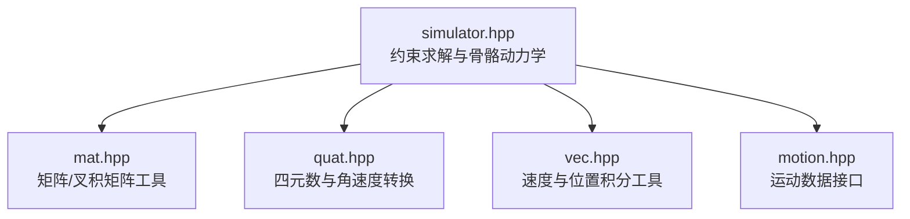
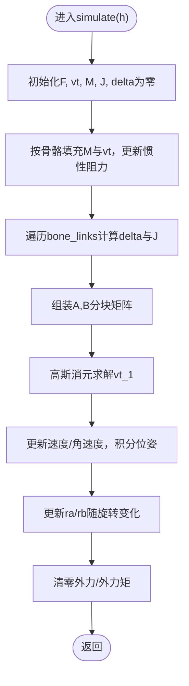
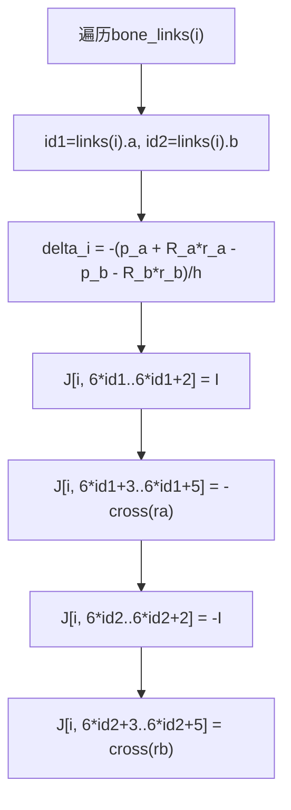
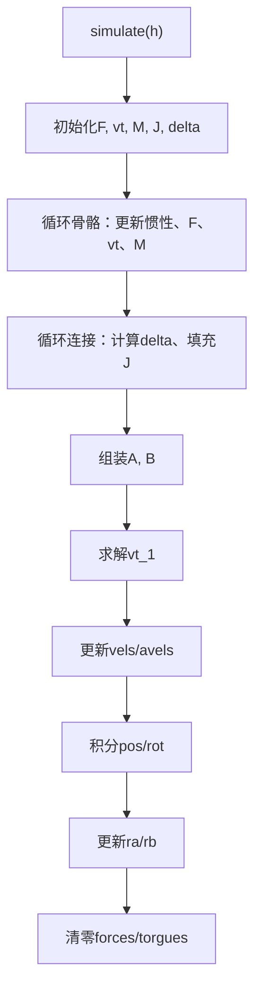
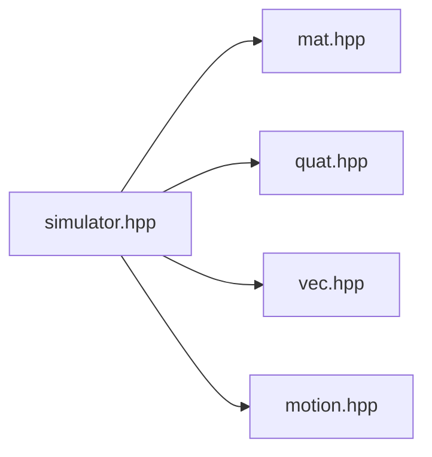

# 约束求解系统

> **版本提示（2.0）**：本文撰写于 1.x 时期，描述的是旧的实现形态——入口在根目录 `main.cpp`，功能由根目录 `.hpp` 头文件库提供，窗口用 raylib、显示用 OpenCV highgui。2.0 已把这些头文件移到 `Source/Legacy/`，渲染默认走 GPU，窗口与 UI 换成 GLFW + ImGui，`main.cpp` 拆成 `Source/Launch/Private/` 下的 `Main.cpp` 与 `Application`。文中的文件路径、行号与调用链可能已失效，请以根目录的「项目概述」「快速开始」「故障排除」三篇与当前源码为准。

<cite>
**本文引用的文件**   
- [README.md](file://README.md)
- [simulator.hpp](file://simulator.hpp)
- [mat.hpp](file://mat.hpp)
- [quat.hpp](file://quat.hpp)
- [vec.hpp](file://vec.hpp)
- [motion.hpp](file://motion.hpp)
</cite>

## 目录
1. [引言](#引言)
2. [项目结构](#项目结构)
3. [核心组件](#核心组件)
4. [架构总览](#架构总览)
5. [详细组件分析](#详细组件分析)
6. [依赖关系分析](#依赖关系分析)
7. [性能与数值稳定性](#性能与数值稳定性)
8. [故障排查指南](#故障排查指南)
9. [结论](#结论)
10. [附录：参数调优建议](#附录参数调优建议)

## 引言
本文件面向MooLab项目的约束求解子系统，聚焦以下目标：
- 线性方程组的构建与求解流程（质量矩阵M、雅可比J、约束误差delta）
- 骨骼连接约束的实现原理（link结构体、相对位置约束、旋转约束）
- 约束力λ的计算方法与约束满足程度的评估
- simulate函数中从矩阵构建到方程求解再到状态更新的完整流程
- 约束参数的调优策略及其对仿真稳定性的影响

该子系统基于拉格朗日乘子法将动力学与几何约束统一为线性方程组，并通过高斯消元法直接求解。

## 项目结构
与约束求解相关的核心代码集中在模拟器头文件中，并依赖基础数学库（向量、矩阵、四元数等）。



**图表来源**
- [simulator.hpp:1-10](file://simulator.hpp#L1-L10)
- [mat.hpp:71-82](file://mat.hpp#L71-L82)
- [quat.hpp:202-221](file://quat.hpp#L202-L221)
- [vec.hpp:200-210](file://vec.hpp#L200-L210)
- [motion.hpp:323-325](file://motion.hpp#L323-L325)

**章节来源**
- [README.md:1-22](file://README.md#L1-L22)
- [simulator.hpp:1-10](file://simulator.hpp#L1-L10)

## 核心组件
- link结构体：描述骨骼间的连接约束，包含两端骨骼索引、局部偏移ra/rb以及约束误差delta
- shape结构体：描述骨骼的几何形状（位置、旋转、半径、长度、接触标志）
- Simulator类：封装骨骼动力学、约束构建与求解、碰撞检测与控制输入

关键数据结构定义如下：
- link：a/b为骨骼索引；ra/rb为在父/子骨坐标系下的连接点偏移；delta为当前步的约束误差
- shape：pos/rot为位姿；radius/length用于碰撞与可视化；ifcontact标记是否接触地面或刚体
- Simulator：维护骨骼拓扑、质量/惯量、速度/角速度、外力/外力矩、约束数组等

**章节来源**
- [simulator.hpp:302-318](file://simulator.hpp#L302-L318)
- [simulator.hpp:321-355](file://simulator.hpp#L321-L355)

## 架构总览
约束求解的核心思想是将牛顿-欧拉动力学与几何约束合并为一个分块线性系统：
- 上部分：动量平衡 M·Δv + J^T·λ = F_ext + M·v_t
- 下部分：约束线性化 J·Δv = -δ/h

其中：
- M：广义质量矩阵（平移+旋转）
- J：约束雅可比（每根连接对应3行）
- δ：约束误差（连接点位置偏差）
- λ：拉格朗日乘子（约束力）
- v_t：上一时刻的速度/角速度
- h：时间步长



**图表来源**
- [simulator.hpp:543-624](file://simulator.hpp#L543-L624)
- [simulator.hpp:154-189](file://simulator.hpp#L154-L189)

**章节来源**
- [simulator.hpp:543-624](file://simulator.hpp#L543-L624)

## 详细组件分析

### 线性方程组构建与求解
- 质量矩阵M：对角块结构，每个骨骼对应一个6×6块，平移部分为(1/h)·m·I，旋转部分为(1/h)·I_body
- 外力项F：包含重力、阻尼、控制力矩等累积的外力/外力矩
- 速度项vt：上一时刻的线速度/角速度
- 约束雅可比J：对每个连接i，J_i作用于id1和id2两个骨骼，分别包含平移单位阵与叉积矩阵项
- 约束误差delta：delta_i = -(p_a + R_a·r_a - p_b - R_b·r_b)/h，即连接点在两端的相对位置偏差除以时间步

求解过程：
- 构造增广矩阵B=[M·v_t+F; -δ/h]
- 构造系数矩阵A=[[M, -J^T]; [J, 0]]
- 使用高斯消元法求解未知数[Δv; λ]

```mermaid
sequenceDiagram
participant S as "Simulator : : simulate"
participant M as "质量矩阵M"
participant J as "雅可比J"
participant G as "高斯消元求解器"
participant U as "状态更新"
S->>M : 填充M与vt
S->>J : 计算delta与J
S->>S : 组装A,B
S->>G : Elimination_method_solution_of_linear_equations(A,B)
G-->>S : 返回vt_1=[Δv; λ]
S->>U : 更新vels/avels，积分pos/rot
S->>S : 更新ra/rb，清零forces/torgues
```

**图表来源**
- [simulator.hpp:543-624](file://simulator.hpp#L543-L624)
- [simulator.hpp:154-189](file://simulator.hpp#L154-L189)

**章节来源**
- [simulator.hpp:543-624](file://simulator.hpp#L543-L624)
- [simulator.hpp:154-189](file://simulator.hpp#L154-L189)

### 雅可比矩阵J与约束误差delta
- 对于连接i，关联骨骼id1与id2：
  - J在id1的平移块为单位阵，旋转块为-叉积矩阵(ra)
  - J在id2的平移块为负单位阵，旋转块为叉积矩阵(rb)
- delta_i = -(p_a + R_a·r_a - p_b - R_b·r_b)/h
- 物理含义：J·Δv近似表示连接点在一阶近似下的位移变化，delta/h是期望的修正速度以消除位置偏差



**图表来源**
- [simulator.hpp:573-583](file://simulator.hpp#L573-L583)
- [mat.hpp:71-82](file://mat.hpp#L71-L82)

**章节来源**
- [simulator.hpp:573-583](file://simulator.hpp#L573-L583)
- [mat.hpp:71-82](file://mat.hpp#L71-L82)

### 骨骼连接约束：link结构体与相对位置/旋转处理
- link结构体字段：
  - a/b：连接的父/子骨骼索引
  - ra/rb：连接点在父/子骨骼局部坐标中的偏移
  - delta：当前步的约束误差（由simulate内部计算）
- 相对位置约束：通过J与delta强制两端连接点重合
- 旋转约束：通过叉积矩阵项将旋转自由度耦合进J，使旋转变化影响连接点位置

```mermaid
classDiagram
class link {
+int a
+int b
+vec3 ra
+vec3 rb
+vec3 delta
}
class shape {
+vec3 pos
+quat rot
+double radius
+double length
+bool ifcontact
}
class Simulator {
+array1d<link> bone_links
+array1d<shape> bone_shapes
+void simulate(double h)
}
Simulator --> link : "拥有"
Simulator --> shape : "拥有"
```

**图表来源**
- [simulator.hpp:302-318](file://simulator.hpp#L302-L318)
- [simulator.hpp:321-355](file://simulator.hpp#L321-L355)

**章节来源**
- [simulator.hpp:302-318](file://simulator.hpp#L302-L318)
- [simulator.hpp:321-355](file://simulator.hpp#L321-L355)

### 约束力λ的计算与约束满足程度评估
- λ由线性系统求解得到，代表维持约束所需的广义力
- 约束满足程度可通过delta的范数评估：||delta||越小，约束越接近满足
- 由于delta在每一步被重新计算并作为右端项的一部分，求解后若||delta||显著下降，说明约束正在收敛

注意：
- 当前实现未显式输出λ，但可通过求解结果反推（例如记录A与B，回代得到λ）
- 约束误差delta在每次迭代前更新，因此其大小反映了瞬时约束偏离

**章节来源**
- [simulator.hpp:573-583](file://simulator.hpp#L573-L583)
- [simulator.hpp:586-600](file://simulator.hpp#L586-L600)

### simulate函数的完整流程示例
以下为simulate函数中约束系统的步骤概览（不展示具体代码内容）：
1. 初始化F、vt、M、J、delta为零
2. 对每个骨骼：
   - 计算世界坐标系下的转动惯量
   - 更新外力矩中的陀螺阻力项
   - 填充F、vt、M
3. 对每个连接：
   - 计算delta
   - 填充J
4. 组装A、B
5. 调用高斯消元求解vt_1
6. 更新vels/avels，积分pos/rot
7. 更新ra/rb随旋转变化
8. 清零forces/torgues



**图表来源**
- [simulator.hpp:543-624](file://simulator.hpp#L543-L624)

**章节来源**
- [simulator.hpp:543-624](file://simulator.hpp#L543-L624)

## 依赖关系分析
- simulator.hpp依赖：
  - mat.hpp：提供矩阵运算与叉积矩阵转换
  - quat.hpp：提供四元数与角速度的相互转换
  - vec.hpp：提供速度与位置的积分工具
  - motion.hpp：提供运动数据的访问接口



**图表来源**
- [simulator.hpp:1-10](file://simulator.hpp#L1-L10)
- [mat.hpp:71-82](file://mat.hpp#L71-L82)
- [quat.hpp:202-221](file://quat.hpp#L202-L221)
- [vec.hpp:200-210](file://vec.hpp#L200-L210)
- [motion.hpp:323-325](file://motion.hpp#L323-L325)

**章节来源**
- [simulator.hpp:1-10](file://simulator.hpp#L1-L10)
- [mat.hpp:71-82](file://mat.hpp#L71-L82)
- [quat.hpp:202-221](file://quat.hpp#L202-L221)
- [vec.hpp:200-210](file://vec.hpp#L200-L210)
- [motion.hpp:323-325](file://motion.hpp#L323-L325)

## 性能与数值稳定性
- 高斯消元复杂度：O(n^3)，n为未知数维度（6N+3L），N为骨骼数，L为连接数
- 并行优化：矩阵乘法使用OpenMP并行加速
- 数值稳定性：
  - 避免除零：在距离计算中使用max(den, 1e-8)
  - 小步长h：提高约束线性化的精度
  - 惯性张量更新：每步更新世界坐标系下的惯量，提升动态响应准确性

建议：
- 对大规模骨架可考虑稀疏求解器或预条件共轭梯度法替代直接消元
- 对刚性约束可引入惩罚项或投影校正以提升鲁棒性

**章节来源**
- [simulator.hpp:61-79](file://simulator.hpp#L61-L79)
- [simulator.hpp:154-189](file://simulator.hpp#L154-L189)
- [simulator.hpp:557-571](file://simulator.hpp#L557-L571)

## 故障排查指南
常见问题与定位方法：
- 约束不收敛：检查delta范数是否持续增大；确认ra/rb更新是否正确
- 数值溢出：检查h是否过小或过大；确认M对角元是否合理
- 姿态抖动：检查惯性阻力项与阻尼参数；确认控制输入的增益是否过高
- 碰撞穿透：调整碰撞检测阈值eps与弹簧/阻尼系数kp/kd

调试建议：
- 打印delta范数与λ范数以评估约束满足度
- 逐步禁用约束观察系统行为，定位问题连接
- 降低控制增益或增加阻尼以提高稳定性

**章节来源**
- [simulator.hpp:374-435](file://simulator.hpp#L374-L435)
- [simulator.hpp:557-624](file://simulator.hpp#L557-L624)

## 结论
MooLab的约束求解系统将骨骼动力学与几何约束统一为线性系统，通过雅可比J与约束误差delta构建方程，并使用高斯消元法求解速度与约束力。该设计简洁直观，易于扩展与调试。在实际应用中，需根据骨架规模与实时性要求选择合适的求解器与参数调优策略。

## 附录：参数调优建议
- 时间步长h：较小值提高精度但增加计算量；较大值可能引起不稳定
- 阻尼参数：适当增加阻尼可抑制高频振荡
- 控制增益：过高的增益会导致超调与抖动，应结合反馈微分项进行平滑
- 碰撞刚度kp与阻尼kd：kp决定穿透恢复强度，kd决定能量耗散；需平衡响应速度与稳定性

**章节来源**
- [simulator.hpp:365-372](file://simulator.hpp#L365-L372)
- [simulator.hpp:391-407](file://simulator.hpp#L391-L407)
- [simulator.hpp:416-427](file://simulator.hpp#L416-L427)