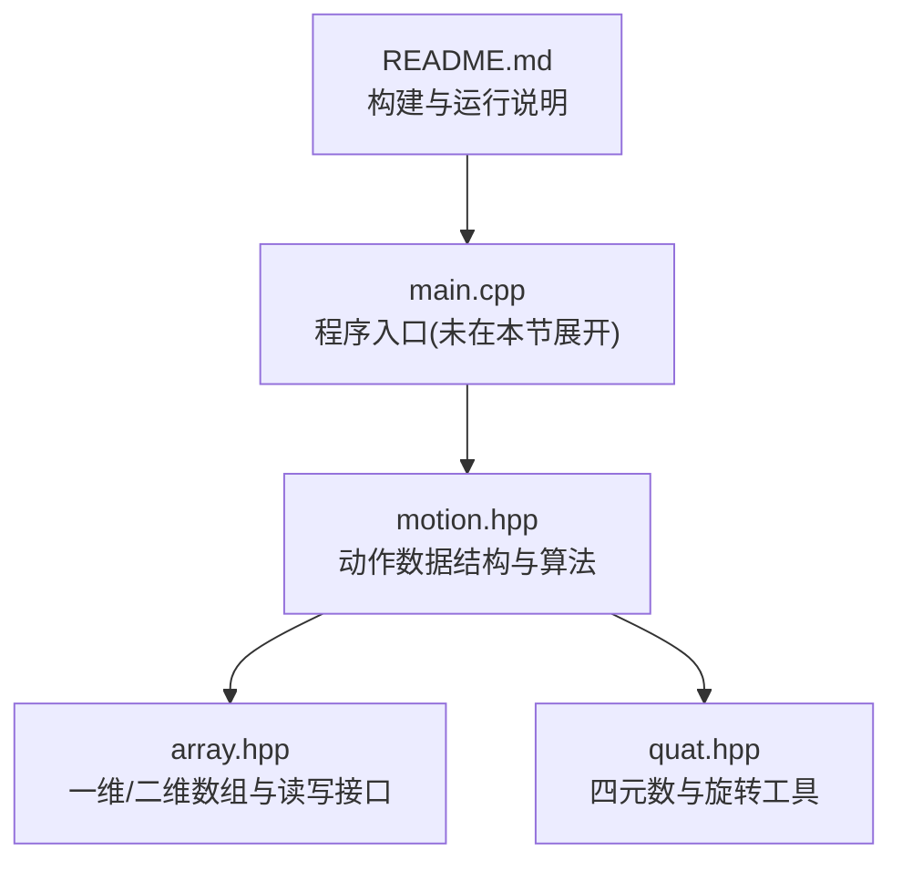
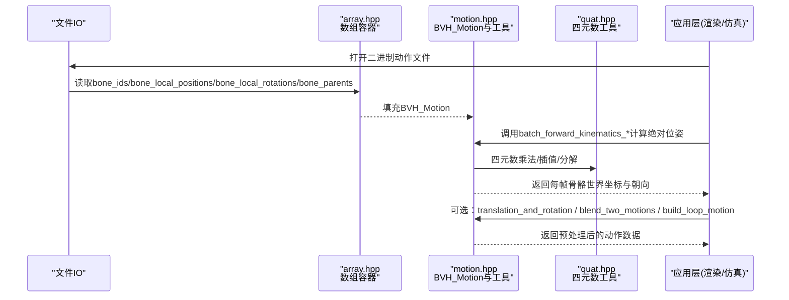
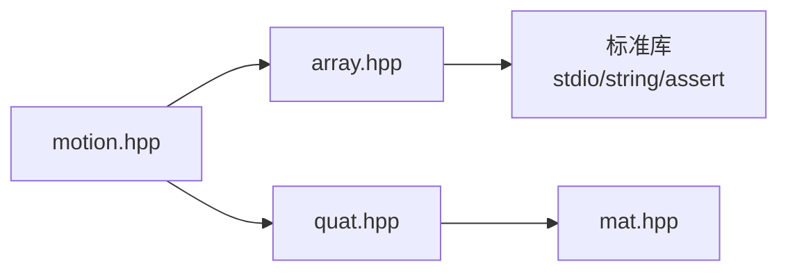

# BVH动作数据格式

> **版本提示（2.0）**：本文撰写于 1.x 时期，描述的是旧的实现形态——入口在根目录 `main.cpp`，功能由根目录 `.hpp` 头文件库提供，窗口用 raylib、显示用 OpenCV highgui。2.0 已把这些头文件移到 `Source/Legacy/`，渲染默认走 GPU，窗口与 UI 换成 GLFW + ImGui，`main.cpp` 拆成 `Source/Launch/Private/` 下的 `Main.cpp` 与 `Application`。文中的文件路径、行号与调用链可能已失效，请以根目录的「项目概述」「快速开始」「故障排除」三篇与当前源码为准。

<cite>
**本文引用的文件**   
- [motion.hpp](file://motion.hpp)
- [array.hpp](file://array.hpp)
- [quat.hpp](file://quat.hpp)
- [README.md](file://README.md)
</cite>

## 目录
1. [简介](#简介)
2. [项目结构](#项目结构)
3. [核心组件](#核心组件)
4. [架构总览](#架构总览)
5. [详细组件分析](#详细组件分析)
6. [依赖关系分析](#依赖关系分析)
7. [性能与内存优化](#性能与内存优化)
8. [故障排查指南](#故障排查指南)
9. [结论](#结论)
10. [附录：BVH规范与本项目映射](#附录bvh规范与本项目映射)

## 简介
本文件面向MooLab项目中的动作数据处理模块，聚焦于BVH（Biovision Hierarchy）动作数据的解析、存储、变换与播放流程。需要特别说明的是：当前仓库并未包含对原始文本BVH文件的解析器；而是提供了一套二进制序列化/反序列化的动作数据结构与工具函数，用于高效加载、缓存和计算骨骼动画。因此，本文在解释BVH文件格式的同时，会明确标注哪些内容属于通用BVH规范，哪些由本项目实现。

- 通用BVH规范：层次结构定义、关节参数、通道数据、关键帧信息、时间戳与帧率等概念。
- 本项目实现：二进制动作数据结构的构建、批量前向运动学、姿态对齐、片段拼接与混合、循环闭合等。

## 项目结构
本项目采用单头文件模块化组织，核心动作逻辑集中在 motion.hpp，基础数组容器与四元数运算分别位于 array.hpp 与 quat.hpp。README.md 提供了构建与运行说明。

图表来源
- [README.md:1-22](file://README.md#L1-L22)
- [motion.hpp:1-379](file://motion.hpp#L1-L379)
- [array.hpp:1-220](file://array.hpp#L1-L220)
- [quat.hpp:1-229](file://quat.hpp#L1-L229)

章节来源
- [README.md:1-22](file://README.md#L1-L22)

## 核心组件
- BVH_Motion：动作数据的核心结构体，保存骨骼ID、局部位置、局部旋转、父子关系以及帧数/骨数查询方法。
- Motion_load/Motion_save：二进制I/O接口，将BVH_Motion写入或从磁盘读取。
- 运动学工具：batch_forward_kinematics_full/part/root，批量计算每帧的绝对位姿。
- 预处理工具：translation_and_rotation（平移与朝向对齐）、blend_two_motions（双动作混合）、build_loop_motion（循环闭合）、concatenate_two_motions（两段动作平滑衔接）。
- 枚举Motion_Bones：预置的人体骨骼索引，便于上层使用固定骨架。

章节来源
- [motion.hpp:8-70](file://motion.hpp#L8-L70)
- [motion.hpp:72-96](file://motion.hpp#L72-L96)
- [motion.hpp:122-198](file://motion.hpp#L122-L198)
- [motion.hpp:200-377](file://motion.hpp#L200-L377)

## 架构总览
下图展示了动作数据从“二进制文件”到“可渲染位姿”的关键路径，以及各模块的职责边界。

图表来源
- [motion.hpp:72-96](file://motion.hpp#L72-L96)
- [motion.hpp:122-198](file://motion.hpp#L122-L198)
- [motion.hpp:200-377](file://motion.hpp#L200-L377)
- [array.hpp:91-106](file://array.hpp#L91-L106)
- [array.hpp:158-176](file://array.hpp#L158-L176)
- [quat.hpp:155-210](file://quat.hpp#L155-L210)

## 详细组件分析

### 数据结构：BVH_Motion
- bone_ids：骨骼ID数组，长度等于骨骼数量。
- bone_local_positions：形状为[帧数×骨骼数]的三维向量矩阵，表示每帧每根骨骼相对于父节点的位移。
- bone_local_rotations：形状为[帧数×骨骼数]的四元数矩阵，表示每帧每根骨骼相对于父节点的旋转。
- bone_parents：长度为骨骼数的整数数组，记录每根骨骼的父节点索引；根节点通常以特殊值标识。
- nframes()/nbones()：便捷访问器，分别返回帧数与骨骼数。

复杂度与布局
- 内存布局为连续二维数组，行优先存储，利于批量SIMD与缓存友好访问。
- 空间复杂度O(F×B)，F为帧数，B为骨骼数。

章节来源
- [motion.hpp:37-70](file://motion.hpp#L37-L70)

### 二进制I/O：Motion_load / Motion_save
- 使用C标准库FILE进行二进制读写。
- 通过array1d_read/array2d_read与array1d_write/array2d_write完成各字段的序列化/反序列化。
- 错误处理：文件打开失败时触发断言宏MOO_CHECK_ALWAYS。

注意
- 该接口直接读写内部数组的二进制布局，并非解析文本BVH。若需从文本BVH导入，需在外部完成解析并构造BVH_Motion后调用Motion_save持久化。

章节来源
- [motion.hpp:72-96](file://motion.hpp#L72-L96)
- [array.hpp:91-106](file://array.hpp#L91-L106)
- [array.hpp:158-176](file://array.hpp#L158-L176)

### 批量前向运动学：batch_forward_kinematics_*
- full：以每帧根节点的局部位姿作为起点，自顶向下累积得到所有骨骼的世界坐标与朝向。
- part：允许传入自定义根节点位姿，适用于角色在世界坐标系中已有位姿的场景。
- root：对已计算好的世界位姿再施加根节点的统一旋转和平移，常用于整体朝向与位置的二次校正。

假设
- 骨骼按从根到叶的顺序排列，父节点索引小于子节点索引，保证单次线性扫描即可正确传播。

章节来源
- [motion.hpp:122-198](file://motion.hpp#L122-L198)

### 预处理与编辑：translation_and_rotation
- 目标：将动作的根节点平移到指定XZ平面位置，并将根节点朝向旋转到目标方向。
- 步骤概览：
  1) 计算偏移量，应用到所有帧的根节点位置。
  2) 将根节点旋转分解为绕Y轴的旋转Ry与其余分量Rxz。
  3) 根据目标朝向计算全局旋转Q。
  4) 对所有帧的根节点旋转与位置施加Q，保持相对关系不变。

适用场景
- 将不同来源的动作统一到同一坐标系与朝向，便于后续混合或回放。

章节来源
- [motion.hpp:200-264](file://motion.hpp#L200-L264)

### 动作混合：blend_two_motions
- 输入两段相同骨架的动作与一段alpha曲线（长度等于输出帧数）。
- 对位置使用线性插值，对旋转使用球面线性插值（slerp），确保旋转平滑。
- 输出帧数由alpha长度决定，内部对源动作帧索引做均匀采样。

章节来源
- [motion.hpp:266-291](file://motion.hpp#L266-L291)
- [quat.hpp:155-180](file://quat.hpp#L155-L180)

### 循环闭合：build_loop_motion
- 目标：使动作首尾平滑连接，消除跳跃。
- 思路：
  - 对每根骨骼，计算首尾帧之间的角速度与线速度。
  - 将差值按时间均匀分布到每一帧，叠加到原有位姿上。
- 参数：half_life与fps用于控制过渡节奏，dt为默认时间步长。

章节来源
- [motion.hpp:293-330](file://motion.hpp#L293-L330)
- [quat.hpp:182-210](file://quat.hpp#L182-L210)

### 动作拼接：concatenate_two_motions
- 功能：将两段动作平滑衔接，支持混入时长mix_time与混入起始帧mix_frame。
- 流程：
  1) 取第一段在mix_frame处的根节点位姿与朝向。
  2) 对第二段动作执行translation_and_rotation，使其根节点与朝向与第一段衔接点一致。
  3) 根据mix_frame是否越界，切分两段动作的首尾片段。
  4) 使用blend_two_motions在mix_time内对两段动作进行混合。
  5) 将三段结果拼接为最终动作。

章节来源
- [motion.hpp:332-377](file://motion.hpp#L332-L377)

### 骨骼枚举：Motion_Bones
- 定义了人体常用骨骼的索引，便于上层代码以语义化方式访问骨骼。
- 包含左右髋、膝、踝、脚趾、骨盆、躯干、肩、肘、腕等。

章节来源
- [motion.hpp:8-35](file://motion.hpp#L8-L35)

## 依赖关系分析
- motion.hpp依赖：
  - array.hpp：提供array1d/array2d及其读写接口，支撑动作数据的内存布局与I/O。
  - quat.hpp：提供四元数运算、欧拉角转换、角速度估计等工具，支撑旋转相关算法。
- array.hpp依赖：
  - 标准库stdio.h、string.h、assert.h，提供基础I/O与断言能力。
- quat.hpp依赖：
  - mat.hpp：提供矩阵与Rodrigues等数学工具（未在本文展开）。

图表来源
- [motion.hpp:1-6](file://motion.hpp#L1-L6)
- [array.hpp:1-7](file://array.hpp#L1-L7)
- [quat.hpp:1-4](file://quat.hpp#L1-L4)

章节来源
- [motion.hpp:1-6](file://motion.hpp#L1-L6)
- [array.hpp:1-7](file://array.hpp#L1-L7)
- [quat.hpp:1-4](file://quat.hpp#L1-L4)

## 性能与内存优化
- 连续内存布局：array2d以行优先连续存储，减少缓存缺失，提升批量前向运动学与插值的吞吐。
- 批量操作：batch_forward_kinematics_*一次遍历完成整段动作的计算，避免逐帧开销。
- 零拷贝切片：slice1d/slice2d提供视图类型，避免不必要的复制，适合高性能管线。
- I/O效率：二进制读写直接序列化底层数组，避免字符串解析与动态分配。

建议
- 对于大规模动作库，建议在应用层维护BVH_Motion的缓存池，并按需加载/卸载。
- 对高频访问的帧范围，可使用motion_sub_sequence提取子序列以减少计算量。

章节来源
- [array.hpp:16-43](file://array.hpp#L16-L43)
- [array.hpp:198-216](file://array.hpp#L198-L216)
- [motion.hpp:98-120](file://motion.hpp#L98-L120)

## 故障排查指南
- 文件无法打开：检查路径与工作目录。程序启动时会切换到resources目录，请确保二进制动作文件存在且可读。
- 数据损坏或不匹配：若二进制文件非由Motion_save生成，可能导致字段尺寸不一致。建议使用Motion_load/Motion_save成对使用。
- 骨骼顺序问题：batch_forward_kinematics_*假设骨骼按从根到叶排序，若父子索引不满足该条件，会导致计算错误。
- 朝向异常：translation_and_rotation依赖根节点旋转分解，若目标朝向与根朝向退化（如轴向重合），需检查角度计算分支。

章节来源
- [motion.hpp:72-96](file://motion.hpp#L72-L96)
- [motion.hpp:122-198](file://motion.hpp#L122-L198)
- [motion.hpp:200-264](file://motion.hpp#L200-L264)

## 结论
本项目通过BVH_Motion结构与一系列工具函数，构建了高效的动作数据处理管线。虽然未直接解析文本BVH，但提供了完整的二进制动作数据生命周期管理（加载、保存、变换、混合、拼接、循环闭合）与前向运动学计算，足以支撑角色动画的渲染与仿真需求。开发者可在上层实现文本BVH解析器，将结果转换为BVH_Motion后复用本模块的全部能力。

## 附录：BVH规范与本项目映射
以下为通用BVH文件格式要点与本项目的对应关系说明。请注意，这些是规范层面的描述，不代表仓库中存在对应的文本解析器。

- 层次结构定义
  - BVH以层级树描述骨骼拓扑，根节点无父节点，子节点继承父节点的空间变换。
  - 本项目以bone_parents数组表达父子关系，并以Motion_Bones枚举提供常见骨架索引。

- 关节参数
  - 每个关节有偏移（offset）与旋转限制（limits）等参数。
  - 本项目将关节偏移编码为bone_local_positions，旋转限制不在结构中显式保存，通常在外部约束或IK求解中使用。

- 通道数据
  - BVH为每个关节定义若干通道（如Xposition/Yposition/Zposition/Xrotation/Yrotation/Zrotation）。
  - 本项目将通道数据统一压缩为每帧的局部位置与局部旋转（四元数），不再保留通道维度。

- 关键帧信息
  - BVH包含帧数与帧间隔（或帧率），每帧依次给出各关节通道的数值。
  - 本项目以nframes()表示帧数，帧率与时间戳由上层应用管理；build_loop_motion使用dt与fps参与循环闭合计算。

- 时间戳与帧率
  - 通用BVH以帧间隔或帧率驱动时序。
  - 本项目未内置时间戳数组，时间轴由上层在播放或物理步进时维护。

- 单位与坐标系
  - BVH单位通常为厘米，坐标系约定因数据源而异。
  - 本项目未内置单位转换；translation_and_rotation提供坐标系对齐与朝向归一化的能力，可在外部完成单位换算后再进入本模块。

章节来源
- [motion.hpp:8-35](file://motion.hpp#L8-L35)
- [motion.hpp:37-70](file://motion.hpp#L37-L70)
- [motion.hpp:293-330](file://motion.hpp#L293-L330)