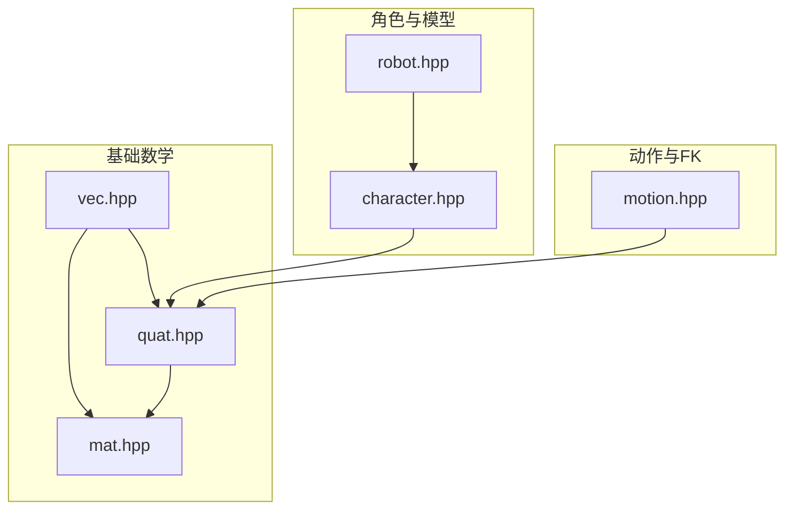
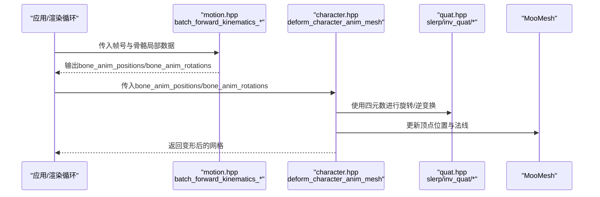
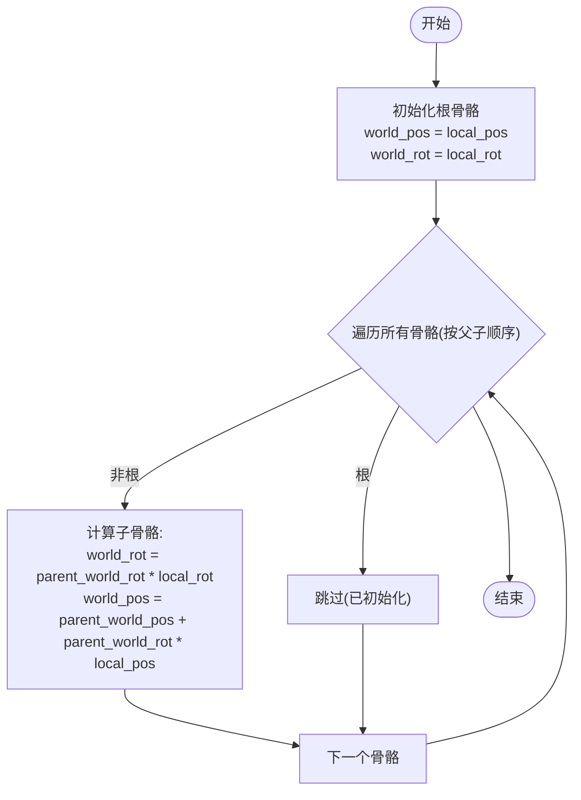
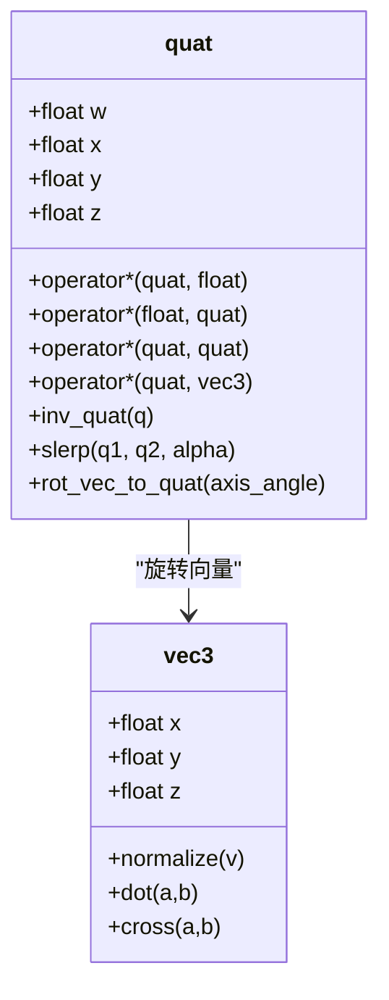
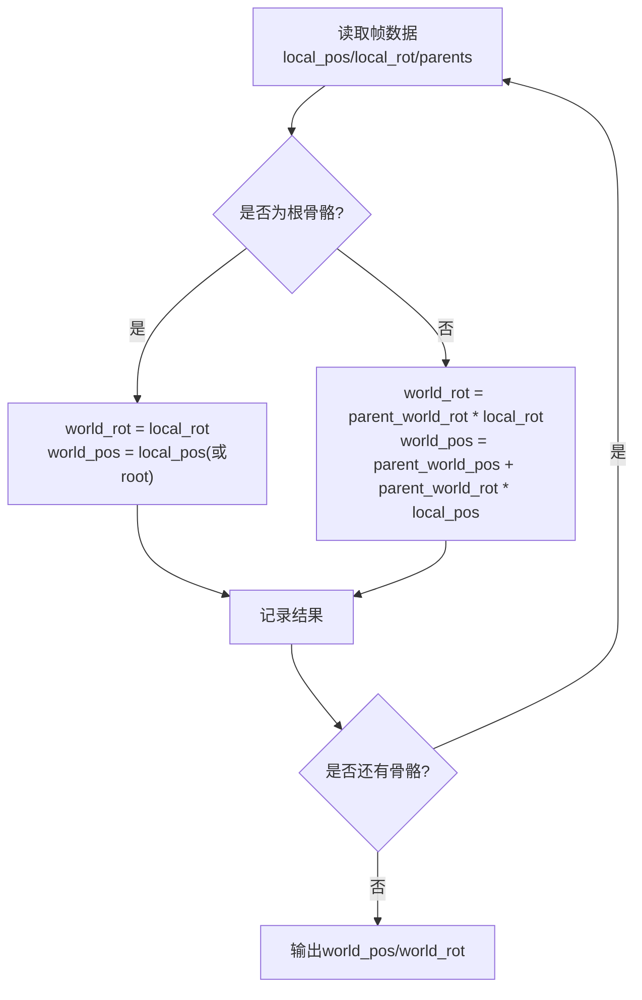
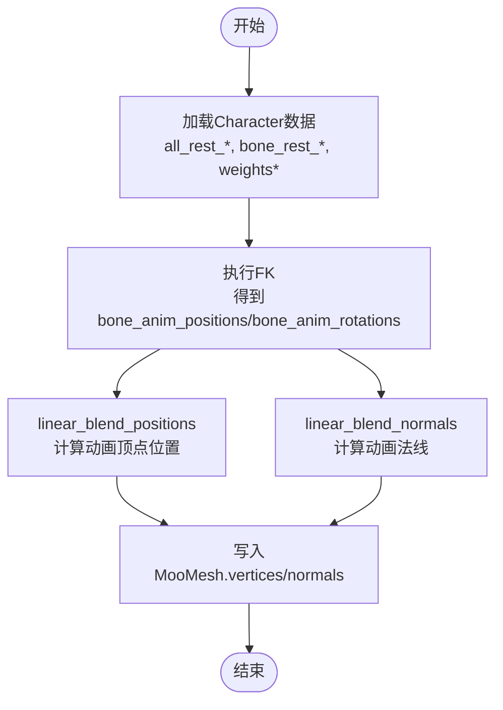
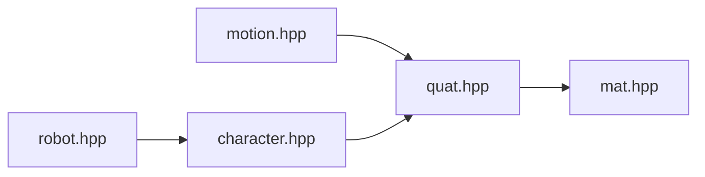

# 前向运动学（FK）

> **版本提示（2.0）**：本文撰写于 1.x 时期，描述的是旧的实现形态——入口在根目录 `main.cpp`，功能由根目录 `.hpp` 头文件库提供，窗口用 raylib、显示用 OpenCV highgui。2.0 已把这些头文件移到 `Source/Legacy/`，渲染默认走 GPU，窗口与 UI 换成 GLFW + ImGui，`main.cpp` 拆成 `Source/Launch/Private/` 下的 `Main.cpp` 与 `Application`。文中的文件路径、行号与调用链可能已失效，请以根目录的「项目概述」「快速开始」「故障排除」三篇与当前源码为准。

<cite>
**本文引用的文件**   
- [character.hpp](file://character.hpp)
- [motion.hpp](file://motion.hpp)
- [robot.hpp](file://robot.hpp)
- [quat.hpp](file://quat.hpp)
- [vec.hpp](file://vec.hpp)
- [mat.hpp](file://mat.hpp)
</cite>

## 目录
1. [引言](#引言)
2. [项目结构](#项目结构)
3. [核心组件](#核心组件)
4. [架构总览](#架构总览)
5. [详细组件分析](#详细组件分析)
6. [依赖关系分析](#依赖关系分析)
7. [性能考量](#性能考量)
8. [故障排查指南](#故障排查指南)
9. [结论](#结论)
10. [附录](#附录)

## 引言
本文件面向MooLab项目的前向运动学（Forward Kinematics, FK），聚焦于骨骼层级与变换计算、四元数旋转在动画中的应用，以及从根骨骼开始逐级计算世界坐标与世界旋转的完整流程。文档同时给出如何使用Character结构体中的骨骼数据完成网格形变（顶点位置与法线）的具体步骤说明，并解释Bones枚举中各骨骼节点的含义，帮助开发者理解角色动画中位置计算的数学基础与实现细节。

## 项目结构
本项目采用模块化头文件组织：
- 基础数学类型与运算：vec.hpp、mat.hpp、quat.hpp
- 角色与网格：character.hpp
- 机器人/通用骨架示例：robot.hpp
- 动作数据与批量FK：motion.hpp
- IK算法与工具：ik.hpp（本文主要关注FK）

图表来源
- [vec.hpp:75-160](file://vec.hpp#L75-L160)
- [mat.hpp:7-145](file://mat.hpp#L7-L145)
- [quat.hpp:6-81](file://quat.hpp#L6-L81)
- [character.hpp:35-47](file://character.hpp#L35-L47)
- [robot.hpp:6-43](file://robot.hpp#L6-L43)
- [motion.hpp:37-70](file://motion.hpp#L37-L70)

章节来源
- [vec.hpp:75-160](file://vec.hpp#L75-L160)
- [mat.hpp:7-145](file://mat.hpp#L7-L145)
- [quat.hpp:6-81](file://quat.hpp#L6-L81)
- [character.hpp:35-47](file://character.hpp#L35-L47)
- [robot.hpp:6-43](file://robot.hpp#L6-L43)
- [motion.hpp:37-70](file://motion.hpp#L37-L70)

## 核心组件
- 向量与矩阵：vec3、mat3、mat4提供基本几何运算与坐标系变换能力。
- 四元数：quat封装旋转表示、插值（slerp）、逆操作、欧拉转换等。
- 角色数据结构：Character包含网格顶点、法线、纹理坐标、索引，以及每顶点的骨骼权重与骨骼ID映射；同时包含每个骨骼的静止位置与静止旋转。
- 机器人骨架：Robot提供通用骨架示例，含局部/静止骨骼数据、父子关系、网格与权重。
- 动作数据：BVH_Motion存储多帧的骨骼局部位移与旋转，以及父子关系，用于批量FK。

章节来源
- [vec.hpp:75-160](file://vec.hpp#L75-L160)
- [mat.hpp:147-194](file://mat.hpp#L147-L194)
- [quat.hpp:6-81](file://quat.hpp#L6-L81)
- [character.hpp:35-47](file://character.hpp#L35-L47)
- [robot.hpp:6-43](file://robot.hpp#L6-L43)
- [motion.hpp:37-70](file://motion.hpp#L37-L70)

## 架构总览
FK的核心思想是：给定每根骨骼的局部位移与局部旋转，沿父子链自根至叶逐层累积，得到每根骨骼在世界坐标系下的位置与旋转。随后，利用这些世界变换对网格顶点进行线性混合蒙皮（LBS），得到动画姿态。

图表来源
- [motion.hpp:122-182](file://motion.hpp#L122-L182)
- [character.hpp:142-164](file://character.hpp#L142-L164)
- [quat.hpp:98-180](file://quat.hpp#L98-L180)

## 详细组件分析

### 骨骼层级与FK计算原理
- 父关节到子关节的坐标变换过程：
  - 世界旋转：子骨骼的世界旋转 = 父骨骼的世界旋转 × 子骨骼的局部旋转。
  - 世界位置：子骨骼的世界位置 = 父骨骼的世界位置 + 父骨骼的世界旋转 × 子骨骼的局部位移。
- 该过程从根骨骼开始，按父子顺序遍历所有骨骼，保证父先于子被处理。

图表来源
- [motion.hpp:122-182](file://motion.hpp#L122-L182)
- [robot.hpp:130-157](file://robot.hpp#L130-L157)

章节来源
- [motion.hpp:122-182](file://motion.hpp#L122-L182)
- [robot.hpp:130-157](file://robot.hpp#L130-L157)

### 四元数旋转在骨骼动画中的应用
- 姿态表示：使用quat表示旋转，避免万向锁，支持稳定插值。
- 旋转插值：slerp(q1, q2, alpha)在两个单位四元数之间进行球面线性插值，常用于动画过渡或IK求解过程中的角度平滑。
- 逆变换：inv_quat(q)用于将向量从世界空间转回局部空间，或在蒙皮时恢复局部方向。
- 轴角构造：quat(theta, axis)由轴角构造旋转，便于根据目标方向计算旋转差。

图表来源
- [quat.hpp:6-81](file://quat.hpp#L6-L81)
- [quat.hpp:98-180](file://quat.hpp#L98-L180)
- [vec.hpp:75-160](file://vec.hpp#L75-L160)

章节来源
- [quat.hpp:6-81](file://quat.hpp#L6-L81)
- [quat.hpp:98-180](file://quat.hpp#L98-L180)
- [vec.hpp:75-160](file://vec.hpp#L75-L160)

### 骨骼链的计算流程（从根到叶）
- 输入：
  - BVH_Motion：每帧的bone_local_positions、bone_local_rotations、bone_parents。
  - 可选：根骨骼的世界位置与世界旋转（当需要覆盖根时）。
- 输出：
  - bone_anim_positions：每根骨骼的世界位置。
  - bone_anim_rotations：每根骨骼的世界旋转。
- 流程：
  - 若parent_id == -1（根）：world_rot = local_rot，world_pos = local_pos（或外部提供的root值）。
  - 否则：world_rot = parent_world_rot × local_rot；world_pos = parent_world_pos + parent_world_rot × local_pos。
  - 按父子顺序遍历，确保父先于子。

图表来源
- [motion.hpp:122-182](file://motion.hpp#L122-L182)
- [robot.hpp:130-157](file://robot.hpp#L130-L157)

章节来源
- [motion.hpp:122-182](file://motion.hpp#L122-L182)
- [robot.hpp:130-157](file://robot.hpp#L130-L157)

### 使用Character结构体进行网格形变（LBS）
Character结构体提供了角色网格与骨骼绑定所需的数据：
- all_rest_positions/all_rest_normals/texcoords/indices：静态网格顶点、法线、UV与三角索引。
- bone_weights/bone_weights_ids：每顶点最多4个骨骼的权重与骨骼ID。
- bone_rest_positions/bone_rest_rotations：每根骨骼的静止位置与静止旋转（T-Pose或Bind Pose）。

形变流程：
- 调用linear_blend_positions：对每个顶点，基于其受影响的骨骼集合，计算该顶点在动画姿态下的世界位置。
- 调用linear_blend_normals：对每个顶点，基于其受影响的骨骼旋转，计算动画法线。
- 最终通过deform_character_anim_mesh将结果写入MooMesh。

图表来源
- [character.hpp:35-47](file://character.hpp#L35-L47)
- [character.hpp:68-121](file://character.hpp#L68-L121)
- [character.hpp:142-164](file://character.hpp#L142-L164)

章节来源
- [character.hpp:35-47](file://character.hpp#L35-L47)
- [character.hpp:68-121](file://character.hpp#L68-L121)
- [character.hpp:142-164](file://character.hpp#L142-L164)

### Bones枚举定义与骨骼节点含义
Bones枚举定义了角色骨骼节点的标识，涵盖躯干、四肢与末端关节，例如：
- 骨盆与脊柱：Bone_Hips、Bone_Spine、Bone_Spine1、Bone_Spine2
- 颈部与头部：Bone_Neck、Bone_Head
- 左臂链：Bone_LeftShoulder、Bone_LeftArm、Bone_LeftForeArm、Bone_LeftHand
- 右臂链：Bone_RightShoulder、Bone_RightArm、Bone_RightForeArm、Bone_RightHand
- 左腿链：Bone_LeftUpLeg、Bone_LeftLeg、Bone_LeftFoot、Bone_LeftToe
- 右腿链：Bone_RightUpLeg、Bone_RightLeg、Bone_RightFoot、Bone_RightToe
- Bone_Entity：实体根节点

用途：
- 作为骨骼数组索引，配合bone_rest_positions/bone_rest_rotations访问对应骨骼的静止数据。
- 在动画管线中用于定位特定骨骼，进行可视化、调试或控制。

章节来源
- [character.hpp:8-33](file://character.hpp#L8-L33)

### 代码示例路径（不直接展示代码内容）
- 批量FK（完整）：[batch_forward_kinematics_full:122-150](file://motion.hpp#L122-L150)
- 批量FK（部分，带自定义根）：[batch_forward_kinematics_part:152-182](file://motion.hpp#L152-L182)
- 机器人FK（全量）：[robot_forward_kinematics_full:130-157](file://robot.hpp#L130-L157)
- 机器人FK（角度输入）：[robot_forward_kinematics_positions:159-187](file://robot.hpp#L159-L187)
- 机器人FK（四元数输入）：[robot_forward_kinematics_quaternions:189-217](file://robot.hpp#L189-L217)
- 角色网格形变入口：[deform_character_anim_mesh:142-164](file://character.hpp#L142-L164)
- 顶点位置线性混合：[linear_blend_positions:68-95](file://character.hpp#L68-L95)
- 法线线性混合：[linear_blend_normals:97-121](file://character.hpp#L97-L121)
- 四元数插值：[slerp:155-180](file://quat.hpp#L155-L180)
- 四元数逆：[inv_quat:98-101](file://quat.hpp#L98-L101)
- 轴角构造四元数：[quat(theta, axis):10-21](file://quat.hpp#L10-L21)

## 依赖关系分析
- motion.hpp依赖quat.hpp进行旋转组合与插值。
- character.hpp依赖quat.hpp进行蒙皮时的旋转计算。
- robot.hpp复用character.hpp中的蒙皮函数，并提供通用骨架与FK接口。
- mat.hpp为quat.hpp提供Rodrigues等辅助矩阵运算。

图表来源
- [motion.hpp:122-182](file://motion.hpp#L122-L182)
- [character.hpp:68-121](file://character.hpp#L68-L121)
- [robot.hpp:130-157](file://robot.hpp#L130-L157)
- [quat.hpp:221-226](file://quat.hpp#L221-L226)

章节来源
- [motion.hpp:122-182](file://motion.hpp#L122-L182)
- [character.hpp:68-121](file://character.hpp#L68-L121)
- [robot.hpp:130-157](file://robot.hpp#L130-L157)
- [quat.hpp:221-226](file://quat.hpp#L221-L226)

## 性能考量
- 时间复杂度：
  - FK遍历O(N)，N为骨骼数量。
  - 蒙皮LBS为O(V×K)，V为顶点数，K为每顶点最大骨骼数（通常为4）。
- 数值稳定性：
  - 使用单位四元数与slerp避免奇异点与抖动。
  - inv_quat用于局部空间投影，注意归一化与浮点误差。
- 缓存友好：
  - 批量处理同一帧的骨骼与顶点，减少重复计算。
- 优化建议：
  - 预计算bone_rest_rotations的逆矩阵或四元数逆，加速蒙皮。
  - 对稀疏权重进行压缩存储，减少内存带宽压力。
  - 多线程并行化顶点级LBS。

## 故障排查指南
- 问题：骨骼位置错位或拉伸异常
  - 检查父子关系是否正确（bone_parents），确保根骨骼parent_id为-1且位于遍历首位。
  - 确认局部位移local_pos与静止位置bone_rest_positions一致（在T-Pose下）。
- 问题：旋转出现翻转或抖动
  - 检查四元数是否为单位长度；必要时在slerp前后进行归一化。
  - 检查旋转顺序（乘法顺序）是否符合约定（父×子）。
- 问题：网格形变不正确
  - 核对bone_weights与bone_weights_ids是否与顶点一一对应。
  - 确认bone_rest_rotations与bone_rest_positions与导入的模型一致。
  - 检查linear_blend_positions与linear_blend_normals的参数顺序与数据类型。

章节来源
- [motion.hpp:122-182](file://motion.hpp#L122-L182)
- [character.hpp:68-121](file://character.hpp#L68-L121)
- [quat.hpp:98-180](file://quat.hpp#L98-L180)

## 结论
MooLab的FK实现以四元数为旋转核心，结合清晰的骨骼父子链遍历，实现了高效稳定的世界坐标与旋转计算。Character结构体将骨骼数据与网格绑定，通过线性混合蒙皮将骨骼动画映射到顶点层面。开发者可基于motion.hpp与robot.hpp提供的接口快速搭建角色动画管线，并结合quat.hpp的工具函数进行插值与姿态控制。

## 附录
- 常用数学函数参考：
  - 向量：length、normalize、dot、cross、lerp
  - 矩阵：eye3、get_rigid_body_motion_matrix、get_inverse_rigid_body_motion_matrix
  - 四元数：slerp、inv_quat、rot_vec_to_quat、quat_to_euler_YXZ、euler_YXZ_to_quat

章节来源
- [vec.hpp:75-160](file://vec.hpp#L75-L160)
- [mat.hpp:147-194](file://mat.hpp#L147-L194)
- [quat.hpp:125-140](file://quat.hpp#L125-L140)
- [quat.hpp:155-180](file://quat.hpp#L155-L180)