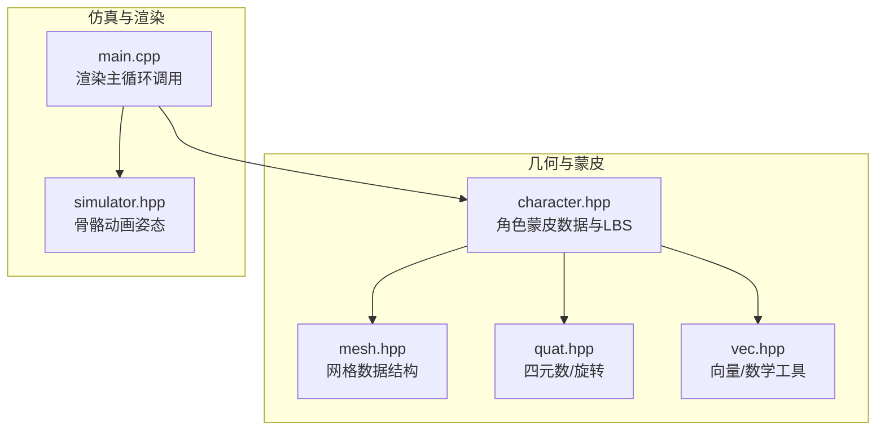
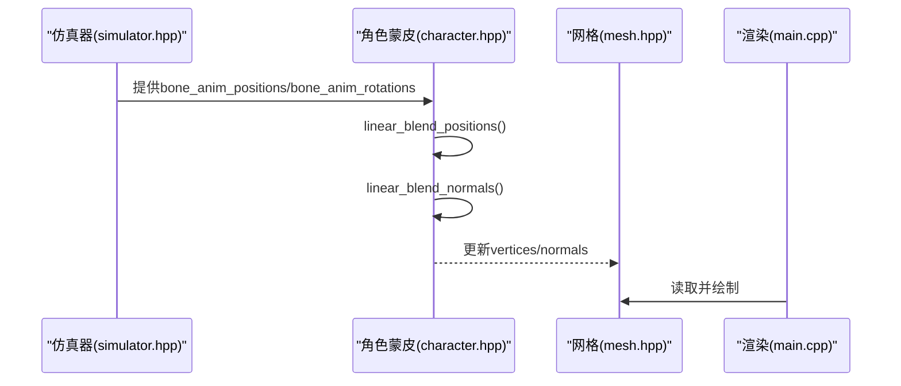
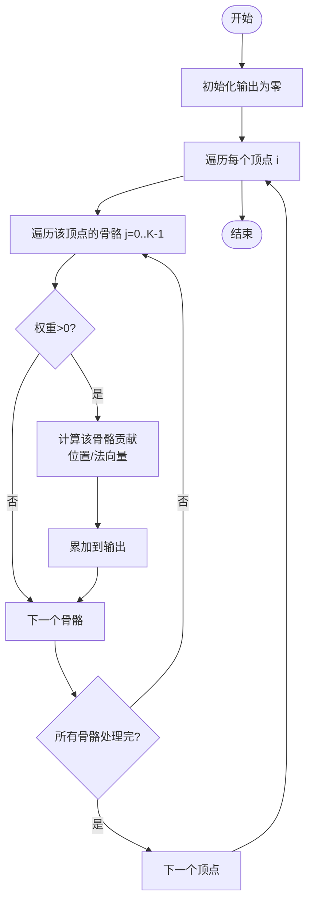
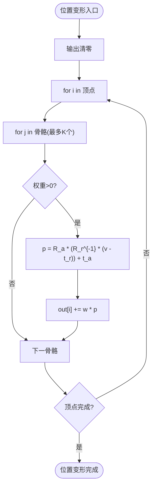
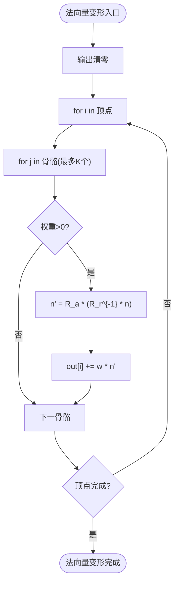
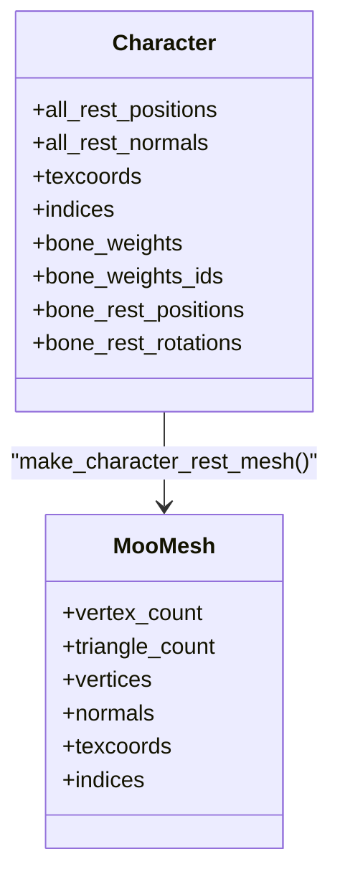
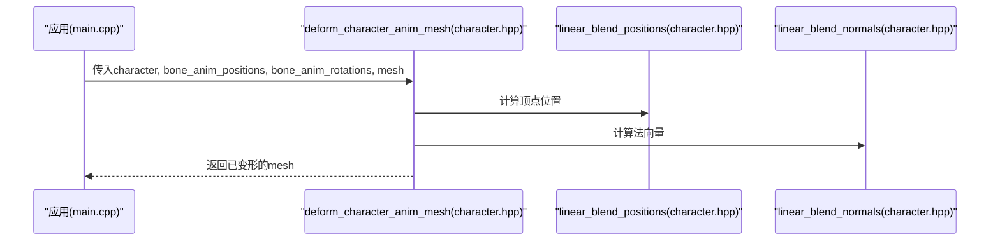
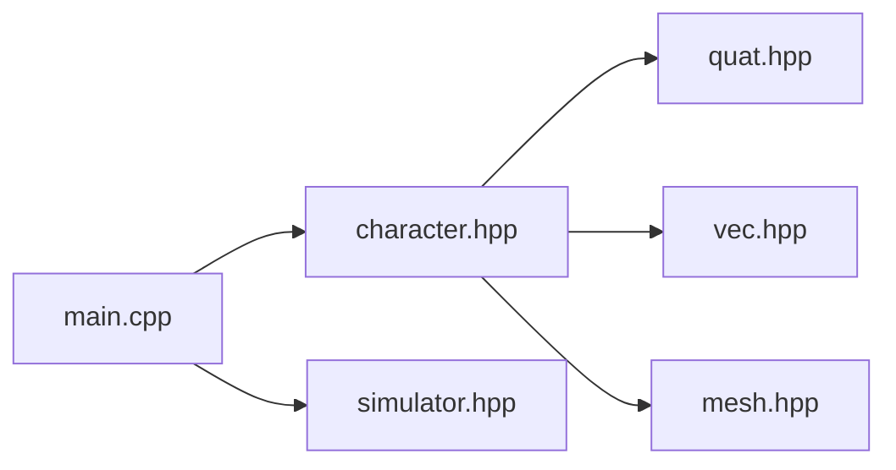

# 蒙皮变形算法

> **版本提示（2.0）**：本文撰写于 1.x 时期，描述的是旧的实现形态——入口在根目录 `main.cpp`，功能由根目录 `.hpp` 头文件库提供，窗口用 raylib、显示用 OpenCV highgui。2.0 已把这些头文件移到 `Source/Legacy/`，渲染默认走 GPU，窗口与 UI 换成 GLFW + ImGui，`main.cpp` 拆成 `Source/Launch/Private/` 下的 `Main.cpp` 与 `Application`。文中的文件路径、行号与调用链可能已失效，请以根目录的「项目概述」「快速开始」「故障排除」三篇与当前源码为准。

<cite>
**本文引用的文件**   
- [character.hpp](file://character.hpp)
- [mesh.hpp](file://mesh.hpp)
- [quat.hpp](file://quat.hpp)
- [vec.hpp](file://vec.hpp)
- [simulator.hpp](file://simulator.hpp)
- [main.cpp](file://main.cpp)
</cite>

## 目录
1. [引言](#引言)
2. [项目结构](#项目结构)
3. [核心组件](#核心组件)
4. [架构总览](#架构总览)
5. [详细组件分析](#详细组件分析)
6. [依赖关系分析](#依赖关系分析)
7. [性能与优化](#性能与优化)
8. [故障排查指南](#故障排查指南)
9. [结论](#结论)

## 引言
本文面向MooLab项目的蒙皮变形子系统，系统性讲解线性混合蒙皮（Linear Blend Skinning, LBS）的数学原理、实现细节与数据流。重点包括：
- 顶点权重分配与变换矩阵计算
- 顶点位置与法向量的变形流程
- 骨骼权重系统（多骨骼影响与权重归一化）
- 蒙皮网格数据结构（顶点、法向量、纹理坐标、索引缓冲）
- 关键函数 deform_character_anim_mesh、linear_blend_positions、linear_blend_normals 的实现要点
- 性能优化策略（CPU/GPU加速与批量处理建议）

## 项目结构
本仓库采用模块化组织，几何与蒙皮相关逻辑集中在以下头文件中：
- character.hpp：角色蒙皮数据结构与LBS算法实现
- mesh.hpp：通用网格数据结构与基础几何生成
- quat.hpp：四元数与旋转运算
- vec.hpp：向量与常用数学工具
- simulator.hpp：仿真器中骨骼动画姿态的计算
- main.cpp：渲染主循环中对蒙皮变形的调用点

图表来源
- [character.hpp:35-47](file://character.hpp#L35-L47)
- [mesh.hpp:6-14](file://mesh.hpp#L6-L14)
- [quat.hpp:6-24](file://quat.hpp#L6-L24)
- [vec.hpp:75-82](file://vec.hpp#L75-L82)
- [simulator.hpp:911-930](file://simulator.hpp#L911-L930)
- [main.cpp:424-430](file://main.cpp#L424-L430)

章节来源
- [character.hpp:35-47](file://character.hpp#L35-L47)
- [mesh.hpp:6-14](file://mesh.hpp#L6-L14)
- [quat.hpp:6-24](file://quat.hpp#L6-L24)
- [vec.hpp:75-82](file://vec.hpp#L75-L82)
- [simulator.hpp:911-930](file://simulator.hpp#L911-L930)
- [main.cpp:424-430](file://main.cpp#L424-L430)

## 核心组件
- Character：承载角色蒙皮所需的全部静态数据与权重信息
  - all_rest_positions/all_rest_normals：静止姿势下的顶点位置与法向量
  - texcoords/indices：纹理坐标与三角形索引
  - bone_weights/bone_weights_ids：每个顶点对应骨骼的权重与骨骼ID
  - bone_rest_positions/bone_rest_rotations：骨骼在静止姿势下的平移与旋转
- MooMesh：渲染用网格对象
  - vertices/normals/texcoords/indices：GPU可消费的顶点属性与索引缓冲
- 四元数与向量：quat/vec3等基础类型与运算
- 仿真器：提供每帧骨骼动画的姿态（位置和旋转），供蒙皮使用

章节来源
- [character.hpp:35-47](file://character.hpp#L35-L47)
- [mesh.hpp:6-14](file://mesh.hpp#L6-L14)
- [quat.hpp:6-24](file://quat.hpp#L6-L24)
- [vec.hpp:75-82](file://vec.hpp#L75-L82)

## 架构总览
下图展示从仿真器到渲染器的蒙皮变形数据流：仿真器输出骨骼动画姿态，角色蒙皮模块对网格进行LBS变形，最终由渲染管线绘制。

图表来源
- [simulator.hpp:911-930](file://simulator.hpp#L911-L930)
- [character.hpp:68-121](file://character.hpp#L68-L121)
- [character.hpp:142-164](file://character.hpp#L142-L164)
- [main.cpp:424-430](file://main.cpp#L424-L430)

## 详细组件分析

### 线性混合蒙皮（LBS）数学原理
- 目标：根据每根骨骼的当前姿态（平移与旋转），将静止姿势下的顶点位置与法向量映射到动画姿势下。
- 单骨骼变换：对于顶点v，若其受骨骼i影响，则先将其转换到骨骼局部坐标系，应用该骨骼的旋转和平移，再回到世界坐标系。
- 多骨骼混合：对每个顶点，按权重w_i对各骨骼贡献的位置/法向量加权求和，得到最终结果。
- 权重归一化：通常要求每个顶点的权重之和为1；代码通过跳过零权重并累加的方式隐式实现“有效权重”的线性组合。

注意：
- 位置变换包含平移项，法向量只参与旋转（无平移）。
- 旋转以四元数表示，避免万向锁并支持插值。

章节来源
- [character.hpp:68-95](file://character.hpp#L68-L95)
- [character.hpp:97-121](file://character.hpp#L97-L121)
- [quat.hpp:66-81](file://quat.hpp#L66-L81)

### 顶点权重系统与多骨骼影响
- 数据结构：
  - bone_weights_ids[i][j]：第i个顶点受第j根骨骼影响的骨骼ID
  - bone_weights[i][j]：对应权重
- 处理逻辑：
  - 遍历每个顶点与其最多K根骨骼（K=bone_weights_ids.cols）
  - 仅当权重>0时参与计算，减少无效运算
  - 最终结果为各骨骼贡献的加权平均

图表来源
- [character.hpp:68-95](file://character.hpp#L68-L95)
- [character.hpp:97-121](file://character.hpp#L97-L121)

章节来源
- [character.hpp:68-95](file://character.hpp#L68-L95)
- [character.hpp:97-121](file://character.hpp#L97-L121)

### 顶点变形计算流程
- 位置变形（linear_blend_positions）：
  - 对每个顶点，对每根骨骼：
    - 将静止位置减去骨骼静止平移，得到相对偏移
    - 用骨骼静止旋转的逆四元数将该偏移转到骨骼局部空间
    - 用骨骼动画旋转将该局部偏移旋转到动画空间
    - 加上骨骼动画平移，得到该骨骼对该顶点的贡献
    - 乘以权重并累加
- 法向量变形（linear_blend_normals）：
  - 对每个顶点，对每根骨骼：
    - 将静止法向量用相同方式（逆静止旋转+动画旋转）旋转到动画空间
    - 乘以权重并累加
  - 不加入平移，因为法向量是方向量

图表来源
- [character.hpp:68-95](file://character.hpp#L68-L95)

章节来源
- [character.hpp:68-95](file://character.hpp#L68-L95)

### 法向量更新流程
- 法向量不参与平移，仅随骨骼旋转变化
- 对每个顶点，对每根骨骼：
  - n' = R_a * (R_r^{-1} * n)
  - out[i] += w * n'

图表来源
- [character.hpp:97-121](file://character.hpp#L97-L121)

章节来源
- [character.hpp:97-121](file://character.hpp#L97-L121)

### 蒙皮网格的数据结构
- Character：
  - all_rest_positions/all_rest_normals：顶点位置与法向量（静止姿势）
  - texcoords/indices：纹理坐标与三角形索引
  - bone_weights/bone_weights_ids：权重与骨骼ID
  - bone_rest_positions/bone_rest_rotations：骨骼静止姿态
- MooMesh：
  - vertex_count/triangle_count：顶点与三角面数量
  - vertices/normals/texcoords/indices：GPU可消费的数据缓冲区

图表来源
- [character.hpp:35-47](file://character.hpp#L35-L47)
- [mesh.hpp:6-14](file://mesh.hpp#L6-L14)
- [character.hpp:123-140](file://character.hpp#L123-L140)

章节来源
- [character.hpp:35-47](file://character.hpp#L35-L47)
- [mesh.hpp:6-14](file://mesh.hpp#L6-L14)
- [character.hpp:123-140](file://character.hpp#L123-L140)

### 关键函数实现要点
- deform_character_anim_mesh：
  - 接收Character、骨骼动画姿态与待更新的MooMesh
  - 依次调用linear_blend_positions与linear_blend_normals更新网格的顶点与法向量
- linear_blend_positions：
  - 对每个顶点，按权重对多骨骼贡献进行加权求和
  - 使用四元数旋转与平移组合实现局部到世界的变换
- linear_blend_normals：
  - 对每个顶点，按权重对多骨骼的法向量旋转贡献进行加权求和
  - 不包含平移

图表来源
- [character.hpp:142-164](file://character.hpp#L142-L164)
- [character.hpp:68-95](file://character.hpp#L68-L95)
- [character.hpp:97-121](file://character.hpp#L97-L121)
- [main.cpp:424-430](file://main.cpp#L424-L430)

章节来源
- [character.hpp:142-164](file://character.hpp#L142-L164)
- [character.hpp:68-95](file://character.hpp#L68-L95)
- [character.hpp:97-121](file://character.hpp#L97-L121)
- [main.cpp:424-430](file://main.cpp#L424-L430)

## 依赖关系分析
- character.hpp依赖：
  - array/mesh：用于数组与网格数据结构
  - quat：四元数旋转与逆变换
  - vec：向量运算
- simulator.hpp提供：
  - 每帧骨骼动画的姿态（bone_anim_positions/bone_anim_rotations）
- main.cpp作为调用方：
  - 在渲染循环中调用deform_character_anim_mesh更新网格

图表来源
- [character.hpp:1-7](file://character.hpp#L1-L7)
- [main.cpp:424-430](file://main.cpp#L424-L430)
- [simulator.hpp:911-930](file://simulator.hpp#L911-L930)

章节来源
- [character.hpp:1-7](file://character.hpp#L1-L7)
- [main.cpp:424-430](file://main.cpp#L424-L430)
- [simulator.hpp:911-930](file://simulator.hpp#L911-L930)

## 性能与优化
- CPU侧优化建议：
  - 并行化：外层顶点循环可并行化（OpenMP），内层骨骼循环较小且分支少，适合SIMD或展开
  - 预计算：对每个骨骼预计算R_r^{-1}与R_a，减少重复四元数运算
  - 稀疏访问：bone_weights_ids与bone_weights可按非零权重压缩存储，减少遍历开销
  - 内存布局：使用SoA（结构体数组）而非AoS（数组结构体）以提升缓存友好性
- GPU侧优化建议：
  - 将LBS移至顶点着色器：每帧上传bone_anim_positions/bone_anim_rotations与权重表，在GPU上并行计算
  - 使用Uniform Buffer/Object与Texture Buffer存储权重与骨骼姿态，减少带宽
  - 批处理：一次提交多个角色网格，减少Draw Call
- 数值稳定性：
  - 法向量在变形后建议重新归一化，避免累积误差导致光照异常
  - 权重未显式归一化，但通过跳过零权重与线性累加，实际效果等价于对有效权重的加权平均

[本节为通用指导，不直接分析具体文件]

## 故障排查指南
- 模型穿模或形变异常：
  - 检查bone_weights_ids与bone_weights是否匹配，确保每个顶点的权重非负且合理
  - 确认bone_rest_positions/bone_rest_rotations与模型绑定一致
- 法向量异常（光照闪烁/暗面）：
  - 检查linear_blend_normals是否正确执行，确保未误加平移
  - 在渲染前对法向量进行归一化
- 性能瓶颈：
  - 若CPU占用高，考虑并行化或迁移至GPU
  - 检查是否频繁重建网格，尽量复用MooMesh缓冲区

章节来源
- [character.hpp:68-121](file://character.hpp#L68-L121)
- [character.hpp:142-164](file://character.hpp#L142-L164)

## 结论
MooLab的蒙皮变形基于标准LBS，使用四元数表达旋转，结合骨骼静止与动画姿态，对顶点位置与法向量进行逐顶点、逐骨骼的加权变换。通过Character与MooMesh的数据组织，配合仿真器提供的骨骼姿态，实现了角色模型的几何驱动变形。在实际工程中，可通过CPU并行化与GPU卸载进一步提升性能，并确保权重与绑定的正确性以获得稳定的视觉效果。