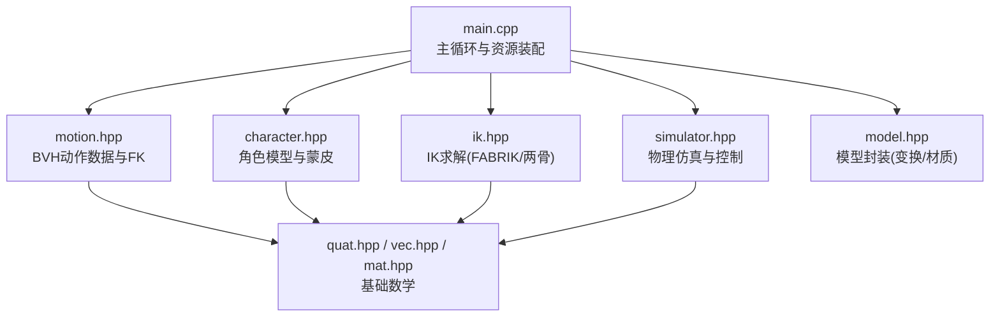
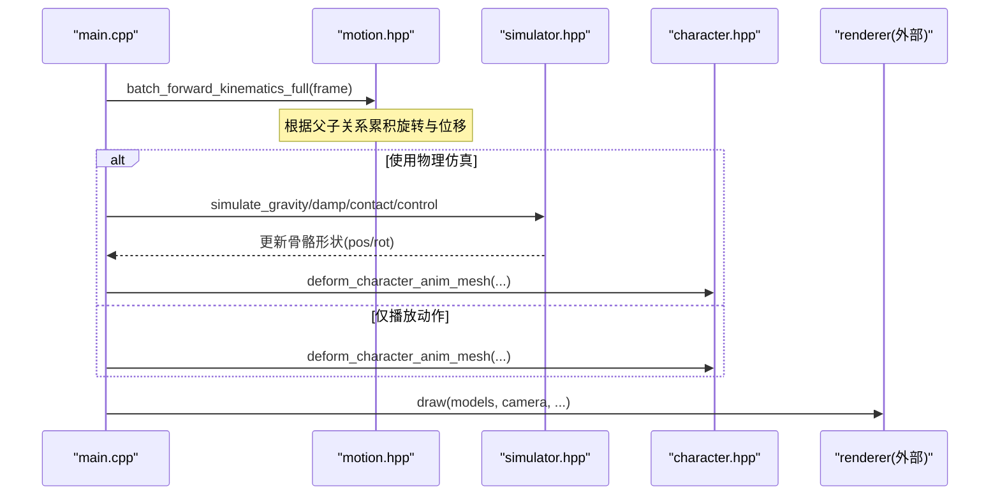
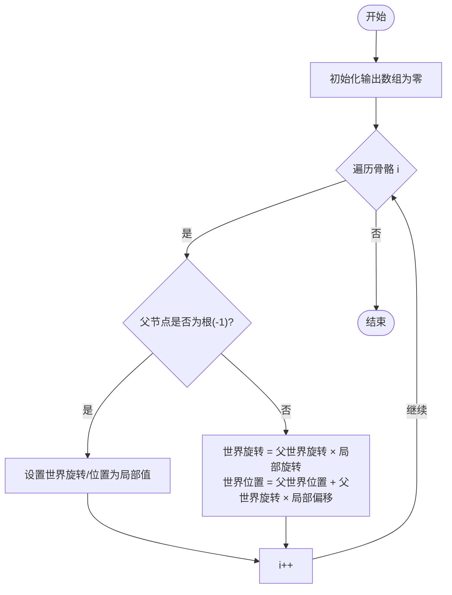
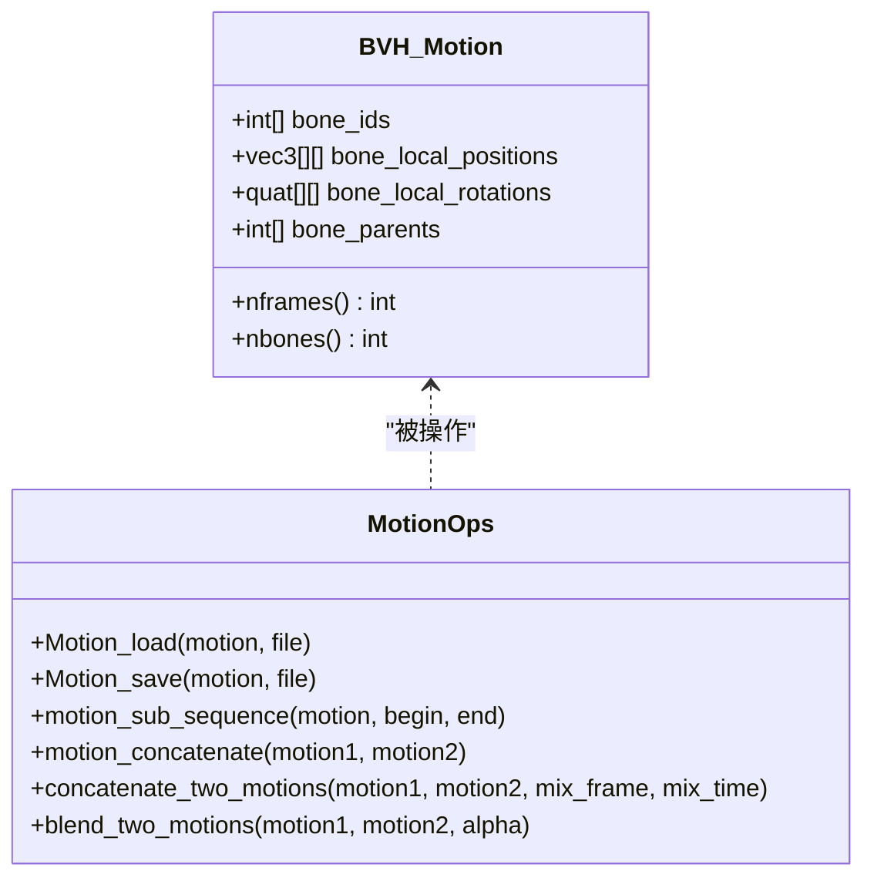
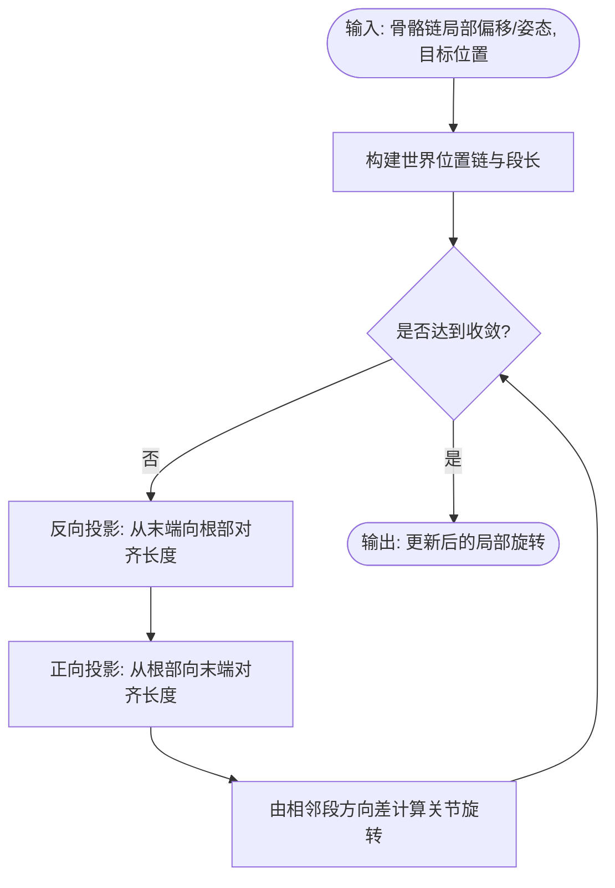
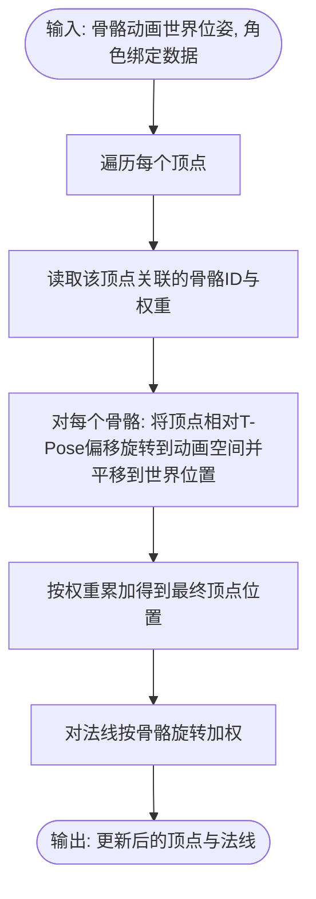
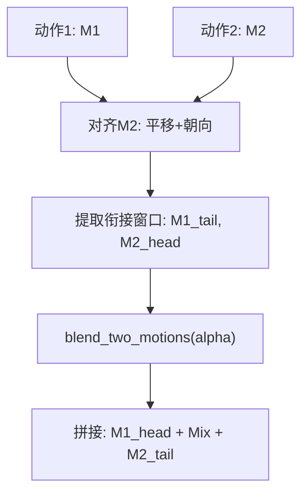
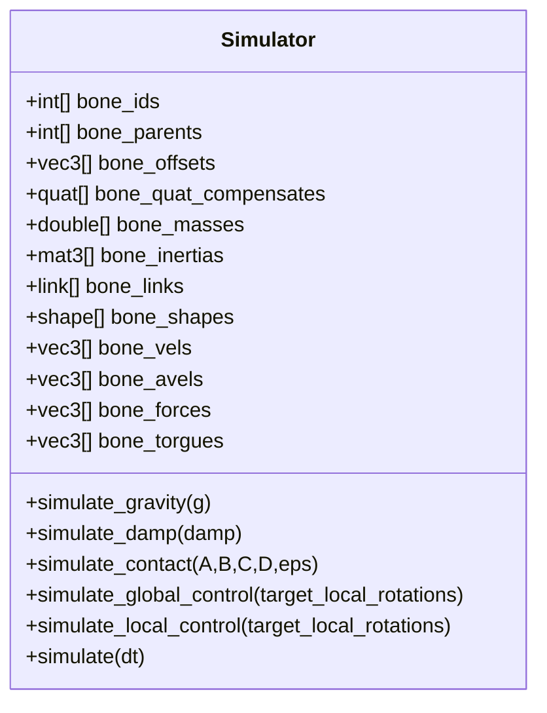
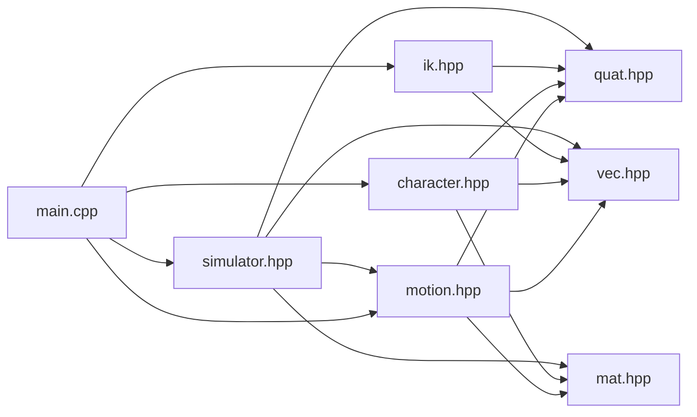

# 角色动画概念

> **版本提示（2.0）**：本文撰写于 1.x 时期，描述的是旧的实现形态——入口在根目录 `main.cpp`，功能由根目录 `.hpp` 头文件库提供，窗口用 raylib、显示用 OpenCV highgui。2.0 已把这些头文件移到 `Source/Legacy/`，渲染默认走 GPU，窗口与 UI 换成 GLFW + ImGui，`main.cpp` 拆成 `Source/Launch/Private/` 下的 `Main.cpp` 与 `Application`。文中的文件路径、行号与调用链可能已失效，请以根目录的「项目概述」「快速开始」「故障排除」三篇与当前源码为准。

<cite>
**本文引用的文件**   
- [main.cpp](file://main.cpp)
- [character.hpp](file://character.hpp)
- [motion.hpp](file://motion.hpp)
- [ik.hpp](file://ik.hpp)
- [simulator.hpp](file://simulator.hpp)
- [quat.hpp](file://quat.hpp)
- [vec.hpp](file://vec.hpp)
- [mat.hpp](file://mat.hpp)
- [model.hpp](file://model.hpp)
</cite>

## 目录
1. [简介](#简介)
2. [项目结构](#项目结构)
3. [核心组件](#核心组件)
4. [架构总览](#架构总览)
5. [详细组件分析](#详细组件分析)
6. [依赖关系分析](#依赖关系分析)
7. [性能与优化](#性能与优化)
8. [故障排查指南](#故障排查指南)
9. [结论](#结论)

## 简介
本文件面向MooLab项目的角色动画系统，系统性阐述以下核心概念：
- 前向运动学（FK）：骨骼层级、关节旋转与位置传播。
- BVH动作数据格式与解析：骨骼层次、关键帧数据、插值与混合。
- 逆运动学（IK）：目标位置约束与骨骼链调整（含FABRIK）。
- 蒙皮变形：顶点权重计算与网格变形流程。
- 动作混合：线性插值与更复杂的过渡算法。
并提供代码级路径说明，帮助开发者理解角色动画系统的实现要点。

## 项目结构
MooLab采用模块化设计，围绕“动作数据—骨骼解算—物理仿真—渲染”的管线组织：
- 基础数学库：向量、矩阵、四元数运算。
- 动作数据：BVH_Motion结构与加载/保存、子序列、拼接与混合。
- 角色模型：Character结构、蒙皮权重、网格构建与变形。
- IK求解：两骨/多骨闭合解与FABRIK迭代。
- 物理仿真：Simulator刚体链、碰撞、控制力矩与步进。
- 渲染与主循环：main中装配各模块并驱动帧更新。

图表来源
- [main.cpp:53-160](file://main.cpp#L53-L160)
- [motion.hpp:37-96](file://motion.hpp#L37-L96)
- [character.hpp:35-66](file://character.hpp#L35-L66)
- [ik.hpp:7-51](file://ik.hpp#L7-L51)
- [simulator.hpp:321-355](file://simulator.hpp#L321-L355)
- [quat.hpp:6-24](file://quat.hpp#L6-L24)
- [vec.hpp:75-82](file://vec.hpp#L75-L82)
- [mat.hpp:7-14](file://mat.hpp#L7-L14)
- [model.hpp:8-19](file://model.hpp#L8-L19)

章节来源
- [main.cpp:53-160](file://main.cpp#L53-L160)

## 核心组件
- 动作数据(BVH_Motion)：存储每帧骨骼局部位置与旋转、父子关系，提供批量FK、子序列、拼接与混合等工具函数。
- 角色模型(Character)：包含静态网格、法线、纹理坐标、骨骼绑定权重与骨骼T-Pose信息，提供蒙皮变形接口。
- IK求解器：提供两骨/三骨闭合解与FABRIK单端/双端约束求解。
- 物理仿真(Simulator)：将骨骼映射为胶囊体刚体，支持重力、阻尼、接触碰撞、全局/局部控制力矩与数值积分。
- 基础数学：quat/vec/mat提供四元数、向量、矩阵运算与Rodrigues公式。

章节来源
- [motion.hpp:37-96](file://motion.hpp#L37-L96)
- [character.hpp:35-66](file://character.hpp#L35-L66)
- [ik.hpp:7-51](file://ik.hpp#L7-L51)
- [simulator.hpp:321-355](file://simulator.hpp#L321-L355)
- [quat.hpp:6-24](file://quat.hpp#L6-L24)
- [vec.hpp:75-82](file://vec.hpp#L75-L82)
- [mat.hpp:7-14](file://mat.hpp#L7-L14)

## 架构总览
下图展示从动作数据到最终渲染的关键调用链：主循环读取当前帧动作，执行FK得到骨骼世界位姿；若启用物理则通过Simulator进行受力与约束求解，再将结果回写到骨骼；最后对角色网格进行蒙皮变形并渲染。

图表来源
- [main.cpp:292-345](file://main.cpp#L292-L345)
- [motion.hpp:122-150](file://motion.hpp#L122-L150)
- [simulator.hpp:357-624](file://simulator.hpp#L357-L624)
- [character.hpp:142-164](file://character.hpp#L142-L164)

## 详细组件分析

### 前向运动学（FK）原理与实现
- 骨骼层级：BVH_Motion以bone_parents描述父子关系，根节点parent_id为-1。
- 旋转传播：子骨骼的世界旋转=父骨骼世界旋转×自身局部旋转。
- 位置传播：子骨骼的世界位置=父骨骼世界位置+父骨骼世界旋转×自身局部偏移。
- 批量计算：batch_forward_kinematics_full按骨骼顺序一次遍历完成所有骨骼的世界位姿计算。

图表来源
- [motion.hpp:122-150](file://motion.hpp#L122-L150)

章节来源
- [motion.hpp:122-150](file://motion.hpp#L122-L150)

### BVH动作数据格式与解析
- 数据结构：BVH_Motion包含bone_ids、bone_local_positions(nframes×nbones)、bone_local_rotations(nframes×nbones)、bone_parents(nbones)。
- 加载/保存：Motion_load/Motion_save直接读写二进制数组，保证与array1d/array2d一致。
- 时间切片与拼接：motion_sub_sequence取子序列；motion_concatenate拼接两段；concatenate_two_motions在衔接处做平移与朝向对齐，并用blend_two_motions进行平滑过渡。
- 插值：blend_two_motions对位置使用lerp，对旋转使用slerp，alpha随时间线性变化。

图表来源
- [motion.hpp:37-96](file://motion.hpp#L37-L96)
- [motion.hpp:98-120](file://motion.hpp#L98-L120)
- [motion.hpp:266-291](file://motion.hpp#L266-L291)
- [motion.hpp:332-377](file://motion.hpp#L332-L377)

章节来源
- [motion.hpp:72-96](file://motion.hpp#L72-L96)
- [motion.hpp:98-120](file://motion.hpp#L98-L120)
- [motion.hpp:266-291](file://motion.hpp#L266-L291)
- [motion.hpp:332-377](file://motion.hpp#L332-L377)

### 逆运动学（IK）基本概念与求解
- 两骨/三骨闭合解：IK_two_bones通过余弦定理计算关节轴与角度差，构造四元数旋转修正，使末端到达目标位置。
- FABRIK：迭代式反向前向投影，逐步逼近目标；支持单端/双端约束与角度限制。
- 应用示例：main中预留脚部IK锁（注释），用于防止滑步或贴合地面。

图表来源
- [ik.hpp:105-162](file://ik.hpp#L105-L162)
- [ik.hpp:250-315](file://ik.hpp#L250-L315)

章节来源
- [ik.hpp:7-51](file://ik.hpp#L7-L51)
- [ik.hpp:105-162](file://ik.hpp#L105-L162)
- [ik.hpp:250-315](file://ik.hpp#L250-L315)
- [main.cpp:389-415](file://main.cpp#L389-L415)

### 蒙皮变形算法
- 绑定数据：Character包含all_rest_positions/all_rest_normals、bone_weights/bone_weights_ids、bone_rest_positions/bone_rest_rotations。
- 顶点位置变形：linear_blend_positions对每个顶点，按权重聚合多个骨骼的变换结果：先将顶点相对T-Pose偏移用骨骼T-Pose旋转归一化，再用动画旋转与位置变换后加权求和。
- 法线变形：linear_blend_normals类似地按骨骼旋转加权法线。
- 网格构建：make_character_rest_mesh复制静态网格数据；deform_character_anim_mesh调用上述两个函数更新顶点和法线。

图表来源
- [character.hpp:68-121](file://character.hpp#L68-L121)
- [character.hpp:123-164](file://character.hpp#L123-L164)

章节来源
- [character.hpp:35-66](file://character.hpp#L35-L66)
- [character.hpp:68-121](file://character.hpp#L68-L121)
- [character.hpp:123-164](file://character.hpp#L123-L164)

### 动作混合技术
- 线性插值：blend_two_motions对位置使用lerp，对旋转使用slerp，alpha随时间从0到1变化，实现两段动作的平滑过渡。
- 复杂过渡：concatenate_two_motions先对第二段动作做平移与朝向对齐（translation_and_rotation），再在衔接窗口内用blend_two_motions生成过渡片段，最后拼接三段（原尾段、过渡段、新头段）。
- 循环与速度估计：build_loop_motion对首尾帧的旋转差与位置差分解为角速度与线速度，逐帧补偿，形成闭环。

图表来源
- [motion.hpp:266-291](file://motion.hpp#L266-L291)
- [motion.hpp:332-377](file://motion.hpp#L332-L377)
- [motion.hpp:213-264](file://motion.hpp#L213-L264)
- [motion.hpp:293-330](file://motion.hpp#L293-L330)

章节来源
- [motion.hpp:266-291](file://motion.hpp#L266-L291)
- [motion.hpp:332-377](file://motion.hpp#L332-L377)
- [motion.hpp:213-264](file://motion.hpp#L213-L264)
- [motion.hpp:293-330](file://motion.hpp#L293-L330)

### 物理仿真与控制器（补充）
- 刚体链：Simulator将骨骼映射为胶囊体shape，维护质量、惯量、速度、角速度、力与力矩。
- 力与约束：simulate_gravity施加重力，simulate_damp施加阻尼，simulate_contact处理刚体间与地面的碰撞（含摩擦）。
- 控制策略：simulate_global_control/simulate_local_control根据目标局部旋转计算力矩，结合误差累积与微分项稳定控制。
- 数值积分：simulate组装质量矩阵M、雅可比J与约束delta，求解线性方程组更新速度与位置。

图表来源
- [simulator.hpp:321-355](file://simulator.hpp#L321-L355)
- [simulator.hpp:357-624](file://simulator.hpp#L357-L624)

章节来源
- [simulator.hpp:357-624](file://simulator.hpp#L357-L624)

## 依赖关系分析
- 模块耦合：
  - main.cpp组合motion/character/ik/simulator/renderer/ui等资源。
  - motion.hpp依赖quat/vec/mat与spring（未在本节展开）。
  - character.hpp依赖mesh/quat/array。
  - ik.hpp依赖array/quat。
  - simulator.hpp依赖motion及大量数学工具。
- 外部依赖：raylib用于窗口与手柄输入，OpenCV用于显示图像（见README与main）。

图表来源
- [main.cpp:8-17](file://main.cpp#L8-L17)
- [motion.hpp:4-6](file://motion.hpp#L4-L6)
- [character.hpp:4-6](file://character.hpp#L4-L6)
- [ik.hpp:4-5](file://ik.hpp#L4-L5)
- [simulator.hpp:4](file://simulator.hpp#L4)

章节来源
- [main.cpp:8-17](file://main.cpp#L8-L17)

## 性能与优化
- 批量计算：batch_forward_kinematics_full一次性遍历骨骼，避免重复计算。
- 并行加速：simulator中的矩阵乘法使用OpenMP并行化（#pragma omp parallel for）。
- 数值稳定性：四元数插值slerp在小角度时退化为线性插值，避免除零；距离与点积计算使用clampf保护反三角函数定义域。
- 内存布局：BVH_Motion与Character使用二维数组连续存储，利于缓存命中。

[本节为通用指导，不直接分析具体文件]

## 故障排查指南
- 动作播放异常：
  - 检查Motion_load是否正确读取bone_ids/local positions/rotations/parents。
  - 确认batch_forward_kinematics_full的骨骼顺序是否满足“根在前”。
- 蒙皮撕裂或抖动：
  - 检查bone_weights_ids与bone_weights是否对应且非负，确保每个顶点至少有一个有效权重。
  - 验证bone_rest_positions与bone_rest_rotations是否与网格T-Pose一致。
- IK无解或抖动：
  - 检查目标位置是否在可达范围内；必要时增大FABRIK最大迭代次数或放宽收敛阈值。
  - 对于带角度约束的FABRIK，适当调整constraint_angle。
- 物理不稳定：
  - 调整simulate_contact的刚度kp与阻尼kd；检查地面平面参数A/B/C/D。
  - 控制增益过大导致震荡，需降低simulate_global_control/simulate_local_control的比例系数。

章节来源
- [motion.hpp:72-96](file://motion.hpp#L72-L96)
- [motion.hpp:122-150](file://motion.hpp#L122-L150)
- [character.hpp:68-121](file://character.hpp#L68-L121)
- [ik.hpp:105-162](file://ik.hpp#L105-L162)
- [simulator.hpp:374-435](file://simulator.hpp#L374-L435)
- [simulator.hpp:437-541](file://simulator.hpp#L437-L541)

## 结论
MooLab的角色动画系统以BVH动作数据为核心，通过批量FK快速计算骨骼世界位姿，结合IK与物理仿真增强可控性与真实感，并以蒙皮变形将骨骼运动传递至网格。动作混合提供流畅的过渡能力，配合基础数学库与高效的批量计算，构成完整的角色动画管线。开发者可基于此文档定位关键实现位置，按需扩展IK策略、混合曲线与物理参数，以获得更丰富的动画效果。