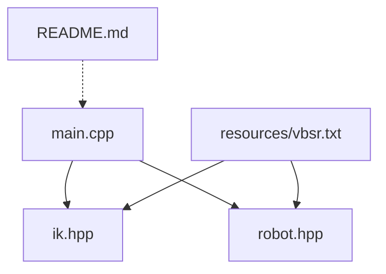
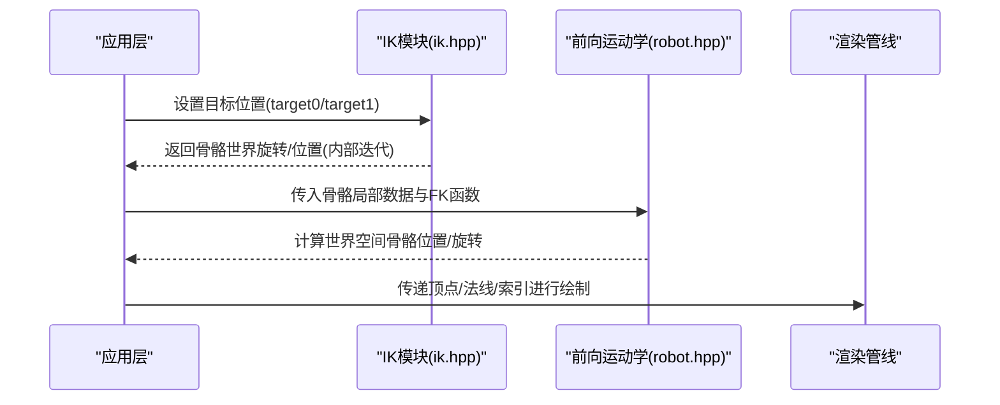
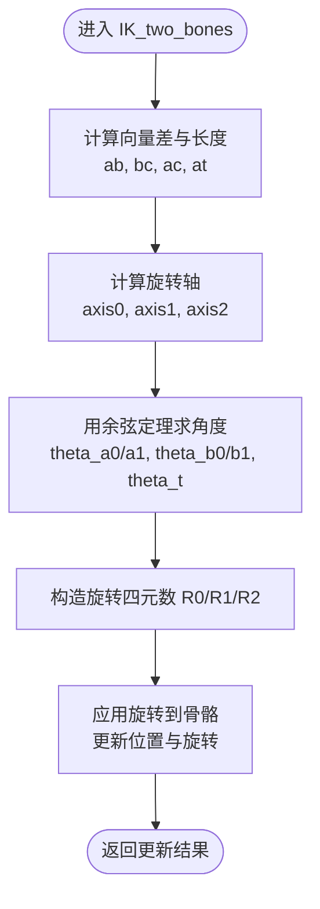
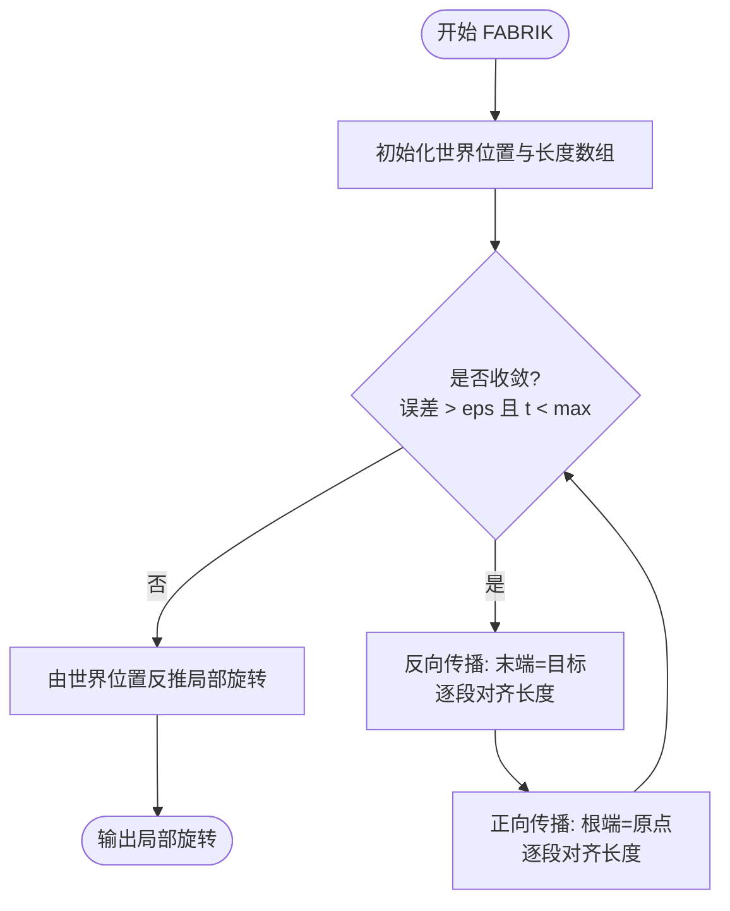
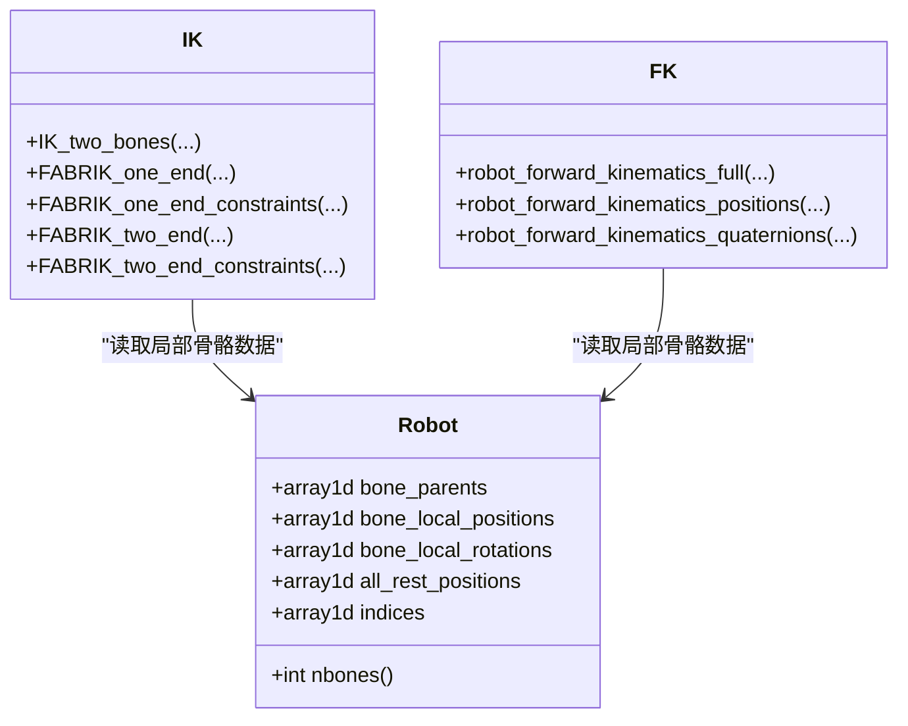
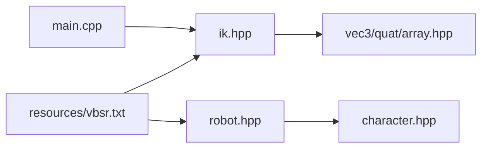

# 逆运动学（IK）

> **版本提示（2.0）**：本文撰写于 1.x 时期，描述的是旧的实现形态——入口在根目录 `main.cpp`，功能由根目录 `.hpp` 头文件库提供，窗口用 raylib、显示用 OpenCV highgui。2.0 已把这些头文件移到 `Source/Legacy/`，渲染默认走 GPU，窗口与 UI 换成 GLFW + ImGui，`main.cpp` 拆成 `Source/Launch/Private/` 下的 `Main.cpp` 与 `Application`。文中的文件路径、行号与调用链可能已失效，请以根目录的「项目概述」「快速开始」「故障排除」三篇与当前源码为准。

<cite>
**本文引用的文件**   
- [ik.hpp](file://ik.hpp)
- [robot.hpp](file://robot.hpp)
- [main.cpp](file://main.cpp)
- [vbsr.txt](file://resources/vbsr.txt)
- [README.md](file://README.md)
</cite>

## 目录
1. [简介](#简介)
2. [项目结构](#项目结构)
3. [核心组件](#核心组件)
4. [架构总览](#架构总览)
5. [详细组件分析](#详细组件分析)
6. [依赖关系分析](#依赖关系分析)
7. [性能与优化](#性能与优化)
8. [故障排查指南](#故障排查指南)
9. [结论](#结论)
10. [附录：使用示例与最佳实践](#附录使用示例与最佳实践)

## 简介
本文件面向MooLab项目的逆运动学（IK）模块，目标是帮助开发者理解并正确使用其中的IK算法，实现目标驱动的角色动画控制。仓库中实现了两类IK求解器：
- 解析式短链IK：针对两/三关节的几何解法（用于短链快速定位）。
- FABRIK迭代IK：基于位置的正向/反向传播迭代，支持单末端、双末端以及角度约束，适合多关节骨骼链。

此外，文档将解释IK在角色动画中的典型应用、收敛条件、约束系统、性能调优方法，并提供结合机器人骨架（Robot）进行控制的步骤说明。

## 项目结构
与IK相关的代码主要位于以下文件：
- ik.hpp：IK算法实现（短链解析解与FABRIK迭代解）。
- robot.hpp：机器人骨架数据结构与前向运动学（FK），为IK提供骨骼链输入与输出。
- main.cpp：程序入口，包含对ik.hpp的引用。
- resources/vbsr.txt：演示如何调用FABRIK接口进行实时控制。
- README.md：项目构建与运行说明。

图表来源
- [main.cpp:1-20](file://main.cpp#L1-L20)
- [ik.hpp:1-10](file://ik.hpp#L1-L10)
- [robot.hpp:1-20](file://robot.hpp#L1-L20)
- [vbsr.txt:220-230](file://resources/vbsr.txt#L220-L230)
- [README.md:1-22](file://README.md#L1-L22)

章节来源
- [main.cpp:1-20](file://main.cpp#L1-L20)
- [README.md:1-22](file://README.md#L1-L22)

## 核心组件
- IK短链解析解：
  - IK_two_bones(vec3&, vec3&, vec3&, quat&, quat&, quat&, vec3)：两关节（三段骨）解析解。
  - IK_two_bones(vec3&, vec3&, vec3&, vec3&, quat&, quat&, quat&, quat&, vec3)：三关节（四段骨）解析解。
- FABRIK迭代IK：
  - FABRIK_one_end(...)：单末端目标，带收敛阈值与最大迭代次数。
  - FABRIK_one_end_constraints(...)：单末端+角度约束。
  - FABRIK_two_end(...)：双末端目标。
  - FABRIK_two_end_constraints(...)：双末端+角度约束。
- Robot骨架与FK：
  - Robot结构体：保存骨骼局部位置、旋转、父节点、网格权重等。
  - robot_forward_kinematics_*：根据关节角或四元数计算世界空间骨骼位置与旋转。

章节来源
- [ik.hpp:7-103](file://ik.hpp#L7-L103)
- [ik.hpp:105-420](file://ik.hpp#L105-L420)
- [robot.hpp:6-43](file://robot.hpp#L6-L43)
- [robot.hpp:130-217](file://robot.hpp#L130-L217)

## 架构总览
IK模块通过“目标位置”驱动骨骼链，最终输出每根骨骼的世界空间位置与世界空间旋转；随后由FK管线将局部骨骼变换组合到模型顶点，完成渲染变形。

图表来源
- [ik.hpp:105-420](file://ik.hpp#L105-L420)
- [robot.hpp:130-217](file://robot.hpp#L130-L217)

## 详细组件分析

### 短链解析IK（IK_two_bones）
- 输入：若干骨骼的世界位置与世界旋转，以及目标位置。
- 处理：通过余弦定理计算各关节转角，构造旋转四元数并应用到对应骨骼。
- 输出：更新后的骨骼位置与旋转，使末端尽量接近目标。

适用场景：短链（2-3个关节）的快速定位，无需迭代，计算开销低。

图表来源
- [ik.hpp:7-51](file://ik.hpp#L7-L51)
- [ik.hpp:53-103](file://ik.hpp#L53-L103)

章节来源
- [ik.hpp:7-103](file://ik.hpp#L7-L103)

### FABRIK迭代IK（单末端/双末端/角度约束）
- 基本思想：从末端向根端反向拉直，再从根端向末端正向对齐，反复迭代直至满足收敛条件（末端误差小于阈值或达到最大迭代次数）。
- 单末端：固定根端，调整中间关节使末端靠近目标。
- 双末端：同时逼近两个目标点，并在两段之间做折中分配。
- 角度约束：在迭代过程中检测相邻骨段的夹角是否超过限制，若超限则按约束角度重新对齐。

图表来源
- [ik.hpp:105-162](file://ik.hpp#L105-L162)
- [ik.hpp:164-248](file://ik.hpp#L164-L248)
- [ik.hpp:250-315](file://ik.hpp#L250-L315)
- [ik.hpp:317-420](file://ik.hpp#L317-L420)

章节来源
- [ik.hpp:105-420](file://ik.hpp#L105-L420)

### 与Robot骨架和FK的结合
- Robot结构体提供骨骼的局部位置、旋转、父节点关系与网格权重。
- 使用前向运动学（FK）将局部骨骼变换组合为世界空间变换，从而得到可渲染的模型顶点。
- IK输出的是局部旋转（bone_local_rotations），需要配合FK计算世界空间位置以进行可视化或物理仿真。

图表来源
- [robot.hpp:6-43](file://robot.hpp#L6-L43)
- [robot.hpp:130-217](file://robot.hpp#L130-L217)
- [ik.hpp:105-420](file://ik.hpp#L105-L420)

章节来源
- [robot.hpp:6-43](file://robot.hpp#L6-L43)
- [robot.hpp:130-217](file://robot.hpp#L130-L217)

## 依赖关系分析
- ik.hpp依赖基础数学类型与四元数操作（vec3、quat等），并通过slice/array容器管理批量数据。
- robot.hpp依赖character.hpp，提供骨架结构与FK工具。
- main.cpp包含ik.hpp，作为程序入口组织IK调用。
- resources/vbsr.txt演示了如何在主循环中设置目标位置并调用FABRIK接口。

图表来源
- [ik.hpp:1-6](file://ik.hpp#L1-L6)
- [robot.hpp:1-5](file://robot.hpp#L1-L5)
- [main.cpp:1-20](file://main.cpp#L1-L20)
- [vbsr.txt:220-230](file://resources/vbsr.txt#L220-L230)

章节来源
- [ik.hpp:1-6](file://ik.hpp#L1-L6)
- [robot.hpp:1-5](file://robot.hpp#L1-L5)
- [main.cpp:1-20](file://main.cpp#L1-L20)
- [vbsr.txt:220-230](file://resources/vbsr.txt#L220-L230)

## 性能与优化
- 迭代控制：
  - 通过eps控制收敛精度，max控制最大迭代次数。合理设置可在保证效果的同时降低CPU开销。
- 分支选择：
  - 短链优先使用解析解（IK_two_bones），避免迭代开销。
  - 长链使用FABRIK，必要时启用角度约束以提升稳定性。
- 批处理与缓存：
  - 复用临时数组（如bone_anim_positions、lengths）减少分配开销。
  - 预计算骨骼长度，避免重复开方。
- 数值稳定：
  - 使用clampf限制acos参数范围，防止NaN。
  - 归一化向量时注意零向量保护（库函数已封装）。

[本节为通用指导，不直接分析具体文件]

## 故障排查指南
- 末端无法到达目标：
  - 检查目标是否在可达范围内（受骨骼长度与约束角度影响）。
  - 增大max或减小eps，观察收敛曲线。
- 抖动或不稳定：
  - 检查角度约束是否过紧导致频繁修正。
  - 适当放宽constraint_angle或增加阻尼（在更高层控制器中平滑目标轨迹）。
- 旋转异常或翻转：
  - 确认四元数乘法顺序与坐标系一致。
  - 检查父节点关系与局部坐标定义是否正确。

章节来源
- [ik.hpp:164-248](file://ik.hpp#L164-L248)
- [ik.hpp:317-420](file://ik.hpp#L317-L420)

## 结论
MooLab的IK模块提供了短链解析解与FABRIK迭代解两种路径，能够覆盖从简单短链到复杂多关节骨骼链的目标驱动控制需求。结合Robot骨架与FK管线，可实现高效的实时角色动画控制。通过合理的迭代参数与约束设置，可以在精度与性能之间取得平衡。

[本节为总结性内容，不直接分析具体文件]

## 附录：使用示例与最佳实践

- 使用FABRIK进行双末端控制（含角度约束）：
  - 在主循环中更新目标位置target0、target1。
  - 调用FABRIK_two_end_constraints，传入骨骼局部位置与旋转、目标位置、末端索引与约束角度。
  - 随后调用FK函数计算世界空间位置与旋转，用于渲染。

参考调用位置：
- [resources/vbsr.txt:217-226](file://resources/vbsr.txt#L217-L226)

- 配置骨骼链与FK：
  - 使用Robot结构体定义骨骼数量、父子关系与局部坐标。
  - 使用robot_forward_kinematics_full或quaternions版本计算世界空间变换。

参考实现位置：
- [robot.hpp:130-217](file://robot.hpp#L130-L217)

- 构建与运行：
  - 按照README说明安装依赖并构建Release版本以获得更好性能。

参考说明位置：
- [README.md:7-15](file://README.md#L7-L15)

章节来源
- [vbsr.txt:217-226](file://resources/vbsr.txt#L217-L226)
- [robot.hpp:130-217](file://robot.hpp#L130-L217)
- [README.md:7-15](file://README.md#L7-L15)