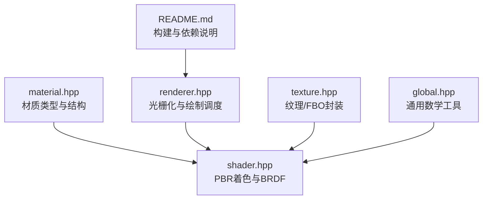
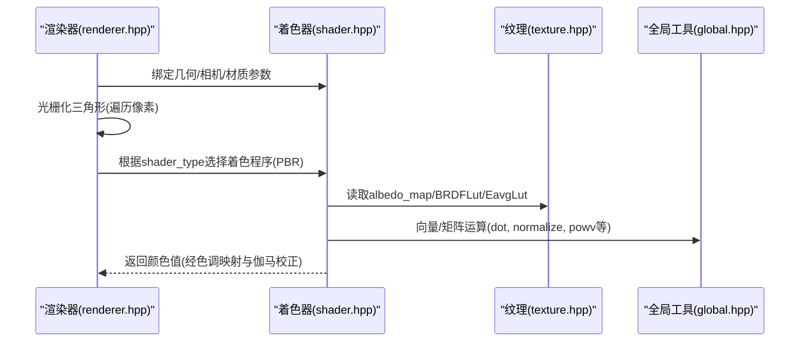
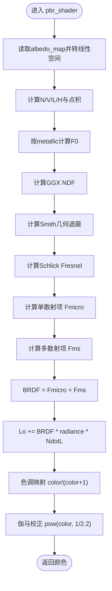
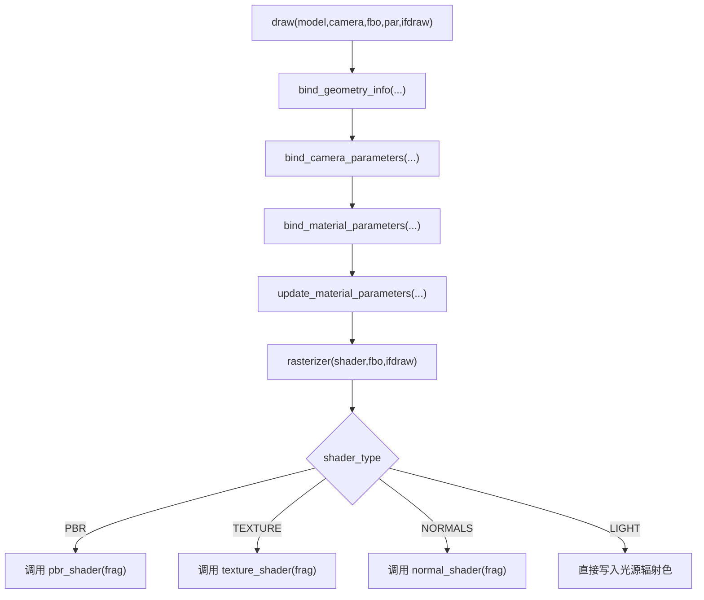
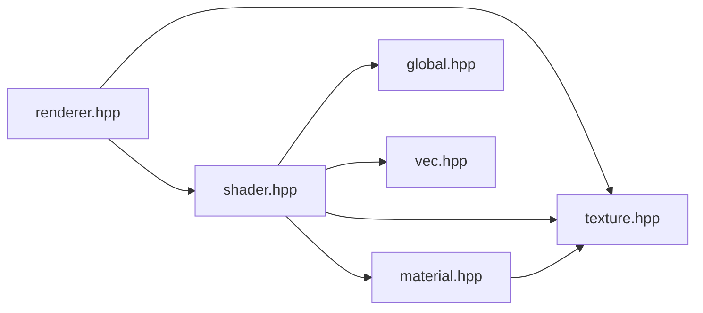

# PBR材质系统

> **版本提示（2.0）**：本文撰写于 1.x 时期，描述的是旧的实现形态——入口在根目录 `main.cpp`，功能由根目录 `.hpp` 头文件库提供，窗口用 raylib、显示用 OpenCV highgui。2.0 已把这些头文件移到 `Source/Legacy/`，渲染默认走 GPU，窗口与 UI 换成 GLFW + ImGui，`main.cpp` 拆成 `Source/Launch/Private/` 下的 `Main.cpp` 与 `Application`。文中的文件路径、行号与调用链可能已失效，请以根目录的「项目概述」「快速开始」「故障排除」三篇与当前源码为准。

<cite>
**本文引用的文件**   
- [material.hpp](file://material.hpp)
- [shader.hpp](file://shader.hpp)
- [renderer.hpp](file://renderer.hpp)
- [texture.hpp](file://texture.hpp)
- [global.hpp](file://global.hpp)
- [README.md](file://README.md)
</cite>

## 目录
1. [简介](#简介)
2. [项目结构](#项目结构)
3. [核心组件](#核心组件)
4. [架构总览](#架构总览)
5. [详细组件分析](#详细组件分析)
6. [依赖关系分析](#依赖关系分析)
7. [性能与优化](#性能与优化)
8. [故障排查指南](#故障排查指南)
9. [结论](#结论)
10. [附录：扩展与调参指南](#附录扩展与调参指南)

## 简介
本文件面向MooLab中的PBR（基于物理的渲染）材质系统，系统性阐述其数学模型、实现细节与工程实践。内容涵盖：
- PBR材质属性（漫反射albedo、镜面反射specular、粗糙度roughness、金属度metallic）的物理意义与数值影响
- BRDF（双向反射分布函数）计算流程：GGX微表面法线分布、Schlick几何遮蔽、Fresnel效应
- 多散射能量补偿与缺失能量修正
- 着色管线数据流与关键函数的调用顺序
- 材质调优最佳实践与扩展新材质类型的步骤

## 项目结构
本项目采用模块化C++头文件组织，渲染与材质相关逻辑主要分布在以下文件中：
- material.hpp：材质类型枚举与材质数据结构定义
- shader.hpp：着色器数据结构、PBR核心算法（GGX、Schlick、Fresnel、多散射BRDF）
- renderer.hpp：光栅化、参数绑定、绘制调度
- texture.hpp：纹理与帧缓冲对象（FBO）封装
- global.hpp：通用数学工具与常量
- README.md：构建说明与环境依赖

图表来源
- [material.hpp:7-30](file://material.hpp#L7-L30)
- [shader.hpp:35-86](file://shader.hpp#L35-L86)
- [renderer.hpp:17-22](file://renderer.hpp#L17-L22)
- [texture.hpp:11-34](file://texture.hpp#L11-L34)
- [global.hpp:13-18](file://global.hpp#L13-L18)

章节来源
- [README.md:1-22](file://README.md#L1-L22)

## 核心组件
- 材质定义（MooMaterial）
  - 包含材质类型、基础反射系数（kd/ks/ka）、PBR参数（metallic、roughness）、纹理贴图（albedo_map、BRDFLut、EavgLut）
- 着色器（MooShader）
  - 维护顶点/片段载荷、矩阵与相机/光源参数、材质映射、以及PBR着色函数pbr_shader
- 渲染器（MooRenderer）
  - 负责将几何、相机、材质参数绑定到着色器，执行光栅化并调用对应着色程序

章节来源
- [material.hpp:7-30](file://material.hpp#L7-L30)
- [shader.hpp:35-86](file://shader.hpp#L35-L86)
- [renderer.hpp:17-22](file://renderer.hpp#L17-L22)

## 架构总览
下图展示从渲染器到着色器的调用链与数据流向，重点标注PBR路径。

图表来源
- [renderer.hpp:121-211](file://renderer.hpp#L121-L211)
- [shader.hpp:199-237](file://shader.hpp#L199-L237)
- [texture.hpp:65-84](file://texture.hpp#L65-L84)
- [global.hpp:13-18](file://global.hpp#L13-L18)

## 详细组件分析

### 材质系统与参数语义
- 材质类型
  - LIGHT/PBR/TEXTURE/NORMALS用于区分不同着色路径
- MooMaterial字段
  - kd/ks/ka：传统光照模型的漫反射/镜面反射/环境光系数（在PBR路径中主要用于兼容或调试）
  - metallic/roughness：PBR核心参数
    - metallic：控制F0（入射角为0时的反射率）在介质与导体之间的插值
    - roughness：控制微表面分布宽度，影响高光扩散程度
  - tex/BRDFLut/EavgLut：纹理资源
    - tex：albedo贴图（需sRGB转线性空间）
    - BRDFLut/EavgLut：预计算的BRDF与平均反射能量查找表，用于多散射项近似

章节来源
- [material.hpp:7-30](file://material.hpp#L7-L30)

### 着色器与PBR计算流程
- 输入与中间变量
  - fragment_payload：片段位置、法线、纹理坐标、深度
  - N/V/L/H：表面法线、视角方向、光线方向、半程向量
  - albedo：从albedo_map采样并转换为线性空间
  - F0：由metallic在介质与导体之间插值得到
- BRDF组成
  - NDF（GGX）：DistributionGGX(N,H,roughness)
  - 几何遮蔽（Smith）：GeometrySmith(N,V,L,roughness) = Schlick(NdotV)*Schlick(NdotL)
  - Fresnel（Schlick近似）：fresnelSchlick(F0,V,N)
  - 单散射项：Fmicro = (NDF * G * F) / (4 * NdotL * NdotV + eps)
  - 多散射项：MultiScatterBRDF(albedo_map,BRDFLut,EavgLut,roughness,tex_coords,NdotL,NdotV)
  - 总BRDF：Fmicro + Fms
- 输出
  - Lo += BRDF * radiance * NdotL
  - 色调映射：color/(color+1)
  - 伽马校正：pow(color, 1/2.2)

图表来源
- [shader.hpp:127-197](file://shader.hpp#L127-L197)
- [shader.hpp:199-237](file://shader.hpp#L199-L237)

章节来源
- [shader.hpp:127-237](file://shader.hpp#L127-L237)

### 光栅化与绘制调度
- 绑定阶段
  - bind_geometry_info：将索引、顶点、法线、纹理坐标打包到vertex_payload
  - bind_camera_parameters：设置模型/视图/投影矩阵、相机位置与近裁剪面
  - bind_material_parameters：将材质纹理与PBR参数注入着色器
  - update_material_parameters：更新光源位置/方向/辐射强度与阴影贴图
- 光栅化阶段
  - rasterizer：对每个三角形进行视口变换、屏幕包围盒裁剪、三角形覆盖测试、深度写入
  - 根据shader_type分发至LIGHT/PBR/TEXTURE/NORMALS着色程序
- 绘制入口
  - draw：遍历模型网格，依次完成绑定与光栅化

图表来源
- [renderer.hpp:33-92](file://renderer.hpp#L33-L92)
- [renderer.hpp:121-211](file://renderer.hpp#L121-L211)

章节来源
- [renderer.hpp:33-92](file://renderer.hpp#L33-L92)
- [renderer.hpp:121-211](file://renderer.hpp#L121-L211)
- [renderer.hpp:213-239](file://renderer.hpp#L213-L239)

### 纹理与FBO
- texture：提供二维纹理采样接口getcolor(u,v)，内部使用最近邻采样与边界钳制
- FBO：帧缓冲对象，存储颜色与深度缓冲区，支持逐像素读写
- 图像转换：img_to_tex/tex_to_img/fbo_to_img用于OpenCV互操作

章节来源
- [texture.hpp:11-34](file://texture.hpp#L11-L34)
- [texture.hpp:65-110](file://texture.hpp#L65-L110)

### 数学工具与常量
- global.hpp提供PI常量、clampf、powv、mix、normalize等常用函数
- vec.hpp提供vec3/vec2基本运算（dot/cross/length/mix/powv等）

章节来源
- [global.hpp:13-18](file://global.hpp#L13-L18)
- [global.hpp:31-54](file://global.hpp#L31-L54)
- [vec.hpp:134-179](file://vec.hpp#L134-L179)

## 依赖关系分析
- 模块耦合
  - renderer.hpp依赖shader.hpp与texture.hpp以完成绘制与着色
  - shader.hpp依赖material.hpp获取材质参数，依赖texture.hpp访问纹理，依赖global.hpp与vec.hpp进行数学运算
  - material.hpp依赖texture.hpp以承载纹理资源
- 外部依赖
  - OpenCV用于图像加载与格式转换（texture.hpp）
  - OpenMP用于并行光栅化（renderer.hpp中的#pragma omp parallel for）

图表来源
- [renderer.hpp:1-8](file://renderer.hpp#L1-L8)
- [shader.hpp:1-8](file://shader.hpp#L1-L8)
- [material.hpp:1-5](file://material.hpp#L1-L5)

章节来源
- [renderer.hpp:1-8](file://renderer.hpp#L1-L8)
- [shader.hpp:1-8](file://shader.hpp#L1-L8)
- [material.hpp:1-5](file://material.hpp#L1-L5)

## 性能与优化
- 并行化
  - 光栅化循环使用OpenMP并行化，可显著提升吞吐；建议结合Release模式编译以获得更好性能
- 内存与访存
  - 纹理采样频繁，建议使用合适分辨率的贴图与合理的mipmap策略（当前实现为最近邻采样）
  - FBO与纹理数据布局连续，利于缓存命中
- 数值稳定性
  - 分母保护：在BRDF分母中加入小量epsilon避免除零
  - 角度点积钳制：NdotL/NdotV使用max(...,0)保证非负
- 色调映射与伽马
  - 使用Reinhard色调映射与sRGB伽马校正，确保显示正确亮度范围

章节来源
- [renderer.hpp:121-127](file://renderer.hpp#L121-L127)
- [shader.hpp:222-234](file://shader.hpp#L222-L234)

## 故障排查指南
- 现象：画面全黑或过曝
  - 检查albedo贴图是否已正确加载且处于sRGB空间（代码中对albedo做了gamma展开）
  - 确认光源radiance与light_pos是否正确传入
  - 检查near裁剪面z_near设置是否合理
- 现象：高光异常或闪烁
  - 检查roughness取值范围[0,1]，过大过小可能导致NDF/G项异常
  - 确认F0插值逻辑与metallic参数一致
- 现象：性能低下
  - 确认已启用OpenMP与Release构建
  - 降低分辨率或减少三角面数
  - 检查纹理尺寸是否过大

章节来源
- [shader.hpp:199-237](file://shader.hpp#L199-L237)
- [renderer.hpp:121-211](file://renderer.hpp#L121-L211)

## 结论
MooLab的PBR材质系统实现了经典的GGX微表面BRDF模型，包括Schlick几何遮蔽与Fresnel效应，并通过预计算LUT引入多散射项与缺失能量修正。渲染管线清晰，参数绑定与光栅化分离良好，便于扩展新的材质类型与着色程序。通过合理的参数调优与性能优化，可在实时场景中取得稳定且真实的视觉效果。

## 附录：扩展与调参指南

### 添加新的材质类型
- 步骤
  1. 在material.hpp中新增材质类型枚举值
  2. 在shader.hpp中添加对应的着色函数（如custom_shader）
  3. 在renderer.hpp的光栅化分支中增加case处理，调用自定义着色函数
- 注意事项
  - 保持与其他材质一致的输入/输出约定（fragment_payload与颜色输出）
  - 若需要新的纹理或LUT，请在MooMaterial中扩展字段并在bind_material_parameters中绑定

章节来源
- [material.hpp:7-13](file://material.hpp#L7-L13)
- [shader.hpp:67-86](file://shader.hpp#L67-L86)
- [renderer.hpp:165-206](file://renderer.hpp#L165-L206)

### 材质调优最佳实践
- albedo
  - 使用sRGB贴图，并在着色前转为线性空间（代码已做）
  - 避免过饱和颜色，保持物理合理性
- metallic
  - 非金属：F0接近介质反射率（约0.04~0.08）
  - 金属：F0接近albedo，体现金属的高反射特性
- roughness
  - 低粗糙度：锐利高光
  - 高粗糙度：扩散高光
- 多散射项
  - 使用BRDFLut与EavgLut进行近似，注意LUT分辨率与精度
- 光源
  - 合理设置light_radiance与light_pos，避免过亮导致色调映射饱和

章节来源
- [shader.hpp:179-237](file://shader.hpp#L179-L237)
- [material.hpp:15-30](file://material.hpp#L15-L30)