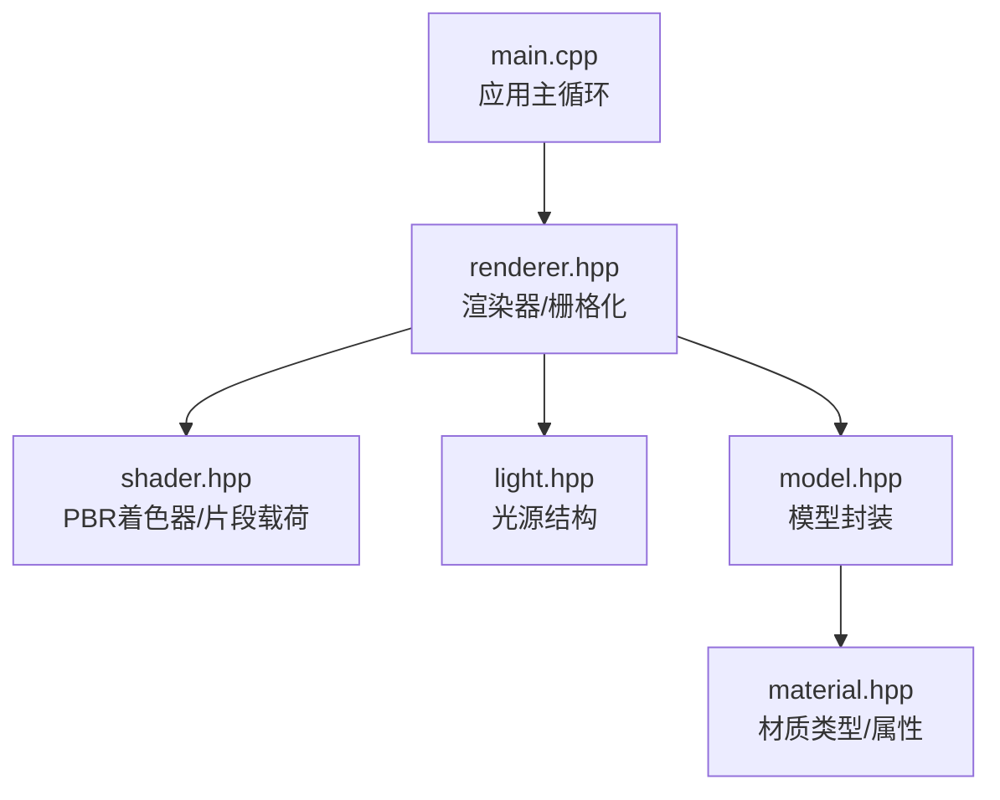
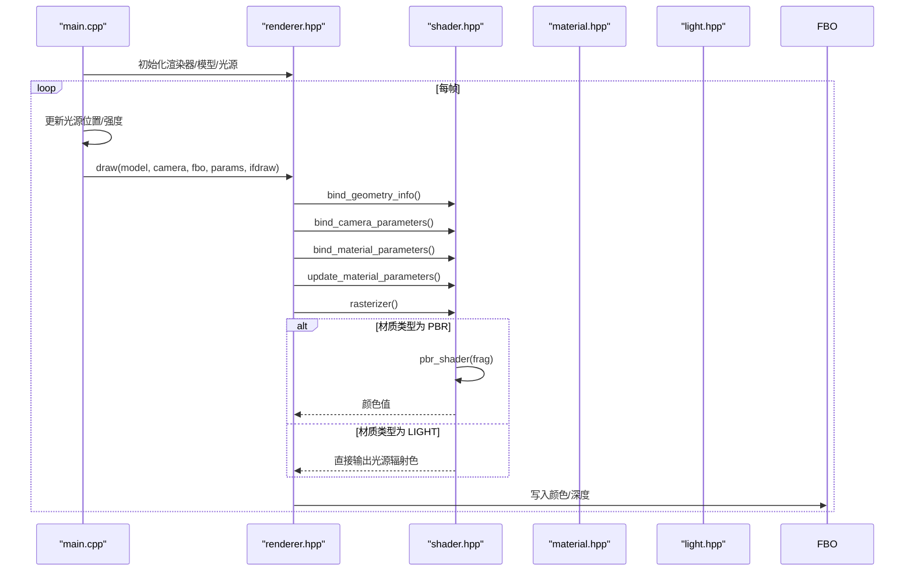
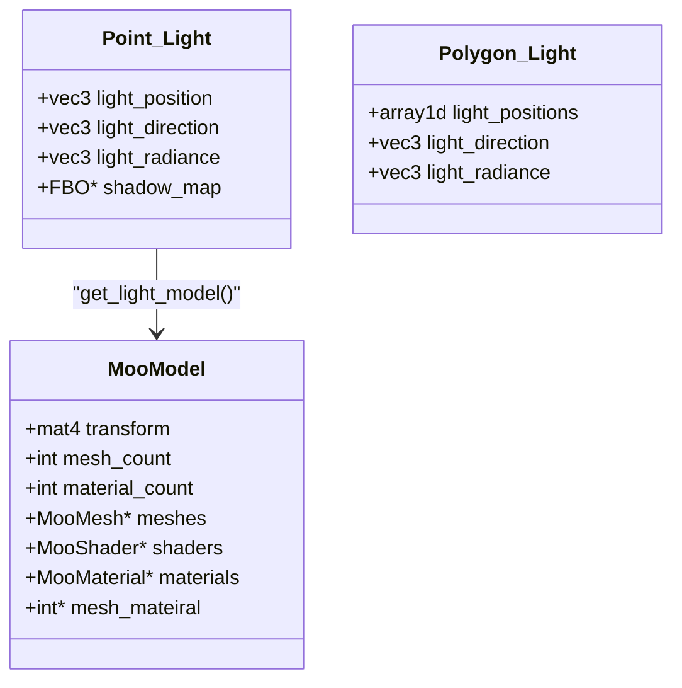
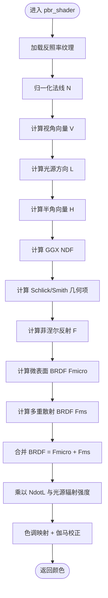
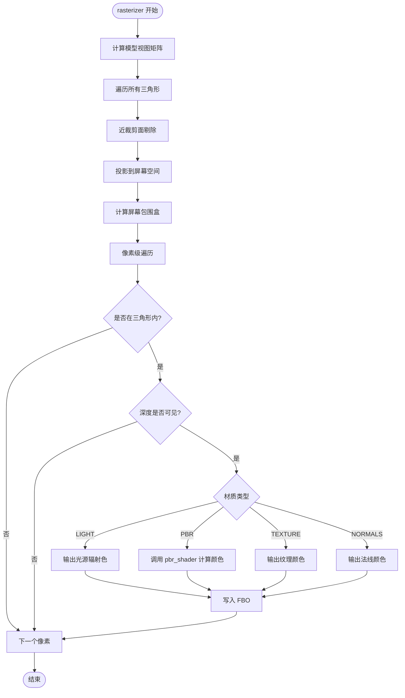
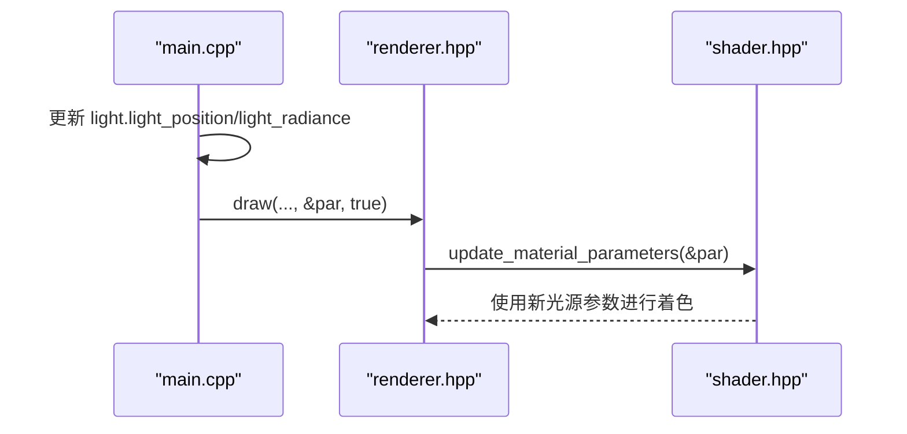
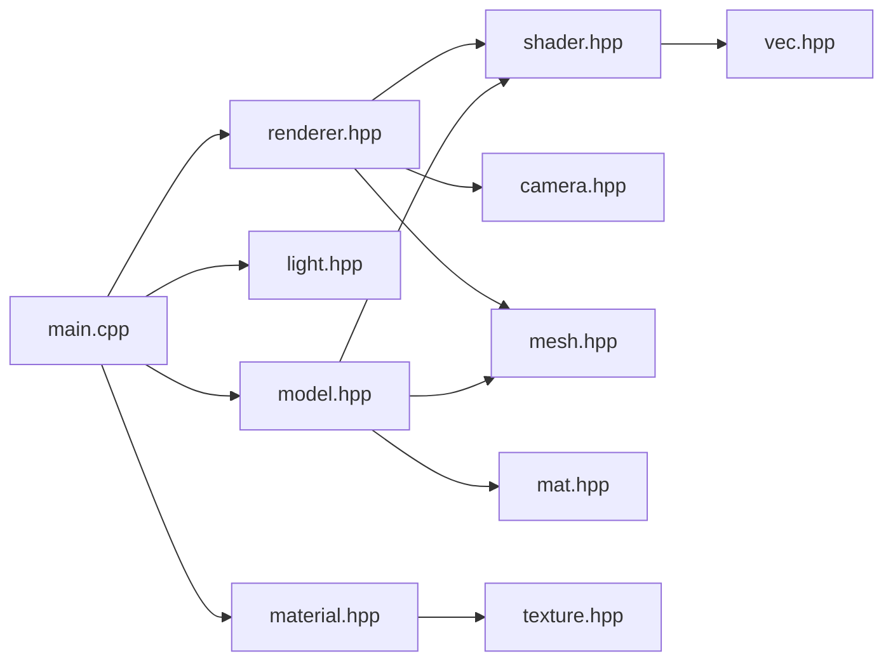

# 光照计算系统

> **版本提示（2.0）**：本文撰写于 1.x 时期，描述的是旧的实现形态——入口在根目录 `main.cpp`，功能由根目录 `.hpp` 头文件库提供，窗口用 raylib、显示用 OpenCV highgui。2.0 已把这些头文件移到 `Source/Legacy/`，渲染默认走 GPU，窗口与 UI 换成 GLFW + ImGui，`main.cpp` 拆成 `Source/Launch/Private/` 下的 `Main.cpp` 与 `Application`。文中的文件路径、行号与调用链可能已失效，请以根目录的「项目概述」「快速开始」「故障排除」三篇与当前源码为准。

<cite>
**本文引用的文件**   
- [light.hpp](file://light.hpp)
- [shader.hpp](file://shader.hpp)
- [renderer.hpp](file://renderer.hpp)
- [material.hpp](file://material.hpp)
- [model.hpp](file://model.hpp)
- [main.cpp](file://main.cpp)
</cite>

## 目录
1. [简介](#简介)
2. [项目结构](#项目结构)
3. [核心组件](#核心组件)
4. [架构总览](#架构总览)
5. [详细组件分析](#详细组件分析)
6. [依赖关系分析](#依赖关系分析)
7. [性能与优化](#性能与优化)
8. [调试与可视化](#调试与可视化)
9. [常见问题与排错](#常见问题与排错)
10. [结论](#结论)

## 简介
本技术文档围绕 MooLab 的光照计算系统展开，重点说明当前代码库中已实现的光源类型、着色器模型、渲染管线与参数更新机制。需要特别说明的是：仓库中仅实现了点光源（Point_Light）及其 PBR 光照模型；方向光（Directional_Light）与聚光灯（Spot_Light）在当前源码中未出现。文档将基于现有代码进行准确描述，并给出扩展建议与最佳实践。

## 项目结构
MooLab 采用模块化头文件组织，关键模块如下：
- light.hpp：定义光源数据结构与辅助函数
- shader.hpp：定义着色器数据、片段载荷与 PBR 着色逻辑
- renderer.hpp：定义渲染器、栅格化、绘制工具与参数绑定
- material.hpp：材质类型与属性
- model.hpp：模型封装与构建
- main.cpp：应用入口、场景装配、动态参数更新与渲染循环

图表来源
- [main.cpp:99-159](file://main.cpp#L99-L159)
- [renderer.hpp:17-22](file://renderer.hpp#L17-L22)
- [shader.hpp:35-86](file://shader.hpp#L35-L86)
- [light.hpp:16-40](file://light.hpp#L16-L40)
- [model.hpp:8-19](file://model.hpp#L8-L19)
- [material.hpp:7-30](file://material.hpp#L7-L30)

章节来源
- [main.cpp:53-159](file://main.cpp#L53-L159)
- [renderer.hpp:17-22](file://renderer.hpp#L17-L22)
- [shader.hpp:35-86](file://shader.hpp#L35-L86)
- [light.hpp:16-40](file://light.hpp#L16-L40)
- [model.hpp:8-19](file://model.hpp#L8-L19)
- [material.hpp:7-30](file://material.hpp#L7-L30)

## 核心组件
- 光源
  - Point_Light：包含位置、方向、辐射强度与阴影贴图指针。用于表示点光源，并在场景中生成可视化的光源小立方体。
  - Polygon_Light：多边形面光源的数据结构，但当前未参与渲染流程。
- 着色器
  - MooShader：承载模型视图投影矩阵、相机参数、光源参数、材质纹理与 LUT、以及顶点/片段着色回调。提供 PBR 着色函数。
- 渲染器
  - MooRenderer：管理模型与光源集合，负责几何绑定、相机/材质参数注入、栅格化与绘制。
- 材质
  - MooMaterial：材质类型枚举（LIGHT/PBR/TEXTURE/NORMALS），以及粗糙度、金属度、反照率纹理与 BRDF/Eavg LUT。
- 模型
  - MooModel：封装网格、着色器实例与材质，并提供 mesh_material_to_model 构造器。

章节来源
- [light.hpp:16-40](file://light.hpp#L16-L40)
- [shader.hpp:35-86](file://shader.hpp#L35-L86)
- [renderer.hpp:17-22](file://renderer.hpp#L17-L22)
- [material.hpp:7-30](file://material.hpp#L7-L30)
- [model.hpp:8-19](file://model.hpp#L8-L19)

## 架构总览
整体渲染流程为：
- 在 main.cpp 中初始化相机、控制器、角色与仿真器，创建点光源与材质，构建模型并加入渲染器。
- 每帧更新光源位置与强度，调用 draw 对每个模型执行几何绑定、相机/材质参数绑定、更新光源参数，然后栅格化并写入 FBO。
- 着色阶段根据材质类型选择 LIGHT/PBR/TEXTURE/NORMALS 路径，其中 PBR 使用 GGX NDF + Schlick G + Fresnel + MultiScatter BRDF 近似。

图表来源
- [main.cpp:99-159](file://main.cpp#L99-L159)
- [main.cpp:453-472](file://main.cpp#L453-L472)
- [renderer.hpp:213-239](file://renderer.hpp#L213-L239)
- [renderer.hpp:121-211](file://renderer.hpp#L121-L211)
- [shader.hpp:199-237](file://shader.hpp#L199-L237)
- [material.hpp:7-30](file://material.hpp#L7-L30)
- [light.hpp:16-40](file://light.hpp#L16-L40)

## 详细组件分析

### 光源类型与模型
- 点光源（Point_Light）
  - 字段：位置、方向、辐射强度、阴影贴图指针。
  - 可视化：通过 get_light_model 将点光源转换为一个小立方体模型，并使用 LIGHT 材质类型直接以辐射强度作为颜色输出。
- 多边形光源（Polygon_Light）
  - 定义了多个顶点位置、方向与辐射强度，但当前未在渲染管线中使用。

图表来源
- [light.hpp:16-40](file://light.hpp#L16-L40)
- [light.hpp:27-33](file://light.hpp#L27-L33)
- [model.hpp:8-19](file://model.hpp#L8-L19)

章节来源
- [light.hpp:16-40](file://light.hpp#L16-L40)
- [model.hpp:21-43](file://model.hpp#L21-L43)

### 着色器与 PBR 光照模型
- 片段载荷（fragment_payload）
  - 包含片段世界坐标、法线、纹理坐标与深度，由 get_fragment_payload 插值生成。
- PBR 着色（pbr_shader）
  - 输入：反照率纹理、BRDFLut、EavgLut、粗糙度、法线、视角向量、光源方向与辐射强度。
  - 步骤：
    - 计算 GGX NDF（DistributionGGX）
    - 计算 Schlick 几何遮蔽（GeometrySchlickGGX / GeometrySmith）
    - 计算菲涅尔反射（fresnelSchlick）
    - 计算微表面 BRDF（Fmicro）
    - 计算多重散射 BRDF（MultiScatterBRDF）
    - 组合后乘以 NdotL 与光源辐射强度，并进行色调映射与伽马校正
- 其他着色器
  - texture_shader：纯纹理采样
  - normal_shader：法线可视化

图表来源
- [shader.hpp:110-125](file://shader.hpp#L110-L125)
- [shader.hpp:127-197](file://shader.hpp#L127-L197)
- [shader.hpp:199-237](file://shader.hpp#L199-L237)

章节来源
- [shader.hpp:19-33](file://shader.hpp#L19-L33)
- [shader.hpp:110-125](file://shader.hpp#L110-L125)
- [shader.hpp:127-197](file://shader.hpp#L127-L197)
- [shader.hpp:199-237](file://shader.hpp#L199-L237)

### 渲染管线与栅格化
- 几何绑定（bind_geometry_info）
  - 将索引、顶点、法线与纹理坐标打包到 shader.ver 的三角形数组中。
- 相机参数绑定（bind_camera_parameters）
  - 设置模型/视图/投影矩阵、屏幕到世界逆变换、相机位置/方向与近裁剪面。
- 材质参数绑定（bind_material_parameters）
  - 注入反照率纹理、BRDF/Eavg LUT、粗糙度与金属度等。
- 动态参数更新（update_material_parameters）
  - 每帧更新光源位置/方向/辐射强度与阴影贴图指针。
- 栅格化（rasterizer）
  - 遍历三角形，进行视锥剔除、屏幕空间包围盒扫描、三角形覆盖测试、深度比较与逐像素着色。
  - 根据材质类型分支：
    - LIGHT：直接输出光源辐射强度颜色
    - PBR：调用 pbr_shader 计算光照
    - TEXTURE/NORMALS：分别输出纹理或法线

图表来源
- [renderer.hpp:33-59](file://renderer.hpp#L33-L59)
- [renderer.hpp:61-92](file://renderer.hpp#L61-L92)
- [renderer.hpp:121-211](file://renderer.hpp#L121-L211)

章节来源
- [renderer.hpp:33-59](file://renderer.hpp#L33-L59)
- [renderer.hpp:61-92](file://renderer.hpp#L61-L92)
- [renderer.hpp:121-211](file://renderer.hpp#L121-L211)

### 光照衰减与阴影
- 光照衰减
  - 当前 PBR 着色器中未实现距离衰减（如 1/d^2）。光照贡献仅与 NdotL 和光源辐射强度相关。
- 阴影计算
  - Point_Light 包含 shadow_map 指针，但在当前渲染流程中并未实际生成或使用阴影贴图。因此，阴影效果未启用。

章节来源
- [light.hpp:16-25](file://light.hpp#L16-L25)
- [shader.hpp:199-237](file://shader.hpp#L199-L237)
- [renderer.hpp:121-211](file://renderer.hpp#L121-L211)

### 多重光照叠加
- 当前渲染管线为单光源模式：
  - 每帧通过 updated_paramters 向着色器注入单一光源的位置、方向与辐射强度。
  - 没有实现多光源累加或延迟聚合。
- 如需支持多光源，可在 PBR 着色器中增加光源列表循环，并对每个光源的贡献进行累加。

章节来源
- [renderer.hpp:86-92](file://renderer.hpp#L86-L92)
- [shader.hpp:199-237](file://shader.hpp#L199-L237)

### 光照参数的动态更新机制
- 光源位置与强度
  - main.cpp 每帧更新 light.light_position 与 light.light_radiance，并将这些地址赋给 updated_paramters，供 draw 时更新到着色器。
- 光源可视化
  - 光源模型（小立方体）的变换矩阵每帧设置为光源位置，确保可视化与物理光源一致。

图表来源
- [main.cpp:453-457](file://main.cpp#L453-L457)
- [renderer.hpp:86-92](file://renderer.hpp#L86-L92)

章节来源
- [main.cpp:99-159](file://main.cpp#L99-L159)
- [main.cpp:453-457](file://main.cpp#L453-L457)
- [renderer.hpp:86-92](file://renderer.hpp#L86-L92)

## 依赖关系分析
- 模块耦合
  - main.cpp 依赖 renderer、light、model、material 与 UI/仿真模块。
  - renderer.hpp 依赖 camera、light、model、mesh。
  - shader.hpp 依赖 global、material、mat、texture、vec。
  - model.hpp 依赖 mat、mesh、shader。
  - material.hpp 依赖 global、texture。
- 外部依赖
  - raylib（窗口与输入）
  - OpenCV（图像显示）

图表来源
- [main.cpp:1-18](file://main.cpp#L1-L18)
- [renderer.hpp:1-8](file://renderer.hpp#L1-L8)
- [model.hpp:1-7](file://model.hpp#L1-L7)
- [material.hpp:1-6](file://material.hpp#L1-L6)
- [shader.hpp:1-9](file://shader.hpp#L1-L9)

章节来源
- [main.cpp:1-18](file://main.cpp#L1-L18)
- [renderer.hpp:1-8](file://renderer.hpp#L1-L8)
- [model.hpp:1-7](file://model.hpp#L1-L7)
- [material.hpp:1-6](file://material.hpp#L1-L6)
- [shader.hpp:1-9](file://shader.hpp#L1-L9)

## 性能与优化
- 并行化
  - 栅格化三角形循环使用 OpenMP 并行（#pragma omp parallel for），可显著提升多线程 CPU 上的吞吐。
- 减少不必要的绘制
  - 当前 main.cpp 仅绘制光源模型与部分骨骼胶囊体，避免全量绘制人物网格以降低开销。
- 纹理与 LUT
  - PBR 使用 BRDFLut 与 EavgLut 预计算表，降低实时计算复杂度。
- 色调映射与伽马校正
  - 在着色器末尾进行色调映射与伽马校正，有助于提升视觉质量与稳定性。

章节来源
- [renderer.hpp:121-211](file://renderer.hpp#L121-L211)
- [main.cpp:466-472](file://main.cpp#L466-L472)
- [shader.hpp:199-237](file://shader.hpp#L199-L237)

## 调试与可视化
- 光源可视化
  - 通过 get_light_model 将点光源渲染为小立方体，便于观察光源位置与移动轨迹。
- 关键点绘制
  - 提供 draw_point 与 draw_line 工具，可用于绘制接触点、骨骼关键点与速度预测曲线。
- 图像输出
  - 使用 OpenCV 的 imshow 展示渲染结果，便于离线分析与调试。

章节来源
- [light.hpp:27-33](file://light.hpp#L27-L33)
- [renderer.hpp:241-265](file://renderer.hpp#L241-L265)
- [renderer.hpp:267-373](file://renderer.hpp#L267-L373)
- [main.cpp:508-509](file://main.cpp#L508-L509)

## 常见问题与排错
- 问题：未见方向光与聚光灯
  - 原因：代码库中未定义 Directional_Light 与 Spot_Light 结构，也未在渲染管线中处理这两种光源。
  - 解决建议：
    - 在 light.hpp 中新增 Directional_Light 与 Spot_Light 结构，补充衰减与角度参数。
    - 在 shader.hpp 的 pbr_shader 中增加光源类型分支，分别计算方向光与聚光灯的贡献。
    - 在 renderer.hpp 中维护多光源列表，并在每帧聚合各光源贡献。
- 问题：无光照衰减
  - 原因：pbr_shader 未实现距离衰减。
  - 解决建议：在着色器中加入 1/(a + b*d + c*d^2) 形式的衰减因子，并根据光源类型调整参数。
- 问题：阴影未启用
  - 原因：Point_Light.shadow_map 存在但未生成与采样。
  - 解决建议：
    - 为点光源生成阴影贴图（Shadow Map），从光源视角渲染深度图。
    - 在 pbr_shader 中采样阴影贴图，结合 PCF 滤波减少锯齿。
- 问题：多光源未支持
  - 原因：updated_paramters 仅支持单光源。
  - 解决建议：改为数组或链表存储多光源，并在着色器中循环累加贡献。

章节来源
- [light.hpp:16-40](file://light.hpp#L16-L40)
- [shader.hpp:199-237](file://shader.hpp#L199-L237)
- [renderer.hpp:86-92](file://renderer.hpp#L86-L92)

## 结论
当前 MooLab 光照系统实现了点光源与 PBR 着色模型，具备基础的材质与纹理能力，并通过 OpenMP 并行栅格化提升了 CPU 渲染效率。尚未实现方向光、聚光灯、光照衰减与阴影，也未支持多光源叠加。若需扩展，建议在 light.hpp 与 shader.hpp 中完善光源类型与着色逻辑，并在 renderer.hpp 中引入多光源管理与阴影贴图生成/采样流程。同时，可利用现有的 draw_point/draw_line 工具与 OpenCV 输出进行调试与可视化验证。