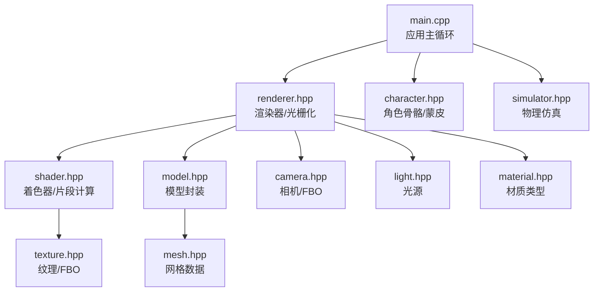
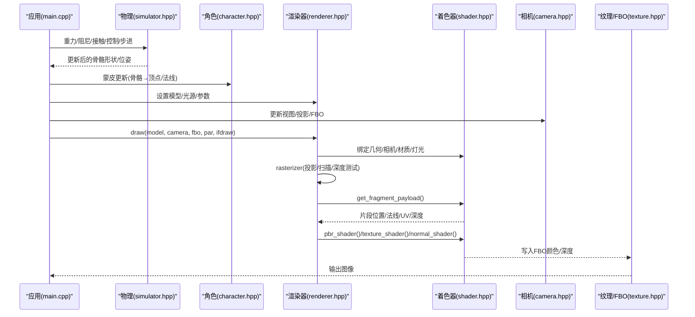
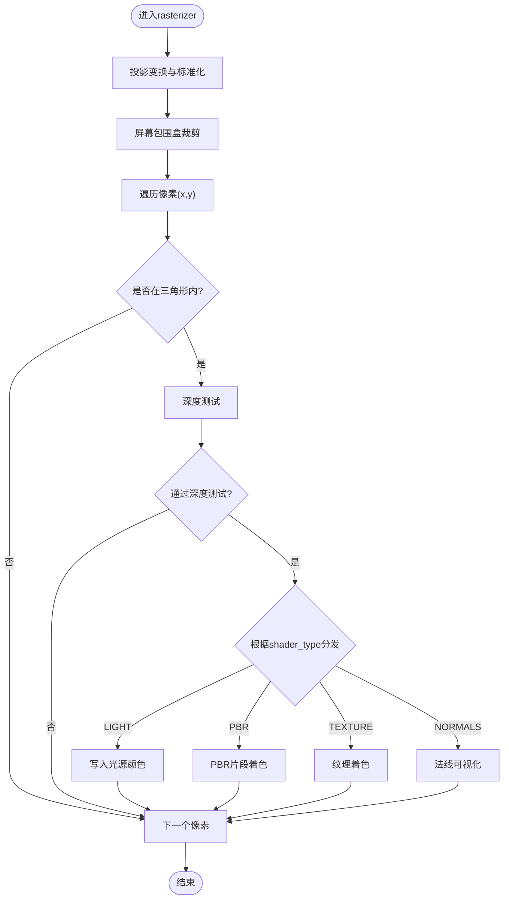
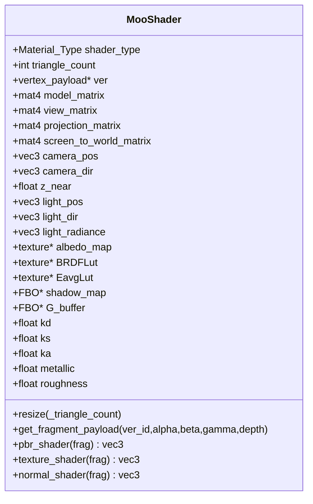
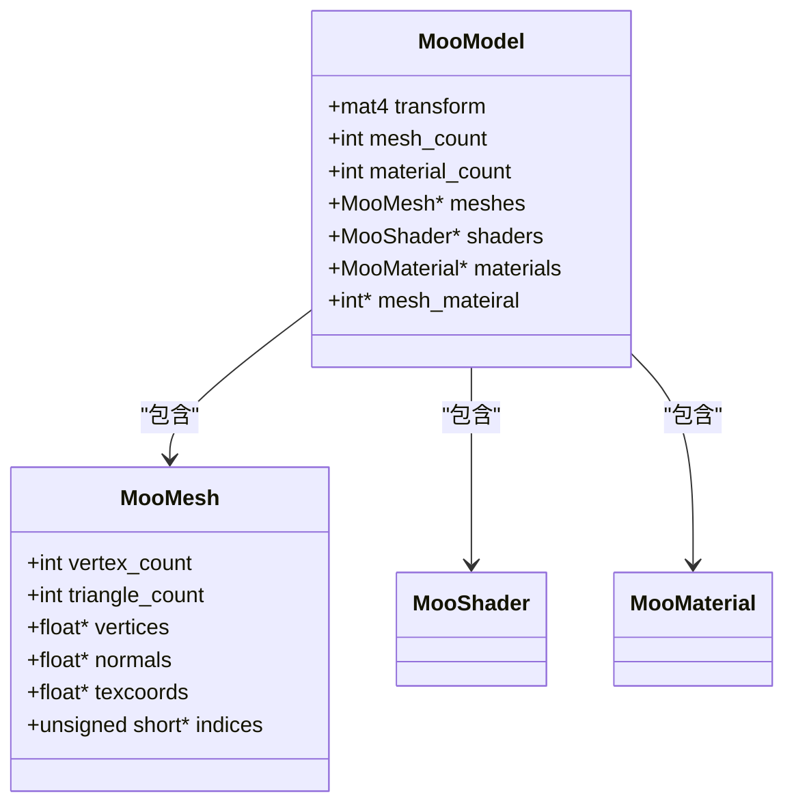
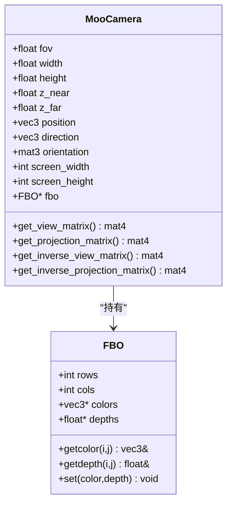
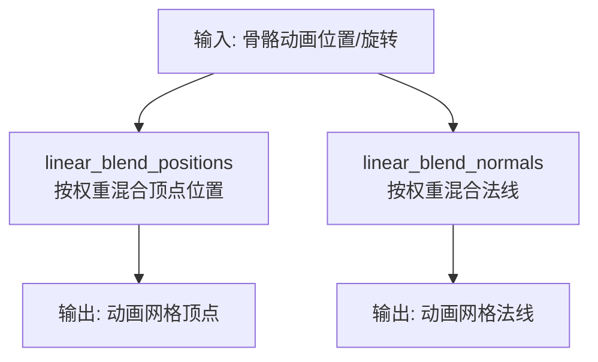
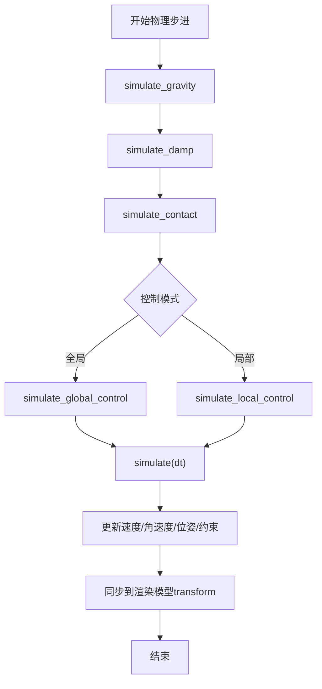
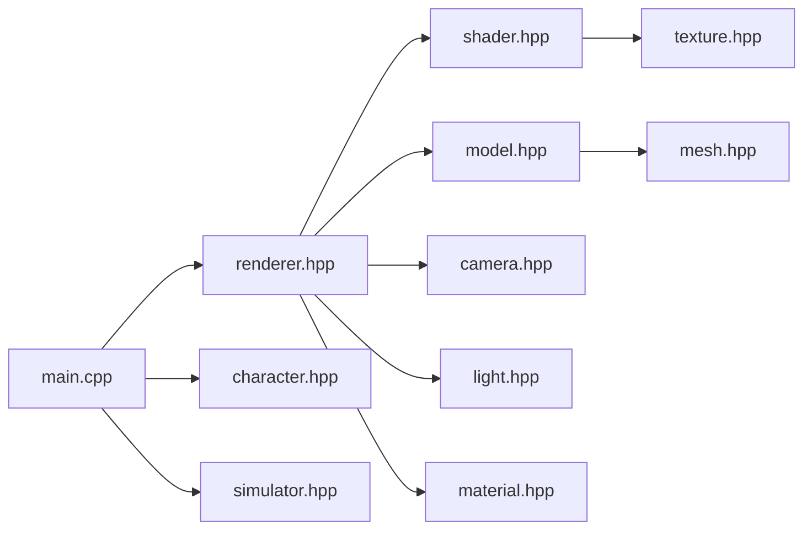

# 渲染管线架构

> **版本提示（2.0）**：本文撰写于 1.x 时期，描述的是旧的实现形态——入口在根目录 `main.cpp`，功能由根目录 `.hpp` 头文件库提供，窗口用 raylib、显示用 OpenCV highgui。2.0 已把这些头文件移到 `Source/Legacy/`，渲染默认走 GPU，窗口与 UI 换成 GLFW + ImGui，`main.cpp` 拆成 `Source/Launch/Private/` 下的 `Main.cpp` 与 `Application`。文中的文件路径、行号与调用链可能已失效，请以根目录的「项目概述」「快速开始」「故障排除」三篇与当前源码为准。

<cite>
**本文引用的文件**   
- [main.cpp](file://main.cpp)
- [renderer.hpp](file://renderer.hpp)
- [shader.hpp](file://shader.hpp)
- [model.hpp](file://model.hpp)
- [mesh.hpp](file://mesh.hpp)
- [camera.hpp](file://camera.hpp)
- [light.hpp](file://light.hpp)
- [material.hpp](file://material.hpp)
- [texture.hpp](file://texture.hpp)
- [character.hpp](file://character.hpp)
- [simulator.hpp](file://simulator.hpp)
</cite>

## 目录
1. [引言](#引言)
2. [项目结构](#项目结构)
3. [核心组件](#核心组件)
4. [架构总览](#架构总览)
5. [详细组件分析](#详细组件分析)
6. [依赖关系分析](#依赖关系分析)
7. [性能与优化](#性能与优化)
8. [故障排查指南](#故障排查指南)
9. [结论](#结论)

## 引言
本技术文档聚焦于 MooLab 的渲染管线架构，系统阐述从顶点处理、光栅化到片段着色等阶段的实现方式；解释 G-Buffer（几何缓冲）的多通道渲染组织；说明渲染状态管理、批处理绘制与 GPU 指令优化策略；并给出渲染管线与角色系统、物理系统的集成方式、数据流与同步机制。最后提供性能分析与瓶颈识别方法以及改进建议。

## 项目结构
MooLab 采用“头文件即模块”的组织方式：渲染相关逻辑集中在 renderer.hpp、shader.hpp、model.hpp、mesh.hpp、camera.hpp、light.hpp、material.hpp、texture.hpp 中；主循环在 main.cpp；角色与物理分别由 character.hpp 与 simulator.hpp 提供。

**图表来源**
- [main.cpp:53-160](file://main.cpp#L53-L160)
- [renderer.hpp:17-23](file://renderer.hpp#L17-L23)
- [shader.hpp:35-91](file://shader.hpp#L35-L91)
- [model.hpp:8-19](file://model.hpp#L8-L19)
- [mesh.hpp:6-14](file://mesh.hpp#L6-L14)
- [camera.hpp:7-20](file://camera.hpp#L7-L20)
- [light.hpp:16-26](file://light.hpp#L16-L26)
- [material.hpp:7-13](file://material.hpp#L7-L13)
- [texture.hpp:11-34](file://texture.hpp#L11-L34)

**章节来源**
- [main.cpp:53-160](file://main.cpp#L53-L160)
- [renderer.hpp:17-23](file://renderer.hpp#L17-L23)
- [shader.hpp:35-91](file://shader.hpp#L35-L91)
- [model.hpp:8-19](file://model.hpp#L8-L19)
- [mesh.hpp:6-14](file://mesh.hpp#L6-L14)
- [camera.hpp:7-20](file://camera.hpp#L7-L20)
- [light.hpp:16-26](file://light.hpp#L16-L26)
- [material.hpp:7-13](file://material.hpp#L7-L13)
- [texture.hpp:11-34](file://texture.hpp#L11-L34)

## 核心组件
- 渲染器与光栅化：renderer.hpp 中的 MooRenderer、draw、rasterizer 负责将三角形投影、扫描覆盖、深度测试与片段着色写入 FBO。
- 着色器与片段计算：shader.hpp 中的 MooShader 提供 PBR、纹理、法线显示三种片段着色路径，并维护顶点/片段载荷。
- 模型与网格：model.hpp 的 MooModel 聚合 mesh/shader/material；mesh.hpp 的 MooMesh 存储顶点、法线、纹理坐标与索引。
- 相机与帧缓冲：camera.hpp 的 MooCamera 提供视图/投影矩阵与 FBO；texture.hpp 的 FBO 提供颜色与深度缓冲访问。
- 光源与材质：light.hpp 定义点光源；material.hpp 定义材质类型与参数。
- 角色与物理：character.hpp 提供骨骼蒙皮；simulator.hpp 提供刚体链式动力学与碰撞约束。

**章节来源**
- [renderer.hpp:17-23](file://renderer.hpp#L17-L23)
- [renderer.hpp:121-239](file://renderer.hpp#L121-L239)
- [shader.hpp:35-91](file://shader.hpp#L35-L91)
- [shader.hpp:201-239](file://shader.hpp#L201-L239)
- [model.hpp:8-19](file://model.hpp#L8-L19)
- [mesh.hpp:6-14](file://mesh.hpp#L6-L14)
- [camera.hpp:7-20](file://camera.hpp#L7-L20)
- [texture.hpp:11-34](file://texture.hpp#L11-L34)
- [light.hpp:16-26](file://light.hpp#L16-L26)
- [material.hpp:7-13](file://material.hpp#L7-L13)
- [character.hpp:35-47](file://character.hpp#L35-L47)
- [simulator.hpp:321-355](file://simulator.hpp#L321-L355)

## 架构总览
渲染管线以“每帧更新物理与角色 → 准备模型与光源 → 调用 draw 进行逐模型绘制 → rasterizer 完成光栅化与片段着色 → 写入 FBO”的流程运行。当前实现为直接渲染（非延迟多通道），但保留了 G-Buffer 枚举与 FBO 结构，便于扩展。

**图表来源**
- [main.cpp:295-472](file://main.cpp#L295-L472)
- [simulator.hpp:357-624](file://simulator.hpp#L357-L624)
- [character.hpp:142-164](file://character.hpp#L142-L164)
- [renderer.hpp:213-239](file://renderer.hpp#L213-L239)
- [renderer.hpp:121-211](file://renderer.hpp#L121-L211)
- [shader.hpp:112-127](file://shader.hpp#L112-L127)
- [shader.hpp:201-239](file://shader.hpp#L201-L239)
- [camera.hpp:53-70](file://camera.hpp#L53-L70)
- [texture.hpp:11-34](file://texture.hpp#L11-L34)

## 详细组件分析

### 渲染器与光栅化（renderer.hpp）
- 数据结构
  - MooRenderer：持有模型列表与光源列表，作为渲染上下文。
  - updated_paramters：传递动态灯光参数与阴影贴图指针。
- 关键流程
  - bind_geometry_info：将三角面片三个顶点的 position/normal/texcoords 打包进 shader.ver。
  - bind_camera_parameters：注入 model/view/projection/screen_to_world/camera_pos/dir/z_near/G_buffer。
  - bind_material_parameters：注入 albedo_map、BRDFLut、EavgLut、kd/ks/ka/metallic/roughness。
  - update_material_parameters：注入 shadow_map/light_pos/light_dir/light_radiance。
  - rasterizer：对每个三角面片执行视锥剔除、投影标准化、屏幕包围盒裁剪、像素级重心坐标测试与深度测试，按 shader_type 调用对应片段着色函数写入 FBO。
  - draw：遍历模型的 mesh_count，依次绑定几何/相机/材质/灯光后调用 rasterizer。
- 辅助绘制
  - draw_point/draw_line/draw_curve：用于调试可视化关键点、线段与预测曲线。

**图表来源**
- [renderer.hpp:121-211](file://renderer.hpp#L121-L211)

**章节来源**
- [renderer.hpp:33-92](file://renderer.hpp#L33-L92)
- [renderer.hpp:121-239](file://renderer.hpp#L121-L239)
- [renderer.hpp:241-426](file://renderer.hpp#L241-L426)

### 着色器与片段计算（shader.hpp）
- 数据结构
  - vertex_payload：保存一个三角面片的三顶点属性（位置/法线/UV）。
  - fragment_payload：保存插值后的片段位置/法线/UV/深度。
  - MooShader：包含材质类型、三角计数、顶点载荷、矩阵/相机/灯光参数、纹理与 LUT、材质系数，并提供片段着色入口。
- 片段着色
  - pbr_shader：基于 GGX NDF + Smith G + Schlick F 的微表面 BRDF，结合 MultiScatterBRDF 近似多次散射，并进行色调映射与伽马校正。
  - texture_shader：简单纹理采样输出。
  - normal_shader：法线可视化输出。
- 工具函数
  - DistributionGGX / GeometrySchlickGGX / GeometrySmith / fresnelSchlick / AverageFresnel / MultiScatterBRDF：构成 PBR 着色链路。

**图表来源**
- [shader.hpp:35-91](file://shader.hpp#L35-L91)

**章节来源**
- [shader.hpp:19-33](file://shader.hpp#L19-L33)
- [shader.hpp:35-91](file://shader.hpp#L35-L91)
- [shader.hpp:112-127](file://shader.hpp#L112-L127)
- [shader.hpp:129-199](file://shader.hpp#L129-L199)
- [shader.hpp:201-254](file://shader.hpp#L201-L254)

### 模型与网格（model.hpp, mesh.hpp）
- MooModel：封装 transform、meshes/shaders/materials 数组及 mesh_mateiral 映射。
- mesh_material_to_model：将单个 MooMesh 与 MooMaterial 组合成 MooModel，并为 shaders[0] 就地构造并 resize。
- MooMesh：存储顶点数、三角数、顶点/法线/纹理坐标与索引数组。
- capsule/triangle/cube：内置基础几何生成器，供物理胶囊体与光源可视化使用。

**图表来源**
- [model.hpp:8-19](file://model.hpp#L8-L19)
- [mesh.hpp:6-14](file://mesh.hpp#L6-L14)

**章节来源**
- [model.hpp:8-45](file://model.hpp#L8-L45)
- [mesh.hpp:6-14](file://mesh.hpp#L6-L14)
- [mesh.hpp:16-51](file://mesh.hpp#L16-L51)
- [mesh.hpp:53-189](file://mesh.hpp#L53-L189)
- [mesh.hpp:191-297](file://mesh.hpp#L191-L297)

### 相机与帧缓冲（camera.hpp, texture.hpp）
- MooCamera：维护 FOV、宽高、近远平面、位置/方向/朝向矩阵，提供视图/投影矩阵及其逆矩阵；内部持有 FBO 数组（当前单缓冲）。
- FBO：二维颜色缓冲 colors 与深度缓冲 depths，提供 getcolor/getdepth/set 接口；fbo_to_img 将 FBO 转为 OpenCV 图像。
- texture：纹理采样封装，img_to_tex 从图像加载纹理。

**图表来源**
- [camera.hpp:7-36](file://camera.hpp#L7-L36)
- [texture.hpp:11-34](file://texture.hpp#L11-L34)

**章节来源**
- [camera.hpp:7-70](file://camera.hpp#L7-L70)
- [texture.hpp:11-63](file://texture.hpp#L11-L63)
- [texture.hpp:65-111](file://texture.hpp#L65-L111)

### 光源与材质（light.hpp, material.hpp）
- Point_Light：包含位置、方向、辐射强度与阴影贴图指针（当前未启用）。
- Polygon_Light：多边形光源（未在当前渲染路径中使用）。
- MooMaterial：材质类型（LIGHT/PBR/TEXTURE/NORMALS）与 PBR 参数（kd/ks/ka/metallic/roughness）及纹理/LUT。

**章节来源**
- [light.hpp:16-41](file://light.hpp#L16-L41)
- [material.hpp:7-31](file://material.hpp#L7-L31)

### 角色系统与蒙皮（character.hpp）
- Bones：骨骼枚举（Entity/Hips/左右腿/脚/趾/脊柱/颈/头/肩臂手）。
- Character：存储静态网格、权重与骨骼初始姿态。
- linear_blend_positions/normals：按权重对顶点位置与法线进行骨骼线性混合（蒙皮）。
- deform_character_anim_mesh：将动画骨骼位姿应用到网格顶点/法线。

**图表来源**
- [character.hpp:68-121](file://character.hpp#L68-L121)
- [character.hpp:142-164](file://character.hpp#L142-L164)

**章节来源**
- [character.hpp:8-47](file://character.hpp#L8-L47)
- [character.hpp:49-66](file://character.hpp#L49-L66)
- [character.hpp:68-121](file://character.hpp#L68-L121)
- [character.hpp:123-164](file://character.hpp#L123-L164)

### 物理系统与同步（simulator.hpp）
- Simulator：维护骨骼质量、惯量、连杆、形状（胶囊体）、速度/角速度、力/扭矩、约束误差等。
- 主要步骤
  - simulate_gravity/simulate_damp：施加重力与阻尼。
  - simulate_contact：胶囊体间与地面碰撞检测，产生法向力与摩擦力。
  - simulate_global_control/simulate_local_control：基于目标局部旋转计算关节扭矩（全局/局部两种模式）。
  - simulate：组装质量矩阵 M、雅可比 J、约束残差 delta，求解线性方程组得到新速度与角速度，更新位置/旋转与约束。
- 与渲染同步
  - main.cpp 在每帧先更新物理，再将模拟器 bone_shapes 的位姿赋给渲染模型 transform，使视觉与物理一致。

**图表来源**
- [simulator.hpp:357-624](file://simulator.hpp#L357-L624)
- [main.cpp:320-437](file://main.cpp#L320-L437)

**章节来源**
- [simulator.hpp:321-355](file://simulator.hpp#L321-L355)
- [simulator.hpp:357-624](file://simulator.hpp#L357-L624)
- [simulator.hpp:634-662](file://simulator.hpp#L634-L662)
- [simulator.hpp:664-800](file://simulator.hpp#L664-L800)
- [main.cpp:320-437](file://main.cpp#L320-L437)

## 依赖关系分析
- 渲染器依赖着色器、模型、相机、材质与纹理。
- 着色器依赖材质与纹理，并在片段阶段读取 FBO 深度。
- 模型依赖网格与材质；网格提供几何数据。
- 相机持有 FBO，作为渲染目标。
- 光源与材质参数通过 updated_paramters 与 bind_* 系列函数注入到着色器。
- 主循环协调物理、角色、相机、光源与渲染器，形成完整的数据流。

**图表来源**
- [main.cpp:53-160](file://main.cpp#L53-L160)
- [renderer.hpp:17-23](file://renderer.hpp#L17-L23)
- [shader.hpp:35-91](file://shader.hpp#L35-L91)
- [model.hpp:8-19](file://model.hpp#L8-L19)
- [mesh.hpp:6-14](file://mesh.hpp#L6-L14)
- [camera.hpp:7-20](file://camera.hpp#L7-L20)
- [light.hpp:16-26](file://light.hpp#L16-L26)
- [material.hpp:7-13](file://material.hpp#L7-L13)
- [texture.hpp:11-34](file://texture.hpp#L11-L34)

**章节来源**
- [main.cpp:53-160](file://main.cpp#L53-L160)
- [renderer.hpp:17-23](file://renderer.hpp#L17-L23)
- [shader.hpp:35-91](file://shader.hpp#L35-L91)
- [model.hpp:8-19](file://model.hpp#L8-L19)
- [mesh.hpp:6-14](file://mesh.hpp#L6-L14)
- [camera.hpp:7-20](file://camera.hpp#L7-L20)
- [light.hpp:16-26](file://light.hpp#L16-L26)
- [material.hpp:7-13](file://material.hpp#L7-L13)
- [texture.hpp:11-34](file://texture.hpp#L11-L34)

## 性能与优化

### 当前实现特征
- 光栅化采用 CPU 端像素级扫描，使用 OpenMP 并行化三角循环。
- 片段着色为 CPU 端计算，无 GPU 管线加速。
- 渲染为直接渲染（一次写入 FBO），未启用延迟渲染多通道。
- 模型批量绘制：draw 遍历 mesh_count，避免重复绑定状态。

### 瓶颈识别
- 光栅化像素循环：rasterizer 中对每个三角的像素双重循环是主要热点。
- PBR 片段着色：MultiScatterBRDF 与多次纹理查找开销较大。
- 物理求解：assemble M/J/delta 与线性方程求解在大规模骨架时成本较高。
- 内存分配：频繁 malloc/free 可能引起碎片与抖动。

### 优化策略
- 渲染侧
  - 引入 GPU 管线：将顶点/索引上传至 GPU，使用顶点/片段着色器替代 CPU rasterizer。
  - 批处理合并：将同材质/同 shader 的 mesh 合并为单次 draw call，减少状态切换。
  - 遮挡剔除：在 CPU 或 GPU 端进行更严格的可见性剔除（如 frustum culling、occlusion culling）。
  - 纹理缓存：对频繁采样的 LUT 进行预取或缓存。
- 物理侧
  - 稀疏求解：利用 M/J 的稀疏性，采用迭代求解器（如 Conjugate Gradient）替代稠密消元。
  - 子步与自适应 dt：根据运动剧烈程度调整子步数与时间步长。
- 通用
  - 内存池：为频繁分配的临时对象（如 vertex_payload、中间矩阵）使用内存池。
  - 数据对齐与 SIMD：对向量/矩阵运算进行 SIMD 优化。

**章节来源**
- [renderer.hpp:121-211](file://renderer.hpp#L121-L211)
- [shader.hpp:181-239](file://shader.hpp#L181-L239)
- [simulator.hpp:543-624](file://simulator.hpp#L543-L624)

## 故障排查指南
- 画面全黑或颜色异常
  - 检查 FBO 是否初始化正确，颜色/深度缓冲是否分配。
  - 确认相机 near/far 与投影矩阵设置合理。
  - 验证片段着色输出是否被 clamp 或色调映射错误。
- 模型不显示或错位
  - 检查模型 transform 与骨骼位姿同步是否正确。
  - 确认 mesh 的顶点/法线/索引已正确填充。
- 物理不稳定或穿透
  - 调整碰撞刚度/阻尼参数（kp/kd）。
  - 减小 dt 或增加子步数。
  - 检查地面平面方程与胶囊体半径设置。
- 性能低下
  - 统计 rasterizer 像素循环耗时与 PBR 片段着色耗时。
  - 减少不必要的 draw call，合并同材质 mesh。
  - 降低分辨率或关闭调试绘制（draw_point/draw_line/draw_curve）。

**章节来源**
- [texture.hpp:11-34](file://texture.hpp#L11-L34)
- [camera.hpp:53-70](file://camera.hpp#L53-L70)
- [shader.hpp:201-239](file://shader.hpp#L201-L239)
- [simulator.hpp:374-435](file://simulator.hpp#L374-L435)
- [renderer.hpp:241-426](file://renderer.hpp#L241-L426)

## 结论
MooLab 的渲染管线以 CPU 端光栅化与片段着色为核心，配合角色蒙皮与物理仿真，实现了实时的人形角色可视化与控制。尽管当前未使用 GPU 管线，但其模块化设计（渲染器/着色器/模型/相机/材质/纹理）为后续迁移到 GPU 提供了清晰的基础。通过引入 GPU 渲染、批处理合并、遮挡剔除与物理求解优化，可显著提升性能与可扩展性。同时，保留的 G-Buffer 结构与 FBO 抽象为未来延迟渲染与多通道后处理预留了空间。