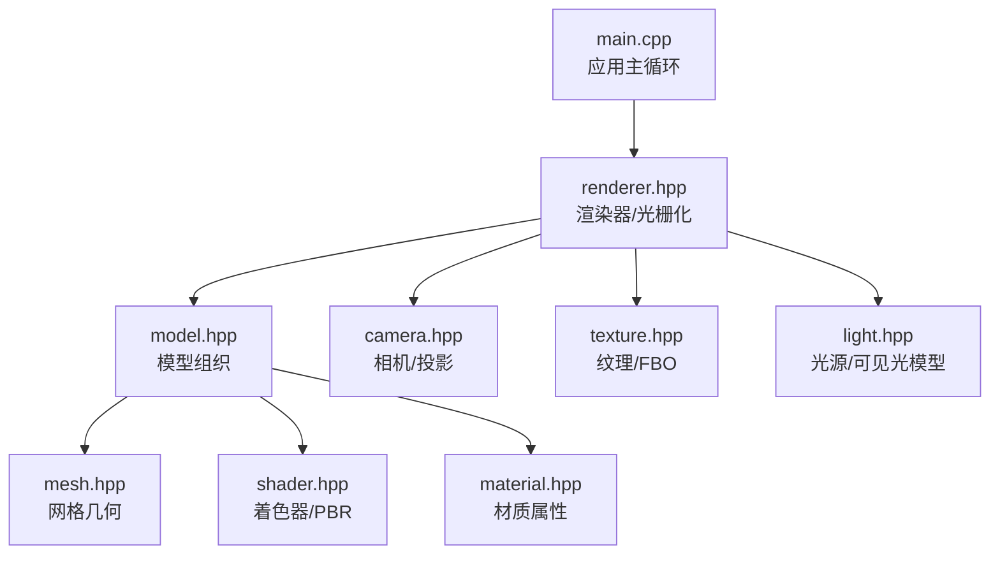
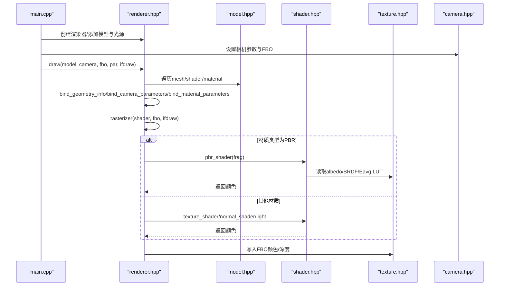
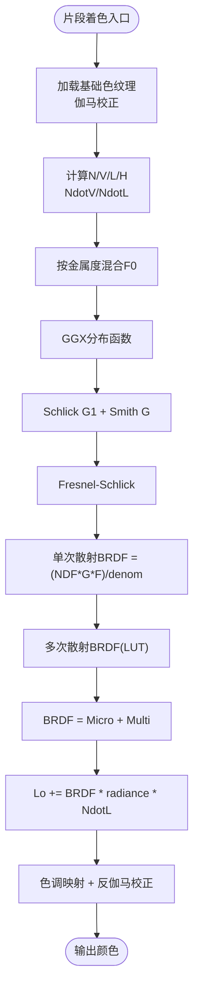
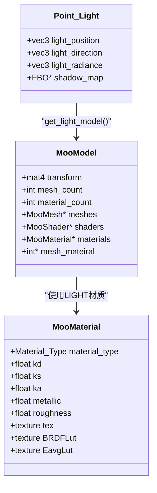
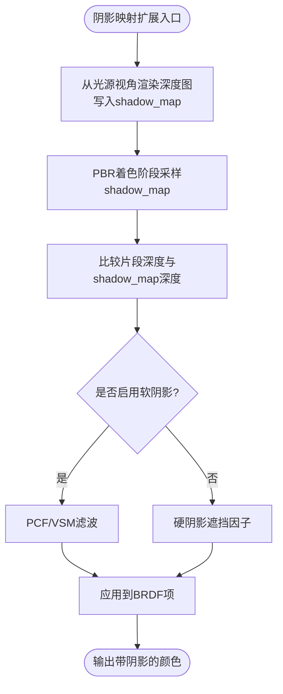
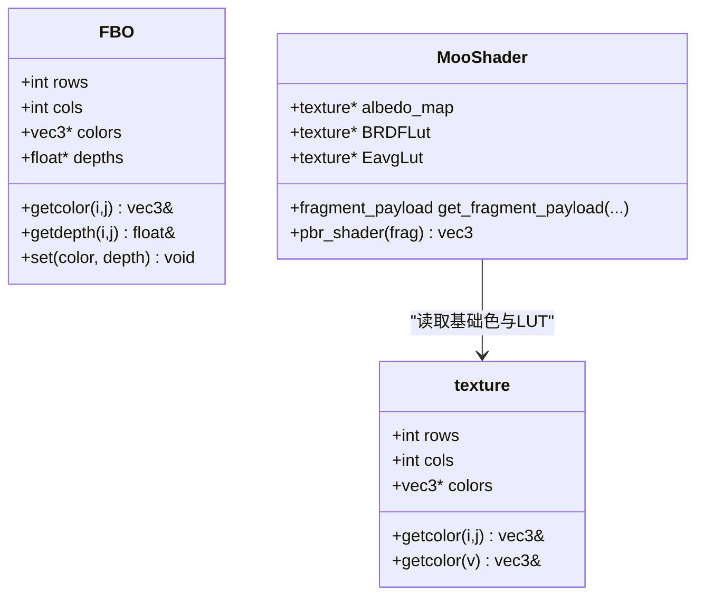
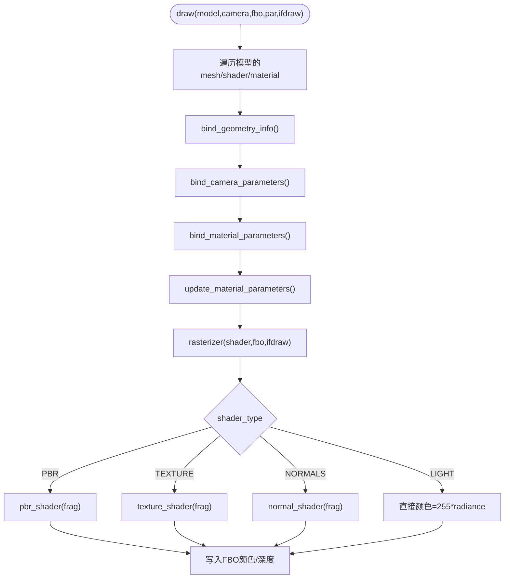
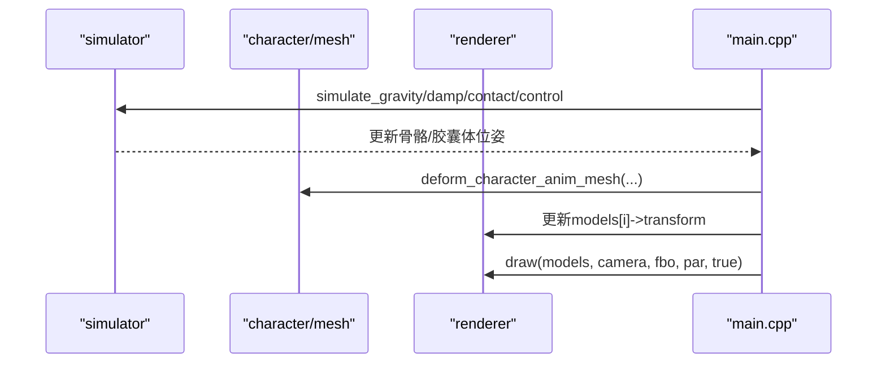
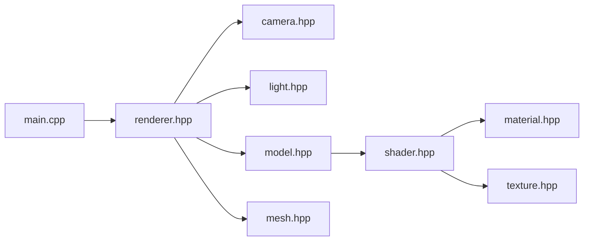

# 渲染系统

> **版本提示（2.0）**：本文撰写于 1.x 时期，描述的是旧的实现形态——入口在根目录 `main.cpp`，功能由根目录 `.hpp` 头文件库提供，窗口用 raylib、显示用 OpenCV highgui。2.0 已把这些头文件移到 `Source/Legacy/`，渲染默认走 GPU，窗口与 UI 换成 GLFW + ImGui，`main.cpp` 拆成 `Source/Launch/Private/` 下的 `Main.cpp` 与 `Application`。文中的文件路径、行号与调用链可能已失效，请以根目录的「项目概述」「快速开始」「故障排除」三篇与当前源码为准。

<cite>
**本文引用的文件**   
- [README.md](file://README.md)
- [main.cpp](file://main.cpp)
- [renderer.hpp](file://renderer.hpp)
- [material.hpp](file://material.hpp)
- [light.hpp](file://light.hpp)
- [texture.hpp](file://texture.hpp)
- [shader.hpp](file://shader.hpp)
- [model.hpp](file://model.hpp)
- [mesh.hpp](file://mesh.hpp)
- [camera.hpp](file://camera.hpp)
</cite>

## 目录
1. [简介](#简介)
2. [项目结构](#项目结构)
3. [核心组件](#核心组件)
4. [架构总览](#架构总览)
5. [详细组件分析](#详细组件分析)
6. [依赖关系分析](#依赖关系分析)
7. [性能与优化](#性能与优化)
8. [故障排查指南](#故障排查指南)
9. [结论](#结论)

## 简介
本技术文档面向 MooLab 渲染子系统，聚焦以下目标：
- PBR（基于物理的渲染）材质系统的实现细节，包括漫反射、镜面反射、粗糙度、金属度等属性的计算流程。
- 光照模型与光源类型支持情况，重点说明点光源在管线中的着色器路径与数据流。
- 阴影映射技术的现状与扩展方向，涵盖深度图生成、阴影采样与软阴影处理思路。
- 纹理系统机制，包括纹理加载、UV 坐标映射与过滤策略。
- 着色器代码注释与扩展指南，帮助读者理解并扩展渲染管线。
- 渲染性能优化建议，如批处理绘制、LOD 等。
- 渲染管线与角色系统、物理系统的集成方式。

本项目使用 C++ 与 Raylib/OpenCV 构建，采用自定义软件光栅化与着色器管线，结合运动仿真与角色动画进行实时渲染展示。

**章节来源**
- [README.md:1-22](file://README.md#L1-L22)

## 项目结构
MooLab 渲染相关的关键头文件与入口如下：
- 渲染器与光栅化：renderer.hpp
- 材质定义：material.hpp
- 光源与可见光模型：light.hpp
- 纹理与帧缓冲：texture.hpp
- 着色器与PBR算法：shader.hpp
- 模型组织：model.hpp
- 网格几何：mesh.hpp
- 相机与投影：camera.hpp
- 应用主循环与资源装配：main.cpp

**图表来源**
- [main.cpp:149-159](file://main.cpp#L149-L159)
- [renderer.hpp:17-31](file://renderer.hpp#L17-L31)
- [model.hpp:8-19](file://model.hpp#L8-L19)
- [mesh.hpp:6-14](file://mesh.hpp#L6-L14)
- [shader.hpp:35-86](file://shader.hpp#L35-L86)
- [material.hpp:15-30](file://material.hpp#L15-L30)
- [camera.hpp:7-36](file://camera.hpp#L7-L36)
- [texture.hpp:11-34](file://texture.hpp#L11-L34)
- [light.hpp:16-33](file://light.hpp#L16-L33)

**章节来源**
- [main.cpp:149-159](file://main.cpp#L149-L159)
- [renderer.hpp:17-31](file://renderer.hpp#L17-L31)
- [model.hpp:8-19](file://model.hpp#L8-L19)
- [mesh.hpp:6-14](file://mesh.hpp#L6-L14)
- [shader.hpp:35-86](file://shader.hpp#L35-L86)
- [material.hpp:15-30](file://material.hpp#L15-L30)
- [camera.hpp:7-36](file://camera.hpp#L7-L36)
- [texture.hpp:11-34](file://texture.hpp#L11-L34)
- [light.hpp:16-33](file://light.hpp#L16-L33)

## 核心组件
- 渲染器（MooRenderer）：管理模型列表与光源列表，驱动 draw 流程。
- 材质（MooMaterial）：定义材质类型（LIGHT/PBR/TEXTURE/NORMALS）、基础色、粗糙度、金属度、BRDF/Eavg LUT 纹理等。
- 光源（Point_Light）：包含位置、方向、辐射强度，以及可选的阴影贴图指针。
- 纹理与FBO（texture/FBO）：提供图像到纹理的转换、颜色与深度缓冲访问接口。
- 着色器（MooShader）：封装顶点/片段着色逻辑，提供 PBR、纹理、法线着色函数。
- 模型（MooModel）：聚合 mesh、shader、material，并提供变换矩阵。
- 网格（MooMesh）：存储顶点、法线、纹理坐标与索引。
- 相机（MooCamera）：维护视图/投影矩阵、屏幕尺寸与 FBO。

**章节来源**
- [renderer.hpp:17-31](file://renderer.hpp#L17-L31)
- [material.hpp:15-30](file://material.hpp#L15-L30)
- [light.hpp:16-33](file://light.hpp#L16-L33)
- [texture.hpp:11-34](file://texture.hpp#L11-L34)
- [shader.hpp:35-86](file://shader.hpp#L35-L86)
- [model.hpp:8-19](file://model.hpp#L8-L19)
- [mesh.hpp:6-14](file://mesh.hpp#L6-L14)
- [camera.hpp:7-36](file://camera.hpp#L7-L36)

## 架构总览
渲染管线整体流程如下：
- main.cpp 初始化相机、控制器、角色、动作库、仿真器、材质、模型、UI 与渲染器。
- 每帧更新仿真与动画，更新骨骼位姿与胶囊体模型变换。
- 将模型与光源加入渲染器，调用 draw 进行逐模型绘制。
- renderer.hpp 中 bind_* 系列函数绑定几何、相机、材质参数，然后进入 rasterizer 光栅化。
- shader.hpp 根据材质类型选择着色器分支（PBR/TEXTURE/NORMALS/LIGHT），输出颜色写入 FBO。

**图表来源**
- [main.cpp:149-159](file://main.cpp#L149-L159)
- [main.cpp:453-472](file://main.cpp#L453-L472)
- [renderer.hpp:213-239](file://renderer.hpp#L213-L239)
- [renderer.hpp:121-211](file://renderer.hpp#L121-L211)
- [shader.hpp:199-237](file://shader.hpp#L199-L237)
- [texture.hpp:55-63](file://texture.hpp#L55-L63)
- [camera.hpp:53-70](file://camera.hpp#L53-L70)

**章节来源**
- [main.cpp:149-159](file://main.cpp#L149-L159)
- [main.cpp:453-472](file://main.cpp#L453-L472)
- [renderer.hpp:213-239](file://renderer.hpp#L213-L239)
- [renderer.hpp:121-211](file://renderer.hpp#L121-L211)
- [shader.hpp:199-237](file://shader.hpp#L199-L237)
- [texture.hpp:55-63](file://texture.hpp#L55-L63)
- [camera.hpp:53-70](file://camera.hpp#L53-L70)

## 详细组件分析

### PBR 材质系统与着色器
- 材质属性：
  - 基础色（albedo）来自纹理，并在 PBR 着色前进行伽马校正（sRGB→线性空间）。
  - 粗糙度（roughness）控制微表面分布；金属度（metallic）混合 F0（反射率基值）。
  - BRDF LUT 与 Eavg LUT 用于近似多次散射与能量守恒修正。
- 着色器流程：
  - 计算法线 N、观察向量 V、入射光 L、半角 H。
  - GGX 分布函数（NDF）、Schlick G1 几何项、Smith 几何项组合得到几何遮蔽。
  - Fresnel-Schlick 计算反射系数。
  - 单次散射 BRDF 与多次散射 BRDF 合并后乘以光照项，并进行色调映射与反伽马校正。

**图表来源**
- [shader.hpp:127-177](file://shader.hpp#L127-L177)
- [shader.hpp:179-197](file://shader.hpp#L179-L197)
- [shader.hpp:199-237](file://shader.hpp#L199-L237)

**章节来源**
- [material.hpp:15-30](file://material.hpp#L15-L30)
- [shader.hpp:127-197](file://shader.hpp#L127-L197)
- [shader.hpp:199-237](file://shader.hpp#L199-L237)

### 光源与可见光模型
- Point_Light：包含位置、方向、辐射强度，以及可选的阴影贴图指针。
- get_light_model：为点光源生成一个小型立方体模型，并使用 LIGHT 材质类型以直接显示光源位置。
- main.cpp 中将点光源添加到渲染器，并在每帧更新其位置与辐射强度。

**图表来源**
- [light.hpp:16-33](file://light.hpp#L16-L33)
- [model.hpp:8-19](file://model.hpp#L8-L19)
- [material.hpp:7-13](file://material.hpp#L7-L13)

**章节来源**
- [light.hpp:16-33](file://light.hpp#L16-L33)
- [main.cpp:99-124](file://main.cpp#L99-L124)
- [main.cpp:453-457](file://main.cpp#L453-L457)

### 阴影映射技术
- 当前状态：
  - Point_Light 结构包含 shadow_map 字段，但未见显式的深度图生成与阴影采样逻辑。
  - updated_paramters 结构包含 shadow_map 指针，并在 update_material_parameters 中传递给着色器。
- 扩展建议：
  - 深度图生成：从光源视角渲染场景，记录每个像素的深度值到 FBO（shadow_map）。
  - 阴影采样：在 PBR 着色阶段，将片段世界坐标变换到光源裁剪空间，采样 shadow_map 比较深度，得到遮挡因子。
  - 软阴影：对 shadow_map 进行 PCF（百分比渐进滤波）或 VSM（方差阴影贴图）处理，减少锯齿与硬边。

**图表来源**
- [light.hpp:16-24](file://light.hpp#L16-L24)
- [renderer.hpp:24-31](file://renderer.hpp#L24-L31)
- [renderer.hpp:86-92](file://renderer.hpp#L86-L92)

**章节来源**
- [light.hpp:16-24](file://light.hpp#L16-L24)
- [renderer.hpp:24-31](file://renderer.hpp#L24-L31)
- [renderer.hpp:86-92](file://renderer.hpp#L86-L92)

### 纹理系统与 UV 映射
- 纹理加载：img_to_tex 使用 OpenCV 读取图像，转换为 RGB 浮点数组，并分配内存存储颜色。
- UV 坐标映射：fragment_payload 包含插值后的 fragment_texcoords，着色器通过 albedo_map->getcolor(tex_coords) 获取基础色。
- 纹理过滤：texture::getcolor 使用最近邻采样（整数索引），未实现双线性/各向异性过滤。
- FBO：颜色与深度缓冲分离，提供 getcolor/getdepth 访问接口，支持拼接与图像转换。

**图表来源**
- [texture.hpp:65-100](file://texture.hpp#L65-L100)
- [texture.hpp:11-34](file://texture.hpp#L11-L34)
- [shader.hpp:110-125](file://shader.hpp#L110-L125)
- [shader.hpp:199-203](file://shader.hpp#L199-L203)

**章节来源**
- [texture.hpp:65-100](file://texture.hpp#L65-L100)
- [texture.hpp:11-34](file://texture.hpp#L11-L34)
- [shader.hpp:110-125](file://shader.hpp#L110-L125)
- [shader.hpp:199-203](file://shader.hpp#L199-L203)

### 光栅化与绘制流程
- bind_geometry_info：将三角形顶点的顶点位置、法线与纹理坐标拷贝到着色器的 vertex_payload。
- bind_camera_parameters：绑定模型/视图/投影矩阵、屏幕到世界矩阵、相机位置与方向、近裁剪面与 FBO。
- bind_material_parameters：绑定基础色、BRDF/Eavg LUT、kd/ks/ka、金属度与粗糙度。
- rasterizer：并行遍历三角形，进行视锥剔除、投影标准化、屏幕包围盒扫描、重心坐标测试与深度测试，最终调用对应着色器输出颜色。

**图表来源**
- [renderer.hpp:33-92](file://renderer.hpp#L33-L92)
- [renderer.hpp:121-211](file://renderer.hpp#L121-L211)
- [renderer.hpp:213-239](file://renderer.hpp#L213-L239)

**章节来源**
- [renderer.hpp:33-92](file://renderer.hpp#L33-L92)
- [renderer.hpp:121-211](file://renderer.hpp#L121-L211)
- [renderer.hpp:213-239](file://renderer.hpp#L213-L239)

### 渲染管线与角色/物理系统集成
- 角色与动画：main.cpp 中通过 deform_character_anim_mesh 更新人物网格顶点，依据骨骼位姿变形。
- 物理仿真：simulator 提供重力、阻尼、接触检测与力矩控制，更新胶囊体模型变换。
- 渲染集成：每帧将更新的模型变换传入 renderer.models，随后调用 draw 完成渲染。

**图表来源**
- [main.cpp:295-345](file://main.cpp#L295-L345)
- [main.cpp:423-437](file://main.cpp#L423-L437)
- [main.cpp:466-472](file://main.cpp#L466-L472)

**章节来源**
- [main.cpp:295-345](file://main.cpp#L295-L345)
- [main.cpp:423-437](file://main.cpp#L423-L437)
- [main.cpp:466-472](file://main.cpp#L466-L472)

## 依赖关系分析
- 模块耦合：
  - renderer.hpp 依赖 camera.hpp、light.hpp、model.hpp、mesh.hpp。
  - shader.hpp 依赖 global.hpp、material.hpp、mat.hpp、texture.hpp、vec.hpp。
  - model.hpp 依赖 mat.hpp、mesh.hpp、shader.hpp。
  - main.cpp 依赖 renderer.hpp、character.hpp、simulator.hpp、ui.hpp 等。
- 外部依赖：
  - Raylib：窗口与手柄输入。
  - OpenCV：图像读取与显示。
  - OpenMP：并行光栅化（#pragma omp parallel for）。

**图表来源**
- [main.cpp:8-17](file://main.cpp#L8-L17)
- [renderer.hpp:4-7](file://renderer.hpp#L4-L7)
- [model.hpp:4-6](file://model.hpp#L4-L6)
- [shader.hpp:4-8](file://shader.hpp#L4-L8)

**章节来源**
- [main.cpp:8-17](file://main.cpp#L8-L17)
- [renderer.hpp:4-7](file://renderer.hpp#L4-L7)
- [model.hpp:4-6](file://model.hpp#L4-L6)
- [shader.hpp:4-8](file://shader.hpp#L4-L8)

## 性能与优化
- 并行光栅化：rasterizer 使用 OpenMP 并行遍历三角形，提升吞吐。
- 批处理绘制：当前 draw 按模型逐个绘制，可考虑合并相同材质的 mesh 以减少状态切换。
- 纹理过滤：当前为最近邻采样，可引入双线性/各向异性过滤以提升视觉质量。
- LOD 技术：可为不同距离的模型提供多分辨率网格，降低远距渲染成本。
- 阴影优化：启用 PCF/VSM 软阴影时注意采样开销，可采用分屏或低分辨率 shadow map。
- 色调映射与伽马校正：已在 PBR 着色中实现，确保色彩一致性。

[本节为通用指导，不直接分析具体文件]

## 故障排查指南
- 颜色异常：
  - 检查 albedo 纹理是否正确加载与伽马校正。
  - 确认 PBR 着色器中 F0 混合与 BRDF 计算路径。
- 阴影缺失：
  - 确认 shadow_map 指针已正确传递至着色器。
  - 若实现阴影采样，检查光源裁剪空间变换与深度比较逻辑。
- 性能瓶颈：
  - 评估三角形数量与光栅化并行效率。
  - 减少不必要的模型变换与材质切换。
- 纹理模糊或锯齿：
  - 调整纹理过滤模式与分辨率。
  - 检查 UV 坐标范围与重复模式。

**章节来源**
- [shader.hpp:199-237](file://shader.hpp#L199-L237)
- [texture.hpp:65-100](file://texture.hpp#L65-L100)
- [renderer.hpp:121-211](file://renderer.hpp#L121-L211)

## 结论
MooLab 渲染系统采用自定义软件光栅化与着色器管线，实现了基础的 PBR 材质模型与点光源可视化。纹理系统通过 OpenCV 加载图像并映射到 UV 坐标，FBO 提供颜色与深度缓冲。阴影映射尚未完整实现，但已有数据结构与参数传递通道，便于扩展。性能方面已利用 OpenMP 并行化光栅化，后续可通过批处理、LOD、纹理过滤与阴影优化进一步提升渲染质量与效率。渲染管线与角色/物理系统紧密集成，支持实时动画与仿真驱动的视觉效果。

[本节为总结性内容，不直接分析具体文件]