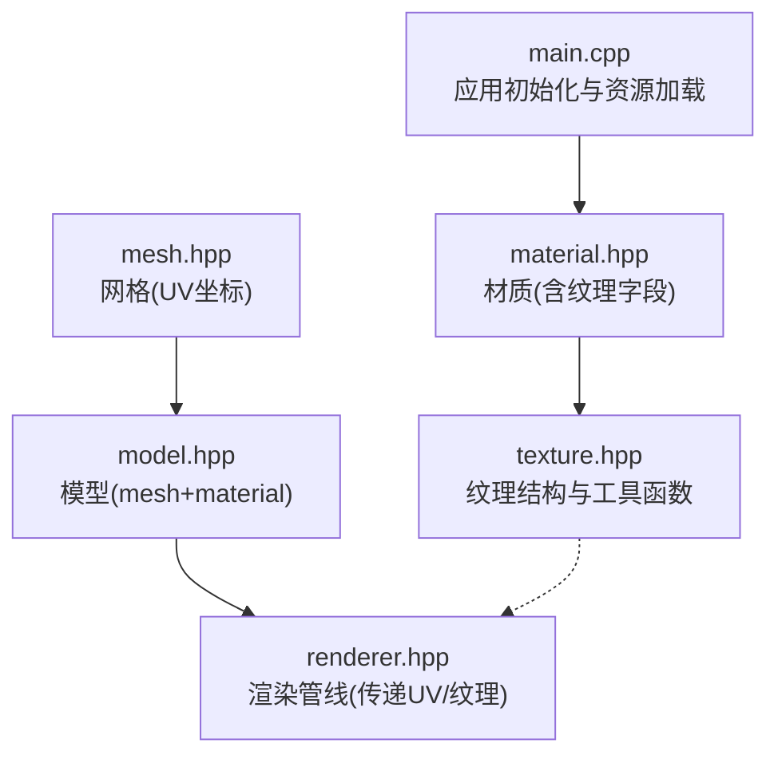
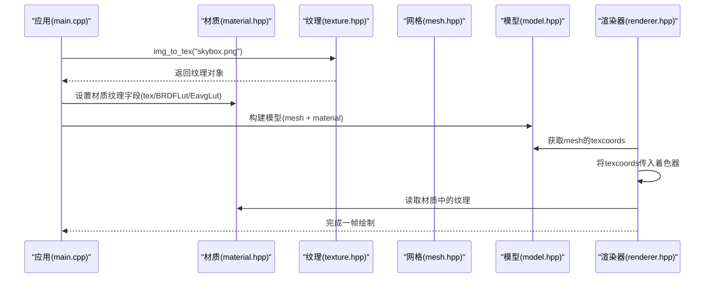
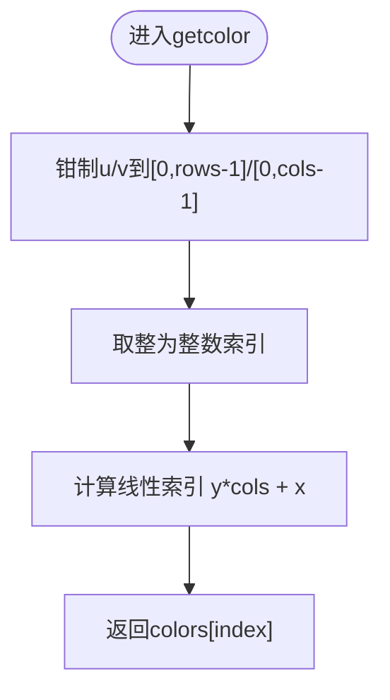
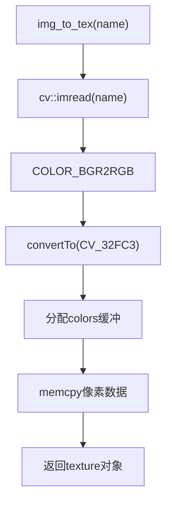
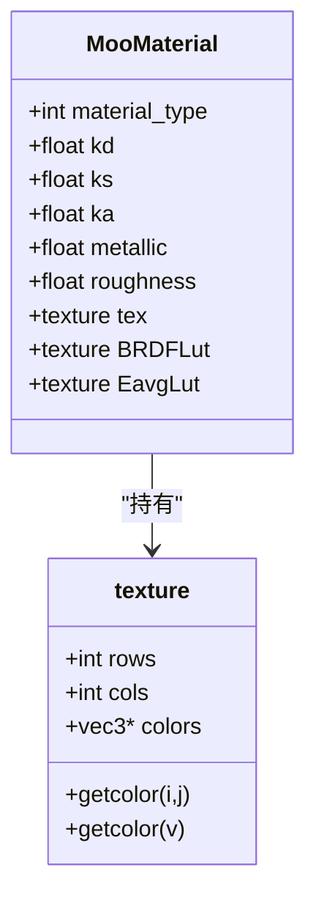
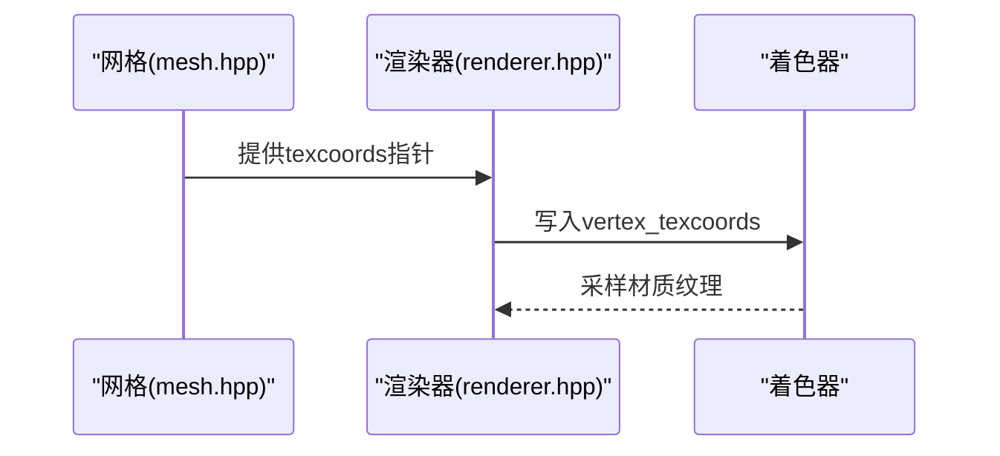
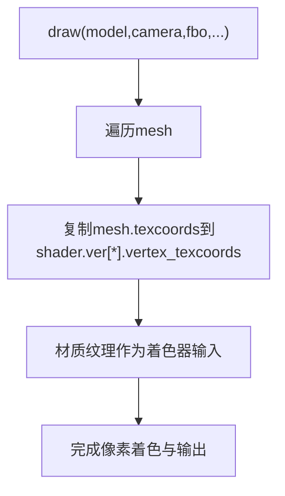
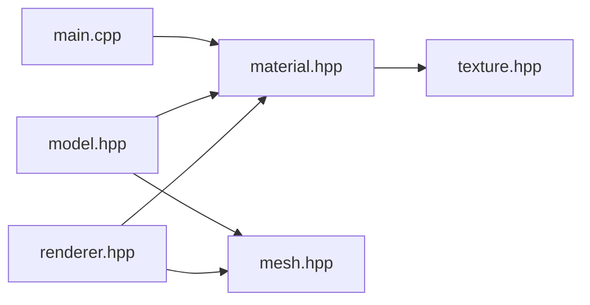

# 纹理管理系统

> **版本提示（2.0）**：本文撰写于 1.x 时期，描述的是旧的实现形态——入口在根目录 `main.cpp`，功能由根目录 `.hpp` 头文件库提供，窗口用 raylib、显示用 OpenCV highgui。2.0 已把这些头文件移到 `Source/Legacy/`，渲染默认走 GPU，窗口与 UI 换成 GLFW + ImGui，`main.cpp` 拆成 `Source/Launch/Private/` 下的 `Main.cpp` 与 `Application`。文中的文件路径、行号与调用链可能已失效，请以根目录的「项目概述」「快速开始」「故障排除」三篇与当前源码为准。

<cite>
**本文引用的文件**   
- [texture.hpp](file://texture.hpp)
- [material.hpp](file://material.hpp)
- [mesh.hpp](file://mesh.hpp)
- [model.hpp](file://model.hpp)
- [renderer.hpp](file://renderer.hpp)
- [main.cpp](file://main.cpp)
</cite>

## 目录
1. [引言](#引言)
2. [项目结构](#项目结构)
3. [核心组件](#核心组件)
4. [架构总览](#架构总览)
5. [详细组件分析](#详细组件分析)
6. [依赖关系分析](#依赖关系分析)
7. [性能与内存优化](#性能与内存优化)
8. [故障排查指南](#故障排查指南)
9. [结论](#结论)
10. [附录：API与数据流速查](#附录api与数据流速查)

## 引言
本技术文档聚焦于 MooLab 的纹理管理系统，围绕纹理加载、存储、采样与渲染管线中的使用进行系统化说明。当前实现基于 CPU 侧的 OpenCV 图像读取与像素缓冲，材质层持有纹理对象，模型/网格提供 UV 坐标，渲染器将纹理与着色器参数关联并驱动绘制。文档同时给出可落地的扩展建议，包括纹理压缩、图集（Texture Atlas）、LOD、各向异性过滤等工程化方案。

## 项目结构
与纹理管理直接相关的代码分布在以下文件中：
- texture.hpp：定义纹理数据结构、FBO 辅助、图像与纹理互转工具
- material.hpp：材质结构体，包含纹理字段与 PBR 查找表
- mesh.hpp：网格结构体，包含顶点、法线、UV 与索引
- model.hpp：模型结构体，聚合 mesh、shader、material
- renderer.hpp：渲染器，负责将 UV 与纹理传入着色器并执行绘制
- main.cpp：应用入口，创建材质并加载纹理资源

图表来源
- [main.cpp:109-124](file://main.cpp#L109-L124)
- [material.hpp:15-30](file://material.hpp#L15-L30)
- [texture.hpp:65-110](file://texture.hpp#L65-L110)
- [mesh.hpp:6-14](file://mesh.hpp#L6-L14)
- [model.hpp:8-19](file://model.hpp#L8-L19)
- [renderer.hpp:220-225](file://renderer.hpp#L220-L225)

章节来源
- [main.cpp:109-124](file://main.cpp#L109-L124)
- [material.hpp:15-30](file://material.hpp#L15-L30)
- [texture.hpp:65-110](file://texture.hpp#L65-L110)
- [mesh.hpp:6-14](file://mesh.hpp#L6-L14)
- [model.hpp:8-19](file://model.hpp#L8-L19)
- [renderer.hpp:220-225](file://renderer.hpp#L220-L225)

## 核心组件
- 纹理结构体 texture：以行×列维度组织 RGB 浮点像素缓冲，并提供按浮点坐标取色的接口；支持边界钳制与整数化采样。
- 图像与纹理转换：img_to_tex 通过 OpenCV 读取图片、颜色空间转换与类型转换后拷贝到纹理缓冲；tex_to_img 反向导出用于调试显示。
- 材质 MooMaterial：包含材质类型、PBR 参数以及多个纹理字段（主纹理、BRDF LUT、Eavg LUT）。
- 网格 MooMesh：包含顶点、法线、UV 坐标与索引，UV 为二维浮点坐标，范围通常为 [0,1]。
- 模型 MooModel：聚合 mesh、shader、material，并将 mesh 与 material 的映射关系保存。
- 渲染器：在绘制时从模型中获取 mesh 的 texcoords，并将其传递给着色器；材质中的纹理作为着色器输入参与计算。

章节来源
- [texture.hpp:65-110](file://texture.hpp#L65-L110)
- [material.hpp:15-30](file://material.hpp#L15-L30)
- [mesh.hpp:6-14](file://mesh.hpp#L6-L14)
- [model.hpp:8-19](file://model.hpp#L8-L19)
- [renderer.hpp:220-225](file://renderer.hpp#L220-L225)

## 架构总览
下图展示纹理从“图像文件”到“渲染输出”的端到端流程：

图表来源
- [main.cpp:109-124](file://main.cpp#L109-L124)
- [material.hpp:15-30](file://material.hpp#L15-L30)
- [texture.hpp:86-100](file://texture.hpp#L86-L100)
- [mesh.hpp:6-14](file://mesh.hpp#L6-L14)
- [model.hpp:21-43](file://model.hpp#L21-L43)
- [renderer.hpp:220-225](file://renderer.hpp#L220-L225)

## 详细组件分析

### 纹理结构与采样
- 数据结构
  - rows/cols：纹理分辨率
  - colors：RGB 浮点像素缓冲（vec3）
- 采样接口
  - getcolor(float i, float j)：按浮点坐标采样，内部对坐标进行钳制并取整
  - getcolor(vec2 v)：按 vec2 坐标采样，逻辑同上
- 复杂度
  - 单次采样 O(1)，无插值或滤波
- 边界处理
  - clampf 确保坐标不越界，float_to_int 做最近邻取整

图表来源
- [texture.hpp:70-81](file://texture.hpp#L70-L81)

章节来源
- [texture.hpp:65-84](file://texture.hpp#L65-L84)

### 纹理加载与导出
- 加载流程 img_to_tex
  - 使用 OpenCV 读取图像
  - BGR→RGB 颜色空间转换
  - 转换为 CV_32FC3（浮点三通道）
  - 分配纹理缓冲并拷贝像素数据
- 导出流程 tex_to_img
  - 将纹理缓冲包装为 OpenCV 矩阵
  - 转换为 CV_8UC3 并 RGB→BGR 转换，便于显示

图表来源
- [texture.hpp:86-100](file://texture.hpp#L86-L100)

章节来源
- [texture.hpp:86-110](file://texture.hpp#L86-L110)

### 材质与纹理绑定
- 材质字段
  - material_type：枚举类型（LIGHT/PBR/TEXTURE/NORMALS）
  - kd/ks/ka：基础反射系数
  - metallic/roughness：PBR 参数
  - tex：主纹理
  - BRDFLut/EavgLut：PBR 查找表纹理
- 绑定方式
  - 在 main.cpp 中通过 img_to_tex 加载纹理并赋值给材质字段
  - 模型构建时将材质与网格关联

图表来源
- [material.hpp:15-30](file://material.hpp#L15-L30)
- [texture.hpp:65-84](file://texture.hpp#L65-L84)

章节来源
- [material.hpp:15-30](file://material.hpp#L15-L30)
- [main.cpp:109-124](file://main.cpp#L109-L124)

### 网格 UV 与纹理映射
- 网格结构
  - vertices/normals/texcoords/indices
  - texcoords 为二维浮点数组，每个顶点对应一个 UV
- 内置几何体的 UV
  - cube() 为立方体六个面分别生成 [0,1] 范围的 UV
  - capsule() 根据柱面展开生成 UV（纬度方向与经度方向）
- 渲染管线
  - renderer.hpp 中将 mesh.texcoords 写入着色器顶点属性
  - 材质中的纹理作为着色器输入参与光照计算

图表来源
- [mesh.hpp:6-14](file://mesh.hpp#L6-L14)
- [mesh.hpp:131-186](file://mesh.hpp#L131-L186)
- [mesh.hpp:244-245](file://mesh.hpp#L244-L245)
- [renderer.hpp:55-57](file://renderer.hpp#L55-L57)
- [renderer.hpp:223-223](file://renderer.hpp#L223-L223)

章节来源
- [mesh.hpp:6-14](file://mesh.hpp#L6-L14)
- [mesh.hpp:131-186](file://mesh.hpp#L131-L186)
- [mesh.hpp:244-245](file://mesh.hpp#L244-L245)
- [renderer.hpp:55-57](file://renderer.hpp#L55-L57)
- [renderer.hpp:220-225](file://renderer.hpp#L220-L225)

### 渲染器与纹理使用
- 渲染器职责
  - 遍历模型的 mesh，将 texcoords 写入着色器顶点属性
  - 将材质中的纹理作为着色器输入
- 关键路径
  - 在 draw 过程中，针对每个三角形，将三个顶点的 texcoords 写入 shader.ver[i].vertex_texcoords
  - 最终由着色器根据 UV 采样材质纹理

图表来源
- [renderer.hpp:55-57](file://renderer.hpp#L55-L57)
- [renderer.hpp:220-225](file://renderer.hpp#L220-L225)

章节来源
- [renderer.hpp:55-57](file://renderer.hpp#L55-L57)
- [renderer.hpp:220-225](file://renderer.hpp#L220-L225)

## 依赖关系分析
- 模块耦合
  - main.cpp 依赖 material.hpp 与 texture.hpp 完成资源加载
  - material.hpp 依赖 texture.hpp 持有纹理
  - model.hpp 聚合 mesh.hpp 与 material.hpp
  - renderer.hpp 依赖 mesh.hpp 与 material.hpp 完成绘制
- 外部库
  - OpenCV：图像读取、颜色空间转换、类型转换
  - Raylib：窗口与输入（间接影响渲染循环）

图表来源
- [main.cpp:109-124](file://main.cpp#L109-L124)
- [material.hpp:15-30](file://material.hpp#L15-L30)
- [texture.hpp:65-110](file://texture.hpp#L65-L110)
- [mesh.hpp:6-14](file://mesh.hpp#L6-L14)
- [model.hpp:8-19](file://model.hpp#L8-L19)
- [renderer.hpp:220-225](file://renderer.hpp#L220-L225)

章节来源
- [main.cpp:109-124](file://main.cpp#L109-L124)
- [material.hpp:15-30](file://material.hpp#L15-L30)
- [texture.hpp:65-110](file://texture.hpp#L65-L110)
- [mesh.hpp:6-14](file://mesh.hpp#L6-L14)
- [model.hpp:8-19](file://model.hpp#L8-L19)
- [renderer.hpp:220-225](file://renderer.hpp#L220-L225)

## 性能与内存优化
当前实现为 CPU 侧纹理缓冲，适合原型与教学场景。面向生产环境的优化建议如下：

- 支持的纹理格式
  - 现状：OpenCV 支持的常见位图格式（如 PNG/JPG/BMP），通过 cv::imread 加载
  - 建议：引入 GPU 原生格式（如 DDS/KTX2），减少 CPU-GPU 带宽与解压开销
- 内存管理策略
  - 现状：malloc/free 手动管理像素缓冲，未显式释放
  - 建议：引入 RAII 封装（智能指针/自定义析构），统一生命周期管理；避免重复加载同一资源（资源池/引用计数）
- 纹理过滤
  - 现状：最近邻采样（clamp + 取整）
  - 建议：实现双线性/三线性过滤；GPU 管线启用各向异性过滤以提升斜视质量
- 纹理压缩
  - 现状：CPU 侧 RGB 浮点缓冲，体积大且带宽高
  - 建议：采用 ASTC/ETC2/DXT 等压缩格式，按需解码至 GPU 纹理
- 纹理图集（Texture Atlas）
  - 现状：每材质独立纹理
  - 建议：合并小图至图集，减少状态切换与批处理次数；在 UV 上划分子区域
- LOD（多细节层次）
  - 现状：无 LOD
  - 建议：按距离或屏幕尺寸选择不同分辨率纹理；或使用 mipmaps
- 批处理绘制优化
  - 现状：逐模型/材质绘制
  - 建议：按材质与图集分组，批量提交绘制调用；合并相同材质的网格

章节来源
- [texture.hpp:86-110](file://texture.hpp#L86-L110)
- [material.hpp:15-30](file://material.hpp#L15-L30)
- [renderer.hpp:220-225](file://renderer.hpp#L220-L225)

## 故障排查指南
- 纹理颜色异常
  - 现象：颜色偏色或反转
  - 原因：BGR↔RGB 转换不一致
  - 排查：确认 img_to_tex 与 tex_to_img 的颜色空间转换一致
- 纹理采样错位
  - 现象：贴图拉伸或错位
  - 原因：UV 范围不正确或行列顺序混淆
  - 排查：检查 mesh.texcoords 是否为 [0,1] 范围；确认 rows/cols 与 UV 的对应关系
- 内存泄漏
  - 现象：运行时间越长占用越高
  - 原因：纹理缓冲未释放
  - 排查：为 texture 添加析构释放；或在资源池中标记回收
- 性能瓶颈
  - 现象：帧率低
  - 原因：CPU 侧纹理拷贝与转换开销大
  - 排查：统计 img_to_tex 调用频率；考虑预加载与缓存；迁移至 GPU 纹理

章节来源
- [texture.hpp:86-110](file://texture.hpp#L86-L110)
- [mesh.hpp:131-186](file://mesh.hpp#L131-L186)

## 结论
MooLab 的纹理系统当前以 CPU 侧 OpenCV 为核心，提供了简洁的纹理加载、存储与采样能力，并通过材质与网格 UV 与渲染管线衔接。该实现易于理解与扩展，适合作为学习原型。面向生产环境，建议引入 GPU 纹理、压缩格式、图集与 LOD，完善过滤与内存管理，以实现更高的性能与更稳定的资源管理。

## 附录：API与数据流速查
- 纹理加载
  - img_to_tex(const char* name) → texture
- 纹理导出
  - tex_to_img(texture*) → cv::Mat
- 纹理采样
  - texture::getcolor(float,float) / texture::getcolor(vec2)
- 材质字段
  - MooMaterial::tex / BRDFLut / EavgLut
- 网格 UV
  - MooMesh::texcoords（二维浮点数组）
- 渲染管线
  - renderer.hpp 将 texcoords 写入着色器顶点属性，材质纹理作为输入

章节来源
- [texture.hpp:86-110](file://texture.hpp#L86-L110)
- [material.hpp:15-30](file://material.hpp#L15-L30)
- [mesh.hpp:6-14](file://mesh.hpp#L6-L14)
- [renderer.hpp:55-57](file://renderer.hpp#L55-L57)
- [renderer.hpp:220-225](file://renderer.hpp#L220-L225)