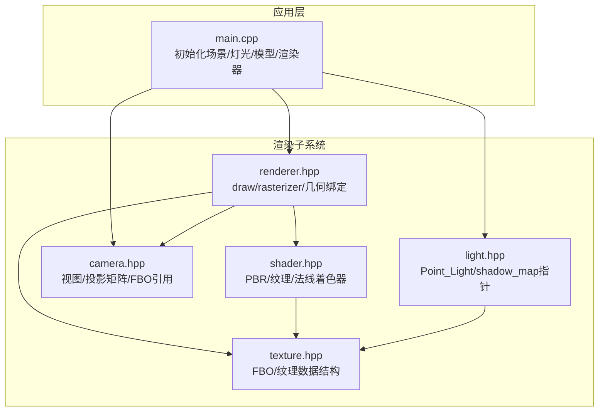
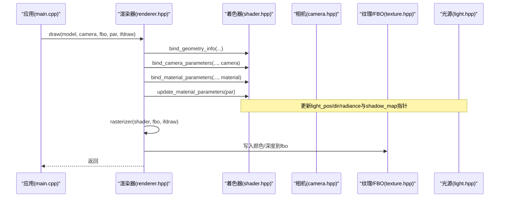
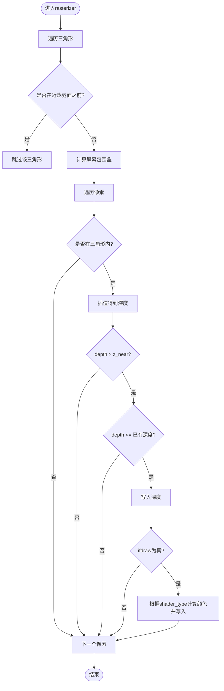
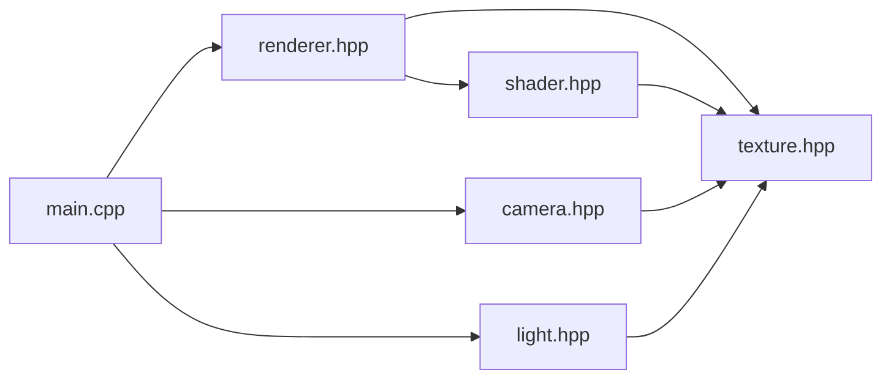

# 阴影映射技术

> **版本提示（2.0）**：本文撰写于 1.x 时期，描述的是旧的实现形态——入口在根目录 `main.cpp`，功能由根目录 `.hpp` 头文件库提供，窗口用 raylib、显示用 OpenCV highgui。2.0 已把这些头文件移到 `Source/Legacy/`，渲染默认走 GPU，窗口与 UI 换成 GLFW + ImGui，`main.cpp` 拆成 `Source/Launch/Private/` 下的 `Main.cpp` 与 `Application`。文中的文件路径、行号与调用链可能已失效，请以根目录的「项目概述」「快速开始」「故障排除」三篇与当前源码为准。

<cite>
**本文引用的文件**   
- [README.md](file://README.md)
- [main.cpp](file://main.cpp)
- [renderer.hpp](file://renderer.hpp)
- [shader.hpp](file://shader.hpp)
- [light.hpp](file://light.hpp)
- [texture.hpp](file://texture.hpp)
- [camera.hpp](file://camera.hpp)
</cite>

## 目录
1. [引言](#引言)
2. [项目结构](#项目结构)
3. [核心组件](#核心组件)
4. [架构总览](#架构总览)
5. [详细组件分析](#详细组件分析)
6. [依赖关系分析](#依赖关系分析)
7. [性能与质量权衡](#性能与质量权衡)
8. [故障排查指南](#故障排查指南)
9. [结论](#结论)
10. [附录](#附录)

## 引言
本文件面向MooLab中的“阴影映射”相关实现，系统梳理其渲染管线、FBO（帧缓冲对象）在深度缓冲区管理中的作用、以及当前代码中与阴影相关的接口与数据流。需要特别说明的是：仓库中已为光源预留了shadow_map字段并在渲染参数中传递，但实际的“从光源视角生成深度图”和“基于深度图的阴影采样/PCF/偏差”等算法并未在当前源码中实现。因此，本文既会解释现有代码如何准备阴影相关数据，也会给出可落地的扩展方案与最佳实践，帮助你在不破坏现有架构的前提下完成完整的阴影映射管线。

## 项目结构
MooLab采用自研软件光栅化管线，主要模块包括：
- 相机与视口：负责视图矩阵、投影矩阵与屏幕FBO的创建与管理
- 模型/材质/着色器：封装几何、材质属性与片段着色逻辑
- 渲染器：负责几何装配、三角形光栅化、深度测试与颜色写入
- 纹理/FBO：以CPU侧数组模拟GPU FBO与纹理访问
- 光源：定义点光源属性，并预留shadow_map指针用于后续阴影计算

图表来源
- [main.cpp:149-159](file://main.cpp#L149-L159)
- [renderer.hpp:213-239](file://renderer.hpp#L213-L239)
- [shader.hpp:35-86](file://shader.hpp#L35-L86)
- [camera.hpp:7-36](file://camera.hpp#L7-L36)
- [texture.hpp:11-34](file://texture.hpp#L11-L34)
- [light.hpp:16-25](file://light.hpp#L16-L25)

章节来源
- [README.md:1-22](file://README.md#L1-L22)
- [main.cpp:53-160](file://main.cpp#L53-L160)

## 核心组件
- FBO与纹理
  - FBO包含颜色与深度二维数组，提供行列尺寸与像素读写接口；texture提供纹理坐标到颜色的读取。
  - 当前所有缓冲均为CPU内存，未使用OpenGL/GPU FBO。
- 相机
  - 维护视口尺寸、近远裁剪面、位置方向、朝向矩阵，并提供视图/投影矩阵及其逆矩阵。
  - 持有指向FBO的指针，作为最终颜色输出目标。
- 渲染器
  - 将模型几何装配到MooShader，设置模型/视图/投影矩阵、材质参数，并调用rasterizer进行逐三角形光栅化与深度测试。
  - 支持多种着色器类型（LIGHT/PBR/TEXTURE/NORMALS）。
- 光源
  - Point_Light包含位置、方向、辐射度，并预留FBO* shadow_map用于阴影贴图。
- 着色器
  - MooShader聚合顶点/片段数据、光照参数、纹理与FBO引用，并提供PBR/纹理/法线三种片段着色函数。

章节来源
- [texture.hpp:11-34](file://texture.hpp#L11-L34)
- [camera.hpp:7-36](file://camera.hpp#L7-L36)
- [renderer.hpp:17-31](file://renderer.hpp#L17-L31)
- [light.hpp:16-25](file://light.hpp#L16-L25)
- [shader.hpp:35-86](file://shader.hpp#L35-L86)

## 架构总览
下图展示了当前渲染主循环中，模型绘制、参数绑定与FBO写出的关键流程。阴影相关的数据（light_pos/light_dir/light_radiance/shadow_map）通过updated_paramters传入渲染器，并在每个模型的着色器中更新。

图表来源
- [main.cpp:459-472](file://main.cpp#L459-L472)
- [renderer.hpp:213-239](file://renderer.hpp#L213-L239)
- [renderer.hpp:121-211](file://renderer.hpp#L121-L211)
- [shader.hpp:86-92](file://shader.hpp#L86-L92)
- [light.hpp:16-25](file://light.hpp#L16-L25)

## 详细组件分析

### FBO与深度缓冲区管理
- 数据结构
  - FBO包含rows/cols、colors与depths数组，提供getcolor/getdepth与set方法。
  - texture提供按浮点坐标取色的能力，内部做边界钳制与整数索引转换。
- 行为特征
  - set方法会将整个FBO的颜色与深度统一填充，常用于清空或调试可视化。
  - fbo_to_img将FBO颜色缓冲转换为OpenCV图像以便显示。
- 与阴影的关系
  - 当前shadow_map是FBO指针，可用于存储从光源视角生成的深度图。
  - 由于shadow_map未被实际分配与填充，需在扩展中为其分配合适尺寸的FBO，并在光源视角下渲染场景深度。

章节来源
- [texture.hpp:11-34](file://texture.hpp#L11-L34)
- [texture.hpp:55-63](file://texture.hpp#L55-L63)

### 相机与投影
- 相机提供视图矩阵、投影矩阵及其逆矩阵，用于将世界坐标变换到裁剪空间，再归一化到NDC。
- 投影矩阵将z_near/z_far映射到[-1,1]区间，供深度比较使用。
- 相机持有FBO指针，作为最终颜色输出目标。

章节来源
- [camera.hpp:7-36](file://camera.hpp#L7-L36)
- [camera.hpp:53-70](file://camera.hpp#L53-L70)

### 渲染器与光栅化
- 几何装配
  - bind_geometry_info将三角面的顶点位置、法线与纹理坐标拷贝到MooShader::ver。
- 参数绑定
  - bind_camera_parameters设置model/view/projection/screen_to_world/camera_pos/dir/z_near/G_buffer。
  - bind_material_parameters设置albedo/BRDF/Eavg LUT与材质参数。
  - update_material_parameters将光源位置/方向/辐射度与shadow_map注入着色器。
- 光栅化
  - rasterizer遍历三角形，计算屏幕包围盒，逐像素重心坐标插值，执行深度测试，并根据着色器类型写入颜色。
  - 深度测试条件：depth <= fbo->getdepth(...) 且 depth > shader.z_near。

图表来源
- [renderer.hpp:121-211](file://renderer.hpp#L121-L211)

章节来源
- [renderer.hpp:33-92](file://renderer.hpp#L33-L92)
- [renderer.hpp:121-211](file://renderer.hpp#L121-L211)

### 光源与阴影数据准备
- Point_Light包含light_position/light_direction/light_radiance与FBO* shadow_map。
- main.cpp中将light.shadow_map赋给updated_paramters，并在draw前更新到各着色器。
- 当前未对shadow_map进行分配与填充，也未在片段着色中使用shadow_map进行阴影采样。

章节来源
- [light.hpp:16-25](file://light.hpp#L16-L25)
- [main.cpp:132-137](file://main.cpp#L132-L137)
- [main.cpp:453-457](file://main.cpp#L453-L457)
- [renderer.hpp:86-92](file://renderer.hpp#L86-L92)

### 着色器与PBR
- MooShader聚合顶点/片段数据、矩阵、相机/光源参数、纹理与FBO引用。
- 提供fragment_payload构造与三种片段着色：PBR、纹理、法线。
- PBR着色器实现GGX NDF、Schlick G1、Smith G、Fresnel Schlick与多重散射近似，并进行色调映射与伽马校正。
- 当前PBR着色器未使用shadow_map进行阴影采样。

章节来源
- [shader.hpp:35-86](file://shader.hpp#L35-L86)
- [shader.hpp:110-125](file://shader.hpp#L110-L125)
- [shader.hpp:127-237](file://shader.hpp#L127-L237)

## 依赖关系分析
- main.cpp依赖renderer、camera、light、material、model等模块，负责场景初始化、输入处理与渲染循环。
- renderer.hpp依赖camera、light、model、mesh、shader，承担几何装配与光栅化职责。
- shader.hpp依赖global、material、mat、texture、vec，实现片段着色逻辑。
- texture.hpp提供FBO与texture的基础数据结构与工具函数。
- camera.hpp依赖mat与texture，提供相机矩阵与FBO引用。
- light.hpp依赖material、model、texture，定义光源与辅助函数。

图表来源
- [main.cpp:8-17](file://main.cpp#L8-L17)
- [renderer.hpp:4-7](file://renderer.hpp#L4-L7)
- [shader.hpp:4-8](file://shader.hpp#L4-L8)
- [texture.hpp:1-10](file://texture.hpp#L1-L10)
- [camera.hpp:4-5](file://camera.hpp#L4-L5)
- [light.hpp:4-6](file://light.hpp#L4-L6)

章节来源
- [main.cpp:8-17](file://main.cpp#L8-L17)
- [renderer.hpp:4-7](file://renderer.hpp#L4-L7)
- [shader.hpp:4-8](file://shader.hpp#L4-L8)
- [texture.hpp:1-10](file://texture.hpp#L1-L10)
- [camera.hpp:4-5](file://camera.hpp#L4-L5)
- [light.hpp:4-6](file://light.hpp#L4-L6)

## 性能与质量权衡
- 分辨率选择
  - 阴影贴图分辨率直接影响阴影精度与显存/CPU内存占用。建议根据场景尺度与光源距离动态调整，例如近距离强光源使用高分辨率，远距离弱光源降低分辨率。
- 采样优化
  - PCF（Percentage Closer Filtering）可通过多邻域采样平滑阴影边缘，但会增加采样次数。可采用自适应PCF核大小或在低重要性区域减少采样数。
- 深度偏差（Shadow Bias）
  - 为避免阴影自遮蔽伪影（shadow acne），需引入合理的深度偏移。建议根据表面法线与光线夹角动态调整，避免过度偏移导致“漂浮阴影”。
- 可见性优化
  - 仅对受光物体参与阴影投射，或使用遮挡剔除减少不必要的阴影绘制。
- 带宽与缓存
  - 尽量保证阴影贴图的局部访问模式，提高缓存命中率；避免跨行跳跃式随机访问。

[本节为通用指导，不直接分析具体文件]

## 故障排查指南
- 无阴影现象
  - 检查shadow_map是否已分配并填充：确保在光源视角下渲染场景深度至shadow_map。
  - 检查updated_paramters是否正确将light_pos/dir/radiance与shadow_map传递给着色器。
- 阴影撕裂/锯齿
  - 提升阴影贴图分辨率或启用PCF；调整PCF核半径与权重分布。
- 阴影自遮蔽（acne）
  - 调整shadow bias，结合法线与光线夹角进行动态偏移；避免过大bias造成漂浮阴影。
- 阴影闪烁/抖动
  - 固定光源投影矩阵或采用时间滤波；避免每帧微小变化导致的噪声。
- 性能瓶颈
  - 降低阴影贴图分辨率；限制阴影投射物体的数量；使用分块或延迟阴影策略。

章节来源
- [light.hpp:16-25](file://light.hpp#L16-L25)
- [main.cpp:132-137](file://main.cpp#L132-L137)
- [renderer.hpp:86-92](file://renderer.hpp#L86-L92)

## 结论
MooLab当前提供了阴影映射所需的基础设施：光源结构中包含shadow_map指针，渲染参数传递链完整，FBO与纹理数据结构完备，渲染管线支持深度写入与颜色输出。然而，实际的“从光源视角生成深度图”与“基于深度图的阴影采样/PCF/偏差”尚未实现。建议在现有架构上扩展以下两点：
- 在光源视角下渲染场景深度至shadow_map（可复用draw/rasterizer，切换视图/投影矩阵为目标光源）。
- 在片段着色阶段读取shadow_map进行阴影检测，并结合shadow bias与PCF进行抗锯齿与伪影抑制。

这样可在不改动现有渲染主循环的前提下，获得稳定可控的阴影效果，并通过分辨率与采样策略平衡质量与性能。

[本节为总结性内容，不直接分析具体文件]

## 附录

### 阴影映射扩展要点清单
- 分配shadow_map
  - 为Point_Light::shadow_map分配合适尺寸的FBO（如1024x1024或2048x2048）。
- 生成深度图
  - 构建光源视图矩阵与投影矩阵，调用draw将所有可投射阴影的物体渲染到shadow_map的深度通道。
- 阴影采样
  - 在片段着色中，将片段世界坐标变换到光源裁剪空间，归一化后采样shadow_map得到最近深度。
- 深度偏差
  - 根据表面法线与光线夹角计算动态bias，避免acne与漂浮阴影。
- PCF
  - 在shadow_map周围进行多邻域采样，加权平均得到柔和阴影。
- 调试可视化
  - 将shadow_map深度图转为灰度图像显示，便于观察阴影覆盖与分辨率问题。

[本节为概念性说明，不直接分析具体文件]